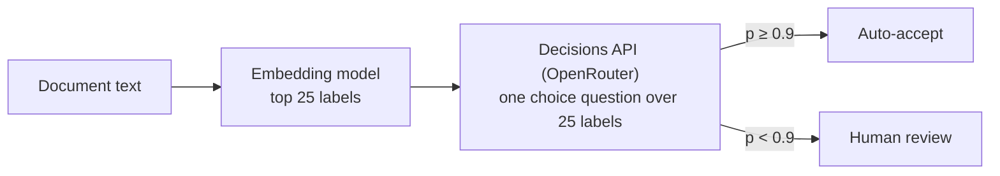

# Instructions for AI agents

This repo is a collection of independent experiments, one Jupyter notebook each. Read this file before
adding or changing a notebook.

## Layout

```
notebooks/NN-short-name/
  NN_short_name.ipynb   the experiment, committed with its outputs
  README.md             why the problem matters, question, result, workflow diagram, key figure, how to run
  data/                 inputs, caches of every model response, results tables
  figures/              PNGs saved by the notebook (used by README.md)
```

## Git workflow

- All new code and notebooks, and changes to existing ones, are merged through a pull request against `main`.
  Never commit or push to `main` directly.
- One branch per change (`add-09-short-name`, `fix-05-scoring`). The PR description says what changed and,
  for a new or re-run notebook, the headline result and the spend.
- A PR that adds a notebook also adds its row to the table in the root `README.md`.

## Claim a notebook number before you start

Several agents may build notebooks at the same time. To keep two of them from picking the same `NN`, claim
the number with a GitHub issue before you create any file for a new notebook.

1. **Find the lowest free number**: the lowest `NN` not used by a folder in `notebooks/` on `origin/main`
   and not claimed by an open issue titled `Notebook NN: ...`.

   ```bash
   git fetch origin
   git ls-tree -d --name-only origin/main notebooks/
   gh issue list --state open --search "Notebook in:title" --json number,title
   ```

2. **Open the claim issue.** Title `Notebook NN: short-name`. The body gives the question, the data, the
   models, a cost estimate and the branch name (`add-NN-short-name`).

   ```bash
   gh issue create --title "Notebook 09: short-name" --body "Question: ... Data: ... Models: ... Branch: add-09-short-name"
   ```

3. **Check for a race.** List open claim issues again. If another open issue claims the same `NN` and has a
   lower issue number, it keeps the number: retitle yours to the next free number
   (`gh issue edit <issue> --title "Notebook 10: short-name"`) and check again.
4. **Use the number everywhere**: folder, notebook file name, branch and PR title. The PR body says
   `Closes #<issue>`, so merging the PR closes the claim.
5. **Release a number you will not use.** If you stop, comment on the issue and close it as not planned
   (`gh issue close <issue> --reason "not planned"`). The number is then free for the next agent.

Do not rename or renumber another agent's notebook or issue. If you find a notebook folder in your working
tree with no claim issue, ask the user before touching it.

## Rules for notebooks

- **Self-contained.** A notebook imports nothing from this repo. Helpers (CLI wrappers, caches, plot style)
  are defined inside the notebook, even if another notebook has the same code. Paths are relative to
  the notebook's folder.
- **Goal first.** The first cell states the question, why it matters, the data, the method and the
  headline result. A reader should get the answer from the first screen.
- **Structure:** goal and summary, contents and workflow diagram, setup and configuration, data (with a look
  at it), method, results (charts and tables), error analysis with concrete examples, limitations, how to
  reproduce, future work and further reading.
- **Future work and further reading.** The last numbered section is `## NN. Future work and further reading`,
  linked from the Contents cell like every other section.
  - Under `### Future work`, list three to five follow-up experiments that this notebook's results or
    limitations point to. Each says what would change (data, model, method, sample size), what it would
    measure, and which result in the notebook motivates it.
  - Under `### Further reading`, list three to six papers, documentation pages, datasets or benchmarks, one
    per bullet: `[Title](url) (Author et al., year). One sentence on how it relates to this notebook.`
  - Link the canonical page (arXiv abstract, DOI, publisher or official docs), open every link before
    committing, and say in the section's first lines when the links were checked. Prefer sources the notebook
    does not already cite. When a re-run changes a result the section refers to, update the section too.
- **Commit outputs.** Run top to bottom (`jupyter nbconvert --to notebook --execute --inplace`) before
  committing. A re-run must replay from the caches in `data/` without any API calls. Edits that touch only
  markdown cells (explainers, diagrams) do not need a re-run.
- **Charts:** matplotlib, one style block per notebook, a title that states the finding, labelled axes,
  no dual y-axes. Save the key figure to `figures/`.

## Workflow diagrams

A reader should see how the experiment runs before reading any code.

- **Contents and workflow at the top.** Right after the goal cell, add a `## Contents` cell that links to
  every numbered `##` section, then a diagram of the whole experiment: data, preparation, model calls,
  scoring, results. Label each step with what goes in and what comes out, with counts ("146 photos",
  "584 Decisions calls"). Repeat the diagram in the notebook's `README.md`.
- **Model call graph.** When a notebook makes more than one LLM call per item, or calls are chained, add a
  diagram of the calls. This covers cascades, retrieve-then-decide, tournaments, judges, retries and
  fallbacks, agent loops and agents that message each other.
  - One node per model call or agent, labelled with the model, how it is called (`claude -p`,
    `codex exec`, `muse exec`, OpenRouter) and what it returns.
  - Edges show what one call passes to the next. Mark loops, branches (beam, fallback), calls that run in
    parallel and points where the code waits.
  - For agents that exchange messages, add a sequence diagram: one lane per agent, arrows for handoffs,
    messages, questions and replies, and a marker where an agent is blocked. Draw one per pattern when the
    notebook compares patterns.
  - Put each diagram next to the method it describes.
- **How to draw them.** Write diagrams in Mermaid (a fenced code block tagged `mermaid` in a markdown
  cell). GitHub renders Mermaid in `README.md` and JupyterLab 4.1+ renders it in notebook cells. Diagrams
  built from run data (timelines, per-call traces) are drawn with matplotlib from the cached runs and saved
  to `figures/`.

A minimal call graph:



## Explainers and visuals

- **Explain each step.** Before each method or processing step, a markdown cell says what the step does,
  why it is there and what to look for in the output. After each result, one or two sentences state what it
  shows, with the number.
- **Show the inputs.** Show a sample of the data (a page, an image, a row), the exact prompt or question sent
  to each model, and one raw response next to the parsed result.
- **Charts for every result.** Each results section has at least one chart, not only a table. Error analysis
  shows failures visually where it can: the image or page region next to the model's answer and the gold
  label.
- **Define terms on first use** (average precision, recall@k, F1, calibration, top-1) in a sentence a reader
  new to the field can follow.
- **Save the figures the README uses** to `figures/`: the headline chart, an error example and any
  matplotlib diagram.

## Notebook README

Open a notebook's `README.md` the way a lecturer opens a topic: make the reader care about the problem before
showing any number. In order:

1. **The situation.** A concrete case where the task comes up and what a mistake costs there ("a missed
   checkbox is a test that never runs"). Short paragraphs, plain words, no product names the reader must know.
2. **Why it is hard.** Why the obvious approach, or the obvious way to measure it, fails. This is where the
   design of the experiment comes from (paired permitted controls, swapped answer order, a fixed call budget).
3. **Question.** One or two sentences naming what is compared, on what data, with counts.
4. **Result.** The answer in plain numbers, then the one caveat that matters most.

Then the details: results table, figures, workflow diagram, method, limits, spend and how to run. Run
bookkeeping (call counts, blocked or failed requests, cache layout, protocol versions) goes below the result,
and every term a reader new to the tools would not know is explained where it first appears.

## Root README table

Each notebook has one row in a table in the root `README.md`. The tables sit under themed sections ("Reading
documents", "Letting models act"), each opened by a short paragraph on why that family of problems matters. Put
a new notebook under the section it fits, or add a section with its own paragraph. Write each row for a reader
who has opened no notebook and does not know the tools:

- **Goal and question:** first the problem and why it matters, then the question, naming what is compared
  and on what data (with counts). Explain or avoid jargon and product names. Do not lean on another notebook
  without saying what it found.
- **Headline result:** answer the question with numbers.

## Model access

- OpenAI, Anthropic and Meta Muse models are called **only through their CLIs**: `codex exec`, `claude -p`
  and `muse exec`. Never through their HTTP APIs or SDKs.
- OpenRouter (`OPENROUTER_API_KEY`) is used only for open-weight models and for the OpenAI Decisions API,
  which has no CLI.
- Anything that costs money has a size knob (`N_...`, `MODELS`) at the top of the notebook. Defaults stay
  small. Print the spend at the end.
- Cache every model response on disk, keyed by the full request. Never commit keys or tokens.
- Judges are top models (Claude Opus, GPT via Codex, Muse) and never the model being judged alone.

## Data

Public data with its source and licence recorded, or synthetic data generated for the experiment. No
private or client data. Large public files (PDFs) are downloaded on demand and git-ignored.

## Writing style

Plain, specific, short. State what was measured and what it showed, with numbers. Write for a reader who
knows Python but has not seen this experiment. These rules apply to notebook markdown, READMEs, PR
descriptions and issues.

LLM-written text has recognisable habits: a small set of overused words, stock sentence shapes and
formatting tics. One instance is harmless; several together make a page read as generated and hide the
findings. The lists below come from Wikipedia's [Signs of AI writing](https://en.wikipedia.org/wiki/Wikipedia:Signs_of_AI_writing)
guide (WikiProject AI Cleanup) and from studies of words whose frequency jumped in scientific abstracts after
2022 ([Kobak et al.](https://arxiv.org/abs/2406.07016), [Juzek and Ward](https://arxiv.org/abs/2412.11385)).

### Do

- **Lead with the finding and its number.** "Claude Opus 5.5 read every marked test on 24 forms (F1 1.00)",
  not "The results reveal interesting patterns across models".
- **Name things.** The model, the dataset, the count, the file: "146 photos of 73 car models", not "a
  diverse set of images".
- **Use plain verbs.** "is", "has", "uses", "shows", "returns".
- **Keep one name per thing.** Once a method is "Decisions + DP" it stays "Decisions + DP". Do not rotate
  synonyms for variety; a reader takes a new word for a new thing.
- **Hedge once, where the doubt is, and say why.** "0 violations in 29 requests still allows a true rate up
  to 12%", not "this may potentially suggest the model is safe".
- **Say what a model did, not what it thought.** "returned", "wrote", "chose label X", not "understood" or
  "realised".
- **Use sentences for reasoning and bullets for parallel items.** A chain of "because" and "so" belongs in
  a paragraph.
- **Stop when the content stops.** A section ends with its last finding. A closing section gives a decision
  or recommendation, not a recap of numbers the reader just saw.
- **Attribute claims** to a named, linked source or to this notebook's own results.

### Avoid

**Overused words.** delve, tapestry, testament, intricate, meticulous(ly), pivotal, crucial, vital, robust,
seamless, leverage, harness (as a verb; an agent harness is fine), unlock, elevate, empower, foster, underscore, showcase, realm, landscape,
navigate (figurative), journey, embark, game-changer, cutting-edge, groundbreaking, transformative,
holistic, multifaceted, nuanced, comprehensive, invaluable, vibrant, boasts, notably, additionally,
furthermore, moreover, "plays a key role", "a wide range of", "a myriad of", "valuable insights". Use the
plain word, or delete the phrase.

**Sentence patterns.**

| Pattern | Example | Instead |
|---|---|---|
| Denying a claim nobody made | "It's not just a classifier, it's a triage system." "Not only cheap but also fast." | State the claim: "It costs $0.20 per 1,000 images and answers in 0.9 s." |
| Rule of three | "fast, reliable and scalable" | List what you measured, however many items that is. |
| Trailing "-ing" significance | "..., highlighting the importance of calibration." "..., underscoring the need for overlap." | Make it a separate claim with its evidence, or cut it. |
| Inflated "is" | "serves as", "stands as", "functions as", "features", "boasts" | "is", "has". |
| Significance inflation | "marks a pivotal moment", "sets the stage for", "in an evolving landscape" | Say what changed and by how much. |
| Teaser or colon reveal | "The result? ...", "Here's the catch:", "The answer is simple:" | State the result. |
| Throat clearing and signposting | "It's worth noting that", "It's important to note", "Let's dive in", "In this section we will explore" | Start with the content. |
| Recap endings | "In conclusion", "Overall,", "In summary", "Key takeaways" that repeat the section | End on the last finding. |
| Vague attribution | "Studies show", "Experts agree", "It is widely known" | Name and link the source, or drop the claim. |
| Stacked hedges | "may potentially", "could possibly suggest", "it seems that perhaps" | One hedge with its reason. |
| Unmeasured intensifiers | "significantly" (with no test), "dramatically", "substantially", "remarkably" | The number, and the test or interval if you claim significance. |
| Filler openers and false ranges | "In today's fast-paced world", "When it comes to", "from beginners to experts" | Delete. |
| Promotional tone | "powerful", "impressive", "exciting", "state-of-the-art" | A measured comparison. |
| Chatbot residue | "Certainly", "Great question", "I hope this helps", "Let me know if", "Here is the updated notebook", knowledge-cutoff notes | Delete. None of it belongs in a committed file. |

**Formatting.**

- Bold only a headline number or a term where it is defined. Not a phrase in every sentence.
- In notebook prose and READMEs, do not give every bullet a bold lead-in and a colon ("**Speed:** ...").
  Write the sentence.
- Headings in sentence case ("Accuracy by view angle"), not Title Case. No rhetorical questions as headings.
- No em dashes. Use a comma, a colon, parentheses or a new sentence.
- No emoji, no exclamation marks, no horizontal rules between sections.
- Use a table to compare several items on several attributes, not to hold two facts.

**Claims.** Do not claim more than the data supports. Small samples get confidence intervals or a caveat.
Prefer a table or a number over an adjective.

### Check before you commit

Read the changed text once against the lists above, then search the files you wrote for the overused words
and for em dashes (replace the paths with your notebook's):

```bash
grep -niE "\b(delv(e|es|ed|ing)|tapestry|testament|intricate|meticulous(ly)?|pivotal|crucial|robust|seamless(ly)?|leverag(e|es|ed|ing)|unlock(s|ed|ing)?|underscor(e|es|ed|ing)|showcas(e|es|ed|ing)|realm|landscape|game-changer|cutting-edge|groundbreaking|transformative|holistic|multifaceted|comprehensive|furthermore|moreover|additionally|notably|it's worth noting)\b|—" notebooks/09-short-name/*.ipynb notebooks/09-short-name/README.md
```

Rewrite every hit in prose. Leave a word that is literal or sits in code or output (a "robust" estimator, a
column named `landscape`).
