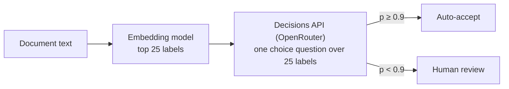

# Instructions for AI agents

This repo is a collection of independent experiments, one Jupyter notebook each. Read this file before
adding or changing a notebook.

## Layout

```
notebooks/NN-short-name/
  NN_short_name.ipynb   the experiment, committed with its outputs
  README.md             topic introduction, worked examples, question, explained results and visuals, how to run
  data/                 inputs, caches of every model response, results tables
  figures/              PNGs saved by the notebook (used by README.md)
```

## Git workflow

- All new code and notebooks, and changes to existing ones, are merged through a pull request against `main`.
  Never commit or push to `main` directly.
- One branch per change (`add-09-short-name`, `fix-05-scoring`). The PR description says what changed and,
  for a new or re-run notebook, the headline result and the spend.
- A PR that adds a notebook also adds its row to the table in the root `README.md`.

## Propose an experiment

An idea for a notebook that nobody is building yet is an issue titled `Proposal: <short description>` with the
`notebook-proposal` label (do not put the word "Notebook" in the title). The body gives the question, why it
matters, the fresh data to use (see [Data](#data)), the models, the method, what to measure, and a size and cost
estimate. A proposal claims no number. To build one, claim a number as below, link the proposal from the claim
issue, and close the proposal when the notebook's PR merges. The root `README.md` lists open proposals under
"Planned experiments"; update that table when you open or close one.

## Claim a notebook number before you start

Several agents may build notebooks at the same time. To keep two of them from picking the same `NN`, claim
the number with a GitHub issue before you create any file for a new notebook.

1. **Find the lowest free number**: the lowest `NN` not used by a folder in `notebooks/` on `origin/main`
   and not claimed by an open issue titled `Notebook NN: ...`.

   ```bash
   git fetch origin
   git ls-tree -d --name-only origin/main notebooks/
   gh issue list --state open --search "Notebook in:title" --json number,title
   ```

2. **Open the claim issue.** Title `Notebook NN: short-name`. The body gives the question, the data, the
   models, a cost estimate and the branch name (`add-NN-short-name`).

   ```bash
   gh issue create --title "Notebook 09: short-name" --body "Question: ... Data: ... Models: ... Branch: add-09-short-name"
   ```

3. **Check for a race.** List open claim issues again. If another open issue claims the same `NN` and has a
   lower issue number, it keeps the number: retitle yours to the next free number
   (`gh issue edit <issue> --title "Notebook 10: short-name"`) and check again.
4. **Use the number everywhere**: folder, notebook file name, branch and PR title. The PR body says
   `Closes #<issue>`, so merging the PR closes the claim.
5. **Release a number you will not use.** If you stop, comment on the issue and close it as not planned
   (`gh issue close <issue> --reason "not planned"`). The number is then free for the next agent.

Do not rename or renumber another agent's notebook or issue. If you find a notebook folder in your working
tree with no claim issue, ask the user before touching it.

## Reader and quality standard

Assume the reader knows nothing about the topic and will not read or run the code. Both the notebook's
rendered narrative and its README must teach the topic and explain the experiment independently. A reader
should understand the problem, the choices made, the evidence and its practical meaning from prose,
examples, tables and figures alone. Python knowledge is needed only for the optional reproduction steps.

Aim for the teaching and presentation quality of winning Kaggle competition notebooks: a welcoming
introduction, carefully chosen examples, clear visual explanations, reasoned comparisons and honest error
analysis. Treat this as an editorial standard. Every explanation must be supported by this experiment's
evidence or a named source. Give the subject enough space to make sense; short sentences do not require
short explanations.

## Rules for notebooks

- **Self-contained.** A notebook imports nothing from this repo. Helpers (CLI wrappers, caches, plot style)
  are defined inside the notebook, even if another notebook has the same code. Paths are relative to
  the notebook's folder.
- **Introduce the topic first.** Open with several short markdown paragraphs that explain the topic in
  everyday language, where it comes up, who uses the answer and why mistakes matter. Start with a concrete
  situation and a simple example of the task. Explain the basic concepts and the ordinary approach before
  introducing model names, metrics or experiment details. Let the difficulty in that example lead into
  the research question. The opening may span several markdown cells.
- **Orient the reader before the code.** After the introduction, state the question, data and counts,
  method in plain language, headline result and main caveat. Keep this summary before the Contents and
  setup cells. Give readers enough context to understand the result before asking them to interpret it.
- **Structure:** topic introduction and simple example, question and summary, contents and workflow
  diagram, setup and configuration, data (with a look at it), method with worked examples, results (charts,
  tables and interpretation), error analysis with concrete examples, limitations, how to reproduce,
  future work and further reading. Explain the purpose and choices of each code step in the surrounding
  prose, so skipping all code leaves a complete account of the experiment.
- **Future work and further reading.** The last numbered section is `## NN. Future work and further reading`,
  linked from the Contents cell like every other section.
  - Under `### Future work`, list three to five follow-up experiments that this notebook's results or
    limitations point to. Each says what would change (data, model, method, sample size), what it would
    measure, and which result in the notebook motivates it.
  - Under `### Further reading`, list three to six papers, documentation pages, datasets or benchmarks, one
    per bullet: `[Title](url) (Author et al., year). One sentence on how it relates to this notebook.`
  - Link the canonical page (arXiv abstract, DOI, publisher or official docs), open every link before
    committing, and say in the section's first lines when the links were checked. Prefer sources the notebook
    does not already cite. When a re-run changes a result the section refers to, update the section too.
- **Commit outputs.** Run top to bottom (`jupyter nbconvert --to notebook --execute --inplace`) before
  committing. A re-run must replay from the caches in `data/` without any API calls. Edits that touch only
  markdown cells (explainers, diagrams) do not need a re-run.
- **Charts:** matplotlib, one style block per notebook, a title that states the finding, labelled axes,
  no dual y-axes. Save the key figure to `figures/`.

## Workflow diagrams

A reader should see how the experiment runs before reading any code.

- **Contents and workflow at the top.** After the opening introduction and experiment summary, before
  any code, add a `## Contents` cell that links to every numbered `##` section, then a diagram of the whole
  experiment: data, preparation, model calls, scoring, results. Label each step with what goes in and what
  comes out, with counts ("146 photos", "584 Decisions calls"). Repeat the diagram in the notebook's
  `README.md` and explain how one example travels through it.
- **Model call graph.** When a notebook makes more than one LLM call per item, or calls are chained, add a
  diagram of the calls. This covers cascades, retrieve-then-decide, tournaments, judges, retries and
  fallbacks, agent loops and agents that message each other.
  - One node per model call or agent, labelled with the model, how it is called (`claude -p`,
    `codex exec`, `muse exec`, OpenRouter) and what it returns.
  - Edges show what one call passes to the next. Mark loops, branches (beam, fallback), calls that run in
    parallel and points where the code waits.
  - For agents that exchange messages, add a sequence diagram: one lane per agent, arrows for handoffs,
    messages, questions and replies, and a marker where an agent is blocked. Draw one per pattern when the
    notebook compares patterns.
  - Put each diagram next to the method it describes.
- **How to draw them.** Write diagrams in Mermaid (a fenced code block tagged `mermaid` in a markdown
  cell). GitHub renders Mermaid in `README.md` and JupyterLab 4.1+ renders it in notebook cells. Diagrams
  built from run data (timelines, per-call traces) are drawn with matplotlib from the cached runs and saved
  to `figures/`.

A minimal call graph:



## Explainers and visuals

- Before each method or processing step, explain what it does, why it is needed, why this approach was
  chosen and what to look for in the output. Describe the simplest reasonable alternative and what the
  comparison can tell us. A reader should not need to infer the method from code or a library name.
- Show actual inputs (a page, an image, a row), the exact prompt or question sent to each model, and a raw
  response next to the parsed result. Walk one example through preparation, prediction and scoring.
  Explain what the correct answer means and how it was established.
- Define terms and acronyms before using them to explain a result. For measures such as average precision,
  recall@k, F1, calibration and top-1, explain what is counted, which direction is better and what a value
  means for the task. Use a small numerical example for the main metric; formulas can follow the intuition.
- Each results section has at least one chart. Choose a visual that answers a stated question. Before it,
  explain what to compare; alongside it, explain the axes, units, groups, colours and any reference lines,
  intervals or unusual scales. Define what an interval represents and how it was calculated.
- Follow every figure and results table with interpretation in prose. For a diagram or input example,
  explain the relationships or details it teaches. For measured results, state the main pattern with
  actual values and sample counts, compare it with the relevant baseline, and explain what it means in
  the original situation. Discuss exceptions, uncertainty and what the visual cannot establish. Use as
  many connected paragraphs as the finding needs; a caption that repeats the title is not sufficient.
- Explain why a pattern might occur using evidence from examples or further analysis. Separate measured
  observations from possible explanations. Do not infer a cause from an aggregate comparison alone. When
  supported by the data, examine groups or conditions that help explain the average and show their counts.
- Show error examples visually where possible: put the input or relevant region beside the model's
  answer and the correct answer. Explain the specific mismatch, its effect on the score and its practical
  consequence. Include successes and disagreements to show the boundary of what worked.
- Make figures readable at normal README width: legible text, units, consistent colours, descriptive
  legends and annotations for the points discussed in prose. Do not rely on colour alone to identify a
  result. Give embedded images useful alt text and keep detailed interpretation in visible prose.
- Save every figure used by the README to `figures/`, including the headline chart, example panels and
  any matplotlib diagrams. Keep notebook and README figures, numbers and explanations in agreement.

## Worked examples

Examples are part of the explanation in both the notebook and its README. Place them beside the concept
or finding they teach. A reader should be able to follow the reasoning without opening the notebook from
the README, reading code or inspecting a cache file.

- Include at least five substantive examples in each README when the data supports them. Cover a simple
  introduction to the task, an end-to-end worked case, a typical success, an informative failure and a
  difficult case or disagreement between methods. Use more when different methods or failure types need
  explanation. For very small experiments, show the available distinct cases and explain the coverage.
- For each measured example, show the relevant input, expected answer, observed answer or behaviour, and
  why the outcome matters. For the end-to-end example, show the intermediate steps and how the score is
  calculated. Use readable excerpts, annotated images or small comparison tables as appropriate.
- Identify measured cases with stable item IDs or source references that connect them to the saved data.
  Explain how examples were selected and how common the illustrated behaviour was. Include ordinary cases
  as well as striking ones, and relate them to aggregate results so examples do not substitute for evidence.
- A teaching example may simplify the task, but label it as illustrative and keep it separate from measured
  results. Never invent a response or failure to fill an example category. If no failures or disagreements
  were observed, say so, explain the sample limit and show the closest informative cases instead.

## Notebook README

Write each notebook's `README.md` as a standalone illustrated explanation for someone new to the subject.
It should provide enough background, examples and analysis to understand the work without reading code or
following a link to the notebook. Open gently, like a lecturer introducing an unfamiliar topic. In order:

1. Introduce the topic through a concrete situation. Explain what the task is, who needs it and why the
   answer matters. Spend several short paragraphs on the background needed to understand the experiment.
   Define unfamiliar concepts in plain language as they appear.
2. Show a small example of the task and what a useful answer looks like. Explain the ordinary approach
   and where it becomes difficult, including what a mistake costs. Use this difficulty to motivate the
   experimental design; explain choices such as paired controls or a fixed call budget before naming them.
3. State the question: what is compared, on what data and with what counts. Explain why the comparison
   would help someone make a decision.
4. Give the result in plain numbers, translate it into the original situation and state the caveat that
   most affects its use. Introduce the metric before asking the reader to interpret a score.

Then develop the evidence as a connected explanation:

- Explain the data, method and reasons for the main choices. Include the workflow diagram and an
  end-to-end worked example. Explain what makes the comparison fair and what each method can access.
- Present a results table and key figures with the reading guidance and interpretation required above.
  Connect each comparison to the question it answers. Explain the size and practical meaning of differences,
  including tradeoffs such as accuracy, time and cost when measured.
- Distribute the worked examples through the explanation. Include an error analysis that links particular
  failures or disagreements to patterns in the results, with figures where they help the reader see why.
- Explain limitations and the conditions under which the finding might change. End the analysis with what
  the evidence supports doing and which uncertainty needs another experiment.
- Put spend, call counts, blocked or failed requests, cache layout, protocol versions and how to run below
  the analysis. Link the notebook and saved results for readers who want to inspect or reproduce the work.

Use headings and a contents list when needed to make a long README easy to browse. Keep background relevant
to the question, and give each example or visual a teaching purpose. Cut repetition while preserving the
explanations that a new reader needs.

## Root README table

Open the root `README.md` with a plain-language introduction to the project's topics, why the experiments
matter and what a reader can learn without reading code. Each notebook has one row in a table under a
themed section ("Reading documents", "Letting models act"). Introduce each theme with a concrete example
and enough background to explain why that family of problems matters. Put a new notebook under the
section it fits, or add a section with its own introduction. Write each row for a reader who has opened
no notebook and does not know the topic or tools:

- **Goal and question:** first the problem and why it matters, then the question, naming what is compared
  and on what data (with counts). Explain or avoid jargon and product names. Do not lean on another notebook
  without saying what it found.
- **Headline result:** answer the question with numbers.

## Model access

- OpenAI, Anthropic and Meta Muse models are called **only through their CLIs**: `codex exec`, `claude -p`
  and `muse exec`. Never through their HTTP APIs or SDKs.
- OpenRouter (`OPENROUTER_API_KEY`) is used only for open-weight models and for decision models (models that
  answer typed questions with probabilities instead of text). The allowed decision models are OpenAI's
  Decisions API (`openai/gpt-6-luna-decisions`, which has no CLI), TypeSafe's Jev (`typesafe/jev-1.14`) and
  Inception's Mercury Decide (`inception/mercury-decide`). Open-weight decision models such as Cloudflare's Clef
  (`cloudflare/clef-flash`) fall under the open-weight rule. Pin a dated version, not a `-latest` alias, and record
  its permaslug (for example `typesafe/jev-1.14-20261014`). These models are allowed, not required: compare the
  ones the experiment's question needs or the requester asks for, and say why each one is included. Adding
  another closed decision model needs the repo owner's approval and a change to this list.
- Open-weight models that are not chat LLMs (time-series foundation models, embedding, image or audio models) may
  run locally. Pin the Hugging Face revision, and record the licence, release date, hardware and run time. Leave
  out any model whose licence forbids this use.
- Anything that costs money has a size knob (`N_...`, `MODELS`) at the top of the notebook. Defaults stay
  small. Print the spend at the end.
- Cache every model response on disk, keyed by the full request. Never commit keys or tokens.
- Judges are top models (Claude Opus, GPT via Codex, Muse) and never the model being judged alone.

## Data

Public data with its source and licence recorded, or synthetic data generated for the experiment. No
private or client data. Large public files (PDFs) are downloaded on demand and git-ignored.

### Fresh data: no training-set leakage

A model may have been trained on anything published before its training cutoff, labels included. A score on such
data can measure memory rather than skill. Test on data the models cannot have seen:

- **Data written for the experiment**: synthetic cases, generated documents, authored fixtures. Prefer generating
  it in code with exact ground truth. If an LLM writes any of it, use a different vendor from the models under
  test and say so.
- **Data published after the models were trained**: keep only items created after the latest training cutoff of
  every model in the notebook (or its release date, when no cutoff is published). For time series, forecast the
  last one to two months before the run; earlier history may be used as model input but never as a target.
- Prefer recent data over easily available older data (benchmarks, Kaggle sets, well-known papers and
  documents), even when the older data is cheaper or cleaner. Data used only to train a baseline may be older.
- Record in `data/`, and show in the notebook's data section: each model's training cutoff or release date with its
  source, each item's creation date, and the date filter applied.
- Freeze what you collect (save it in `data/`, or pin URLs and hashes where the licence does not allow
  redistribution), so a re-run scores the same items.
- If a notebook has to use older public data, say so in the opening summary and the limitations, and treat
  its accuracy as an upper bound. Notebooks 01-04 and 06 predate this rule and do so.

## Writing style

Use plain words, specific statements and short sentences, with enough explanation to teach an unfamiliar
topic. Assume no subject knowledge and no code reading. Introduce concepts through examples, then state
what was measured and what it showed, with numbers. These rules apply to notebook markdown, READMEs, PR
descriptions and issues; the longer teaching narrative belongs in notebooks and READMEs.

LLM-written text has recognisable habits: a small set of overused words, stock sentence shapes and
formatting tics. One instance is harmless; several together make a page read as generated and hide the
findings. The lists below come from Wikipedia's [Signs of AI writing](https://en.wikipedia.org/wiki/Wikipedia:Signs_of_AI_writing)
guide (WikiProject AI Cleanup) and from studies of words whose frequency jumped in scientific abstracts after
2022 ([Kobak et al.](https://arxiv.org/abs/2406.07016), [Juzek and Ward](https://arxiv.org/abs/2412.11385)).

### Do

- **Introduce the topic before the findings.** Give notebook and README openings room to explain the
  subject, its importance and a concrete example before presenting the experimental result.
- **Lead result paragraphs with the finding and its number.** Once the task and metric are explained,
  write "Claude Opus 5.5 read every marked test on 24 forms (F1 1.00)", not "The results reveal interesting
  patterns across models". Follow the number with its meaning and the evidence needed to interpret it.
- **Name things.** The model, the dataset, the count, the file: "146 photos of 73 car models", not "a
  diverse set of images".
- **Use plain verbs.** "is", "has", "uses", "shows", "returns".
- **Keep one name per thing.** Once a method is "Decisions + DP" it stays "Decisions + DP". Do not rotate
  synonyms for variety; a reader takes a new word for a new thing.
- **Hedge once, where the doubt is, and say why.** "0 violations in 29 requests still allows a true rate up
  to 12%", not "this may potentially suggest the model is safe".
- **Say what a model did, not what it thought.** "returned", "wrote", "chose label X", not "understood" or
  "realised".
- **Use sentences for reasoning and bullets for parallel items.** A chain of "because" and "so" belongs in
  a paragraph.
- **Stop when the content stops.** A section ends with its last finding. A closing section gives a decision
  or recommendation, not a recap of numbers the reader just saw.
- **Attribute claims** to a named, linked source or to this notebook's own results.

### Avoid

**Overused words.** delve, tapestry, testament, intricate, meticulous(ly), pivotal, crucial, vital, robust,
seamless, leverage, harness (as a verb; an agent harness is fine), unlock, elevate, empower, foster, underscore, showcase, realm, landscape,
navigate (figurative), journey, embark, game-changer, cutting-edge, groundbreaking, transformative,
holistic, multifaceted, nuanced, comprehensive, invaluable, vibrant, boasts, notably, additionally,
furthermore, moreover, "plays a key role", "a wide range of", "a myriad of", "valuable insights". Use the
plain word, or delete the phrase.

**Sentence patterns.**

| Pattern | Example | Instead |
|---|---|---|
| Denying a claim nobody made | "It's not just a classifier, it's a triage system." "Not only cheap but also fast." | State the claim: "It costs $0.20 per 1,000 images and answers in 0.9 s." |
| Rule of three | "fast, reliable and scalable" | List what you measured, however many items that is. |
| Trailing "-ing" significance | "..., highlighting the importance of calibration." "..., underscoring the need for overlap." | Make it a separate claim with its evidence, or cut it. |
| Inflated "is" | "serves as", "stands as", "functions as", "features", "boasts" | "is", "has". |
| Significance inflation | "marks a pivotal moment", "sets the stage for", "in an evolving landscape" | Say what changed and by how much. |
| Teaser or colon reveal | "The result? ...", "Here's the catch:", "The answer is simple:" | State the result. |
| Throat clearing and signposting | "It's worth noting that", "It's important to note", "Let's dive in", "In this section we will explore" | Start with the content. |
| Recap endings | "In conclusion", "Overall,", "In summary", "Key takeaways" that repeat the section | End on the last finding. |
| Vague attribution | "Studies show", "Experts agree", "It is widely known" | Name and link the source, or drop the claim. |
| Stacked hedges | "may potentially", "could possibly suggest", "it seems that perhaps" | One hedge with its reason. |
| Unmeasured intensifiers | "significantly" (with no test), "dramatically", "substantially", "remarkably" | The number, and the test or interval if you claim significance. |
| Filler openers and false ranges | "In today's fast-paced world", "When it comes to", "from beginners to experts" | Delete. |
| Promotional tone | "powerful", "impressive", "exciting", "state-of-the-art" | A measured comparison. |
| Chatbot residue | "Certainly", "Great question", "I hope this helps", "Let me know if", "Here is the updated notebook", knowledge-cutoff notes | Delete. None of it belongs in a committed file. |

**Formatting.**

- Bold only a headline number or a term where it is defined. Not a phrase in every sentence.
- In notebook prose and READMEs, do not give every bullet a bold lead-in and a colon ("**Speed:** ...").
  Write the sentence.
- Headings in sentence case ("Accuracy by view angle"), not Title Case. No rhetorical questions as headings.
- No em dashes. Use a comma, a colon, parentheses or a new sentence.
- No emoji, no exclamation marks, no horizontal rules between sections.
- Use a table to compare several items on several attributes, not to hold two facts.

**Claims.** Do not claim more than the data supports. Small samples get confidence intervals or a caveat.
Prefer a table or a number over an adjective.

### Check before you commit

When adding or revising a notebook or its README, read the rendered README and the notebook with code
cells hidden or skipped. Check that:

- The opening teaches the topic, shows why it matters and gives a simple example before the result.
- A new reader can explain the question, data, methods and main result using only the narrative and visuals.
- The README stands on its own and includes the worked examples required above, drawn from traceable data
  or clearly labelled as illustrations.
- Every visual has reading guidance and an explanation of what it teaches. Results figures and tables
  have numerical interpretation, practical meaning and relevant limits. The prose explains patterns
  rather than merely naming the largest bar or best score.
- Error analysis explains actual cases and how they relate to the aggregate findings. Observations and
  possible explanations are clearly distinguished.
- Images render, text is legible, links and section references work, and counts and claims agree between
  the notebook, README and saved results.

Read the changed text once against the lists above, then search the files you wrote for the overused words
and for em dashes (replace the paths with your notebook's):

```bash
grep -niE "\b(delv(e|es|ed|ing)|tapestry|testament|intricate|meticulous(ly)?|pivotal|crucial|robust|seamless(ly)?|leverag(e|es|ed|ing)|unlock(s|ed|ing)?|underscor(e|es|ed|ing)|showcas(e|es|ed|ing)|realm|landscape|game-changer|cutting-edge|groundbreaking|transformative|holistic|multifaceted|comprehensive|furthermore|moreover|additionally|notably|it's worth noting)\b|—" notebooks/09-short-name/*.ipynb notebooks/09-short-name/README.md
```

Rewrite every hit in prose. Leave a word that is literal or sits in code or output (a "robust" estimator, a
column named `landscape`).
