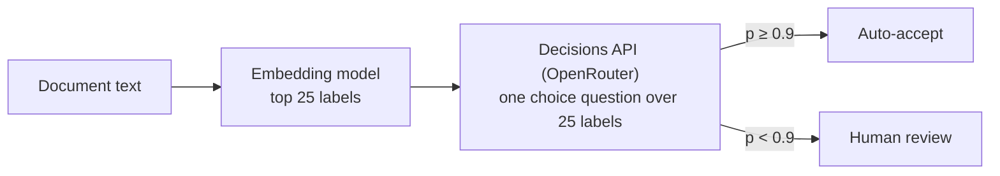

# Instructions for AI agents

This repo is a collection of independent experiments, one Jupyter notebook each. Read this file before
adding or changing a notebook.

## Layout

```
notebooks/NN-short-name/
  NN_short_name.ipynb   the experiment, committed with its outputs
  README.md             goal, headline result, workflow diagram, key figure, how to run
  data/                 inputs, caches of every model response, results tables
  figures/              PNGs saved by the notebook (used by README.md)
```

## Git workflow

- All new code and notebooks, and changes to existing ones, are merged through a pull request against `main`.
  Never commit or push to `main` directly.
- One branch per change (`add-09-short-name`, `fix-05-scoring`). The PR description says what changed and,
  for a new or re-run notebook, the headline result and the spend.
- A PR that adds a notebook also adds its row to the table in the root `README.md`.

## Rules for notebooks

- **Self-contained.** A notebook imports nothing from this repo. Helpers (CLI wrappers, caches, plot style)
  are defined inside the notebook, even if another notebook has the same code. Paths are relative to
  the notebook's folder.
- **Goal first.** The first cell states the question, why it matters, the data, the method and the
  headline result. A reader should get the answer from the first screen.
- **Structure:** goal and summary, contents and workflow diagram, setup and configuration, data (with a look
  at it), method, results (charts and tables), error analysis with concrete examples, limitations, how to
  reproduce.
- **Commit outputs.** Run top to bottom (`jupyter nbconvert --to notebook --execute --inplace`) before
  committing. A re-run must replay from the caches in `data/` without any API calls. Edits that touch only
  markdown cells (explainers, diagrams) do not need a re-run.
- **Charts:** matplotlib, one style block per notebook, a title that states the finding, labelled axes,
  no dual y-axes. Save the key figure to `figures/`.

## Workflow diagrams

A reader should see how the experiment runs before reading any code.

- **Contents and workflow at the top.** Right after the goal cell, add a `## Contents` cell that links to
  every numbered `##` section, then a diagram of the whole experiment: data, preparation, model calls,
  scoring, results. Label each step with what goes in and what comes out, with counts ("146 photos",
  "584 Decisions calls"). Repeat the diagram in the notebook's `README.md`.
- **Model call graph.** When a notebook makes more than one LLM call per item, or calls are chained, add a
  diagram of the calls. This covers cascades, retrieve-then-decide, tournaments, judges, retries and
  fallbacks, agent loops and agents that message each other.
  - One node per model call or agent, labelled with the model, how it is called (`claude -p`,
    `codex exec`, `muse exec`, OpenRouter) and what it returns.
  - Edges show what one call passes to the next. Mark loops, branches (beam, fallback), calls that run in
    parallel and points where the code waits.
  - For agents that exchange messages, add a sequence diagram: one lane per agent, arrows for handoffs,
    messages, questions and replies, and a marker where an agent is blocked. Draw one per pattern when the
    notebook compares patterns.
  - Put each diagram next to the method it describes.
- **How to draw them.** Write diagrams in Mermaid (a fenced code block tagged `mermaid` in a markdown
  cell). GitHub renders Mermaid in `README.md` and JupyterLab 4.1+ renders it in notebook cells. Diagrams
  built from run data (timelines, per-call traces) are drawn with matplotlib from the cached runs and saved
  to `figures/`.

A minimal call graph:



## Explainers and visuals

- **Explain each step.** Before each method or processing step, a markdown cell says what the step does,
  why it is there and what to look for in the output. After each result, one or two sentences state what it
  shows, with the number.
- **Show the inputs.** Show a sample of the data (a page, an image, a row), the exact prompt or question sent
  to each model, and one raw response next to the parsed result.
- **Charts for every result.** Each results section has at least one chart, not only a table. Error analysis
  shows failures visually where it can: the image or page region next to the model's answer and the gold
  label.
- **Define terms on first use** (average precision, recall@k, F1, calibration, top-1) in a sentence a reader
  new to the field can follow.
- **Save the figures the README uses** to `figures/`: the headline chart, an error example and any
  matplotlib diagram.

## Root README table

Each notebook has one row in the table in the root `README.md`. Write it for a reader who has opened no
notebook and does not know the tools:

- **Goal and question:** first the problem and why it matters, then the question, naming what is compared
  and on what data (with counts). Explain or avoid jargon and product names. Do not lean on another notebook
  without saying what it found.
- **Headline result:** answer the question with numbers.

## Model access

- OpenAI, Anthropic and Meta Muse models are called **only through their CLIs**: `codex exec`, `claude -p`
  and `muse exec`. Never through their HTTP APIs or SDKs.
- OpenRouter (`OPENROUTER_API_KEY`) is used only for open-weight models and for the OpenAI Decisions API,
  which has no CLI.
- Anything that costs money has a size knob (`N_...`, `MODELS`) at the top of the notebook. Defaults stay
  small. Print the spend at the end.
- Cache every model response on disk, keyed by the full request. Never commit keys or tokens.
- Judges are top models (Claude Opus, GPT via Codex, Muse) and never the model being judged alone.

## Data

Public data with its source and licence recorded, or synthetic data generated for the experiment. No
private or client data. Large public files (PDFs) are downloaded on demand and git-ignored.

## Writing style

Plain, specific, short. State what was measured and what it showed, with numbers.

- No filler or hype: "delve", "crucial", "robust", "seamless", "leverage", "unlock", "game-changer",
  "it's worth noting", "in today's fast-paced world", "comprehensive".
- No rhetorical questions as headings, no emoji, no exclamation marks.
- Do not claim more than the data supports. Small samples get confidence intervals or a caveat.
- Prefer a table or a number over an adjective.
