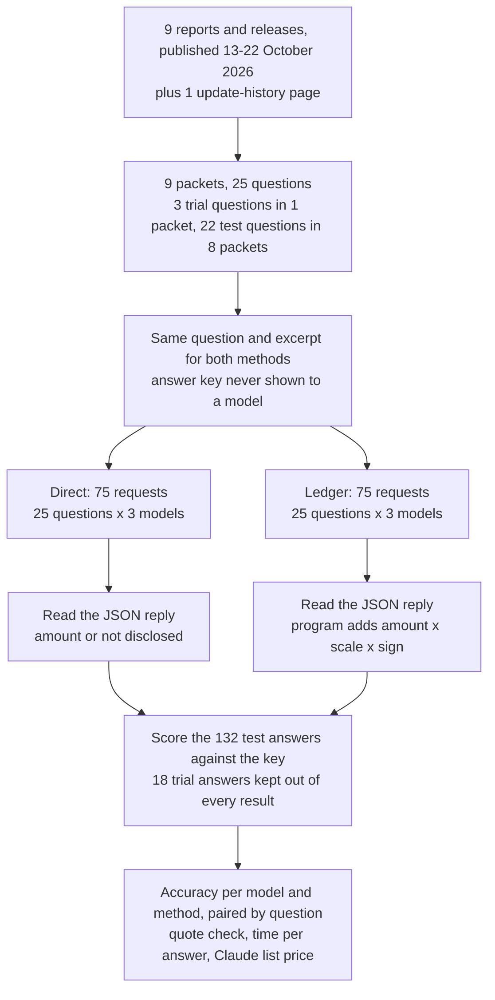
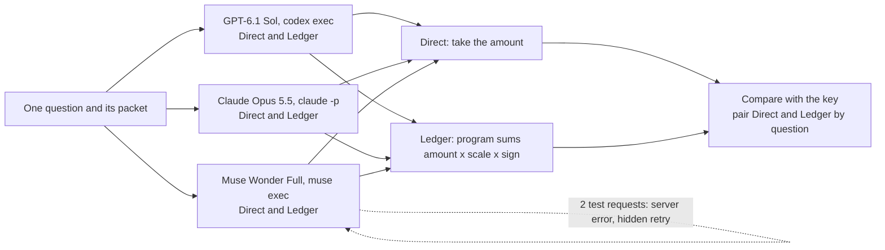
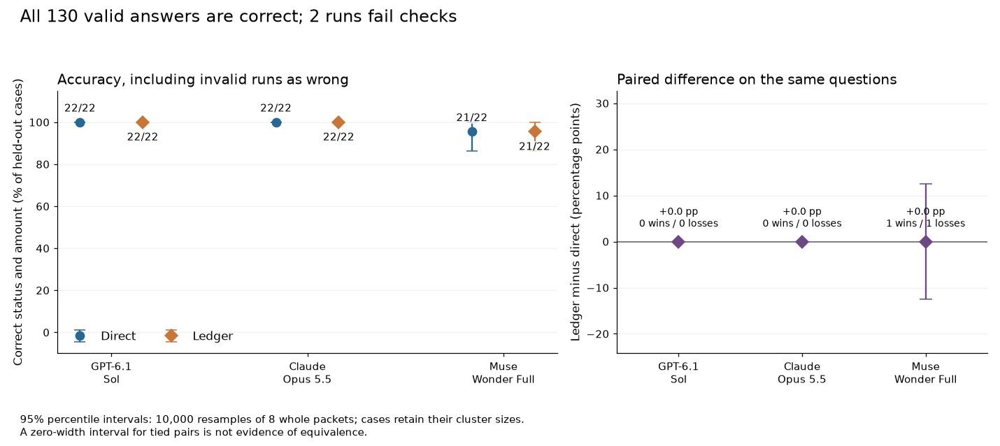
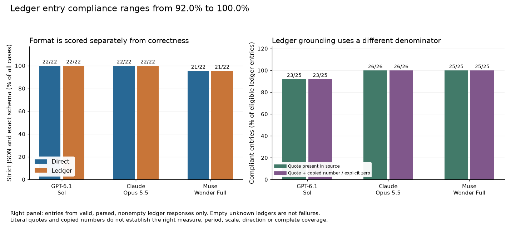
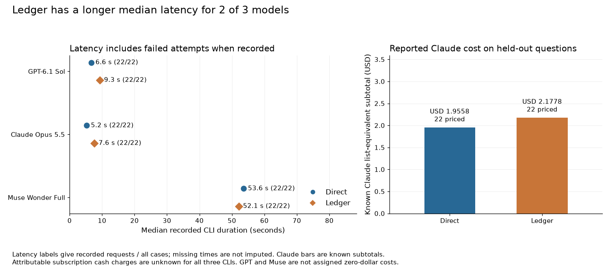
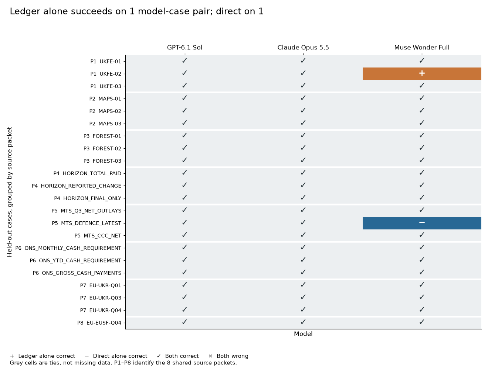

# Reading what government spending figures mean

## A number and the question it answers

When a government announces support for a service or a project, a natural next question is how much money has actually been paid. A journalist may want to check a promise. A researcher may want to compare this year's spending with last year's. Both need the number that answers the question they are asking, and a public report rarely contains just one candidate.

The same report can hold an amount approved for future use, a cost recorded in the accounts and an amount of money that has already changed hands, all for the same programme. Each is a correct figure for something. Before adding anything up, a reader has to work out which of these each number is. Economists call the step from a promise to an actual payment fiscal implementation, which gives this notebook's folder its name.

### An illustrative example

This example is made up to introduce the ideas. The measured cases come later.

A small agency receives a grant of GBP 100 to run a service. During the year it uses GBP 10 of that money to repay a loan. If someone asks how much funding arrived, the answer is GBP 100. If they ask how much was left after the repayment, the answer is GBP 90. Accountants call the first figure a **gross** amount: everything received, before anything is taken away. They call the second a **net** amount: what remains after specified amounts are subtracted. Both numbers are true, and copying GBP 90 perfectly still answers the funding question wrongly.

Now add one complication. The agency's board has approved GBP 40 for new computers, but the report does not say whether any computers have been paid for. An approval is permission to spend, not a payment. Asked "how much was paid for computers?", a careful reader cannot turn the GBP 40 approval into a payment, and cannot assume the answer is zero either. The honest answer is that the report does not disclose it.

A third distinction concerns timing. A supplier delivers GBP 30 of equipment in March and is paid in April, and the agency's year ends on 31 March. The accounts for that year still record a GBP 30 expense, because the agency owed the money as soon as the goods arrived. Recording a cost when it is incurred rather than when it is paid is called **accrual** accounting. No cash left the agency's bank until April, so the cash paid for equipment during the year was zero. An expense line answers "what did the year's activity cost?", not "how much cash was paid?".

A person working through a real report would start from the question, find the right table, read its headings, units and footnotes, and decide which amounts belong in the answer. The footnotes can matter as much as the largest number on the page. The arithmetic is usually the easy part.

### Why this matters now

Economists have started to use language models to turn reports into spending data. A March 2026 IMF working paper applied a fixed GPT-4.1 prompt to country reports to build a quarterly record of government spending actions in 64 countries, and then used that record to estimate how strongly economic output responds to spending ([Das et al., 2026](https://www.imf.org/-/media/files/publications/wp/2026/english/wpiea2026043-source-pdf.pdf)). In a pipeline like that, a model that returns the net figure when the question asked for the gross one, or that reports an approval as a payment, puts a wrong number into the data with no visible sign. Every study built on the data inherits the error.

### Two ways to ask

A model can be asked to read an excerpt from a report and return the answer directly: one number, or "not disclosed", with a short explanation. This experiment calls that the **Direct** method.

A model can also be asked to show its working. It lists each figure it used as a separate row: the figure as printed, its unit, whether to add or subtract it, and the exact passage it came from. It also lists nearby figures it decided to leave out, each with a reason. A short program then converts the units and adds the rows. This experiment calls that list a **ledger** and the method **Ledger**. The word is used in its everyday sense of a list of entries, not for an organisation's own accounting books.

The ledger could help in two ways. The program does the arithmetic, so a model cannot slip while adding three numbers or moving from thousands to millions. And every choice is written down, so a reviewer can see which figure was used and which was set aside. It could also make no difference. If the hard part is choosing the right figure, writing that figure into a list does not make the choice better, and the longer reply takes longer to write.

### What this experiment does

The test uses real reports that the models cannot have seen. Nine official reports and releases from UK, US and EU bodies were published between 13 and 22 October 2026, after every tested model's training cutoff or release date.

The relevant pages are supplied as text. The models do not have to find the report or the table, so the test measures reading, not searching. The excerpts keep whole tables, the previous year's comparison column and the notes, so the tempting wrong figures are still on the page.

Each question names the measure, the period and the unit ("gross cash ... without netting off proceeds from disposals ... in million GBP"), so that it has exactly one right answer. "Not disclosed" is a scored answer: six questions ask for an amount the excerpt does not establish, and a model that fills the gap with a budget, an expense or a zero is wrong.

Both methods receive identical text. Three strong models from three companies answer each question once with each method.

## The question

Given the right pages of a recent government report and a precisely worded question about money (what was received, paid or owed, or whether the report says at all), does asking a model to list each figure it used with its supporting passage, and letting a program add them, give more correct answers than asking for the figure directly?

The answer matters to anyone building spending data with a model. If the ledger catches mistakes, it is worth its extra time. If it does not, a team can ask for the direct answer and spend its checking effort elsewhere.

## Study summary

Three models (GPT-6.1 Sol, Claude Opus 5.5 and Muse Wonder Full) answered 22 test questions on 8 official reports and releases, once with each method: 132 answers. Sixteen questions have a known amount, one of them an explicit zero, and six have no disclosed amount. Three more questions on a ninth report were used beforehand to try out the setup and are not scored.

- Every completed answer was right: 131 of 131. GPT-6.1 Sol and Claude Opus 5.5 scored 22 of 22 with both methods, and Muse Wonder Full scored 21 of 22 with both. Neither Muse miss was a reading mistake. Its Direct request on `UKFE-02` timed out with no reply, and its correct Ledger answer on `MTS_DEFENCE_LATEST` was excluded because the command-line tool had quietly retried the request, which the study's rules do not allow.
- This is a ceiling result: with no wrong answers in either method, the test cannot show whether the ledger improves accuracy.
- On the six questions whose amount is not disclosed, all 36 answers said so. None substituted a budget, an expense or a zero.
- The ledger cost time and output. The median time per answer rose from 6.6 to 9.3 seconds for GPT-6.1 Sol and from 5.2 to 7.6 seconds for Claude Opus 5.5; Muse Wonder Full took about 52 to 54 seconds either way. Each model wrote 2.7 to 3.0 times as many output tokens. Claude's 22 Ledger answers cost USD 2.18 at Anthropic's list prices, against USD 1.96 for Direct.
- The ledger made the working visible. 74 of 76 ledger rows quoted a passage found word for word in the source, and the 2 exceptions were GPT-6.1 Sol quotes stitched together from two places around correct figures. In 24 of 47 known-amount ledgers the model listed a single figure, so the program only converted its unit.

In the original situation: given the right report pages and a precise question, each of these models gave the right figure, and asking it to show its working added a few seconds without changing the answer. Whether the visible working helps a person catch mistakes was not measured, and there were no mistakes here to catch.

The main caveat is that 22 hand-picked, precisely worded questions on supplied excerpts were not hard enough to separate the methods. Equal scores here are not evidence that the two methods are equally reliable on vaguer questions, on long histories of revised reports, or when the model has to find the document itself.

## Contents

1. [The reports and the questions](#1-the-reports-and-the-questions)
2. [How the experiment runs](#2-how-the-experiment-runs)
3. [The models and the measures](#3-the-models-and-the-measures)
4. [Results: correct answers](#4-results-correct-answers)
5. [Results: what the ledger adds and what it costs](#5-results-what-the-ledger-adds-and-what-it-costs)
6. [Error analysis](#6-error-analysis)
7. [What the evidence supports](#7-what-the-evidence-supports)
8. [Limitations](#8-limitations)
9. [Spend, data and how to run](#9-spend-data-and-how-to-run)
10. [Future work and further reading](#10-future-work-and-further-reading)

## 1. The reports and the questions

Each question is asked about one **packet**: the excerpt, or two excerpts, from one report that all of that report's questions share. The table lists the nine packets, with the trap each one sets.

| Packet | Published | Questions | What can go wrong |
| --- | --- | --- | --- |
| [UK Fusion Energy accounts](https://www.gov.uk/government/publications/uk-fusion-energy-ltd-annual-report-and-accounts-202526/uk-fusion-energy-ltd-annual-report-and-accounts-202526-accessible-version) | 13 Oct | 3 test | Asset values and programme spending mistaken for cash; a supported zero |
| [Money and Pensions Service accounts](https://www.gov.uk/government/publications/money-and-pensions-service-annual-report-and-accounts-2025-to-2026) | 20 Oct | 3 test | Net financing and investing totals mistaken for gross receipts or purchases |
| [National Forest Company accounts](https://www.gov.uk/government/publications/national-forest-company-annual-report-and-accounts-2025-to-2026) | 15 Oct | 3 test | Pounds versus millions; group versus parent; accrued lease costs |
| [Post Office Horizon redress](https://www.gov.uk/government/publications/post-office-horizon-financial-redress-and-legal-costs-data-for-2026/post-office-horizon-financial-redress-data-as-of-30-september-2026) and [update history](https://www.gov.uk/government/publications/post-office-horizon-financial-redress-and-legal-costs-data-for-2026) | 16 Oct; corrected 22 Oct | 3 test | Closed scheme omitted; interim payments confused with final settlements |
| [US September Monthly Treasury Statement](https://fiscaldata.treasury.gov/static-data/published-reports/mts/MonthlyTreasuryStatement_202609.pdf) | 16 Oct | 3 test | Fiscal year versus quarter; offsets; an already-included revision |
| [Office for National Statistics (ONS), September public sector finances](https://www.ons.gov.uk/economy/governmentpublicsectorandtaxes/publicsectorfinance/bulletins/publicsectorfinances/september2026) | 21 Oct | 3 test | Net cash requirement confused with gross accrued expenditure |
| [EU Ukraine support release](https://cyprus.representation.ec.europa.eu/news/commission-disburses-eur286-billion-ukraine-drones-missiles-and-urgent-battlefield-needs-2026-10-14_en) | 14 Oct | 3 test | New defence cash confused with budget support still available |
| [European Parliament storm-aid vote, European Union Solidarity Fund (EUSF)](https://www.europarl.europa.eu/news/en/press-room/20261018IPR48259/parliament-backs-storm-recovery-aid-for-portugal-spain-italy-and-malta) | 21 Oct | 1 test | Approval and past advances mistaken for a new payment that day |
| [EU Sweden/Netherlands Recovery and Resilience Facility (RRF) payments](https://ec.europa.eu/commission/presscorner/detail/en/mex_26_2159) | 14 Oct | 3 trial | New payments versus cumulative totals; false precision from percentages |

Questions from the same report share a document, so the 22 test questions are not 22 independent tests; the uncertainty ranges in section 3 allow for this. The excerpts run from about 300 words (the storm-aid release) to about 6,600 (the UK Fusion Energy accounts), counting space-separated words in the `text` field of [sources.json](data/real_v2/sources.json). Fifteen test questions are in pounds, four in euros and three in dollars, always in millions, with no currency conversion.

### Three measures from public finance

Besides the gross, net, approval and accrual ideas from the opening, three ideas from government statistics each set the trap in at least one question.

The first is the **net cash requirement** in the ONS bulletin. The bulletin's glossary defines it as "the cash the government must raise from financial markets to finance its activities". It is a net figure: if a government pays out 120 in a month and collects 100 in taxes and other receipts, its net cash requirement is 20. Knowing the 20 does not tell you the 120. In September 2026 the central government net cash requirement was GBP 16.9 billion. The same bulletin reports GBP 111.3 billion of total central government expenditure for the month, but that figure is recorded on an accrual basis. Neither number is the gross cash paid out in September, which is why question `ONS_GROSS_CASH_PAYMENTS` has the answer "not disclosed".

The second is **net budget outlays** in the US Treasury statement. The statement uses what it calls a modified cash basis: amounts are counted when cash is collected or paid, some receipts and refunds are subtracted from gross outlays, and interest on the public debt is counted as it accrues. A programme that collects more than it pays in a month therefore shows negative outlays. In September 2026 the Commodity Credit Corporation paid out USD 355 million and received USD 690 million, so its net outlays were minus USD 335 million (`MTS_CCC_NET`). A negative figure does not mean nothing was paid.

The third is a **revision already included**. Government statistics are corrected after publication. The Treasury's fiscal-year figure for Defense military programmes, USD 916,836 million, carries a footnote saying it was decreased by USD 18 million because of additional reporting for August. The correction is already inside the 916,836. Subtracting it again gives 916,818, a figure that appears nowhere in the excerpt (`MTS_DEFENCE_LATEST`).

Units are a quieter trap: annual accounts print thousands of pounds (single pounds for the National Forest Company) and the ONS prints billions. GBP 16.9 billion becomes 16,900 million in the key, keeping the displayed precision without claiming more.

### Fresh data

GPT-6.1 Sol's training cutoff is 30 April 2026. Claude Opus 5.5's published cutoff is June 2026 (released 22 September 2026). Muse Wonder Full has no published cutoff and was released on 12 October 2026 ([model_metadata.json](data/real_v2/model_metadata.json)), the latest of the three dates, so only reports published after it were used: 13 to 22 October 2026. The questions were written on 22 October 2026 (`created_on` in [cases.json](data/real_v2/cases.json)). Two qualifications apply. The annual accounts describe the year to 31 March 2026, so some of their facts may have been public earlier. The Horizon update-history page was first published on 9 February 2026 and updated on 22 October; no answer is taken from its older entries ([provenance_notes.json](data/real_v2/provenance_notes.json)).

### The answer key

Every answer in the key comes from a quotation, a table cell or arithmetic on them; [cases.json](data/real_v2/cases.json) stores each question with its answer, tolerance and rationale. The questions and key were written by AI agents working on this repository, each set checked by a different agent, with no human coders ([gold_review.json](data/real_v2/gold_review.json)). Two candidate questions were dropped before any model saw them: one whose source had a conflicting unit header, and one that repeated another.

A number must match the key to within one pound, euro or dollar. There is no percentage tolerance, so a small relative error on a large budget still fails.

## 2. How the experiment runs



For example, `MAPS-01` sends the Money and Pensions Service excerpt and one question to each model twice, once with each method's instructions. Direct returns an amount; Ledger returns three grant inflows in thousands of pounds, which the program converts and adds. All six results are compared with the key, GBP 206.238 million.

Every question produces six independent requests, which never see each other's answers:



### What each method returns

Both methods start with the same twelve lines of instructions. They say that cash, allocations, forecasts, commitments, approvals, requests and balances are different measures, "Do not infer zero from silence", and that an explicit statement that no payments were made supports zero. Both may answer "not disclosed".

A Direct reply is one JSON object (a fixed text format that programs can read) with a status, an amount, the cited source and a short explanation. A Ledger reply has a status, a list of rows and a list of exclusions. Each row holds the figure as printed, a scale that converts it to millions (0.001 for thousands, 1000 for billions), a sign (+1 to add, -1 to subtract) and a quotation. Each exclusion names a nearby figure and says why it was left out. The Ledger instructions forbid a final total and allow a total or its parts, never both. Every request's full text is saved in its cache folder, for example [the Ledger request in the worked example below](data/real_v2/cache/8b71fcf15b6bd69abfde780f84b5d1c09529761e82dc1f39b9756725352ae4b5/attempt_001.started.json).

One reading rule applies to both methods: the program takes one complete JSON object from the reply, even if surrounded by text, and never repairs a value. None of the 131 completed replies needed the allowance; each was a bare JSON object in the exact format (`recovered_json` is false on every row of [test_case_scores.csv](data/real_v2/results/test_case_scores.csv)).

Each request runs once, in a fresh empty folder with tools and web access off, at most three at a time in random order. A run is valid only if the requested model answered with no tools and no extra attempt; otherwise it counts as wrong, even if its reply was right.

### Worked example: `MAPS-02` from question to score

The question:

> For the Money and Pensions Service in the year ended 31 March 2026, what was the gross cash spent purchasing intangible assets and property, plant and equipment combined, without netting off proceeds from disposals? Report a positive outflow in million GBP.

The relevant rows of the cash-flow statement, as the models received them (thousands of pounds; current year, then prior year):

```text
 Cash flows from investing activities
 Purchase of intangibles                       3        (12,234)        (12,584)
 Purchase of property, plant, equipment        4         (1,074)            (44)
 Proceeds from sale of property, plant,
 equipment                                     4               7              27
 Net cash outflow from investing activities             (13,301)        (12,601)
```

The answer key is `(12,234 + 1,074) x 0.001 = 13.308` million GBP. The printed net outflow, 13.301, subtracts the GBP 7 thousand received from selling equipment, so it answers a different question. The prior-year column (12,584 and 44) is a second trap.

Claude Opus 5.5's Direct reply returned an amount of 13.308 and explained: "Gross total: 12,234 + 1,074 = £13,308k, which is £13.308m. Disposal proceeds of £7k are excluded, which is why this differs from the net investing outflow of £13,301k."

Its Ledger reply listed two rows and four exclusions:

| Row | Figure as printed | Scale | Sign | Contribution (million GBP) |
| --- | ---: | ---: | ---: | ---: |
| Purchase of intangibles, year ended 31 March 2026 | 12,234 | 0.001 | +1 | 12.234 |
| Purchase of property, plant, equipment, year ended 31 March 2026 | 1,074 | 0.001 | +1 | 1.074 |
| Program's total | | | | 13.308 |

The exclusions were the GBP 7 thousand of sale proceeds ("Question asks for gross purchases without netting off disposal proceeds"), the GBP 13,301 thousand net investing outflow, GBP 12.2 million of grant-in-aid spent on capital, and the prior year's purchases.

Both runs passed the rules and 13.308 matches the key, so both answers are correct; both quoted lines appear in the source with their row's figure, so the rows pass the quote check (section 3). All six `MAPS-02` answers returned 13.308.

### How the study got here

Two earlier steps shaped the design; [data/PROTOCOL.md](data/PROTOCOL.md) gives their dates and settings.

The first was a synthetic study, also run on 22 October 2026. Python generated 60 made-up histories of a spending programme (12 trial, 48 test), each a series of short notices about announcements, approvals, payments, corrections and cancellations, and the models reconstructed cumulative cash paid at three quarter-ends. GPT-6.1 Sol and Claude Opus 5.5 answered at low reasoning effort, 240 requests in all. GPT-6.1 Sol got 48 of 48 histories right with both methods; Claude Opus 5.5 got 47 of 48 Direct and 48 of 48 Ledger, and its one miss had every value right but began with a sentence of prose, which that study's strict format rule rejected. All 191 readable replies had zero cash error, so the records were too easy and the only difference was a formatting rule. The real-report study changed four things: real documents with tempting nearby figures, a third model, medium reasoning effort, and one JSON-reading rule for both methods, so a stray sentence of prose no longer counts against either. The synthetic study's ledger was a different design (dated events reduced by a program), so the two studies are not a controlled comparison of difficulty alone. Its write-up is archived in [data/synthetic_v1_README.md](data/synthetic_v1_README.md).

The second step was the three trial questions on the EU recovery-fund release, 18 requests run before any test question. 17 were correct; the Muse Wonder Full Ledger request on `EU-RRF-Q01` hit the 120-second time limit, so before any test request the limit was raised to 300 seconds for all three models, with nothing else changed. The trial also shows a "false precision" trap: in `EU-RRF-Q04` the Netherlands has received 68.6% of a EUR 5.44 billion allocation. Multiplying gives about EUR 3,732 million, but both inputs are rounded, and all six trial answers said "not disclosed".

## 3. The models and the measures

| Model | Pinned version | Provider and how called | Size and precision | Settings | Why included |
| --- | --- | --- | --- | --- | --- |
| GPT-6.1 Sol | `gpt-6.1-sol` as requested; Codex returns no identity, so no dated version recorded | OpenAI, `codex exec` (CLI 0.160.1), read-only, tools and web search off | Not published | Reasoning effort medium | First of three frontier models from different companies, so a shared result does not depend on one vendor |
| Claude Opus 5.5 | `claude-opus-5-5`, returned by the CLI on all 50 requests; no dated version recorded | Anthropic, `claude -p` (CLI 2.1.296), tools off, at most USD 0.50 per request | Not published | Effort medium | Second vendor; its CLI reports a list price per request, so the ledger's cost can be measured |
| Muse Wonder Full | `muse-wonder-full-1.0`, returned by the CLI on all 50 requests; no dated version recorded | Meta, `muse exec` (CLI 1.4.12), tools off, one model step | Not published | Reasoning effort medium | Third vendor and the newest model; its 12 October 2026 release sets the earliest allowed report date |

"Medium" is each vendor's own label and does not promise equal hidden reasoning across vendors, so the comparison that answers the question is between methods within each model.

### What counts as correct

An answer is **correct** when its run passed the rules and it gives the key's status and, for a known amount, a number within the tolerance. **Accuracy** is correct answers divided by all 22 test questions for one model and method; higher is better, and a request that fails or times out counts as wrong. For example, Muse Wonder Full answered 21 of the 22 questions correctly with Direct, an accuracy of 21 / 22 = 95.5%. The comparison is paired: Ledger accuracy minus Direct accuracy for each model on the same 22 questions, in percentage points, with the number of questions only one method got right.

Failures are counted in three kinds. A **wrong** answer is a readable reply with the wrong amount or status, which says something about reading. An **unreadable** answer is no reply, or a reply that is not JSON in the required format, which says something about the tool or the format. An **excluded run** is a readable reply from a run that broke a rule, such as an extra attempt.

The range around each score is a 95% interval from resampling whole packets: 10,000 times, draw 8 packets with replacement, keep each packet's questions together, and recompute the score. Muse Wonder Full's Ledger misses one of the three Treasury questions; draws without that packet score 100% and draws that pick it twice score lower, giving 86.4% to 100%. When every answer is right, every draw agrees and the interval has zero width, which says only that these packets hold no disagreement to resample.

### The quote check

Each ledger row is checked in two steps: its quotation must appear in the source word for word, ignoring spacing, and the row's figure must appear in that quotation (for a zero, the quotation must say no payment was made). A row that passes both is **compliant**. The check covers the 76 rows in valid, non-empty ledgers; a "not disclosed" ledger has no rows. Passing shows that the figure was copied from a real passage, not that it is the right measure or year: the prior-year 12,584 sits in the same quoted line as the current-year 12,234.

Time is elapsed seconds per request, including the tool's start-up, with three requests running at once. Cost is the Anthropic list price that the Claude CLI reports per request; the other two CLIs report no price.

## 4. Results: correct answers

| Model | Direct correct | Ledger correct | Only Ledger right | Only Direct right | Wrong answers | Unreadable or excluded | Ledger minus Direct (95% packet interval) |
| --- | --- | --- | ---: | ---: | ---: | --- | --- |
| GPT-6.1 Sol | 22/22 | 22/22 | 0 | 0 | 0 | 0 | 0 points (0 to 0) |
| Claude Opus 5.5 | 22/22 | 22/22 | 0 | 0 | 0 | 0 | 0 points (0 to 0) |
| Muse Wonder Full | 21/22 | 21/22 | 1 | 1 | 0 | 1 unreadable (Direct timeout), 1 excluded (Ledger) | 0 points (-12.5 to +12.5) |

Counts from [model_arm_summary.csv](data/real_v2/results/model_arm_summary.csv) and [paired_summary.csv](data/real_v2/results/paired_summary.csv).



In the left panel each model has a blue circle for Direct and an orange diamond for Ledger, with the count of correct answers and a bar for the 95% packet interval. The right panel shows Ledger minus Direct against a zero line; "1 wins / 1 losses" counts questions only Ledger or only Direct got right.

All three models sit at or next to 100% with both methods, and the difference is zero for all three: a ceiling. GPT-6.1 Sol and Claude Opus 5.5 answered all 44 of their requests correctly, so their intervals have zero width. Muse Wonder Full's interval of -12.5 to +12.5 points comes entirely from its two run failures, one on each side: the timeout on `UKFE-02` (Ledger right, Direct gave nothing) and the excluded run on `MTS_DEFENCE_LATEST` (Direct right, Ledger excluded).

Counting only readable replies, every one was correct: 131 of 131. Muse Wonder Full's excluded Ledger reply gave the key, 916,836, so on readable replies it scores 22 of 22 with Ledger and 21 of 21 with Direct. The models and methods remain tied.

By kind of question ([status_summary.csv](data/real_v2/results/status_summary.csv)): on the 16 known amounts, GPT-6.1 Sol and Claude Opus 5.5 scored 16 of 16 with each method and Muse Wonder Full 15 of 16, its misses being the run failures. On the 6 undisclosed amounts, all six model and method combinations scored 6 of 6, so 36 answers declined to invent a figure. The explicit zero (`UKFE-02`) got zero from all five replies that arrived. "Not disclosed" refers to the supplied excerpt only; another document might disclose the amount.

## 5. Results: what the ledger adds and what it costs

### What the ledger shows



The left panel counts replies in the exact JSON format from a valid run, out of 22. Muse Wonder Full's 21 of 22 is the two run failures again; all 131 replies that arrived were in the exact format ([response_review.json](data/real_v2/response_review.json), `format_counts`). The right panel counts ledger rows passing the quote check: green for a quotation found in the source, purple for one that also contains the row's figure. The legends cover part of the GPT-6.1 Sol bars, and the title gives the purple range, 92% to 100%.

74 of 76 ledger rows passed: Claude Opus 5.5 26 of 26, Muse Wonder Full 25 of 25 and GPT-6.1 Sol 23 of 25. Both failures are GPT-6.1 Sol rows with right figures whose quotations join two passages that are not adjacent in the source (section 6).

The ledgers also named the figures they set aside, which is the part a reviewer could check against the report: a median of 3 per reply for GPT-6.1 Sol (67 in 22 replies), 5.5 for Claude Opus 5.5 (113 in 22) and 4 for Muse Wonder Full (80 in 21), counted from each valid Ledger reply's `exclusions` list in the cache.

In 24 of the 47 valid known-amount ledgers the model listed a single figure, so the program only changed its unit (counted from each reply's `entries` list; GPT-6.1 Sol 9 of 16, Claude Opus 5.5 8 of 16, Muse Wonder Full 7 of 15). The other 23 had two or three rows, on 8 questions that need a sum or a difference. All 24 Direct answers to those 8 questions were also right, so the program had no arithmetic mistake to prevent.

### Time and cost



The left panel shows the median seconds per request ("latency" in the title) for each model and method, with how many of the 22 requests had a recorded time. The right panel shows Claude Opus 5.5's list-price total for 22 test requests; the other two CLIs report no price, so they have no bars.

| Model | Direct median seconds | Ledger median seconds | Direct median output tokens | Ledger median output tokens | Claude list price, Direct | Claude list price, Ledger |
| --- | ---: | ---: | ---: | ---: | ---: | ---: |
| GPT-6.1 Sol | 6.6 | 9.3 | 88 | 266.5 | not reported | not reported |
| Claude Opus 5.5 | 5.2 | 7.6 | 204.5 | 565 | USD 1.96 | USD 2.18 |
| Muse Wonder Full | 53.6 | 52.1 | 271 | 739 | not reported | not reported |

Output tokens are medians over valid test runs of each CLI's usage record in the cache (`usage.output_tokens`; for Muse Wonder Full `usage.models[0].output_tokens`). The CLIs count differently, so compare within a model.

The ledger added 2.6 seconds per answer for GPT-6.1 Sol and 2.4 for Claude Opus 5.5 (40% and 46% more). Muse Wonder Full took 52 to 54 seconds with either method. Every model wrote 2.7 to 3.0 times as many output tokens for a ledger. Claude's list price rose by only 11%, from USD 1.96 to USD 2.18, because most of each request's price is the excerpt read in, which is the same for both methods: the Claude Direct request for `UKFE-01`, for example, read 17,728 input tokens and wrote 184.

## 6. Error analysis

No completed answer was wrong, so there are no reading mistakes to analyse. This section covers the traps the questions set, the two run failures, the two quote-check failures, and one answer reached by different routes.

### The traps, and how many answers fell in

Each question has a figure nearby that answers a different question. The table shows 13 of the 22 questions with the clearest such figure, in millions of the question's currency.

| Question | What it asks | Answer key | Nearby figure that answers a different question |
| --- | --- | --- | --- |
| `MAPS-01` | Gross grant received | 206.238 | 206.023, net financing after lease payments |
| `MAPS-02` | Gross asset purchases | 13.308 | 13.301, net investing outflow after sale proceeds |
| `FOREST-01` | Asset purchases less investment sales | 1.350741 | 1.261309, net investing outflow, which also includes interest and rent received |
| `FOREST-02` | Change in cash | 0.504601 | 0.963450, net income for the year |
| `UKFE-02` | Rent paid | 0 | 17.904, valuation of the leased land and building |
| `UKFE-03` | Cash paid for goods and services | not disclosed | 88.091, goods-and-services expense (accrual) |
| `MTS_DEFENCE_LATEST` | Latest fiscal-year Defense outlays | 916,836 | 916,818 (correction subtracted twice); 913,705, budget estimate |
| `MTS_CCC_NET` | Net outlays in September | -335 | 355, gross outlays |
| `MTS_Q3_NET_OUTLAYS` | Total outlays, July to September | 1,877,883 | 7,395,800, fiscal-year total |
| `ONS_YTD_CASH_REQUIREMENT` | Net cash requirement, year to September | 90,000 | 97,800, public sector borrowing; 102,700, central government borrowing |
| `ONS_GROSS_CASH_PAYMENTS` | Gross cash paid out in September | not disclosed | 111,300, accrued expenditure; 16,900, net cash requirement |
| `EU-UKR-Q04` | New budget-support cash paid on 14 October | not disclosed | 2,860, defence payment that day; 12,700, budget support still available |
| `EU-EUSF-Q04` | New storm-aid cash paid on the vote day | not disclosed | 489, aid approved by Parliament |

The nearby figures come from the `gold_rationale` field of [cases.json](data/real_v2/cases.json) or, where it names none, from the excerpt. None of the 77 completed answers to these 13 questions gave a nearby figure (columns `predicted_amount` and `predicted_status` of [test_case_scores.csv](data/real_v2/results/test_case_scores.csv)); one `UKFE-02` request timed out. Many explanations and ledger exclusions name the nearby figure and why it does not fit. On `ONS_GROSS_CASH_PAYMENTS`, for example, GPT-6.1 Sol's Direct reply says the "£111.3 billion expenditure total is accrual-based, while the £16.9 billion net cash requirement reflects payments and receipts rather than gross cash paid".

### An accrual case: `UKFE-03`

The question asks what cash UK Fusion Energy paid for goods and services, excluding staff and capital purchases, in the year to 31 March 2026, and asks for an amount only if the report establishes it. The income statement records a GBP 88.091 million expense for goods and services. That is the accrual figure from the opening example: it records what was incurred, not what was paid. The cash-flow statement starts from the year's result and adjusts for changes in amounts owed, and it does not split those changes finely enough to work out the cash paid for this one category. The key is "not disclosed".

All six answers said "not disclosed". Claude Opus 5.5's Direct reply put it in one line: "That is an expense recognised in the Statement of comprehensive net income, not a cash payment." A pipeline that copied the most relevant-looking number would record GBP 88.091 million of spending that the report never says was paid.

### A hard case: `MTS_DEFENCE_LATEST`

The question asks for the latest reported fiscal-year 2026 net outlays for Department of Defense military programmes, "Incorporate the reported August correction exactly once." The Treasury table row and its footnote read:

```text
Department of Defense--Military Programs 84,221 [1]916,836    868,412    913,705
1 Amount decreased by $18 million due to additional reporting for the month of August 2026.
```

The four figures are September alone, the fiscal year to date, the previous year and the full-year budget estimate. The `[1]` is a footnote marker, not a digit. The key is 916,836, which already includes the correction.

All six replies returned 916,836, and all three ledgers listed the USD 18 million as an exclusion. Claude Opus 5.5 explained that "The footnote is attached to the 916,836 fiscal-year-to-date figure, so that figure already includes the decrease."

GPT-6.1 Sol's Ledger reply quoted exactly the two lines above as one quotation. Both lines are in the source, but on different parts of the page, so the joined text is not a single passage and the row fails the word-for-word check. Its figure is right. The other GPT-6.1 Sol failure, on `UKFE-01`, has the same shape: it quoted the cash-flow statement's heading and unit line together with the investing rows, skipping the operating section between them, around a correct GBP 10.595 million. These are the only two quote-check failures, and both show that a failed check is a reason to look, not proof of a wrong number.

Muse Wonder Full's Ledger reply was also right, and it is the excluded run. Its event record shows that the first attempt to reach Meta's model server returned HTTP 504 (a gateway timeout), the CLI retried on its own, and the request finished after 233 seconds with the second attempt's answer. The study allows one attempt per request, so the run counts as wrong.

### The other run failure: `UKFE-02`

The question asks how much rent UK Fusion Energy paid for land leased from its parent body. The note says "No rental payments were made or are payable", beside a GBP 17.904 million valuation of the land and building, which changes the balance sheet without any cash moving. The key is zero, the only explicit zero in the test.

Five replies returned zero, and all three ledgers quoted the no-payment sentence as a zero row. Muse Wonder Full's Direct request returned nothing: its event record shows the same HTTP 504 and internal retry, and the process was stopped at the time limit (295 seconds recorded). Both Muse failures began with the same server error, so they reflect the service on the day, not either method.

### Same answer, different working: `FOREST-02`

The question asks for the National Forest Company group's increase in cash after combining operating and investing cash flows. The key is (1,765,910 - 1,261,309) / 1,000,000 = 0.504601 million GBP, and the statement also prints that difference as the year's change in cash.

GPT-6.1 Sol's ledger had one row, the printed 504,601, and excluded the two components. Claude Opus 5.5 and Muse Wonder Full listed the components, one added and one subtracted, and excluded the printed total. All three are right and follow the rule of a total or its parts, never both. When a report prints the total, the ledger can carry it in one row, which is why the program often had little to do.

### Every question at a glance



Each row is one test question, grouped by packet (P1 to P8, in the order of the table in section 1), and each column is a model. A grey tick means both methods were right, an orange plus means only Ledger was right, a blue minus means only Direct was right, and a cross would mean both were wrong. The title, "Ledger alone succeeds on 1 model-case pair; direct on 1", is literally true but describes the two Muse run failures, not reading differences: the plus on `UKFE-02` is the Direct timeout and the minus on `MTS_DEFENCE_LATEST` is the excluded Ledger run.

Of the 66 pairs, 64 are ticks, 2 are the run failures and none is a cross: no report, currency or kind of trap separated the methods.

### What these examples cannot show

With no wrong answers, they cannot show which method would catch more mistakes, or whether a mistake would be easier to spot in a ledger. Nor can they show how the models would do without the instructions about gross, net, approvals and silence in both prompts.

## 7. What the evidence supports

- When the right pages are supplied and the question names the measure, period and unit, any of the three models can be asked for the figure directly. Here the ledger added about 2.5 seconds per answer for GPT-6.1 Sol and Claude Opus 5.5 and 11% to Claude's list price, and changed no answer.
- Ask for a ledger when a person will review the answers. It names the figures that were set aside (a median of 3 to 5.5 per reply) and quotes the source, which gives a reviewer something to check. Run the quote check automatically, and treat a failure as a reason to look: both failures here sat around correct figures.
- Include "not disclosed" as an allowed answer and say that silence is not zero. All 36 answers on the six undisclosed questions used it rather than inventing a figure.
- Plan for run failures as well as reading failures. Muse Wonder Full lost 2 of its 44 test requests after a server error and a hidden retry, and took about a minute per answer.

The uncertainty that most needs another experiment is whether the ledger helps on questions hard enough that models get some of them wrong: vaguer wording, long chains of revised releases, or reports the model has to find itself.

## 8. Limitations

- The result is at a ceiling. No completed answer was wrong, so the test cannot rank the methods or the models. Zero wrong in 131 answers still allows a true error rate of up to about 2.3% at 95% confidence (the rule of three, 3 / 131), and because the 131 answers share 22 questions the real uncertainty is wider.
- The sample is small and hand-picked: 22 test questions on 8 English-language packets, chosen to contain tempting nearby figures.
- The task is easier than real use: the excerpts are supplied, each question names the measure, period and unit, and both prompts warn about double counting, approvals and silence. Each model answered each question once per method, so variation between repeated replies is unmeasured.
- The answer key was written and checked by AI agents, not by human economists. A "not disclosed" answer is correct for the supplied excerpt only.
- The reports are newer than every model, but the annual accounts describe the year to March 2026 and some of their facts may have been public earlier.
- "Medium" reasoning effort is each vendor's own label, so the three models may have reasoned for different amounts.
- The questions, answer key, prompts and scoring rules were fixed before the first trial request, and the trial results did not change which questions were scored. One change was made after the trial and before any test request: the time limit rose from 120 to 300 seconds for all three models. The record is in [data/PROTOCOL.md](data/PROTOCOL.md).

## 9. Spend, data and how to run

The study sent 150 requests (18 trial, 132 test; 50 per model). Three failed: the Muse Wonder Full trial timeout and the two test failures above. The runner made no retries or repair calls; the two retries inside Muse Wonder Full's CLI are the only observed extra model attempts. Claude Opus 5.5's list price for all 150 is USD 4.28, including USD 0.15 for the trial. The GPT-6.1 Sol and Muse Wonder Full costs are unknown, not zero. The earlier synthetic study used 240 CLI requests (Claude list price USD 3.01) and one OpenRouter call to Qwen3.8 Flash to write wording templates (USD 0.00052).

| File | What it holds |
| --- | --- |
| [cases.json](data/real_v2/cases.json), [sources.json](data/real_v2/sources.json) | The 25 questions with answer key and rationale; the exact excerpts with dates, licences and hashes |
| `data/real_v2/cache/<request hash>/` | Each request's full prompt and the CLI's raw reply, usage and timing |
| [test_case_scores.csv](data/real_v2/results/test_case_scores.csv), [scores.json](data/real_v2/results/scores.json) | The 132 scored test answers, one row each; all 150 requests, trial included |
| [analysis_summary.json](data/real_v2/results/analysis_summary.json), [response_review.json](data/real_v2/response_review.json) | Counts and intervals; an agent's rescoring of all 132 test answers |
| [protocol.json](data/real_v2/protocol.json), [gold_review.json](data/real_v2/gold_review.json), [model_metadata.json](data/real_v2/model_metadata.json) | The fixed plan, answer-key checks, model dates and CLI versions |
| [data/PROTOCOL.md](data/PROTOCOL.md) | Run history in date order, with links to every plan file |
| [synthetic_v1_README.md](data/synthetic_v1_README.md) and the other files at the top of `data/` | The earlier synthetic study |

Running the notebook replays every result from these files with no model calls:

```powershell
python -m jupyter nbconvert --to notebook --execute --inplace 22_fiscal_implementation.ipynb
```

The original downloads are not committed; the saved excerpts are all a replay needs. A small live run needs signed-in `codex`, `claude` and `muse` command-line tools and `NB_REAL_V2_LIVE=1`. It asks two trial questions by default; `NB_REAL_V2_N_CASES` and `NB_REAL_V2_MAX_NEW_CALLS` (default 12) set its size, and the notebook caps the total at 180 requests and USD 20 of Claude list price. The full analysis is in [22_fiscal_implementation.ipynb](22_fiscal_implementation.ipynb).

## 10. Future work and further reading

### Future work

- Ask vaguer questions about the same packets ("how much did the service spend on equipment?") without naming gross or net, and measure how often each method picks the figure a careful reader would. Every question here named its measure, and every answer was right.
- Supply full histories of a programme across several releases, with revisions, stale cumulative totals and missing settlement dates, and measure double counting and revision errors. Most packets here held one report, and the one correction tested was already inside the final figure.
- Give human reviewers either Direct answers or ledgers, with some errors planted, and measure review minutes, errors caught and errors missed. This study measured whether quotations were copied, not whether a ledger helps a reviewer.
- Repeat each request several times and add questions that need four or more figures combined. Here each request ran once, and 24 of 47 known-amount ledgers held a single figure.
- Collect 100 or more packets across institutions and languages, with two human coders writing the answer key independently, and measure accuracy and coder disagreement. Eight packets and an agent-written key leave generalisation open.

### Further reading

Links checked on 28 October 2026.

- [AI Meets Fiscal Policy: Mapping Government Spending Actions Across 64 Countries](https://www.imf.org/-/media/files/publications/wp/2026/english/wpiea2026043-source-pdf.pdf) (Das et al., 2026). Applies a fixed GPT-4.1 prompt to country reports to build a quarterly record of discretionary spending actions and estimate spending multipliers; the kind of pipeline whose inputs this notebook tests.
- [Learning to Regulate: A New Event-Level Dataset of Capital Control Measures](https://arxiv.org/abs/2505.23025) (Sun et al., 2025). Uses language models to extract capital-control events across 196 countries from an IMF report, a related setting in which dates and policy status matter.
- [Inference for Regression with Variables Generated by AI or Machine Learning](https://arxiv.org/abs/2402.15585) (Battaglia et al., 2024, revised 2025). Shows that treating model-generated measurements as error-free data biases later economic estimates, which is why small reading errors in a spending series matter.
