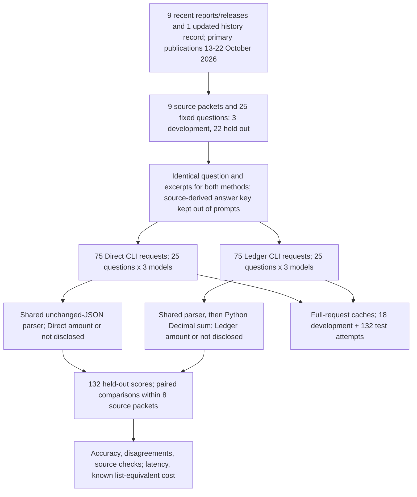
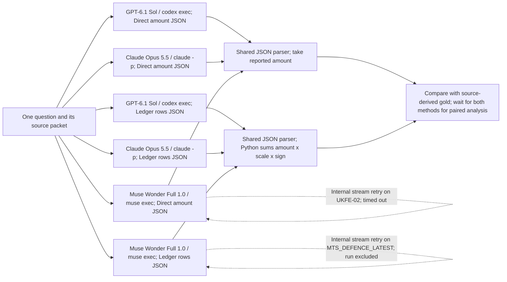

# Fiscal measurement from recent public reports

A government report can mention a programme's budget, an expense recorded in its accounts and a payment that has reached somebody's bank. These numbers answer different questions. A researcher building a spending series, or a journalist checking a promise, needs to know which number the document actually supports.

Suppose an agency receives grants and uses part of the money to repay a lease. Its net financing inflow is smaller than the grants it received. Reporting that net figure as the amount of government funding would subtract a payment that belongs to a different part of the question. The error can survive even when every number was copied correctly.

The Money and Pensions Service's newly published accounts give a real example. Its cash-flow statement reports grant receipts of GBP 203.555 million from the Department for Work and Pensions (DWP), GBP 2.100 million from HM Revenue and Customs (HMRC), and GBP 0.583 million from the Ministry of Justice (MoJ). Together these are GBP 206.238 million. The statement's net financing inflow is GBP 206.023 million, after lease principal of GBP 0.182 million and interest of GBP 0.033 million. Both totals are valid, but only the first answers a question about gross grant receipts. This is measured case `MAPS-01`; the model answers appear below.

The ordinary approach is to read the question, find the relevant table and notes, select the right amounts and calculate the answer. A language model can perform all of those steps in one response. Another approach asks the model to make a ledger: a short list of source numbers, their units, addition or subtraction signs, and supporting quotations. Python then does the arithmetic. A ledger can expose a wrong inclusion or unit conversion, but it also asks the model to produce more fields. It does not make an unsupported number true.

This notebook tests that choice on nine public fiscal reports or releases published from 13 to 22 October 2026, with an updated publication-history page as auxiliary context. It extends an earlier synthetic pilot, where every valid answer had the correct financial values and the ledger's only apparent gain was cleaner JSON formatting. The original caches, figures and [archived explanation](data/synthetic_v1_README.md) remain available.

The question is whether a ledger improves the correctness of fiscal amounts and missing-disclosure decisions when Direct and Ledger receive the same real source excerpts. The new study has 25 questions from nine source packets and ten official source records. Three questions from one packet are development checks. The primary comparison uses 22 held-out questions from eight packets, with one Direct and one Ledger request to each of GPT-6.1 Sol through Codex, Claude Opus 5.5 through Claude Code, and Muse Wonder Full 1.0 through Muse.

An answer is correct under the primary score when its run satisfies the fixed rules and it returns the supported amount in the requested units, or correctly says that the supplied documents do not disclose it. Six held-out questions have no disclosed amount; 16 have a supported amount, including one explicit zero. Accuracy counts every question, including a request that fails or cannot be parsed. For example, 21 correct answers out of 22 means 95.5% accuracy. Cleaner JSON is measured separately, using the same unchanged-object recovery rule for both methods.

GPT-6.1 Sol: Direct 22/22, Ledger 22/22; Claude Opus 5.5: Direct 22/22, Ledger 22/22; Muse Wonder Full: Direct 21/22, Ledger 21/22. Across the six model-method combinations, 130 of 132 held-out answers were correct. This run found no demonstrated gain in completed financial answers from the ledger. Run failures are reported separately from financial mistakes. The selected sample is too small to establish equivalence on other records. All 130 protocol-valid held-out answers have the correct financial amount or status. A separate unchanged-payload check also finds the excluded Muse Ledger answer financially correct: all 131 completed parseable answers have the right amount or status. That diagnostic does not replace the fixed one-attempt score.

The main caveat is the small, selected sample. These are English excerpts chosen to contain relevant evidence and difficult nearby figures. Most packets contain one report. This tests reading and measurement after retrieval, rather than finding every relevant document on the open web. A recent publication date also does not prove that every underlying financial fact was previously unseen by a model.

## Contents

- [1. Configuration and fixed inputs](#1-configuration-and-fixed-inputs)
- [2. Documents and the answer key](#2-documents-and-the-answer-key)
- [3. Direct answers and the ledger](#3-direct-answers-and-the-ledger)
- [4. Financial answer results](#4-financial-answer-results)
- [5. Worked cases and error analysis](#5-worked-cases-and-error-analysis)
- [6. Format and source checks](#6-format-and-source-checks)
- [7. Time and spend](#7-time-and-spend)
- [8. Limits and reproduction](#8-limits-and-reproduction)
- [9. Future work and further reading](#9-future-work-and-further-reading)



For `MAPS-01`, the annual report enters as one frozen text excerpt. Each method receives the same gross-grant question and the same tables. Direct returns an amount. Ledger returns the selected source numbers, and Python adds them after converting thousands of pounds into millions. Both answers are compared with GBP 206.238 million. The three questions from this report remain together when uncertainty is estimated.

## 1. Configuration and fixed inputs

The published run uses medium reasoning effort for all three models. Those vendor labels do not guarantee equal hidden computation. The comparison that answers this notebook's question is within each model: the evidence is held fixed while the response method changes.

The notebook configuration defaults to a full replay of saved responses. Live mode is explicit and defaults to only two questions. Model selection, new-call limits and the Claude list-equivalent budget are visible at the top. Codex and Muse do not expose a cash charge attributable to each request, so a call cap also limits their use.

The development run produced 17 correct completed answers and one Muse ledger timeout. Before any held-out request, the timeout was increased from 120 to 300 seconds for all three models. The failed development request was retained and was not retried. The original and amended protocol files record this change. Questions, evidence, gold labels, prompts and scoring were unchanged.

## 2. Documents and the answer key

The source packets include complete selected financial tables with their headers, comparative columns and relevant notes, as well as substantive sections from official releases. HTML table cells were kept in order. The UK annual-report PDFs were extracted with Poppler; the Treasury PDF used pdfplumber. Tables were checked against rendered pages. One Treasury footnote required a reading-order repair because the extraction interleaved it with a neighbouring note. Its words and numbers were preserved.

| Packet | Publication | Questions | What can go wrong |
| --- | --- | --- | --- |
| [UK Fusion Energy accounts](https://www.gov.uk/government/publications/uk-fusion-energy-ltd-annual-report-and-accounts-202526/uk-fusion-energy-ltd-annual-report-and-accounts-202526-accessible-version) | 13 Oct | 3 test | Asset values and programme spending mistaken for cash; a supported zero |
| [Money and Pensions Service accounts](https://www.gov.uk/government/publications/money-and-pensions-service-annual-report-and-accounts-2025-to-2026) | 20 Oct | 3 test | Net financing and investing totals mistaken for gross receipts or purchases |
| [National Forest Company accounts](https://www.gov.uk/government/publications/national-forest-company-annual-report-and-accounts-2025-to-2026) | 15 Oct | 3 test | Pounds versus millions; group versus parent; accrued lease costs |
| [Post Office Horizon redress](https://www.gov.uk/government/publications/post-office-horizon-financial-redress-and-legal-costs-data-for-2026/post-office-horizon-financial-redress-data-as-of-30-september-2026) and [update history](https://www.gov.uk/government/publications/post-office-horizon-financial-redress-and-legal-costs-data-for-2026) | 16 Oct; corrected 22 Oct | 3 test | Closed scheme omitted; interim payments confused with final settlements |
| [US September Monthly Treasury Statement](https://fiscaldata.treasury.gov/static-data/published-reports/mts/MonthlyTreasuryStatement_202609.pdf) | 16 Oct | 3 test | Fiscal year versus quarter; offsets; an already-incorporated revision |
| [Office for National Statistics (ONS), September public sector finances](https://www.ons.gov.uk/economy/governmentpublicsectorandtaxes/publicsectorfinance/bulletins/publicsectorfinances/september2026) | 21 Oct | 3 test | Net cash requirement confused with gross accrued expenditure |
| [EU Ukraine support release](https://cyprus.representation.ec.europa.eu/news/commission-disburses-eur286-billion-ukraine-drones-missiles-and-urgent-battlefield-needs-2026-10-14_en) | 14 Oct | 3 test | New defence cash confused with available future budget support |
| [European Parliament storm-aid vote, European Union Solidarity Fund (EUSF)](https://www.europarl.europa.eu/news/en/press-room/20261018IPR48259/parliament-backs-storm-recovery-aid-for-portugal-spain-italy-and-malta) | 21 Oct | 1 test | Approval and past advances mistaken for new same-day payment |
| [EU Sweden/Netherlands Recovery and Resilience Facility (RRF) payments](https://ec.europa.eu/commission/presscorner/detail/en/mex_26_2159) | 14 Oct | 3 development | New payments versus cumulative totals; false precision from percentages |

The eight held-out packets contain seven groups of three questions and one single-question packet. That is 22 questions, rather than 22 independent document settings. The Horizon packet contains the payment release and its publication/update history; the other packets each contain one official source record. The test includes GBP, EUR and USD questions but does not convert currencies or average monetary errors across currencies.

Two measures need particular care. The US Monthly Treasury Statement uses modified cash accounting, with public-debt interest accrued rather than counted only when cash moves. Its questions therefore ask for reported net budget outlays, not strict gross bank payments. The ONS net cash requirement is the net financing that central government needs to raise, not a gross spending total. Converting the bulletin's GBP 16.9 billion into 16,900 million preserves the displayed precision; it does not create precision to the nearest million. The Treasury quarter target is likewise the sum of the displayed, rounded July, August and September cells.

Each question specifies the entity, period and measure. An amount reported in billions is converted into millions. A gross receipt includes all the requested inflows before deductions; a net amount has specified inflows or outflows offset against one another. An accrual records an expense when the obligation arises, which can precede the cash payment. These distinctions determine the answer key, rather than a rule that every prominent amount must be cash.

The answer key is derived from quotations, tables and explicit arithmetic. A second agent independently checked the UK/US cases and annual-report calculations against the sources. These were AI-agent documentary checks, not independent human coding. The root reviewer also checked the selected EU cases. The saved [gold review](data/real_v2/gold_review.json) records the roles and exclusions. The Renewables Obligation statement was excluded before collection because its units and cash basis were ambiguous. A redundant country-level storm-aid question was also excluded.

For a question asking for a published rounded value, the target is that displayed value. `HORIZON_REPORTED_CHANGE`, for example, asks for the difference between the reported GBP 1,731 million and GBP 1,697 million totals: GBP 34 million. This does not establish an exact September bank-payment total, because the publication says prior payments can be retrospectively confirmed. Numerical scoring uses tight absolute Decimal tolerances, with no relative tolerance that could excuse a large monetary error on a large budget.

Muse Wonder Full's release on 12 October 2026 supplies the latest conservative freshness bound. GPT-6.1 Sol's documented cutoff is 30 April 2026; Claude Opus 5.5 lists June 2026. Primary report and release publications are restricted to 13-22 October. The auxiliary Horizon history page was first published on 9 February and updated on 22 October; its frozen `published_on` field refers to that update, while `original_page_published_on` retains the original date. This qualification is documented in [provenance_notes.json](data/real_v2/provenance_notes.json), and the frozen prompts were not silently changed. No scored amount comes from an older entry on that history page.

The annual reports describe the year ended March 2026, and individual facts may have appeared earlier. Publication recency reduces an obvious source of leakage but does not certify unseen facts. Publication evidence, source licences, exact text hashes and raw-download hashes are saved in [sources.json](data/real_v2/sources.json); model dates and official documentation links are in [model_metadata.json](data/real_v2/model_metadata.json).

## 3. Direct answers and the ledger

Direct receives the question and source text and returns a status, a final amount, source IDs and a brief explanation. Ledger receives the same question and source text. It returns included source amounts with their scales and signs, plus quotations and excluded figures. Python multiplies each amount by its scale and sign, then adds the rows. A thousand pounds has scale 0.001 when the target is million GBP; a billion euros has scale 1000 when the target is million EUR.

Both methods are told to distinguish cash, allocations, forecasts, commitments, approvals, requests and balances. Both may answer `not_disclosed`. Neither may turn missing evidence into zero. Ledger may encode zero when the source explicitly says that no payments were made. Both use the same fixed parser: a single complete JSON object can be recovered unchanged from surrounding prose or a fence. Values are never repaired, and no model is called to fix an answer.



The six requests are independent. They do not exchange messages, see the other method's answer, or receive the gold labels. The runner randomizes request order and permits at most three concurrent CLI processes. Each request starts in a temporary directory with tools disabled. Raw CLI events, requested model IDs, returned model identities where available, token usage and latency are cached. Codex's event stream does not return a model identity, so its identity evidence is the explicit CLI model argument; Claude and Muse also return model identity metadata.

The fixed run checks require a successful terminal response, the requested model where returned identity is available, no tool calls and no observed extra model attempt. The runner never retries or repairs an answer. Muse's internal retry behaviour is visible in two held-out event streams despite the one-step CLI setting. One request timed out; the other returned a correct answer after a failed stream and was marked invalid under these unchanged rules.

Consider `MAPS-02`. The exact question is:

> For the Money and Pensions Service in the year ended 31 March 2026, what was the gross cash spent purchasing intangible assets and property, plant and equipment combined, without netting off proceeds from disposals? Report a positive outflow in million GBP.

The statement's current-year column has purchases of intangibles of 12,234, purchases of property, plant and equipment of 1,074, and disposal proceeds of 7, all in thousands of pounds. The requested gross outflow is `(12,234 + 1,074) x 0.001 = 13.308` million GBP. The net investing outflow of 13.301 million GBP includes the sale proceeds and answers a different question.

Claude's actual Ledger response for this case is reproduced without editing:

```json
{"status":"known","entries":[{"source_id":"UK-MAPS-20261020","label":"Purchase of intangibles, year ended 31 March 2026 (cash outflow)","amount":12234,"scale":0.001,"sign":1,"quote":"Purchase of intangibles                                        3                                  (12,234)                          (12,584)"},{"source_id":"UK-MAPS-20261020","label":"Purchase of property, plant, equipment, year ended 31 March 2026 (cash outflow)","amount":1074,"scale":0.001,"sign":1,"quote":"Purchase of property, plant, equipment                         4                                    (1,074)                             (44)"}],"exclusions":[{"source_id":"UK-MAPS-20261020","label":"Proceeds from sale of property, plant, equipment £7k (2025/26)","reason":"Question asks for gross purchases without netting off disposal proceeds."},{"source_id":"UK-MAPS-20261020","label":"Net cash outflow from investing activities £13,301k","reason":"Net figure includes disposal proceeds; components used instead to avoid double counting."},{"source_id":"UK-MAPS-20261020","label":"Grant-in-Aid incurred on capital expenditure £12.2 million","reason":"Funding allocation measure, not cash paid for asset purchases; overlaps with cash flow lines."},{"source_id":"UK-MAPS-20261020","label":"Prior-year purchases (£12,584k intangibles, £44k PPE) and PPE note additions for 2024/25","reason":"Relate to year ended 31 March 2025, not the requested period."}]}
```

Python's parsed amount is 13.308 million GBP. The expected amount is 13.308 million GBP, and the answer is correct under the fixed score. A numerical match is separate from a quotation match: copying a real passage does not establish that a number belongs to the right year or measure. The later audit checks copied numerals as well as literal passages, while the worked cases examine their meaning.

The complete common instruction, method contracts and one full worked request are displayed in the linked notebook. Every exact prompt is also saved with its full-request hash in the cache. The request manifest was frozen before development and the held-out deadline amendment was frozen before any held-out response.

## 4. Financial answer results

Compare Direct and Ledger within each model. Accuracy is the fraction of the 22 held-out questions with the right supported amount or missing-disclosure status. The difference is Ledger minus Direct, in percentage points. A positive value favours Ledger. The paired counts show whether one method corrected a case the other missed, rather than only comparing two averages.

| Model | Direct correct | Ledger correct | Ledger-only correct | Direct-only correct | Difference; 95% packet interval |
| --- | --- | --- | --- | --- | --- |
| GPT-6.1 Sol | 22/22 | 22/22 | 0 | 0 | +0.0 pp; [+0.0, +0.0] |
| Claude Opus 5.5 | 22/22 | 22/22 | 0 | 0 | +0.0 pp; [+0.0, +0.0] |
| Muse Wonder Full | 21/22 | 21/22 | 1 | 1 | +0.0 pp; [-12.5, +12.5] |

GPT-6.1 Sol: Direct 22/22, Ledger 22/22; Claude Opus 5.5: Direct 22/22, Ledger 22/22; Muse Wonder Full: Direct 21/22, Ledger 21/22. This run found no demonstrated gain in completed financial answers from the ledger. Run failures are reported separately from financial mistakes. The selected sample is too small to establish equivalence on other records. There were 2 held-out request failures. All failures remain in the denominator. All 130 protocol-valid held-out answers have the correct financial amount or status. A separate unchanged-payload check also finds the excluded Muse Ledger answer financially correct: all 131 completed parseable answers have the right amount or status. That diagnostic does not replace the fixed one-attempt score. The original pilot's prose-before-JSON failure would not by itself change this primary result, because both methods now receive the same deterministic recovery rule.


The left panel shows correct-answer percentages; the right shows the paired difference. Intervals are the 2.5th and 97.5th percentiles from 10,000 resamples of the eight complete source packets, using seed 22061022. Each sampled packet brings all of its questions, and the score is divided by the number of sampled questions. Related questions are never resampled as if they were separate publications. With only eight purposively selected packets, these intervals cannot describe all public fiscal records.

For GPT-6.1 Sol, Claude Opus 5.5, every observed paired difference is zero. Resampling those same pairs always gives zero, so their displayed [0, 0] difference intervals are degenerate. They do not establish equivalence on other documents. The intervals describe only variation among these eight observed packets. The three model comparisons are exploratory.

| Model | Method | Known amount correct | Not disclosed correct |
| --- | --- | --- | --- |
| GPT-6.1 Sol | Direct | 16/16 | 6/6 |
| GPT-6.1 Sol | Ledger | 16/16 | 6/6 |
| Claude Opus 5.5 | Direct | 16/16 | 6/6 |
| Claude Opus 5.5 | Ledger | 16/16 | 6/6 |
| Muse Wonder Full | Direct | 15/16 | 6/6 |
| Muse Wonder Full | Ledger | 15/16 | 6/6 |

The known-amount subgroup contains 16 questions, including one explicit zero. The missing-disclosure subgroup contains six. A missing disclosure is conditional on the supplied excerpts, not a claim that no payment occurred in the world or that no other public source could reveal it. Returning an invented cash value on one of these cases is an error even if the value is a real budget allocation.

## 5. Worked cases and error analysis

2 of 132 held-out requests failed the fixed success criteria. The table lists every failure, so selected examples do not replace the denominator.

| Case | Model | Method | Observed | Expected | Run valid |
| --- | --- | --- | --- | --- | --- |
| MTS_DEFENCE_LATEST | Muse Wonder Full | Ledger | 916,836 (run invalid) | 916,836 | False |
| UKFE-02 | Muse Wonder Full | Direct | no completed answer | 0 | False |

`MTS_DEFENCE_LATEST`, Muse Wonder Full ledger: The reported actual fiscal-year value already incorporates the USD 18m downward August correction. It is not the full-year budget estimate, and the superscript 1 is a footnote marker. The saved response was 916,836 (run invalid). The CLI returned a correct 916,836 million USD payload after an internal retry. Its usage records two model attempts, one failed and one completed. The fixed run validator rejects that extra attempt, so the primary score stays incorrect even though the unchanged payload is financially correct. This is a run-rule failure, not a financial reasoning error.

`UKFE-02`, Muse Wonder Full direct: The source explicitly states no rental payments were made. The land valuation is non-cash recognition, so this is a supported zero, not a missing disclosure. The saved response was no completed answer. The request timed out without a completed answer. For the held-out Muse Direct request, the raw event stream also records an internal retry after HTTP 504. This is a workflow failure, not evidence of a wrong completed financial calculation.

The case map shows every held-out question for each model. Compare the symbols as well as the colours: both-correct ties are different from both-wrong ties, even though either has a zero method difference. Packet labels identify questions sharing the same source report.


Across the 66 paired model-question comparisons, Ledger alone is correct on 1, Direct alone is correct on 1, both are correct on 64, and both are wrong on 0. The map identifies the source concentration of any differences; it does not turn several rows from one report into independent replications.

The following six cases were chosen to teach distinct measurement problems: gross versus net, an embedded revision, a negative net amount, an explicit zero, an accrual-to-cash gap and an undisclosed settlement. `MAPS-02` above supplies the end-to-end arithmetic example. Every numerical table below is generated from the saved responses, and all remaining cases are available in [test_case_scores.csv](data/real_v2/results/test_case_scores.csv).


### MAPS-01: Gross grant receipts

> For the Money and Pensions Service in the year ended 31 March 2026, how much gross cash grant-in-aid was received from DWP, HMRC and MoJ combined, before lease principal and interest payments? Use the detailed cash-flow statement and report million GBP.

The cash-flow statement lists grant inflows of 203,555, 2,100 and 583 in thousands of pounds. Their sum is GBP 206.238 million. The net financing total of GBP 206.023 million has already subtracted lease principal and interest. Reporting the net total as gross funding would understate receipts by GBP 0.215 million.

| Model | Direct | Ledger | Expected |
| --- | --- | --- | --- |
| GPT-6.1 Sol | 206.238 | 206.238 | 206.238 |
| Claude Opus 5.5 | 206.238 | 206.238 | 206.238 |
| Muse Wonder Full | 206.238 | 206.238 | 206.238 |

All six answers select gross receipts of GBP 206.238 million. Neither method substitutes the GBP 206.023 million net financing total, so neither understates these grant receipts by the GBP 0.215 million of lease payments.


### MTS_DEFENCE_LATEST: A correction already included in the total

> What are the latest reported fiscal-year-2026 net budget outlays for Department of Defense--Military Programs in the September final statement, in million USD? Incorporate the reported August correction exactly once.

The final Treasury statement reports fiscal-year Defense military-programme net outlays of USD 916,836 million. Its footnote says the amount was decreased by USD 18 million for additional August reporting. The final figure already contains that correction, and another table repeats it. Subtracting 18 again would incorrectly give 916,818. This is a revision-reading test, not evidence that the notebook recovered an independently archived earlier vintage.

| Model | Direct | Ledger | Expected |
| --- | --- | --- | --- |
| GPT-6.1 Sol | 916,836 | 916,836 | 916,836 |
| Claude Opus 5.5 | 916,836 | 916,836 | 916,836 |
| Muse Wonder Full | 916,836 | 916,836 (run invalid) | 916,836 |

All six emitted answers contain the supported USD 916,836 million amount, and none subtracts the USD 18 million correction again. Five requests pass the fixed run rules; Muse Ledger is excluded because its CLI retried internally. The completed financial values agree even where the primary run scores differ.


### MTS_CCC_NET: Negative net outlays still include gross payments

> What are the Commodity Credit Corporation net budget outlays for September 2026 after applicable receipts, in million USD? Preserve the sign.

The September Commodity Credit Corporation row shows gross outlays of USD 355 million and applicable receipts of USD 690 million. Net outlays are therefore minus USD 335 million. A negative net amount does not mean that no gross payment was made. Treating the sign as an error would reverse the fiscal measurement.

| Model | Direct | Ledger | Expected |
| --- | --- | --- | --- |
| GPT-6.1 Sol | -335 | -335 | -335 |
| Claude Opus 5.5 | -335 | -335 | -335 |
| Muse Wonder Full | -335 | -335 | -335 |

All six answers return minus USD 335 million. Both methods preserve the distinction between gross payments and net outlays when receipts exceed payments; neither replaces the negative amount with zero.


### UKFE-02: An explicit zero beside a large asset value

> How much rent did UK Fusion Energy Ltd pay during the year ended 31 March 2026 for the 99-year West Burton land and St Ives Bungalow arrangement granted by UKAEA on 23 March 2026? Report cash paid in million GBP.

UK Fusion Energy reports a land and building valuation of GBP 17.904 million for the West Burton and St Ives Bungalow arrangement. The note explicitly states that no rental payments were made or payable. The requested rent paid is therefore zero. The valuation changes the accounts without establishing a cash rent payment.

| Model | Direct | Ledger | Expected |
| --- | --- | --- | --- |
| GPT-6.1 Sol | 0 | 0 | 0 |
| Claude Opus 5.5 | 0 | 0 | 0 |
| Muse Wonder Full | no completed answer | 0 | 0 |

The five completed answers return zero, matching the explicit no-payment statement. Muse Direct supplies no answer before the timeout. The observed method difference is therefore request completion, not one method mistaking the GBP 17.904 million asset value for rent paid.


### UKFE-03: An expense does not disclose category cash

> What exact cash amount did UK Fusion Energy Ltd pay for goods and services, excluding staff and capital purchases, during the year ended 31 March 2026? Report in million GBP only if that cash amount is established by the supplied report.

The income statement reports goods-and-services expense of GBP 88.091 million. Its aggregate operating cash-flow reconciliation does not split receivable and payable movements enough to calculate the cash paid for that category. The supported answer is not disclosed, rather than 88.091 or zero.

| Model | Direct | Ledger | Expected |
| --- | --- | --- | --- |
| GPT-6.1 Sol | not disclosed | not disclosed | not disclosed |
| Claude Opus 5.5 | not disclosed | not disclosed | not disclosed |
| Muse Wonder Full | not disclosed | not disclosed | not disclosed |

All six answers say the cash amount is not disclosed. Neither method treats the GBP 88.091 million accrual expense as category cash expenditure or interprets the missing breakdown as zero. Another source could still disclose that cash amount.


### FOREST-03: A lease liability does not disclose a settlement

> What exact cash settlement had the National Forest Company paid by 31 March 2026 to surrender its former office lease after vacating in January 2026? Report in million GBP only if the supplied report establishes cash paid for that surrender.

The National Forest Company vacated its office in January 2026 and began negotiations to surrender its lease. It accrued the remaining onerous costs as a liability at 31 March. Neither the annual lease expense nor zero future minimum rentals establishes a cash surrender settlement. The requested cash amount is not disclosed.

| Model | Direct | Ledger | Expected |
| --- | --- | --- | --- |
| GPT-6.1 Sol | not disclosed | not disclosed | not disclosed |
| Claude Opus 5.5 | not disclosed | not disclosed | not disclosed |
| Muse Wonder Full | not disclosed | not disclosed | not disclosed |

All six answers say the settlement amount is not disclosed. Neither method converts the accrued liability or the absence of future minimum rentals into a reported cash settlement. This result is conditional on the supplied annual-report excerpt.

## 6. Format and source checks

A correct total is one outcome; an inspectable path to that total is another. Strict format requires one JSON object with exactly the requested schema. The reported format rate also requires a valid run: the excluded Muse retry counts as a failure even though its final JSON has the correct schema. Source checks ask whether cited IDs belong to the supplied packet and whether each ledger quotation occurs in the source after whitespace normalization. A second check asks whether the entry copies a numeral found in that quotation, allowing grouping and sign direction, or uses an explicit no-payment statement to support zero.

| Model | Direct strict format | Ledger strict format | Ledger entries passing passage + numeral check | Nonempty ledger outputs |
| --- | --- | --- | --- | --- |
| GPT-6.1 Sol | 22/22 | 22/22 | 23/25 | 16 |
| Claude Opus 5.5 | 22/22 | 22/22 | 26/26 | 16 |
| Muse Wonder Full | 21/22 | 21/22 | 25/25 | 15 |

The ledger entry denominator excludes empty `not_disclosed` ledgers. It includes all entries in valid parsed nonempty outputs, rather than counting an unknown answer as a perfectly grounded zero-row calculation. A quote can pass the text check yet still refer to the wrong year, unit or measure. These automatic checks therefore do not certify semantic support or complete event coverage.


Across the three ledger methods, 74 of 76 eligible entries pass both literal-passage and copied-numeral checks. Across all methods, 130 of 132 held-out responses satisfy the strict format and run checks. All 131 emitted payloads have valid JSON and the requested schema; the lower run-gated count should not be read as a completed-payload formatting error. These denominators answer different questions and should not be combined into one accuracy score.

Two GPT Ledger responses illustrate why those checks are separate. In `UKFE-01`, GPT joins the cash-flow heading and unit header to the investing rows, skipping the operating section between them. In `MTS_DEFENCE_LATEST`, it joins the Defense table row to a footnote elsewhere on the page. This is the actual quotation returned for the latter case:

```text
Department of Defense--Military Programs 84,221 [1]916,836    868,412    913,705
1 Amount decreased by $18 million due to additional reporting for the month of August 2026.
```

Both parts occur in the Treasury source, and the selected USD 916,836 million is the correct current-year amount. They do not form a single continuous passage, so the fixed literal-match check fails. The same distinction applies to the UK Fusion Energy response: its GBP 10.595 million answer is correct, while its quotation omits intervening rows. These are quotation-compliance failures, not fabricated financial values. The independent [response review](data/real_v2/response_review.json) records the exact requests and checks of passing multi-entry ledgers and missing-disclosure explanations.

The copied-numeral check matters because a model could calculate 13.308 itself, place it in a ledger row, and quote a passage containing only 12,234 and 1,074. Its final amount would be correct, but the claimed extraction-and-calculation method would not have been followed. A regression check confirms that this constructed audit example fails component compliance while preserving the separate outcome score. It is a validator test, not an observed model failure.

In this run, 23 of 47 valid known-amount Ledger responses contain more than one row. The remaining 24 contain one row, so Python only scales or signs that selected number. This descriptive count helps explain the scope of the arithmetic comparison: many of these questions test selecting the right reported amount rather than calculating a long sum.

## 7. Time and spend

The relevant comparison is the extra work required by the ledger within a model. The table and figure below use held-out requests only, with 22 requests per model-method group. Latency is elapsed CLI time, including startup, service delay and recorded failure durations. A timeout duration is not successful completion time. This is not a measurement of human review time, and the three-way concurrency can affect waiting time.

| Model | Direct median seconds | Ledger median seconds | Direct Claude list USD | Ledger Claude list USD |
| --- | --- | --- | --- | --- |
| GPT-6.1 Sol | 6.6 | 9.3 | unavailable | unavailable |
| Claude Opus 5.5 | 5.2 | 7.6 | 1.955826 | 2.177798 |
| Muse Wonder Full | 53.6 | 52.1 | unavailable | unavailable |


GPT-6.1 Sol took a median 6.6 seconds for Direct and 9.3 seconds for Ledger. Claude took 5.2 and 7.6 seconds; Muse took 53.6 and 52.1 seconds. The cost panel shows only the known Claude list-equivalent amounts. Blank Codex and Muse dollar costs mean unavailable, not zero.

Collection used 150 experimental CLI invocations: 18 development and 132 held-out, with 50 to each model. There were 3 invalid runs in total, including the retained Muse development timeout. The runner made no retry or answer-repair calls. Muse's event streams show internal retry activity on two held-out invocations; one timed out, while the other finished with two reported provider attempts. The 150 invocations therefore do not equal all underlying provider attempts. Claude's reported list-price equivalent for this new study is USD 4.28489600. Attributable cash charges for the authenticated subscriptions are unknown. This is not a complete cash bill, and Muse Wonder Full is not assigned the API price of a different Muse tier.

The earlier synthetic pilot is separate: it recorded 240 evaluated CLI requests plus one wording-authoring request, Claude list equivalent of USD 3.009032 and OpenRouter metered cost of USD 0.00052039. Those old calls are not part of the new 150-request estimate. Every new response is cached, including the timeout and any partial output, so offline replay makes no paid calls.

## 8. Limits and reproduction

This run found no demonstrated gain in completed financial answers from the ledger. Run failures are reported separately from financial mistakes. The selected sample is too small to establish equivalence on other records. A ledger supplies a list of included and excluded figures that a reviewer could inspect. This run does not establish whether that inspection benefit pays for the extra output and time. It also does not establish that a ledger improves the extraction of a fiscal time series, the estimated effect of spending on the economy, or the speed of a human auditor.

Several limits affect that decision. The sample is purposive and small, with one response per model-method-question. Most questions use one report rather than a long chronology of conflicting releases. The selected excerpts retain distracting numbers but remove most retrieval work. The questions name the requested measure and period, and both methods receive guidance about double counting and missing evidence; less precise questions could perform differently. The answer key has source checks and arithmetic review by AI agents, not two blinded human economists. Some missing-disclosure decisions could change if another document were supplied. Source publication dates are recent, while many measured events are earlier. The real-document ledger also differs from the synthetic pilot's event-ID reconciliation algorithm, so the two studies are not a controlled before-and-after comparison of difficulty alone.

The notebook is [22_fiscal_implementation.ipynb](22_fiscal_implementation.ipynb). Run from its directory:

```powershell
python -m jupyter nbconvert --to notebook --execute --inplace 22_fiscal_implementation.ipynb
```

Default execution reads the committed source excerpts and response caches. It refuses a cache miss before any model transport. Raw PDFs and HTML downloads are git-ignored; their URLs, licences and hashes are recorded, and the frozen excerpts are sufficient for replay. No source download is needed to reproduce the scores.

For a small live profile, set `NB_REAL_V2_LIVE=1`. It selects two development questions by default. `NB_REAL_V2_N_CASES`, `MODELS` and `NB_REAL_V2_MAX_NEW_CALLS` control size; the default new-call cap is 12. Existing matching responses are reused. The total cache cap is 180 attempts, Claude's list-equivalent ceiling is USD 20, and at most three CLIs run at once. A partial live profile prints its results without overwriting the published full-grid analysis. A changed question or prompt requires a new named protocol and request manifest; do not delete the published cache to hide or reroll failures.

| Saved item | Purpose |
| --- | --- |
| [cases.json](data/real_v2/cases.json) | Fixed questions, source IDs, gold amounts/status, absolute tolerances and evidence |
| [sources.json](data/real_v2/sources.json) | Exact official excerpts, publication evidence, licences and hashes |
| [protocol.json](data/real_v2/protocol.json) and [request_manifest.json](data/real_v2/request_manifest.json) | Methods, scoring contract and all full-request hashes |
| [transport_amendment.json](data/real_v2/transport_amendment.json) | The pre-test timeout change and its development evidence; initial freeze also retained |
| `data/real_v2/cache/<request hash>/` | Immutable start and result records with full prompts, raw CLI events, usage and latency |
| [analysis_summary.json](data/real_v2/results/analysis_summary.json) | Counts, denominators, paired packet intervals and currency-separated errors |
| [scores.json](data/real_v2/results/scores.json) | All 150 rescored responses, including development and failures |
| [spend.json](data/real_v2/results/spend.json) | List-equivalent amounts, unknown dollar costs and call counts |
| [offline_audit.json](data/real_v2/offline_audit.json) | Frozen-input checks, unchanged-cache checks and zero-call replay |
| [synthetic_v1_README.md](data/synthetic_v1_README.md) | Historical explanation of the initial synthetic pilot |

The notebook contains its own runner, parser, Decimal calculator, source checks and plotting functions. It imports no helper from this repository. Its committed outputs and README figures are generated from the same saved rows.

## 9. Future work and further reading

Links checked on 22 October 2026. These readings place the measurement task in the wider use of models to construct economic data.

### Future work

- Collect at least 100 source packets across institutions and languages, with two blinded human coders resolving the answer key. Measure paired financial accuracy and coder disagreement. The present eight held-out packets and agent-reviewed gold leave uncertainty about generalization and ambiguous disclosures.
- Supply complete multi-release histories with revisions, stale cumulative totals and missing settlement dates. Measure duplicate counting and revision errors against dated source evidence. Most current packets contain one report, and the Defense correction is already incorporated in the final table.
- Randomize human reviewers to Direct answers or Ledger records and measure review minutes, corrected errors and errors that survive review. The current source checks show only whether passages and numerals were copied; no human audit benefit was measured.
- Repeat each model-method-question several times and add a condition that deliberately requires several source components to be combined. Measure reliability and the share of calculations actually delegated to Python. One response per arm and source totals that can sometimes be copied limit the current comparison.

### Further reading

- [AI Meets Fiscal Policy: Mapping Government Spending Actions Across 64 Countries](https://www.imf.org/-/media/files/publications/wp/2026/english/wpiea2026043-source-pdf.pdf) (Das et al., 2026). Uses document extraction to build a fiscal policy series, motivating careful distinctions between policy actions and measured spending.
- [Learning to Regulate: A New Event-Level Dataset of Capital Control Measures](https://arxiv.org/abs/2505.23025) (Sun et al., 2025). Provides a related economic event-extraction setting in which dates, policy status and structured attributes matter.
- [Inference for Regression with Variables Generated by AI or Machine Learning](https://arxiv.org/abs/2402.15585) (Battaglia et al., 2024, revised 2025). Explains why treating model-generated measurements as error-free data can distort downstream economic inference.
