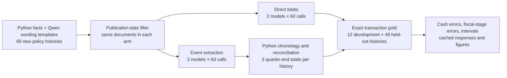
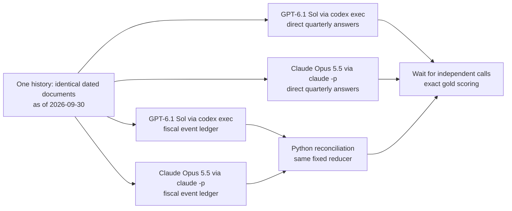
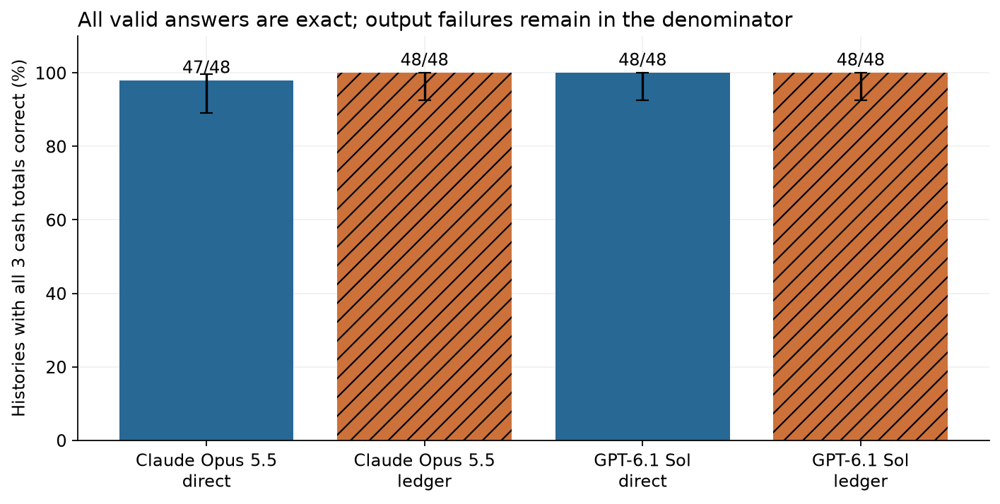
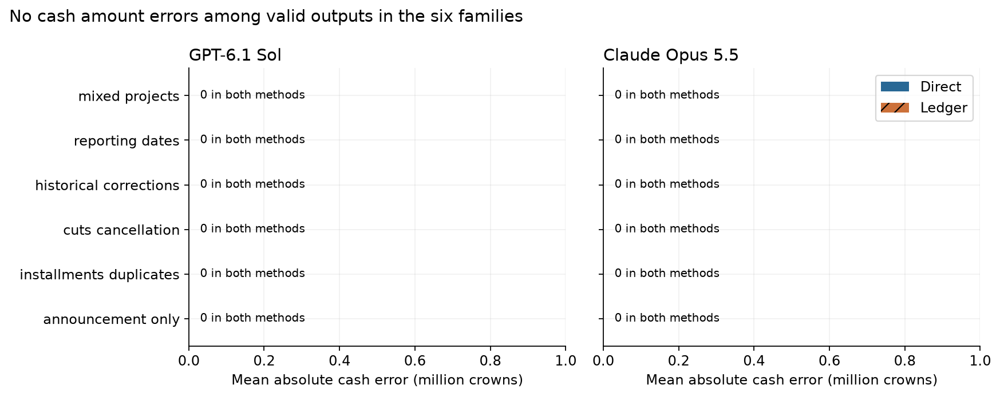
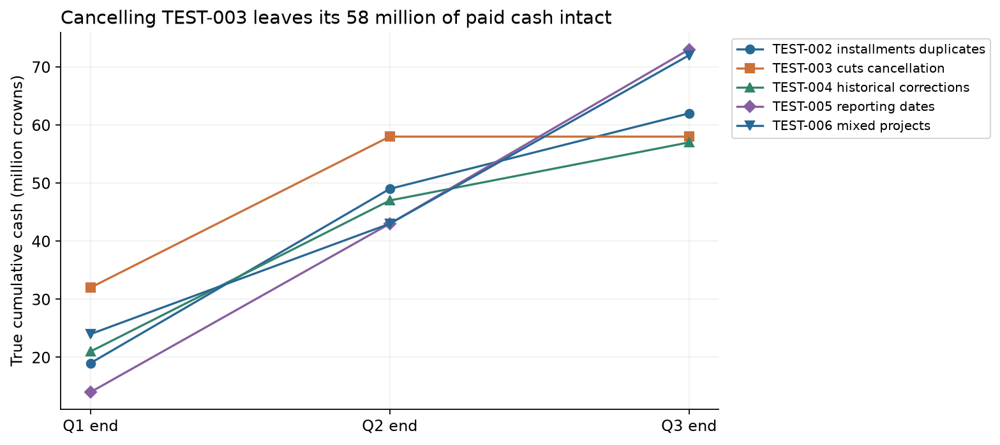

Historical synthetic pilot, archived before the real-document extension. The figures and numbers below describe the original 241-request study. Its reproduction instructions apply to commit b05e85be2be47adee0ff78ba0b963a04fd22658a. The current notebook runs the real-document study.

# From spending announcements to cash actually paid

A government announces a new clinic. Parliament approves funding, a contractor signs an agreement, and the treasury pays the first installment. These are separate economic events. An economist using document-based spending data needs to decide whether the variable measures a promise, permission to spend, a commitment, or money that has actually left the treasury.

Here implemented spending means settled cash paid to an external recipient. Budget authority is a ceiling, not a payment. A signed but unpaid contract is also not cash. A cancellation can leave past cash positive while reducing active authority to zero. This distinction matters because counting an announcement as implementation can put spending in the wrong quarter or count money that was never paid.

For an illustrative clinic, a 100-million announcement, an 80-million approval and a 20-million payment imply 20 million of implemented spending. If the programme is then cancelled without a refund, the 20 remains paid. A useful answer should preserve that history instead of choosing the last or largest amount in the documents.

The ordinary approach is to read each document, identify its programme and fiscal stage, then reconcile repeated reports and revisions. A direct model answer combines these steps. An event ledger makes them explicit: the model records dated events and Python calculates the cash path. The ledger adds implementation work, so it needs either better measurements or a separately demonstrated review benefit to justify that work.

We compare these methods on 48 held-out fictional policy histories, after 12 development histories, using GPT-6.1 Sol and Claude Opus 5.5. Both methods receive identical raw documents and use one model call per history. Each returns cumulative cash for three quarter-ends, plus separate active authority and status. All three quarters use information available by 30 September 2026. These are retrospectively reconstructed totals, not estimates restricted to what was known at each quarter-end.

The main score is an exact cash history: all three cumulative cash amounts must be correct. A separate amount score averages the absolute error across the three quarters, in million crowns. Invalid responses fail exactness and remain in its denominator.

GPT-6.1 Sol: direct 48/48 and ledger 48/48 exact cash histories; Claude Opus 5.5: direct 47/48 and ledger 48/48 exact cash histories. All 191 schema-valid held-out answers have zero cash error. There is 1 invalid output among 192 held-out responses. The invalid answer contains the correct cash, authority and status values but begins with prose. The sample contains explicit synthetic records and only six recurring history structures; it does not establish equal performance on public fiscal documents.

## Contents

- [Data and freshness](#data-and-freshness)
- [Two methods with the same evidence](#two-methods-with-the-same-evidence)
- [Results](#results)
- [Worked histories and errors](#worked-histories-and-errors)
- [Limits and practical use](#limits-and-practical-use)
- [Spend and reproduction](#spend-and-reproduction)
- [Future work and further reading](#9-future-work-and-further-reading)

## Data and freshness

The dataset has 60 histories, 560 visible documents and 60 additional post-cutoff documents that are stored but excluded. Six families have two development and eight held-out histories each. They cover approval without cash, installments with repeated reports, cancellation after payment, corrected historical amounts, publication-versus-settlement dates and notices about two programmes.

Python generated every amount, identity and transaction schedule on 22 October 2026. The dates inside the records refer to a simulated 2026 accounting year. They are not dates of real public records or training examples. Different-vendor Qwen3.8 Flash, pinned to `qwen/qwen3.8-flash-20260826`, wrote 22 wording templates for 11 event types. Template placeholders were validated and factual semantics reviewed before evaluation. One template repeats its project placeholder; this is permitted because it changes neither the fact nor the set of substituted fields. Qwen did not produce the monetary gold labels.

GPT-6.1 Sol's [published cutoff is 30 April 2026](https://developers.openai.com/api/docs/models/gpt-6.1-sol). [Claude Opus 5.5 was released on 22 September 2026](https://www.anthropic.com/claude-opus-5-5); the release is recorded as the freshness fallback, not a claimed cutoff. [Qwen's weights](https://huggingface.co/Qwen/Qwen3.8-Flash-Next) use the Qwen community 1.0 licence; we used its hosted inference route and did not redistribute weights. Newly generated fixture content is released as CC0-1.0. Exact model metadata and the authored response are saved in `data/`.

The scoring gold comes from final cash transactions and a separate authority schedule. A second implementation reconciles the oracle events and must agree on every quarter of all 60 histories before any evaluated model call. This checks arithmetic and event semantics. It cannot establish that synthetic documents represent the ambiguities of real fiscal records.



One history passes through the publication filter once. Its resulting document packet goes to both model methods. A late document describing a March payment can inform the reconstructed Q1 total, but an October publication never reaches either method. The same gold cash schedule scores both branches, with no model judging another model.

## Two methods with the same evidence

The direct prompt asks for quarterly cash totals, authority and status. The ledger prompt asks for event kind, source, payment or checkpoint reference, effective date and amount. The deterministic reducer keeps the latest publication of each referenced payment or checkpoint. It uses the most recent cumulative checkpoint as an anchor, adds later cash transfers, and follows authority changes separately. A correction replaces a prior record; a repeated report is not an additional payment.

Both arms get the same fiscal definitions and the same source documents, with low reasoning effort. Each has one independent CLI call per history. The ledger may return more text; we do not claim equal token budgets. Calls have no tools or browsing and run in an isolated temporary directory. At most three run concurrently. There are no answer-repair calls.



For TEST-004, the following exact cached ledger response shows the intermediate event record before Python calculates quarter totals. It can be compared with the source excerpts and arithmetic in the worked example below.

<details>
<summary>Exact raw ledger response for TEST-004, GPT-6.1 Sol</summary>

```json
{"events":[{"source_id":"TEST-004-D01","event_id":"TEST-004-D01","kind":"announcement","effective_date":"2026-01-09","amount":147},{"source_id":"TEST-004-D02","event_id":"TEST-004-D02","kind":"authority","effective_date":"2026-02-01","amount":107},{"source_id":"TEST-004-D04","event_id":"TEST-004-P1","kind":"payment","effective_date":"2026-03-18","amount":25},{"source_id":"TEST-004-D05","event_id":"TEST-004-P2","kind":"payment","effective_date":"2026-06-15","amount":26},{"source_id":"TEST-004-D06","event_id":"TEST-004-P1","kind":"payment","effective_date":"2026-03-18","amount":25},{"source_id":"TEST-004-D07","event_id":"TEST-004-C1","kind":"cumulative","effective_date":"2026-06-30","amount":51},{"source_id":"TEST-004-D08","event_id":"TEST-004-P1","kind":"payment","effective_date":"2026-03-18","amount":21},{"source_id":"TEST-004-D09","event_id":"TEST-004-C1","kind":"cumulative","effective_date":"2026-06-30","amount":47},{"source_id":"TEST-004-D10","event_id":"TEST-004-P3","kind":"payment","effective_date":"2026-09-09","amount":10}]}
```

</details>

<details>
<summary>Exact direct prompt for TEST-004</summary>

```text
You are measuring fiscal cash spending from fictional public documents. Use ONLY the supplied documents. All amounts are million crowns. The target programme is named below; ignore every other programme's cash and authority.
The as-of date filters publication availability. Reconstruct cumulative cash at each quarter-end using ALL available documents, including later published corrections to earlier quarters. This is retrospective as-of measurement, not what was known at each quarter-end.
Implemented cash means a settled external transfer. Announcements, budget authority, signed-but-unpaid contracts, and pending or proposed payments are not cash. Do not infer a payment from a plan. Payment references identify transfers: repeated reports of one reference are one payment; an explicit correction replaces its reported amount, not an extra cash flow. A cumulative checkpoint includes earlier transfers, not extra cash. Ignore later effective events when answering an earlier quarter. Cancellation removes active authority but does not erase paid cash unless a refund is explicitly stated.
Active authority means the latest total authorized ceiling effective by that quarter, not the remaining unspent amount. A cut replaces the ceiling. Cancellation sets active authority to zero, even if cash was paid earlier. Status is cancelled if cancellation is effective; otherwise partly_paid if positive cash exists, authorized if authority has been granted, or announced if there is only an announcement.
No tools. Return JSON only. Do not include prose outside JSON.

Return {"quarters":[{"quarter_end":"YYYY-MM-DD","cash_paid":number,"active_authority":number,"status":"announced|authorized|partly_paid|cancelled"}, ...]}. Exactly one row per requested quarter. Compute the totals directly from the documents.
INPUT
{
  "target_programme": "TEST-004 River Clinic",
  "as_of": "2026-09-30",
  "quarter_ends": [
    "2026-03-31",
    "2026-06-30",
    "2026-09-30"
  ],
  "documents": [
    {
      "document_id": "TEST-004-D01",
      "published_on": "2026-01-10",
      "text": "On 2026-01-09, a proposal to allocate 147 million crowns to TEST-004 River Clinic was announced. This is not an approval, contract, or cash payment."
    },
    {
      "document_id": "TEST-004-D02",
      "published_on": "2026-02-06",
      "text": "As of 2026-02-01, the total active spending authority for TEST-004 River Clinic is set at 107 million crowns. This represents a total ceiling, not an increment or cash payment."
    },
    {
      "document_id": "TEST-004-D03",
      "published_on": "2026-02-20",
      "text": "Contract for TEST-004 River Clinic valued at 47 million crowns signed on 2026-02-19 is currently unpaid. This action does not alter existing budget authority."
    },
    {
      "document_id": "TEST-004-D04",
      "published_on": "2026-03-21",
      "text": "External cash transfer of 25 million crowns for TEST-004 River Clinic settled on 2026-03-18 under reference TEST-004-P1. Note that reporting may occur later."
    },
    {
      "document_id": "TEST-004-D05",
      "published_on": "2026-06-18",
      "text": "External cash transfer of 26 million crowns for TEST-004 River Clinic settled on 2026-06-15 under reference TEST-004-P2. Note that reporting may occur later."
    },
    {
      "document_id": "TEST-004-D06",
      "published_on": "2026-06-25",
      "text": "External cash transfer of 25 million crowns for TEST-004 River Clinic settled on 2026-03-18 under reference TEST-004-P1. Note that reporting may occur later."
    },
    {
      "document_id": "TEST-004-D07",
      "published_on": "2026-07-03",
      "text": "Through 2026-06-30, checkpoint TEST-004-C1 indicates cumulative cash paid for TEST-004 River Clinic totals 51 million crowns. This includes prior payments and is not an additional transfer."
    },
    {
      "document_id": "TEST-004-D08",
      "published_on": "2026-07-22",
      "text": "Payment reference TEST-004-P1 for TEST-004 River Clinic settled on 2026-03-18 is corrected to 21 million crowns via accounting adjustment. This is not a new transfer or refund."
    },
    {
      "document_id": "TEST-004-D09",
      "published_on": "2026-07-23",
      "text": "Corrected checkpoint TEST-004-C1 replaces its earlier cumulative cash total for TEST-004 River Clinic through 2026-06-30 with 47 million crowns. Not new spending."
    },
    {
      "document_id": "TEST-004-D10",
      "published_on": "2026-09-11",
      "text": "External cash transfer of 10 million crowns for TEST-004 River Clinic settled on 2026-09-09 under reference TEST-004-P3. Note that reporting may occur later."
    }
  ]
}
```

</details>

<details>
<summary>Exact ledger prompt for TEST-004</summary>

```text
You are measuring fiscal cash spending from fictional public documents. Use ONLY the supplied documents. All amounts are million crowns. The target programme is named below; ignore every other programme's cash and authority.
The as-of date filters publication availability. Reconstruct cumulative cash at each quarter-end using ALL available documents, including later published corrections to earlier quarters. This is retrospective as-of measurement, not what was known at each quarter-end.
Implemented cash means a settled external transfer. Announcements, budget authority, signed-but-unpaid contracts, and pending or proposed payments are not cash. Do not infer a payment from a plan. Payment references identify transfers: repeated reports of one reference are one payment; an explicit correction replaces its reported amount, not an extra cash flow. A cumulative checkpoint includes earlier transfers, not extra cash. Ignore later effective events when answering an earlier quarter. Cancellation removes active authority but does not erase paid cash unless a refund is explicitly stated.
Active authority means the latest total authorized ceiling effective by that quarter, not the remaining unspent amount. A cut replaces the ceiling. Cancellation sets active authority to zero, even if cash was paid earlier. Status is cancelled if cancellation is effective; otherwise partly_paid if positive cash exists, authorized if authority has been granted, or announced if there is only an announcement.
No tools. Return JSON only. Do not include prose outside JSON.

Return {"events":[{"source_id":"document ID","event_id":"reference ID or document ID","kind":"announcement|authority|payment|cumulative|cancel","effective_date":"YYYY-MM-DD","amount":number}, ...]}.
Extract only target-programme fiscal events. One record for each relevant announcement, authority change, cash transfer or cumulative checkpoint. Do not include signed contracts or pending payments. Use each explicit payment or checkpoint reference as event_id; repeated reports and corrections keep the SAME reference and original effective date. A correction to a payment remains kind payment; a correction to a checkpoint remains cumulative. Include both the original source and its revision, so the deterministic reducer can choose the latest publication. An authority cut is kind authority, amount is the new total ceiling. A cancellation is kind cancel with amount 0. Other event IDs can be their source document IDs. In a joint payment extract ONLY the target share. Do not sum or replace the documents with quarter totals.
The reducer sorts publications, keeps the latest record per (kind,event_id), anchors cash at the last effective cumulative checkpoint before each quarter-end, adds subsequent payments, and separately follows authority/cancellation in effective-date order.
INPUT
{
  "target_programme": "TEST-004 River Clinic",
  "as_of": "2026-09-30",
  "quarter_ends": [
    "2026-03-31",
    "2026-06-30",
    "2026-09-30"
  ],
  "documents": [
    {
      "document_id": "TEST-004-D01",
      "published_on": "2026-01-10",
      "text": "On 2026-01-09, a proposal to allocate 147 million crowns to TEST-004 River Clinic was announced. This is not an approval, contract, or cash payment."
    },
    {
      "document_id": "TEST-004-D02",
      "published_on": "2026-02-06",
      "text": "As of 2026-02-01, the total active spending authority for TEST-004 River Clinic is set at 107 million crowns. This represents a total ceiling, not an increment or cash payment."
    },
    {
      "document_id": "TEST-004-D03",
      "published_on": "2026-02-20",
      "text": "Contract for TEST-004 River Clinic valued at 47 million crowns signed on 2026-02-19 is currently unpaid. This action does not alter existing budget authority."
    },
    {
      "document_id": "TEST-004-D04",
      "published_on": "2026-03-21",
      "text": "External cash transfer of 25 million crowns for TEST-004 River Clinic settled on 2026-03-18 under reference TEST-004-P1. Note that reporting may occur later."
    },
    {
      "document_id": "TEST-004-D05",
      "published_on": "2026-06-18",
      "text": "External cash transfer of 26 million crowns for TEST-004 River Clinic settled on 2026-06-15 under reference TEST-004-P2. Note that reporting may occur later."
    },
    {
      "document_id": "TEST-004-D06",
      "published_on": "2026-06-25",
      "text": "External cash transfer of 25 million crowns for TEST-004 River Clinic settled on 2026-03-18 under reference TEST-004-P1. Note that reporting may occur later."
    },
    {
      "document_id": "TEST-004-D07",
      "published_on": "2026-07-03",
      "text": "Through 2026-06-30, checkpoint TEST-004-C1 indicates cumulative cash paid for TEST-004 River Clinic totals 51 million crowns. This includes prior payments and is not an additional transfer."
    },
    {
      "document_id": "TEST-004-D08",
      "published_on": "2026-07-22",
      "text": "Payment reference TEST-004-P1 for TEST-004 River Clinic settled on 2026-03-18 is corrected to 21 million crowns via accounting adjustment. This is not a new transfer or refund."
    },
    {
      "document_id": "TEST-004-D09",
      "published_on": "2026-07-23",
      "text": "Corrected checkpoint TEST-004-C1 replaces its earlier cumulative cash total for TEST-004 River Clinic through 2026-06-30 with 47 million crowns. Not new spending."
    },
    {
      "document_id": "TEST-004-D10",
      "published_on": "2026-09-11",
      "text": "External cash transfer of 10 million crowns for TEST-004 River Clinic settled on 2026-09-09 under reference TEST-004-P3. Note that reporting may occur later."
    }
  ]
}
```

</details>

The prompt wording is identical across evaluated models. The caches record the CLI options as well as the full prompt. Development produced 47/48 valid outputs; every valid development answer matched cash, authority and status. One Claude direct response added prose before otherwise correct JSON. We retained the strict output contract for the held-out run. The protocol and test requests were frozen before its first call.

## Results

Compare direct and ledger within each model. The first figure counts histories where all three cash amounts are right; an invalid output counts as a failure. Its intervals are 95% Wilson intervals over histories.



### What the measured differences support

GPT-6.1 Sol: direct 48/48 and ledger 48/48 exact cash histories; Claude Opus 5.5: direct 47/48 and ledger 48/48 exact cash histories. All 191 schema-valid held-out answers have zero cash error. There is 1 invalid output among 192 held-out responses. The invalid answer contains the correct cash, authority and status values but begins with prose. The sample contains explicit synthetic records and only six recurring history structures; it does not establish equal performance on public fiscal documents.

| Model | Method | Exact cash histories | Valid responses | Cash MAE, valid only | Authority exact | Status exact |
| --- | --- | --- | --- | --- | --- | --- |
| Claude Opus 5.5 | direct | 47/48 | 47/48 | 0.000 | 47/48 | 47/48 |
| Claude Opus 5.5 | ledger | 48/48 | 48/48 | 0.000 | 48/48 | 48/48 |
| GPT-6.1 Sol | direct | 48/48 | 48/48 | 0.000 | 48/48 | 48/48 |
| GPT-6.1 Sol | ledger | 48/48 | 48/48 | 0.000 | 48/48 | 48/48 |

The exact-history columns use all 48 histories for each method. MAE means mean absolute cash error, measured in million crowns; it uses only the valid responses shown beside it. Authority and status also require all three quarters to match. An invalid output fails each exact-history column, even if a reader can see a plausible answer in the raw response.

For GPT-6.1 Sol, ledger minus direct cash error is 0.000 million crowns, with a 95% paired history-bootstrap interval [0.000, 0.000] on 48 histories with valid answers in both arms. For Claude Opus 5.5, ledger minus direct cash error is 0.000 million crowns, with a 95% paired history-bootstrap interval [0.000, 0.000] on 47 histories with valid answers in both arms. These intervals describe the observed valid-pair sample. An interval of [0, 0] when all observed errors are zero is not proof that the methods are equivalent on unseen cases. The Wilson bars in the first figure remain below 100% at their lower end even when all 48 histories pass.

The first figure compares each method within its model. Bar heights count complete three-quarter cash histories; the black lines are 95% Wilson intervals over histories. The second figure groups the 48 histories into six families of eight. Its horizontal axis is absolute cash error in million crowns, so a zero bar means that no cash discrepancy was observed among valid answers in that family. It does not imply that every response met the output contract.

There are 0 false positive cash quarters among 96 valid zero-cash quarter outputs. These quarters are nested within the eight no-payment histories and model-method runs; they are not 96 independent economic cases.

The ledger responses match 672 of 672 gold source-event records and contain 672 records. Event precision is 1.000, the share of extracted records that exactly match gold. Recall is 1.000, the share of gold records found. The comparison checks source ID, reference, kind, date and amount. A duplicate report can be unnecessary for a correct cash total and still matter to this strict event audit.

GPT-6.1 Sol median CLI latency is 5.6 seconds direct and 8.1 seconds for the ledger. Claude Opus 5.5 median CLI latency is 4.0 seconds direct and 5.6 seconds for the ledger. The timings include CLI startup and service variation. They come from this run, without randomized execution order or repeated timing trials, and should not be interpreted as stable model-speed rankings.


Compare the six families next. Each model-method-family group has eight histories before any invalid outputs are excluded from amount-error calculation. Blue bars show direct errors, orange hatched bars ledger errors. The horizontal scale is million crowns.



The largest observed valid-response history error is 0.000 million crowns. Each family contributes eight histories per model-method before output failures are excluded; 191/192 total held-out outputs are valid. These counts keep the zero or small amount-error bars separate from schema reliability.

All quarters in one history share documents and transactions. The bootstrap therefore resamples whole histories rather than treating 144 quarter rows as independent observations. MAE among valid answers and paired-valid differences cannot by themselves establish better overall reliability when format failure counts differ.

## Worked histories and errors

Examples are the first held-out case from each family. This deterministic choice shows ordinary cases rather than selecting the most favourable answers. Amount lists run from Q1 to Q3 and are in million crowns. The raw source IDs connect each excerpt to `data/histories.json`.

### TEST-001: Approval and contracts still imply zero cash

> TEST-001-D02 (published 2026-02-06): Effective 2026-02-01, total active spending authority for TEST-001 River Clinic becomes 126 million crowns. This is a total ceiling, not an increment or a cash payment.

> TEST-001-D03 (published 2026-02-20): Contract for TEST-001 River Clinic valued at 62 million crowns signed on 2026-02-19 is currently unpaid. This action does not alter existing budget authority.

> TEST-001-D07 (published 2026-09-18): A cash payment for TEST-001 River Clinic of 14 million crowns is proposed for 2026-10-07 but has not settled. Do not describe it as money already paid.

> TEST-001-D08 (published 2026-09-19): External cash transfer of 55 million crowns for TEST-001 River Water settled on 2026-09-18 under reference TEST-001-W1. Note that reporting may occur later.

The authority is 126 million crowns, but the target has no settled transfer. A signed contract and an unsettled proposal do not change this. A separate water-programme payment must also be ignored. The expected cash path is 0, 0, 0. This family contains eight held-out histories.

| Model | Method | Returned Q1, Q2, Q3 cash | Returned active authority |
| --- | --- | --- | --- |
| GPT-6.1 Sol | direct | 0, 0, 0 | 126, 126, 126 |
| GPT-6.1 Sol | ledger | 0, 0, 0 | 126, 126, 126 |
| Claude Opus 5.5 | direct | 0, 0, 0 | 126, 126, 126 |
| Claude Opus 5.5 | ledger | 0, 0, 0 | 126, 126, 126 |

4/4 model-method answers reproduce the cash path 0, 0, 0 exactly under the strict output contract. Across the eight histories in this family, 32/32 model-method answers are exact. These are four model-method answers to the same case, not four independent economic observations. The fixtures and gold are stored under `TEST-001` in `data/histories.json`.


### TEST-002: A repeated transfer is not another payment

> TEST-002-D04 (published 2026-03-21): A settled external cash transfer of 19 million crowns for TEST-002 River Clinic with payment reference TEST-002-P1 and settlement date 2026-03-18. Reporting may occur later.

> TEST-002-D05 (published 2026-06-18): External cash transfer of 30 million crowns for TEST-002 River Clinic settled on 2026-06-15 under reference TEST-002-P2. Note that reporting may occur later.

> TEST-002-D06 (published 2026-06-25): A settled external cash transfer of 19 million crowns for TEST-002 River Clinic with payment reference TEST-002-P1 and settlement date 2026-03-18. Reporting may occur later.

> TEST-002-D07 (published 2026-07-03): Checkpoint TEST-002-C1 reports cumulative cash paid for TEST-002 River Clinic through 2026-06-30 as 49 million crowns. Includes all earlier payments; not an additional transfer.

> TEST-002-D08 (published 2026-09-11): A settled external cash transfer of 13 million crowns for TEST-002 River Clinic with payment reference TEST-002-P3 and settlement date 2026-09-09. Reporting may occur later.

Transfer P1 paid 19 in March. The June document repeats P1 instead of making a second payment. P2 adds 30, and the cumulative June checkpoint confirms 49; it is not another 49 of spending. P3 adds 13, giving 19, 49, 62. Counting P1 twice would overstate Q1 onward. There are eight installment histories.

| Model | Method | Returned Q1, Q2, Q3 cash | Returned active authority |
| --- | --- | --- | --- |
| GPT-6.1 Sol | direct | 19, 49, 62 | 112, 112, 112 |
| GPT-6.1 Sol | ledger | 19, 49, 62 | 112, 112, 112 |
| Claude Opus 5.5 | direct | 19, 49, 62 | 112, 112, 112 |
| Claude Opus 5.5 | ledger | 19, 49, 62 | 112, 112, 112 |

4/4 model-method answers reproduce the cash path 19, 49, 62 exactly under the strict output contract. Across the eight histories in this family, 32/32 model-method answers are exact. These are four model-method answers to the same case, not four independent economic observations. The fixtures and gold are stored under `TEST-002` in `data/histories.json`.


### TEST-003: Cancellation retains money already paid

> TEST-003-D04 (published 2026-03-21): A settled external cash transfer of 32 million crowns for TEST-003 River Clinic with payment reference TEST-003-P1 and settlement date 2026-03-18. Reporting may occur later.

> TEST-003-D08 (published 2026-05-14): Total active spending authority for TEST-003 River Clinic is cut to 68 million crowns effective 2026-05-12. No refunds are issued for earlier payments. This is not a cash transfer.

> TEST-003-D05 (published 2026-06-18): A settled external cash transfer of 26 million crowns for TEST-003 River Clinic with payment reference TEST-003-P2 and settlement date 2026-06-15. Reporting may occur later.

> TEST-003-D09 (published 2026-08-21): From 2026-08-20 the TEST-003 River Clinic is cancelled and active spending authority is zero. Earlier cash payments are retained by recipients, without refund.

> TEST-003-D10 (published 2026-09-12): A cash payment for TEST-003 River Clinic of 8 million crowns is proposed for 2026-09-20 but has not settled. Do not describe it as money already paid.

March cash of 32 and June cash of 26 remain paid after the August cancellation. The correct cash path is 32, 58, 58; active authority follows 116, 68, 0. A rule that replaces cash with the latest budget amount would erase 58 million actually paid. Eight test histories use this structure.

| Model | Method | Returned Q1, Q2, Q3 cash | Returned active authority |
| --- | --- | --- | --- |
| GPT-6.1 Sol | direct | 32, 58, 58 | 116, 68, 0 |
| GPT-6.1 Sol | ledger | 32, 58, 58 | 116, 68, 0 |
| Claude Opus 5.5 | direct | 32, 58, 58 | 116, 68, 0 |
| Claude Opus 5.5 | ledger | 32, 58, 58 | 116, 68, 0 |

4/4 model-method answers reproduce the cash path 32, 58, 58 exactly under the strict output contract. Across the eight histories in this family, 32/32 model-method answers are exact. These are four model-method answers to the same case, not four independent economic observations. The fixtures and gold are stored under `TEST-003` in `data/histories.json`.


### TEST-004: A correction changes an earlier quarter

> TEST-004-D04 (published 2026-03-21): External cash transfer of 25 million crowns for TEST-004 River Clinic settled on 2026-03-18 under reference TEST-004-P1. Note that reporting may occur later.

> TEST-004-D07 (published 2026-07-03): Through 2026-06-30, checkpoint TEST-004-C1 indicates cumulative cash paid for TEST-004 River Clinic totals 51 million crowns. This includes prior payments and is not an additional transfer.

> TEST-004-D08 (published 2026-07-22): Payment reference TEST-004-P1 for TEST-004 River Clinic settled on 2026-03-18 is corrected to 21 million crowns via accounting adjustment. This is not a new transfer or refund.

> TEST-004-D09 (published 2026-07-23): Corrected checkpoint TEST-004-C1 replaces its earlier cumulative cash total for TEST-004 River Clinic through 2026-06-30 with 47 million crowns. Not new spending.

> TEST-004-D10 (published 2026-09-11): External cash transfer of 10 million crowns for TEST-004 River Clinic settled on 2026-09-09 under reference TEST-004-P3. Note that reporting may occur later.

P1 was first reported as 25 but corrected in July to 21. The June cumulative checkpoint was also corrected to 47. At the September as-of date, the corrected path is 21, 47, 57. The ledger replaces P1 and the checkpoint by their shared references. For a prediction equal to this path, absolute error is (0 + 0 + 0) / 3 = 0. These are revised estimates of past quarters, not the estimates available in March. All eight correction histories explicitly update both payment and checkpoint; stale checkpoint conflicts are untested.

| Model | Method | Returned Q1, Q2, Q3 cash | Returned active authority |
| --- | --- | --- | --- |
| GPT-6.1 Sol | direct | 21, 47, 57 | 107, 107, 107 |
| GPT-6.1 Sol | ledger | 21, 47, 57 | 107, 107, 107 |
| Claude Opus 5.5 | direct | 21, 47, 57 | 107, 107, 107 |
| Claude Opus 5.5 | ledger | 21, 47, 57 | 107, 107, 107 |

4/4 model-method answers reproduce the cash path 21, 47, 57 exactly under the strict output contract. Across the eight histories in this family, 32/32 model-method answers are exact. These are four model-method answers to the same case, not four independent economic observations. The fixtures and gold are stored under `TEST-004` in `data/histories.json`.


### TEST-005: Publication date differs from settlement date

> TEST-005-D10 (published 2026-03-15): A cash payment for TEST-005 River Clinic of 17 million crowns is proposed for 2026-04-10 but has not settled. Do not describe it as money already paid.

> TEST-005-D06 (published 2026-06-25): External cash transfer of 14 million crowns for TEST-005 River Clinic settled on 2026-03-18 under reference TEST-005-P1. Note that reporting may occur later.

> TEST-005-D04 (published 2026-07-08): External cash transfer of 14 million crowns for TEST-005 River Clinic settled on 2026-03-18 under reference TEST-005-P1. Note that reporting may occur later.

> TEST-005-D09 (published 2026-09-15): Effective 2026-10-01, total active spending authority for TEST-005 River Clinic becomes 148 million crowns. This is a total ceiling, not an increment or a cash payment.

The source published in July describes a March settlement of 14. It belongs in reconstructed Q1 cash. A September authorization effective on 1 October does not change Q3 authority, which stays 123. Assigning amounts by publication date would instead shift cash between quarters. Eight histories contain this reporting-date structure.

| Model | Method | Returned Q1, Q2, Q3 cash | Returned active authority |
| --- | --- | --- | --- |
| GPT-6.1 Sol | direct | 14, 43, 73 | 123, 123, 123 |
| GPT-6.1 Sol | ledger | 14, 43, 73 | 123, 123, 123 |
| Claude Opus 5.5 | direct | INVALID | INVALID |
| Claude Opus 5.5 | ledger | 14, 43, 73 | 123, 123, 123 |

3/4 model-method answers reproduce the cash path 14, 43, 73 exactly under the strict output contract. Across the eight histories in this family, 31/32 model-method answers are exact. These are four model-method answers to the same case, not four independent economic observations. The fixtures and gold are stored under `TEST-005` in `data/histories.json`.


### TEST-006: A combined notice contains two programmes

> TEST-006-D05 (published 2026-06-18): A joint settlement on 2026-06-15 paid 60 million crowns: 19 for TEST-006 River Clinic under reference TEST-006-P2 and 41 for TEST-006 River Water. The project amount is only its own share.

> TEST-006-D09 (published 2026-08-16): External cash transfer of 99 million crowns for TEST-006 River Water settled on 2026-08-15 under reference TEST-006-W2. Note that reporting may occur later.

> TEST-006-D10 (published 2026-09-20): Checkpoint TEST-006-C2 reports cumulative cash paid for TEST-006 River Clinic through 2026-09-15 as 72 million crowns. Includes all earlier payments; not an additional transfer.

The joint settlement contains 19 for the clinic and 41 for the water programme, a total of 60. Only the clinic share counts. A later 99-million water payment also stays outside the target. Correct clinic cash is 24, 43, 72. Eight mixed-project histories test this separation.

| Model | Method | Returned Q1, Q2, Q3 cash | Returned active authority |
| --- | --- | --- | --- |
| GPT-6.1 Sol | direct | 24, 43, 72 | 122, 122, 122 |
| GPT-6.1 Sol | ledger | 24, 43, 72 | 122, 122, 122 |
| Claude Opus 5.5 | direct | 24, 43, 72 | 122, 122, 122 |
| Claude Opus 5.5 | ledger | 24, 43, 72 | 122, 122, 122 |

4/4 model-method answers reproduce the cash path 24, 43, 72 exactly under the strict output contract. Across the eight histories in this family, 32/32 model-method answers are exact. These are four model-method answers to the same case, not four independent economic observations. The fixtures and gold are stored under `TEST-006` in `data/histories.json`.


### Observed output failures

The following held-out responses fail the primary output contract. They remain failures in the headline denominator. A reader can distinguish a formatting issue from a cash-amount issue by inspecting the exact text.

#### TEST-005, Claude Opus 5.5, direct

Parser result: `JSONDecodeError: Expecting value: line 1 column 1 (char 0)`. Cache key: `20d28b9ab035986a05fb5f5680d41992741573fad040c42aaf9a228fecd766fd`.

```text
Q1: P1 14. Q2: 14+29=43 (checkpoint consistent). Q3: 73. Authority 123 throughout (148 effective Oct).

{"quarters":[{"quarter_end":"2026-03-31","cash_paid":14,"active_authority":123,"status":"partly_paid"},{"quarter_end":"2026-06-30","cash_paid":43,"active_authority":123,"status":"partly_paid"},{"quarter_end":"2026-09-30","cash_paid":73,"active_authority":123,"status":"partly_paid"}]}
```


Read the cash paths by quarter: compare TEST-003 after cancellation with the four histories that still receive a Q3 payment. The figure shows generated transaction truth, not another set of model predictions.



The cash-path figure plots the gold trajectories for five displayed examples. Its horizontal axis is quarter-end; the vertical axis is cumulative paid cash in million crowns. TEST-003 stays at 58 million in Q2 and Q3 even though its authority falls from 68 to zero. The lines describe the generated facts, not model predictions. Different event structures can lead to the same monotone cash pattern, so accurate totals alone cannot tell us whether every source event was extracted correctly.

A secondary diagnostic extracts a single JSON payload verbatim from otherwise invalid responses, ignoring a prose prefix or enclosing fence. It changes no values and makes no model calls. TEST-005's unchanged payload has the correct cash, authority and status in all three quarters. This diagnostic distinguishes formatting from cash reasoning but does not replace the primary exactness score. Its results are saved in `data/format_diagnostics.csv` and displayed in the notebook.

## Limits and practical use

The templates explicitly label unsettled payments, authorization ceilings and cumulative checkpoints. They are clearer than many public records. Amounts and identities vary, but the 48 histories use six recurring structures, so 48 should not be read as 48 independent writing styles or institutional settings. The experiment has one response per model-method-history and no human review-time measurements.


Every historical payment correction is accompanied by an updated cumulative checkpoint. The reducer would otherwise trust the stale checkpoint for cash before that checkpoint date. This experiment does not establish that a ledger handles such conflicts. All histories have approved authority by Q1, so an announced-only final state and ambiguity about approval are also outside the tested coverage.

The source templates explicitly label unsettled commitments and repeated checkpoints. Their clarity helps both methods. If all valid answers have zero cash error, the useful result is that this level of difficulty does not justify an accuracy claim for the extra ledger machinery. A ledger may still be useful for inspection, but that benefit has not been measured with human reviewers here.


No claim about fiscal multipliers or causal spending shocks follows from the result. This is a measurement-method experiment. If the direct method already returns correct totals under these conditions, use the ledger for an explicit need such as inspectable event records, then test that need. A public-document validation with incomplete or contradictory sources is the next decision-relevant experiment.

## Spend and reproduction

The run cached 240 evaluated CLI requests: 120 Codex and 120 Claude, comprising 48 development and 192 held-out calls. The Qwen authoring call is separate. There were 0 transport-level failed requests, no model repair calls, and 1 held-out schema failure. Claude's reported list-price equivalent totals 3.009032 US dollars; the OpenRouter authoring call reports 0.00052039 US dollars. Codex per-request dollars are unknown under the authenticated subscription. These figures must not be added and labelled the full cash cost of the experiment. Unknown Claude costs, if any, retain the per-call budget reservation rather than counting as zero.

GPT-6.1 Sol median CLI latency is 5.6 seconds direct and 8.1 seconds for the ledger. Claude Opus 5.5 median CLI latency is 4.0 seconds direct and 5.6 seconds for the ledger.

The experiment is in [22_fiscal_implementation.ipynb](https://github.com/k-sandhu/experiment-notebooks/blob/b05e85be2be47adee0ff78ba0b963a04fd22658a/econ/22-fiscal-implementation/22_fiscal_implementation.ipynb). Run from this folder:

```powershell
python -m jupyter nbconvert --to notebook --execute --inplace 22_fiscal_implementation.ipynb
```

The default is offline replay. A cache miss fails before making a model call. For a small live smoke run, set `NB_LIVE=1`; the default live sample is two development and two test histories. Set `NB_FISCAL_PROFILE=published` only to request the full profile. Model selection, counts, concurrency, the 240-request ceiling and the 20 US dollars Claude cap appear at the top of the notebook. The different-vendor authoring cap is 1 US dollar. Current caps protect new requests; cached results cost nothing to replay.

| File | Contents |
| --- | --- |
| `data/histories.json` | Created dates, published dates, frozen source text, latent transactions and oracle events |
| `data/authoring_cache.json` | Exact different-vendor authoring request, raw response, usage and pinned metadata |
| `data/cache_requests.jsonl` | Full-request hashes, prompts, raw CLI responses, latency and usage |
| `data/protocol.json` and `data/test_request_freeze.json` | Fixed methods, scoring contract, evidence hashes and held-out request hashes |
| `data/history_scores.csv` and `data/quarter_scores.csv` | Primary scores with every history retained |
| `data/summary.csv` and `data/paired_contrasts.csv` | Method summaries and paired history-bootstrap intervals |
| `data/format_diagnostics.csv` | Secondary unchanged-payload formatting diagnostic |
| `data/spend.json` and `data/validation.json` | Known costs, unpriced usage and replay checks |
| `data/offline_audit.json` | HTTP and subprocess guards, identical evidence checks and unchanged cache hashes |

## 9. Future work and further reading

Links checked on 22 October 2026.

### Future work

- Replace the generated histories with newly published public budget and audit records. Have two independent human coders reconstruct cash events. Measure accuracy and disagreement; this addresses the controlled templates and complete records used here.
- Increase histories from 48 to at least 200 and vary document length, reference quality and publication delay. Measure whether the present zero cash-error result persists as histories become longer, rather than treating this small controlled sample as a universal ranking.
- Add contradictory sources, missing settlement dates and revisions without explicit references. Permit an unknown answer and measure review workload as well as cash error; the current gold assumes that the records resolve to a definite answer.
- Query each quarter using only that quarter's available documents. Measure revision size between first-release and September-vintage estimates; the present experiment instead reconstructs every quarter using one September information set.

### Further reading

- [AI Meets Fiscal Policy: Mapping Government Spending Actions Across 64 Countries](https://www.imf.org/-/media/files/publications/wp/2026/english/wpiea2026043-source-pdf.pdf) (Das et al., 2026). Motivates distinguishing stages of fiscal policy when extracting economic measurements from documents.
- [Learning to Regulate: A New Event-Level Dataset of Capital Control Measures](https://arxiv.org/abs/2505.23025) (Sun et al., 2025). Shows how dated policy events can support economic analysis; this notebook tests event reconciliation against exact synthetic cash facts.
- [Inference for Regression with Variables Generated by AI or Machine Learning](https://arxiv.org/abs/2402.15585) (Battaglia et al., 2024, revised 2025). Explains why measurement errors in AI-generated variables matter for downstream economic estimates.
