# Splitting office work among AI agents

## One credit file on one desk

A small construction company wants an excavator. It applies to an equipment-finance company, which will buy the machine and lease it to the company over five years. Before any money moves, someone in the credit team works the file: checks that the application is complete, looks up the credit score, adds up what the company already owes, decides whether to approve, refer to a manager or decline, and lists the conditions to meet before the machine is released. Each answer goes into a box on a form.

A useful outcome is easy to state: every box is right. A wrong exposure figure can send the decision to someone without the authority to sign it; a missing condition can release the machine before something the customer promised has arrived. One wrong box can cost money even when the others are perfect, so a file counts as done only when all of them are right.

### A small example

This example is made up, with easy numbers. The company asks for $50,000 and already owes $20,000 on an earlier lease, so its total exposure would be $70,000. Its score is 700, the forms are signed and the business is four years old. The policy says such a file is approved, and an analyst may sign it because the exposure is under the analyst's limit. The clerk fills in the boxes: complete, score 700, exposure $70,000, approve, analyst. It is careful reading and simple arithmetic.

Now add one complication. Among the papers is a two-line email from the colleague who manages the customer relationship: release must also wait for a signed environmental undertaking. It is not on any form. A clerk who reads it adds one more code to the conditions. A clerk who skims past it releases the excavator without the undertaking, and nothing else on the form would show the mistake.

### When the work is split

Large firms rarely leave a file with one person. A credit file usually passes along a line of specialists, from an intake coordinator to a credit analyst who decides and a release coordinator who writes the final conditions. Each sees the papers for their own step and the form as it arrives.

Splitting the work changes where information lives. The relationship email lands with the intake coordinator at the start of the line, but the conditions box is filled in at the end. The sentence can travel only in the note each person writes for the next, and every handoff is a chance for it to be dropped, shortened, or retold so that it sounds less certain. The first person may also get a colleague's summary that states one value wrongly, to be checked against the signed papers.

### Two ways to organise a team

In a line, or **pipeline**, each person sees only their own papers, the boxes filled so far and the previous person's note, and cannot change earlier boxes. In a **shared record**, everyone sees every paper and everything written so far, and anyone may correct an earlier box. A pipeline can also end with a **checker**: one more person who sees everything and fixes what is wrong. The pipeline keeps each person's reading short but depends on the notes; the shared record and the checker remove that dependence at the cost of more full readings.

### Why ask this about AI agents

In this experiment an **AI agent** is a language model given a role, instructions and some documents, which returns the boxes it was asked to fill and a note for the next agent. Companies are starting to build teams of such agents that copy their organisation charts. Every added agent means more text to read and write, which is what model use is paid for, so if splitting the work loses facts, a bigger team could cost more and finish fewer files correctly.

Economists who study firms ask how output grows as a firm adds workers. If each added agent brought the same amount of correct work, correct output would grow in proportion to the team; if handoffs lose information, it would grow more slowly or not at all. A useful result says which arrangement finishes the most files fully right, and how much each added agent buys.

## The question

When several AI agents work one piece of office work together, does the way they are organised change how many cases they get fully right, and how does correct output grow as agents are added? The experiment compares one agent that sees everything with pipelines of 2, 4 and 8 agents, a shared record of 4 and a pipeline of 4 followed by a checker, on the same 80 generated cases from four office processes, 20 each. Two arms added after the first results were seen test explanations for them: a second model alone, and one agent followed by three agents who each redo the whole case.

## Study summary

Eight arms worked the same 80 cases: capital call notices, small equipment-finance credit applications, laboratory claims to a provincial health plan and block trades, 20 of each. Each case has eight stations, an exact answer computed by code, and one easily missed sentence (the **planted fact**) in a document only the first station sees; in 17 cases a colleague's intake note also states one value wrongly. Claude Sonnet 5.5 formed every team; GPT-6.1 Terra was the checker and, in one control arm, worked alone. A case is **fully correct** only when every field is right. Scores use each agent's final answer, with the first-answer score in brackets where it differs.

- Passing work down a line lost accuracy. One Sonnet agent with everything got **67 of 80** cases fully correct (65); pipelines of 2, 4 and 8 got 59 (54), 60 (57) and **47** (39). The pipeline of 8 trails one owner on the same cases by 25.0 points (interval 12.5 to 38.8; 32.5 on first answers). The pipelines of 2 and 4 trail by 10.0 and 8.8 points with intervals that reach zero under both readings. Nine of the pipeline of 2's failures were unreadable forms; on readable cases it scores 83.1%, beside the owner's 83.8%.
- More agents meant more reading and writing for little more correct output. Work rose from 9,163 characters per case for one owner to 40,532 for the pipeline of 8. With the same work budget per agent, correct output grew with team size at an exponent of **0.13** (interval 0.03 to 0.22), where 1 is growth in proportion; on first answers, 0.07 (interval -0.05 to 0.18).
- The shared record of 4 (79 of 80) and the pipeline of 4 with a Terra checker (80 of 80) were nearly perfect, but the control arms show neither result is about team structure. Terra alone got 78 of 80, 2 fewer than the checker arm (interval 0.0 to 6.2 points). One Sonnet owner followed by three full reviews got 80 of 80 (67, 78, 80 and 80 after each pass), and the shared record's first agent had already filled in every field, so it was also four full passes. These four arms differ by at most 2 cases, a ceiling at which this test cannot rank them.

How a reply is read was changed after the results were seen. In 23 replies an agent wrote an answer, corrected itself and wrote a second one; the rule fixed in advance scored the first and, in pipelines, passed it on, so both readings are reported and the affected chains were re-run. Every conclusion above holds under both; the gap between the pipeline of 8 and one owner narrows, and the scaling exponent moves from indistinguishable from zero to a small rise still far below 1.

In the credit office from the opening: dividing the papers among specialists lost correct files, a second full look at the whole file won them back, and one stronger worker with every paper beat every team that divided them. The caveats: the control arms and the second reading were chosen after seeing results; one model family formed the teams; and every case fits in one prompt, which favours one agent with everything. The wrong intake note sits at a ceiling (corrected in all 17 cases by every arm, apart from one unreadable form).

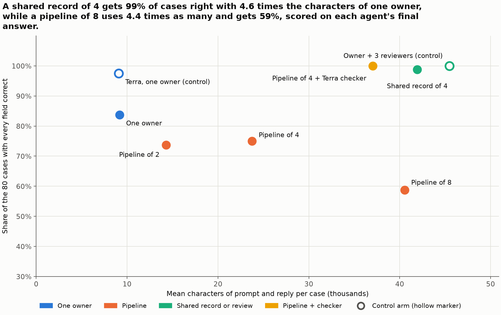

Each point is an arm: right means more work per case, up means more cases fully correct; hollow markers are control arms. The pipelines move right without moving up; the pipeline of 8 uses 4.4 times the owner's characters and finishes 20 fewer cases. The top-right group reaches 99% to 100% with 4.0 to 5.0 times the owner's work; Terra alone reaches 97.5% at the owner's cost.

## Contents

1. [The cases and their exact answers](#1-the-cases-and-their-exact-answers)
2. [The team designs](#2-the-team-designs)
3. [The models](#3-the-models)
4. [The measures](#4-the-measures)
5. [One case from start to finish](#5-one-case-from-start-to-finish)
6. [How the study got here](#6-how-the-study-got-here)
7. [Accuracy by design](#7-accuracy-by-design)
8. [What the control arms show](#8-what-the-control-arms-show)
9. [Accuracy by process](#9-accuracy-by-process)
10. [The planted fact and the wrong intake note](#10-the-planted-fact-and-the-wrong-intake-note)
11. [Work and scaling](#11-work-and-scaling)
12. [Unreadable forms and two ways to read a reply](#12-unreadable-forms-and-two-ways-to-read-a-reply)
13. [Error analysis](#13-error-analysis)
14. [Limitations](#14-limitations)
15. [What the evidence supports](#15-what-the-evidence-supports)
16. [Spend, data and how to run](#16-spend-data-and-how-to-run)
17. [Future work and further reading](#17-future-work-and-further-reading)

### How the experiment runs

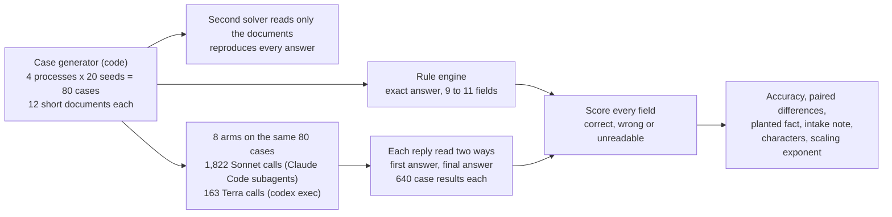

One case travels through it like this. `credit-4802` is generated with 12 documents and an exact answer of 10 fields. The same documents go to every arm: one Sonnet call for the single owner, two to eight chained calls for a pipeline. Each arm's final form is compared field by field with the exact answer, and the characters of every prompt and reply are added up.

## 1. The cases and their exact answers

The rules, names and amounts are fictional; they test careful reading and arithmetic, not knowledge of real regulation.

| Process | What the case asks | Fields | Planted fact (late field it changes) |
|---|---|---|---|
| Capital call | Check a fund's request for money against the commitment and terms, deduct disallowed amounts, convert currency, check the bank account, set date and approval level | 9 | The release also needs a treasury or compliance countersignature (`release_control`, station 8) |
| Equipment credit | The application from the opening | 10 | Release must await a signed environmental or ownership undertaking (`conditions`, station 8) |
| Laboratory billing | Check the health card, decide which tests the plan pays, cap units and funding, price patient charges, list rejection codes, choose who is billed | 10 | An employer or study sponsor will receive every patient-pay charge (`billed_to`, station 7) |
| Block trade | Split a share purchase among three accounts by weight in lots of 100, excluding restricted accounts; price, commission, settlement, flags | 11 | The ticket must carry a CLIENT_REVIEW or LEGAL_REVIEW flag (`exception_flags`, station 8) |

Every case has 12 documents of 5 to 25 lines: the policy, a calendar, a currency rate confirmation, the relationship email holding the planted fact, and eight process records such as the bureau report. Each process has nine possible complications, such as a bankruptcy or a US-dollar request in credit, and each case draws four.

Each process is cut into eight stations with their own instructions, documents and fields; every station also sees the policy. The credit layout:

| Station | Role | Own documents | Fields |
|---|---|---|---|
| 1 | Credit coordinator | application, registry, relationship email | complete |
| 2 | Bureau support analyst | bureau report | bureau_score |
| 3 | Relationship exposure analyst | exposure extract, rate confirmation | exposure_cad |
| 4 | Small-ticket credit analyst | none | decision |
| 5 | Equipment valuation analyst | invoice and valuation | approved_amount |
| 6 | Senior structuring analyst | rate card | term_months, rate_tier |
| 7 | Credit manager | delegation schedule | authority |
| 8 | Vendor desk release coordinator | release checklist, calendar | conditions, approval_expiry |

Teams of 4 merge neighbouring stations (1-2, 3-4, 5-6, 7-8) and teams of 2 merge halves (1-4, 5-8).

Every case starts with an intake note written by the harness, such as "My summary has bureau_score: 691." In 17 cases, chosen by seed, it states one value wrongly: a notice amount 10,000 too high, a score 100 too high, a card version "XY" or a security code "CA000000". The document with the right value goes only to an early station.

The cases were generated in code on 18 November 2026, so no model could have seen them in training. A rule engine computes every field; a separately written second solver reads only the documents and reproduces every answer. GPT-6.1 Sol wrote the generator; role names came from process descriptions prepared for an earlier study here.

## 2. The team designs

| Arm | Calls per case | What each agent sees | What it may change |
|---|---|---|---|
| One owner | 1 | All instructions and documents, the intake note | Every field |
| Pipeline of 2, 4 or 8 | 2, 4 or 8 | Its stations' documents and instructions, the fields so far, the previous note (agent 1: the intake note) | Only its own fields |
| Shared record of 4 | 4 | Its stations' instructions, all documents, every earlier field and note | Any field; last value wins |
| Pipeline of 4 + Terra checker | 5 | As the pipeline of 4; then Terra sees everything | Checker returns corrections |
| Terra as one owner (control) | 1 | As one owner | Every field |
| Owner + 3 reviewers (control) | 4 | Each reviewer sees everything plus the record | Every field; last value wins |

Every agent is told the team size, its place and every field it must return, and replies with a JSON object, `{"fields": {...}, "note": "..."}`. No design has a person, a coordinator or parallel work.

### Call graphs

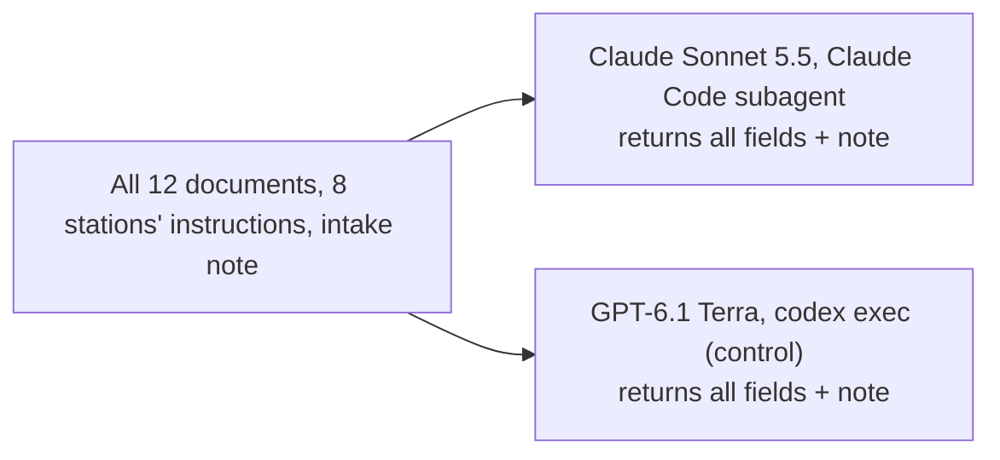

A pipeline runs one round per agent, each waiting for the previous reply. The pipeline of 4 is shown; the pipelines of 2 and 8 have two and eight such calls.

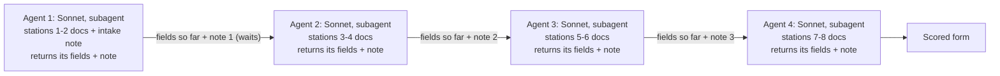

In the shared record every agent gets all documents and the whole record and may overwrite any field.

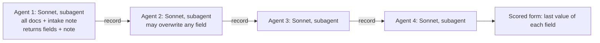

The checker arm reuses the pipeline of 4's replies, then calls Terra.

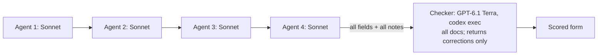

The review control starts from the single owner's saved reply.

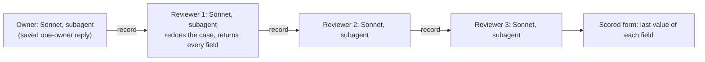

## 3. The models

| Model | Pinned version | Provider and how called | Size and precision | Settings that change output | Why included |
|---|---|---|---|---|---|
| Claude Sonnet 5.5 | `claude-sonnet-5-5`, Claude Code alias `sonnet` (version string in every cache row) | Anthropic; Claude Code 2.1 subagents, one per prompt, launched by a workflow script | not published | effort low; default agent type; every prompt starts with an instruction to use no tool | The team model in every Sonnet arm, so arms differ only in how work is divided |
| GPT-6.1 Terra | `gpt-6.1-terra` | OpenAI; `codex exec` 0.160.1 with `--ignore-user-config`, read-only sandbox, one-line instruction | not published | reasoning effort low | Checker from a second vendor, and alone as a control, to separate what checking adds from what the model does alone |

Sonnet ran as subagents because `claude -p` on the machine was signed out. Each subagent carried about 72,000 tokens of unreported standing context, including the project instruction file, and had tools it never used.

## 4. The measures

A case is **fully correct** when every scored field matches the exact answer; money compares to the cent and code lists compare as sets. A case is **unreadable** when the form cannot be scored: no parseable JSON object, a field the agent was not allowed to fill, a missing note, or a scored field never filled. A readable case that is not fully correct is **wrong**. Both count as failures, and accuracy on readable cases is also given.

A reply can hold more than one JSON object. The **first-answer** reading, fixed in advance, takes the first complete object; the **final-answer** reading takes the last complete object with a `fields` key. They differ only when an agent revised itself within a reply (section 12).

**Planted fact kept** is the share of cases in which the field that depends on the planted fact is correct; in credit and trade that field also lists other codes, so section 10 also counts cases where the planted code itself is missing. **Intake error caught** is the share of the 17 wrong-note cases in which the affected field is correct.

**Characters per case** totals every prompt and reply in a case. Work is counted in characters because the subagents report no tokens and `codex exec` adds 21,375 tokens of fixed overhead per call; the count leaves out that standing context.

Each accuracy has a **95% interval** from 4,000 bootstrap resamples: draw 80 cases with replacement, recompute the share, keep the middle 95%. An arm with 80 of 80 gets an interval with no width, though its true error rate could be up to about 4%.

A **paired difference** compares two arms on the same cases: score each case 1 if fully correct, 0 if not, and average (first arm minus second). The shared record was right and one owner wrong on 13 cases, the reverse on 1, so the difference is (13 - 1) / 80 = +15.0 points. Its interval resamples the case pairs.

The **scaling exponent** asks how correct output grows with team size when each agent has the same work budget. Output per 1,000 characters is k agents times accuracy divided by thousands of characters per case: 1 x 0.8375 / 9.163 = 0.091 for one owner, 8 x 0.5875 / 40.532 = 0.116 for the pipeline of 8, against 0.73 if output grew in proportion. The exponent is the slope of log output on log k over k = 1, 2, 4 and 8: 1 is proportional, 0 is no growth, and 0.13 means doubling the team multiplies output by about 1.1.

## 5. One case from start to finish

`credit-4802` is traced through the single owner because three later examples use it too. Lines from its documents:

```
Equipment finance application | Northlake | 2026-05-13 | file 4802
Requested amount: 190000.00   Requested term: 60   Consent signed: NO   Invoice attached: YES
Registry: status ACTIVE, business age months 48, industry CONSTRUCTION
Bureau report: verified bureau score 691, bankruptcy YES
Relationship extract: existing CAD exposure 230000.00
Rate confirmation: currency CAD, CAD per currency unit 1.0000
Invoice and valuation: equipment condition NEW
Relationship mailbox: Leila mentioned that release must also await a signed environmental undertaking.
Calendar: case date 2026-05-13, closed dates NONE
```

The 8,088-character prompt states the task and role, lists all eight stations, the allowed fields with their formats, the 12 documents and the intake note:

> Complete this fictional business case using the attached policy and source records, resolving any conflict in favour of signed records over the colleague's intake summary. [...] You are the only person working this case. [...] Your fields, all of which you must return: complete, bureau_score, exposure_cad, decision, approved_amount, term_months, rate_tier, authority, conditions, approval_expiry

The policy gives the answer step by step. Consent is unsigned, so the file is incomplete. The score is 691, as the intake note says. Exposure is 190,000.00 x 1.0000 + 230,000.00 = 420,000.00. Bankruptcy is a hard decline that outranks the referral rules, so the decision is DECLINE with no amount, term or rate tier. Exposure over 150,000 puts authority with a MANAGER. Conditions are COMPLETE_FILE plus ENV_UNDERTAKING from the email, with no MANAGER_REVIEW because the file is declined, not referred. The offer expires 10 business days after Wednesday 13 May: 27 May.

The owner's 780-character reply holds one object, so both readings agree:

```json
{"fields":{"complete":false,"bureau_score":691,"exposure_cad":420000.00,"decision":"DECLINE",
 "approved_amount":0.00,"term_months":0,"rate_tier":"NONE","authority":"MANAGER",
 "conditions":["COMPLETE_FILE","ENV_UNDERTAKING"],"approval_expiry":"2026-05-27"},
 "note":"Declined: bankruptcy YES on the bureau report [...] Relationship mailbox says release must also await a signed environmental undertaking (ENV_UNDERTAKING). [...]"}
```

All 10 fields match (the conditions are in a different order, which is allowed), so the case is fully correct, the planted fact is kept, and the work is 8,088 + 780 = 8,868 characters. The pipeline of 2 was unreadable on this case (section 12) and the pipelines of 4 and 8 added MANAGER_REVIEW (section 13); the other arms were correct.

## 6. How the study got here

The design, measures and expectations were written down on 18 November 2026 before any model call. In the first test the single owner's prompt said to return "only your owned fields", and Sonnet answered as station 1; every prompt was rewritten to list every field to return, and those replies were discarded.

A calibration run on 24 separate, unscored cases aimed for single-owner accuracy of 50% to 90%. With two complications per case the owner got 22 of 24 and the pipeline of 4 got 20; with four, the owner again got 22 and the pipeline of 4 fell to 15. The scored run uses four, with the owner at 92%, one case above the band, so comparisons against one owner sit near its ceiling.

The plan also ran every design with Terra as the team; before the scored run the repo owner limited teams to Sonnet. Afterwards two results could not be read as effects of design, and the repo owner agreed to the two control arms (section 8), run on 20 November.

While this write-up was drafted, the per-call records showed agents writing an answer, then a correction such as "the JSON above is superseded by this one" and a second answer; the first-answer rule had scored the draft and, in pipelines, passed it on. On 21 November the final-answer reading was added and the 23 chains where a draft had been passed on were re-run from the next agent (62 new Sonnet calls over six rounds, 3 new Terra checker calls); other runs were carried over.

## 7. Accuracy by design

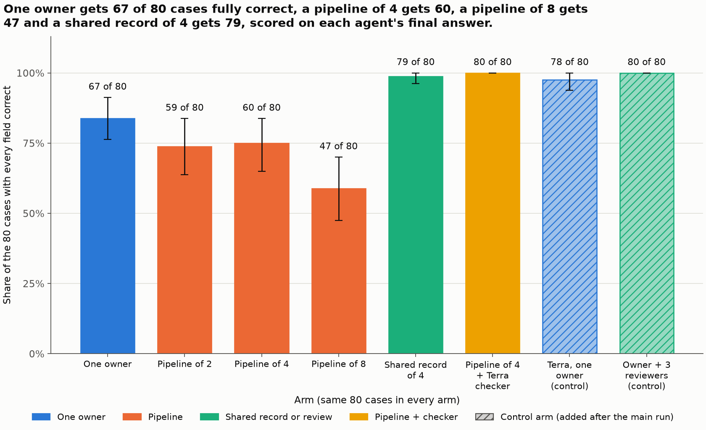

Each bar is an arm's share of cases fully correct on final answers, with its count and 95% interval; hatched bars are control arms. Compare the pipelines with one owner, then the right-hand group with each other. First-answer counts are in brackets.

| Arm | Correct, final (first) | Wrong | Unreadable | Accuracy, final | 95% interval | On readable | Characters per case |
|---|---|---|---|---|---|---|---|
| One owner | 67 (65) | 13 (15) | 0 (0) | 83.8% | 76.2% to 91.2% | 83.8% | 9,163 |
| Pipeline of 2 | 59 (54) | 12 (18) | 9 (8) | 73.8% | 63.7% to 83.8% | 83.1% | 14,294 |
| Pipeline of 4 | 60 (57) | 19 (22) | 1 (1) | 75.0% | 65.0% to 83.8% | 75.9% | 23,756 |
| Pipeline of 8 | 47 (39) | 33 (39) | 0 (2) | 58.8% | 47.5% to 70.0% | 58.8% | 40,532 |
| Shared record of 4 | 79 | 1 | 0 | 98.8% | 96.2% to 100.0% | 98.8% | 41,928 |
| Pipeline of 4 + Terra checker | 80 | 0 | 0 | 100.0% | 100.0% to 100.0% | 100.0% | 37,050 |
| Terra as one owner (control) | 78 | 2 | 0 | 97.5% | 93.8% to 100.0% | 97.5% | 9,081 |
| Owner + 3 reviewers (control) | 80 | 0 | 0 | 100.0% | 100.0% to 100.0% | 100.0% | 45,470 |

Every pipeline did worse than one owner, and the longest did worst: 47 of 80, 20 fewer than the owner. The pipelines of 2 and 4 are close (59 and 60), and on readable cases their order flips because 9 of the pipeline of 2's failures were unreadable. The other arms are all at 97.5% or above.

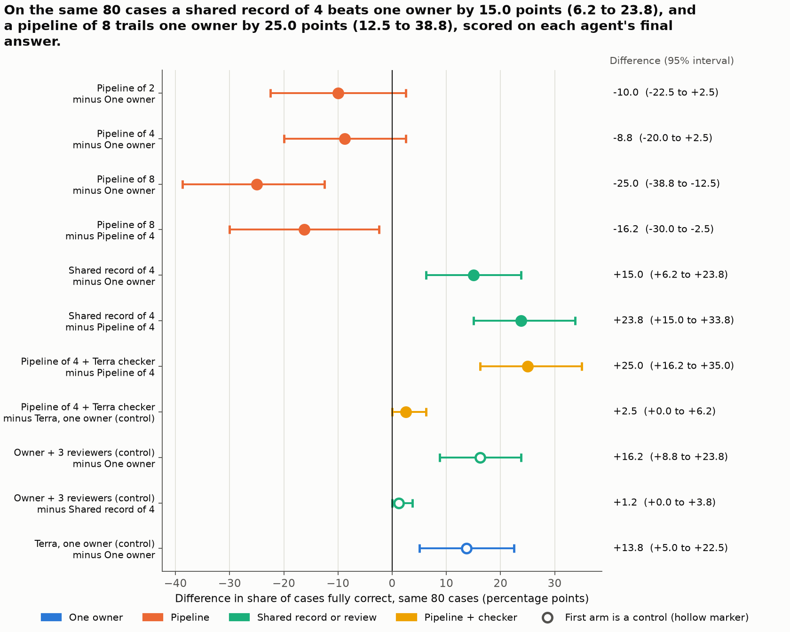

Each row compares two arms on the same cases; a dot right of zero means the first arm got more right, and a bar crossing zero means the gap could be chance. Counts are cases only the first arm got right, then only the second.

| Comparison (first arm minus second) | Final answers (interval) | Counts | First answers (interval) |
|---|---|---|---|
| Pipeline of 2 minus one owner | -10.0 (-22.5 to +2.5) | 10, 18 | -13.8 (-27.5 to +0.0) |
| Pipeline of 4 minus one owner | -8.8 (-20.0 to +2.5) | 7, 14 | -10.0 (-21.2 to +1.2) |
| Pipeline of 8 minus one owner | -25.0 (-38.8 to -12.5) | 7, 27 | -32.5 (-46.2 to -17.5) |
| Pipeline of 8 minus pipeline of 4 | -16.2 (-30.0 to -2.5) | 11, 24 | -22.5 (-37.5 to -6.2) |
| Shared record minus one owner | +15.0 (+6.2 to +23.8) | 13, 1 | +17.5 (+8.8 to +26.2) |
| Shared record minus pipeline of 4 | +23.8 (+15.0 to +33.8) | 19, 0 | +27.5 (+17.5 to +37.5) |
| Checker arm minus pipeline of 4 | +25.0 (+16.2 to +35.0) | 20, 0 | +28.7 (+18.8 to +38.8) |
| Checker arm minus Terra alone | +2.5 (+0.0 to +6.2) | 2, 0 | +2.5 (+0.0 to +6.2) |
| Terra alone minus one owner | +13.8 (+5.0 to +22.5) | 13, 2 | +16.2 (+6.2 to +25.0) |
| Owner + 3 reviewers minus one owner | +16.2 (+8.8 to +23.8) | 13, 0 | +18.8 (+10.0 to +27.5) |
| Owner + 3 reviewers minus shared record | +1.2 (+0.0 to +3.8) | 1, 0 | +1.2 (+0.0 to +3.8) |

Every comparison points the same way under both readings, and every interval that excludes zero under one excludes it under the other. The pipeline of 8 is clearly behind one owner and the pipeline of 4; the pipelines of 2 and 4 may be behind one owner, but their intervals cross zero, and the pipeline of 2 got 10 cases right that the owner missed. The shared record beat the pipeline of 4 on 19 cases and lost none; section 8 shows why.

## 8. What the control arms show

The checker sees every document, so if Terra alone scores about the same, the checker arm measures Terra, not checking. Terra alone got 78 of 80, 2 fewer than the checker arm (interval 0.0 to 6.2 points) and 13.8 points more than the Sonnet owner with about the same work. Its two misses were each off by exactly 1.00 in a currency conversion (`capital-4812`, `credit-4805`).

The shared record's first agent sees every document and returned every field in all 80 cases, so the design was four full passes. If one owner followed by three full reviews scores the same, the gain comes from repeated passes. It did.

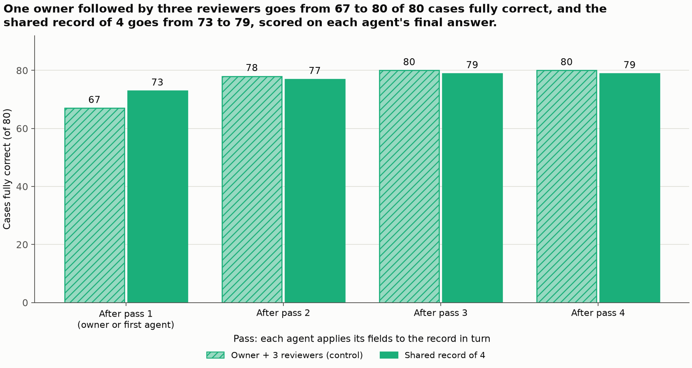

Bars show the record after each pass; hatched bars are the owner with reviewers, solid bars the shared record. The first reviewer fixed 12 of the owner's 13 wrong cases and broke one (`trade-4801`), for 78; the second repaired it and fixed `credit-4804`, for 80; the third changed nothing (65, 77, 80, 80 on first answers). In the shared record (73, 77, 79, 79 under both readings) the second agent fixed six cases and broke two, the third repaired both, and `credit-4806` stayed wrong.

The shared record's first agent got 73 right where the owner, with a prompt that differs only in its role text, got 67; they disagreed on 18 cases (12 against 6), so gaps of about 6 cases between single passes need care.

## 9. Accuracy by process

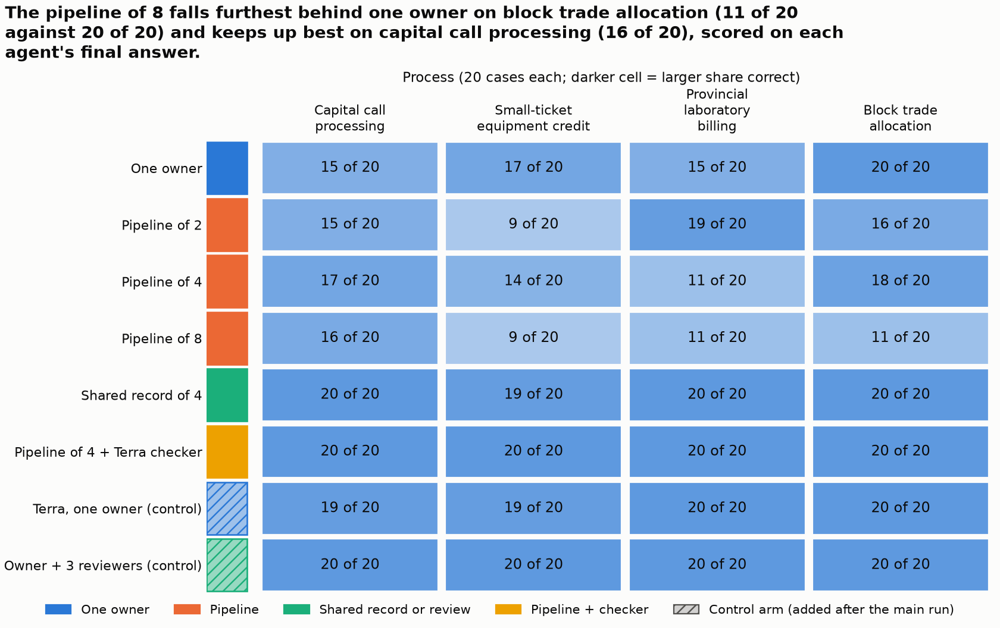

Each cell counts fully correct cases out of 20 on final answers, first-answer counts in brackets.

| Process | One owner | Pipeline of 2 | Pipeline of 4 | Pipeline of 8 | Shared record | Checker arm | Terra alone | Owner + 3 reviewers |
|---|---|---|---|---|---|---|---|---|
| Capital call | 15 (14) | 15 (11) | 17 (15) | 16 (15) | 20 | 20 | 19 | 20 |
| Equipment credit | 17 | 9 | 14 | 9 (7) | 19 | 20 | 19 | 20 |
| Laboratory billing | 15 (14) | 19 | 11 | 11 (9) | 20 | 20 | 20 | 20 |
| Block trade | 20 | 16 (15) | 18 (17) | 11 (8) | 20 | 20 | 20 | 20 |

Block trade allocation was expected to show the smallest gaps between designs. It showed the largest: one owner got all 20 and the pipeline of 8 got 11. Commission was wrong in 5 of its 9 failures; in 3 the agent's note had the right figure after a wrong field ("CORRECTION: commission_cad is 136.00, not 907.20", `trade-4805`). In capital calls the pipelines of 4 and 8 beat the owner (17 and 16 against 15), and in laboratory billing the pipeline of 2 did (19 against 15). With 20 cases per cell, gaps of three or four cases are within chance, so the rows show where losses happened, not a ranking.

## 10. The planted fact and the wrong intake note

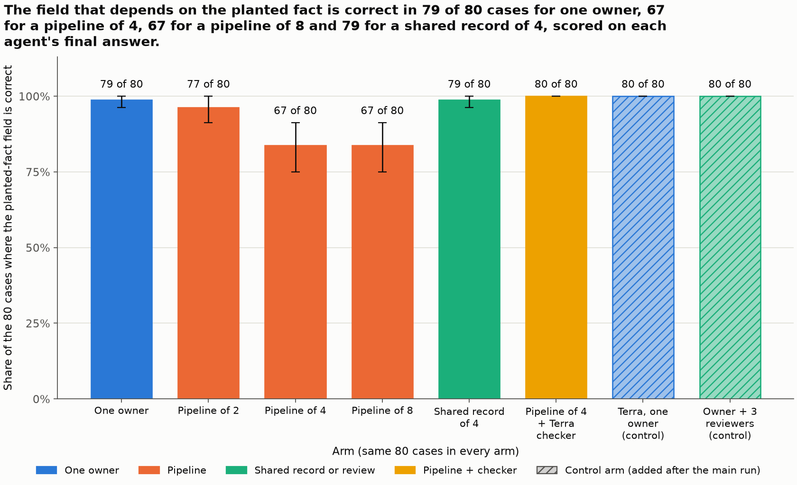

Each bar counts cases in which the late field that depends on the planted sentence came out right. The middle column, counted from the final forms in the two results files, gives cases where the planted code itself is missing.

| Arm | Planted fact kept, final (first) | Planted code missing, final (first) | Intake error caught (17 cases) |
|---|---|---|---|
| One owner | 79 (79) | 0 (0) | 17 |
| Pipeline of 2 | 77 (75) | 0 (2) | 16 |
| Pipeline of 4 | 67 (66) | 7 (8) | 17 |
| Pipeline of 8 | 67 (60) | 9 (16) | 17 |
| Shared record of 4 | 79 | 0 | 17 |
| Checker arm, Terra alone, owner + 3 reviewers | 80 each | 0 | 17 each |

The fact was kept less often in the longer pipelines: 67 of 80 cases with four or eight agents, against 79 for one owner. The planted code was missing in 7 pipeline-of-4 cases, all laboratory billing, and 9 pipeline-of-8 cases (5 laboratory, 2 credit, 1 capital, 1 trade), and never where agents saw the original email.

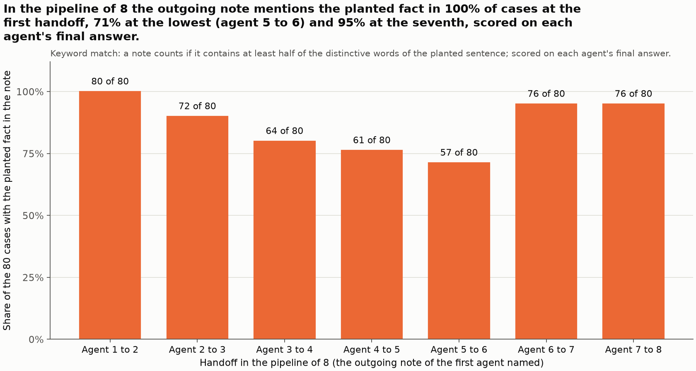

Each bar is a handoff in the pipeline of 8 and counts notes containing at least half of the planted sentence's distinctive words: 80 of 80 after agent 1, 57 after agent 5, then 76 and 76. The late rise needs care: the match also counts notes saying the fact is absent, so the chart counts mentions, not correct use.

Reading the 16 pipeline cases with the planted code missing gives a clearer picture. In 14, the fact reached the agent that fills the field as a colleague's retelling, and that agent declined to act on an unsigned second-hand claim. In 2 (`credit-4807`, `credit-4808`, pipeline of 8), the seventh agent's note covered only its own field and the fact vanished. None traces to a draft. On first answers there were 26: the same 14 and 2, plus 10 where the next agent got a draft note without the fact while the agent's own revision carried it, which is why the second reading exists.

The wrong intake note was caught in all 17 cases by every arm except the pipeline of 2, whose one miss (`credit-4805`) was an unreadable form with the field never filled. This test is at a ceiling. A possible link, untested: the rule that guards against the wrong note (prefer signed records) is the one late agents cited when they set aside a retold planted fact.

## 11. Work and scaling

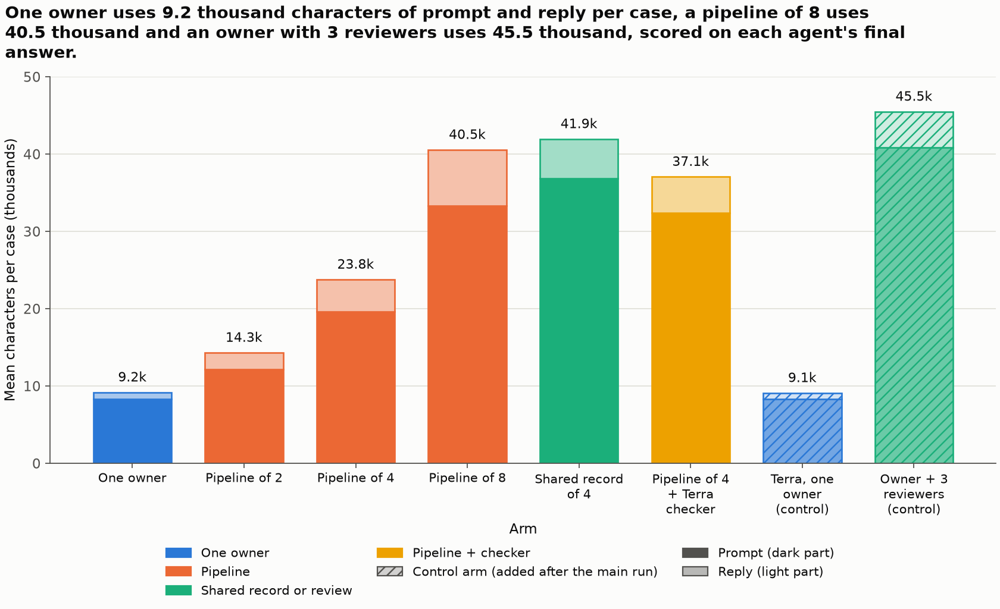

Each bar is the mean characters per case, prompt in the darker part. The pipelines of 2, 4 and 8 used 1.56, 2.59 and 4.42 times the owner's characters, mostly reading. The arms at 97.5% or more used 37,050 to 45,470 characters, except Terra alone at 9,081.

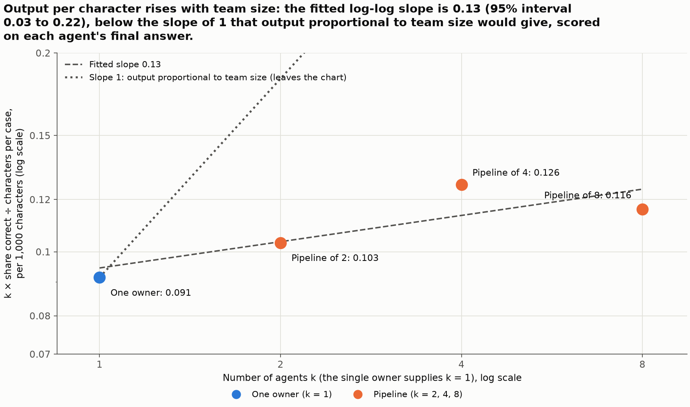

The scaling chart puts agents and the output measure from section 4 on log scales, so a line's slope is the exponent; the dotted line is proportional growth. On final answers the points are 0.091 for one owner, then 0.103, 0.126 and 0.116 for pipelines of 2, 4 and 8, an exponent of 0.13 (interval 0.03 to 0.22); on first answers, 0.089, 0.095, 0.120 and 0.096, an exponent of 0.07 (interval -0.05 to 0.18). With the same budget per agent, eight agents produced about 27% more correct cases than one (8% on first answers), where proportional growth would give eight times as many.

## 12. Unreadable forms and two ways to read a reply

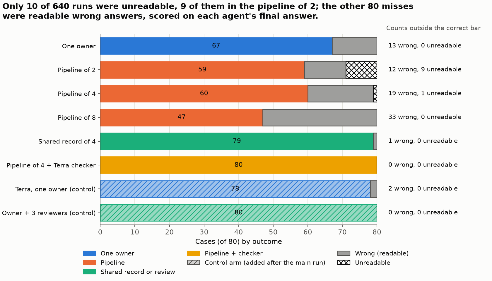

Each bar splits an arm's cases into correct, wrong and unreadable. On final answers 10 of 640 case results were unreadable and 80 were wrong (11 and 97 on first answers). Nine unreadable cases were in the pipeline of 2 (credit-4802, 4803, 4805, 4809, 4816, 4817, 4819, 4820, trade-4803): agent 1 returned only its first stations' fields, and agent 2 was not allowed to fill the rest. The tenth, lab-4806 in the pipeline of 4, never filled payable_codes. In eight of the nine the notes held the right values for every missing field and every filled field was right; in `credit-4817` the conditions also lacked VALUATION.

### Worked example: `credit-4802` in the pipeline of 2

The first unreadable case in id order, unreadable under both readings. Agent 1's prompt says "Your fields, all of which you must return: complete, bureau_score, exposure_cad, decision". It returned `{"fields":{"complete":false}, ...}` with a note holding the inputs:

> consent signed is NO, so complete is false [...] Intake summary bureau_score 691 matches the bureau report's verified score 691. Bankruptcy per bureau report: YES. Existing CAD exposure 230000.00 [...]

Agent 2, covering stations 5 to 8, worked out the missing answers in its note, but they were not its fields:

> Decision is DECLINE: the bureau report shows bankruptcy YES, and policy says this outranks the referral rules, so MANAGER_REVIEW is not included. [...] Exposure is 420000.00 CAD (190000.00 requested + 230000.00 existing) [...]

Its six fields were all right. The expected bureau_score 691, exposure_cad 420000.00 and decision DECLINE appear in the notes but not the form; the owner got the case right in one call. Eight of 20 credit cases failed this way in the pipeline of 2.

### Two ways to read a reply

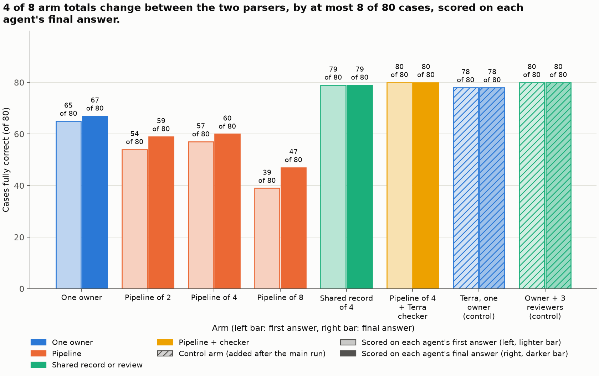

Left bars are first-answer scores, right bars final-answer scores. Four arm totals change: one owner by 2 cases, the pipelines of 2, 4 and 8 by 5, 3 and 8.

Twenty-five Sonnet replies held more than one JSON object. In 23 the later object has a `fields` key and is what the final-answer reading takes: 2 from the owner, 6, 3 and 11 from the pipelines of 2, 4 and 8, and 1 from a reviewer. In the other 2 (`capital-4811`, `lab-4808`, pipeline of 2) the correction sits outside any object with fields, so both readings take the first. Re-reading and re-running changed 20 case results: 18 became correct, `credit-4820` (pipeline of 2) went from wrong to unreadable because the revision dropped two fields, and `credit-4819` (pipeline of 8) from unreadable to wrong because the revised exposure was also wrong.

#### Worked example: `trade-4806` in the pipeline of 8

Chosen because one reply, read two ways, changes the rest of the chain. The email says "Iris mentioned that the final ticket must carry the CLIENT_REVIEW flag", and 37 shares are left over after whole lots. Expected: flags CLIENT_REVIEW, RESTRICTED, ODD_LOT; reconciled false; commission 44.53. One owner got all 11 fields right.

Agents 1 to 6 carried the flag and the odd lot. Agent 7 wrote a first object with authority SENIOR and a note only about authority, then "Correction: the JSON above is superseded by this one", and a second with DIRECTOR and a note keeping "flags ODD_LOT (37 residual shares, executed 1637, allocated 1600, reconciled false), RESTRICTED, CLIENT_REVIEW".

On first answers, agent 8 received the draft note and wrote "no explicit ODD_LOT, MANUAL, LATE, SSI_HOLD, CLIENT_REVIEW or LEGAL_REVIEW information was given, so only RESTRICTED is flagged": four fields wrong. On final answers, agent 8, re-run with the revised note, wrote "37 residual odd shares held unallocated (ODD_LOT), so reconciled is false. Accounts B and C restricted (RESTRICTED). CLIENT_REVIEW carried from early correspondence": only the commission was wrong, where agent 5's note computed 44.53 but its field said 43.52.

## 13. Error analysis

Each example is one case of a pattern, on final answers unless stated; how common it is comes from counts over all 80 cases.

### A typical pipeline success: `credit-4811`, pipeline of 4

An ordinary success (60 of 80 pipeline-of-4 cases were fully correct) that also tests the intake note, which said 670 where the bureau report says 570. Agent 1 wrote "verified score 570 (the intake summary's 670 is wrong; the signed bureau report governs)" and "include OWNERSHIP_UNDERTAKING in conditions". Agent 2 declined on three hard rules, noting "MANAGER_REVIEW applies only if REFER". Agents 3 and 4 repeated the undertaking, and all 10 fields came out right under both readings.

### The planted fact lost in the pipeline of 8: `credit-4807` and `trade-4817`

`credit-4807` is one of the two cases where the fact was dropped; one owner got it right. The email says "Leila mentioned that release must also await a signed ownership undertaking", so the conditions should be OWNERSHIP_UNDERTAKING and the authority ANALYST. Agents 1 to 6 carried it ("OWNERSHIP_UNDERTAKING applies even on decline", agent 6). Agent 7's note discussed only authority, and its field said MANAGER although its own note ended "so authority = ANALYST". Agent 8 wrote "They also contain no early correspondence, so no ENV_UNDERTAKING or OWNERSHIP_UNDERTAKING request is recorded" and returned empty conditions: two fields wrong, under both readings, since agent 7's correction sits in its note.

`trade-4817` shows the commoner kind, 14 of the 16: the fact reaches the end, but its standing erodes. Agent 1 wrote "Bespoke review flag: LEGAL_REVIEW." Agent 3 added "not a signed record"; agent 6, "downstream should treat it as unverified". Agent 8: "LEGAL_REVIEW not set: it appears only in the relationship administrator's account of Iris, not in a signed record or confirmed early correspondence, so it is unverified."

### Laboratory billing in the pipeline of 4: `lab-4801`

The first of seven laboratory cases the pipeline of 4 got wrong on `billed_to` under both readings, all of which the owner got right. The email says "Noah noted that the employer has agreed to receive every patient-pay charge". Agent 1 wrote "relationship mailbox says employer agreed to receive every patient-pay charge (billed_to EMPLOYER)". Agent 3 passed it on but changed its source: "this is from the intake summary and I could not verify it against a signed record, so confirm". Agent 4, which owns `billed_to` and sees "Default payer: PATIENT", wrote:

> billed_to is PATIENT because no signed early correspondence is in the records. The EMPLOYER arrangement comes only from the intake summary (relationship mailbox), which the previous agent said it could not verify.

Every other field was right. The owner, reading the email itself, set EMPLOYER, and Terra as checker restored it. In all seven laboratory losses the last agent set the arrangement aside as unverified.

### An owner error a reviewer corrected: `capital-4803`

The first capital case among the 12 owner errors the first reviewer fixed. The schedule says "Purpose: INVESTMENT", the fee equals the allowed fee and expenses are 8,000.00 against a 5,000.00 cap, so the only deduction is 3,000.00: eligible amount 84,680.72, codes EXPENSE_CAP and BANK_HOLD. The owner deducted 9,000.00 and listed EXCLUDED_PURPOSE, a penalty that does not exist. Reviewer 1:

> the earlier record deducted 9000 and listed EXCLUDED_PURPOSE, but no PENALTY investment exists (the breakdown schedule shows INVESTMENT purpose only). The only deduction is the expense excess of 3000.00

Five of the owner's 13 errors were capital calls, four with wrong deduction amounts, and five were laboratory rejection-code lists; a pass that redoes the work from the documents catches them.

### A rule read two ways: MANAGER_REVIEW on a declined file

The policy says "conditions includes COMPLETE_FILE if incomplete, VALUATION if USED, MANAGER_REVIEW if REFER, even on decline." The exact answer adds MANAGER_REVIEW only to referred files, but "even on decline" can be read as covering it. That reading appeared once for the owner, once in the shared record, 5 times in the pipeline of 4 and 3 times in the pipeline of 8. On `credit-4802` in the pipeline of 4, agent 2 wrote "MANAGER_REVIEW and COMPLETE_FILE apply as conditions even on decline", and the last agent copied it.

## 14. Limitations

The control arms and the final-answer reading were chosen after the results were seen; first-answer results are reported beside them, and no conclusion depends on which is used. The design and measures were fixed before any model call; later changes are recorded with reasons in [`data/PROTOCOL.md`](data/PROTOCOL.md).

Only Sonnet formed the teams, at low effort; another model or more reasoning might carry notes better or revise less. Every case fits in one prompt of about 8,000 characters, which favours one agent with everything. With 80 cases the pipelines of 2 and 4 are not clearly separated from one owner, and process-level gaps rest on a few cases.

Agents also corrected themselves inside notes, which neither reading uses (`credit-4807`, the trade commissions), and the 10 unreadable forms count as failures. The teams have no people, sign-offs, separation of duties or parallel work, and no agent could ask a question back up the line. The instruction to prefer signed records may have made late agents distrust retold facts.

Sonnet ran as Claude Code subagents rather than through `claude -p` as this repository's rules ask. GPT-6.1 Sol wrote the code that generates the cases and rules, Claude Sonnet 5.5 subagents made later fixes, and Claude designed the analysis and wrote this text. Sol and Terra come from the same vendor; whether that helps Terra is untested.

## 15. What the evidence supports

For work of this size, where the case fits in one prompt, give one agent every document: the pipeline of 8 used 4.4 times the work and finished 20 fewer cases. If a second agent is affordable, use it for a full second pass over the whole case: one reviewer took the owner from 67 to 78, a second reached 80, a third changed nothing. A stronger model alone reached 78 of 80 at the owner's cost.

If the work must be divided, give every agent the original documents rather than a colleague's retelling, since most lost facts arrived and were set aside as unverified. Decide in advance which object in a reply counts, and test that rule on replies that revise themselves.

Whether design matters when no agent can hold the whole case, or for other models, needs another experiment.

## 16. Spend, data and how to run

Both tools ran on subscriptions with no per-call bill. Counts are distinct replies in the scored arms; tests and calibration add 290 Sonnet and about 37 Terra calls.

| Model | Calls | Input tokens | Fixed overhead | Task input | Output tokens | Prompt characters | Reply characters |
|---|---|---|---|---|---|---|---|
| Claude Sonnet 5.5 | 1,822 | not reported | | | | 11,750,559 | 1,915,343 |
| GPT-6.1 Terra | 163 | 4,088,960 | 3,484,125 | 604,835 | 29,385 | 1,721,372 | 107,917 |

Sonnet: 1,520 calls in the main comparison, 240 in the review arm, 62 re-runs. Terra: 80 checker, 80 single-owner, 3 checker re-runs, with 21,375 tokens of overhead each. No call was retried and no reply was empty.

Files:

- [`48_agent_team_designs.ipynb`](48_agent_team_designs.ipynb): the notebook; `agent_teams.py` beside it is the script it was built from, with the command-line modes below.
- [`data/results_last_object.csv`](data/results_last_object.csv) and [`data/results.csv`](data/results.csv): one row per case and arm on final and first answers.
- `data/accuracy.csv`, `by_process.csv`, `paired.csv`, `scaling.csv`, `scaling_points.csv`: the tables above, with a `parser` column; `data/parser_report.csv`: replies the readings differ on.
- `data/cases.jsonl`: the 80 cases; `data/cache_requests.jsonl`: every request and response, keyed by a hash of the full request.
- [`data/PROTOCOL.md`](data/PROTOCOL.md): the design fixed before any call and every recorded change.
- `data/tmp/` (git-ignored): per-call records under each reading, rebuilt from the cache.

To reproduce with no model calls, install the repository's `requirements.txt` and run `python -m nbconvert --to notebook --execute --inplace 48_agent_team_designs.ipynb` here; it replays every reply from the cache. `python agent_teams.py --replay --parser last` rebuilds a results table and compares it with the committed one. New Claude replies are collected in rounds, one per pipeline agent: `--run --export-pending --parser last` writes the waiting prompts (default `data/tmp/rounds/pending.json`), `--make-workflow data/tmp/rounds/pending.json data/tmp/rounds/round1` writes workflow files and `round1_parent.js`, the parent file is run in Claude Code, and `--import-journal RUN_DIR data/tmp/rounds/pending.json` imports the replies. GPT calls go through `codex exec` from `--run`.

## 17. Future work and further reading

### Future work

- Make cases too large for one prompt (say 60 documents) and measure whether the pipeline or shared record catches up with one owner. Motivated by the owner's lead when every case fits in about 8,000 characters.
- Require notes to quote the original sentence and name its source, and measure the planted fact kept in the pipelines of 4 and 8. Motivated by the 14 of 16 lost facts that arrived as a retelling and were set aside.
- Put the note before the fields and allow one object per reply, and measure how often agents still revise. Motivated by the 23 replies revised after a first answer, 20 in pipelines.
- Run the designs with Terra as the team, as first planned, and measure whether the ranking holds for a second model family.
- Compare one reviewer with two, and a reviewer who sees the owner's form with one who works blind, measuring cost per fully correct case. Motivated by the first reviewer fixing 12 cases and breaking 1.

### Further reading

Links checked on 21 November 2026.

- [Organizing Intelligence](https://storage.googleapis.com/deepmind-media/papers/organizing-intelligence.pdf) (Imas, Koh and Legg, 2026). A model of firms where competence raises output and coordination sets how output grows with size; Terra's lead and the small exponent here are measured cases of each.
- [Why Do Multi-Agent LLM Systems Fail?](https://arxiv.org/abs/2503.13657) (Cemri et al., 2025). A taxonomy of 14 failure modes from seven multi-agent frameworks, including inter-agent misalignment, which the dropped and distrusted notes here resemble.
- [TheAgentCompany](https://arxiv.org/abs/2412.14161) (Xu et al., 2024). Single agents on office tasks in a simulated software company, the best completing about 30%; longer tool-using work than these cases.
- [The Cybernetic Teammate](https://www.nber.org/papers/w33641) (Dell'Acqua et al., 2025). A field experiment with 776 professionals where one person with AI matched a two-person team without it, a human parallel to the single agent here.
- [Drop the Hierarchy and Roles](https://arxiv.org/abs/2603.28990) (Dochkina, 2026). Eight coordination protocols over 25,000 tasks; a lightly structured sequential protocol beat centralised coordination by 14%. It varies who coordinates, this notebook who sees which documents.
