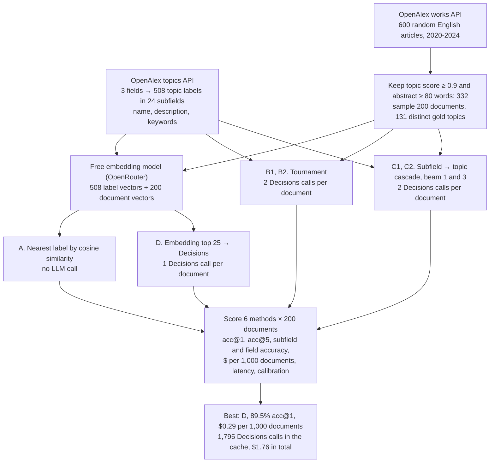

# 01 · Classifying documents into 508 labels with the OpenAI Decisions API

**Goal.** Find out how to use OpenAI's Decisions API (`openai/gpt-6-luna-decisions` on OpenRouter) when the label
set is far larger than one question allows (a `choice` question takes at most 255 options), and whether its
probabilities are good enough to auto-accept confident labels.

**Result.** Retrieve-then-decide wins on accuracy, cost and calls: a free embedding model shortlists 25 labels,
then one Decisions call chooses. **89.5% top-1** (95% CI 85-94%) over 508 labels, **$0.29 per 1,000 documents**.
Auto-accepting at confidence ≥ 0.9 covers 86.5% of documents at 93.6% accuracy. A greedy subfield→topic
cascade reaches only 76.5% because first-step errors cannot be recovered; a beam of 3 recovers most of that.

**Workflow.** The whole experiment from data to results, with the counts from this run. Every model response is cached in `data/`, so a re-run replays it without API calls.

| | |
|---|---|
| Data | 508 OpenAlex research topics (Computer Science, Business, Decision Sciences); 200 English abstracts from OpenAlex with their primary topic as the (silver) gold label |
| Methods | embedding nearest-label; two-round tournament; hierarchical cascade (beam 1 and 3); embedding shortlist + one Decisions call |
| Cost to re-run from scratch | $1.76 on OpenRouter (1,795 Decisions calls); $0 replaying the caches in `data/` |

**Run it.** `pip install -r ../../requirements.txt`, open the notebook, run all cells. Without `OPENROUTER_API_KEY`
the notebook replays every call from `data/`.
