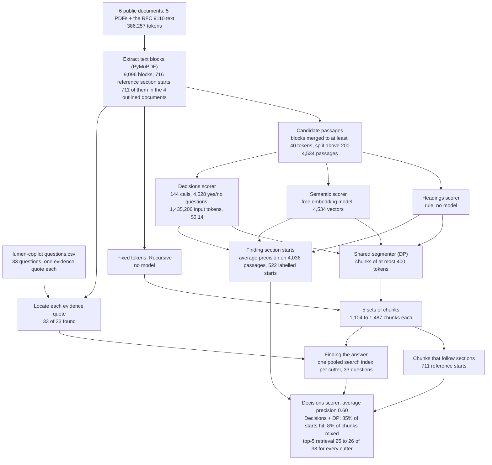
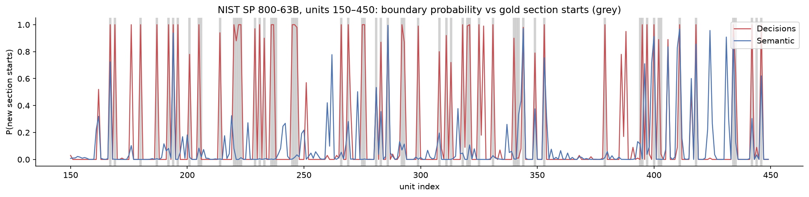

# Cutting long documents where their sections start

## Why search systems cut documents into pieces

Suppose you ask an assistant a question about NIST SP 800-63B, the US government's standard for passwords and other ways of proving who you are online: "What is the minimum length of a password that the user chooses?" The answer is one sentence in section 5.1.1.1 of the standard: "Memorized secrets SHALL be at least 8 characters in length if chosen by the subscriber." (In the standard's language, a memorized secret is a password or PIN, and the subscriber is the user.)

An assistant cannot reread a whole standard for every question, and a library of documents is far too large to hand to a language model at once. So most systems that answer questions from documents work in two steps. Ahead of time, they cut every document into pieces of a few hundred words, called chunks. When a question arrives, a search step finds the few chunks that look most like the question, and only those are passed to a language model, which writes the answer and points to the chunk it used. This arrangement is called retrieval-augmented generation, or RAG ([Lewis et al., 2020](https://arxiv.org/abs/2005.11401)).

The search step usually compares meanings rather than exact words. An embedding model turns each chunk, and later each question, into a list of numbers, chosen so that texts about the same thing get similar lists. The search returns the chunks whose lists are closest to the question's.

Where the cuts fall decides what the search can find and what the reader is shown. A chunk that starts at a section heading carries that heading and reads on its own: "5.1.1.1 Memorized Secret Authenticators", then the rule. A chunk cut at an arbitrary point may start in the middle of a paragraph, stop in the middle of a word, or join the end of one section to the start of the next. Its meaning is then a blend of two topics, which can make it a weaker match for a question about either, and an answer quoted from it is harder to check.

### An illustrative example

This example is simplified from the measured case in [section 2](#2-how-the-experiment-runs).

Start with the ordinary case. NIST SP 800-63B is numbered like most standards. Section 5 covers the requirements for each way of logging in, 5.1.1 covers passwords, 5.1.1.1 gives the rules for the person choosing a password, and 5.1.1.2 gives the rules for the system that checks it. A person preparing this standard for a search system would cut where each numbered section begins and keep each chunk under a size limit. The chunk for 5.1.1.1 would open with its heading, and the answer would be its first sentence.

Now add one complication. Size limits for chunks are counted in tokens, the word fragments that language models read; in these documents 400 tokens average about 240 words. The simplest cutter ignores the text and cuts every 400 tokens. In this experiment one such cut produced a chunk that opens with the tail of a page footer and the heading of section 5, runs through the introduction to passwords, holds the answer around its 193rd token, and stops in the middle of a word inside 5.1.1.2 ("To make allowances for likely mistyping, ver"). The answer is in the chunk, but so are the openings of sections 5, 5.1 and 5.1.1 and the start of 5.1.1.2, and a reader shown it as the source has to hunt for the sentence.

A person would solve this by looking for headings. That works on a cleanly numbered standard, but many documents are not typeset that way. The IRS instructions for Form 1040, the US income tax return, run many headings into the first sentence ("Married Filing Jointly You can check the ..."), and they are full of short capitalised lines that are not headings, such as "CAUTION !" boxes and the "Yes. Continue" and "No. STOP" steps of their flowcharts. A rule that looks for short capitalised lines misses the first kind and cuts at the second.

### Two ways to choose the cuts

One family of cutters ignores the content and cuts by length: every 400 tokens, or at whichever paragraph and sentence breaks keep each chunk under 400 tokens. They cost nothing and they are the baselines here.

The other family first estimates, for every paragraph, how likely it is that a new section starts there, and then picks cuts that land on likely starts while keeping each chunk under the limit. When a section is longer than the limit, the cutter still has to cut inside it, and it picks the most section-like spot. The estimate can come from a heading rule, from how much the meaning changes between neighbouring paragraphs (measured with an embedding model), or from asking a model.

The model asked here is a decision model. It does not write text. You give it some evidence and a question with fixed answers, here "does passage 148 begin a new section, or does it continue passage 147?", and it returns a probability for "yes". One request can carry many questions about the same evidence, and the evidence is paid for once per request, so 32 paragraphs can be scored in one call, each seen with its neighbours. In this experiment the price was $0.10 per million input tokens.

A model costs money and time, and a heading rule costs nothing. [Qu et al. (2024)](https://arxiv.org/abs/2410.13070) found that cutting by meaning did not consistently repay its extra computation in RAG systems. So it is an open question whether model scores place cuts better than free rules, and whether better cuts help the search. A useful outcome would be chunks that start where the document's own sections start and rarely join two sections, and a search that finds the answer more often.

## The question

If a decision model scores every passage of a document for how likely it is to start a new section, and the cuts go where those scores are high within a 400-token limit, do the chunks follow the document's real sections better than cuts by length, a heading rule or changes in meaning between paragraphs? And does a search over those chunks find the passage that answers a question more often? The test uses six public documents, 711 known section starts and 33 questions with known answer passages.

A team building a document search needs both answers. The first says whether the model's cost buys cleaner chunks; the second says whether users would get different answers.

## Study summary

Five cutters split six public documents (386,257 tokens in all) into chunks of at most 400 tokens. Two cut by length. The other three share the same candidate cut points and the same cut-choosing step and differ only in how they score a section start: a heading rule, a score for how much the meaning changes between neighbouring passages, or OpenAI's Decisions model (144 calls through OpenRouter). The scores were checked against 711 section starts taken from the outlines and numbered headings of four of the documents, and each set of chunks was searched for the answer passages of 33 questions.

- The Decisions model ranked the real section starts highest, with an average precision of 0.60 against 0.43 for the heading rule and 0.32 for the meaning-change score; guessing would score 0.09 to 0.19. The gap was widest on the IRS instructions (0.58 against 0.19), where headings run into the text. On RFC 9110, which numbers every section, the heading rule was slightly ahead (0.58 against 0.54).
- Its chunks put a cut within 200 characters (about 30 words) of 85% of section starts, and 8% of its chunks joined two sections. The heading rule came close, at 80% and 9%. Fixed 400-token windows reached 28% and 46%.
- The search put the answer passage in its top 5 results for 25 or 26 of the 33 questions with every cutter (0.76 to 0.79), and the 95% intervals overlap. 21 questions were found by all five cutters and 4 by none, so only 8 questions could separate them. Compared with fixed windows, the Decisions chunks found 3 answers the windows missed and missed 3 the windows found.
- The run cost $0.14, about $0.37 per million document tokens. Every call returned a usable probability for every question.

In the password example, the model's chunks begin where the standard's own sections begin, which makes a quoted answer easier to read and check, but on these 33 questions the search did not find answers more often than it did with plain 400-token windows. On cleanly numbered documents the free heading rule gets most of the way; the model helped most where headings run into the text.

The main caveat is that the six documents are well known and were published between 2017 and 2024, before the models' training cutoffs, so the model may have seen their structure; treat the section-finding scores as an upper bound. With 33 questions, the retrieval comparison can only detect large differences.

## Contents

1. [The documents and the questions](#1-the-documents-and-the-questions)
2. [How the experiment runs](#2-how-the-experiment-runs)
3. [The models and the measures](#3-the-models-and-the-measures)
4. [Results: finding section starts](#4-results-finding-section-starts)
5. [Results: chunks that follow sections](#5-results-chunks-that-follow-sections)
6. [Results: finding the answer](#6-results-finding-the-answer)
7. [Error analysis](#7-error-analysis)
8. [What the evidence supports](#8-what-the-evidence-supports)
9. [Limitations](#9-limitations)
10. [Spend, data and how to run](#10-spend-data-and-how-to-run)
11. [Future work and further reading](#11-future-work-and-further-reading)

## 1. The documents and the questions

The six documents are a research paper, two technical standards, a letter, a scientific summary and a long set of tax instructions. They are downloaded from their publishers when the notebook first runs and are not stored in this repository.

| Document | Publisher and date printed on it | Tokens | Reference section starts | Questions |
|---|---|---:|---:|---:|
| Attention Is All You Need (arXiv 1706.03762v7) | Vaswani et al., NIPS 2017 | 9,781 | 22 | 7 |
| NIST SP 800-63B Digital Identity Guidelines | NIST, June 2017 (with 2020 updates) | 40,264 | 119 | 6 |
| RFC 9110: HTTP Semantics | IETF, June 2022 | 100,493 | 260 | 5 |
| Berkshire Hathaway 2023 shareholder letter | Berkshire Hathaway, February 24, 2024 | 13,656 | 0 | 4 |
| IPCC AR6 Working Group I Summary for Policymakers | IPCC, 2021 | 32,019 | 5 | 4 |
| IRS Form 1040 instructions (2024) | IRS, December 16, 2024 | 190,044 | 310 | 7 |

The reference section starts are the answer key for the section-finding test. For the PDFs they come from the publisher's own outline, the list of bookmarks a PDF reader shows beside the page; each outline entry is matched to the text block on its page that begins with the same title. For the RFC, a plain-text file, they are its numbered heading lines, such as "4.2.1. http URI Scheme". The Berkshire letter has no outline and the IPCC summary has only 5 entries, so those two documents are left out of the section tests (the notebook requires at least 10 starts) and used only for retrieval. That leaves 711 reference starts in four documents.

The 33 questions come from the benchmark file of [lumen-copilot](https://github.com/k-sandhu/lumen-copilot), a public retrieval project under the same GitHub account as this repository. The file has 101 questions; 33 have an answer passage, given as a word-for-word quote, in one of these six documents. Its `category` field labels 14 as single lookups, 4 as needing two documents (the second is not in this set, so only one half can be found), 2 as distractors, 2 as false-premise questions, and 11 as comparisons, conditions, procedures, computed answers, navigation ("which RFC should I open?") and one aggregation. The file does not record who wrote the questions or when. All 33 quotes were found in the extracted text, matching on letters and digits only because the quotes were written against a different text extractor.

All six documents and the questions file were public before the models' training cutoffs. This notebook predates the repository's rule that test data must be newer than the models, so a model could have learned these documents' structure in training, which matters most for the section-finding test.

## 2. How the experiment runs



Each document is first turned into text blocks, roughly one per paragraph or heading. The blocks become candidate passages: short blocks are merged with the blocks after them until the passage has at least 40 tokens, so that a heading usually travels with the paragraph it introduces, and passages over 200 tokens are split at sentence ends. A cut can fall only between two passages. The code and the figure call these passages "units".

The five cutters, with the names used in every table and figure:

| Name | How it cuts |
|---|---|
| Fixed tokens | Windows of 400 tokens, each overlapping the previous one by 50 tokens |
| Recursive | Splits at blank lines, then sentence ends, then spaces, until every part fits in 400 tokens, then joins neighbouring parts into chunks of up to 400 tokens |
| Headings + DP | A rule gives each passage 0.9 if its first or second block looks like a heading (numbered, Title Case or capitals, at most 12 words, no final full stop, comma or colon), otherwise 0.1 |
| Semantic + DP | Embeds every passage, measures how far the meaning of the 2 passages before a cut point is from the 2 after it, and turns that distance into a score between 0 and 1, so that the most distant tenth of cut points score above 0.5 |
| Decisions + DP | Asks the Decisions model whether each passage begins a new section and uses its probability |

In the text, the three scores are called the heading rule, the meaning-change score and the Decisions scores; tables and figures call them Headings, Semantic and Decisions. "+ DP" means the cuts are chosen by the shared segmenter. It treats each score p as the probability that a section starts at that passage and picks the set of cuts that best agrees with all the scores at once: a cut at a passage with a high p gains, leaving a high-p passage uncut costs, and so does cutting at a low-p passage. Chunks may not exceed 400 tokens, and chunks under 100 tokens pay a penalty. The search over all possible cut sets uses dynamic programming (DP), a method that finds the best plan without trying every combination. Because the three scored cutters share the passages, the segmenter and the size limit, any difference between them comes from the scores.

The Decisions scorer sends a window of 40 consecutive passages, numbered as they appear in the document, and asks one yes/no question for each of the middle 32. The next window starts 32 passages later, so every passage is asked about once and is seen with at least 4 passages of context on each side. The calls run 8 at a time; the notebook draws this call pattern as a diagram beside its method.

### Worked example: one question from start to finish

This follows question bm-036 from the benchmark, "Per NIST SP 800-63B, what is the minimum length of a memorized secret chosen by the subscriber?", whose evidence quote is "Memorized secrets SHALL be at least 8 characters in length if chosen by the subscriber."

The standard becomes 1,274 text blocks and then 564 candidate passages. Five of them, around the answer, and the scores each scorer gave them:

| Passage | Opens with | Tokens | Reference start | Decisions | Headings | Semantic |
|---:|---|---:|---|---:|---:|---:|
| 146 | "This section provides the detailed requirements specific to each type of authenticator ..." | 74 | no | 0.98 | 0.1 | 0.07 |
| 147 | "Requirements by Authenticator Type / 5.1.1 Memorized Secrets / A Memorized Secret authenticator ..." | 90 | yes | 0.73 | 0.9 | 0.02 |
| 148 | "5.1.1.1 Memorized Secret Authenticators / Memorized secrets SHALL be at least 8 characters ..." | 120 | yes | 0.28 | 0.9 | 0.00 |
| 149 | "5.1.1.2 Memorized Secret Verifiers / Verifiers SHALL require subscriber-chosen memorized secrets ..." | 160 | yes | 0.00 | 0.9 | 0.00 |
| 150 | "If Unicode characters are accepted in memorized secrets, the verifier SHOULD apply ..." | 98 | no | 0.03 | 0.1 | 0.01 |

The Decisions scores come from one call. Its evidence was passages 125 to 164, introduced by the line `Consecutive passages from the document "NIST SP 800-63B Digital Identity Guidelines", in reading order:` and then each passage prefixed with its number, such as `[148] 5.1.1.1 Memorized Secret Authenticators ...`. It carried 32 questions, for passages 129 to 160. The question for passage 148, as sent:

```json
{"type": "noul",
 "instructions": "Does passage [148] begin a new section or a clearly new topic (for example, it opens with a section heading), rather than continuing passage [147]?",
 "criteria": {"false": "[148] continues the same section or topic as [147].",
              "true": "[148] starts a new section or topic."}}
```

`noul` is the API's name for a yes/no question. The reply for this question, as cached, was `{"type": "noul", "noul": 0.28}`: a 28% probability that passage 148 starts a new section. The whole call used 9,582 input tokens, cost $0.00096 and took 1.26 seconds.

Here the model was unsure about 5.1.1.1 and gave 5.1.1.2 a probability of 0, although both open with a numbered heading. The heading rule scored all three numbered passages 0.9. The segmenter for Decisions + DP still cut before passage 148. It cut before 146 (0.98) and 148 (0.28), not before 147 (0.73): passages 148 to 150 fill 378 tokens, and every plan that cut before 147 instead needed another cut at a passage scored 0.03 or lower, or left a chunk under 100 tokens.

The five cutters' chunks containing the answer (from the notebook's section 5.4 output, with each chunk's search rank for this question):

| Cutter | Chunk size | Answer starts at token | Chunk opens with | Search rank |
|---|---:|---:|---|---:|
| Fixed tokens | 400 | 193 | "63b / 5 Authenticator and Verifier Requirements / This section is normative ..." | 3 |
| Recursive | 337 | 217 | "This publication is available free of charge from: https://doi.org/..." | 2 |
| Headings + DP | 120 | 13 | "5.1.1.1 Memorized Secret Authenticators" | 1 |
| Semantic + DP | 370 | 103 | "Requirements by Authenticator Type / 5.1.1 Memorized Secrets" | 1 |
| Decisions + DP | 378 | 13 | "5.1.1.1 Memorized Secret Authenticators" | 2 |

The ranks come from replaying the notebook's code from its caches: the notebook computes a rank for every question (the `_hits` column of its retrieval table) but prints only averages. The recursive chunk ends with the stranded heading "5.1.1.2 Memorized Secret Verifiers", whose text went to the next chunk.

Scoring this one example: every cutter put the answer in the top 5, so it counts as a hit for all five and does not separate them. For section structure, the Decisions + DP chunk starts exactly at the reference start of 5.1.1.1, a hit, but it also contains the start of 5.1.1.2, 604 characters in, so it counts as a chunk that joins two sections. The Headings + DP chunk holds 5.1.1.1 alone.

## 3. The models and the measures

| Model | Pinned version | Provider and how called | Size and precision | Settings | Why included |
|---|---|---|---|---|---|
| OpenAI Decisions | `openai/gpt-6-luna-decisions` as requested; the cached replies hold no version, so no dated version was recorded | OpenAI, through OpenRouter's alpha Decisions endpoint (HTTP) | Not published | Yes/no (`noul`) questions; 40-passage windows, 32 questions per call, 8 calls in parallel | The method under test: a decision model that returns a probability per question instead of text, at $0.10 per million input tokens |
| NVIDIA Llama Nemotron Embed VL 1B v2 | `nvidia/llama-nemotron-embed-vl-1b-v2:free`; no revision recorded | OpenRouter free endpoint (HTTP); serving host not recorded | About 1B parameters (from the name); precision not recorded | 512-dimension vectors, normalised | Free embedding model; computes the meaning-change score for Semantic + DP and builds the search index for all five cutters, so retrieval differences come from the chunks alone |

Token counts use the `o200k_base` tokenizer from the `tiktoken` library for every cutter.

### Finding section starts

The first test asks how well each scorer, on its own, ranks the passages that really start a section. A passage counts as a start if a reference start falls within its first 120 characters; on the four outlined documents that gives 522 labelled starts among 4,036 passages (the first passage of each document is left out).

The main measure is **average precision**. Sort all passages by score, highest first, walk down the list, and each time you reach a real start note the share of passages so far that are real starts. Average precision is the mean of those shares. A small illustrative example: five passages, two of which (A and C) are real starts, scored A 0.9, B 0.7, C 0.6, D 0.2, E 0.1. At A the share is 1 of 1; at C it is 2 of 3. Average precision is (1.00 + 0.67) / 2 = 0.83. A scorer that put both starts first would get 1.00. One that guessed would get, on average, the share of passages that are starts: 0.40 here, and 0.09 to 0.19 on the four documents in this test (IRS 188 of 2,038 passages; NIST 107 of 563). Higher is better. The heading rule gives only two scores, 0.9 and 0.1, so its ranking has just two levels, and passages with equal scores are counted as one step.

The notebook also reports **ROC-AUC**: the chance that a randomly chosen real start gets a higher score than a randomly chosen other passage. 0.5 is guessing and 1.0 is perfect.

### Chunks that follow sections

The second test looks at the finished chunks. **Section-start recall** is the share of the 711 reference starts that have a cut within 200 characters, about 30 words; higher is better. **Mixed-section chunks** is the share of chunks with a reference start more than 200 characters inside them, so that the chunk holds the end of one section and the start of the next; lower is better. Both are averages of the four per-document rates, as the notebook computes them; the counts beside them are pooled, so a percentage and its count can differ slightly.

### Finding the answer

The third test builds one search index per cutter from the chunks of all six documents, embeds each question, and ranks every chunk by similarity. A question is answered at rank k if a chunk covering at least half of its evidence quote is among the top k. **Recall@5** is the share of the 33 questions answered within the top 5; recall@1 and recall@3 are the same at 1 and 3. **MRR** (mean reciprocal rank) averages 1 divided by the rank of the first answering chunk, so rank 1 scores 1, rank 2 scores 0.5 and rank 10 scores 0.1. **Evidence intact** is the share of quotes that sit entirely inside one chunk. The 95% intervals for recall@5 come from resampling the 33 questions 2,000 times.

No reply was unreadable. The Decisions model returned a probability between 0 and 1 for all 4,528 questions in the 144 calls (no window was refused), and every text was embedded, so every score below comes from a complete set of answers.

## 4. Results: finding section starts

| Document | Decisions | Headings | Semantic | Labelled starts / passages |
|---|---:|---:|---:|---:|
| Attention Is All You Need | 0.64 | 0.59 | 0.22 | 20 / 141 |
| NIST SP 800-63B | 0.64 | 0.36 | 0.31 | 107 / 563 |
| RFC 9110 | 0.54 | 0.58 | 0.50 | 207 / 1,294 |
| IRS 1040 instructions | 0.58 | 0.19 | 0.24 | 188 / 2,038 |
| Mean average precision | **0.60** | 0.43 | 0.32 | |
| Mean ROC-AUC | 0.88 | 0.82 | 0.73 | |

Average precision per document and the means, from the notebook's section 5.1.

The Decisions scorer had the highest mean average precision, 0.60, against 0.43 for the heading rule and 0.32 for the meaning-change score; all three are well above guessing (0.09 to 0.19). The lead is not uniform. On the NIST standard and the IRS instructions the Decisions scorer was far ahead (0.64 against 0.36, and 0.58 against 0.19). On the Transformer paper it was a little ahead (0.64 against 0.59), and on RFC 9110 the heading rule was ahead (0.58 against 0.54). The RFC numbers every section on its own line, the case a heading rule is built for. With four documents, the mean says which scorer did best here, not by how much it would lead on another document.

The two large gaps have visible causes. On the IRS instructions the heading rule missed 111 of 188 labelled starts, many of them headings run into their first sentence, and fired on "CAUTION !" boxes and flowchart steps (section 7). On NIST it flagged 151 passages that are not labelled starts, and 52 of those begin with the page header that repeats on every page in capitals, "NIST SP 800-63B DIGITAL IDENTITY GUIDELINES: AUTHENTICATION & LIFECYCLE MANAGEMENT". Mean ROC-AUC gives the same order (0.88, 0.82, 0.73), but the heading rule had the higher ROC-AUC on the Transformer paper (0.94 against 0.85) and the RFC (0.91 against 0.87), where it gave its low score to few labelled starts (0 of 20 and 17 of 207). Section 7 also shows that the reference labels miss some real starts, such as the RFC's 34 status-code sections, which costs both the Decisions scorer and the heading rule.



How to read this figure. The horizontal axis is the passage number (the figure's "unit index") across passages 150 to 450 of the NIST standard's 564. Grey bars mark the passages labelled as reference starts ("gold" in the figure's title). The red line is the Decisions probability for each passage. The blue line is the meaning-change score of Semantic + DP, which is a rescaled distance rather than a probability, although it shares the vertical axis. The heading rule is not drawn. Single passages are hard to pick out among 300, so those discussed below are named by number.

In this window 62 passages are labelled starts. The Decisions model scored 48 passages at 0.9 or higher, and 45 of those are labelled starts; 7 labelled starts got less than 0.5. The meaning-change score passed 0.5 on 20 passages, of which 11 are labelled starts. So the red spikes mostly sit on grey bars and the blue line wanders. The red line jumps between floor and ceiling because the model's answers are mostly extreme: of all 4,528, 3,100 are exactly 0 and 470 exactly 1 (field `noul` in `data/decisions_cache.jsonl`). Of the three red spikes without a grey bar, two are real section starts that the labels miss. Passage 176 opens the text of section 5.1.3, "An out-of-band authenticator is a physical device ...", but its heading "5.1.3 Out-of-Band Devices" was merged into the end of passage 175, so neither passage counts as a start; passage 327 is the same case for "Revocation and Termination". The third, passage 388, is a row of the standard's threat table ("4.3.2 Phishing or Pharming Use authenticators that provide verifier impersonation resistance ..."), a real false alarm. Most of the misses are numbered sub-sections, such as passage 206, "5.1.5.1 Multi-Factor OTP Authenticators", scored 0.00 right after its parent section 5.1.5 scored 1.00.

## 5. Results: chunks that follow sections

| Cutter | Section-start recall | Starts hit (pooled) | Mixed-section chunks | Mixed chunks (pooled) | Chunks (6 documents) | Median size | Chunks under 50 tokens |
|---|---:|---:|---:|---:|---:|---:|---:|
| Fixed tokens | 28.4% | 182 / 711 | 46.3% | 357 / 973 | 1,104 | 400 | 0.0% |
| Recursive | 34.0% | 223 / 711 | 37.6% | 296 / 976 | 1,120 | 364 | 0.0% |
| Headings + DP | 79.8% | 527 / 711 | 8.9% | 124 / 1,246 | 1,398 | 288 | 0.0% |
| Semantic + DP | 52.2% | 409 / 711 | 23.7% | 194 / 1,160 | 1,318 | 311 | 0.3% |
| Decisions + DP | **84.7%** | 601 / 711 | **8.0%** | 88 / 1,333 | 1,487 | 286 | 2.3% |

Percentages and sizes are from the notebook's sections 4 and 5.2; the pooled counts were recounted by replaying the notebook's code from its caches.

With the same segmenter and the same 400-token limit, Decisions + DP put a cut near 85% of section starts (601 of 711 pooled) and 8% of its chunks joined two sections. Headings + DP was close behind, at 80% and 9%, and the rest were far behind: Semantic + DP 52% and 24%, Recursive 34% and 38%, and Fixed tokens 28% and 46%. In practical terms, almost half of the fixed windows on these four documents hold the end of one section and the start of the next, against about one chunk in twelve for either the heading rule or the Decisions model.

Per document, the two leaders traded places. Headings + DP had the higher recall on the Transformer paper (95% against 86%) and the RFC (86% against 83%); Decisions + DP had it on NIST (83% against 76%) and, by the widest margin, on the IRS instructions (86% against 62%). That matches the section-finding results: the model's advantage is concentrated where typography is irregular.

Cleaner cuts come with smaller chunks. Decisions + DP made the most chunks, 1,487 against 1,104 fixed windows, with a median of 286 tokens, and 2.3% of its chunks (34) are under 50 tokens. A bigger index costs more to embed and store, and very small chunks can lose to boilerplate in the search (section 7). The fixed windows keep every evidence quote whole, but only because of their 50-token overlap.

## 6. Results: finding the answer

| Cutter | Recall@1 | Recall@3 | Recall@5 | Found in top 5 | 95% interval for recall@5 | MRR | Evidence intact |
|---|---:|---:|---:|---:|---|---:|---:|
| Fixed tokens | 0.33 | 0.61 | 0.76 | 25 / 33 | 0.61 to 0.91 | 0.50 | 1.00 |
| Recursive | 0.36 | 0.64 | 0.76 | 25 / 33 | 0.61 to 0.88 | 0.53 | 0.94 |
| Headings + DP | 0.42 | 0.64 | 0.79 | 26 / 33 | 0.64 to 0.91 | 0.56 | 0.94 |
| Semantic + DP | 0.49 | 0.76 | 0.79 | 26 / 33 | 0.64 to 0.91 | 0.61 | 1.00 |
| Decisions + DP | 0.39 | 0.67 | 0.76 | 25 / 33 | 0.61 to 0.91 | 0.56 | 0.94 |

From the notebook's section 5.3; intervals reproduce the notebook's bootstrap (seed 0, 2,000 resamples).

Every cutter put the answer in the top 5 for 25 or 26 of the 33 questions, and the intervals, each about 0.3 wide, overlap almost completely. Semantic + DP had the most first-place answers (16 of 33) and the highest MRR (0.61), and Fixed tokens the fewest (11 of 33, MRR 0.50), but these differences rest on a handful of questions. The comparison sits near its own limit: 21 questions were answered in the top 5 by all five cutters, including 8 answered first by all five, and 4 by none, so only 8 questions could separate them.

| Question | What it asks | Fixed | Recursive | Headings | Semantic | Decisions |
|---|---|---:|---:|---:|---:|---:|
| bm-015 | What does the 405 status code indicate (RFC 9110)? | 4 | 5 | 4 | 11 | 9 |
| bm-027 | How many attention heads does the base Transformer use? | 3 | 2 | 7 | 1 | 7 |
| bm-028 | What hardware was the Transformer trained on? | 1 | 1 | 4 | 8 | 4 |
| bm-031 | Heads in the base Transformer and BERT-Large's size (Transformer half) | 7 | 8 | 2 | 1 | 2 |
| bm-072 | Filing threshold for married filing separately (IRS) | 16 | 12 | 1 | 1 | 1 |
| bm-073 | Filing threshold for single, 65 or older (IRS) | 10 | 40 | 1 | 1 | 1 |
| bm-086 | How many TPUs trained the Transformer? (false premise) | 6 | 4 | 9 | 10 | 8 |
| bm-091 | Which RFC covers the semantics of HTTP status codes? | 5 | 6 | 34 | 4 | 52 |

Search rank of the first answering chunk for the 8 questions where the cutters disagreed about the top 5, recounted from the notebook's `_hits` values.

The equal totals hide movement in both directions. Against Fixed tokens, Decisions + DP gained bm-031, bm-072 and bm-073 and lost bm-015, bm-027 and bm-091. The two IRS threshold questions are the clearest gain for cutting by section: all three scored cutters began a chunk at the title of the filing-requirement chart and ranked it first, while the fixed window holding the answer rows began with text about private delivery services and ranked 16th and 10th. The losses came from small chunks and from competition with other chunks (section 7). On this question set, cleaner chunks changed what a found answer looks like, not how often it was found.

## 7. Error analysis

The examples were picked to explain the averages: the document where the model's lead was largest, the misses in the figure, cases where the reference labels are wrong, and each kind of retrieval disagreement. Counts come from the notebook's own `scores`, `gold` and `_hits` values, recounted by replaying its code from the caches.

### Headings run into the text: the IRS instructions

On the IRS instructions the heading rule flagged 234 passages, of which 77 are labelled starts, and missed 111 of the 188 labelled starts. Many of the misses are run-in headings, where the heading and the first sentence share one line:

| Passage | Opens with | Decisions | Headings |
|---:|---|---:|---:|
| IRS 96 | "Name Change If you changed your name because of marriage, divorce, etc., ..." | 1.00 | 0.1 |
| IRS 116 | "Married Filing Jointly You can check the "Married filing jointly" box ..." | 1.00 | 0.1 |
| IRS 124 | "Married Filing Separately Check the "Married filing separately" box ..." | 1.00 | 0.1 |
| IRS 61 | "CAUTION ! If you e-file your return, there is no need to mail it ..." | 0.01 | 0.9 |
| IRS 188 | "Yes. Continue ... No. STOP You can't claim this child as a dependent." | 0.00 | 0.9 |

The rule allows at most 12 words with no final punctuation, so a heading followed by its sentence fails the test, while "CAUTION !" and "Yes. Continue" pass it. Of the 157 passages the rule flagged wrongly, 24 begin with "CAUTION" and 15 with "Yes." or "No.". The Decisions model scored 81 of the rule's 111 missed starts at 0.9 or higher, and gave 0.01 or less to the caution box and the flowchart step above. This is where its lead in average precision (0.58 against 0.19) comes from.

### Sub-sections that follow their parent

On the cleanly numbered documents, many of the Decisions model's misses were numbered sub-sections. Some come straight after their parent section's opening. In the worked example it scored 5.1.1.1 at 0.28 and 5.1.1.2 at 0.00. In the figure it scored "5.1.5.1 Multi-Factor OTP Authenticators" 0.00 right after "5.1.5 Multi-Factor OTP Devices" (1.00), and "5.1.9.1 Multi-Factor Cryptographic Device Authenticators" 0.00 right after "5.1.9" (1.00). Others follow ordinary text: in the Transformer paper it scored "3.2 Attention", "3.2.2 Multi-Head Attention" and "3.2.3 Applications of Attention in our Model" at 0.00 and "5.3 Optimizer" at 0.02. The heading rule scored all of these 0.9.

Across the four documents, the model scored 33 of the 121 labelled starts that directly follow another labelled start below 0.5 (27%), against 73 of the 400 that follow unlabelled text (18%). One possible reason is the question's wording: it asks whether a passage starts "a new section or a clearly new topic ... rather than continuing passage [i-1]", and a sub-section often continues the topic of the text before it. The data shows the pattern, not the reason. Overall the model scored 106 of the 522 labelled starts below 0.5, against 140 for the heading rule, most of those on the IRS instructions.

### When the answer key is wrong

Some of the model's "false alarms" are real section starts that the reference labels miss, so the measured scores understate it in places.

- Headings merged into the previous passage. When a short paragraph comes just before a heading, the merging step joins them, and the heading ends up at the tail of the earlier passage. Passages 176 and 327 in the figure are this case. Across the four documents, 90 of the 711 reference starts do not fall in the first 120 characters of any passage, and 20 of the model's 273 false alarms (scores of 0.9 or more on unlabelled passages) come right after such a passage.
- RFC status-code sections. The RFC's labelling rule wants a letter after the section number, so headings such as "15.5.6. 405 Method Not Allowed" never count as starts. 34 passages open with such a heading; the heading rule scored all 34 at 0.9 and the model scored 23 of them at 0.9 or more, and each was counted as a false alarm. Counting them as starts raises the RFC's average precision from 0.54 to 0.62 for the model and from 0.58 to 0.69 for the heading rule (0.50 to 0.51 for the meaning-change score); the order on the RFC and in the mean does not change.
- Not every unlabelled spike is a hidden section. 43 of the model's 117 false alarms on the RFC are entries of its reference list, such as "[RFC1919] Chatel, M., ...", which the model treated as new topics. Passage 388 in the figure, a table row, is another.

### Where cleaner chunks helped the search

Questions bm-072 and bm-073 ask for filing thresholds that sit in rows of the IRS's Chart A ("For Most People") (evidence quote for bm-073: "Single under 65 / 65 or older / $14,600 / 16,550"). All three scored cutters began a chunk at the chart's title (271 tokens for Headings + DP and Decisions + DP; 134 for Semantic + DP, which ends partway through the chart but after both answer rows), and that chunk ranked first for both questions. The fixed window holding the rows started with "Addresses. The private delivery service can tell you how to get written proof of the mailing date" and ranked 16th and 10th. The recursive cutter put the bm-072 row in an 84-token fragment of the chart (12th) and the bm-073 row in a chunk that opens with filing extensions and private delivery services (40th). Here a chunk that starts where the document's own unit, one table, starts was easier to find.

### Where small chunks lost

Question bm-091, "Which RFC in the corpus should I open to look up the semantics of HTTP status codes?", is answered by the RFC's front-page header ("Request for Comments: 9110 ... Obsoletes: 2818, 7230, 7231 ..."). Headings + DP and Decisions + DP both made a 108-token chunk of just that header block, and it ranked 34th and 52nd; entries of the reference list such as "[RFC6585] Nottingham, M. and R. Fielding, "Additional HTTP Status Codes" ..." ranked above it. Semantic + DP and Fixed tokens kept the header together with more of the opening text (247 and 400 tokens) and ranked it 4th and 5th.

Question bm-015, on the 405 status code, shows that a rank depends on the whole index. Headings + DP and Decisions + DP made the identical 111-token answering chunk, "15.5.6. 405 Method Not Allowed ...", with the same similarity to the question (0.378). It ranked 4th among the heading-rule chunks and 9th among the Decisions chunks, because the Decisions index held eight chunks that scored higher, led by its chunk of the RFC's "Status of This Memo" front matter (0.501).

Question bm-027, the number of attention heads, is the clearest win for Semantic + DP: its chunk began at "Multi-head attention allows the model to jointly attend to information from different representation subspaces ..." and ranked first, while the 350-token chunk that Headings + DP and Decisions + DP both made, opening at "3.2.2 Multi-Head Attention", ranked 7th, below the paper's copyright notice and its conclusion.

### Questions no cutter answered

Four questions were missed in the top 5 by all five cutters (best ranks 11 to 115). bm-038 asks "Does NIST SP 800-63B require users to change their passwords periodically?"; the benchmark's `notes` field calls it a popular-misconception probe. The answer is "Verifiers SHOULD NOT require memorized secrets to be changed arbitrarily (e.g., periodically)", and its chunks ranked 36th (Decisions + DP) to 129th (Headings + DP). The top results were mostly front matter and page footers that repeat the standard's name. bm-085 rests on the same passage and a false premise ("requires passwords to be rotated every 90 days"); its best rank was 17th. bm-034 asks for the 2024 payment due date, which sits among many passages about dates, penalties and interest (ranks 11 to 22), and bm-059 asks first about the 1913 Form 1040, which is not among these documents (ranks 115 to 142). No choice of cuts fixed any of the four.

### What these examples cannot show

They show where each scorer put its probabilities and where each chunk ranked, not why the model scored a passage as it did. The retrieval examples are single questions; the pattern of small chunks losing to boilerplate is seen in two of them and would need many more questions to measure.

## 8. What the evidence supports

- For cutting documents at their section starts, the Decisions scores beat the heading rule and the meaning-change score on the two documents whose headings are mixed with run-in text, caution boxes or capitalised page headers (the IRS instructions and NIST), at about $0.37 per million document tokens. On documents with clean numbered headings, the free heading rule did as well or better and is the cheaper choice.
- Do not expect section-aligned chunks to raise search recall on their own. On 33 questions every cutter found 25 or 26 answers in the top 5. The case for section-aligned chunks here is that a found chunk opens with its heading and holds one section, which makes an answer easier to quote and check.
- If you use these scores, keep a floor on chunk size or keep small structural chunks (title blocks, front matter, reference lists) out of the index. Two retrieval losses came from small chunks that competed with boilerplate.
- Check the labelling before trusting a section-finding score. Here the answer key missed the RFC's status-code sections and every heading that was merged into the previous passage.

The uncertainty that most needs another experiment is retrieval: whether section-aligned chunks change what a search finds, which needs a few hundred questions, ideally on documents published after the models were trained.

## 9. Limitations

- Older public data. All six documents (2017 to 2024) and the questions file were public before the models' training cutoffs, as this notebook predates the fresh-data rule, so the section-finding scores are an upper bound.
- Few documents and few questions. Section scores rest on four documents with an outline; retrieval rests on 33 questions, of which only 8 separated the cutters, and every recall@5 interval spans about 0.3.
- An imperfect answer key. The RFC pattern misses the status-code sections, 90 of 711 starts fall outside the first 120 characters of any passage, and 5 passages shorter than 120 characters are labelled only because the next passage starts within that distance. Correcting the RFC labels does not change the order of the scorers (section 7).
- One setting per method: one window size, one question wording, one segmenter penalty and one 400-token limit. The wording may explain the low scores on sub-sections.
- One search model. Retrieval used a single free embedding model, so the retrieval ranks, and which cutter led on recall@1, could change with another.
- No pinned versions. Neither model recorded a version, so a re-run against the live services may differ; replaying the caches is exact.
- Licences for the documents and the questions file are not recorded in `data/`.
- The analysis was not fixed before the results were seen. The counts in section 7 were added later by replaying the notebook's code from its caches. Run settings and history are in [`data/PROTOCOL.md`](data/PROTOCOL.md).

## 10. Spend, data and how to run

The run made 144 Decisions calls with 1,435,206 input tokens and no output tokens, at $0.10 per million input tokens: $0.1435 in all, about $0.37 per million document tokens. The calls took 1.16 seconds each on average (167 seconds summed, 8 in parallel). The embedding model was a free endpoint ($0), with 9,326 texts embedded: passages, chunks and questions.

| File | What it holds |
|---|---|
| `data/questions.csv` | The lumen-copilot benchmark file: 101 questions with category, difficulty, answer and evidence quotes; 33 are used here |
| `data/decisions_cache.jsonl` | Every Decisions reply (probabilities, token usage, cost, time), keyed by a hash of the full request |
| `data/embeddings_cache.npz` | Every embedding vector, keyed by a hash of the model name and the text |
| `data/PROTOCOL.md` | Run settings, labelling rules, history and the hashes of the document copies that reproduce the outputs |

From this folder, the notebook replays everything from the caches without contacting any model:

```bash
jupyter nbconvert --to notebook --execute --inplace 02_decisions_api_chunking.ipynb
```

On the first run it downloads the six documents from their publishers into `data/docs/`, which is not committed. The caches are keyed by the extracted text, so a changed PDF or PyMuPDF version can cause a cache miss, which calls the live service and needs `OPENROUTER_API_KEY`. `data/PROTOCOL.md` lists the document hashes and library versions that reproduce the committed outputs exactly. Dependencies are in `requirements.txt` at the repository root. The full analysis is in [02_decisions_api_chunking.ipynb](02_decisions_api_chunking.ipynb).

## 11. Future work and further reading

### Future work

- Settle the retrieval question with more questions. With 33 questions only 8 separated the cutters. A few hundred checked questions, on documents published after the models' training cutoffs, would show whether section-aligned chunks change recall at all.
- Score answers, not only retrieval. Generate an answer from the top 5 chunks of each cutter and check whether it quotes the evidence correctly, since the bm-036 example suggests section-aligned chunks are easier to cite.
- Use the probabilities as a hierarchy. Treat very high scores as section breaks and middling ones as sub-chunk breaks, search the sub-chunks and return their section, and compare with flat Decisions + DP chunks. Motivated by the model's low scores on first sub-sections, which a hierarchy could keep inside their parent on purpose.
- Repair the answer key and vary the question. Fix the RFC status-code rule and the heading merge, then compare the current question with one that asks about any numbered heading, to see whether the sub-section misses come from the wording.
- Compare with a language model that writes the cut points itself, in the style of LumberChunker, at a similar token budget, and vary the 40-passage window and 4-passage context to see how average precision trades against cost.

### Further reading

Links checked on 17 October 2026.

- [Retrieval-Augmented Generation for Knowledge-Intensive NLP Tasks](https://arxiv.org/abs/2005.11401) (Lewis et al., 2020). The retrieve-then-generate setup that chunk boundaries serve.
- [Text Tiling: Segmenting Text into Multi-paragraph Subtopic Passages](https://aclanthology.org/J97-1003/) (Hearst, 1997). The classic word-overlap method for finding topic shifts, an ancestor of the meaning-change scorer here.
- [Is Semantic Chunking Worth the Computational Cost?](https://arxiv.org/abs/2410.13070) (Qu et al., 2024). Finds that semantic chunking's extra compute is not consistently repaid in RAG tasks, in line with the flat recall@5 across cutters here.
- [LumberChunker: Long-Form Narrative Document Segmentation](https://arxiv.org/abs/2406.17526) (Duarte et al., 2024). A language model places boundaries where the topic changes, the direct-boundary baseline suggested above.
- [Dense X Retrieval: What Retrieval Granularity Should We Use?](https://arxiv.org/abs/2312.06648) (Chen et al., 2023). Argues for proposition-sized retrieval units, the opposite end from section-sized chunks.
- [Introducing Contextual Retrieval](https://www.anthropic.com/news/contextual-retrieval) (Anthropic, 2024). Adds chunk-specific context before indexing instead of moving the boundaries, and reports 49% fewer top-20 retrieval failures.
