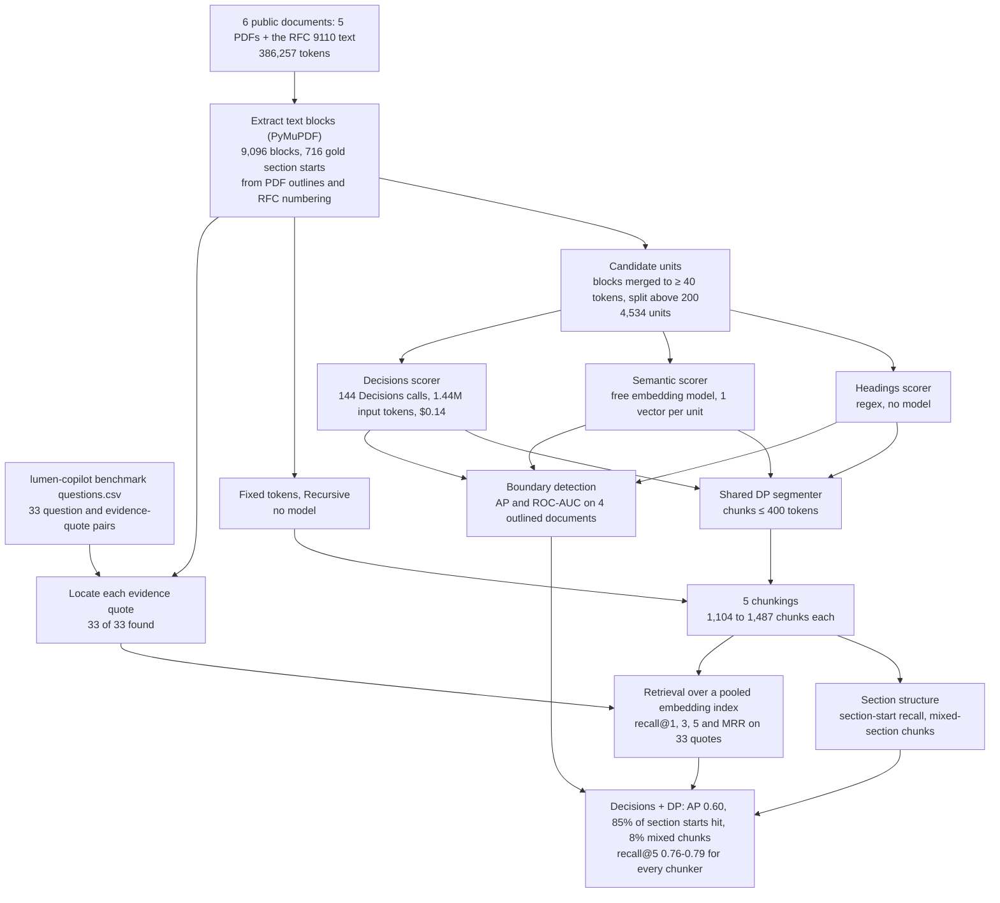

# 02 · Chunking long documents: Decisions API vs classic splitters

**Goal.** Test whether the Decisions API can decide *where* to split a long document better than fixed windows,
recursive splitting, heading heuristics or embedding-based "semantic chunking", with all structure-aware methods
sharing the same candidate split points and the same dynamic-programming segmenter.

**Result.** As a section-start detector the Decisions API scores mean **AP 0.60 / ROC-AUC 0.88**, against 0.43 / 0.82
for a heading heuristic and 0.32 / 0.73 for embedding distance. Its chunks place a boundary near **85%** of real
section starts and only **8%** of them mix two sections (fixed windows: 28% and 46%). It costs about **$0.37 per
million document tokens**. Retrieval recall@5 is 0.76-0.79 for every chunker: on this question set, cleaner
chunks did not change what retrieval finds.

**Workflow.** The whole experiment from data to results, with the counts from this run. Every model response is cached in `data/`, so a re-run replays it without API calls.

| | |
|---|---|
| Data | six public documents (arXiv "Attention Is All You Need", NIST SP 800-63B, RFC 9110, Berkshire Hathaway 2023 letter, IPCC AR6 WG1 SPM, IRS 1040 instructions) and the human-written questions and evidence quotes from the public [lumen-copilot](https://github.com/k-sandhu/lumen-copilot) RAG benchmark |
| Methods | fixed tokens; recursive; headings + DP; semantic + DP; Decisions + DP (400-token budget for all) |
| Cost to re-run from scratch | $0.14 on OpenRouter (144 Decisions calls); $0 replaying the caches |

**Run it.** The PDFs are downloaded from their publishers on the first run into `data/docs/` (git-ignored). Model
calls replay from `data/`.
