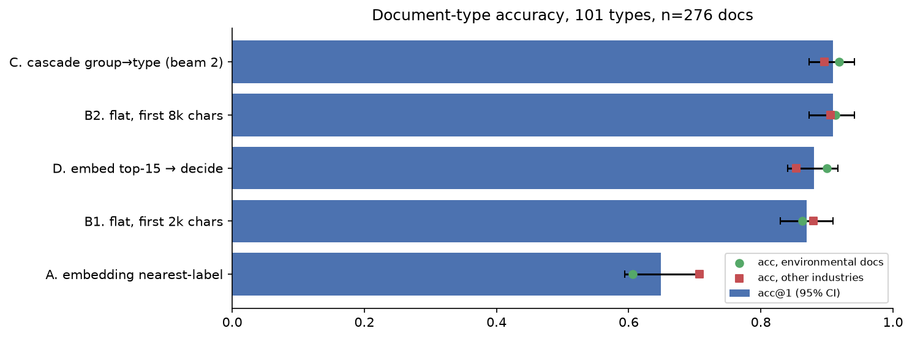

# 03 · Document-type classification on real regulatory and industry PDFs

**Goal.** Notebook 01 classified clean research abstracts by topic. This one classifies messy real-world PDFs
(permits, enforcement settlements, inspection forms, recall notices, accident reports, rate-case filings) by
*document type*, over 101 types, and asks how much of each document the classifier needs to read.

**Result.** One flat `choice` question over all 101 types is the best design: **90.9% top-1**, 96% top-3,
**$0.48 per 1,000 documents**. Retrieve-then-decide, the winner in notebook 01, drops to 88%: embeddings capture
topic, not document form. Reading 8,000 characters instead of 2,000 adds 4 points, mostly on documents whose first
page is a cover letter. Environmental documents are no harder than other industries (91-92% vs 90%).

| | |
|---|---|
| Data | about 300 public PDFs from US and UK regulators and agencies (EPA, state water boards, NHTSA, FDA, CMS, UK AAIB/MAIB/RAIB, Environment Agency, USGS, NY PSC, Federal Register), each pinned by URL and sha256 in `data/catalog/` |
| Labels | 101 document types in 13 groups, gold labels from publisher metadata and a manual first-page review |
| Methods | embedding nearest-label; flat Decisions question; group→type cascade; embedding shortlist + Decisions; 2,000 vs 8,000 characters of context |
| Cost to re-run from scratch | $0.47 on OpenRouter (1,634 Decisions calls); $0 replaying the caches |

**Run it.** The first run downloads about 300 MB of PDFs into `data/docs/` (git-ignored) and checks each file's
sha256 against the catalog. Model calls replay from `data/`.
