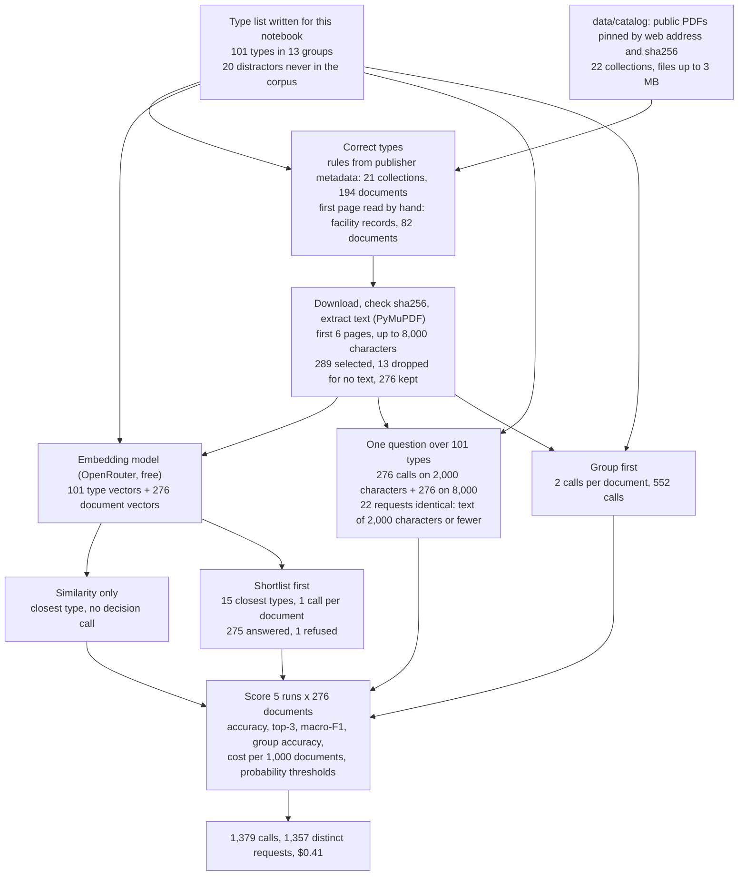
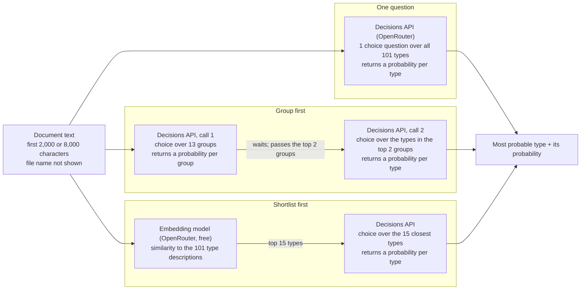

# Sorting regulatory PDFs by document type

## A folder of public records

Suppose a company is about to buy an old paper mill. Before the sale closes, an environmental consultant downloads the public record on the site from the US Environmental Protection Agency (EPA) and the state regulators. It arrives as a folder of 80 PDFs with names like `viewdoc.aspx` and `ar-096.pdf`. Somewhere in it are the mill's discharge permits, letters from the regulators, inspection reports, a court settlement over past violations and notices of public hearings.

The consultant's first job is not to read every page but to sort the folder. A settlement or an enforcement order tells the buyer about penalties and clean-up duties that may pass to the new owner, so it is read first and in full. A notice announcing a hearing can wait.

A useful sorting step files each PDF under the right type and says which ones it is unsure about, so that a person can look at those. Each mistake has a cost. A settlement filed as an ordinary letter may never be read, and the buyer takes on a penalty nobody mentioned. The same sorting step is needed wherever documents arrive in bulk from regulators: a car maker's recall notices, a nursing home's inspection forms, the dozens of filings in a utility's rate case.

### An illustrative example

This example is made up, to show the task. The folder holds two PDFs.

The first opens with a page headed "Final permit". It names the mill, the river it discharges into and the limits on what it may release. Anyone reading that page knows what the document is. This is the ordinary case: the first page says what the document is.

The second opens with a one-page letter from the agency: "Please find enclosed the accepted label for your product. Changes in labeling must be submitted before release." Pages 2 to 15 are the product label itself: the active ingredient, the directions for use, first aid, storage and disposal. If you read only the first page, you file this PDF as correspondence. If you turn the page, you see that the letter is a cover sheet and the document is a pesticide label.

A careful person handles the second file by flipping through it before deciding, and by asking what the document as a whole is for. A program that sorts documents has to make the same choice explicitly: how much of each document to read. Reading more costs more and takes longer, and for most documents the first page is enough. For documents that open with a cover letter, the first page points the wrong way.

### What a document's type means

The two files hold a second trap. A permit and the fact sheet that explains it discuss the same river, the same pollutants and the same mill. A letter that sends out a permit mentions the permit on every line. What separates them is not the subject but the purpose and the form: a permit grants permission and sets conditions, a fact sheet explains the reasons for those conditions, and a letter sends or asks for something. A method that matches documents by subject sees these as nearly the same document. A method that sorts by type has to look at what the document does.

### Asking a decision model

This experiment does the sorting with a decision model. A decision model is a language model offered for one narrow job: it receives some evidence (here, the text of a document) and a question with a fixed list of possible answers, and it returns a probability for each answer instead of writing text. Asked "What type of document is this?" with a list such as "final discharge permit, permit fact sheet, regulatory letter, pesticide label", it might return 0.94 for pesticide label, 0.04 for regulatory letter and almost nothing for the rest.

Two things make this shape suit a sorting job. The answer is always one of the listed types, so nothing has to be pulled out of free text. And the probability suggests a rule for the person in the loop: accept the answer when it is high, and send the document to a person when it is low. That rule works only if a high probability really means the answer is likely right, which is something to test rather than assume.

### Three ways to ask, and how much to read

The study sorts documents into 101 types, arranged in 13 groups such as "water permitting", "environmental enforcement" and "utility rate-case filings". There are three reasonable ways to put that many types to a decision model:

- Ask one question with all 101 types as the answers. The model sees every option, including the near neighbours it has to rule out, such as the permit and its fact sheet. It is the simplest design, but every request carries the descriptions of all 101 types.
- Ask in two steps: first which of the 13 groups the document belongs to, then which type within the two most likely groups. Each question is shorter, but a wrong group at the first step can rule out the right type.
- Make a shortlist first, without a language model. An embedding model turns a text into a list of numbers so that texts on similar subjects get similar numbers. It compares the document with each type's description and keeps the 15 closest, and the decision model chooses among those. Each request is about half as long, but a type the shortlist left out cannot be chosen, and the shortlist is built from subject similarity.

The similarity comparison on its own, picking the single closest type with no decision model, is the cheapest baseline. Across the designs there is also the choice from the example: whether the model reads about one page of text (the first 2,000 characters) or about two to four pages (the first 8,000).

## The question

When a public regulatory PDF has to be filed as one of 101 document types, which way of asking a decision model gets the type right most often for its cost: one question over all 101 types, a group first and then a type, or a 15-type shortlist made by subject similarity? And does the model need about a page of text, or does it do better with four times as much? The test uses 276 PDFs from 22 collections published by US and UK regulators and agencies.

A team building a sorting step needs both answers. The design sets the cost per document and decides which mistakes are possible, and the amount of text decides whether documents that open with a cover letter can be sorted at all.

## Study summary

The decision model was OpenAI's Decisions API, which runs GPT-6 Luna. The three designs that use it share one instruction, to judge "the document's form and purpose, not just its topic". The model sorted 276 public PDFs, from permits and inspection forms to recall notices, accident reports and rate-case filings, each with a known correct type. Of the 101 types, 78 occur in these documents; the other 23 are plausible neighbours the model has to rule out. The main measure is accuracy, the share of documents whose most probable type is the correct one.

- One question over all 101 types, reading 8,000 characters, got 251 of 276 documents right (90.9%), and the correct type was among its three most probable answers for 265 (96.0%). It cost $0.47 per 1,000 documents. Asking for the group first also got 251 right. The two designs disagreed on only 6 documents, 3 each way, so this test cannot separate them.
- The 15-type shortlist got 243 right (88.0%) at $0.22 per 1,000 documents. For 19 documents the correct type was not on the shortlist, so the decision model could not choose it. One request was refused by the service; on the 275 readable replies the shortlist got 243 right (88.4%), and the order of the designs does not change. The similarity comparison alone got 179 right (64.9%).
- Reading 8,000 characters instead of 2,000 raised the one-question design from 240 to 251 right. It fixed 11 documents and broke none. Five of the 11 were EPA pesticide labels, which open with EPA's registration notice: none of the 8 labels was right on 2,000 characters, and 5 were on 8,000.
- The probabilities do not flag most mistakes. 17 of the 25 wrong answers from one question on 8,000 characters came with a probability of 0.9 or more, and 214 of its 276 answers came back at exactly 1.00, 7 of them wrong.

In the consultant's folder, a decision model given about four pages of each PDF and all 101 types would file about nine documents in ten correctly, for less than half a dollar per thousand documents. A probability threshold would not find most of its mistakes. Documents that open with a letter, and close neighbours such as a rate-case motion and a letter, still need a person to check them.

The caveat that most affects this answer is size. The 276 documents cover 78 types, and 64 of those types have between one and four documents, so results for any single type rest on very few examples. Most of the documents were also public before the model's training cutoff (236 of 276 carry an earlier date in the catalog), so the model may have seen some of them, and the accuracy is an upper bound for new documents.

## Contents

1. [The documents and the 101 types](#1-the-documents-and-the-101-types)
2. [How the experiment runs](#2-how-the-experiment-runs)
3. [The models and the measures](#3-the-models-and-the-measures)
4. [Results: which way of asking works best](#4-results-which-way-of-asking-works-best)
5. [Results: how much of each document to read](#5-results-how-much-of-each-document-to-read)
6. [Results: using the probability to choose what a person checks](#6-results-using-the-probability-to-choose-what-a-person-checks)
7. [Error analysis](#7-error-analysis)
8. [What the evidence supports](#8-what-the-evidence-supports)
9. [Limitations](#9-limitations)
10. [Spend, data and how to run](#10-spend-data-and-how-to-run)
11. [Future work and further reading](#11-future-work-and-further-reading)

## 1. The documents and the 101 types

### Where the documents come from

The catalog in `data/catalog/` pins each public PDF by its web address and its sha256 fingerprint (a checksum that changes if one byte of the file changes). The notebook downloads each PDF and refuses a file that has changed since it was catalogued. The PDFs are downloaded on demand, not committed, and 89 of the 276 scored documents are marked "license-unclear" in the catalog because the publisher states no reuse terms.

From each collection the notebook samples a fixed number of documents per type (between 1 and 8, set in its code), keeps PDFs up to 3 MB and extracts text from the first six pages with the PyMuPDF library. It drops any document with fewer than 300 characters of text. Of 289 selected documents, 13 were dropped: 10 scanned PDFs with no text layer (five of the eight South Dakota nursing-home inspection forms, all four corrective-measures work plans and one groundwater determination) and 3 with under 300 characters (two site maps and one rate-case exhibit). (Counted by repeating the notebook's selection on the downloaded files.) The 276 documents kept have 8,415 pages, a median of 12 each.

| Collection (catalog name) | Publisher | Documents | Types | How the correct type was set |
|---|---|---|---|---|
| `env-us-facility-bundles` | EPA, state agencies and courts: records on individual US facilities | 82 | 35 | First page read by hand |
| `env-uk-environment-agency` | UK Environment Agency, on GOV.UK | 26 | 9 | Publisher's attachment title or GOV.UK category |
| `science-us-usgs` | US Geological Survey | 14 | 7 | Publication-series code (fact sheet, open-file report, circular and so on) |
| `epa-npdes-nh`, `epa-npdes-ma` | EPA Region 1 discharge permits, New Hampshire and Massachusetts | 13 and 12 | 3 and 2 | Words in the file name ("draft", "mod", "fact sheet") |
| `nydps-coned-25-e-0072`, `nydps-liberty-water-26-w-0358` | New York Public Service Commission, two rate cases | 11 and 6 | 11 and 6 | The commission's filing category |
| `safety-uk-maib` | UK Marine Accident Investigation Branch | 10 | 2 | File name: safety bulletin or full report |
| `health-us-clinical-trials` | ClinicalTrials.gov study documents | 8 | 2 | File name: protocol with or without its statistical analysis plan |
| `epa-npdes-me` | Maine Department of Environmental Protection | 7 | 2 | Words in the file name |
| 12 single-type collections | EPA pesticide labels (8); NHTSA vehicle recalls (8); FDA 510(k) clearances (8) and premarket approval summaries (8); US customs rulings (8); Federal Register rules (8); UK air (8) and rail (8) accident reports; UK charity annual reports from the Kleister research dataset (8); Missouri drinking-water reports (6); California discharge orders (6); South Dakota nursing-home inspection forms (3) | 87 | 1 each | The collection: every file in it is that type |

In all, 160 documents are environmental (permits, enforcement, waste and clean-up records, UK environmental permitting, pesticide labels) and 116 come from other fields.

### Where the correct types come from

For the 21 collections from a single publisher (194 documents), a rule in the notebook reads the type from metadata the publisher set: a word in the file name, a series code, a filing category or an attachment title. These labels come from the publisher, not from a model. They also inherit the publisher's filing choices. The New York commission can file a letter that asks for something under "motions", and the file-name rule counts any EPA permit whose name contains "mod" as a modification.

The facility records (82 documents) mix every kind of regulatory document, so their types were set by hand. About four files were sampled per file-name pattern, the first page of each was read, and a type was assigned; the assignments are listed in the notebook's code. The notebook does not record who did this review, and no second reviewer checked it, so there is no agreement rate for these labels. Section 7 shows documents where the recorded type is open to argument.

### The 101 types

The type list was written for this notebook. Each type has a one-sentence description, and that description is the text the decision model sees for each answer. The descriptions are general definitions, not phrases copied from the documents. Twenty types are distractors: realistic types that never occur in the corpus, added so that the model has to rule them out. Three more types have no scored document: all four corrective-measures work plans were scans and were dropped, and the sample holds no document of the other two. The groups range from 3 types (corporate and nonprofit reporting) to 15 (hazardous waste and site clean-up).

A few rows show how close the neighbours are:

| Type | Description given to the model | In the scored set |
|---|---|---|
| Wastewater discharge permit (final) | Issued NPDES or state-equivalent permit or adopted waste discharge requirements order authorizing discharges to surface water, with effluent limits and monitoring requirements. | 25 documents |
| Permit fact sheet | Explanatory fact sheet accompanying a draft discharge permit: facility description, receiving water and the basis for each limit. | 1 document |
| Discharge monitoring report (DMR) | Periodic permittee form reporting measured effluent values against permit limits for each outfall and parameter. | Distractor |
| Regulatory correspondence letter | Letter between regulator and facility transmitting a permit, approving a request, or requiring information or action. | 4 documents |
| Pesticide product label | Registered pesticide product label: ingredients, directions for use, precautionary statements and storage/disposal. | 8 documents |

(NPDES is the US federal discharge permit program.) Of the 78 types present, 21 have a single document, 64 have between one and four, and 11 have eight or more.

### Dates and what the model may have seen

The catalog records an estimated first-publication date for every document (`published`), with its basis (`published_basis`: a registry entry, a publisher listing, a date printed in the document, or an estimate from the content) and a confidence (`published_confidence`). The decision model's knowledge cutoff is not recorded in `data/`; [OpenAI's GPT-6 Luna model page](https://developers.openai.com/api/docs/models/gpt-6-luna) gives 18 May 2026 (checked 28 October 2026).

Against that date, 236 documents are dated before the cutoff, 35 after it (25 on a registry, publisher or in-document date, 10 on content estimates) and 5 carry only a year or month that spans it. The 35 later documents come mostly from the UK Environment Agency (16) and the Liberty Water rate case (6). One question on 8,000 characters got 31 of the 35 later documents right (89%) and 216 of the 236 earlier ones (92%). The later group is small and drawn mostly from two of the harder collections, so the split can neither confirm nor rule out an effect of memory. This notebook was built before the repository required data newer than the models, so all results use all 276 documents and are an upper bound for unseen documents.

## 2. How the experiment runs

Each document's text is extracted once. The decision model then answers under four set-ups (one question on 2,000 and on 8,000 characters, group first, shortlist first), and the similarity comparison runs without it. Every reply is cached in `data/decisions_cache_classification.jsonl`, keyed by the full request.



The file name is never shown to the model, because names such as `draft...permit.pdf` would give the answer away. The calls per document for the three designs (eight documents run at a time; a refusal is not retried):



Group first and shortlist first read 8,000 characters. Running one question at both lengths isolates the effect of reading more.

### Worked example: a pesticide label, start to finish

The file `019713-00750-20260831.pdf` (catalog ID `label-019713-00750-20260831`) comes from EPA's pesticide label system. It has 94 pages. Its correct type, "Pesticide product label", comes from the collection: every file in it is a registered label.

The notebook extracts the first six pages and keeps 8,000 characters. The first page is EPA's registration notice, a form letter. The model's text begins:

```text
U.S. ENVIRONMENTAL PROTECTION AGENCY
Office of Pesticide Programs
Registration Division (7505T)
...
EPA Reg. Number: 19713-750
Date of Issuance: 8/31/26
NOTICE OF PESTICIDE:  X Registration
...
Name of Pesticide Product: Drexel Imitator® AG
```

The notice runs to about character 2,000, ending with the approving official's signature and "EPA Form 8570-6". The label comes after it. At character 3,945 the text reads "ACTIVE INGREDIENT: Glyphosate in the form of its isopropylamine salt ... 41.0%", followed by first aid and precautionary statements.

Each request holds the evidence (the text), one question with the instruction "What type of document is this? Choose the single best-matching document type. Judge by the document's form and purpose, not just its topic.", and the 101 types with their descriptions. The cached replies:

| | One question, 2,000 characters | One question, 8,000 characters |
|---|---|---|
| Input tokens (a token is about four characters of English, the unit the service bills) | 3,623 | 4,903 |
| Cost of the call | $0.00036 | $0.00049 |
| Three most probable types | Regulatory correspondence letter 0.46; Permit decision document 0.22; Wastewater discharge permit (final) 0.04 | Pesticide product label 0.94; Regulatory correspondence letter 0.04; Draft or tentative discharge permit 0.01 |
| Scored | Wrong; correct type not in the top three | Right; probability 0.94 |

Most of each request is the list of 101 type descriptions, so four times as much document text adds only about a third to the tokens. Group first gave "Other environmental and product stewardship" 0.97 as the group and then "Pesticide product label" 1.00, for a combined probability of 0.98. Shortlist first gave the label 0.96 from a 15-type list that did not contain "Regulatory correspondence letter". On 2,000 characters the model saw only the notice, and a notice of registration is a letter in form. On 8,000 it also saw the label and chose it.

## 3. The models and the measures

| Model | Pinned version | Provider and how it was called | Size and precision | Settings | Why included |
|---|---|---|---|---|---|
| GPT-6 Luna through OpenAI's Decisions API | Not recorded. The notebook called the undated name `openai/gpt-6-luna-decisions`, and the cached replies carry no dated version | OpenAI, through OpenRouter's Decisions endpoint | Not published | Choice questions; one instruction for every type question; probabilities in steps of 0.01 | The decision model whose ways of asking are compared |
| Llama Nemotron Embed VL 1B v2 | Not recorded. Free endpoint `nvidia/llama-nemotron-embed-vl-1b-v2:free` | NVIDIA, through OpenRouter's embeddings endpoint | About 1 billion parameters (from the name); precision not recorded | 512-number vectors | Builds the shortlist, and on its own is the similarity-only baseline |

The free embedding endpoint may log its inputs, which is acceptable only for public documents.

### How answers are scored

Accuracy (also called top-1 accuracy) is the share of documents whose most probable type is the correct type. Higher is better. Top-3 accuracy counts a document as right when the correct type is among the three most probable; it shows how often a person picking from three suggestions would find the right one.

Accuracy rewards getting the common types right. Macro-F1 gives every type equal weight. For each type it combines two shares: of the documents the model called that type, how many really were (precision), and of the documents of that type, how many the model found (recall). F1 is their harmonic mean, and macro-F1 averages F1 over the 78 types present. A small example: ten documents, nine final permits and one modification, and a model that calls all ten "final permit". Accuracy is 9 of 10, or 90%. F1 for final permits is about 0.95 (precision 9/10, recall 9/9), F1 for modifications is 0, and macro-F1 is 0.47. A model that ignores rare types scores well on accuracy and poorly on macro-F1.

Group accuracy counts an answer as right when the chosen type is in the same group as the correct one. The probability of an answer is the model's probability for its top type. For group first it is the probability of the two kept groups multiplied by the top type's probability. For similarity only it is a score computed from the similarities, used only to rank answers. Cost per 1,000 documents comes from the `usage.cost` field of each cached reply, and time per document from its `latency_s` field. Intervals are 95% bootstrap intervals: the 276 documents are resampled with replacement 2,000 times and the middle 95% of the resulting accuracies is reported.

### Unreadable replies

A decision model's reply is always a probability for each listed answer, so there is no free text that could break a format. The one way a request fails is a refusal: the service returns an error instead of probabilities. The notebook counts a refusal as a wrong answer and reports refusals in their own column. There was one, in the shortlist design, described in section 7.

## 4. Results: which way of asking works best

The code names in the notebook's tables and figure map to the plain names used here: A is similarity only, B1 and B2 are one question on 2,000 and 8,000 characters, C is group first ("cascade") and D is shortlist first.

| Run | Accuracy | Top-3 | Macro-F1 | Group accuracy | Environmental (160) | Other (116) | Refused | Input tokens per document | $ per 1,000 documents |
|---|---|---|---|---|---|---|---|---|---|
| A. Similarity only | 64.9% (179) | 81.5% (225) | 0.509 | 88.0% | 60.6% | 70.7% | 0 | 0 | $0.00 |
| B1. One question, 2,000 characters | 87.0% (240) | 93.1% (257) | 0.840 | 92.4% | 86.2% | 87.9% | 0 | 3,640 | $0.36 |
| B2. One question, 8,000 characters | 90.9% (251) | 96.0% (265) | 0.854 | 96.7% | 91.2% | 90.5% | 0 | 4,748 | $0.47 |
| C. Group first | 90.9% (251) | 95.3% (263) | 0.865 | 96.4% | 91.9% | 89.7% | 0 | 4,720 | $0.47 |
| D. Shortlist first | 88.0% (243) | 92.0% (254) | 0.795 | 94.6% | 90.0% | 85.3% | 1 | 2,174 | $0.22 |

Counts in brackets are documents out of 276. The rates are from the notebook's results table; the counts were recounted from the cached replies.

One question on 8,000 characters and group first tie at 251 of 276 (90.9%). Group first has slightly higher macro-F1 (0.865 against 0.854) and the same cost per document, because its two shorter questions together carry about as many tokens as one long one. Matching the two runs document by document, both were right on 248, both wrong on 22, and each was right on 3 that the other missed. No result here separates them.

The shortlist is cheaper and less accurate. It sends less than half the tokens ($0.22 per 1,000 documents) and got 243 right (88.0%). On the 275 documents where it returned an answer it got 243 right (88.4%), so the refusal does not change the order. Document by document, one question on 8,000 characters was right on 15 documents the shortlist missed, and the shortlist on 7 that one question missed. An exact sign test on those 22 documents gives p = 0.13, so the gap of 3 points could be chance at this sample size.

The median time per document, from the cached `latency_s` field with eight documents at a time, was 1.8 seconds for one question at either length, 4.0 for group first (two calls in turn) and 0.8 for the shortlist, not counting its untimed embedding step.

Similarity alone is far behind at 179 of 276 (64.9%). It also chose a distractor type, one that never occurs in the corpus, 26 times, 16 of them "Discharge monitoring report". The four decision-model runs together chose a distractor twice in 1,103 answers, both times "Journal article / research paper".


Each bar is one run, labelled with its code name from the table above. Its length is accuracy on all 276 documents on a scale from 0 to 1 (the axis has no label; 0.9 means 90%), and the black line is the 95% bootstrap interval. The green circle is accuracy on the 160 environmental documents and the red square on the 116 from other fields. The title states the set-up rather than the finding.

The top three bars sit within 3 points of each other, and their intervals overlap: 87.3% to 94.2% for both one question on 8,000 characters and group first, 84.1% to 91.7% for the shortlist. Environmental documents were not harder for the decision model: one question on 8,000 characters got 146 of 160 environmental documents right (91.2%) and 105 of 116 others (90.5%). Similarity alone is the exception, at 60.6% against 70.7%.

Many documents do not separate the designs at all. In 11 collections, 85 documents in all, every decision-model run got every document right: the recall notices, customs rulings, accident reports, FDA documents, drinking-water reports, California and Massachusetts permits and the nursing-home forms. A typical one is `nhtsa-25v060-rcmn-25v060-2255`, a one-page General Motors bulletin of 553 characters headed "Safety Recall ... Chrome Grille Deflector May Detach". All four runs answered "Vehicle safety recall notice", with probabilities 1.00, 1.00, 0.92 and 0.99. The comparison between designs rests on the other 191 documents.

### Why the shortlist loses some documents and wins others

The shortlist caps what the decision model can do. The correct type was the single closest type for 64.9% of documents, among the closest 5 for 85.9%, among the closest 15 for 93.1% (257 of 276) and among the closest 30 for 96.4%. Of the shortlist design's 33 misses, 19 came from documents whose type was not on the list (one of these is also the refused request), and 14 were wrong choices from a list that included it.

The 19 missing types cluster where types differ by form within one subject: 6 of the 14 US Geological Survey documents, 5 of 26 UK Environment Agency documents, 5 of 82 facility records, 2 of 8 clinical-trial protocols and 1 Con Edison filing. `usgs-doc-usgs-fs20253054` is a four-page USGS fact sheet on undiscovered petroleum in the Haynesville Formation. Similarity ranked "Science fact sheet" 72nd of the 101 types; the closest were "Phase I environmental site assessment" and "Site map or figures". The shortlist design chose "Environmental research or evidence report" at 0.79. One question on 8,000 characters, which saw all 101 types, chose "Science fact sheet" at 0.99. This fits the idea that a similarity search sorts by subject rather than by form, though 19 documents are too few to establish it.

The shortlist also got 7 documents right that one question on 8,000 characters missed, and in 5 of them the type one question chose was not on the shortlist. It got all 8 pesticide labels right, against 5 for one question, and for none of the 8 did "Regulatory correspondence letter" make the shortlist, so the decision model could not give the tempting wrong answer. For `protocol-nct04688346` it chose "Clinical study protocol with statistical analysis plan" (0.91), but plain "Clinical study protocol" was not on its list, and no analysis-plan text appears in the first 8,000 characters (section 7). For `fr-doc-2025-05536` it chose "Federal Register rule" because "Federal Register notice" was not on its list. These are right answers for a reason that would not carry over to a different type list.

## 5. Results: how much of each document to read

Reading 8,000 characters instead of 2,000 raised the one-question design from 240 to 251 right. The change fixed 11 documents and broke none of the 240 already right. An exact sign test on 11 against 0 gives p = 0.001. For 22 documents the extracted text is 2,000 characters or shorter, so the two runs saw the same text; 101 documents have less than 8,000 characters in all.

The table gives correct documents per collection for every run, sorted by one question on 8,000 characters (the notebook's per-collection table, as counts).

| Collection | Documents | Similarity only | One question, 2,000 | One question, 8,000 | Group first | Shortlist first |
|---|---|---|---|---|---|---|
| `nydps-coned-25-e-0072` | 11 | 4 | 6 | 6 | 7 | 7 |
| `epa-pesticide-labels` | 8 | 8 | 0 | 5 | 4 | 8 |
| `health-us-clinical-trials` | 8 | 4 | 5 | 5 | 5 | 5 |
| `env-uk-environment-agency` | 26 | 15 | 21 | 21 | 23 | 19 |
| `nydps-liberty-water-26-w-0358` | 6 | 3 | 5 | 5 | 4 | 4 |
| `epa-npdes-me` | 7 | 5 | 3 | 6 | 6 | 6 |
| `kleister-charity-cohort` | 8 | 8 | 7 | 7 | 7 | 7 |
| `law-us-federal-register` | 8 | 5 | 6 | 7 | 6 | 7 |
| `epa-npdes-nh` | 13 | 7 | 12 | 12 | 12 | 12 |
| `env-us-facility-bundles` | 82 | 47 | 78 | 78 | 78 | 75 |
| `science-us-usgs` | 14 | 3 | 12 | 14 | 14 | 8 |
| 11 collections all right under every decision-model run | 85 | 70 | 85 | 85 | 85 | 85 |

Four collections changed between the two lengths. Pesticide labels went from 0 of 8 to 5 of 8, Maine permits from 3 of 7 to 6 of 7, USGS documents from 12 of 14 to 14 of 14 and Federal Register rules from 6 of 8 to 7 of 8. The pesticide labels open with EPA's registration notice and most Maine permits with a department letter. On the short excerpt the model filed all eight labels and three of the seven Maine permits as letters, sometimes with high probability. `me-permit-me0102581` opens with a Maine DEP letter, "Enclosed please find a copy of your final MEPDES permit and Maine WDL renewal". On 2,000 characters the model said "Regulatory correspondence letter" at 0.97; on 8,000 it said "Wastewater discharge permit (final)" at 1.00, which is correct.

The pattern is the one from the illustrative example. Where the first page states the type, a page is enough, and the extra text changed nothing in 18 of the 22 collections. Where the first page is a cover sheet, the extra pages are what the model needs, and it pays about a third more in tokens for every document to get them.

## 6. Results: using the probability to choose what a person checks

The plan from the opening was to accept confident answers and send the rest to a person. For one question on 8,000 characters, the notebook's threshold table gives:

| Accept if probability is at least | Documents accepted | Right among accepted | Sent to a person | Right among those sent |
|---|---|---|---|---|
| 0 (accept all) | 276 | 251 (91%) | 0 | |
| 0.5 | 272 | 251 (92%) | 4 | 0 |
| 0.7 | 265 | 247 (93%) | 11 | 4 |
| 0.9 | 256 | 239 (93%) | 20 | 12 |

The threshold barely helps. At 0.9 a person checks 20 documents (7% of the folder) and finds 8 of the 25 errors among them, while 17 errors pass unchecked. Accuracy on the accepted documents rises only from 91% to 93%.

The reason shows in the probabilities themselves. The service returns them in steps of 0.01, and 214 of the 276 answers came back at exactly 1.00. Seven of those 214 were wrong, so the top of the scale cannot rank them any further. Among the 25 errors, 12 had a probability of 0.97 or more and only 4 were below 0.5. The model is usually right when it is sure, but when it is wrong it is usually just as sure.

A different rule does better on this data. The model's most common wrong answer was "Regulatory correspondence letter": it gave that answer 9 times, and 5 of them were wrong. Checking every document called a letter means looking at 9 documents and finds 5 errors. Checking those plus everything under 0.9 means looking at 28 documents (10%) and finds 12 of the 25 errors. This rule was found by looking at these errors, so it needs testing on new documents before anyone relies on it. These counts were computed from the cached replies.

## 7. Error analysis

The notebook lists the most frequent confusions of one question on 8,000 characters (correct type, then the type chosen):

| Correct type | Chosen type | Documents |
|---|---|---|
| Pesticide product label | Regulatory correspondence letter | 3 |
| Clinical study protocol with statistical analysis plan | Clinical study protocol | 3 |
| Agency corporate report | Environmental research or evidence report | 2 |
| 17 other pairs | | 1 each |

Most pairs are neighbours. Read against their text, 18 of the 25 errors share one of three causes: the type is beyond the text the model received (6), the correct type is arguable (6), or the type comes from a rate-case filing category (6). The other 7 do not share a cause.

### The type is beyond the text the model received

Three pesticide labels were still filed as letters on 8,000 characters. In `label-089950-00001-20250506` the label's ingredient statement appears at character 5,831 ("ACTIVE INGREDIENTS: Hydrogen peroxide ... 6.98%"), after a long registration notice with conditions, and the model still chose the letter at 0.98. In `label-000524-00670-20260309` none of the usual label headings (directions for use, first aid, precautionary statements, storage and disposal) appears in the first 8,000 characters; "active ingredients" appears once, at character 6,926, inside the notice's conditions. The model chose the letter at 0.38. In `label-100368-00006-20250814` the readable text ends at character 4,208 with "Enclosure: Product Label". The text after it is unreadable, from a font the text extractor could not decode: 13% of the excerpt's characters are control characters, and no label heading appears. Given the text it received, the model's answer (letter, 0.92) is a fair reading. That error belongs to the extraction step, and no choice of design would fix it.

Three of the four clinical-trial protocols filed with an analysis plan were called plain protocols. Their correct type comes from the file name `prot_sap_000.pdf`, which ClinicalTrials.gov uses for a protocol filed together with its statistical analysis plan. In `protocol-nct04688346` the phrase "statistical analysis" does not appear in the first 8,000 characters at all. In the other two it appears at characters 4,387 and 6,662, and the model still chose the plain protocol (0.92 and 0.99). A document that contains a protocol and, later, an analysis plan looks like a protocol for as long as the excerpt lasts.

### The correct type is arguable

`emerald-2013-final-statement-basis` was filed by hand as "Remedy statement of basis / proposed remedy". Its first words are "Statement of Basis / Approval for Commercial Storage and Disposal of Polychlorinated Biphenyls (PCBs)", issued by EPA Region 9. Every decision-model run chose "TSCA PCB storage/disposal approval" at 1.00. The two descriptions both fit: the first covers a regulator's document explaining "a proposed cleanup remedy or permit/approval decision", and the second an "EPA approval (proposed or final) to commercially store or dispose of polychlorinated biphenyls". It is a statement of basis for a PCB approval.

`me-permit-me0002054` has the correct type "Discharge permit modification" because its file name, `finalme0002054permitmod-2026.pdf`, contains "mod". The cover letter says it encloses "your final MEPDES permit and Maine WDL renewal", and the permit's page 3 lists "MODIFICATIONS REQUESTED". Every run chose the final permit (1.00 on 8,000 characters). The document is a renewal that includes a modification.

Four more errors look similar. `kc-047` is the Construction Industry Training Board's "Annual Report and Accounts 2014", "Presented to Parliament". It sits in the charity collection, so its correct type is a charity annual report, but the board is a public body, and every decision-model run called it an agency corporate report. `fr-doc-2025-05536` is printed in the Federal Register's "Rules and Regulations" section, so the collection rule calls it a rule, but its text says "ACTION: Notification of enforcement of regulation", and the model called it a notice (0.94). `epa-schiller-ar-096` is a one-page letter from New Hampshire's environment department following up an inspection. The type "Compliance inspection report" is described as a "report or follow-up letter documenting a regulatory compliance inspection", and every run chose the letter (0.97 on one question). `reservoir-safety-research-strategy-2026`, filed under GOV.UK's corporate report category, is headed "Evidence Base for the Reservoir Safety Research Strategy", and the model called it a research or evidence report (0.99).

In these 6 of the 25 errors, the document's own words support the model's answer about as well as the recorded type. A second reviewer might change some of these labels, which would move accuracy by up to 6 documents (2.2 points). It would not change the order of the designs, because every decision-model run made all six of these errors except the Federal Register notice, which the shortlist got right.

### Neighbouring types told apart by a filing category

The rate-case filings are the hardest collection, at 6 of 11 for Con Edison and 5 of 6 for Liberty Water. Their correct types come from the category the commission filed them under, and several documents look like a different category. `coned-25-e-0072-c0d0ae98-0000-ce42-8115-c9139cd27b98`, filed as a motion, is a letter from a Con Edison vice president to the Secretary of the Commission; the model called it correspondence at 1.00. `coned-25-e-0072-406da397-0000-c262-89e6-6ee27c5bd5a3`, filed as tariff leaves, opens with the case caption "BEFORE THE STATE OF NEW YORK PUBLIC SERVICE COMMISSION", as testimony does, and the model called it pre-filed testimony at 1.00. All 17 rate-case filings share the file name `viewdoc.aspx`, which is why the examples use catalog IDs.

### The one refusal

The shortlist request for `wild-mooring-anglian-waterways` came back with HTTP 502 and the message "OpenAI refused to answer question "doc_type"". The document is the Environment Agency's terms and conditions for a non-residential wild mooring licence, and nothing in its first 8,000 characters suggests a reason to refuse. The same text was answered in the other designs: one question chose "Environmental permit (EPR)" at 0.29, and group first chose the correct "Regulatory guidance document" (type probability 0.49). The code treats a refusal as final, so the request was not retried.

### What these examples cannot show

They show which type the model returned for which text, not why. The pattern that the excerpt's first pages decide the answer is consistent across the pesticide labels, the Maine permits and the protocols, but it rests on 19 documents in three collections.

## 8. What the evidence supports

- For a type list that fits in one question, ask one question over all the types and give the model about 8,000 characters. Group first matched its accuracy at the same cost per document, but it takes two calls and more than twice as long (median 4.0 against 1.8 seconds).
- Use a shortlist only when its savings matter more than accuracy. It halves the cost here, but the decision model can never be more accurate than the shortlist allows (93.1% of documents had their type on it), and its misses fall where types share a subject. Most of its wins came from leaving out a tempting wrong answer, which a team could do on purpose with a rule for a known collection.
- Do not use the probability alone to choose what a person checks: 17 of 25 errors had 0.9 or more. Checking documents by the type they were given (here, every document called a letter) found more errors per document read, but that rule needs testing on new documents.
- Check the text extraction before blaming the classifier. One label was unreadable after its cover letter, and 13 scanned PDFs had no text at all.

The uncertainty that most needs another experiment is the cover-letter problem: whether showing the model the page images, or the first page of each attachment, would fix documents such as the pesticide labels, at the same cost.

## 9. Limitations

- Older public data. 236 of 276 documents were public before the model's knowledge cutoff of 18 May 2026, so the accuracy is an upper bound for new documents. The 35 later documents (31 right) are too few, from too few collections, to measure an effect of memory.
- Few documents per type. The 276 documents cover 78 types, 64 of them with one to four documents. Macro-F1 and every per-type or per-collection rate are noisy.
- Correct types. For 82 documents a single reviewer, not named in the notebook, set the type from the first page, with no second reviewer. The rules for the other 194 inherit the publishers' filing choices. Section 7 found 6 errors where the recorded type is arguable.
- One model, one instruction, one reply per request. Each request was sent once and cached, so the notebook does not measure how much the answers vary between calls. The model version was not pinned.
- Text only. The model never saw page layout, 13 scanned PDFs were dropped and one label was garbled by text extraction, so a real folder with scans would score lower.
- Analysis history. The comparison was not fixed before the results were seen, and the cache holds requests from an earlier shortlist (section 10). [`data/PROTOCOL.md`](data/PROTOCOL.md) records what is known of the run.

## 10. Spend, data and how to run

- The cache holds 1,634 Decisions API replies costing $0.47. The final run's 1,379 calls are 1,357 distinct requests (22 short documents give the same request at both lengths) and cost $0.41. The other $0.06 is 275 requests from an earlier shortlist that the final code does not make. Two cached replies are refusals.
- The embedding endpoint is free; the cache holds 377 vectors (101 type descriptions and 276 documents).
- The run date is not recorded in `data/`. The notebook and its caches were added to this repository on 17 October 2026.

| File in `data/` | What it holds |
|---|---|
| `catalog/<collection>/files.jsonl` | One row per public file: web address, sha256, size, licence, publisher, estimated publication date with its basis and confidence |
| `decisions_cache_classification.jsonl` | Every Decisions API reply, keyed by a hash of the full request: probabilities per answer, token usage, cost and time |
| `embeddings_cache.npz` | The 377 embedding vectors, keyed by a hash of the model name and text |
| `PROTOCOL.md` | What is known of the run's history and settings |

The cache stores replies but not request text, so the per-document examples above were recovered by repeating the notebook's selection and text extraction on the downloaded PDFs and looking up each request's key in the cache. Every request matched. Running the notebook replays everything from these files without model calls:

```bash
jupyter nbconvert --to notebook --execute --inplace 03_document_type_classification.ipynb
```

The first run downloads about 300 MB of PDFs into `data/docs/` (git-ignored) and checks each against its sha256. A request missing from the cache needs `OPENROUTER_API_KEY`. The full analysis is in [03_document_type_classification.ipynb](03_document_type_classification.ipynb).

## 11. Future work and further reading

### Future work

- Show the page as well as the text. The Decisions API also accepts images. Add the first page image, or the first page of each attachment, and check whether layout fixes the cover-letter and protocol-with-plan confusions in section 7 (motivated by the pesticide labels, 5 of 8 on 8,000 characters).
- Read the right part of the document. Reading 8,000 instead of 2,000 characters fixed 11 documents. Test the first 4,000 plus the last 2,000 characters, or the start of each attachment, at the same token budget.
- Test review rules on new documents. Compare a probability threshold with "check every document given a type that is often wrong" at the same number of documents checked, on a fresh set (motivated by 17 of 25 errors at 0.9 or more).
- Bring back the 13 scanned PDFs with OCR (optical character recognition) and report them separately, since scanned documents are common in regulatory records.
- Collect at least 10 documents per type, all published after the model's cutoff, with a second reviewer for hand-set types so that the correct types have an agreement rate (motivated by 64 of 78 types having one to four documents).

### Further reading

Links checked on 17 October 2026.

- [Evaluation of Deep Convolutional Nets for Document Image Classification and Retrieval](https://arxiv.org/abs/1502.07058) (Harley et al., 2015). Introduced RVL-CDIP, the standard document-type benchmark, built from page images rather than text.
- [LayoutLMv3: Pre-training for Document AI with Unified Text and Image Masking](https://arxiv.org/abs/2204.08387) (Huang et al., 2022). One model over text and page image together, the layout signal that sending the page image would add.
- [DiT: Self-supervised Pre-training for Document Image Transformer](https://arxiv.org/abs/2203.02378) (Li et al., 2022). Classifies documents from the image alone, a baseline without a language model for types that differ in form.
- [Kleister: Key Information Extraction Datasets Involving Long Documents with Complex Layouts](https://arxiv.org/abs/2105.05796) (Stanisławek et al., 2021). The source of the UK charity annual reports in this corpus (`kleister-charity-cohort`), released as an extraction benchmark for long documents.
- [Decisions](https://developers.openai.com/api/docs/guides/decisions) (OpenAI API guide). The vendor's description of the API tested here: typed questions over fixed options, answered with probabilities instead of text.
