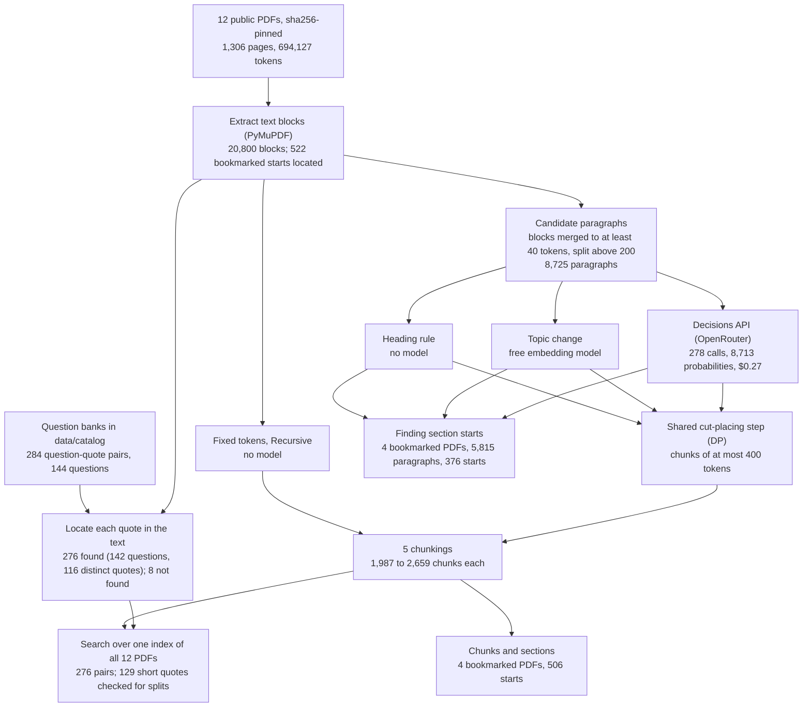
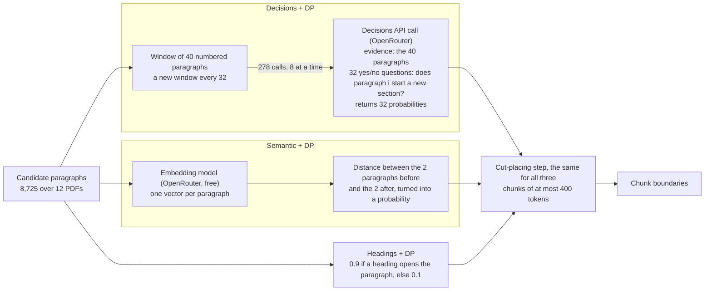

# Cutting long permits and filings into pieces a search can find

## A question about a permit

A cement plant in Atlanta runs under an air permit issued by Georgia's environmental agency. A permit is the regulator's written list of what a facility may release into the air or water, and of what it must check, record and report to show that it stays within those limits. This one is 44 pages of numbered conditions. Suppose someone at the plant, or an inspector, wants to know how often the baghouses, the fabric filters that catch dust, must be checked for visible emissions. The answer is in condition 5.2.1 on page 12: at least once for each day the plant operates.

Finding that by hand takes a few minutes for one permit. A company with many sites may hold dozens of permits, each reissued every few years, along with settlements, rate filings and inspection reports, some of them hundreds of pages long. So teams put such documents behind a search tool. The tool returns the passages most closely related to a question, and either a person reads them or a language model writes an answer from them. The second arrangement is called retrieval-augmented generation, or RAG.

The search does not look at whole documents. Each document is first cut into pieces of a few hundred words, called chunks. A model turns each chunk into an embedding: a list of numbers chosen so that texts with similar meaning get similar numbers. The question gets an embedding too, and the search returns the chunks whose numbers are closest to it. A chunk is the smallest thing the search can return, so where the cuts fall decides what the reader gets back.

### An illustrative example

This example is simplified from the Georgia permit tested below.

Part 5 of the permit covers monitoring. Section 5.1 sets general rules for monitoring equipment. Section 5.2 starts the specific requirements, and its first condition, 5.2.1, is the daily baghouse check, followed by its steps a to d. Suppose every chunk may hold at most 400 tokens. A token is a word or a piece of a word, so 400 tokens is a few hundred words.

In the ordinary case the cut goes just before the heading "5.2 Specific Monitoring Requirements". The chunk then opens with the heading and holds the whole baghouse condition. A search about baghouse checks finds it, and the reader sees the section number to cite.

Now add one complication. A cutter that only counts tokens puts a cut every 400 tokens, wherever the count runs out. One chunk might hold the end of the testing rules in section 4.2 and the first lines of 5.2.1, and the next chunk the rest of the condition. The search may return the half without the answer, and a chunk that mixes two topics resembles neither of them closely.

A second complication runs the other way. Cutting at every section start is not always safe, because a question can need a passage that crosses a heading: the last row of a table and the heading under it, or the case number on a cover page and the document title below it. A cut at a correct section start then splits the passage the question needs. A person reading the permit simply keeps reading; a search returns one chunk at a time.

### Two ways to cut

One way ignores the content. It cuts every 400 tokens, or it splits at blank lines and sentence ends and packs the pieces back together up to 400 tokens. This is fast and free, and needs no model.

The other way reads the text to decide where sections start, then cuts there while keeping every chunk within 400 tokens. This study compares three readers. A heading rule spots lines typed like headings: numbered, in capitals, short. An embedding measure checks how much the topic changes between neighbouring paragraphs. A decision model is asked about each paragraph whether a new section starts there. A decision model answers a question that has a fixed set of answers by returning a probability for each answer, instead of writing text. The one tested here is OpenAI's Decisions API. All three readers give each paragraph a probability that a section starts there, and one shared procedure turns those probabilities into cuts, so the readers can be compared on equal terms. Below, the five cutters are called Fixed tokens, Recursive, Headings + DP, Semantic + DP (topic change) and Decisions + DP, where DP, short for dynamic programming, is that shared procedure.

The decision model costs money for every page it reads; the other methods cost nothing. A team building search over its permits needs three answers before paying: whether the model's cuts follow the documents' sections better, whether that helps the search find answers, and how often its cuts split an answer in two.

## The question

On 12 long public filings (water and air permits, a hazardous-waste permit, a settlement, two utility rate filings, a vehicle recall notice, a nursing-home inspection and a pesticide label), do chunks cut where the Decisions API says a section starts follow the documents' sections more closely than chunks cut by length, by a heading rule or by topic change? Does that help a search find the passages behind 276 question-and-quote pairs, and how often does a cut split a passage a question needs?

## Study summary

Five ways of cutting were compared under the same 400-token limit on 12 PDFs (1,306 pages, 694,127 tokens). Four of the PDFs carry bookmarks that mark 506 section starts, and these four test whether each method finds section starts and keeps sections apart. A bank of 142 questions with 276 evidence quotes tests whether a search over the chunks finds each quote among its top five results, and the 129 pairs whose quote is 600 characters or shorter test how often a quote is cut in two.

- Finding section starts: the Decisions API ranked real section starts above other paragraphs best, with an average precision of 0.35 against 0.21 for the heading rule and 0.20 for topic change; a random ranking would score about 0.10. It led on three of the four documents. The heading rule led on the 313-page Massachusetts permit (0.19 against 0.16), whose bookmarks mark each reply to a public comment as a section.
- Following sections: Decisions + DP put a cut within 200 characters of 77% of bookmarked section starts, and 6% of its chunks held two sections. Headings + DP reached 68% and 10%; Fixed tokens 26% and 28%.
- Finding the evidence: the search found the quoted passage in its top five chunks for 50% to 55% of the 276 pairs under every method, and the 95% intervals overlap. Cleaner sections did not make the search find more.
- Splitting answers: Decisions + DP kept 101 of the 129 short quotes whole (78%), against 118 to 120 (91% to 93%) for the other methods. Most of that gap is one quote. The 129 pairs repeat 47 distinct quotes, and 18 of the 28 splits are a single Con Edison cover page cited by 18 questions. Counting each distinct quote once, Decisions + DP kept 41 of 47 whole and the other methods 42 to 45.
- All 278 Decisions API calls returned a readable probability for each of the 8,713 paragraphs asked about, so no result depends on failed replies.

For the plant's question, this means a search built on the Decisions API's cuts returns chunks that line up with the permit's own numbered sections, for $0.39 per million tokens of document, but it does not find the baghouse condition more often than a free cutter that counts tokens, and now and then it separates a table row or a cover-page title from the text around it.

The main caveat is that the section results rest on four documents whose bookmarks mark only some of their sections, and the question bank repeats quotes and words many questions as long templated instructions, so the search results describe this question bank more than search in general. This notebook also predates the repository's rule that test documents must be newer than the models: the documents are public filings that the catalogue dates between 2021 and 2026, no training cutoff is recorded for either model, and the scores should be read as an upper bound.

## Contents

1. [The documents and the questions](#1-the-documents-and-the-questions)
2. [How the experiment runs](#2-how-the-experiment-runs)
3. [The five cutters and the models](#3-the-five-cutters-and-the-models)
4. [How the results are measured](#4-how-the-results-are-measured)
5. [Results: finding section starts](#5-results-finding-section-starts)
6. [Results: chunks that follow sections](#6-results-chunks-that-follow-sections)
7. [Results: finding the evidence and keeping it whole](#7-results-finding-the-evidence-and-keeping-it-whole)
8. [Error analysis](#8-error-analysis)
9. [What the evidence supports](#9-what-the-evidence-supports)
10. [Limitations](#10-limitations)
11. [Spend, data and how to run](#11-spend-data-and-how-to-run)
12. [Future work and further reading](#12-future-work-and-further-reading)

## 1. The documents and the questions

The twelve PDFs are public records from US federal and state agencies, and they are awkward to cut: tables that run across pages, attachments without headings, page headers on every page, and numbered conditions several levels deep.

| Document | ID | Pages | Tokens | Catalogue date | Bookmarked starts | Question-quote pairs |
|---|---|---:|---:|---|---:|---:|
| California water discharge permit | `ca-permit-004` | 144 | 80,015 | 2026-02-27 | 112 | 24 |
| Maine water discharge permit | `me-permit-me0100773` | 54 | 25,462 | 2026 | 79 | 7 |
| New Hampshire water discharge permit | `nh-nh0001621-150f087b` | 138 | 76,084 | 2023-10 | 6 | 5 |
| Massachusetts water discharge permit | `ma-ma0100480-980fe11e` | 313 | 172,619 | 2021-10 | 131 | 17 |
| Puerto Rico hazardous-waste cleanup permit (draft) | `epa-neolpharma-pbg-pr-rcra-draft-permit-2026-04` | 37 | 19,966 | 2026-04-01 | 0 | 59 |
| Georgia air operating permit, Argos Cement | `epa-argos-atlanta-title-v-permit-2025` | 44 | 22,706 | 2025-04-15 | 0 | 49 |
| California water board settlement | `ch-sugar-r2-2025-1022-enforcement` | 41 | 20,301 | 2025-11-24 | 1 | 36 |
| Con Edison electric and gas rate case, joint proposal | `coned-25-e-0072-...` | 387 | 201,086 | 2025-12-02 | 184 | 45 |
| Liberty water rate case, corrections testimony | `liberty-water-26-w-0358-...` | 22 | 7,858 | 2026-08-14 | 0 | 11 |
| Vehicle safety recall notice | `nhtsa-25v037-rcmn-25v037-0197` | 13 | 2,691 | 2025-02-25 | 9 | 17 |
| Nursing-home inspection, statement of deficiencies | `sd2567-20250821-0d4aa1c615` | 56 | 40,586 | not recorded | 0 | 3 |
| Pesticide product label | `label-000100-01712-20251120` | 57 | 24,753 | 2025-11-20 | 0 | 3 |

Tokens and bookmarked starts are from the notebook's overview table (section 2.1). Pairs are counted after locating the quotes; the overview counts them before (New Hampshire 8, recall notice 22). Pages were counted from the pinned PDFs. Dates are the `published` field of each row in `data/catalog/<dataset>/files.jsonl`. The catalogue marks most of them as estimates from the document's content (`published_basis`, with `published_confidence` from 0.25 to 0.78); for the inspection report it records only the survey date, 21 August 2025.

A few terms. The water permits are NPDES permits, which let a plant discharge treated wastewater into a river under the federal Clean Water Act. The Georgia permit is a Title V permit, the operating permit large air-pollution sources need. The Puerto Rico permit falls under RCRA, the federal hazardous-waste law, and covers cleanup of a former pharmaceutical site. A rate case is a utility's request to a state commission to set its prices; the Con Edison document is the joint proposal that settles one. The inspection report is a CMS-2567, the federal form listing problems found at a nursing home.

Each PDF is fetched from its public address and checked against a sha256 hash recorded in the catalogue, so a changed file stops the run. The PDFs are not stored in the repository. The catalogue's `license` field describes six as public domain or public information and marks six as licence unclear.

### Where the bookmarks come from

Seven PDFs have a bookmark outline, the clickable table of contents a publisher can attach to a PDF. Each bookmark's title is matched to a text block on the page it points to (or the next page); a match marks a bookmarked section start. Four PDFs have at least 10 matched starts and are used for the section tests: California (112), Maine (79), Massachusetts (131) and Con Edison (184), 506 in all. The bookmarks are partial. Publishers bookmark what they choose, so some real sections have no bookmark and some bookmarks are not what a reader would call a section (section 5 shows both).

### Where the questions come from

The questions and quotes come from question banks in `data/catalog/`, one or more files per dataset. Each question has an answer and one or more evidence quotes, each naming the file and page it comes from. The notebook keeps answerable questions whose evidence touches at most two files and quotes of at least 40 characters from the twelve PDFs. That gives 284 pairs from 144 questions.

The files record no author, creation date or licence for the questions. Each question has an `origin` field (`curated` for 141 of the 142 used) and a `verification_status` (92 `passed`, 50 `pending`). The `notes` of 19 say "Root authored", without saying who or what Root is. Two questions come from a file of synthetic questions about a fictional data room; their three quotes come from the real cleanup permit, and the notebook's filter keeps them. Many questions are long templated instructions rather than plain searches. All 20 Georgia questions begin "Resolve the exact Atlanta FRS address/permit identity before reviewing this 2025 air source:", followed by the actual request.

The banks quote a different PDF text extractor from the one used here, so each quote is matched on letters and digits only. 276 of the 284 quotes were found in the extracted text. Three of the 8 misses belong to one New Hampshire question whose quotes include markers such as "[page 2]"; five are recall-notice quotes in which the other extractor wrote the circled step numbers (①, ②) as stray characters.

Quotes repeat. The 276 pairs hold 116 distinct quotes, because many questions cite the same passage, most often a cover page that identifies the document: the cleanup permit's cover appears in 25 pairs, the Georgia permit's in 20 and Con Edison's in 18. Every result over pairs counts a repeated quote once per question. Quote lengths in the extracted text range from 56 to 3,373 characters, with a median of about 880; 129 pairs have quotes of 600 characters or fewer.

## 2. How the experiment runs



One pair travels through it as follows: the quote is located in the extracted text, the three readers score the permit's paragraphs, each cutter makes its chunks, the chunks of all twelve PDFs form one search index per cutter, and the question is searched to see where the first chunk holding the quote ranks. The worked example below follows one pair.

Only the Decisions API is a paid model call, one call per window of 40 paragraphs:



### Worked example: one pair from start to finish

The pair is question `facility-065-weekly-maintenance-not-daily-ve` and its quote of condition 5.2.1 on page 12 of the Georgia permit (`epa-argos-atlanta-title-v-permit-2025`). The question reads:

> Resolve the exact Atlanta FRS address/permit identity before reviewing this 2025 air source: register the separate maintenance cadence and required indicators/actions.

Its recorded answer is that baghouses get at least weekly maintenance checks and that the daily visible-emissions check has a different purpose. The question cites four quotes, three of them in this permit; this one begins "5.2.1 The Permittee shall perform a check of visible emissions from all baghouses" and runs 2,526 characters through the daily check and its steps a to c.

Preparation. The permit's text is split into 292 candidate paragraphs. Paragraph 69 opens "5.1 General Monitoring Requirements" and paragraph 70 opens "5.2 Specific Monitoring Requirements / 5.2.1 The Permittee shall perform a check of visible emissions".

The model call. Paragraphs 61 to 100 form one window: 40 numbered paragraphs, 15,482 characters, sent as the evidence, with 32 questions about paragraphs 65 to 96. The question about paragraph 70 is:

> Does passage [70] begin a new section or a clearly new topic (for example, it opens with a section heading), rather than continuing passage [69]?

with the two answers "[70] continues the same section or topic as [69]" and "[70] starts a new section or topic". The cached reply holds one probability per question. Near this spot it reads `b68: 1`, `b69: 1`, `b70: 0`, `b71: 0`. The call used 10,044 input tokens, cost $0.0010 and took 2.2 seconds. So the model marked the start of Part 5 and of section 5.1 as new sections, and said section 5.2, which opens with a numbered heading, continues 5.1.

The chunks. The notebook prints where the chunk holding the start of the quote begins under each method:

| Method | Chunk size | Chunk begins | Quote starts at token |
|---|---:|---|---:|
| Fixed tokens | 400 | mid-sentence, then "4.2 Specific Testing Requirements" | 348 |
| Recursive | 323 | "5.2.1 The Permittee shall perform..." | 0 |
| Headings + DP | 330 | "5.2 Specific Monitoring Requirements" | 7 |
| Semantic + DP | 380 | "5.1 General Monitoring Requirements" | 124 |
| Decisions + DP | 380 | "5.1 General Monitoring Requirements" | 124 |

The heading rule cut exactly where the illustrative example says it should. Decisions + DP followed the model's 0 at paragraph 70 and put 5.1 and the start of 5.2 in one chunk, the same chunk the topic-change reader produced. Fixed tokens cut 52 tokens into the condition, as in the first complication of the opening example.

The search. The quote is long, so a chunk counts as holding it if it covers 300 of its characters. Searched with the question above, the first chunk holding the quote ranked 14th (Fixed tokens), 19th (Recursive), 18th (Headings + DP), 8th (Semantic + DP) and 10th (Decisions + DP). No method put it in the top five, so this pair counts as a miss for all five. The question's long opening clause is about the facility's identity, not about baghouses, which may be why no chunk of condition 5.2.1 ranked near the top.

## 3. The five cutters and the models

The two cutters that ignore content:

- Fixed tokens cuts the text into windows of 400 tokens that overlap by 50.
- Recursive splits at blank lines, then at sentence ends, then at spaces, until every piece fits in 400 tokens, and packs neighbouring pieces back together up to 400 tokens. These two are the simplest choices and need no model.

The three cutters that read the text share their candidate cut points and their cut-placing step, and differ only in where the probabilities come from.

The candidate cut points are paragraphs built from the PDF's text blocks. Short blocks are merged forward into the next until a paragraph has at least 40 tokens, so a short heading joins the text it introduces, and paragraphs over 200 tokens are split at sentence ends. The 12 PDFs give 8,725 paragraphs. A chunk is a run of whole paragraphs, so a cut can fall only between paragraphs.

The readers:

- The heading rule (Headings + DP) gives a paragraph 0.9 if one of its first two blocks looks like a heading (1 to 12 words, no final punctuation, and numbered, in title case or in capitals), otherwise 0.1. It is free and depends on clean typography.
- Topic change (Semantic + DP) embeds every paragraph and measures how far apart the average of the 2 paragraphs before a candidate and the 2 after it are. Distances are turned into probabilities so that roughly the most distant tenth score above 0.5.
- The Decisions API (Decisions + DP) is asked, for each paragraph, the yes/no question shown in the worked example, with at least 4 paragraphs of context on each side. Each call sends a window of 40 paragraphs as evidence and asks 32 questions; the evidence is billed once per call, so 32 questions cost little more than one.

The cut-placing step is a small dynamic program (DP), a method that tries every way of cutting a run of paragraphs and keeps the best. A cut at a paragraph earns the logarithm of its probability, and leaving a paragraph uncut earns the logarithm of one minus its probability; every chunk must stay within 400 tokens, and a chunk under 100 tokens costs a penalty of 3. With probabilities 0.9, 0.1 and 0.8 for three paragraphs, the best plan cuts at the first and the third. A section longer than 400 tokens must be cut inside, at its most section-like place. Leaving out a cut with probability near 1 costs far more than the small-chunk penalty, so a run of high probabilities produces a run of small chunks.

| Model | Pinned version | Provider and how called | Size and precision | Settings | Why included |
|---|---|---|---|---|---|
| OpenAI Decisions API | `openai/gpt-6-luna-decisions` as requested; the cached replies carry no model or version field, so no dated version was recorded | OpenAI, through OpenRouter's Decisions endpoint (`/api/alpha/decisions`), one HTTP call per window | Not published | 32 yes/no (`noul`) questions per call, each returning a probability; no sampling settings | The method under test: a decision model that gives the probability that a paragraph starts a new section |
| Llama Nemotron Embed VL 1B v2 | `nvidia/llama-nemotron-embed-vl-1b-v2:free` as requested; no dated version recorded | NVIDIA open-weight model, OpenRouter free endpoint | About 1B parameters (from the name); precision not recorded | 512-number vectors, normalised | Scores topic change for Semantic + DP and builds the search index for all five cutters at no cost |

Token counts everywhere use the `o200k_base` tokenizer from the `tiktoken` library. `data/` records no release date or training cutoff for either model. Free OpenRouter endpoints may log their inputs, which is acceptable for public filings and would not be for private documents.

## 4. How the results are measured

Section starts. Each candidate paragraph is labelled a section start if a bookmarked start falls within its first 120 characters. Each reader's probabilities then rank the paragraphs, and two scores compare the ranking with the labels.

Average precision (AP) asks how high the real section starts sit in the ranking. Walk down the list; each time a real start appears, note the share of real starts among the paragraphs seen so far; AP is the average of those shares. Suppose 10 paragraphs hold 2 real starts, ranked 1st and 3rd: the shares are 1 of 1 and 2 of 3, so AP is (1 + 0.67) / 2 = 0.83. A ranking in random order scores about the share of real starts. In the four bookmarked PDFs that share is 4.5% (Con Edison) to 19.8% (Maine), about 0.10 on average, so 0.10 is the level a reader with no skill would reach. Higher is better, and 1 is perfect. The heading rule gives only two values, 0.9 and 0.1, so its ranking is one split into two groups.

ROC-AUC is the chance that a randomly chosen real start gets a higher probability than a randomly chosen other paragraph: 0.5 is chance, 1 is perfect.

Chunks and sections. Section-start recall is the share of bookmarked starts that have a chunk boundary within 200 characters; higher is better. Mixed-section chunks is the share of chunks with a bookmarked start more than 200 characters inside them, chunks that glue two sections together; lower is better. Both are averaged over the four bookmarked PDFs.

Search. For each cutter, every chunk of all twelve PDFs goes into one index. Each question is embedded and the chunks are ranked by similarity. A pair is a hit at rank k if a chunk among the top k is from the right document and covers at least half of the quote, or 300 of its characters when the quote is long. Recall@5 is the share of the 276 pairs that are hits within the top five; recall@1 and recall@3 likewise. MRR, the mean reciprocal rank, averages 1 divided by the rank of the first chunk holding the quote, so a hit at rank 2 adds 0.5. Higher is better for all of them.

Evidence intact is the share of the 129 pairs with quotes of 600 characters or fewer whose quote lies entirely inside one chunk. A split quote means the search can return at most part of it.

Failed replies. The only model replies scored are the Decisions API's probabilities. All 278 calls returned a probability for every question asked (8,713 of 8,713, field `answers` in `data/decisions_cache_chunking.jsonl`), and no window was refused (column `refused windows` in the notebook's cost table). There are no unreadable replies to separate from wrong ones.

Counts marked as recounted are not printed by the notebook. A script replayed the notebook's own code on the pinned PDFs and cached responses, with no model calls, reproducing every table the notebook prints. Most are per-pair results that `retrieval_eval` (section 5.3) computes but only averages, or counts held in the section 5.1 table `bd` (columns `positives`, `candidates`).

## 5. Results: finding section starts

| Reader | Mean AP | Mean ROC-AUC | California | Maine | Massachusetts | Con Edison |
|---|---:|---:|---:|---:|---:|---:|
| Decisions API | 0.35 | 0.83 | 0.42 | 0.61 | 0.16 | 0.20 |
| Heading rule | 0.21 | 0.76 | 0.17 | 0.38 | 0.19 | 0.09 |
| Topic change (embeddings) | 0.20 | 0.70 | 0.24 | 0.36 | 0.09 | 0.11 |
| Share of real starts (chance) | | | 0.08 (78 of 975) | 0.20 (65 of 329) | 0.06 (109 of 1,770) | 0.05 (124 of 2,741) |

AP and ROC-AUC are from the notebook's section 5.1; the last row is recounted from `bd`. The Decisions API had the highest AP on three of the four documents and the highest mean, more than three times the chance level, while the other two readers reached about twice the chance level. On Massachusetts the heading rule was ahead. With four documents, the mean rests on four numbers, and one document whose bookmarks differ could move it.


How to read this figure. It shows one stretch of the California permit: candidate paragraphs 100 to 400 of 976. The horizontal axis is the paragraph's position, the vertical axis the probability that a new section starts there. Red is the Decisions API, blue the embedding topic-change reader (the legend calls it "Semantic"), and the grey bands are bookmarked section starts, which the title calls "gold". A good reader rises at the grey bands and stays low elsewhere.

The stretch holds 21 bookmarked starts. The Decisions API gave 0.5 or more at 19 of them and the topic-change reader at 10 (recounted). The red line also rises away from the bands: the Decisions API gave 0.5 or more to 76 paragraphs here, 57 of them not bookmarked. The longest red run, around paragraphs 165 to 212, is Attachment A, a glossary in which each term ("Mixing Zone", "Ocean Waters", "Outflow") starts on its own line. The model called most of these entries a new topic, which is a fair reading of the question it was asked, while the bookmarks list only the attachment. So the figure shows a reader that catches nearly every bookmarked start in this stretch and also marks many smaller units the bookmarks leave out. It does not show the blue line being generally noisier: blue misses half the starts and also rises in places with no band.

Across the whole California permit the same pattern holds. The Decisions API gave 0.5 or more to 196 of 975 paragraphs, 66 of them among the 78 real starts; the heading rule gave 0.9 to 299 paragraphs, 60 of them real starts (recounted). The two catch a similar number of starts, but the heading rule also flags far more paragraphs that are not starts, which lowers its AP; section 8 shows the lettered headings it misses.

On Massachusetts the bookmarks favour the heading rule. 47 of its 109 bookmarked paragraphs open "Response 1", "Response 2" and so on, the agency's replies to public comments, each bookmarked after the comment it answers. The heading rule gave all 47 the value 0.9; the Decisions API gave 41 of them less than 0.2, treating each reply as part of the comment before it (recounted). Meanwhile the bookmarks leave out the permit's own lettered sections ("B. UNAUTHORIZED DISCHARGES", "C. OPERATION AND MAINTENANCE OF THE SEWER SYSTEM"), which the model marked at 1.00. Both differences count against the model, and neither shows it misreading the document: AP here measures agreement with one publisher's bookmarks.

## 6. Results: chunks that follow sections

| Method | Section-start recall | Mixed-section chunks | Chunks | Median tokens | Chunks under 50 tokens |
|---|---:|---:|---:|---:|---:|
| Fixed tokens | 26% | 28% | 1,987 | 400 | 0.0% |
| Recursive | 36% | 21% | 2,020 | 372 | 0.5% |
| Headings + DP | 68% | 10% | 2,659 | 269 | 0.9% |
| Semantic + DP | 54% | 14% | 2,368 | 313 | 0.3% |
| Decisions + DP | 77% | 6% | 2,571 | 298 | 3.2% |

Section columns are means over the four bookmarked PDFs (notebook section 5.2); chunk columns cover all 12 PDFs (section 4).

Decisions + DP put a boundary near 77% of bookmarked starts and glued two sections together in 6% of its chunks. Against cutting every 400 tokens, that is roughly three times the recall and under a quarter of the mixed chunks; against Headings + DP, 9 points more recall and 4 points fewer mixed chunks. For a reader, a chunk that starts at a section and holds one section is easier to cite: it carries its own heading and section number.

The averages hide one exception. On Massachusetts Headings + DP reached 81% of bookmarked starts against 64% for Decisions + DP (recounted), the same bookmark effect as in section 5.

The cost of following sections is smaller chunks. Decisions + DP made chunks with a median of 298 tokens, against 400 for fixed windows, and 3.2% of its chunks, about 80, are under 50 tokens. These come from runs of paragraphs the model scored near 1, where the cut-placing step prefers several tiny chunks to leaving a likely cut out; section 8 shows a 44-token chunk holding only a page header and a section heading.

## 7. Results: finding the evidence and keeping it whole

| Method | Recall@1 | Recall@3 | Recall@5 | MRR | Evidence intact | Short quotes kept whole |
|---|---:|---:|---:|---:|---:|---:|
| Fixed tokens | 0.29 | 0.46 | 0.53 | 0.40 | 0.91 | 118 of 129 |
| Recursive | 0.23 | 0.45 | 0.55 | 0.37 | 0.93 | 120 of 129 |
| Headings + DP | 0.25 | 0.43 | 0.50 | 0.37 | 0.92 | 119 of 129 |
| Semantic + DP | 0.24 | 0.43 | 0.51 | 0.37 | 0.92 | 119 of 129 |
| Decisions + DP | 0.22 | 0.39 | 0.50 | 0.35 | 0.78 | 101 of 129 |

Rates are from the notebook's section 5.3 over 276 pairs; the last column is recounted.

Recall@5 lies between 0.50 and 0.55 for all five methods. The notebook draws 95% bootstrap intervals for recall@5 (resampling the 276 pairs 2,000 times); as drawn, each spans roughly 0.06 either side of its bar, and all five overlap. Those intervals treat the pairs as independent, which they are not, since quotes repeat; the true uncertainty is wider. Fixed tokens has the best recall@1 and MRR, Decisions + DP the lowest, but the differences are of the same size as the intervals. The way of cutting made no measurable difference to finding the evidence: 86 pairs were in the top five under every method and 84 under none (recounted).

Repeated quotes move these averages in blocks. The Georgia permit's cover page is the evidence for all 20 Georgia questions. Fixed tokens, Recursive, Headings + DP and Semantic + DP put it in the top five for 17 to 19 of them, Decisions + DP for 6 (recounted). That one quote accounts for 11 to 13 pairs of Decisions + DP's gap on Georgia. Leaving out the two most repeated quotes (the cleanup permit's cover, 25 pairs, and Georgia's, 20), Decisions + DP found 126 of the remaining 231 pairs in the top five, between Recursive's 128 and Fixed tokens' 123 (recounted).

Evidence intact shows the one clear difference: Decisions + DP split 28 of the 129 short quotes, the other methods 9 to 11. But the 129 pairs hold only 47 distinct quotes, and the 28 splits are 6 distinct quotes:

| Split quote | Pairs | Split by |
|---|---:|---|
| Con Edison cover page: case caption, then "JOINT PROPOSAL / November 5, 2025" | 18 | Decisions + DP only |
| Recall notice: reimbursement table, last row's part numbers | 4 | Decisions + DP, Headings + DP, Fixed tokens |
| Georgia 7.12: revocation heading, its text, then 7.13 | 2 | Decisions + DP, Fixed tokens |
| Recall notice: reference images for rust and water damage | 2 | Decisions + DP, Headings + DP |
| Georgia 3.2.3, ending with the next heading "3.3 Equipment" | 1 | Decisions + DP, Headings + DP |
| Liberty cover page: case caption, then the testimony title and dates | 1 | Decisions + DP only |

Counted once each, Decisions + DP kept 41 of the 47 distinct short quotes whole, Fixed tokens and Headings + DP 42, Semantic + DP 44 and Recursive 45 (recounted). The other methods' splits repeat too: 8 of Recursive's 9 split pairs are one recall-notice quote. Decisions + DP still splits the most distinct quotes, by 1 to 4, and two of its six splits are cover pages, cut between a case caption and the document title beneath it, a boundary the model marked at probability 1.0.

## 8. Error analysis

Each case below is a measured result with its document and question IDs. Together they show where the Decisions API's lead on section starts comes from, why its splits concentrate in a few places, and why the search did not reward cleaner chunks.

### A cover page counted eighteen times

Eighteen Con Edison questions in `nydps-coned-25-e-0072/adopted-procedure-questions.jsonl` (for example `coned-adopted-storm-trigger-boundary`) cite the filing's cover page as one of their quotes: the two case captions, "for Electric Service" and "for Gas Service", then "JOINT PROPOSAL" and "November 5, 2025". The extractor gives this as two paragraphs, and the Decisions API scored the second, "JOINT PROPOSAL / November 5, 2025", as a new section with probability 1.0. Decisions + DP cut there, so the 423-character quote is split in all 18 pairs. The other four methods kept the cover in one chunk.

The cut is defensible: the caption names the case and the title names the document. The quote is there to show which document an answer comes from, and the answers themselves are deep inside a 387-page filing. One placement decision on one page becomes 18 of the 28 splits. Without it, Decisions + DP would have kept 119 of the 129 short quotes whole, the same as Headings + DP and Semantic + DP. This is the clearest case on the page where the measure misleads.

### A table row cut from its part numbers

The recall notice (`nhtsa-25v037-rcmn-25v037-0197`) has a reimbursement table with three rows, each a campaign code, a labour time and a list of parts. Four questions, such as `nhtsa-technical-rust-labor`, quote the whole table. The last row's part numbers, "LT226A02EX LT226B02EX", are a short text block. Because short blocks merge forward, they joined the next paragraph, which continues "REPAIR PROCEDURE: 1. Park the vehicle on a flat, level surface". The Decisions API scored that paragraph 0.99, reasonably, since it opens a new part of the notice. Decisions + DP cut before it: one chunk ends with the last row's "Replace relays. Clean terminals.", and the next 84-token chunk opens with that row's part numbers and the repair procedure.

For `nhtsa-technical-rust-labor`, which asks for the campaign code, labour time and parts of exactly that row, the answer is now in two chunks. The heading rule scored the same paragraph 0.9 and cut in the same place. The fault is in how paragraphs are built, not in either reader: a cut can only fall between paragraphs, and this paragraph starts one block before the section it introduces.

### A heading cut from its own text

On page 23 of the Georgia permit, section 7.12 reads "Revocation of Existing Permits and Amendments", followed by a sentence and a one-row table naming the revoked permit. Two questions quote it (`facility-065-old-permit-revocation-event`, `facility-065-predecessor-to-current-record-change`). The page header and the heading form paragraph 146; the sentence and table form paragraph 147. The Decisions API gave 1.00 to 146, to 147 and to 148 ("7.13 Pollution Prevention Not Applicable"). For paragraph 147 that is wrong: "The following Air Quality Permits ... are hereby revoked" continues the heading above it. Decisions + DP produced three chunks of 44, 65 and 40 tokens; the first holds only the page header and the heading. This is a model error, and it is the kind of run that produces Decisions + DP's 3.2% of chunks under 50 tokens. Recursive, Headings + DP and Semantic + DP kept the quote whole; Fixed tokens split it.

### A quote that ends with the next heading

Question `facility-065-fuel-authority-and-monthly-records` quotes Georgia condition 3.2.3, "The Permittee is authorized to burn natural gas and landfill gas as fuel in the Finish Mill (EU208)", and the quote ends with the next heading, "3.3 Equipment". Decisions + DP and Headings + DP both cut at that heading, a correct section start, so the quote counts as split, although everything the question needs is in the first chunk. The intact measure cannot tell this split from a harmful one.

### A typical success

In the California permit, lettered headings such as "B. California Environmental Quality Act (CEQA)" (paragraph 596) and "D. Impaired Water Bodies on CWA 303(d) List" (paragraph 636) are bookmarked starts. The heading rule gave them 0.1, because its pattern accepts numbers such as "5.2" but not a single letter and a full stop, and these headings fail its strict title-case test (an acronym in capitals or a lower-case "on" is enough). The Decisions API gave both 1.0; across the permit it gave more than 0.9 to 10 bookmarked starts that the heading rule missed (recounted). This is where its AP lead on California (0.42 against 0.17) comes from: it does not depend on how a heading is typed.

### A question no method answered fully

Question `nh-root-reasoning-007` asks which sample type the New Hampshire permit requires for total suspended solids (TSS) at outfall 001, and whether a sample collected over exactly 15 minutes would meet its definition. The recorded answer is no: the table row "Total Suspended Solids (TSS) 30 mg/L 50 mg/L 1/Week Grab" requires a grab sample, and footnote 5 defines a grab sample as "an individual sample collected in a period of less than 15 minutes". Only Decisions + DP put the table row in the top five (rank 3; the others ranked it 6, 10, 177 and 148). No method put the footnote in the top five (ranks 7 to 13). The answer needs a table cell and a footnote, and each method found at most one of them. In most of the 84 pairs no method found, the search reached the right filing and missed the passage: the top-ranked chunk came from the right document in 59 to 67 of them, depending on the method (recounted).

### What these examples cannot show

They show what each reader scored and where each cutter cut, not why the model scored a paragraph as it did. The six split quotes and the handful of disagreements are too few to estimate how often each kind of error happens in other filings.

## 9. What the evidence supports

- For reading and citing, the Decisions API's cuts follow the structure of long permits and filings better than the free alternatives tested: more chunks start at a section (77% against 68% for Headings + DP) and fewer mix two (6% against 10%), for $0.39 per million tokens of document. The advantage is clearest on documents whose headings are not uniformly numbered, such as the California permit.
- For finding answers, the way of cutting did not matter here. All five methods found 50% to 55% of the quotes in their top five chunks. A team whose goal is search alone has no reason in this evidence to pay for model-placed cuts; better questions, separate searches per document or a better embedding model are more likely places to look.
- Return the neighbouring chunk with each hit, or let chunks overlap by a sentence or two. The splits found here sit at boundaries the cutters had good reason to choose, such as a table's last cell glued to the next heading or a cover-page caption, and the answer often lies just across them. This fix was not tested here.
- Build candidate paragraphs so that a short block at the end of a section stays with that section. Two of the six distinct splits by Decisions + DP trace to a short block merged into the next section's paragraph.
- Count distinct quotes, not question-quote pairs, before reading a split rate. Here 18 of 28 splits were one cover page.

The uncertainty that most needs another experiment is whether cleaner chunks help search with natural questions over a larger set of documents whose sections are marked by people rather than by publishers' bookmarks.

## 10. Limitations

- Older public data. This notebook predates the repository's rule that test data must be newer than the models. The filings are public, dated between October 2021 and August 2026 in the catalogue, and no training cutoff or release date is recorded for either model, so the notebook cannot rule out that a model saw some of them. Treat the scores as an upper bound.
- Partial bookmarks on four documents. The section tests use publishers' bookmarks, which skip some real sections (the Massachusetts permit's lettered parts, the California glossary) and include entries that are arguably not sections (replies to comments). Only four of twelve PDFs have usable bookmarks, and the mean AP rests on those four.
- An unreviewed, repetitive question bank. No file records who wrote the questions, 50 of the 142 are marked as pending review, many are long templated instructions, and the 276 pairs repeat 116 distinct quotes, three cover pages alone accounting for 63 pairs. Rates over pairs weight those quotes heavily, and the bootstrap intervals understate the uncertainty.
- One search setup. Every cutter was searched with the same free embedding model and one pooled index of all twelve documents, with each question's full text as the query. A different model, per-document filtering or plainer questions could change the search results and the gaps between methods.
- One prompt, one window size, no versions. The Decisions API was asked one wording of the question with windows of 40 paragraphs, its probabilities were not checked for calibration, and neither model has a dated version recorded.
- Counts not printed by the notebook. The distinct-quote split counts and per-pair ranks were recounted by replaying the notebook's code. The analysis was not registered before the results were seen. The run history, including an earlier configuration whose results this page does not use, is in [`data/PROTOCOL.md`](data/PROTOCOL.md).

## 11. Spend, data and how to run

The Decisions API cost $0.27 for 278 calls and 2,701,384 input tokens, about $0.39 per million tokens of document; the summed call time was 531 seconds, run 8 at a time. Billed input tokens are 3.9 times the document's tokens, partly because windows overlap and every call also carries its 32 questions. The embedding endpoint is free. Rewriting this page made no model calls.

| File in `data/` | What it holds |
|---|---|
| `catalog/<dataset>/files.jsonl` | One row per source PDF: address, sha256, size, licence, catalogue date and notes |
| `catalog/<dataset>/*.jsonl` (other files) | The question banks: question, answer, evidence quotes with page locators, origin and verification status |
| `decisions_cache_chunking.jsonl` | The 278 Decisions API replies, keyed by a hash of the full request: one probability per question, input tokens, cost and time |
| `embeddings_cache.npz` | 16,763 embedding vectors of 512 numbers each, keyed by a hash of model name and text |
| `PROTOCOL.md` | Run history and settings |

From this folder, the notebook replays everything without model calls:

```bash
jupyter nbconvert --to notebook --execute --inplace 04_industry_document_chunking.ipynb
```

The first run downloads the 12 PDFs into `data/docs/` (git-ignored) and stops if a file's sha256 differs from the catalogue. A request missing from the caches needs `OPENROUTER_API_KEY`. Dependencies are in `requirements.txt` at the repository root. The full analysis is in [04_industry_document_chunking.ipynb](04_industry_document_chunking.ipynb).

## 12. Future work and further reading

### Future work

- Test the fix this page recommends. Add a one- or two-sentence overlap to Decisions + DP, or return the neighbouring chunk with each hit, and measure evidence intact on distinct quotes and recall@5. Motivated by the six distinct quotes it split, against two to five for the other methods.
- Keep end-of-section blocks with their section. Merge a short block backward when it follows a table or figure, and re-score the recall-notice table and the Georgia 7.12 cases. Motivated by the table row whose part numbers were glued to "REPAIR PROCEDURE:".
- Mark section starts by hand in the eight PDFs without usable bookmarks, at an agreed level (part, section, condition), so that AP no longer depends on what each publisher chose to bookmark. Motivated by the Massachusetts comment replies and the California glossary.
- Separate search difficulty from cutting. Rerun the search with plain one-sentence questions, one search per document and each distinct quote counted once, and see how much of the 0.50 to 0.55 recall@5 and the gaps between methods remain. Motivated by the Georgia cover page moving 11 to 13 pairs at once.
- Extract tables as tables. Many quotes are table cells split across text blocks; compare a table-aware extractor on the permits and the Con Edison filing.

### Further reading

Links checked on 17 October 2026.

- [Late Chunking: Contextual Chunk Embeddings Using Long-Context Embedding Models](https://arxiv.org/abs/2409.04701) (Günther et al., 2024). Embeds the whole document before splitting, so a chunk's vector keeps context across a boundary, one answer to the split quotes found here.
- [RAPTOR: Recursive Abstractive Processing for Tree-Organized Retrieval](https://arxiv.org/abs/2401.18059) (Sarthi et al., 2024). Retrieves from a tree of condensed segments, an alternative to choosing one level of boundaries.
- [Docling Technical Report](https://arxiv.org/abs/2408.09869) (Auer et al., 2024). Open-source PDF conversion with layout and table-structure models, a candidate for table-aware extraction.
- [Introducing Contextual Retrieval](https://www.anthropic.com/news/contextual-retrieval) (Anthropic, 2024). Adds chunk-specific context before indexing instead of moving the boundaries, and reports 49% fewer top-20 retrieval failures.
- [Is Semantic Chunking Worth the Computational Cost?](https://arxiv.org/abs/2410.13070) (Qu et al., 2024). Finds that semantic chunking's extra compute is not consistently repaid in retrieval tasks, in line with the flat recall@5 across cutters here.
