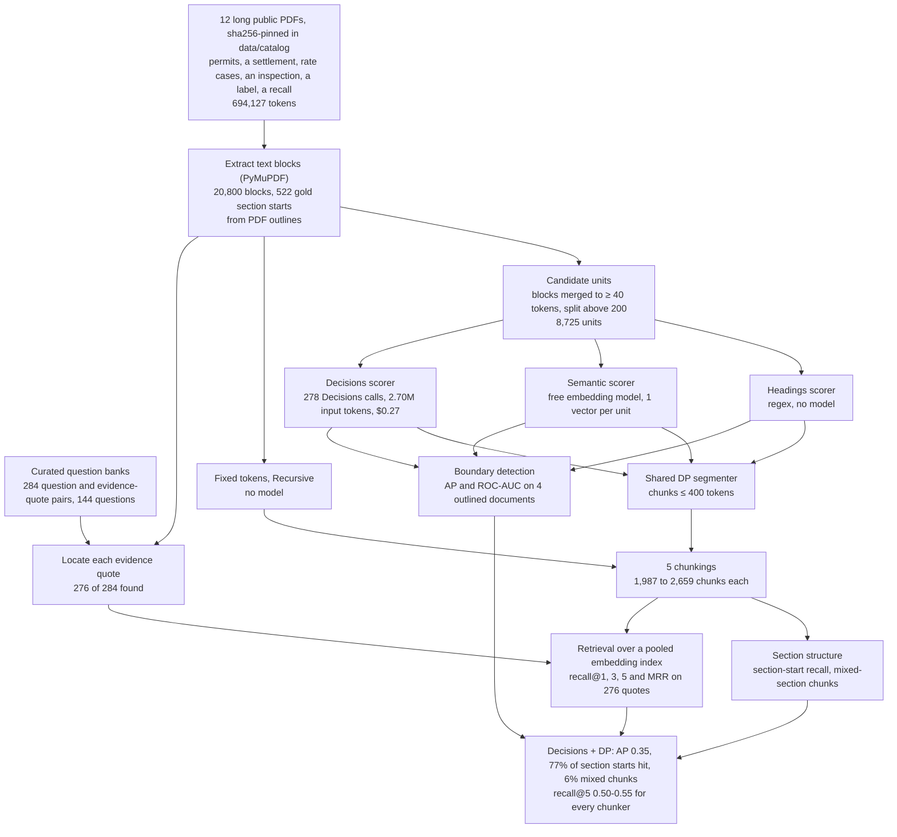
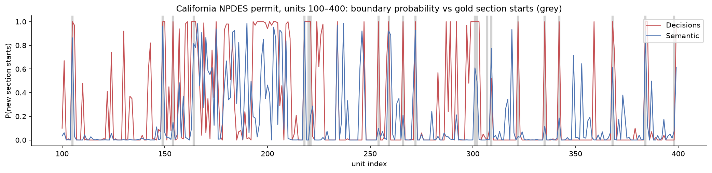

# 04 · Chunking long environmental and industry documents

**Goal.** Repeat the chunking comparison of notebook 02 on long, table-heavy public filings: NPDES and Title V
permits, a RCRA permit, an enforcement settlement, a 387-page utility rate case, a nursing-home inspection, a
pesticide label and a recall notice, each with its own question bank and verbatim evidence quotes.

**Result.** The Decisions API is again the best boundary detector (mean **AP 0.35** vs 0.21 for headings and 0.20 for
embedding distance) and only **6%** of its chunks mix two sections. Retrieval recall@5 is 0.50-0.55 for every
method. A new failure mode appears: 22% of short evidence quotes are split by a Decisions boundary at a real topic
change, against 6-8% for the other methods. Structure-aware chunks need a small overlap or neighbour expansion at
retrieval time.

**Workflow.** The whole experiment from data to results, with the counts from this run. Every model response is cached in `data/`, so a re-run replays it without API calls.

| | |
|---|---|
| Data | 12 long public PDFs pinned by URL and sha256 in `data/catalog/`, with 276 evidence quotes from curated question banks |
| Methods | fixed tokens; recursive; headings + DP; semantic + DP; Decisions + DP (400-token budget) |
| Cost to re-run from scratch | $0.27 on OpenRouter (278 Decisions calls); $0 replaying the caches |

**Run it.** The first run downloads the PDFs into `data/docs/` (git-ignored) and verifies their sha256. Model calls
replay from `data/`.
