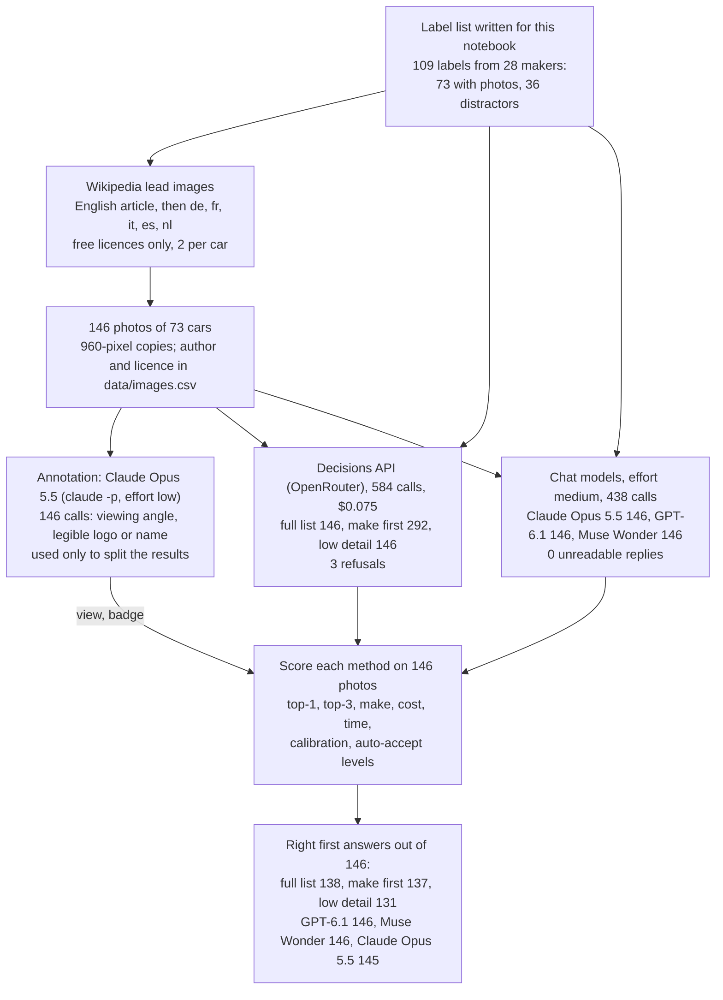
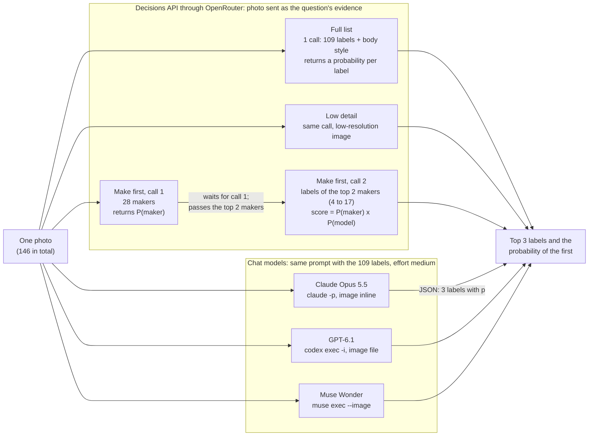
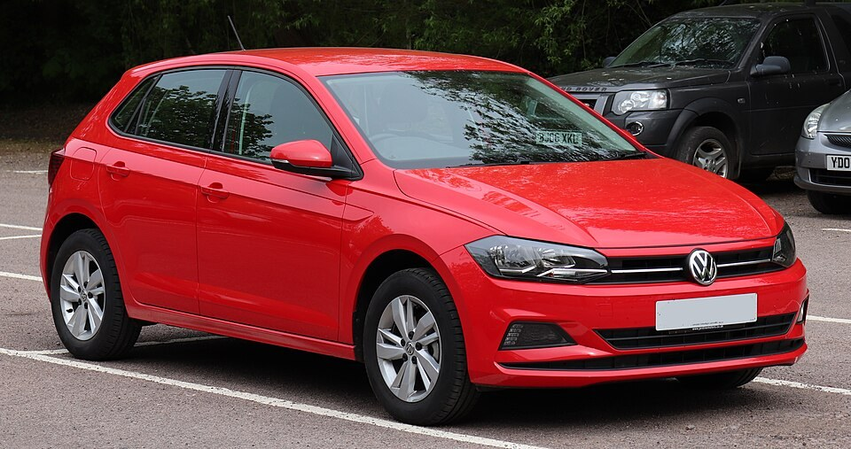
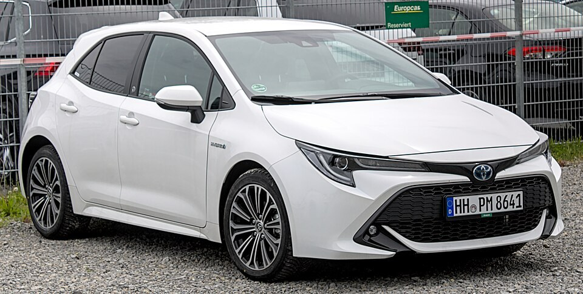

# Can a model that answers with probabilities name a car from one photo?

## A photo and a list of car names

Someone selling a car online fills in a short form. They upload a photo, then choose the make and model from a drop-down list: first Volkswagen, then Polo. The list matters because buyers search by it. A Polo filed as a Golf never appears when someone searches for a Polo, and the price guide shown beside the advert belongs to a different car.

A site that receives thousands of these photos would like a program to choose the label: fill in the box for the seller, or flag an advert whose photo does not match the label the seller picked. The answer has to come from the site's fixed list. A description such as "a small red hatchback" is no use; the program must pick one entry the site already knows.

### An illustrative example

This example is made up. It is a simplified version of one of the photos tested below.

A photo shows a small red hatchback from the front corner. A person with a list of 109 car names starts with the badge on the grille: a VW logo. That rules out every other maker and leaves 8 Volkswagen names on the list. If the boot lid read POLO, the job would be done.

In this photo no model name can be read, and that is the complication. Volkswagen sells two hatchbacks with similar faces, the Polo and the larger Golf. Without a name badge, the person has to judge size and proportions from one picture: the length between the wheels, the shape of the rear side window. They might settle on "probably a Polo, but I'm not sure". A careful person says so, or passes the photo to a colleague who knows Volkswagens.

That last step matters as much as the answer. A clerk who files the obvious photos and passes on the doubtful ones makes fewer mistakes than one who files everything, provided their doubt is honest: unsure when they are likely to be wrong, sure when they are right. A Polo filed as a Golf costs the seller a buyer. A photo passed to a colleague costs a minute.

### Two ways to ask a model

There are two ways to hand this job to a model.

The first is to ask a chat model. You show it the photo and the list and ask it to write its answer. Large chat models that can read images, such as Claude, GPT and Muse, can do this. They reply in text, so a program has to find the label in the reply. If you want to know how sure the model is, you ask it to write a number as well, and that number is text the model chose to write, like the rest of the reply. These models are large, and each answer takes several seconds.

The second is a decision model. You send the photo with the list as a multiple-choice question. The model writes nothing. It returns a probability for every option on the list, adding up to 1, and its answer is the option with the highest probability. For the red hatchback it might return Polo 0.80, Golf 0.15 and the remaining 0.05 spread over everything else (illustrative numbers). Because the probability is part of the answer, a program can use it directly, like the careful clerk: accept answers above a chosen level automatically, and send the rest to a person.

That plan works only if the probabilities are honest. A model is **calibrated** when its probabilities match how often it is right: of all the answers it gives at 0.9, about 9 in 10 are correct. A model that says 0.9 and is right half the time lets mistakes through unchecked. One that says 0.6 and is almost always right sends people photos they did not need to see.

### Why run this test, and how to keep it fair

A team choosing between the two needs four answers: how often each one names the right car, what it costs per photo, how long it takes, and whether the decision model's probabilities separate the answers to accept from those to check. Finding out takes photos whose correct labels are known, and the same list and scoring for every method.

Three choices keep the comparison fair. Every method sees the same photo and the same 109 labels. The list includes 36 labels that have no photo, close relatives of the cars that do appear (a Toyota Yaris beside the Corolla, a BMW X3 beside the X5), so a model cannot reach the answer by ruling out unlikely cars. And because a photo with "COROLLA" written on the boot is easier than one without, each photo is marked for whether a model name or a maker's logo can be read, so accuracy can be checked on photos where the badge does not give the answer away.

The decision model here is OpenAI's Decisions API (`openai/gpt-6-luna-decisions`, reached through the OpenRouter service). It is asked in three ways: with the whole list in one question, with the maker first and then that maker's models, and with a smaller image that costs less. The chat models are Claude Opus 5.5, GPT-6.1 and Muse Wonder, each called through its maker's command-line tool. The photos are the lead images of Wikipedia articles about each car, which limits how far the results carry over, as the study summary explains.

## The question

Given one photo of a car and a fixed list of 109 make-and-model labels, how often does a decision model that returns a probability for every label pick the right one, and how does it compare on accuracy, cost and speed with three large chat models that write their answer? Are its probabilities good enough to decide which answers can be accepted without a person checking them?

A team that files photos against a fixed list needs both parts: the first to choose a model, the second to decide how much checking to keep.

## Study summary

The test used 146 photos of 73 car models from 28 makers, scored against a list of 109 labels. The Decisions API answered every photo in three ways; Claude Opus 5.5, GPT-6.1 and Muse Wonder answered once each. A method scores a photo when its first answer is the right label; the share of photos it scores is its top-1 accuracy.

- With the whole list in one question, the Decisions API named 138 of 146 photos (94.5%; 95% interval 89.6% to 97.2%) for $0.20 per 1,000 photos and a median 0.9 seconds per photo. Its 8 misses are 7 wrong answers and 1 refusal to answer. Five of the 7 wrong answers chose a sibling model from the right maker, such as a Polo filed as a Golf.
- GPT-6.1 and Muse Wonder named all 146 photos and Claude Opus 5.5 named 145, at a median 4.4 to 11.8 seconds per photo. That is a ceiling: one photo separates the three, so the test cannot rank them. All three did better than the Decisions API, and GPT-6.1 and Muse Wonder were right on every one of its 8 misses.
- Asking for the maker first (137 of 146) or sending a smaller image (131 of 146) did not name more cars.
- The probabilities were good enough to choose which answers to accept. With the whole list, every answer given a probability of 0.9 or more was right: 97 of 146 photos (66%). All 8 misses had 0.79 or less. Asking for the maker first gave right answers higher probabilities: at 0.9 it accepted 118 photos (81%), all of them right.

In the original situation: a site receiving photos like these could have filled in about two adverts in three automatically, or four in five with the maker-first question, without a wrong label in this sample, and sent the rest to a person.

The main caveat is the photos. They are well-composed Wikipedia lead images, public on the web and mostly older than the models (only 16 of the 146 file names name a year from 2024 to 2026), so the models may have seen them or photos like them in training. Treat the accuracy as an upper bound for everyday photos from phones or car parks. The 0.9 level was also judged on the same 146 photos, and 0 errors in 97 accepted photos still allows a true error rate of up to 3.8%.

## Contents

1. [The photos and the labels](#1-the-photos-and-the-labels)
2. [How the experiment runs](#2-how-the-experiment-runs)
3. [The models and the measures](#3-the-models-and-the-measures)
4. [Results: accuracy, cost and speed](#4-results-accuracy-cost-and-speed)
5. [Results: badges and viewing angle](#5-results-badges-and-viewing-angle)
6. [Results: using the probabilities to decide what to accept](#6-results-using-the-probabilities-to-decide-what-to-accept)
7. [Error analysis](#7-error-analysis)
8. [What the evidence supports](#8-what-the-evidence-supports)
9. [Limitations](#9-limitations)
10. [Spend, data and how to run](#10-spend-data-and-how-to-run)
11. [Future work and further reading](#11-future-work-and-further-reading)

## 1. The photos and the labels

The label list was written for this notebook. It has 109 make-and-model labels from 28 makers, from one label for Ram and Smart to nine for Toyota. 73 labels have photos. The other 36 are distractors with no photo, chosen from the same makers so that every tested car has look-alikes on the list. Toyota, for example, has six tested labels (Corolla, Camry, RAV4, Prius, Hilux, Land Cruiser) and three distractors (Yaris, Tacoma, Highlander). The full list is in section 2 of [the notebook](06_car_make_model_from_image.ipynb).

The photos come from Wikipedia. For each of the 73 tested cars the notebook took the lead image of the English article, then followed the article's links to the German, French, Italian, Spanish and Dutch editions and took theirs, keeping the first two distinct, freely licensed images. Different editions often show different generations of the same car: here the English Golf photo is a 2020 Golf (`volkswagen-golf-en`) and the German one a 1974 Golf (`volkswagen-golf-de`). Each photo was saved as a copy 960 pixels on its longest side. That gives 146 photos, two per car, from the English (73), French (39), German (24), Italian (5), Spanish (4) and Dutch (1) editions.

Every photo is on Wikimedia Commons under a free licence: CC BY-SA 4.0 (93), CC BY-SA 3.0 de (18), CC BY-SA 3.0 (12), public domain (9), CC0 (7), CC BY 3.0 (2), CC BY 2.0 (2), CC BY-SA 2.0 (1), CC BY-SA 2.0 de (1) and CC BY 4.0 (1), where "de" marks the German version of the licence. The Commons page, author and licence of each photo are recorded in `data/images.csv`, and the copies are in `data/images/`. Reuse follows the Commons attribution rules linked under further reading.

The correct label for each photo is the article it illustrates. No person checked the labels photo by photo. Eight photos are not ordinary photos of one car. Four are close-ups of a badge or logo: the Mustang's running horse (`ford-mustang-fr`), the Corvette's crossed flags (`chevrolet-corvette-it`), the "5" on a BMW 5 Series pillar (`bmw-5-series-de`) and the "i3" lettering of a BMW i3 (`bmw-i3-it`). Four are collages of several generations from French articles (`mercedes-benz-c-class-fr`, `mercedes-benz-e-class-fr`, `land-rover-range-rover-fr`, `renault-clio-fr`). These are the eight photos the view annotation below marks as "other", and they were identified by opening the files. One more photo is filed under a successor's name: `audi-a4-de` is `Audi_80L_2-door_(ca_1975)_B1.JPG`, an Audi 80, filed under Audi A4 because the German article shows it and the list has no Audi 80.

To check whether badges explain the accuracy, Claude Opus 5.5 looked at each photo once and reported the viewing angle and whether a maker's logo or a model name could be read. Its instructions ended "Do not identify the car." 135 of the 146 photos are front three-quarter views (the front and one side). A maker's logo is legible in 108 photos and a model name in 35. These labels were used only to split the results; no method saw them. Claude Opus 5.5 is also one of the models tested, and no person checked its labels.

The notebook predates this repository's rule that test data must postdate the models' training. `data/` records no upload date for the photos, no retrieval date, and no training cutoff or release date for any model. 80 of the 146 Commons file names contain a year, either the car's model year or the date of the photo. 64 of them name 2023 or earlier, 16 name 2024 to 2026, and two give photo dates in 2026: `hyundai-elantra-en` (4 April) and `subaru-outback-en` (24 May). Most of the dated photos are therefore from 2023 or earlier, and all of them have been public on Wikipedia, where a model may have met the photo or its caption in training. The scores are an upper bound for unfamiliar photos.

## 2. How the experiment runs



Each photo goes to six methods. Three use the Decisions API, and in this README they have one name each. The **full list** sends one question with all 109 labels. **Make first** sends two questions in a row: first "which maker?" over 28 makers, then "which model?" over the labels of the two most likely makers, and it scores each label as the maker's probability times the model's probability within that question. **Low detail** is the full list with the image sent at low resolution, a fixed smaller size that costs fewer tokens (the units the API bills by). The full-list question also carries a second question about body style (sedan, hatchback and so on); one image is billed once per call, so the extra question costs little. The other three methods are the chat models, which receive the same 109 labels and are asked for their three most likely labels with a probability for each, in a fixed JSON format (a structured text format programs can read).



Each call is independent, and make first is the only method whose second call depends on the first. Decisions calls ran 8 at a time; the command-line tools ran 4 (Claude), 2 (GPT-6.1) and 3 (Muse Wonder) at a time.

### Worked example: one photo through all six methods



Photo `volkswagen-polo-es`: 2018 Volkswagen Polo SE, by Vauxford, CC BY-SA 4.0, via [Wikimedia Commons](https://commons.wikimedia.org/wiki/File:2018_Volkswagen_Polo_SE_1.0_Front.jpg). It is the lead image of the Spanish article on the Polo, so the correct label is Volkswagen Polo. The annotation says the VW logo is legible and no model name is.

This is the measured version of the opening example. The full list sends one question with all 109 labels and gets back a probability for each (cached in `data/cache_decisions.jsonl`):

| Label | Probability |
|---|---:|
| Volkswagen Golf | 0.79 |
| Volkswagen Polo | 0.12 |
| Toyota Corolla | 0.01 |
| Toyota Yaris | 0.01 |
| 105 other labels | 0.07 in total, 7 of them above zero |

Its body-style answer is "hatchback". The first answer is Golf, so the photo scores 0 for top-1 accuracy. Polo is second, so it counts for top-3, and the maker is right. The probability of the first answer, 0.79, is below 0.9, so under a 0.9 auto-accept rule the photo goes to a person. The call used 1,911 input tokens, cost $0.00019 and took 1.3 seconds.

Make first asks for the maker and gets Volkswagen 0.98, Tesla 0.01, Toyota 0.01. It keeps the top two, Volkswagen and Tesla, and asks a second question over their 13 labels (8 Volkswagen, 5 Tesla). That returns Golf 0.60 and Polo 0.40, so the scores are Golf 0.98 x 0.60 = 0.59 and Polo 0.98 x 0.40 = 0.39. Golf again, wrong. Low detail, the same question as the full list with a smaller image, returns Polo 0.78 and Golf 0.09: right.

The three chat models all answer Polo. Claude Opus 5.5 replied, in full:

```json
{"top3": [{"label": "Volkswagen Polo", "p": 0.93}, {"label": "Volkswagen Golf", "p": 0.05}, {"label": "Volkswagen Jetta", "p": 0.01}]}
```

GPT-6.1 gave Polo 0.99 and Muse Wonder Polo 0.95, in 6.7 and 15.8 seconds against Claude's 6.3. So this photo adds 1 to the top-1 count of low detail and of each chat model, and 0 to the full list (which ends at 138 of 146) and make first (137). It is one of the 8 full-list misses that a 0.9 rule would have sent to a person.

## 3. The models and the measures

| Model | Pinned version | Provider and how called | Size and precision | Settings | Why included |
|---|---|---|---|---|---|
| Decisions API | `openai/gpt-6-luna-decisions` as requested; responses carry no model version, no dated version recorded | OpenAI, through OpenRouter's Decisions endpoint over HTTP | Not published | Image detail high (full list, make first) or low (low detail); returns probabilities only | The method under test: a model that returns a probability for every label, billed per input token |
| Claude Opus 5.5 | `claude-opus-5-5` as requested; no dated version recorded | Anthropic, `claude -p` with tools off | Not published | Effort medium; effort low for the view and badge annotation | Large chat model from Anthropic, a slower alternative a team could use instead; also wrote the annotation |
| GPT-6.1 | `gpt-6.1-sol` as requested; Codex returned no version, not recorded | OpenAI, `codex exec` in a read-only sandbox | Not published | Reasoning effort medium | Large chat model from the company that makes the Decisions API |
| Muse Wonder | `muse-wonder-full-1.0` as requested; no dated version recorded | Meta, `muse exec` with web tools off | Not published | Reasoning effort medium | Large chat model from a third company |

In the notebook's tables and figures the methods carry code names: "A. Decisions flat" is the full list, "B. Decisions make→model" is make first, "C. Decisions flat, low detail" is low detail, and "E. GPT-6.1 (Codex)" is GPT-6.1.

The measures:

- A method's **top-1 accuracy** is the share of the 146 photos where its first answer is the correct label. Higher is better. For the full list, 138 first answers were right: 138 / 146 = 94.5%.
- Counting the correct label anywhere in the first three answers gives **top-3 accuracy**. Counting a first answer with the right maker, such as Golf for a Polo, gives **make accuracy**.
- Each score has a **95% interval**, here a Wilson interval: the range of true accuracies that would plausibly give the observed count. For 138 of 146 it runs from 89.6% to 97.2%. For 146 of 146 it runs from 97.4% to 100%, so a perfect score on 146 photos still allows a model that misses about 1 photo in 40.
- A reply is **unreadable** when the program could not score it: a refusal or a reply with no label from the list. An answer is **wrong** when it is a label that was read and is not the correct one. Both count as misses in top-1 accuracy, and the results report them separately.
- A method's **confidence** in a photo is the probability it gave its first answer. For the Decisions API this is the returned probability; for a chat model it is the number the model wrote.
- The **calibration error** (ECE, expected calibration error) sorts the photos into ten bands of confidence (0 to 0.1, 0.1 to 0.2 and so on), takes the gap between average confidence and share correct in each band, and averages the gaps weighted by the number of photos. 0 is perfect.
- An **auto-accept level** is a confidence at or above which answers are accepted without a check. **Coverage** is the share of photos accepted at that level, and the accuracy that matters is the accuracy on the accepted photos.

A small example of the last two, using the full list. Of the 17 photos where its confidence fell between 0.6 and 0.8 (average 0.70), 14 were right (82%), so in that band it was right more often than it said: it was under-confident. At an auto-accept level of 0.9, 97 of the 146 photos qualify. Coverage is 97 / 146 = 66%, and all 97 were right. The other 49 photos go to a person, and 41 of those were right as well.

## 4. Results: accuracy, cost and speed

| Method | Top-1 (of 146) | 95% interval | Top-3 | Make right | Unreadable | Wrong | Cost per 1,000 photos | Median time per photo |
|---|---:|---|---:|---:|---|---:|---|---:|
| Decisions full list | 138 (94.5%) | 89.6% to 97.2% | 144 | 143 | 1 refusal | 7 | $0.20 | 0.9 s |
| Decisions make first | 137 (93.8%) | 88.7% to 96.7% | 144 | 144 | 0 | 9 | $0.16 | 1.8 s |
| Decisions low detail | 131 (89.7%) | 83.7% to 93.7% | 141 | 142 | 2 refusals | 13 | $0.16 | 0.9 s |
| Claude Opus 5.5 | 145 (99.3%) | 96.2% to 99.9% | 146 | 146 | 0 | 1 | Subscription; $23 at list price | 5.6 s |
| GPT-6.1 | 146 (100%) | 97.4% to 100% | 146 | 146 | 0 | 0 | Subscription | 4.4 s |
| Muse Wonder | 146 (100%) | 97.4% to 100% | 146 | 146 | 0 | 0 | Subscription | 11.8 s |

Counts and costs from `data/results_summary.csv` and `data/predictions.csv`; the Wilson intervals are computed from those counts. The notebook's own table shows a bootstrap interval (resampling the 146 photos), which collapses to "[1.00, 1.00]" at a perfect score. Unreadable replies were counted from `data/cache_decisions.jsonl`, where each refusal is stored as an HTTP 502 error reading "OpenAI refused to answer question "car"". Claude's list price is the `list_cost_usd` its command-line tool reported for the 146 identification calls ($3.36), in `data/cache_cli.jsonl`.


How to read this figure. Each bar is one method's top-1 accuracy over 146 photos, sorted from lowest at the bottom; blue bars are the Decisions API, purple bars the chat models, and the white number is the rounded percentage. Orange dots mark top-3 accuracy and green squares make accuracy. The black lines are bootstrap 95% intervals, which cannot extend past an observed 100%, so GPT-6.1 and Muse Wonder show none (the Wilson intervals above do). The title names "E. GPT-6.1 (Codex)" as best, but Muse Wonder ties with it at 146 of 146, and the legend sits over part of the low-detail bar.

The chat models are at a ceiling. GPT-6.1 and Muse Wonder named every photo and Claude Opus 5.5 missed one, so their intervals overlap almost entirely and this test cannot say which of the three is best. The difference between them and the Decisions API is clearer. GPT-6.1 and Muse Wonder named every one of the full list's 8 misses correctly and missed nothing themselves. A paired comparison that looks only at photos where two methods disagree (an exact McNemar test) gives p = 0.008 for 8 photos against 0.

Between the three Decisions methods the differences are small. The full list and make first disagree on 7 photos: the full list alone was right on 4, make first alone on 3. Low detail lost more: the full list alone was right on 11 photos and low detail alone on 4 (McNemar p = 0.12, so this sample cannot rule out chance). Sending a smaller image cut input tokens from 1,966 to 1,570 per photo (20%) and dropped top-1 accuracy by 7 photos.

Setting aside unreadable replies does not change the order. On replies that named a label, the full list was right on 138 of 145 (95.2%), make first on 137 of 146 (93.8%) and low detail on 131 of 144 (91.0%). The three refusals came on two badge close-ups and one ordinary photo of a Nissan Leaf (section 7). The chat models produced no unreadable reply. Two of Claude's replies wrote text around the JSON, and six replies (1 from Claude, 5 from GPT-6.1) named a third label that is not on the list, such as "Porsche Cayman"; the parser kept the listed labels, and none of this changed a first answer.

The cost difference is large. The Decisions API is billed only for input; the cache records $0.10 per million input tokens and no output tokens. The full list used 1,966 input tokens per photo, which comes to $0.20 per 1,000 photos. Make first is cheaper although it makes two calls, because each of its calls carries a shorter list and used fewer tokens: the maker question averaged 833 input tokens and the model question 763, 1,597 per photo in total. The chat models ran on subscriptions with no per-photo price. Claude's tool reported a list-price equivalent of $3.36 for the 146 photos, about $23 per 1,000, more than 100 times the full list.

The Decisions API answered in a median 0.9 seconds (1.8 seconds for make first's two calls in a row). The chat models took a median 4.4 seconds (GPT-6.1), 5.6 seconds (Claude) and 11.8 seconds (Muse Wonder), and Muse Wonder's slowest call took 202 seconds. These times include starting the command-line tool and were measured with several calls running at once, so they describe this setup rather than the models alone.

## 5. Results: badges and viewing angle

If a method could only read badges, its accuracy would collapse on photos where no model name is legible. It does not:

| Method | Model name legible (35 photos) | No legible model name (111 photos) |
|---|---:|---:|
| Decisions full list | 33 (94%) | 105 (95%) |
| Decisions make first | 34 (97%) | 103 (93%) |
| Decisions low detail | 31 (89%) | 100 (90%) |
| Claude Opus 5.5 | 35 (100%) | 110 (99%) |
| GPT-6.1 | 35 (100%) | 111 (100%) |
| Muse Wonder | 35 (100%) | 111 (100%) |

Counted from `data/predictions.csv` (column `model_name_legible`); the notebook draws the same numbers as a bar chart in section 6.2.

The full list named 105 of the 111 photos with no readable model name (95%) and 33 of the 35 with one (94%). Its two misses among the 35 photos with a legible model name are the BMW badge close-ups; it was right on the other 33. So the full list's accuracy does not depend on a readable model name.

The maker's logo tells a different story for the full list. It named 105 of the 108 photos with a legible logo (97%; interval 92% to 99%) and 33 of the 38 without one (87%; interval 73% to 94%), counted from the annotation replies in `data/cache_cli.jsonl` (field `make_logo_legible`). The intervals overlap, and the five misses without a legible logo are a mixed group: the two BMW badge close-ups, the two classic Dodge Chargers and a Ford Focus. With 38 photos this is a hint, not a finding.

The viewing angle cannot be tested here. 135 of the 146 photos are front three-quarter views, on which the full list was right 129 times (96%). The other 11 are 8 "other" photos (the four close-ups and four collages, 6 right), one front view, one side view and one rear three-quarter view. The notebook's table by angle is in its section 6.3.

On the 138 ordinary photos of one car, leaving out the close-ups and collages, the full list named 132 (95.7%), make first 130 and low detail 126; Claude Opus 5.5 named 137, GPT-6.1 and Muse Wonder 138.

## 6. Results: using the probabilities to decide what to accept


How to read this figure. The left panel groups photos by the confidence of the first answer into five bands of width 0.2 and shows only bands with at least 5 photos. Each point's position across is the band's average confidence and its height the share of those photos that were right. The grey diagonal is perfect calibration; a point above it means the method was right more often than it said. The legend gives each method's calibration error (ECE, computed with ten bands). The right panel sorts each method's photos from most to least confident and accepts them one by one: the position across is the share accepted so far (coverage) and the height is the accuracy among them. Its vertical axis starts at 0.80, which makes small drops look large. Method names use the notebook's code names, as listed in section 3.

The full list was under-confident, and its confident answers were all right. Its 113 photos with confidence 0.8 or more (average 0.96) were all correct. Of its 17 photos between 0.6 and 0.8, 14 were right (82%, at an average confidence of 0.70); of its 10 photos between 0.4 and 0.6, 9 were right (90%, at 0.49). Overall its average confidence was 0.87 and its accuracy 0.95, a calibration error of 0.08. In the right panel its blue line stays at 1.000 until 113 photos (77%) have been accepted.

Make first behaved the same way with higher confidence on right answers. Its first error comes after 126 accepted photos (86%), and its calibration error is 0.07. Low detail is the exception: its first error comes after 73 photos (50%), because it gave two wrong answers confidently. It called the Land Rover Defender in `land-rover-defender-de` a Toyota Land Cruiser at 0.95 and the Tesla Model X in `tesla-model-x-en` a Model Y at 0.90. Its calibration error is 0.11.

For the chat models the panel says little. GPT-6.1 wrote a confidence between 0.96 and 0.999 on every photo and Muse Wonder between 0.85 and 0.99, and both were always right, so their low calibration errors (0.01 and 0.04) only show that they wrote high numbers and made no mistakes. Claude's one wrong answer came with a written confidence of 0.90, higher than 9 of its 145 right answers, so a 0.9 rule would have accepted it.

| Accept if confidence is at least | Full list: accepted | right among accepted | right among the rest | Make first: accepted | right among accepted | right among the rest |
|---|---:|---:|---:|---:|---:|---:|
| 0.5 | 134 (92%) | 131 | 7 of 12 | 139 (95%) | 133 | 4 of 7 |
| 0.7 | 121 (83%) | 120 | 18 of 25 | 132 (90%) | 127 | 10 of 14 |
| 0.9 | 97 (66%) | 97 | 41 of 49 | 118 (81%) | 118 | 19 of 28 |
| 0.97 | 78 (53%) | 78 | 60 of 68 | 88 (60%) | 88 | 49 of 58 |

The full-list columns are the notebook's table in section 6.4. The make-first columns were counted from `data/cache_decisions.jsonl` with the notebook's scoring (the maker probability times the model probability); the notebook's table covers only the full list. At 0.9, low detail accepts 83 photos (57%) with 81 right.

At 0.9, the full list sends 49 photos to a person, who finds 8 errors among them. Make first sends 28, which hold 9 errors. Either way no error passed unchecked in this sample, and make first gives the person 21 fewer photos to check. The levels come from the notebook's code, and they were tried on the same 146 photos they are judged on. 0 errors in 97 accepted photos allows a true error rate of up to 3.8%, and 0 in 118 up to 3.2%.

## 7. Error analysis


How to read this figure. Each tile is one of the full list's 8 misses, titled "Decisions API (flat) misses" in the notebook's naming. Above each photo is the correct label ("gold"), then the prediction and its probability; "(none) (0.00)" marks the refusal. Five tiles are a sibling from the same maker (Polo, Qashqai, Outback and both Chargers), two are another maker (Focus, 5 Series) and one is the refusal (i3). Every probability shown is 0.79 or less.

Most photos gave no trouble. 123 of the 146 were named correctly by all six methods. 23 were missed by at least one Decisions method: 18 by one of the three, `volkswagen-polo-es` by two, and four by all three. GPT-6.1 and Muse Wonder named all 23. The examples below cover the different kinds of miss and two successes, chosen to match the counts above.

### A typical success



Photo `toyota-corolla-en`: Toyota Corolla Hybrid (E210), by Alexander Migl, CC BY-SA 4.0, via [Wikimedia Commons](https://commons.wikimedia.org/wiki/File:Toyota_Corolla_Hybrid_(E210)_IMG_4338.jpg).

All six methods named this Corolla. The full list gave Corolla 0.89 and Prius 0.09, make first 0.97, low detail 0.94, and the chat models wrote 0.93 to 0.99. It also shows the cost of a cautious rule: at 0.89 the full list's answer falls just under 0.9 and the photo goes to a person although it is right, as 41 of the 49 photos sent to a person were.

Look-alikes from the same maker are often named with full confidence. The two Toyota Camry photos, a car the notebook expected to be confused with the Corolla, got Camry at 1.00 from the full list both times. 48 of the full list's 146 answers had a probability of 1.00, and all 48 were right. Low detail is the exception here too: it read `toyota-camry-fr` as a Corolla at 0.87.

### Sibling models from the same maker

Two photos of a classic Dodge Charger (`dodge-charger-en`, whose file name dates the car to 1969, and `dodge-charger-fr`, the same body style) were read as a Dodge Challenger by all three Decisions methods. The full list gave Challenger 0.66 and Charger 0.07 for the first, Challenger 0.43 and Charger 0.13 for the second, and called both body styles "coupe / sports car". Make first was surer of the wrong answer (0.76 and 0.74): it put most of the maker probability on Dodge (0.99 and 0.87) and then preferred Challenger within Dodge (0.77 and 0.85). All three chat models said Charger at 0.95 to 0.99. These two photos account for 6 of the 30 wrong answers across all methods.

The Volkswagen Polo of the worked example went the same way, Golf at 0.79, and make first made the reverse mistake on `volkswagen-golf-de`, a 1974 Golf, which it called a Polo at 0.40. The full list named that Golf at 0.66. The Nissan Qashqai in `nissan-qashqai-en` (a 2024 car) was read as the Rogue / X-Trail, a distractor label, at 0.63 against 0.34 for the Qashqai. Make first named it correctly at 0.59. In every one of these cases the right label came second, which is why the full list's top-3 accuracy (144 of 146) is 6 photos higher than its top-1.

### The 2026 Outback: where the chat models disagreed

`subaru-outback-en` is the most recent photo in the set: its file name says it shows a 2026 Subaru Outback Wilderness photographed on 24 May 2026. All three Decisions methods and Claude Opus 5.5 called it a Subaru Forester, a distractor label. Claude wrote, before its JSON: "This is a 2025+ Subaru Forester Wilderness (gold fog light bezels, Wilderness cladding)", and gave Forester 0.90. GPT-6.1 gave Outback 0.98 and Muse Wonder Outback 0.92. It is the only photo that separates the three chat models.

The full list was unsure (Forester 0.21, Outback 0.11), so a 0.9 rule would have sent the photo to a person; make first was surer (Forester 0.75) but still below 0.9. The data does not say why the models disagree. The photo's recent date fits one possible reason, that some models had seen few pictures of this generation, but the notebook records no training dates to test it.

### Badge close-ups: a correct label that is hard to see

Two of the four close-ups beat the Decisions API. `bmw-5-series-de` shows only a "5" on a BMW's rear pillar. The full list spread its probability thinly and put Tesla Model Y first at 0.08; make first put Porsche (0.10) and Mercedes-Benz (0.09) ahead of BMW, so BMW was never in its second question; low detail refused to answer. `bmw-i3-it` shows only the "i3" lettering. The full list refused; make first gave BMW 0.09 and then i3 0.98 within BMW, a right answer at a confidence of 0.09; low detail named it at 0.24. The chat models named both badges at 0.85 to 0.999. The Decisions API did name the other two close-ups, the Mustang's running horse and the Corvette's crossed flags, with all three methods.

The correct label for these photos is fair, since the badge does name the car, but they test reading lettering, not recognising a car. The three refusals in the study hit the i3 badge (full list), the 5 Series badge (low detail) and an ordinary photo of a Nissan Leaf (`nissan-leaf-en`, low detail), which the full list named correctly. The API returned no reason with any of them.

### Misses the auto-accept level catches, and one it would not

The Ford Focus in `ford-focus-nl`, a blue sedan, is a plain miss for the full list: Hyundai Elantra 0.15, Focus 0.12, Honda Civic 0.10. The probabilities show a model that does not know, and at 0.15 the photo goes to a person. Top-1 accuracy counts this miss the same as a confident one, but in an auto-accept workflow it costs only a check. Make first and low detail named the Focus, at 0.22 and 0.30, so they would also have sent it to a person.

The miss that would cost something is a confident one. Among the Decisions methods only low detail made those: the Defender called a Land Cruiser at 0.95 and the Model X called a Model Y at 0.90. Make first made the same kind of confusion in reverse, calling the Land Cruiser in `toyota-land-cruiser-de` a Land Rover Defender, but at 0.73, below the 0.9 level.

### Wrong answers across all methods

Across the four methods that made wrong answers, there were 30: 7 from the full list, 9 from make first, 13 from low detail and 1 from Claude. 24 of the 30 (80%) kept the right maker. The most frequent were Charger read as Challenger (6), Outback as Forester (4), and C-Class as E-Class, Polo as Golf (2 each); the rest occurred once. Distractor labels caught 2 of the full list's 7 wrong answers, 4 of make first's 9 and 3 of low detail's 13, so the list's look-alikes did their job of making elimination harder. The first four counts are in the notebook's section 7.3 table; the distractor counts compare each first answer in `data/predictions.csv` with the label list.

### What these examples cannot show

The examples show which label each method chose and with what probability, not why. The Decisions API returns no explanation, and the chat models' explanations, where they wrote one, are their own description. One label may also be debatable: `audi-a4-de` shows an Audi 80 filed under Audi A4. The full list, low detail and all three chat models chose Audi A4 for it (the list has no Audi 80), and make first chose Audi A3.

## 8. What the evidence supports

- For whole-car photos like these, the Decisions API can label most photos automatically if a person checks the rest. At an auto-accept level of 0.9, the full list accepted 66% of photos and make first 81%, with no wrong label in either, and every miss carried a probability below 0.8. Choose the level on a fresh sample before relying on it.
- If the review queue matters, prefer make first: in this sample it sent 28 photos to a person instead of 49, at $0.16 instead of $0.20 per 1,000 photos, at the cost of two calls in a row (1.8 seconds against 0.9). On top-1 accuracy alone the two are tied (137 and 138 of 146).
- Do not send the smaller image to save money. Low detail saved 20% of tokens, named 7 fewer photos, and gave two wrong answers at 0.90 and 0.95, which breaks the auto-accept rule.
- If every photo must be labelled with no person checking, the chat models are the better choice: GPT-6.1 and Muse Wonder made no error in 146 photos and Claude Opus 5.5 one, against 8 for the full list. They cost several seconds per photo and, at Claude's list price, more than 100 times as much. Their written confidence was not tested by enough errors to serve as an auto-accept signal, and Claude's one error came at 0.90.

The uncertainty that most needs another experiment is how much of this holds for everyday photos: cars photographed by phones or parking cameras, in poor light, partly hidden, or newer than the models.

## 9. Limitations

- The photos are older public data, and the scores are an upper bound. They are well-composed Wikipedia lead images, mostly older than the models, and the car models on the list have been public for years. `data/` records no upload dates or training cutoffs; 16 of the 146 file names name 2024 to 2026, and two give 2026 photo dates. The notebook predates the repository's rule on fresh data.
- The sample is 146 photos with one answer per method and photo. Intervals are wide (89.6% to 97.2% for the full list), and the differences between the three Decisions methods could change with another sample. Whether the Decisions API returns the same probabilities when asked twice was not measured.
- The auto-accept levels were judged on the same photos they were applied to. 0 errors in 97 or 118 accepted photos still allows a true error rate of 3.8% or 3.2%.
- The list is closed. Every photo shows a car on the list, so the study does not show what the Decisions API does with a car that is not on it, where it must still return some label.
- The correct labels come from the Wikipedia article and were not checked by a person. Eight photos are badge close-ups or collages, and `audi-a4-de` shows an Audi 80.
- The badge and viewing-angle labels come from Claude Opus 5.5, one of the models tested, and no person checked them. They were used only to split the results.
- The chat models' confidence is a number they wrote, and with 0 or 1 errors each, their calibration could not be tested.
- No model version was pinned: the Decisions API response carries no version, and the command-line tools recorded none.
- Times include starting the command-line tools and were measured with several calls at once.
- The analysis was not registered in advance. Run settings, refusals and the image-format note are in [`data/PROTOCOL.md`](data/PROTOCOL.md).

## 10. Spend, data and how to run

The Decisions API cost $0.0749 for 584 calls on OpenRouter: $0.0287 for the full list, $0.0233 for make first and $0.0229 for low detail. Three calls were refusals, cached and scored as misses. The 438 chat-model calls and 146 annotation calls ran on subscriptions. Claude's command-line tool reported a list-price equivalent of $5.64 ($2.28 for the annotation, $3.36 for identification); Codex reported 2,682,907 input and 7,180 output tokens for GPT-6.1's 146 calls and no price; Muse reported no usage.

| File in `data/` | What it holds |
|---|---|
| `images.csv` | The 146 photos: label, maker, model, Wikipedia edition, Commons file, page link, author and licence |
| `images/` | The 960-pixel copies of the photos |
| `cache_decisions.jsonl` | Every Decisions API response (probabilities, tokens, cost, time) or refusal, keyed by a hash of the full request |
| `cache_cli.jsonl` | Every annotation and chat-model reply with time, Claude's list price and Codex's token counts |
| `predictions.csv` | One row per photo: correct label, view, model-name flag, licence, page link and each method's first answer |
| `results_summary.csv` | The results table: top-1, top-3, make accuracy, errors, cost, tokens and median time per method |
| `PROTOCOL.md` | Run settings, command-line flags, retries, refusals and the image-format note |

From this folder, the notebook replays every model call from the caches without contacting any model:

```bash
pip install -r ../../requirements.txt
jupyter nbconvert --to notebook --execute --inplace 06_car_make_model_from_image.ipynb
```

To collect again, delete `data/cache_*.jsonl`; this needs an `OPENROUTER_API_KEY` and signed-in `claude`, `codex` and `muse` command-line tools. Deleting `data/images.csv` and `data/images/` rebuilds the photo set from Wikipedia, which is rate-limited and takes a few minutes. `NB_SMOKE=1` runs 6 photos, and `IMAGES_PER_MODEL`, `MAX_IMAGES`, `RUN_CLI_MODELS` and `WORKERS` at the top of the notebook set the size. The full analysis is in [06_car_make_model_from_image.ipynb](06_car_make_model_from_image.ipynb).

## 11. Future work and further reading

### Future work

- Use everyday photos. Test street, car-park and dashcam photos, and cars photographed after the models were released, and measure how far top-1 accuracy and the coverage at 0.9 fall from the upper bound here. Motivated by the well-composed Wikipedia photos and by the 2026 Outback, the one photo that separated the chat models.
- Check the auto-accept level on a fresh sample. Fix 0.9 in advance and measure errors among accepted photos on several hundred new photos, for the full list and make first. Motivated by make first accepting 118 photos and the full list 97, both with no error, on the same photos used to judge the level.
- Open the list. Add photos of cars that are not on it and measure whether the Decisions API's confidence falls below the auto-accept level for them, since it always returns some label. Motivated by distractor labels catching 2 of the full list's 7 wrong answers.
- Ask for the generation or model year. Several misses are siblings or generations of one car (a 1969 Charger read as a Challenger, a 1974 Golf read as a Polo by make first), and a year range is what a parts or insurance workflow needs.
- Add a non-LLM baseline. An open-weight image-text model such as CLIP, scoring the 109 label names, would show what a local model achieves at near-zero cost against 94.5% top-1 for the full list.

### Further reading

Links checked on 17 October 2026.

- [3D Object Representations for Fine-Grained Categorization](https://openaccess.thecvf.com/content_iccv_workshops_2013/W19/html/Krause_3D_Object_Representations_2013_ICCV_paper.html) (Krause et al., 2013). Introduced the Stanford Cars dataset, the usual fine-grained car benchmark. The original dataset page is offline.
- [A Large-Scale Car Dataset for Fine-Grained Categorization and Verification](https://arxiv.org/abs/1506.08959) (Yang et al., 2015). CompCars, with web and surveillance photos; the surveillance set is the harder kind of photo suggested above.
- [Learning Transferable Visual Models From Natural Language Supervision](https://arxiv.org/abs/2103.00020) (Radford et al., 2021). CLIP, the zero-shot image-text baseline suggested above.
- [Multimodal Decisions: Images, Audio, and Video in the Decisions API](https://openrouter.ai/docs/guides/community/multimodal-decisions) (OpenRouter guide). How images go into a Decisions API request, as the notebook's `decide()` function does.
- [Commons:Reusing content outside Wikimedia](https://commons.wikimedia.org/wiki/Commons:Reusing_content_outside_Wikimedia) (Wikimedia Commons). The attribution and licence rules behind the author and licence columns in `data/images.csv`.
