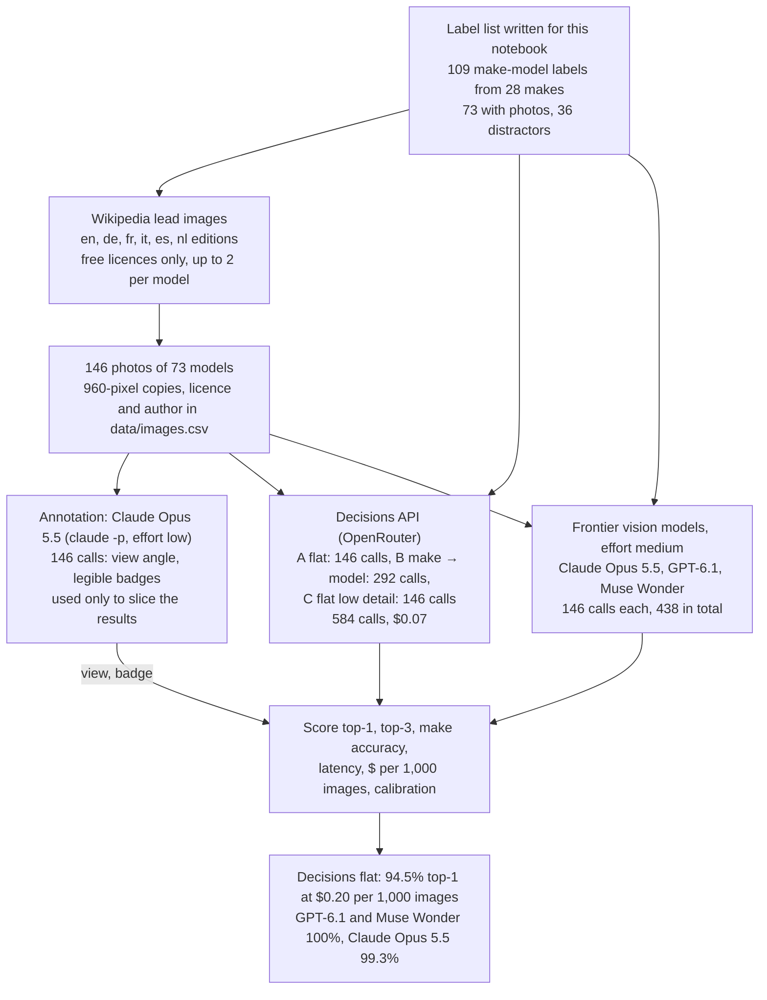
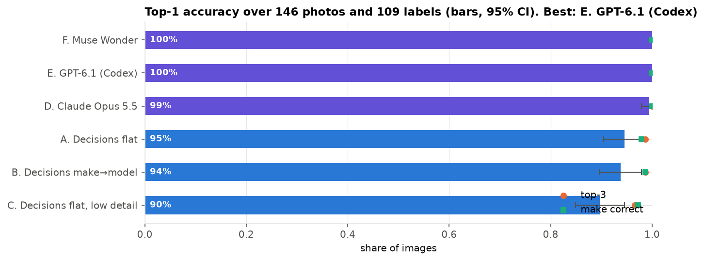
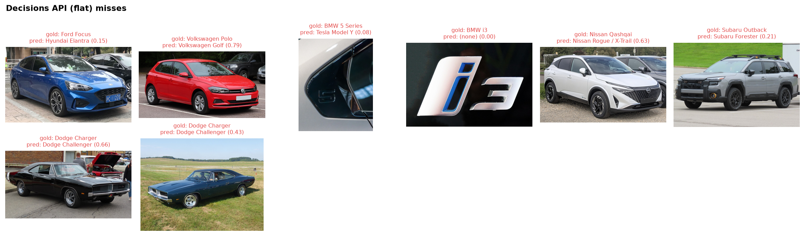

# Can the OpenAI Decisions API name a car's make and model from one photo?

**Goal.** Test whether OpenAI's Decisions API (`openai/gpt-6-luna-decisions` on OpenRouter), which returns
probabilities over options instead of text, can identify the make and model of a car from a single image, and
compare it with frontier vision models asked the same question through their CLIs.

**Result.**

| Method | Top-1 | Top-3 | Make correct | Cost | Median latency |
|---|---|---|---|---|---|
| Decisions API, one question over 109 labels | **94.5%** | 98.6% | 97.9% | $0.20 / 1,000 images | 0.9 s |
| Decisions API, make first, then model | 93.8% | 98.6% | 98.6% | $0.16 / 1,000 images | 1.8 s |
| Decisions API, low-detail image | 89.7% | 96.6% | 97.3% | $0.16 / 1,000 images | 0.9 s |
| Claude Opus 5.5 (`claude -p`) | 99.3% | 100% | 100% | subscription | 5.6 s |
| GPT-6.1 (`codex exec`) | 100% | 100% | 100% | subscription | 4.4 s |
| Muse Wonder (`muse exec`) | 100% | 100% | 100% | subscription | 11.8 s |

* The Decisions API is as accurate on photos with no legible model badge (94.6%) as on photos with one (94.3%).
* Five of its eight misses are a sibling model from the same maker (1969 Charger vs Challenger, Polo vs Golf,
  Outback vs Forester, Qashqai vs Rogue/X-Trail). It refused to answer for one image (a BMW i3 logo close-up).
* Its probabilities are usable for an auto-accept rule: see the calibration chart in the notebook.

**Workflow.** The whole experiment from data to results, with the counts from this run. Every model response is cached in `data/`, so a re-run replays it without API calls.

**Data.** 146 photos of 73 car models from 28 makes: the lead images of each model's Wikipedia article in English,
German, French, Italian, Spanish and Dutch, which often show different generations. 36 more labels are
distractors with no photo. Every image is on Wikimedia Commons under a free licence; source page, author and
licence are in `data/images.csv`. The photos are well-composed and may have been seen by the models in training,
so real-world photos (parking lots, dashcams) will be harder.

**Cost.** $0.07 on OpenRouter for all 584 Decisions calls; the CLI models are billed to their subscriptions.

**Run it.** Running all cells replays every call from `data/cache_*.jsonl`. Deleting `data/images.csv` and
`data/images/` rebuilds the image set from Wikipedia (rate-limited, a few minutes).
