# When an agent hands work to helpers, who waits for whom?

## Planning a trip with helpers

Two people want to fly from Toronto to Lisbon, Rome and Prague, spend two nights in each city, and fly home. Someone has to find the cheapest flight on each of the four legs, choose a hotel in each city, look up the May weather and add up the cost. The hotel rule is simple: take the cheapest hotel rated 4.0 or better, unless a hotel in the city centre costs at most €10 a night more, in which case take the central one. A useful result is a correct plan with a total, delivered quickly.

One person working alone does this as ten searches in a row. A travel office with three assistants would split it: the lead gives each assistant a city and books the flights while they work. The split only saves time if the lead keeps working. A lead who stands at each assistant's desk in turn until that city is done gains nothing, and loses the time it takes to explain each task and read back each answer.

### The same task for AI agents

An AI agent is a language model connected to tools. It works in steps. The model reads the task and what has happened so far and chooses one action, such as "search flights from Toronto to Lisbon". A program carries out the action and returns the result, and the model chooses again. Every step has two waits: a few seconds for the model to reply, and however long the tool takes.

Systems that give agents longer jobs, such as coding or research assistants, now often split the work the way the travel office does. A main agent, here called the planner, starts helper agents (often called subagents), each with a small task of its own. The helpers run at the same time as the planner, and their answers come back to it as messages. Anthropic reports that the lead agent in its research system starts three to five subagents in parallel, and that a lead which waits for each group of subagents to finish creates a bottleneck ([How we built our multi-agent research system](https://www.anthropic.com/engineering/multi-agent-research-system)).

The program that runs the agents, carries their messages and decides when an agent has to wait is called a harness. Agent frameworks supply one, but they hide most of these decisions. This experiment builds a small harness from scratch so that every handoff, message and wait can be seen and timed.

### An illustrative example

This example is made up, with round numbers. Suppose every model step takes 5 seconds and every search 4 seconds. A helper researching one city takes three steps (search hotels, check the weather, write its answer) and makes two searches, so it needs about 23 seconds.

The planner can hand Lisbon to a helper in two ways. It can wait: send the task and do nothing until the answer arrives, like phoning someone and staying on the line. Three cities in turn means about 70 seconds of waiting before the planner starts on the flights. Or it can start the helper and carry on: send the task, start the next helper, and search the flights while all three work, stopping to collect their answers only when it needs them. If the helpers finish while the planner is still busy with flights, collecting their answers costs nothing.

An agent that is waiting and can do nothing else is said to be **blocked**. In the first way the planner is blocked for the whole of each helper's work. In the second it is blocked only if a helper is still busy when the planner needs its answer.

Now add one complication. Rome has two hotels rated 4.0: Via Appia Lodge on the outskirts at €98 a night and Termini Inn in the centre at €104. If the Rome helper was told only "cheapest hotel rated 4.0 or better", it cannot know that the travellers prefer a central hotel within €10. A careful helper asks the planner and waits for the reply, so now the helper is blocked. The planner has to notice the question between its own searches and answer it. If the planner had already started waiting for the Rome helper's final answer, each would be waiting for the other and nothing would ever happen. This is a **deadlock**. A harness avoids it by waking a waiting planner when a question arrives.

Messages can also arrive too late. An instruction that reaches a helper after it has started writing its final answer is never read, and unless the harness says so, the planner does not know.

### Why test this

Someone building a system of agents has to decide how the planner hands out work and when it waits, and each choice has a cost that appears later. A planner that waits on each helper in turn may pay for the helpers' model calls and get no time back. Every helper adds model calls, which cost money: the same Anthropic post reports that its multi-agent system used about 15 times as many tokens as a chat. A question or instruction that arrives too late leaves a helper acting on a guess. Each extra layer of helpers is one more place where a figure that no tool returned can slip into the final answer.

These costs are hard to see because frameworks hide the waits. Running the same task under each arrangement and drawing when every agent was thinking, searching or waiting makes them visible.

The tools here are simulated, with fixed prices and fixed delays. Fixed prices mean the right plan is known in advance (€3,316 in total), so every final answer can be checked. Fixed delays mean that differences in time come from how the agents are arranged, not from a slow website.

## The question

When a planner agent splits a three-city trip among helper agents, how does each way of coordinating them compare with one agent doing everything, in time to a correct answer, number of model calls and time the planner spends waiting? And do the messages between agents (progress reports, questions, instructions and cancellations) reach the agent that needs them in time?

Someone choosing an arrangement needs to know which choices save time, which only add calls, and which messages the harness has to track.

## Study summary

One harness was grown in seven levels, each adding one way of coordinating agents, and each level has one recorded run with real models: Claude Sonnet 5.5 as the planner and Claude Haiku 5.5 as every helper, both called through Anthropic's `claude -p` command-line tool. Six levels plan the whole trip; the seventh races three helpers on the flights alone. The seven runs made 144 model calls and 71 tool calls. It is a demonstration with one recorded run per level, not a benchmark.

- All seven final answers were correct: the six full plans give €3,316 with the right hotels, and the race gives the right €2,654 flight total. Correctness is at its ceiling, so it does not separate the levels. Time, calls and waiting do.
- Handing each city to a helper and waiting for it took 120 s, against 82 s for one agent alone; the planner was blocked for 66 s, 55% of the run. Starting the three helpers and searching flights meanwhile took 57 s and 18 model calls instead of 11, and the planner never waited.
- In every run the wall-clock time equals the planner's own model time, plus its own searches, plus its waiting. Once helpers run alongside it, the number of planner steps sets the time: the two levels that added messages took two more planner steps and 12 s more than the 57 s run.
- A Rome helper asked which hotel to choose and was blocked 11 s while the planner kept working. One message missed: the planner's instruction to the Prague helper arrived during the helper's last model call, was never read, and nothing told the planner.
- Two layers of helpers took 35 model calls, and the final answer added low temperatures and a rainfall figure that no tool returned, under one general caveat.

In the trip situation: start the helpers and keep working, collect their answers only when they are needed, have the harness report messages that were never read, and check that every figure in the final answer came from a tool.

The main caveat is that each level has one recorded run, and every agent step was a new `claude -p` process that took a median of 4.5 s. The timings show the shape of each arrangement, not reliable differences of a few seconds, and a second run could take a different path.

## Contents

1. [The task, the tools and the correct answer](#1-the-task-the-tools-and-the-correct-answer)
2. [How the harness works](#2-how-the-harness-works)
3. [The seven levels and how the experiment runs](#3-the-seven-levels-and-how-the-experiment-runs)
4. [The models and the measures](#4-the-models-and-the-measures)
5. [Worked example: a helper asks a question](#5-worked-example-a-helper-asks-a-question)
6. [Results level by level](#6-results-level-by-level)
7. [Comparison across levels](#7-comparison-across-levels)
8. [Error analysis](#8-error-analysis)
9. [What the evidence supports](#9-what-the-evidence-supports)
10. [Limitations](#10-limitations)
11. [Spend, data and how to run](#11-spend-data-and-how-to-run)
12. [Future work and further reading](#12-future-work-and-further-reading)

## 1. The task, the tools and the correct answer

Every full-trip level gives the planner the same request:

> Plan a May trip for 2 travellers: Toronto -> Lisbon -> Rome -> Prague -> Toronto, 2 nights in each city. For each flight leg pick the cheapest flight. In each city pick the cheapest hotel rated 4.0 or higher, but prefer a central hotel if it costs at most EUR 10 per night more than the cheapest one. Prices: flights are per person, hotels per room per night (both travellers share one room). Answer with the chosen flights, hotels, the May weather per city, and the total cost in EUR.

The tools are four small functions that answer from fixed tables written in the notebook. Each waits a set time before answering, to imitate a slow web service: 3 s for a flight search, 4 s for a hotel search, 5 s for a backup hotel search and 2 s for the weather.

Each leg has two flights. The cheaper ones are TP 258 to Lisbon (€612 per person, against €655), FR 2181 to Rome (€61, against €89), FR 3354 to Prague (€74, against €112) and LH 1397 home (€580, against €640): €1,327 per person, €2,654 for two.

| City | Hotels in the table (rating, € per room per night, location) | Right choice |
|---|---|---|
| Lisbon | Casa Alfama 4.6, 142, central; Baixa Rooms 4.1, 96, central; Oriente Park 3.8, 71, outskirts | Baixa Rooms: the cheapest rated 4.0+, and already central |
| Rome | Trastevere Suites 4.4, 168, central; Termini Inn 4.0, 104, central; Via Appia Lodge 4.0, 98, outskirts | Termini Inn: €6 more than the cheapest, within €10 |
| Prague | Old Town Loft 4.7, 131, central; Vltava Boat Hotel 3.9, 64, central; Zizkov Hostel 3.6, 38, outskirts | Old Town Loft: the only one rated 4.0+ |

Two nights in each hotel cost €662, so the correct total is €3,316. Rome is the only city where the central-hotel rule changes the choice; without it the total would be €3,310. The weather table gives only a high temperature and a count of rain days: 22°C and 6 days for Lisbon, 24°C and 7 for Rome, 19°C and 11 for Prague.

The notebook marks a full-trip answer correct when it contains the number 3316 and all three hotel names. That check does not read the flights or the weather, so all seven final answers were also read: every one names the four cheapest flights, and the race answer gives €2,654 (field `final` in `data/runs/*.json`).

The trip, prices and delays were written for this experiment, so no model can have seen the answer in training. `data/` records no creation date for them and no training cutoff or release date for either model; the run records carry no timestamps and were committed on 17 October 2026.

## 2. How the harness works

Each agent runs on its own thread, a worker that runs at the same time as the others, and has its own inbox for messages. The planner and every helper repeat the same loop, for at most 18 steps:

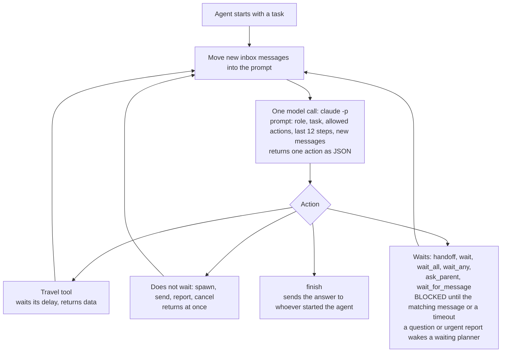

The model keeps no memory between calls. Each prompt is rebuilt from the agent's role instructions, its task, the actions it may use, its last 12 steps (each result cut to 2,500 characters) and any messages that arrived since its last step. The model must answer with one action in JSON, a fixed text format that programs can read, such as `{"action": "search_flights", "args": {"origin": "Toronto", "destination": "Lisbon"}}`.

There are 16 actions; their names appear in the timelines and the notebook.

| Actions | What they do | Does the agent wait? |
|---|---|---|
| `search_flights`, `search_hotels`, `search_hotels_backup`, `get_weather`; in level 5 `search_flights_provider` | Look up the fixed tables | Only for the tool's delay |
| `handoff` / `spawn` | Start a helper | `handoff` waits for its answer; `spawn` carries on |
| `wait`, `wait_all`, `wait_any` | Collect one helper's answer, all named helpers' answers, or the first to arrive | Yes, unless the answers have already arrived |
| `report` | A helper sends a progress note; marked urgent, it wakes a waiting planner | No |
| `send` | The planner sends an instruction or a reply to a helper | No |
| `ask_parent`, `wait_for_message` | A helper asks a question and waits, or waits for an instruction | Yes |
| `cancel` | Stops a helper at its next check: between steps, while it waits or during a tool call | No |
| `finish` | Returns the answer; the planner's `finish` ends the run | |

A message that arrives while an agent is busy is shown at its next step. A waiting agent wakes when its message arrives or at a timeout. A waiting planner is also woken by a question or an urgent report, which prevents the deadlock described in the opening. A message to an agent that finishes without another step stays in its inbox, and nobody is told.

## 3. The seven levels and how the experiment runs

Each level adds one way of coordinating agents. The arrangement is not left to the planner: its role instructions and the actions it may use set the pattern for that level.

| Level | What changes | New actions | What it tests |
|---|---|---|---|
| 0 | One agent does every search itself | none | The baseline |
| 1 | The planner hands each city to a helper and waits for it, then searches flights | `handoff` | Does handing work out save time on its own? |
| 2 | The planner starts all three helpers, searches flights meanwhile, and collects their answers afterwards | `spawn`, `wait`, `wait_all` | Does not waiting save time? |
| 3 | Helpers report progress; the planner can send instructions; Prague's hotel search fails on its first call | `report`, `send`, `wait_for_message` | Do reports and instructions reach the other side in time? |
| 4 | The planner must not pass on the central-hotel preference, so a helper has to ask | `ask_parent` | Can a helper ask and get an answer without a deadlock? |
| 5 | Three helpers search the same flights through providers taking 2, 6 and 14 s per search; the first answer wins | `wait_any`, `cancel` | Does cancelling stop the slower helpers? (flights only) |
| 6 | Each city gets a coordinator that starts its own hotel searcher and weather searcher | a second layer | What does a second layer cost? |

The figures use code names. "Synchronous handoff" is level 1 and "asynchronous spawn" level 2. `main` is the planner; in levels 1 to 4 `city_researcher#2`, `#3` and `#4` are the Lisbon, Rome and Prague helpers; in level 5 `flight_scout#2`, `#3` and `#4` use the providers skyscan (2 s), farefinder (6 s) and airdeal (14 s); in level 6 `city_planner` is a city coordinator and `hotel_scout` and `weather_scout` its searchers.

The whole experiment, with the counts from these runs:

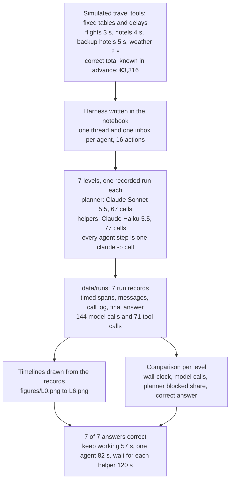

One example travels through it like this: in level 4 the planner starts three helpers, every agent step is one `claude -p` call, and the harness logs each call, search, wait and message with its times. The record is saved to `data/runs/L4_child_asks_parent.json`, the timeline and comparison row are drawn from it, and the check finds 3316 and the three hotel names in the answer. Section 5 follows that run.

Who calls whom, and what each call passes on, for the levels with one and two layers of helpers (the level 5 race is drawn in section 6):

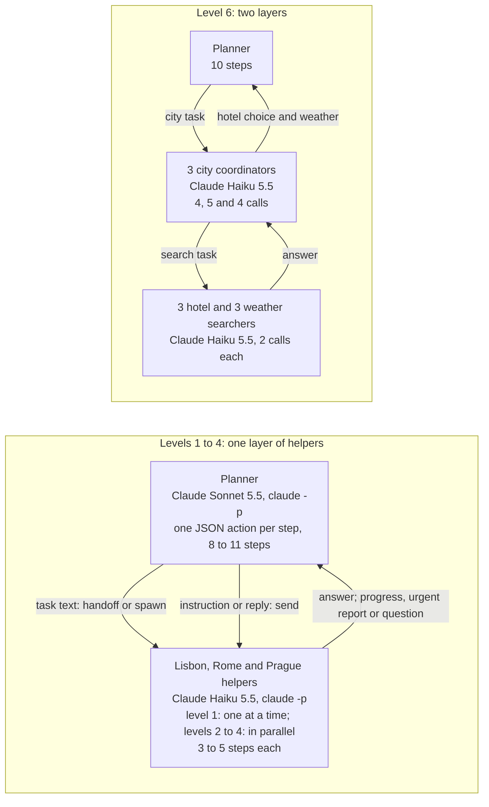

## 4. The models and the measures

| Model | Pinned version | Provider and how called | Size and precision | Settings | Why included |
|---|---|---|---|---|---|
| Claude Sonnet 5.5 | `claude-sonnet-5-5` as requested; only the reply text was kept, so the served version was not recorded | Anthropic, `claude -p`, a new process for every step, tools off, no saved session | Not published | Effort low; CLI default sampling | The planner, which coordinates and writes the final answer: the higher-priced of the two models |
| Claude Haiku 5.5 | `claude-haiku-5-5` as requested; served version not recorded | Anthropic, `claude -p`, same flags | Not published | Effort low; CLI default sampling | Every helper: the cheaper model, the usual choice for workers that each do one narrow job |

The notebook can switch every agent to `codex exec` or `muse exec`, but the recorded runs used only these two models (field `model` of every agent in `data/runs/*.json`).

The measures:

- The **wall-clock time** is the number of seconds from the start of a run to the planner's final answer. Lower is better.
- The number of **model calls** counts the `claude -p` calls by all agents (LLM calls in the figures); each is one step of one agent. More calls cost more, though helper calls use the cheaper model.
- The number of **tool calls** counts the simulated searches.
- The **planner blocked share** is the time the planner spent waiting, divided by the wall-clock time. In level 1 the planner waited 25.0, 21.3 and 20.0 s for its three helpers: 66.3 s of a 120.2 s run, or 55%. 0% means the planner never waited. Waiting is not always waste (in level 5 the planner has nothing else to do), and a helper's wait does not count.
- An answer is **correct** when it passes the check in section 1.

A reply that does not parse as one JSON action becomes an `invalid` action and the agent tries again. None of the 144 replies was unreadable (no step in `agents.*.history` of `data/runs/*.json` has the action `invalid`) and no `claude -p` call failed (no `llm_log` reply starts with "LLM call failed"). The one tool error is the planned failure in level 3. Every deviation below is something an agent chose to do.

### How to read a timeline

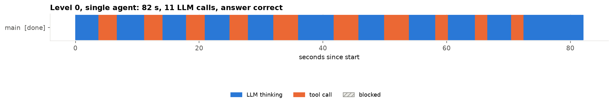

Each row is one agent and the horizontal axis is seconds since the start. Blue bars are model calls, orange bars are tool calls and grey hatched bars are time spent blocked. Arrows between rows are messages: grey starts a helper, green returns an answer, blue is a progress report, yellow an urgent report, orange a question, violet an instruction or reply, red a cancellation. The title gives the wall-clock time, the number of model calls and the result of the correctness check.

Level 0, the baseline, is the simplest case: 11 model calls one after another and 10 searches. Model calls took 51.9 s of the 82.1 s and searches 30.1 s; the last step, writing the plan, was the longest call at 9.6 s.

## 5. Worked example: a helper asks a question

This follows level 4 from start to finish (`data/runs/L4_child_asks_parent.json`). The request has one extra sentence: the planner must give each helper only the city and the rating rule, and helpers must ask if a choice depends on the travellers' preferences. Each helper's role instructions say to ask the planner if two acceptable hotels are within €10 a night of each other.

1. The planner's first three steps (0 to 14.0 s) start the Lisbon, Rome and Prague helpers. The Rome helper's task, written by the planner, ends "If a choice depends on the travellers' preferences, ask me." It does not mention the €10 preference.
2. The Rome helper searches hotels (13.4 to 17.5 s), getting all three Rome hotels, and the weather ("May: 24°C highs, 7 rain days").
3. At 32.4 s it calls `ask_parent` with: "Via Appia Lodge (4.0, EUR 98/night, outskirts) is the cheapest overall. Termini Inn (4.0, EUR 104/night, central) is the cheapest central option. Which should I report as the Rome pick?" From this moment the Rome helper is blocked.
4. The question arrived while the planner was in a model call (29.9 to 34.2 s) choosing its third flight search. The planner saw it at its next step, after that 3 s search, at 37.2 s, together with Prague's finished answer. At 43.1 s it replied with `send`: "Report Termini Inn (central, EUR 104/night) as the Rome pick. It is only EUR 6/night more than Via Appia Lodge, which is within the EUR 10 central-preference limit."
5. The Rome helper woke at 43.1 s after 10.8 s blocked, and at 48.4 s returned "Rome: Pick Termini Inn (rating 4.0, central, EUR 104/night per room), as the parent directed."
6. The planner made its last flight search (43.1 to 50.4 s), then spent two steps on `wait_all` for Lisbon and Prague and `wait` for Rome. Both returned at once, since the answers had arrived, but each was a model call of about 5 s (50.4 to 60.6 s). It finished at 68.9 s.
7. Scoring: the final answer contains "EUR 3,316", Baixa Rooms, Termini Inn and Old Town Loft, so it is correct. The planner was blocked 0 s of 68.9 s, a share of 0%. The run made 21 model calls (planner 11; helpers 3, 4 and 3) and 10 tool calls.


Rows `city_researcher#2`, `#3` and `#4` are the Lisbon, Rome and Prague helpers. The orange arrow at 32 s is the question, the violet arrow at 43 s the reply, and the hatched bar between them the Rome helper's wait. The planner's row is solid: the question cost it one step (6.0 s) and cost the Rome helper 10.8 s of waiting. The deadlock rule was not needed, because the planner was not waiting when the question came.

## 6. Results level by level

Level 0 is drawn in section 4 and level 4 is the worked example in section 5.

### Level 1: hand off and wait for each helper

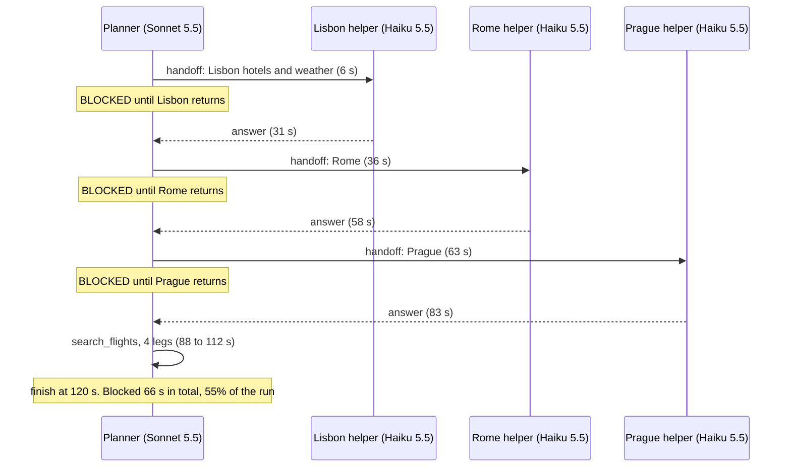

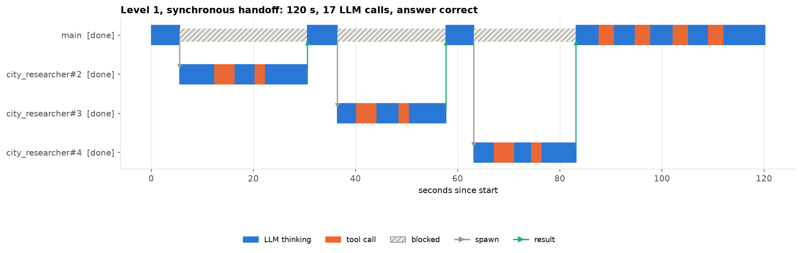

On the planner row, the three long hatched bars are the three waits; under each, one helper works and nothing else happens. The flight searches start only at 83 s.

The planner waited 66.3 s in all, and the run took 120.2 s, 38 s longer than one agent alone. The planner's own work shrank from 11 steps to 8 and from 30 s of searches to 12 s, but each helper needed three model calls on top of its two searches, so handing out a city took longer than searching it. This is the cost case: 17 model calls instead of 11, for a slower answer. Each helper saw only its own city, and the answers were right: the Rome helper returned Termini Inn together with the cheaper Via Appia Lodge, and the planner applied the €10 rule.

### Level 2: start the helpers and keep working

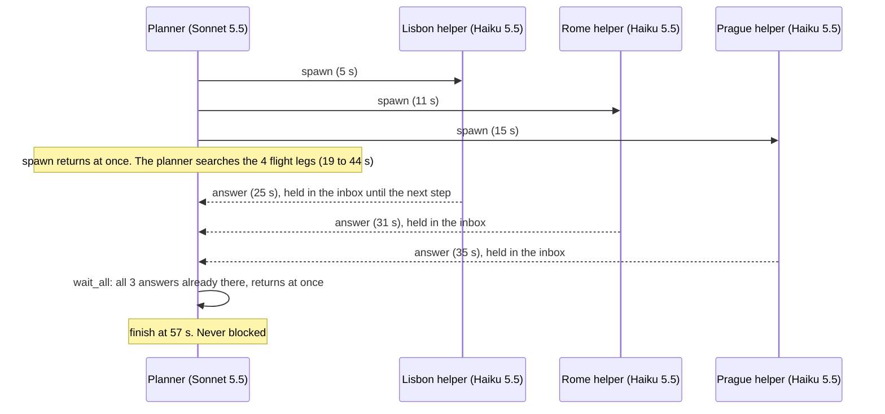

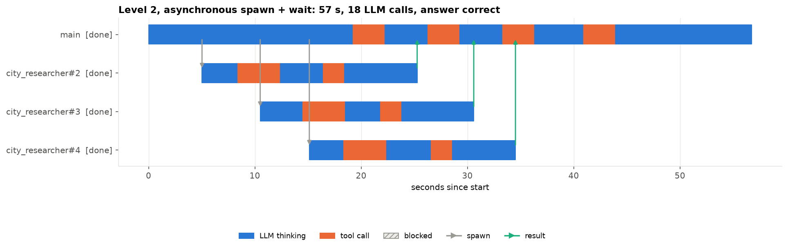

The planner row has no hatched bar. The helper rows overlap the planner's flight searches, and the green arrows reach the planner at 25, 31 and 35 s, while it is still searching.

This is the typical success. When the planner called `wait_all` at 43.9 s, all three answers were already in its inbox, so it was never blocked. The run took 56.8 s against 82.1 s for one agent, with 18 model calls instead of 11. The 7 extra calls were helper calls on the cheaper model; the planner's own prompts totalled 26,775 characters, close to the 24,870 of the single agent (field `prompt_chars` in `llm_log`). About a quarter of the run went on starting helpers: the planner's three `spawn` steps took 15.1 s, because each start is a model call.

### Level 3: progress reports, a failed search and an instruction

Here helpers are told to send a one-line progress report after each search and, if a tool fails, to send an urgent report and wait for instructions without guessing. Prague's hotel search is set to fail once with an "HTTP 503" error, the code a web service returns when it is unavailable.

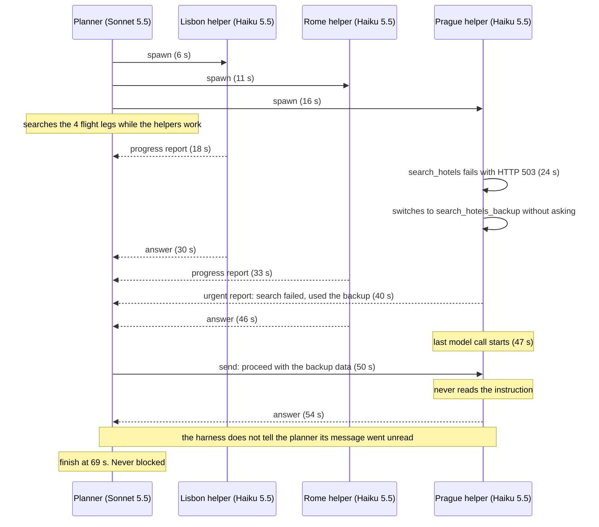

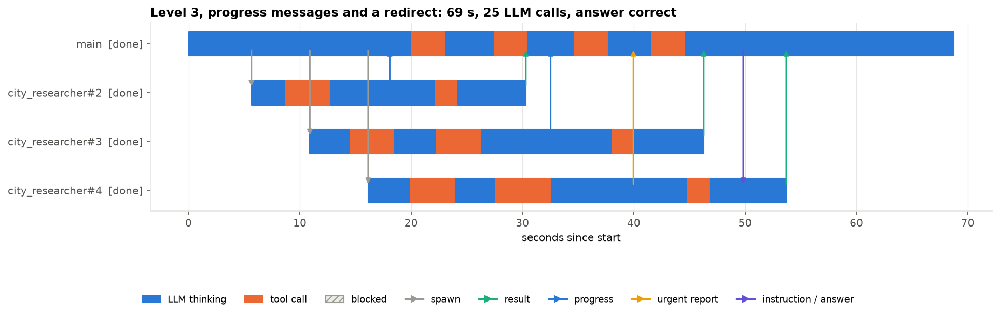

In the bottom row, the Prague helper, the violet arrow at 50 s lands inside its last blue bar, a model call from 46.9 to 53.7 s.

This is the informative failure. The Prague helper's first hotel search failed at 24 s. Instead of reporting and waiting as instructed, it called the backup search on its next step, sent its urgent report at 40.0 s, and went on to the weather. The planner was mid-step when the report came (urgent reports only wake a planner that is waiting), so it read the report at its next step, 44.6 s, and at 49.8 s sent: "Proceed with the backup data, no need to retry search_hotels." By then the helper had already begun its last model call, at 46.9 s, with a prompt built before the instruction existed. That call returned `finish`, so the helper never took another step and the instruction stayed in its inbox. The planner was given no sign of this.

No harm followed, because the instruction matched what the helper did anyway; the answer was correct in 68.8 s with 25 model calls. A different instruction would have been lost. Section 8 counts the other departures from instructions in this level.

### Level 5: race three helpers and cancel the losers

This level has a smaller task, the flights only. Three helpers search the same four legs through providers that take 2, 6 and 14 s per search. The planner takes the first complete answer with `wait_any` and cancels the other two.

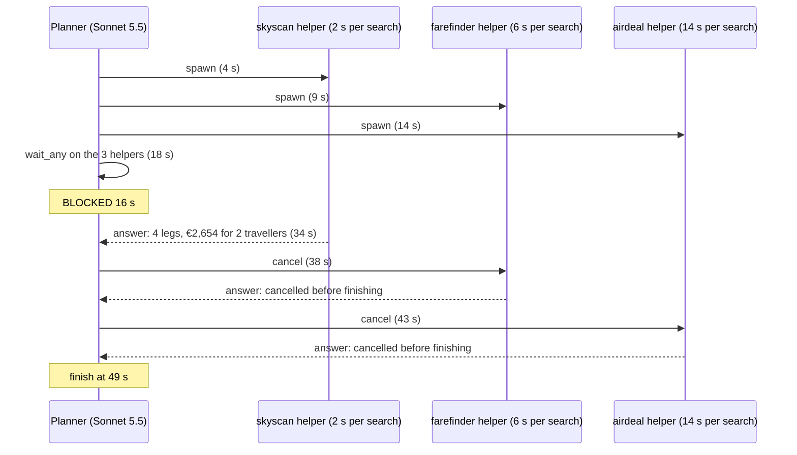

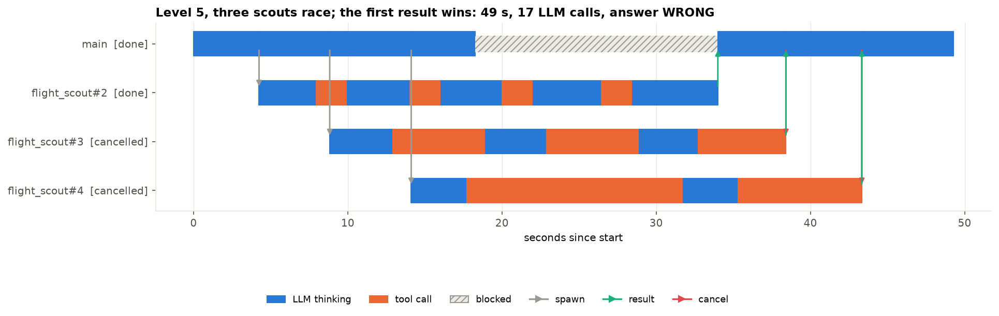

The title's "answer WRONG" is an error in the figure, not the answer: the timeline title applies the full-trip check, which looks for €3,316 and three hotel names that a flights-only answer cannot contain. The comparison table applies the flights check, and the answer gives the right legs and "Total for 2 travellers: 2654 EUR".

The skyscan helper won at 34.0 s, after the planner had been blocked 15.7 s with nothing else to do. The cancellations worked: farefinder had finished 2 of its 4 legs and was stopped during its third search, airdeal had finished 1 and was stopped 8 s into its second 14 s search, and both sent "[cancelled before finishing]", so nothing was left waiting. But each `cancel` was a separate planner step, and the two cancels plus the final answer took 15.3 s after the winning result. With only the slowest provider, the four searches alone would take 56 s. The run made 17 model calls and 9 searches.

### Level 6: helpers with their own helpers

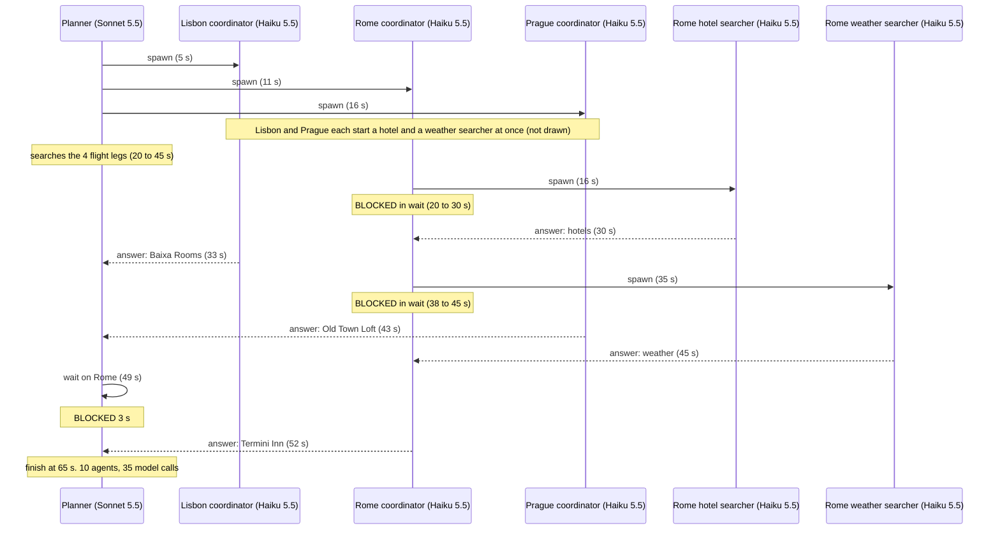

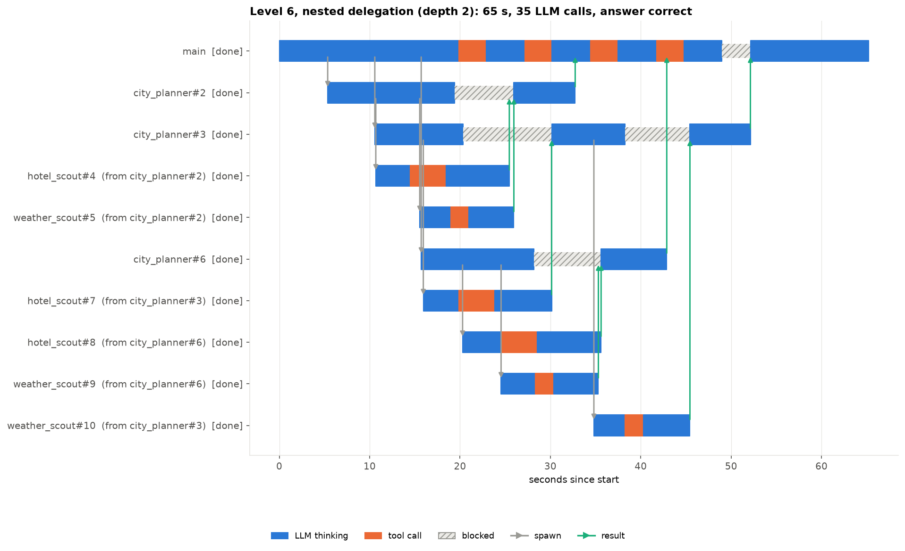

Rows are numbered in the order agents started: `city_planner#2`, `#3` and `#6` are the Lisbon, Rome and Prague coordinators; `hotel_scout#4`, `#7` and `#8` the Lisbon, Rome and Prague hotel searchers; `weather_scout#5`, `#10` and `#9` the weather searchers in the same city order. The Rome coordinator (`city_planner#3`) has two separate hatched waits, because it started its weather searcher only after its hotel searcher had answered.

This is the hard case. Ten agents made 35 model calls, against 18 in level 2: each searcher made one search and one answer, and each coordinator spent 4 or 5 calls passing work down and answers up. The answer was correct after 65.2 s, faster than one agent and 8.5 s slower than level 2. The coordinators were blocked for 24%, 41% and 27% of their time; the rest was their own model calls. The Rome coordinator finished last, at 52.1 s, because it ran its two searchers one after the other, and the planner waited 3.2 s for it.

The final answer also contains weather figures that no tool returned: a low of 13 to 14°C for Lisbon, and a low of 13°C and "about 50 mm rain" for Rome. Section 8 traces where they came from. The answer ends "Some low temperatures and rainfall totals are general climate norms, not tool output", but it does not say which figures those are, and the correctness check passed it.

## 7. Comparison across levels

| Level | Arrangement | Wall-clock | Model calls | Tool calls | Planner blocked | Planner steps | Helpers | Unreadable replies | Correct |
|---|---|---:|---:|---:|---:|---:|---:|---:|---|
| 0 | One agent | 82 s | 11 | 10 | 0 s (0%) | 11 | 0 | 0 | yes |
| 1 | Hand off and wait for each helper | 120 s | 17 | 10 | 66 s (55%) | 8 | 3 | 0 | yes |
| 2 | Start helpers and keep working | 57 s | 18 | 10 | 0 s (0%) | 9 | 3 | 0 | yes |
| 3 | Progress reports and instructions | 69 s | 25 | 12 | 0 s (0%) | 11 | 3 | 0 | yes |
| 4 | A helper asks the planner | 69 s | 21 | 10 | 0 s (0%) | 11 | 3 | 0 | yes |
| 6 | Helpers with their own helpers | 65 s | 35 | 10 | 3 s (5%) | 10 | 9 | 0 | yes |
| 5 | Race and cancel (flights only) | 49 s | 17 | 9 | 16 s (32%) | 7 | 3 | 0 | yes |

From `data/comparison.csv`, with planner steps and helpers counted from `agents` in `data/runs/*.json`. Level 5 is last: its task is smaller, so its time is not comparable.

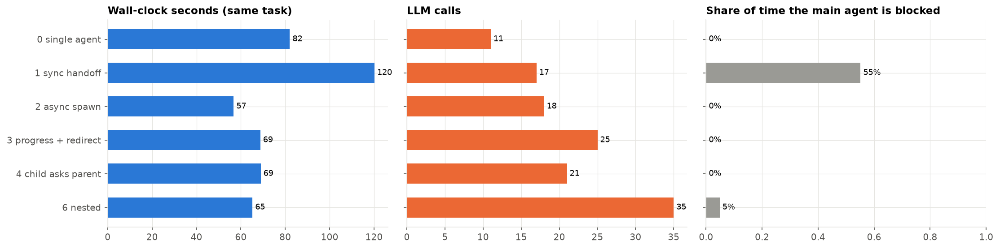

One bar per full-trip level (level 5 is left out): wall-clock seconds, model calls (labelled LLM calls) and the planner's blocked share from 0 to 1, with the code names from section 3 as row labels. The one long blocked bar, level 1, belongs to the one run slower than a single agent.

Only level 1 was slower than one agent. Every level in which the planner kept working (2, 3, 4 and 6) finished in 57 to 69 s, 13 to 25 s faster than level 0, while making 18 to 35 model calls instead of 11. In this task, waiting was what cost time and helpers were what cost calls.

The reason is visible in the run records. In every run the wall-clock time equals the planner's own model time, plus its own searches, plus its blocked time, to within 0.1 s (recounted from the `spans` of agent `main` in `data/runs/*.json`):

| Level | Planner model time | Planner searches | Planner blocked | Wall-clock |
|---|---:|---:|---:|---:|
| 0 | 51.9 s | 30.1 s | 0.0 s | 82.1 s |
| 1 | 41.9 s | 12.0 s | 66.3 s | 120.2 s |
| 2 | 44.7 s | 12.0 s | 0.0 s | 56.8 s |
| 3 | 56.7 s | 12.0 s | 0.0 s | 68.8 s |
| 4 | 56.9 s | 12.0 s | 0.0 s | 68.9 s |
| 6 | 50.0 s | 12.0 s | 3.2 s | 65.2 s |

The helpers' work never shows up in the total unless the planner waits for it. What sets the time is the planner's own steps, about 5 s each. Level 2 took 9 planner steps. Levels 3 and 4 each took two more: one `send` to answer a helper, and one extra collection step for answers that had already arrived. Those 2 steps account for the 12 s between 57 and 69 s.

Summed over every agent, the model time grows with the helpers even as the wall-clock falls: 52 s for one agent, 86 s in level 2, 112 s in level 4, 127 s in level 3 and 173 s in level 6 (`LLM s (summed)` in `data/comparison.csv`). Searches stay at 30 s in every full-trip level except level 3, where the failed search, the backup search and a repeated Rome search raise them to 39 s.

## 8. Error analysis

All seven answers were correct, so the errors here are in how the agents coordinated and what they reported.

### The instruction that arrived during the last step

The level 3 instruction reached a running agent 3.0 s into its last model call, and that call ended the helper. A check that only flags messages sent to finished agents would miss it. A check when an agent finishes, returning any unread message to its sender, would catch it, as would a `send` that returns a delivery status (read, unread, recipient finished). Neither was built or tested here.

### Helpers that did not follow their instructions

Level 3 gave helpers the most detailed procedure, and none followed it fully. The Prague helper switched to the backup search instead of reporting and waiting (its instructions said "do not guess"). Each helper was told to report after every search; the three made 8 searches between them and sent 3 reports. The Rome helper ran the same hotel search twice in a row, which explains why level 3 made 12 tool calls instead of 10.

In level 6 the coordinator role said "Spawn a hotel_scout and a weather_scout, wait for both". The Lisbon and Prague coordinators started both searchers and then waited once. The Rome coordinator started one, waited 9.8 s, started the other and waited 7.2 s, which made Rome the last city and caused the planner's only wait.

In level 4, by contrast, the one helper that met a close call asked as instructed. These are single runs, so they show that departures happen, not how often. In level 3 the planner still learned what had happened, because the helper reported it.

### Steps that collected answers already in hand

Answers that arrive while the planner is busy are shown at its next step (up to 2,500 characters each). The planner still called a waiting action to collect them (the level 2 and 6 instructions end "then collect their results"), and each call is a model step of about 4 to 5 s. Level 2 used one such step (4.1 s). Levels 3, 4 and 6 each used two, one for a single helper and one for the other two (8.4 to 10.2 s of planner model time). In level 5 the two separate `cancel` steps added 9.3 s after the winning answer; the harness also cancels any helper still running when its parent finishes. A planner allowed to collect or cancel all helpers in one action would save these steps, but that was not tested.

### Figures that no tool returned

In level 6, all three city coordinators asked their weather searchers for average low temperatures, which the weather tool does not return. Two of the three searchers supplied them anyway, and both said so:

- Lisbon (`weather_scout#5`): "low around 13–14°C (typical range, not in the history output)", plus an unlabelled "typically 7–8 hours" of sunshine.
- Rome (`weather_scout#10`): "average low about 13°C. Typical rainfall is around 50 mm ... the low and rainfall figures are general climate norms, not from that tool."
- Prague (`weather_scout#9`) declined: "Average low is not in the history I retrieved, so I can't give it reliably."

The coordinators kept the labels. The planner did not: its weather lines state the lows and the rainfall plainly, and one closing sentence says "some" figures are climate norms.

The levels with one layer of helpers behaved differently. In levels 1 to 3, six city helpers were asked in their task for a low temperature, and none supplied one; each said the figure was not available (counted from `task` and the `finish` answer of each helper in `data/runs/*.json`). So 0 of 6 single-layer helpers and 2 of 3 dedicated weather searchers filled the gap, all on the same model. One possible explanation is that a searcher whose only job is the weather treats a missing figure as its task to fill, but three searchers cannot show that.

Is a labelled claim a failure? The searchers were open about their sources. The loss happened one level up, where the planner reduced the labels to "some", so a traveller reading the plan cannot tell which numbers to trust. The check passed it because it reads only the total and the hotel names.

### Where the measures mislead

- The level 5 timeline says "answer WRONG" for a correct answer, because the figure applies the full-trip check to a flights-only task.
- The planner blocked share counts only the planner. Level 4 shows 0% although the Rome helper was blocked 10.8 s, and level 6 shows 5% although its coordinators were blocked 6.6, 17.0 and 7.4 s.
- The correctness check passes the level 6 answer with its unsourced figures, and would pass wrong flights with the right total and hotels, which is why every answer was read.

### What these examples cannot show

They show what each agent did in one run, not why, and not how often. Several patterns rest on a single case: the late instruction, the skipped wait, the sequential Rome coordinator.

## 9. What the evidence supports

- Start helpers and keep the planner working; let it wait only when it needs a result. Here that cut the time from 82 s to 57 s, while handing work out and waiting for each helper raised it to 120 s.
- Count the planner's steps. Once helpers run in parallel, every planner step adds about 5 s to the total, including steps that start, collect or cancel helpers. Actions that start or collect several helpers at once are the next thing to try.
- Give every message a delivery status, and report unread messages when an agent finishes. Level 3 shows that a message can be lost to a running agent, not only to a finished one.
- Keep sources with figures all the way to the final answer, and check that every number in it came from a tool output. The level 6 labels were lost at the top layer, not at the bottom.
- A second layer of helpers did not pay here: with two searches per city, it nearly doubled the model calls (35 against 18) and made the answer slower.

The uncertainty that most needs another experiment is how much of these timings is the 4 to 5 s cost of each `claude -p` step, and whether the same orderings hold with repeated runs and an agent that keeps one session open.

## 10. Limitations

- One recorded run per level. A second run can take a different path, more steps or a wrong turn, and differences of a few seconds may not repeat.
- Each step is a new `claude -p` process. Calls took a median of 4.5 s (3.1 to 9.6 s over 144 calls, from `llm_log`); how much of that is process start-up was not measured, so a step may cost less in a harness that keeps a session open.
- The tools are simulated with fixed delays and fixed data. Real services have variable delays and partial failures.
- The arrangement is set by each level's instructions; the planner never chose between them.
- The correctness check reads only the total and the hotel names. All final answers were also read.
- Two models from one company, one setting each, with no recorded version. Other models, or the same ones at another effort setting, could follow instructions differently.
- The harness is a teaching implementation: threads rather than asynchronous input and output, no saved agent state, and no limits beyond 18 steps per agent, the depth limit and timeouts.
- No analysis plan was recorded before the runs, and `data/` holds one run per level. Settings and run history are in [`data/PROTOCOL.md`](data/PROTOCOL.md).

## 11. Spend, data and how to run

The seven runs made 144 `claude -p` calls: 67 to Claude Sonnet 5.5 and 77 to Claude Haiku 5.5, with prompts totalling 204,501 and 107,449 characters (field `prompt_chars` in `llm_log`, not counting the CLI's own instructions). The cost of these calls was not recorded: the harness kept only the text of each reply. No other service was called.

| File | What it holds |
|---|---|
| `data/runs/L0_single_agent.json` to `L6_nested.json` | One record per level: timed spans, messages, the call log (prompt sizes, first 600 characters of each reply), each agent's task and steps, the final answer |
| `data/comparison.csv` | The comparison table computed from the records |
| `data/PROTOCOL.md` | Settings, run dates and run history |
| `figures/L0.png` to `L6.png`, `figures/comparison.png` | The timelines and the comparison chart |

Running the notebook replays the recorded runs without any model call:

```bash
jupyter nbconvert --to notebook --execute --inplace 07_subagent_handoff_harness.ipynb
```

`NB_LIVE=1` reruns every level through `claude -p` (about 150 calls and 10 to 15 minutes, by the notebook's estimate) and overwrites the records; deleting one run file reruns that level only. `BACKEND` switches every agent to `codex exec` or `muse exec`. The full analysis is in [07_subagent_handoff_harness.ipynb](07_subagent_handoff_harness.ipynb).

## 12. Future work and further reading

### Future work

- Repeat every level ten times. One run per level gives no spread; ten would give a distribution of time, calls and correctness, and show how often a helper skips an instruction as the Prague helper did in level 3.
- Close the gap level 3 found. Make `send` return a delivery status (read, unread, recipient finished), report unread messages when an agent finishes, and test whether the planner acts on a message that arrived too late.
- Separate process start-up from model time. Rerun with one long-lived session per agent to see how much of the 57 to 120 s, and of the roughly 5 s per planner step, is starting `claude -p`.
- Let the planner start and collect several helpers in one action, and measure how much of the 15.1 s of `spawn` steps in level 2 and the collection steps in levels 3, 4 and 6 it removes.
- Trace every number in the final answer to a tool output. Level 6 reported weather figures that no tool returned; a provenance check would flag them before the planner finishes, and its false alarms could be measured on the other levels.

### Further reading

Links checked on 17 October 2026; the Anthropic research-system post was opened again on 28 October 2026 for the figures cited in the opening.

- [Building effective agents](https://www.anthropic.com/research/building-effective-agents) (Anthropic, 2024). Argues for simple, composable patterns before multi-agent designs, consistent with level 1 being slower than one agent.
- [How we built our multi-agent research system](https://www.anthropic.com/engineering/multi-agent-research-system) (Anthropic, 2025). A production planner with parallel subagents, and the coordination problems it met.
- [Why Do Multi-Agent LLM Systems Fail?](https://arxiv.org/abs/2503.13657) (Cemri et al., 2025). A failure taxonomy built from multi-agent traces, including ignored instructions and lost information, as in levels 3 and 6.
- [AutoGen: Enabling Next-Gen LLM Applications via Multi-Agent Conversation](https://arxiv.org/abs/2308.08155) (Wu et al., 2023). A framework built on agents that converse, a contrast to the explicit inboxes and blocking actions here.
- [Coroutines and tasks](https://docs.python.org/3/library/asyncio-task.html) (Python documentation). Task groups, cancellation and timeouts in asyncio, the library versions of `wait_all`, `cancel` and the timeouts this thread-based harness builds by hand.
- [Create custom subagents](https://code.claude.com/docs/en/sub-agents) (Claude Code documentation). How one production harness defines subagents with their own context window, tools and system prompt.
