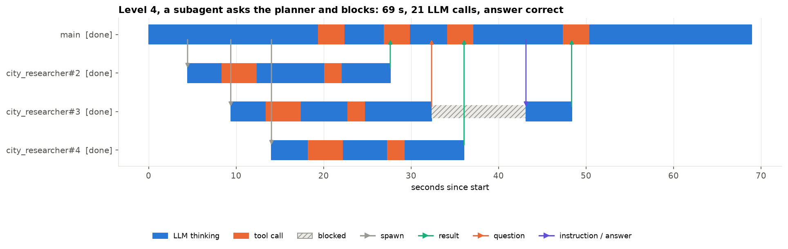

# Subagent harness from scratch: handoffs, messages, blocking and not blocking

**Goal.** Build a multi-agent harness in plain Python (threads, queues, no framework) in which a main agent hands
work to subagents, subagents send messages back, and the main agent either keeps working or chooses to block.
The harness grows one pattern at a time and every pattern is run with real LLM agents on the same task, so each
step's cost and benefit is measured.

| Level | Pattern | New primitive |
|---|---|---|
| 0 | One agent does everything | (baseline) |
| 1 | Synchronous handoff | `handoff` |
| 2 | Asynchronous handoff: spawn, keep working, wait only when needed | `spawn`, `wait`, `wait_all` |
| 3 | Progress up, instructions down; a subagent reports a tool failure and the planner can redirect it | `report`, `send`, `wait_for_message` |
| 4 | A subagent asks the main agent a question and blocks for the answer | `ask_parent` |
| 5 | Three subagents race; the first result wins, the rest are cancelled | `wait_any`, `cancel` |
| 6 | Nested delegation, two levels deep | depth limit |

**Result.** All seven levels produced the correct plan.

| Level | Wall-clock | LLM calls | Main agent blocked |
|---|---|---|---|
| 0 single agent | 82 s | 11 | 0% |
| 1 synchronous handoff | 120 s | 17 | 55% |
| 2 asynchronous spawn | 57 s | 18 | 0% |
| 3 progress + redirect | 69 s | 25 | 0% |
| 4 subagent asks the planner | 69 s | 21 | 0% |
| 6 nested, depth 2 | 65 s | 35 | 5% |
| 5 race + cancel (flights only) | 49 s | 17 | 32% |

* A synchronous handoff is slower than no subagents; the gain comes from spawning and only blocking when a
  result is needed. In level 2 the results arrived while the planner searched flights, so it never blocked.
* A subagent asked a question and was blocked 11 s while the planner kept working, then continued with the answer.
* In level 3 a subagent ignored its "wait for instructions" rule after a tool failure and recovered on its own;
  the planner's reply arrived after it had finished and was silently lost. A harness should report that.
* Nesting cost 35 LLM calls instead of 11, and the final answer picked up weather figures that no tool returned.

**The task.** Plan a trip for two (Toronto → Lisbon → Rome → Prague → Toronto) with cheapest flights and the cheapest
hotel rated 4.0+, preferring central hotels within €10 a night. Tools are simulated with fixed data and real
delays, so the correct answer (€3,316) is known and parallelism shows in wall-clock time.

**Models.** Claude Sonnet 5.5 as the main agent and Claude Haiku 5.5 as subagents, through `claude -p`. `BACKEND`
switches every agent to `codex` or `muse`.

**Run it.** Running all cells replays the recorded runs in `data/runs/`. `NB_LIVE=1` runs the agents again
(about 150 CLI calls, 10-15 minutes).
