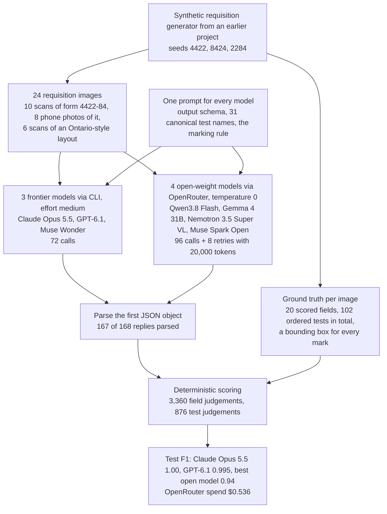
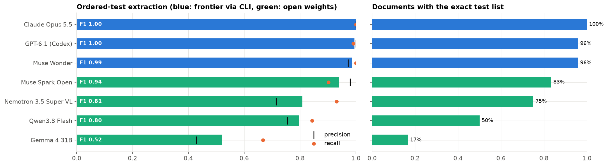
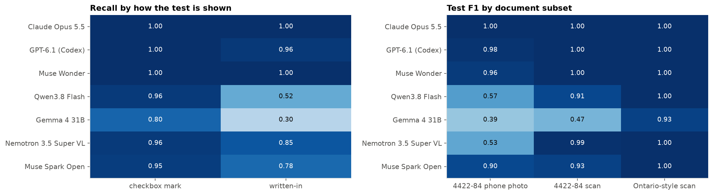

# Reading Ontario lab requisitions with vision LLMs

**Goal.** Measure how well large vision-language models extract structured data from a dense form with
electronic marks: the Ontario Ministry of Health laboratory requisition (form 4422-84). About 70 tests sit in a
tight grid; a test is ordered by an X in a small box (sometimes two boxes, or an eligibility box), and extra
tests are typed or handwritten on "Other Tests" lines. Patient and clinician fields mix typed text and
handwriting.

**Result.**

| Model | How called | Test F1 | Exact test list | Field accuracy | Handwritten fields |
|---|---|---|---|---|---|
| Claude Opus 5.5 | `claude -p` | **1.00** | 100% | **96.7%** | 94.7% |
| GPT-6.1 | `codex exec` | 0.995 | 96% | 88.3% | 83.1% |
| Muse Wonder | `muse exec` | 0.986 | 96% | 91.5% | 86.2% |
| Muse Spark Open | OpenRouter | 0.939 | 83% | 85.2% | 81.0% |
| Nemotron 3.5 Super VL | OpenRouter | 0.809 | 75% | 78.5% | 74.1% |
| Qwen3.8 Flash | OpenRouter | 0.796 | 50% | 83.8% | 78.3% |
| Gemma 4 31B | OpenRouter | 0.521 | 17% | 48.8% | 42.9% |

* The three frontier models read the marked tests almost perfectly, on scans and on phone photos.
* Open-weight models handle flatbed scans well (Nemotron 0.99 F1) but drop on phone photos (Qwen 0.57,
  Nemotron 0.53), and miss tests written on the "Other Tests" lines (recall 0.30-0.85 vs 0.80-0.96 for boxes).
* The hardest fields for every model: date of birth split across yyyy/mm/dd boxes (68% across models), the
  clinician's urgent-results phone, and addresses.

**Workflow.** The whole experiment from data to results, with the counts from this run. Every model response is cached in `data/`, so a re-run replays it without API calls.

**Data.** 24 synthetic requisitions with exact ground truth: 10 flatbed scans of the official 4422-84 layout, 8 phone
photos of it (perspective, shadows, rotated and upside-down captures) and 6 scans of a simpler Ontario-style
layout. They were made with a synthetic requisition generator from an earlier project. Every page is stamped
SYNTHETIC; all names, addresses and identifiers are fictional and identifiers are deliberately invalid. Images and
ground truth are in `data/images/` and `data/ground_truth/`.

**Cost.** $0.54 on OpenRouter for the four open-weight models; the CLI models are billed to their subscriptions.

**Run it.** Running all cells replays every response from `data/cache_*.jsonl`. `NB_SMOKE=1` runs 3 documents.
