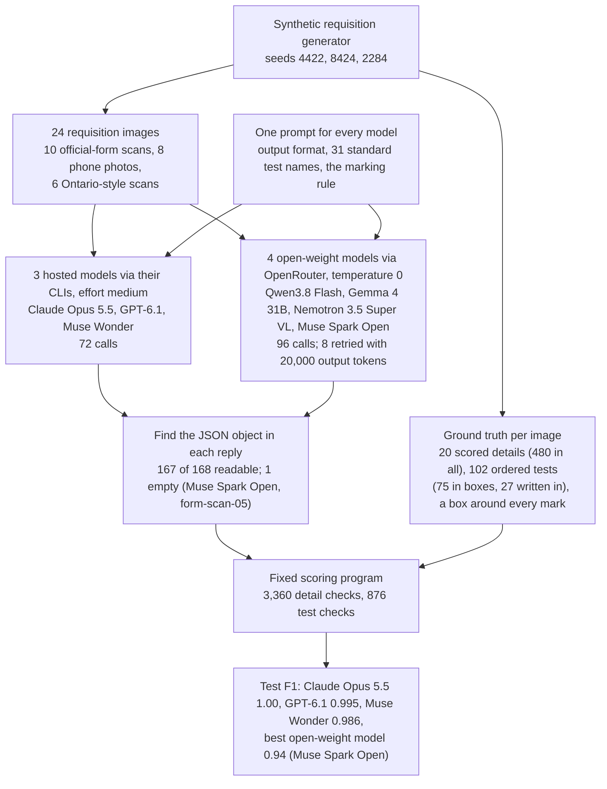
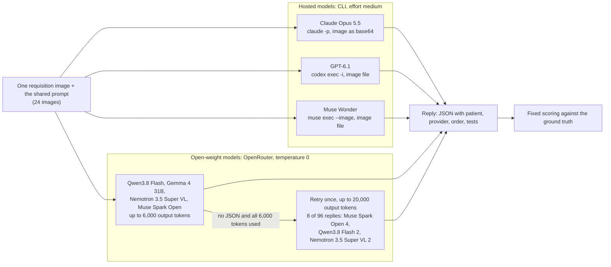
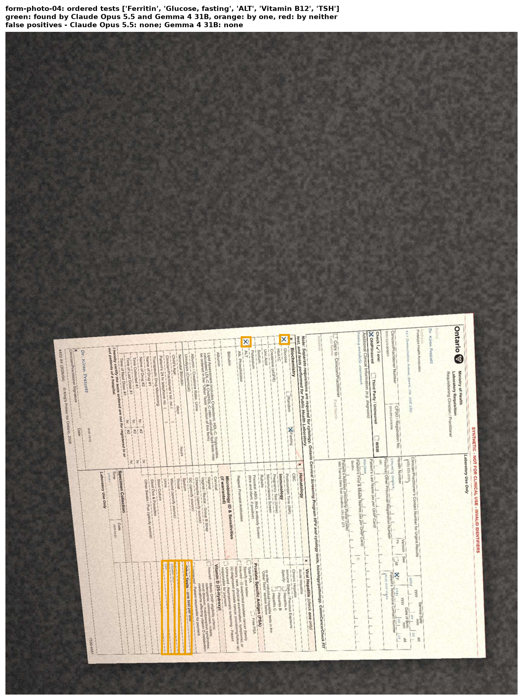

# Can a vision model read the tests ordered on a lab requisition?

## A paper form between the doctor and the lab

When a family doctor in Ontario wants blood work for a patient, the order usually travels on paper. The doctor fills in the province's Laboratory Requisition, a one-page form with the number 4422-84 printed in its corner. The patient carries it to a collection centre, or the clinic faxes or scans it ahead. Before anyone draws blood, someone at the lab reads the page and types the order into the lab's computer system: who the patient is, which clinician gets the results, and which tests to run.

The top of the form holds the details: the patient's name, health card number, date of birth, sex, address and phone, and the clinician's name, clinic, address, registration numbers and urgent-results phone. The lower half is a grid of several dozen printed test names, each with a small box in a narrow column to its left. A mark in the box orders that test. A test that is not printed on the form goes on one of the "Other Tests" lines at the right, one test per line, typed or written by hand.

Each kind of reading mistake has a cost. A test that is missed is never run, so the patient may need a second blood draw and the doctor waits for a result that never arrives. A test that is added costs money and produces a result nobody asked for. A wrong date of birth or health number can stop the lab from matching the patient's record, or attach the result to the wrong person.

### An illustrative example

This example is made up, but it follows the real form's layout.

A doctor wants to check a patient's potassium. Potassium is printed on the form, so she puts an X in its box. In the ordinary case the clerk sees one mark, reads the name beside it and enters Potassium.

Now add one complication. The doctor also wants ferritin, the usual blood test for iron stores, and ferritin is not printed on the form. So she writes "Ferritin" on the first Other Tests line. The page now has one mark and one written line, and the right answer is two tests: Potassium and Ferritin. A careful clerk reads the boxes and then the Other Tests lines. A reader that looks only for marks enters Potassium alone, and the ferritin is never measured. A reader that lists every test name printed on the page enters dozens of tests the doctor never ordered. Both kinds of mistake appear in the results below.

The page may also arrive as a phone photo: taken at an angle, with a shadow across it, or held sideways. The marks are the same, but the boxes are smaller, slanted and harder to line up with their names.

### Why test this, and how

Vision-language models are language models that also take images: given a picture of a page and an instruction, they write text about it. One could read a requisition and return the order as structured data for a clerk to confirm. Before a lab relies on one, it needs three separate numbers: how often the model misses an ordered test, how often it adds a test nobody ordered, and how often it copies a patient or clinician detail wrong. A single "accuracy" figure would hide which of these happens.

Measuring them needs requisitions whose correct contents are known exactly. Real ones contain health information and cannot be published, and their correct contents would have to be typed in by hand, with errors of their own. So this study uses synthetic requisitions. A program fills in the official form with made-up patients and orders, records exactly what it wrote and where, and then makes the page look scanned or photographed. Some values are typed and some are drawn in a script font that imitates handwriting. Every page is stamped "SYNTHETIC - NOT FOR CLINICAL USE" and every identifier is deliberately invalid. Because the filled pages were generated for this test, no model can have seen them, or their answers, during training.

Two kinds of model are compared. Hosted models run on their maker's servers, so the page leaves the lab; three are tested, Claude Opus 5.5 from Anthropic, GPT-6.1 from OpenAI and Muse Wonder from Meta. Open-weight models have their trained files published, so a lab could run one on its own hardware and keep patient pages in-house; four are tested, Qwen3.8 Flash, Gemma 4 31B, Nemotron 3.5 Super VL and Muse Spark Open. Here they were reached through OpenRouter, a service that hosts many open-weight models. The comparison shows how much reading accuracy a lab gives up, on these forms, by choosing a model it could run itself.

## The question

Given a scanned or photographed Ontario lab requisition, can a vision-language model list exactly the tests that were ordered, including the ones written on the Other Tests lines, and copy the patient and clinician details correctly? How do three hosted models and four open-weight models compare on 24 synthetic requisitions whose contents are known exactly?

A lab deciding whether to let a model pre-fill orders needs to know which of these parts it can trust, and on which kind of page.

## Study summary

Each of seven models read each of 24 requisitions once, with the same instructions: 10 flatbed scans of the official form, 8 phone photos of it and 6 scans of a simpler Ontario-style layout. The pages order 102 tests in total, 75 by a mark in a box and 27 on Other Tests lines, and each page has 20 scored details (480 per model). A fixed program compared every reply with the generator's record; no model judged another.

The main measure for tests is F1. It combines precision, the share of listed tests that were really ordered, with recall, the share of ordered tests that were listed. An F1 of 1.00 means no test missed and none added; the scoring section below works through an example.

- Claude Opus 5.5 listed exactly the ordered tests on all 24 pages: 102 of 102 found, none added (F1 1.00). GPT-6.1 missed 1 test and Muse Wonder added 3, all on phone photos (F1 0.995 and 0.986). The three hosted models sit at the ceiling of this test and are separated by 4 tests out of 102, so it cannot rank them on tests.
- The best open-weight model, Muse Spark Open, reached F1 0.94 with the exact list on 20 of 24 pages. Its one empty reply is the only one of the 168 that could not be read; on its 23 readable replies F1 is 0.97. Nemotron 3.5 Super VL (0.81 overall) scored 0.99 on scans of the official form and Qwen3.8 Flash (0.80) scored 0.91, but each returned one phone-photo reply that listed most of the tests printed on the form. Those two replies hold 28 of Nemotron's 38 added tests and 22 of Qwen's 28. Gemma 4 31B (0.52) added more tests than it found, 91 against 68.
- Tests written on the Other Tests lines were the open models' weak point: together they found 66 of 108, against 275 of 300 tests marked in boxes. The hosted models found 80 of 81.
- For patient and clinician details, Claude copied 464 of 480 exactly (96.7%), GPT-6.1 88.3% and Muse Wonder 91.5%. Almost all of the gap is on phone photos: on scans of the official form the three copied 97.5% to 99.5% of details, on photos 90.6%, 67.5% and 77.5%. The date of birth was the hardest detail (right in 114 of 168 replies); years in a handwriting-style font inside the official form's boxed date area were read correctly 7 times out of 42.

In the original situation: on forms like these, Claude Opus 5.5 could pre-fill the test list for a clerk to confirm, and the other two hosted models nearly could. None of the seven should fill in patient details from a phone photo unchecked. With an open-weight model, a person needs to check the Other Tests lines, every phone photo, and any reply that lists far more tests than a requisition carries.

The main caveat is that these are 24 synthetic pages with simulated marks, a script font standing in for handwriting and simulated camera effects, each read once by each model. Real faxes, pen ticks, stamps and handwriting will add failures not tested here, and Claude's 0 misses in 102 tests still allows a true miss rate of up to 3.6%.

## Contents

1. [The form and the synthetic requisitions](#1-the-form-and-the-synthetic-requisitions)
2. [How the experiment runs](#2-how-the-experiment-runs)
3. [The models, the prompt and the measures](#3-the-models-the-prompt-and-the-measures)
4. [Results: ordered tests](#4-results-ordered-tests)
5. [Results: patient, clinician and order details](#5-results-patient-clinician-and-order-details)
6. [Error analysis](#6-error-analysis)
7. [What the evidence supports](#7-what-the-evidence-supports)
8. [Limitations](#8-limitations)
9. [Spend, data and how to run](#9-spend-data-and-how-to-run)
10. [Future work and further reading](#10-future-work-and-further-reading)

## 1. The form and the synthetic requisitions

The pages come from a synthetic requisition generator. For the official layout it draws on the public printable form 4422-84, edition 2026/04; each ground-truth file records the official PDF's download address and its SHA-256 hash. It fills the form with made-up patients, clinicians and test orders, then simulates either a flatbed scan (slight rotation, blur, JPEG compression, speckle) or a phone photo (perspective, framing, lighting, shadows, glare and the way the phone was held). For every image it writes the exact value of every filled field and a bounding box for every field and every mark.

| Subset (label in the figures) | Pages | Seed | What the page looks like | Ordered tests |
|---|---:|---:|---|---|
| Official-form scans (`4422-84 scan`) | 10 | 4422 | Flatbed scan of the official form, turned by less than 1.4 degrees, blurred, compressed and speckled | 47: 29 in boxes, 18 written in |
| Phone photos (`4422-84 phone photo`) | 8 | 8424 | Photo of the official form lying on a surface: 5 upright, 2 sideways, 1 upside down; perspective, shadow, and glare on one | 32: 23 in boxes, 9 written in |
| Ontario-style scans (`Ontario-style scan`) | 6 | 2284 | Flatbed scan of a simpler layout that prints all 31 test names used here, each with its own box, and writes dates as one string | 23, all in boxes |

Counted from `data/manifest.csv` and the ground-truth files in `data/ground_truth/` (fields `document.scan` and `order.tests`). Each page orders 2 to 7 tests.


How to read this figure. Each panel is one page as the models received it, with its page ID and subset in the title. Look at the lower half of each page. On the official form (left and middle) the test grid is dense and the narrow box column sits to the left of each name; the Other Tests lines are at the lower right, where form-scan-01 has "ESR" and "Blood film" written in a script font. In the photo (middle) the same grid is upside down and slanted, and the page fills only part of the frame. The Ontario-style page (right) is the easy reference: three short labelled lists and wide spacing.

The ground truth scores 20 details per page. On the 24 pages these are 233 typed values, 189 values in a handwriting-style font, 48 marks (the sex and coverage boxes) and 10 blank middle names, which a model should return as blank. The handwriting-style values are drawn in a script font that imitates handwriting (fill style `handwritten` in the data); none is real handwriting. Of the 27 written-in tests, 15 are typed and 12 are in the handwriting-style font. The two kinds of test, checkbox tests and written-in tests, appear as `checkbox mark` and `written-in` in the data and figures.

The models are asked to name tests from a fixed list of 31 standard names, because the form prints shortened names such as "Alk. Phosphatase" or "Throat". The most often ordered tests are CBC (complete blood count, 8 pages), Vitamin B12, TSH and Creatinine (7 each).

On data freshness: the filled pages were generated in code from fixed seeds (each ground-truth file has `source.deterministic: true`), so no model can have seen them. The blank official form is public and may have been. `data/` does not record when the pages were rendered, who built the generator or where it is kept, and it records no release date or training cutoff for any of the seven models.

## 2. How the experiment runs



One page travels through it like this: form-scan-01 and the shared prompt go to each of the seven models, each reply is searched for its JSON object, and the object's 20 details and test list are compared with form-scan-01's ground-truth file.

Each model makes one call per page. The only second call is a retry for an open-weight model whose reply used its whole 6,000-token output allowance, spent mostly on reasoning, without producing an answer:




### Worked example: one page from image to score

This is form-scan-01, the left panel of the figure above, as Claude Opus 5.5 read it.

The page orders four tests. Glucose has an X in the box column and a second X in the "Fasting" box on the same row; the form's rule makes that one test, fasting glucose. Potassium has an X. "ESR" and "Blood film" are written on the first two Other Tests lines in the handwriting-style font. The ground truth (`data/ground_truth/form-scan-01.json`, field `order.tests`) lists them as Glucose, fasting; Potassium; ESR; Blood film. Among the 20 details, the patient's last name, address, the clinician's name and both clinician numbers are in the handwriting-style font, and the date of birth, 1962-02-16, is typed.

Claude's reply came back in 9.4 seconds as a JSON object inside a code fence, which the parser removes. Its test list:

```json
"tests": ["Glucose, fasting", "Potassium", "ESR", "Blood film"]
```

Scoring compares this list with the ground truth as two sets. All four ordered tests are listed and nothing else is: 4 found, 0 added, 0 missed. Each detail is compared after normalising case, spacing and punctuation, so "688 Training Data Trail, Peterborough, ON Z7Z 2Z5" matches the ground truth's version with two spaces before the postal code. All 20 details match. form-scan-01 is one of Claude's 24 exact test lists and one of its 19 pages with no error of any kind.

Gemma 4 31B read the same page differently; its reply is the metric example in section 3.

## 3. The models, the prompt and the measures

| Model | Pinned version | Provider and how called | Size and precision | Settings | Why included |
|---|---|---|---|---|---|
| Claude Opus 5.5 | `claude-opus-5-5` as requested; no dated version recorded | Anthropic, `claude -p` with tools off, image sent as base64 | Not published | Effort medium; CLI default sampling | Hosted model from Anthropic |
| GPT-6.1 | `gpt-6.1-sol` as requested; Codex returned no version, not recorded | OpenAI, `codex exec -i` in a read-only sandbox, image as a file | Not published | Reasoning effort medium; CLI default sampling | Hosted model from OpenAI |
| Muse Wonder | `muse-wonder-full-1.0` as requested; no dated version recorded | Meta, `muse exec --image` with web tools off | Not published | Reasoning effort medium; CLI default sampling | Hosted model from Meta, which also makes Muse Spark Open |
| Qwen3.8 Flash | `qwen/qwen3.8-flash`, undated; no dated version recorded | OpenRouter; all 24 scored replies from Alibaba | Not recorded in `data/` | Temperature 0; 6,000 output tokens, one retry with 20,000; writes reasoning first (median 829 reasoning tokens) | Open-weight vision model from Alibaba's Qwen family |
| Gemma 4 31B | `google/gemma-4-31b-it`, undated; no dated version recorded | OpenRouter; all 24 from ModelRun | 31B parameters (from the name); precision not recorded | Temperature 0; 6,000 output tokens; writes no separate reasoning | Open-weight model from Google that answers without a reasoning step |
| Nemotron 3.5 Super VL | `nvidia/nemotron-3.5-super-vl`, undated; no dated version recorded | OpenRouter; 5 hosts (DeepInfra 13, Crusoe 4, Together 3, Venice 2, CoreWeave 2) | Not recorded in `data/` | As Qwen; median 2,420 reasoning tokens | Open-weight vision model from NVIDIA |
| Muse Spark Open | `meta/muse-spark-open`, undated; no dated version recorded | OpenRouter; 3 hosts (Fireworks 21, Nebius 2, BaseTen 1) | Not recorded in `data/` | As Qwen; median 1,770 reasoning tokens | Open-weight model from Meta; beside Muse Wonder it compares a hosted and an open model from one maker |

Hosts and token counts are counted from `data/cache_openrouter.jsonl` (fields `provider` and `usage.completion_tokens_details.reasoning_tokens`) for the 24 scored replies per model. In the figures and in `data/summary_tests.csv`, GPT-6.1 appears as "GPT-6.1 (Codex)" and the three hosted models are labelled "frontier (CLI)".

### The prompt

Every model received the same prompt with the image. It asks for one JSON object with a `patient` block (9 details), a `provider` block (6 details for the clinician), an `order` block (5 details) and a `tests` list. The rules section reads, in part:

```text
- Copy values exactly as written. Use "" for a field that is blank on the page.
- "tests" lists every ordered test, using only names from this list: [the 31 standard names]
- A test is ordered if its checkbox is marked, if one of its eligibility boxes is marked (e.g. the insured or
  uninsured box under Vitamin D or PSA), or if it is written on an "Other Tests" line. Do not list unmarked tests.
- The page may be rotated or photographed at an angle.
```

The third rule is the one a lab clerk would be told. The full prompt is in section 3 of [the notebook](08_lab_requisition_extraction.ipynb).

### Readable and unreadable replies

The parser takes the first complete JSON object in the reply that has a `patient` key, ignoring code fences and any text around it. A reply is unreadable when no such object exists: empty, cut off, or not JSON. An unreadable reply scores as if every detail were blank and no test were listed, so it counts as missing every ordered test.

One reply of 168 was unreadable: Muse Spark Open on form-scan-05 returned no text at all after using its whole 20,000-token retry allowance. Two further replies were readable but empty: Gemma 4 31B returned the requested JSON with every detail blank and no tests for the two sideways photos, form-photo-04 and form-photo-06. Results below give each model's score on all 24 pages and, where it differs, on its readable replies.

### How details are scored

Each detail is right or wrong. Text is compared after normalising Unicode, case, spacing and punctuation. Dates are compared as year, month and day; phone numbers and identifiers on their letters and digits only; the collection time as hours and minutes; coverage by its category. **Field accuracy** is the share of a model's 480 details that match exactly. The notebook also records a character similarity between 0 and 1 for each wrong value, to separate a misread digit from a blank or a value from the wrong field.

### How tests are scored

The test list is compared with the ground truth as a set. A listed test that was ordered is **found**; a listed test that was not ordered is **added** (a false positive); an ordered test that is not listed is **missed** (a false negative). A name outside the 31 is counted as added; no model wrote one.

- Precision is found / (found + added): of the tests the model listed, the share that were ordered. Low precision means unnecessary tests.
- Recall is found / (found + missed): of the ordered tests, the share the model listed. Low recall means tests that are never run.
- F1 is 2 x precision x recall / (precision + recall). It is high only when both are high. Higher is better, and 1.00 is perfect.
- The exact test list is the share of pages where the list is exactly right, nothing missing and nothing added.

A small example. On form-scan-01, Gemma 4 31B listed 12 tests: the three it should (Glucose, fasting; Potassium; Blood film) and nine more (HbA1C, Creatinine (eGFR), Sodium, ALT, Alkaline phosphatase, Bilirubin, Albumin, CBC and Prothrombin time (INR)). It left out ESR. So 3 found, 9 added, 1 missed: precision 3/12 = 0.25, recall 3/4 = 0.75, F1 = 2 x 0.25 x 0.75 / 1.00 = 0.375. The clerk would have run 9 unnecessary tests and skipped one.

F1 for a model pools every page: found, added and missed are summed over its 24 pages before the formula is applied. Over all 24 pages Gemma found 68, added 91 and missed 34, so precision is 68/159 = 0.43, recall 68/102 = 0.67 and F1 0.52.

The notebook gives a 95% interval for each F1 by resampling the 24 pages with replacement 1,000 times. When a model is perfect on every page, every resample is perfect too, so Claude's interval of [1.00, 1.00] carries no information. A better statement for Claude is that 0 misses in 102 ordered tests is consistent with a true miss rate of up to 3.6% (the upper end of a 95% Wilson interval).

## 4. Results: ordered tests

| Model | Found / 102 | Added | Missed | Precision | Recall | Test F1 (95% interval) | Exact test list | Unreadable replies |
|---|---:|---:|---:|---:|---:|---|---:|---:|
| Claude Opus 5.5 | 102 | 0 | 0 | 1.000 | 1.000 | 1.000 (see section 3) | 24 / 24 | 0 |
| GPT-6.1 | 101 | 0 | 1 | 1.000 | 0.990 | 0.995 (0.98 to 1.00) | 23 / 24 | 0 |
| Muse Wonder | 102 | 3 | 0 | 0.971 | 1.000 | 0.986 (0.96 to 1.00) | 23 / 24 | 0 |
| Muse Spark Open | 92 | 2 | 10 | 0.979 | 0.902 | 0.939 (0.85 to 1.00) | 20 / 24 | 1 |
| Nemotron 3.5 Super VL | 95 | 38 | 7 | 0.714 | 0.931 | 0.809 (0.62 to 0.97) | 18 / 24 | 0 |
| Qwen3.8 Flash | 86 | 28 | 16 | 0.754 | 0.843 | 0.796 (0.63 to 0.93) | 12 / 24 | 0 |
| Gemma 4 31B | 68 | 91 | 34 | 0.428 | 0.667 | 0.521 (0.42 to 0.63) | 4 / 24 | 0 (2 blank) |

From `data/summary_tests.csv` (columns `TP`, `FP`, `FN`, `precision`, `recall`, `F1`, `F1 95% CI`, `all tests right`); unreadable and blank replies counted from `data/cache_openrouter.jsonl` and `data/scored_fields.csv`.

On readable replies only, Muse Spark Open found 92 of 96 ordered tests, added 2 and had the exact list on 20 of 23 pages: F1 0.968. Without its two blank replies, Gemma's F1 is 0.535. Neither change alters the order of the seven models.


How to read this figure. The left panel's title is a colour key rather than a finding: blue bars are the three hosted models ("frontier via CLI") and green bars the four open-weight models. Each bar is one model's test F1, and the white label inside it is the F1 rounded to two decimals, so GPT-6.1's 0.995 shows as "1.00". The black tick is precision and the orange dot is recall, both on the same 0 to 1 scale; where the tick sits left of the dot, the model adds tests more than it misses them. The right panel is the share of the 24 pages on which the list was exactly right.

The hosted models are at the ceiling. Between them they made 4 test errors in 72 replies, 1 missed and 3 added, all on phone photos: GPT-6.1 missed Vitamin B12 on form-photo-02, and Muse Wonder added CBC, Hepatitis B serology and Hepatitis C antibody on form-photo-04. Their intervals overlap almost entirely, and this test cannot say which of the three reads test lists best.

Among the open-weight models the tick and the dot tell different stories. Muse Spark Open's precision (0.98) is level with the hosted models'; it falls short on recall (0.90), and 6 of its 10 misses are the 6 tests on its unreadable reply. Nemotron and Qwen have the reverse problem: their recall is 0.93 and 0.84 but their precision is 0.71 and 0.75, because of the added tests. Gemma is low on both. The exact-list panel spreads the open models further apart than F1 does: Qwen's 0.80 F1 comes with the exact list on only half the pages.


How to read this figure. Darker blue is better, and each cell prints its value. The left map splits recall by how the test appears on the page: 75 ordered tests are checkbox tests and 27 are written in. Precision cannot be split this way, because an added test has no position on the page. The right map gives test F1 for each subset of pages: 32 ordered tests on phone photos, 47 on official-form scans and 23 on Ontario-style scans.

Written-in tests separate the open models from the hosted ones. Qwen found 72 of 75 checkbox tests but 14 of 27 written-in tests; Nemotron 72 and 23; Muse Spark Open 71 and 21; Gemma 60 and 8. The hosted models found 80 of 81 written-in tests between them. For Qwen the weakness is about the Other Tests lines rather than the font: it found 8 of the 12 handwriting-style written-in tests and 6 of the 15 typed ones.

The right map shows the phone-photo drop that the overall F1 summarises. Every model except Gemma scored 1.00 on the Ontario-style scans, where all 23 ordered tests are checkbox tests in short lists. Nemotron scored 0.99 on official-form scans and 0.53 on phone photos; Qwen 0.91 and 0.57. Those photo scores rest mostly on one page each. Nemotron's reply for form-photo-02 listed all 31 test names in the prompt, 28 of them not ordered; Qwen's reply for form-photo-06 listed 24 names, 22 of them not ordered (section 6 shows both). Without those two pages, Nemotron's F1 on the other 7 phone photos is 0.73 and Qwen's is 0.76, and their F1 over all remaining pages is 0.92 and 0.88. So the photo drop is mostly one reply each, but even without it both models are weaker on photos than on scans. These recounts use `data/scored_tests.csv` with the named page removed.

The notebook's per-test recall chart (section 5.3 of the notebook) agrees: the hardest tests are the ones the official form has no box for. Reticulocyte count was found in 15 of 21 model-page pairs, Ferritin 27 of 35, Vitamin B12 38 of 49 and TSH 39 of 49. The two-box test, fasting glucose, which needs the X beside Glucose and the X in the Fasting box to be read as one test, was found in 33 of 35 pairs; only Gemma missed it, twice.

## 5. Results: patient, clinician and order details


How to read this figure. Each row is one of the 20 details, named as in the output format (`patient.date_of_birth` is the patient's date of birth, `provider.urgent_phone` the clinician's urgent-results phone, `order.coverage` the insurance box). Each column is a model, and each cell is the share of its 24 pages on which that detail matched exactly. The bottom row, below the white line, pools all 480 details. Darker is better.

Claude Opus 5.5 copied 464 of 480 details exactly (96.7%), Muse Wonder 439 (91.5%), GPT-6.1 424 (88.3%), Muse Spark Open 409 (85.2%), Qwen 402 (83.8%), Nemotron 377 (78.5%) and Gemma 234 (48.8%), counted from `data/scored_fields.csv`, column `exact`. On readable replies only, Muse Spark Open copied 409 of 460 (88.9%), which puts it 0.6 points above GPT-6.1; that is the one place where leaving out the unreadable reply changes the order of two models.

Across all models the hardest details were the date of birth (right in 114 of 168 replies, 68%), the clinician's urgent-results phone (116, 69%), the patient's address (118, 70%) and the clinician's address (125, 74%). The easiest were the clinician's name (162, 96%) and the coverage box (160, 95%). Gemma's column is pale almost everywhere; 121 of its 246 wrong details are blanks, including the 40 from its two empty replies.

The handwriting-style font looks like the cause of the hosted models' gaps at first: on handwriting-style details Claude scored 94.7%, Muse Wonder 86.2% and GPT-6.1 83.1%. Splitting by subset shows that the photos matter more than the font:

| Model | Official-form scans: typed | Official-form scans: handwriting-style | Phone photos: typed | Phone photos: handwriting-style | Ontario-style scans: all |
|---|---:|---:|---:|---:|---:|
| Claude Opus 5.5 | 99 / 99 | 77 / 78 | 69 / 75 | 57 / 66 | 104 / 104 |
| GPT-6.1 | 99 / 99 | 74 / 78 | 51 / 75 | 38 / 66 | 104 / 104 |
| Muse Wonder | 99 / 99 | 73 / 78 | 60 / 75 | 45 / 66 | 104 / 104 |
| Muse Spark Open | 86 / 99 | 66 / 78 | 55 / 75 | 42 / 66 | 104 / 104 |
| Qwen3.8 Flash | 94 / 99 | 67 / 78 | 43 / 75 | 36 / 66 | 104 / 104 |
| Nemotron 3.5 Super VL | 87 / 99 | 65 / 78 | 35 / 75 | 30 / 66 | 104 / 104 |
| Gemma 4 31B | 51 / 99 | 35 / 78 | 11 / 75 | 2 / 66 | 98 / 104 |

Typed and handwriting-style details only; the 48 marks and 10 blank middle names are left out. Counted from `data/scored_fields.csv` (columns `subset`, `fill_style`, `exact`).

On scans of the official form, the hosted models missed at most 5 handwriting-style details out of 78. On phone photos all seven models lost accuracy in both fonts: GPT-6.1 fell from 173 of 177 on scans to 89 of 141 on photos. 52 of GPT-6.1's 56 wrong details and 15 of Claude's 16 are on phone photos. On the Ontario-style scans, six models copied all 104 typed and handwriting-style details. Across all models, 205 of the 611 wrong details are blanks, 259 are near misses with a character similarity of at least 0.8 (typically a digit or two), and 5 are a value from another field of the same page (4 by Gemma, 1 by Qwen). The hosted models' errors are mostly near misses: 12 of Claude's 16 and 33 of Muse Wonder's 41.


How to read this figure. A page counts as clean (green) only when all 20 details and the test list are right: it could go into the lab system with no correction. Each bar is one model's 24 pages, as shares from 0 to 1; errors on details and on tests are added together.

Claude produced 19 clean pages of 24, Muse Wonder 14, GPT-6.1 and Muse Spark Open 13 each, Qwen and Nemotron 7 each and Gemma 3 (counted from `data/scored_fields.csv` and `data/scored_tests.csv`). Claude's five pages with errors are four phone photos and form-scan-10, where its only error is the date of birth. This view is stricter than either score above, and it is closest to the question a lab asks: how many pages need no correction at all.

## 6. Error analysis

The examples below were chosen to explain the patterns in sections 4 and 5. Each is identified by page ID and model and can be found in `data/scored_tests.csv` and `data/scored_fields.csv`.

### Two replies that listed the form instead of the marks

form-photo-02 is the upside-down photo with glare. It orders three tests: Alkaline phosphatase and CBC in boxes, and Vitamin B12 typed on an Other Tests line. Nemotron 3.5 Super VL's first reply used all 6,000 tokens and stopped partway through the JSON; the retry used 8,420 tokens, 7,891 of them reasoning, and listed 31 tests: every name in the prompt's list, in the prompt's order. Three of them were ordered.

form-photo-06 is a sideways photo in dim light, ordering Stool culture and CBC, both in boxes. Qwen3.8 Flash's first reply was all reasoning and no answer; the retry used 11,399 tokens and listed 24 tests in the order of the form's printed columns, from Glucose, fasting down the Biochemistry column, through CBC and Prothrombin time (INR), to Vitamin D (25-Hydroxy). It left out exactly the seven names in the prompt's list that the official form does not print (TSH, Ferritin, Vitamin B12, ESR, Reticulocyte count, Blood film and C-reactive protein; compare the grid in form-scan-01). The two ordered tests are among the 24.

Both replies returned test names that are printed on the form, and both scored precision under 0.15 on the page. Both also came from the 8 retries with the larger output allowance: those 8 replies hold 52 of the 159 tests the open models added, against 107 in the other 88 replies (counted from `data/cache_openrouter.jsonl` and `data/scored_tests.csv`). The details in both replies are also wrong in bulk: 12 of Nemotron's 20 and 13 of Qwen's 20, including the patient's last name ("Syer" for Iverson, "Hattie" for Hartley) and postal codes. What the replies show is a model that has stopped reading marks; why that happened on these two pages, and whether it would happen again on another run, these data cannot say. Each page was read once.

A lab can catch this kind of failure without knowing the answer: no page in this set orders more than 7 tests (`data/manifest.csv`, column `n_tests`), and these replies listed 31 and 24.

### Gemma 4 31B adds the same block of printed names

Gemma's 91 added tests are spread over many pages: 15 on form-scan-06, 14 on form-scan-04, 12 on form-photo-03, 9 on form-scan-01 and fewer elsewhere. They are largely the same names each time. On form-scan-04 and form-scan-06 it added the same 14 names (and Lipid assessment on form-scan-06): every Biochemistry row in the prompt's list from Glucose to Albumin, CBC and Prothrombin time from the Hematology column, and the Pregnancy, Mononucleosis and Prenatal rows from Immunology. The two pages order different tests (Vitamin B12, Blood film and Lipid assessment on form-scan-04; Chlamydia NAAT, C-reactive protein and Hepatitis B serology on form-scan-06), yet the added block is the same. The form-scan-01 reply in section 3 is a shorter version of the same block. On the two sideways photos Gemma returned the JSON template with every value blank and an empty test list. On the Ontario-style scans, by contrast, it found 21 of 23 tests and added 1.

### A miss on the Other Tests lines

form-scan-07 is an ordinary official-form scan ordering seven tests: five in boxes (Glucose, fasting; Sodium; Alkaline phosphatase; Mononucleosis screen; Prothrombin time) and two typed on Other Tests lines (TSH and Reticulocyte count). Qwen3.8 Flash listed the five boxed tests and neither written-in one: precision 1.00, recall 0.71. Nothing in the reply flags a problem; it is a clean-looking list that is two tests short. This is the most common open-model test error: 42 of their 67 missed tests were written in, although written-in tests are only 27 of the 102.

### The hosted models' four test errors

GPT-6.1's one miss is Vitamin B12 on form-photo-02, typed on an Other Tests line of the upside-down photo; it listed the two boxed tests. Claude and Muse Wonder found it. Muse Wonder's three added tests are all on form-photo-04: CBC, Hepatitis B serology and Hepatitis C antibody, beside all five ordered tests. On both pages Claude's list was exact.

### The hardest page

form-photo-04, a sideways photo compressed to the quality of a messaging app, had the most errors summed over all seven models: 129 of the 841 wrong details and test decisions in the study, on 1 page of 24. Claude made 7 of them, GPT-6.1 and Muse Wonder 16 each, and the open models 20 to 25 each (counted from `data/scored_fields.csv` and `data/scored_tests.csv`). GPT-6.1 left all eight written patient details blank and wrote a clinic name and address that are not on the page ("Brookside Health Associates", "117 Pinecrest Drive, Toronto").



How to read this figure. The notebook picks the page with the most errors over all models, then draws a box around each ordered test, coloured by whether the best model on F1 (Claude Opus 5.5) and the worst (Gemma 4 31B) found it: green for both, orange for one, red for neither. The title lists the ordered tests as a Python list. All five boxes are orange because Claude found all five and Gemma, whose reply was blank, found none. The page fills the lower right of the frame, so the marks are small at this width.

Claude's reply on this page is a typical success with a limit. It found all five tests, including the three in the handwriting-style font on the Other Tests lines, but made 7 of its 16 detail errors here: the service and collection dates as 2026-03-22 for 2025-03-22, the date of birth as 1983-02-25 for 1981-02-23, the phone ending 0184 for 0186, the house number 960 for 980 and two more. A clerk would get the right tests and a patient record that does not match.

### Dates of birth in the boxed date area

On form-scan-10 every model got the date of birth wrong. The ground truth is 1960-09-23, written in the handwriting-style font. Claude, Muse Wonder, Qwen, Nemotron and Muse Spark Open all wrote 1940-09-23, GPT-6.1 wrote 1990-09-23 and Gemma 2024-06-24. On form-scan-04 (ground truth 1969-07-22) only Claude was right; Muse Wonder, Qwen and Nemotron wrote 1949, GPT-6.1 1999 and Muse Spark Open 1989.

The image explains part of this. The official form splits the date of birth into separate boxes for the year, month and day, with short printed lines dividing the year area into four. The generator writes all four digits of the year at the left of that area, and on both pages the printed line between the first and second year boxes runs through the third digit, so the 6 is crossed by a vertical stroke. On form-scan-01 the typed year is smaller and ends at the line. This is an observation from three images, not a measured cause.

The counts fit it. Handwriting-style dates of birth on the official form were right in 7 of 42 model-page pairs, and typed ones in 65 of 84. On the Ontario-style layout, which writes the date as one string with no boxes, handwriting-style dates of birth were right in 35 of 35. Of the 16 wrong dates that differ from the truth only in the third digit of the year, 14 are in the handwriting-style font. Here the metric may overstate the models' error: the ground truth is what the generator meant to write, and part of what it drew sits under a printed line. Whether a person would read these dates correctly was not tested.

### The unreadable reply

Muse Spark Open's reply to form-scan-05 was empty twice: the first call used all 6,000 tokens, and the retry used all 20,000, 11,760 of them reasoning, and returned no text. The page is an ordinary official-form scan with six tests, four in boxes and two typed on Other Tests lines. Because the reply could not be read, it scores as 6 missed tests and 20 wrong details, which is 6 of Muse Spark Open's 10 misses and 20 of its 71 wrong details. It is a format failure, not a reading failure: the model never answered. It cost $0.086, a fifth of Muse Spark Open's spend on scored replies.

## 7. What the evidence supports

- On pages like these, Claude Opus 5.5 can pre-fill the list of ordered tests for a clerk to confirm: it was exact on all 24 pages, including all 27 written-in tests and the sideways and upside-down photos. GPT-6.1 and Muse Wonder are close behind on tests; this experiment cannot separate the three.
- Ask for scans rather than phone photos where possible, and have a person check details read from a photo with any model. Claude's detail accuracy fell from 176 of 177 typed and handwriting-style details on official-form scans to 126 of 141 on photos, and GPT-6.1's from 173 to 89.
- Check every date of birth on the official form against another record, especially a handwritten one. Only 7 of 42 handwriting-style dates in the form's boxes were read correctly.
- If an open-weight model must be used, Muse Spark Open was the most accurate here. Three checks address the failures seen in this study: send any page whose reply lists more tests than a requisition plausibly carries (the pages here order 2 to 7) to a person; have a person read the Other Tests lines, where the open models found 66 of 108 tests; and treat an empty or blank reply as "not read", not as "no tests ordered". Gemma 4 31B, as tested, is not a candidate (F1 0.52, 3 clean pages of 24).

The uncertainty that most needs another experiment is how these results carry over to real requisitions: real pen marks and handwriting, fax noise and the rotation of real photos.

## 8. Limitations

- Synthetic pages. The marks are electronic X marks, the handwriting is a script font, and the scan and camera effects are simulated. Names, addresses and identifiers come from small synthetic pools ("Training Data Trail", "SYN-HCN-000001"), which may be easier to read than real ones. Real faxes, pen ticks, stamps, carbon copies and handwriting are not tested.
- One generator quirk affects one result. On the official form, handwriting-style years overlap a printed box line (section 6), so the date-of-birth accuracy on those pages partly measures the generator's layout.
- 24 pages, one reply each. Differences of a few tests in F1 are inside the intervals in section 4. The two replies that listed most of the form came from single runs at temperature 0, and a second run could differ.
- One prompt, one setting per model, no image preparation. Rotating, straightening or cropping the photos first, or a second call for the test grid, could change the open models' results most.
- Retries for open-weight models only. An open-weight reply that used its whole output allowance was retried once with a larger one; the hosted models never needed it. 1 of the 8 retries still returned nothing.
- Hosted models run inside their makers' command-line tools, which add their own instructions; their latency includes that overhead.
- No pinned versions. No dated model version was recorded for any of the seven models, and `data/` records no release dates or training cutoffs. The run history and settings are in [`data/PROTOCOL.md`](data/PROTOCOL.md). The analysis was not fixed before the results were seen.

## 9. Spend, data and how to run

| Model | Median time per page (s) | OpenRouter $ per 100 pages | List-price $ per 100 pages |
|---|---:|---:|---:|
| Claude Opus 5.5 | 9.62 | | 5.93 (subscription) |
| GPT-6.1 | 10.85 | | not reported |
| Muse Wonder | 26.86 | | not reported |
| Qwen3.8 Flash | 18.15 | 0.15 | |
| Gemma 4 31B | 2.51 | 0.09 | |
| Nemotron 3.5 Super VL | 6.82 | 0.20 | |
| Muse Spark Open | 25.61 | 1.79 | |

From the notebook's cost table (section 9), which counts the scored reply for each page.

- OpenRouter: 104 calls (96 first calls and 8 retries), $0.675 in total by the cache's `usage.cost` field. The notebook prints $0.536, which counts only the scored reply for each page and leaves out the $0.138 spent on the first attempts of the 8 retried pages. Muse Spark Open accounts for $0.555 of the total.
- Claude Opus 5.5: 24 calls, $1.42 at list price (`list_cost_usd` in `data/cache_cli.jsonl`), billed to a subscription. GPT-6.1 and Muse Wonder: 24 calls each on subscriptions; no price reported.
- No model was used as a judge; scoring is a fixed program.

| File in `data/` | What it holds |
|---|---|
| `images/` | The 24 page images (JPEG, 1,700 x 2,200 pixels) |
| `ground_truth/` | One JSON file per page: every value, its fill style and bounding box, and the generator's seed and settings |
| `manifest.csv` | Page ID, layout, capture type, orientation and number of ordered tests |
| `cache_cli.jsonl`, `cache_openrouter.jsonl` | Every model reply, keyed by a hash of the full request |
| `scored_fields.csv` | 3,360 rows, one per model, page and detail |
| `scored_tests.csv` | 876 rows, one per model, page and test that was ordered or listed |
| `summary_tests.csv` | The test results table above |
| `PROTOCOL.md` | Run settings, retries and spend accounting |

Running the notebook replays every reply from the caches with no network calls:

```bash
jupyter nbconvert --to notebook --execute --inplace 08_lab_requisition_extraction.ipynb
```

`NB_SMOKE=1` runs the first 3 pages. To query the models again, delete `data/cache_*.jsonl`; this needs signed-in `claude`, `codex` and `muse` command-line tools and an `OPENROUTER_API_KEY`. `N_DOCS` and `OPEN_MODELS` at the top of the notebook control the spend. The full analysis is in [08_lab_requisition_extraction.ipynb](08_lab_requisition_extraction.ipynb).

## 10. Future work and further reading

### Future work

- Prepare phone photos before the call. Rotate them upright, straighten the page and crop the test grid, then measure test F1 and detail accuracy again. Motivated by every model's detail accuracy falling on photos and by the two sideways or upside-down photos behind the list-the-form replies.
- Read the Other Tests lines in a separate call for open-weight models, and check whether their recall on written-in tests (66 of 108 here) rises toward that on checkbox tests (275 of 300).
- Fix the generator so handwriting-style dates sit inside their boxes, then ask for each date box separately and assemble the date in code. That would separate the generator quirk from the models' real difficulty with boxed dates (7 of 42 handwriting-style dates of birth right).
- Run each open-weight model several times per page, to measure how often a reply lists most of the form and whether it is tied to long reasoning (both such replies here needed the 20,000-token retry).
- Add real-world degradations (fax noise, stamps, pen ticks instead of electronic marks, carbon copies) and grow the set to about 100 pages, so that differences of a few points in F1 fall outside the intervals.

### Further reading

Links checked on 17 October 2026.

- [Laboratory Requisition, form 014-4422-84](https://forms.mgcs.gov.on.ca/dataset/014-4422-84) (Ontario Central Forms Repository). The official form that the synthetic requisitions reproduce.
- [FUNSD: A Dataset for Form Understanding in Noisy Scanned Documents](https://arxiv.org/abs/1905.13538) (Jaume et al., 2019). 199 annotated noisy scanned forms, a public benchmark for reading fields from forms.
- [DocVQA: A Dataset for VQA on Document Images](https://arxiv.org/abs/2007.00398) (Mathew et al., 2020). 50,000 questions over more than 12,000 document images, a broader test of reading documents.
- [OCR-free Document Understanding Transformer](https://arxiv.org/abs/2111.15664) (Kim et al., 2021). Donut, a small model that reads document images without OCR, a fine-tuned alternative to prompting large models.
