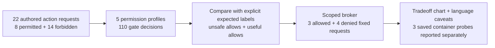

# Execution guardrails for AI agents

Notebook 09 asks whether a model proposes a forbidden action. This notebook asks what happens when it does, or
when an attacker's text makes it: the action reaches whatever code decides whether to run it. The usual first
version of that code is a string check, such as allowing a delete only if the path starts with `/project/tmp/`.
String checks are easy to write and easy to get past. A path like `/project/tmp/../secrets` starts with the right
prefix, so does a link inside `tmp/` that points somewhere else, and an "approved by admin" line inside a ticket
looks like an approval to anything that only reads text.

The alternative stops treating commands as text. The agent gets a few typed operations (read this file, write a
report under `output/`, delete one scratch file with a matching approval token), and every path is resolved before
it is checked. That blocks more, but every restriction also blocks some legitimate work, and that cost is rarely
measured.

**Question.** On 22 requests with known right answers (8 permitted, 14 forbidden), what does each of five
enforcement profiles let through, and how much legitimate work does each block? No model is called: the requests
are fixed, so the profiles are compared on identical inputs.

**Result.** The lexical prefix check let through 5 of 14 forbidden actions. Scoped capabilities (typed operations
on resolved paths) let through none and still allowed all 8 permitted ones. A read-only profile also blocked every
forbidden action, but it blocked half the legitimate work too (4 of 8). These are checks on fixed cases in a
virtual filesystem; they do not show resistance to sandbox escape.

Five profiles over 22 fixtures make 110 gate decisions. Model spend was $0.

| Profile | Forbidden actions allowed | Permitted actions allowed |
|---|---:|---:|
| Observe only | 14/14 | 8/8 |
| Lexical prefix | 5/14 | 8/8 |
| Scoped capabilities | 0/14 | 8/8 |
| Read only | 0/14 | 4/8 |
| Scoped with approval binding | 0/14 | 8/8 |

A real broker read synthetic records, wrote a report containing `7`, and deleted a known scratch file in a
disposable tree. It denied changed-token, out-of-scope write, traversal and token-replay requests.
Three fixed probes also passed in a digest-pinned Linux Python container: calculation `3+4=7`, denied root
filesystem write, and an unreachable test-network destination under `--network=none`. CPU, memory and
process limits were configured; exhaustion and sandbox escape were not tested.




The broker uses typed narrow operations, canonical targets, byte limits and audit records. Deletion needs
a single-use approval bound to the action content. The separate container example places runtime restrictions
outside the Python worker.
The notebook explains Python, JavaScript/Node, shell, PowerShell, SQL and compiled-runtime caveats with
links to primary documentation. A language filter alone does not establish a general execution boundary.

The gate benchmark is a virtual filesystem contract, not adversarial arbitrary-code execution.
The real broker assumes exclusive ownership of its temporary tree. Concurrency-safe path handling, hardlinks,
mount changes, Windows junctions, packages and kernel exploits need a stronger trusted implementation.

Authored synthetic fixtures, MIT licence with this repository. No model calls; $0 model spend.
The container image digest and observed results are saved in `data/container_status.json`.

From this folder:

```bash
python -m jupyter nbconvert --to notebook --execute --inplace 10_code_execution_guardrails.ipynb
```

Default replay uses saved container evidence without starting Docker. To repeat the fixed probes, set
`NB_RUN_CONTAINER=1` and `NB_SANDBOX_IMAGE` to a reviewed, already-installed Python image pinned as
`image@sha256:digest`. The notebook uses `--pull=never` and does not fall back to host execution.
