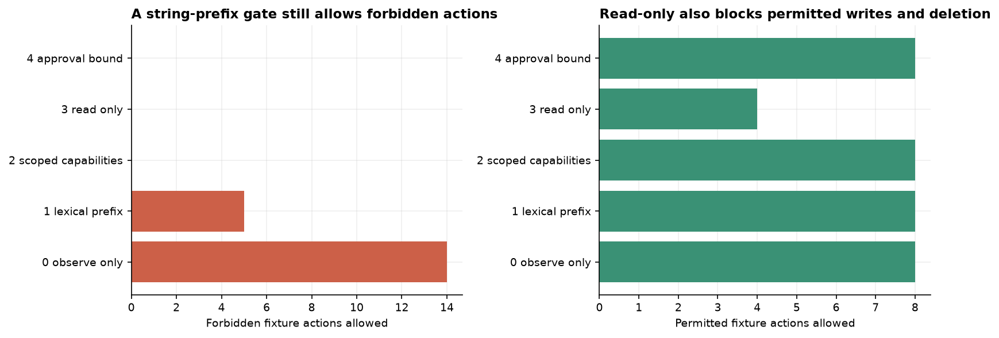
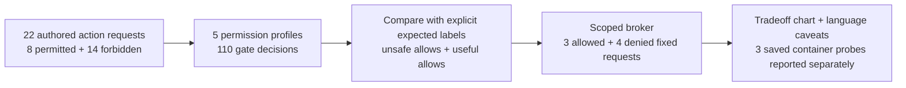

# Execution guardrails for AI agents

A string-prefix gate allowed 5/14 forbidden actions. Scoped capabilities allowed 0/14 and all eight
permitted actions; read-only blocked four of eight permitted actions. The five profiles made 110 decisions
on 22 authored fixtures. Model spend was $0.

This notebook compares five permission profiles to show what each enforces and what permitted work it
blocks. It then demonstrates fixed benign broker operations and language-specific execution controls.
All unsafe requests remain data.

| Profile | Forbidden actions allowed | Permitted actions allowed |
|---|---:|---:|
| Observe only | 14/14 | 8/8 |
| Lexical prefix | 5/14 | 8/8 |
| Scoped capabilities | 0/14 | 8/8 |
| Read only | 0/14 | 4/8 |
| Scoped with approval binding | 0/14 | 8/8 |

A real broker read synthetic records, wrote a report containing `7`, and deleted a known scratch file in a
disposable tree. It denied changed-token, out-of-scope write, traversal and token-replay requests.
Three fixed probes also passed in a digest-pinned Linux Python container: calculation `3+4=7`, denied root
filesystem write, and an unreachable test-network destination under `--network=none`. CPU, memory and
process limits were configured; exhaustion and sandbox escape were not tested.






The broker uses typed narrow operations, canonical targets, byte limits and audit records. Deletion needs
a single-use approval bound to the action content. The separate container example places runtime restrictions
outside the Python worker.
The notebook explains Python, JavaScript/Node, shell, PowerShell, SQL and compiled-runtime caveats with
links to primary documentation. A language filter alone does not establish a general execution boundary.

The gate benchmark is a virtual filesystem contract, not adversarial arbitrary-code execution.
The real broker assumes exclusive ownership of its temporary tree. Concurrency-safe path handling, hardlinks,
mount changes, Windows junctions, packages and kernel exploits need a stronger trusted implementation.

Authored synthetic fixtures, MIT licence with this repository. No model calls; $0 model spend.
The container image digest and observed results are saved in `data/container_status.json`.

From this folder:

```bash
python -m jupyter nbconvert --to notebook --execute --inplace 10_code_execution_guardrails.ipynb
```

Default replay uses saved container evidence without starting Docker. To repeat the fixed probes, set
`NB_RUN_CONTAINER=1` and `NB_SANDBOX_IMAGE` to a reviewed, already-installed Python image pinned as
`image@sha256:digest`. The notebook uses `--pull=never` and does not fall back to host execution.
