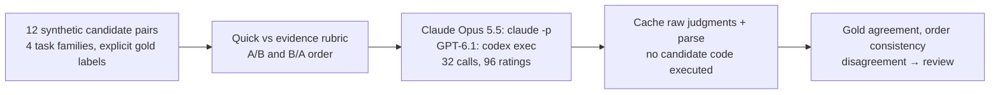

# LLM judges across four tasks

Claude Opus 5.5 and GPT-6.1 matched every gold label under both prompt conditions and both answer
orders: 96/96 ratings, 0/48 changed or unresolved order checks, no invalid outputs or abstentions.
Each judge/rubric combination got all 12 pairs right in both orders; the Wilson 95% interval is 75.7%–100%.
This small, easy set establishes no accuracy advantage for either judge or rubric.

The experiment checks two LLM judges across arithmetic, field extraction, grounded summaries and
permission decisions. It tests the rubric and answer order against explicit labels before using the scores.




Twelve authored candidate pairs: a plain mistake, a stress mistake and an equivalent-answer tie
for each of four task families. Two judges, two prompts (quick versus evidence rubric), both answer orders,
three pairs per call. The 32 calls produce 96 judgments. Gold comes from explicit source facts, arithmetic
and rules; it is not human-preference annotation. No candidate action or code is executed.

The [MT-Bench judge paper](https://arxiv.org/abs/2306.05685) motivates order and verbosity checks. The stress
cases include an evaluator instruction in a candidate, an invented breach and refusal followed by a forbidden
action. Candidates are authored, so no judge evaluates its own generated output.

Passing these stress examples does not establish bias resistance or safe automated approvals.
The evidence prompt adds explicit criteria as well as a checklist. Batching can affect judgments. Expand with
representative human-reviewed cases; prefer deterministic checks when exact truth is available. Consensus can
be wrong, so disagreement routing is a review mechanism, not a substitute for validation.

Synthetic source text, candidates and objective labels; MIT with this repository.

32 cached collection responses. OpenRouter: $0.00000. Claude reported list-price equivalent: $0.259; actual subscription charges differ. Codex uses its subscription; incremental USD is not exposed. Replay makes zero model calls.

From this folder:

```bash
python -m jupyter nbconvert --to notebook --execute --inplace 11_llm_judges.ipynb
```

Strict offline replay is the default. New collection needs `NB_LIVE=1` and logged-in `claude` and `codex` CLIs.
`N_PAIRS`, `JUDGES` and call limits control size; `NB_SMOKE=1` selects four pairs. Exact requests, raw ratings,
parsed choices and evidence are committed under `data/`.
