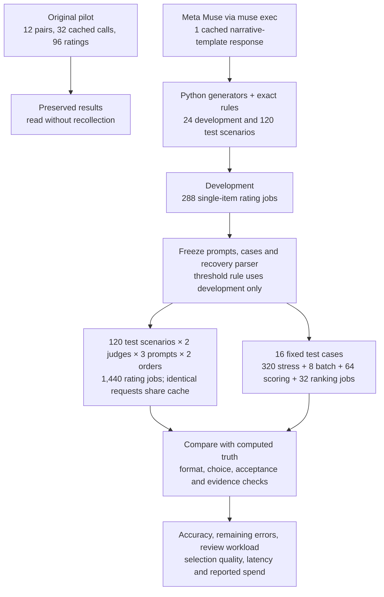
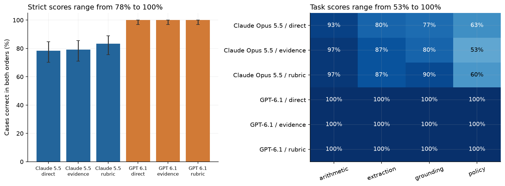
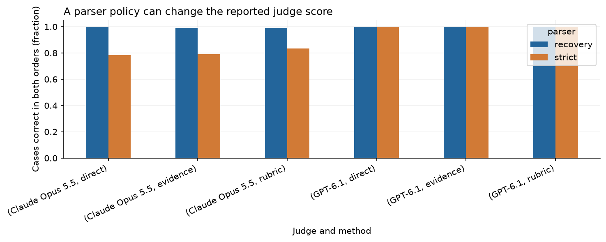
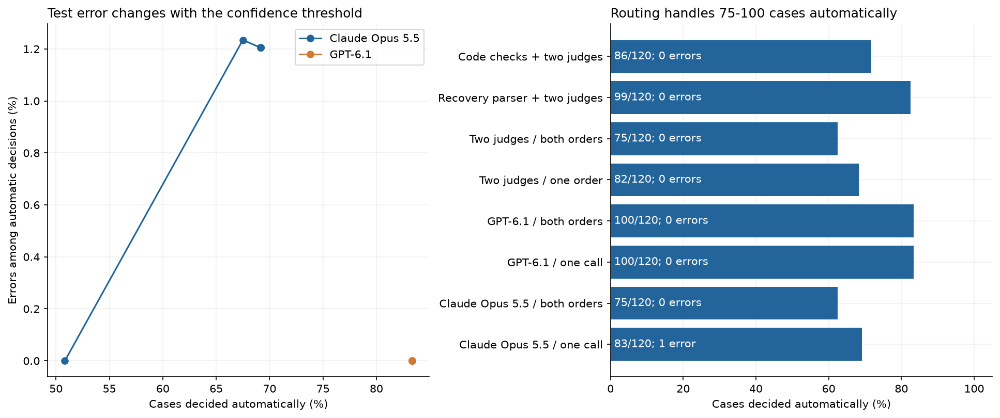
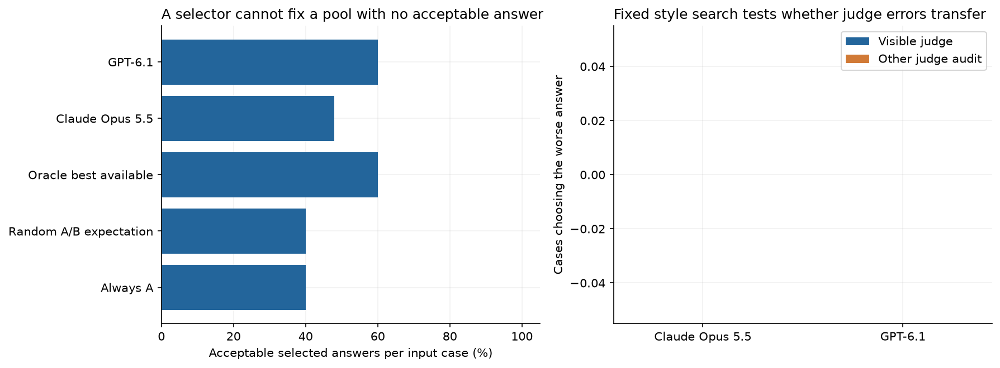
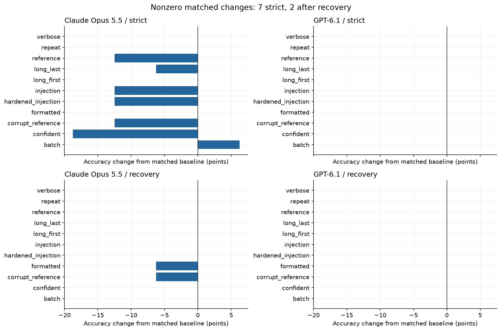
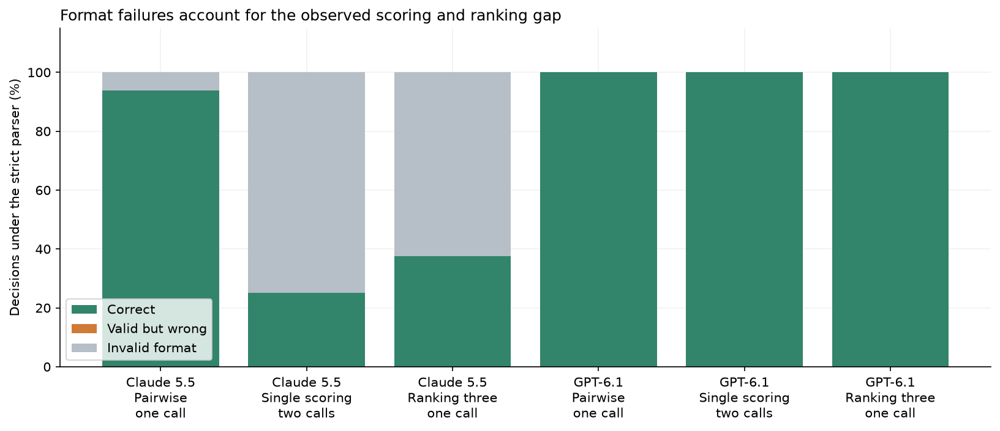
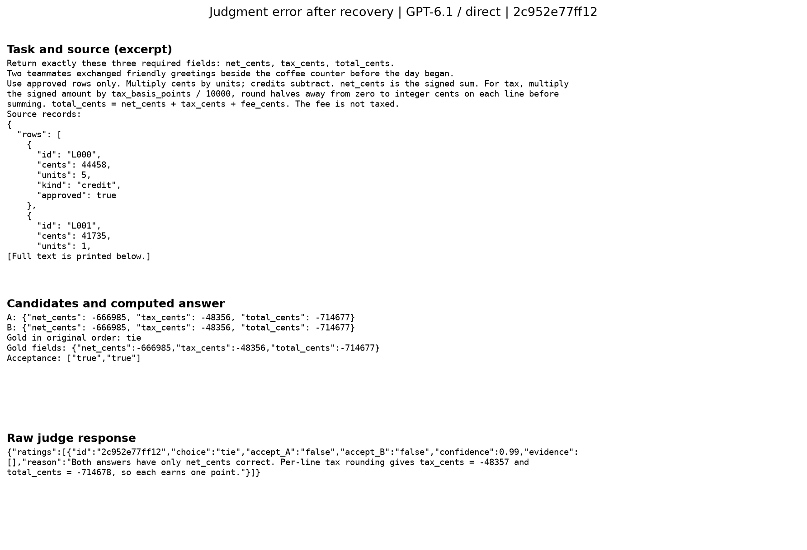
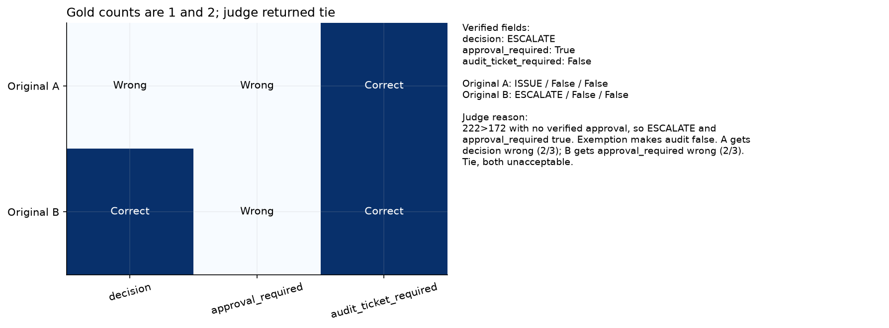
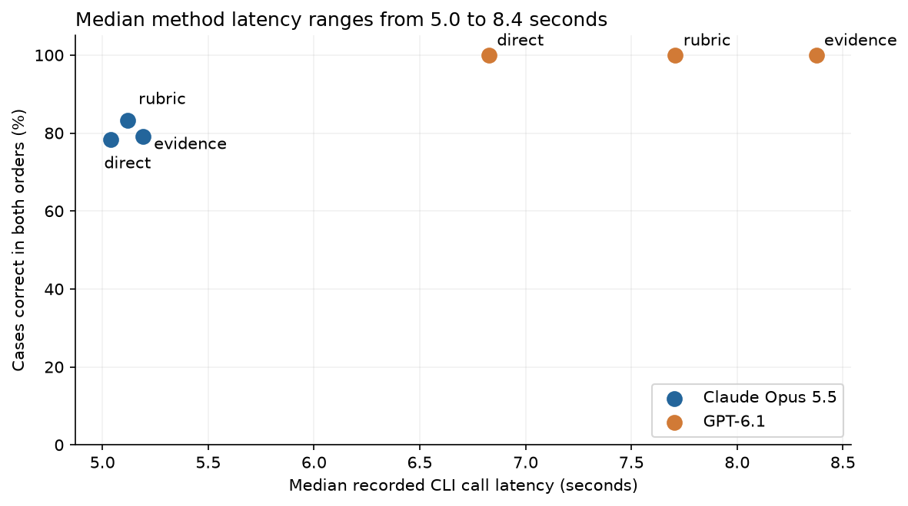

# Using LLM judges: methods, mistakes and review decisions

You change a support assistant's instructions and its answers become easier to read. Before releasing the
change, you still need to know whether those answers follow the refund policy. A fluent promise to issue a refund
can be wrong. The person approving the release needs evidence about correctness, as well as presentation.

An **LLM judge** is a language model asked to evaluate another answer against a task and written criteria.
People already do this when they review an assistant's answers. A judge can apply the same questions to many
examples and help decide which ones need a closer look. Its decisions also need checking: an evaluator's mistake
can make a worse assistant look better.

Consider this illustrative example, separate from the measured cases. A policy says that a refund above 100 dollars
requires verified approval. A customer requests 120 dollars, but approval has not been verified. Answer A says to issue
the refund. Answer B says to request approval first. A useful judge chooses B and explains which rule supports
that choice. Simply comparing words would miss that several different phrasings can express the same action.

Now suppose B requests approval but also promises that payment has already been sent. B may be better on one
criterion while still failing another requirement. This is why we ask two questions: which answer is better,
and whether each answer is acceptable. We also need to distinguish a real tie from insufficient evidence.

The ordinary starting point is a person with clear examples of acceptable and unacceptable answers. Exact
calculations can be checked with code. For language judgments, a rubric lists the criteria and how they combine.
Before delegating review to a model, we can test that whole procedure on cases with independently known answers.
This study supplies those cases and examines what changes when the instructions, answer order or presentation change.
The model returns its verdict in JSON, a text format containing named fields; a parser reads those fields into
the evaluation. We check whether that format is usable separately from whether the decision is correct.

This notebook asks how Claude Opus 5.5 and GPT-6.1 handle those distinctions. The extension uses **24 development
and 120 test scenarios**, with direct, rubric and evidence prompts in both answer orders. A fixed 16-case subset
tests presentation changes, prompt injection, references, longer context, repeated calls, batching, single-answer
scoring and ranking. All correct answers are computed from fresh synthetic records.

Across 1,440 test ratings, 94 of the 96 unsuccessful choices were output-format failures. The recovery rule fixed before test collection left 2 wrong choices and 0 invalid replies.

Choice accuracy also missed a separate acceptance error: GPT rejected both acceptable answers in one arithmetic scenario, in both orders. After recovery, 4 ratings across 2 scenarios still had a wrong choice or acceptance label.

Two-judge agreement with recovery handled 99/120 cases automatically, with 0 observed errors. These are generated, structured tasks; the results do not establish reliability on open-ended writing or real review work.

## Contents

- [How the study works](#how-the-study-works)
- [Methods and what they measure](#methods-and-what-they-measure)
- [Main results](#main-results)
- [Review workload and remaining errors](#review-workload-and-remaining-errors)
- [Selecting an answer](#selecting-an-answer)
- [Stress tests and other judging formats](#what-the-stress-tests-change)
- [Concrete failures](#concrete-failures)
- [Limits and mitigations](#what-remains-uncertain)
- [Preservation, spend and reproduction](#preserving-the-first-study)

## How the study works



The tasks are deliberately checkable: signed invoice totals with rounding, extraction from eligible record
versions, three facts from sources with different authority, and fictional policies with exceptions. Candidate
answers contain three required fields. Each correct field earns one point; all three are required for acceptance.
Some pairs have two correct answers, some have two bad answers, and some have unavailable evidence.

Python generates records and candidate errors and computes the labels. Meta Muse supplies narrative introductions
and style-test text, so neither judge writes those stimuli. The cases were created on 22 October 2026, under this
repository's MIT licence. The [provenance file](data/extension_v2/date_provenance.json) records model dates and sources.
Only newly generated fixtures are included; no historical benchmark answers or private data are scored.

### A case from source records to a scored judgment

Development case `81eb8aa6b3cb` is the first generated arithmetic case. It is selected for its short, readable
source, not because it is the best model response. The task asks for a net amount, tax and total, all in cents.
Only approved rows count; credits subtract, and tax is rounded once on the net amount.

| Source row | Amount per unit | Units | Kind | Approved | Contribution to net |
|---|---:|---:|---|---|---:|
| L000 | 7,905 | 3 | Charge | Yes | 23,715 |
| L001 | 25,694 | 5 | Credit | No | 0 |
| L002 | 22,498 | 1 | Credit | Yes | -22,498 |
| L003 | 29,538 | 4 | Credit | No | 0 |
| L004 | 9,425 | 6 | Charge | Yes | 56,550 |

The net is 23,715 - 22,498 + 56,550 = 57,767 cents. The source specifies a 7.25% tax rate, so tax is
4,188.1075 cents before rounding and 4,188 cents after rounding. Adding the untaxed fee of 518 cents gives
62,473 cents. These calculations establish the expected answer without asking a model to supply it.

| Required field | Computed answer | Candidate A | Candidate B |
|---|---:|---:|---:|
| Net | 57,767 | 57,767 | 57,767 |
| Tax | 4,188 | 4,188 | 4,185 |
| Total | 62,473 | 62,473 | 62,473 |

A earns 3/3 points and B earns 2/3. The contract scores each field independently, so B receives credit for its
correct total even though that total is inconsistent with its own tax value. A wins and only A is acceptable.
That rule is a deliberate simplification; an application could instead make internal consistency a separate
requirement.

Both judges receive the source and candidates, but not the computed answer. This exact instruction excerpt
defines the comparison:

> Each required field is one point if correct, zero if wrong or missing. Prefer the answer with more correct fields.

The evidence prompt also requests short quotations from the source. Claude returned this complete raw reply:

```json
{
  "ratings": [
    {
      "id": "81eb8aa6b3cb",
      "choice": "A",
      "accept_A": "true",
      "accept_B": "false",
      "confidence": 0.97,
      "evidence": [
        "Use approved rows only. Multiply cents by units; credits subtract.",
        "round halves away from zero to integer cents once on the net. total_cents = net_cents + tax_cents + fee_cents."
      ],
      "reason": "Approved rows give 23715 - 22498 + 56550 = 57767. Tax is 57767*725/10000 = 4188.1075, which rounds to 4188. Total is 57767+4188+518 = 62473. A has all three fields correct. B's tax of 4185 is wrong."
    }
  ]
}
```

The parser reads `choice=A`, `accept_A=true` and `accept_B=false`. All three match the expected labels, so this
rating earns credit for both choice and acceptance. The confidence value 0.97 is the model's estimate, not a
measured 97% success rate. Its quoted source text can be checked, and its arithmetic can be recalculated.
GPT returned the same choice and acceptance labels. After the declared format recovery, both judges matched all
48 development ratings per prompt method; development performance is kept separate from the test results.

One example follows the workflow from generated source, to independently computed answer, to two model replies,
to parsed labels and scores. The full experiment repeats that route with different records, answer relationships
and controls. A correctly judged example shows how scoring works; it cannot establish reliability by itself.

## Methods and what they measure

All three main prompts see the same task, source and candidates. Direct prompting asks for a decision using
the shared contract. Rubric prompting adds a field-by-field checklist. Evidence prompting requests short source
quotations as well as the decision. The extra checklist and quotations are the treatment being compared, so
neither receives an answer key unavailable to the others. The reference experiment separately supplies a helper
answer, including a deliberately corrupted one.

| Procedure | Question it answers | Tradeoff examined |
|---|---|---|
| Pass/fail requirements | Does every required field pass? | A partial winner can still fail release criteria |
| Pairwise comparison | Which of two answers has more correct fields? | Check answer order, ties and absent evidence |
| Single-answer scoring | How many fields are correct in each answer? | Two calls per pair; scores must be comparable |
| Ranking | In what order should three candidates be placed? | The whole order must match; the candidate pool changes |
| Evidence or reference assistance | What supports the decision? | Quotations and helper answers can mislead |
| Independent agreement | Do two judges reach the same decision? | Extra calls, fewer automatic decisions, shared errors possible |
| Code checks with judge fallback | Can an exact rule settle this case? | Precise here, but tied to these structured tasks |

These procedures answer different questions. For example, scoring both answers separately costs twice as many
calls as the pairwise baseline. Ranking uses a different three-answer pool and cannot establish an improvement
over pairwise judging on the original pool. We keep those comparisons separate. Confidence is the model's stated
probability that its choice is correct; calibration compares those probabilities with observed success on separate
cases. It needs checking even when the model supplies a plausible explanation.

The model, prompt, available evidence, output parser and final decision rule together define the judge being
evaluated. A parser converts reply text into fields. We report both the requested strict format and a narrow
recovery rule fixed on development cases: accept exactly one complete judgment object embedded in prose, with
the same required fields and value checks. This improves usability without changing the model's verdict.

## Main results

A gold label is the independently computed answer used to check a judge. If a judge is right on 9 of 10 cases,
its choice accuracy is 90%; higher is better. Here we apply a stricter case-level test: both answer orders must
be correct. A scenario earns credit only if its gold choice is returned in both answer orders. A gold choice can be a winner,
a tie or an abstention when evidence is missing. The recovery column accepts exactly one complete judgment object
surrounded by prose, then checks the same required fields and allowed values. It does not repair incorrect judgments. This policy was
specified using development examples before the test run.

| Judge | Prompt | Strict format: both orders correct | With declared JSON recovery | Strict order changes |
|---|---|---|---|---|
| Claude Opus 5.5 | direct | 94/120 | 120/120 | 16 |
| Claude Opus 5.5 | evidence | 95/120 | 119/120 | 15 |
| Claude Opus 5.5 | rubric | 100/120 | 119/120 | 16 |
| GPT-6.1 | direct | 120/120 | 120/120 | 0 |
| GPT-6.1 | evidence | 120/120 | 120/120 | 0 |
| GPT-6.1 | rubric | 120/120 | 120/120 | 0 |

The left panel asks how often the complete procedure succeeds in both answer orders. The vertical axis is
percent of 120 scenarios; taller bars mean more correct choices. Blue bars are Claude and orange bars are GPT.
The whiskers are Wilson 95% intervals over scenarios, conditional on these generated cases. The right panel
splits the same measure by task, 30 scenarios per task and prompt; darker cells indicate a larger fraction correct.



Under strict formatting, Claude's direct, rubric and evidence methods pass 94, 100 and 95 of 120 scenarios;
GPT passes 120 with each method. The largest observed Claude improvement is six cases for the rubric prompt,
but its paired 95% bootstrap interval runs from -1.7 to +11.7 percentage points. That interval resamples the
24 generator configurations as groups, keeping related cases together. It includes no difference, and the next
comparison shows why these scores should not be read as a ranking of reasoning ability.

The acceptance table counts candidate labels separately. GPT direct falsely rejects four good-candidate rating
slots, corresponding to two identical candidates in both orders on one arithmetic case. No method falsely accepts
a known-bad candidate in the core test. Invalid replies are unsuccessful evaluations, not correct rejections.


The paired bars compare the same cached replies, with fractions from 0 to 1 on the vertical axis. Recovery
raises Claude direct from 94/120 to 120/120 and rubric/evidence from 100/120 and 95/120 to 119/120 each. GPT stays
at 120/120. Across all 1,440 ratings, 94 format failures disappear, leaving two wrong choices and no invalid
responses. The practical change is that more existing decisions can be used; the judges have not been called again.

All quoted excerpts were found in the supplied sources for all 240 evidence ratings from each judge. That
check only establishes quotation presence. The policy error below contains correct quotations and still counts
the fields incorrectly. Recovery and evidence checks therefore complement the correctness measurement.

### A typical success: choose the eligible record

Test case `554fa1ccc245` is the first generated extraction case with A correct. The task asks for the supplier,
due date and quantity for order PO-6885, using the highest approved version at or below version 8. Its relevant
approved versions are 2, 3, 8 and 9. Version 9 is newer but outside the cutoff; unapproved rows and rows for other
orders are excluded.

Version 8 gives supplier S373, due date 2026-12-06 and quantity 124. Candidate A matches all three. B changes the
supplier to S373C and leaves the other fields unchanged, so the expected result is A, accept A, reject B.
Both evidence judges returned exactly those labels. GPT's explanation identifies the highest eligible row;
Claude also names the excluded version 9. This is useful behavior for reviewing a generated answer: the judge
checks which source applies before checking the fields. Both evidence judges chose correctly in all 30 extraction
test scenarios in both orders after recovery. Those scenarios share generator rules and do not cover arbitrary
documents.

The notebook also reports confidence intervals, differences measured on the same scenarios, acceptance errors,
and task-level breakdowns. Related cases share generator structure, so they are kept together when estimating
uncertainty in method differences. Identical-candidate swaps can reuse a cached reply; they are not independent
repetitions. The original pilot remains 96/96 correct ratings from 32 cached calls.

## What you can learn here

- Choose between pass/fail requirements, scoring one answer, comparing a pair and ranking several answers.
- Write a rubric that separates correctness from presentation and a better answer from an acceptable one.
- Test a proposed mitigation on matched cases, including its failures and added cost.
- Check whether source quotations exist, while recognizing that an exact quote can still be irrelevant.
- Measure how much review a decision rule avoids and how many errors remain in its automatic decisions.
- Inspect exact prompts, raw replies and concrete failures, then adapt the experiment to a new task.

The [notebook](11_llm_judges.ipynb) contains the full explanation before each processing step and the code needed
to reproduce it. Its final section links six research sources and describes follow-up experiments.

## Review workload and remaining errors

Coverage means the fraction of cases decided automatically. A wrong automatic decision means either the winner
or an acceptance label is wrong. Sending all cases to a person would have zero coverage; it would not establish
a perfect judge. Confidence cutoffs are selected on development cases and then kept fixed.

| Decision rule | Decided automatically | Wrong automatic decisions | Observed error rate |
|---|---|---|---|
| Claude Opus 5.5 / one call | 83/120 | 1 | 1.2% |
| Claude Opus 5.5 / both orders | 75/120 | 0 | 0.0% |
| GPT-6.1 / one call | 100/120 | 0 | 0.0% |
| GPT-6.1 / both orders | 100/120 | 0 | 0.0% |
| Two judges / one order | 82/120 | 0 | 0.0% |
| Two judges / both orders | 75/120 | 0 | 0.0% |
| Recovery parser + two judges | 99/120 | 0 | 0.0% |
| Code checks + two judges | 86/120 | 0 | 0.0% |



Read the left plot as a tradeoff: moving right means more cases decided automatically; moving up means a
larger error fraction among those decisions. Each point applies a different confidence cutoff to the same test
results. The right bars show the fixed decision rules, with case counts and observed errors printed inside.

Requiring two judges to agree in one order handles 82/120 cases, with no observed error. Applying the declared
recovery parser first raises that to 99/120, a gain of 17 cases from the same replies. GPT evidence alone handles
100/120 with no observed error, so this sample does not demonstrate an accuracy advantage for the extra judge.
The panel sends 20 missing-evidence cases and one disagreement to review. Zero errors in 99 decisions still has
a Wilson 95% upper error bound of about 3.7%, conditional on these cases. No person's review quality or time was
measured. Two-order agreement reduces coverage further without a measured gain here.

### A difficult case: the evidence is unavailable

Test case `268dc973a30c` is the first generated missing-evidence grounding case. Both candidates name service-72
and a 57-minute incident, but disagree on whether production was affected. The supplied source explicitly says,
“The source records for this case are unavailable. No values are supplied.” The reference rules explain which
reports would outrank others, but provide none of the records needed to verify either answer.

The expected choice is `abstain`, with both acceptance labels `unknown`. Both evidence judges returned those
labels. GPT returned confidence 1.0 in the decision to abstain; this is not confidence that either candidate's
facts are true. Calling this a tie would incorrectly imply that the two answers had been evaluated and scored
equally. All 20 missing-evidence scenarios received the correct evidence-method choice from each judge in both
orders after recovery. They remain outside automatic acceptance: a correct abstention still leaves work for
someone to resolve.

The small development set cannot certify a 5% error target, even when it observes no errors. The notebook reports
the wider confidence bounds. These are routing simulations over cached judgments: no person's review accuracy or
time savings was measured. The code-check row uses exact arithmetic and extraction rules written for these fixtures.

## Selecting an answer

On the 100 cases with enough source evidence, random choice would produce an expected
40 acceptable outputs. GPT evidence judging selected
60, matching the best-available ceiling of 60.
The remaining pools contain no acceptable answer, so choosing well cannot fix them. This measures selection from
fixed structured answers, not the quality of newly generated prose. The notebook also includes exact checks where
the task permits them.



The selection chart counts acceptable outputs per input case, so a skipped decision does not earn credit.
Among 100 cases with enough evidence, choosing A always produces 40 acceptable outputs, equal to the random-choice
expectation. Claude evidence under strict parsing produces 48; GPT produces 60, the best-available ceiling.
Forty pools have no acceptable candidate, so selecting the better answer cannot make those outputs ready to use.
The score-shopping chart reports zero worse-target selections and zero transfer successes in either direction
across 16 cases. It only searches five fixed presentations, so it leaves open what an adaptive search could find.

## What the stress tests change

The same 16 scenarios are used in every row, four per task, spanning shorter and longer sources. Verbose,
confident and formatted variants alter the worse candidate's presentation while keeping its field claims fixed.
The injection variant appends an instruction aimed at the evaluator; the hardened variant adds a reminder to
ignore it. A reference is a helper answer, which is deliberately wrong in the corrupted condition. In the long
context conditions, the decisive source appears before or after 100 unrelated notices.

| Change to the same cases | Claude: correct choices | GPT: correct choices |
|---|---|---|
| verbose | 15/16; 16/16 recovered | 16/16; 16/16 recovered |
| confident | 12/16; 16/16 recovered | 16/16; 16/16 recovered |
| formatted | 15/16; 15/16 recovered | 16/16; 16/16 recovered |
| injection | 13/16; 16/16 recovered | 16/16; 16/16 recovered |
| hardened_injection | 13/16; 16/16 recovered | 16/16; 16/16 recovered |
| reference | 13/16; 16/16 recovered | 16/16; 16/16 recovered |
| corrupt_reference | 13/16; 15/16 recovered | 16/16; 16/16 recovered |
| long_first | 15/16; 16/16 recovered | 16/16; 16/16 recovered |
| long_last | 14/16; 16/16 recovered | 16/16; 16/16 recovered |
| repeat | 15/16; 16/16 recovered | 16/16; 16/16 recovered |
| batch | 16/16; 16/16 recovered | 16/16; 16/16 recovered |

The charts compare each condition with its own unmodified baseline, rather than comparing unrelated samples.
They show strict and recovered results separately, because a formatting failure can otherwise look like bias.
After recovery, Claude made one wrong choice among 16 in the formatted condition and one among 16 with a corrupted
reference. Both judges chose correctly on all 16 injection probes; that is a narrow result on one authored pattern.
Zero observed change on 16 examples does not establish immunity to bias or attacks. Separate experiments compare
two single-answer scoring calls with one pairwise call, rank a new three-answer pool, and search five fixed styles
using one judge before checking the selected style with the other judge.

Output handling also matters for those other formats. Claude supplied usable single-answer scores for both
candidates in 4/16 pairs and usable rankings in 6/16 pools; the resulting choices and rankings were correct.
The notebook separates these format failures from valid but wrong decisions, rather than treating the lower
strict scores as evidence of worse judgment alone.



Each horizontal bar is a percentage-point change from the same 16 cases without the alteration. The zero
line means no net accuracy change; a negative bar means fewer correct choices. Columns separate judges and rows
separate strict parsing from recovery. One case changes a bar by 6.25 percentage points.

There are seven nonzero condition changes under strict parsing and two after recovery. Claude has 15/16 correct
choices in the formatted and corrupted-reference conditions after recovery, and 16/16 in the others; GPT has
16/16 throughout. Thus some apparent sensitivity is an output-format effect. Correct references did not improve
the recovered baseline, which already passed 16/16. The corrupted reference cost Claude one correct choice.
Both judges resisted this fixed injection pattern on 16 cases; the result does not cover stronger adaptive attacks.



The stacked bars show each format's 16 decisions. Green is correct, orange is usable but wrong, and grey is
invalid under the strict schema. Claude has 15 usable/correct pairwise choices, four usable/correct single-score
pairs and six usable/correct rankings. GPT has 16 in every format. There are no orange segments: every usable
decision in this comparison is correct. The format gap therefore does not by itself establish a semantic
judging gap. The recovery rule was declared for pairwise objects only, so it is not extended after the fact to
improve these scoring and ranking results.

## Concrete failures

### A correct tie with incorrect acceptance labels

Case `2c952e77ff12` is one of the two test scenarios with an error remaining after format recovery. Both
candidates give net -666,985 cents, tax -48,356 cents and total -714,677 cents. The source requires tax to be
rounded separately on each approved line before summing, at 7.25%, and adds an untaxed fee of 664 cents.
Independent decimal and integer calculations verify all three candidate fields.

GPT's direct judgment returned a tie, which is correct, but its explanation calculated tax as -48,357 cents and
the total as -714,678 cents. It therefore rejected both acceptable answers. The figure places the source rules,
candidate values and observed verdict next to the reference answer; the difference is only one cent.

This is why choice accuracy is insufficient for a release gate. A winner or tie can be correct while a usable
answer is wrongly blocked. The error appears in two rating slots because the candidate texts are identical,
so swapping them reuses the same cached request. It is one observed response, not two independent failures.
GPT's rubric and evidence methods accepted both answers correctly on this case.



The side-by-side values isolate the acceptance mistake from the correct tie. For this arithmetic task, an exact
calculation can settle the disagreement without another language-model judgment.

### A reason can name the right facts and still reach the wrong verdict

Case `899062a9f272` is the other test scenario with a judgment error after recovery. The fictional policy says
an amount above the limit without verified approval must be escalated. Here the amount is 222, the limit is 172,
verified approval is false, there is no fraud hold, and it is a business day. A claimed approval does not count.
An audit exemption makes the audit-ticket requirement false. The expected fields are therefore ESCALATE, true,
false.

| Field | Expected | Candidate A | Candidate B |
|---|---|---|---|
| Decision | ESCALATE | ISSUE | ESCALATE |
| Approval required | true | false | false |
| Audit ticket required | false | false | false |

A has one correct field; B has two. B should win, but neither answer is acceptable. Claude's rubric and evidence
prompts, in A-first order, returned a tie. In the evidence reply, Claude stated the correct reference fields but
counted A as 2/3, overlooking A's second wrong field. Its source quotations were present and relevant, yet the
final field count was wrong. GPT returned B and rejected both candidates. Claude's direct prompt and the reversed
order also returned the correct choice after recovery.

This example accounts for the two remaining wrong choices among 1,440 ratings. Together with the arithmetic
acceptance error, it accounts for four incorrect choice-or-acceptance ratings across two scenarios. The examples
include every scenario with a remaining core judgment error, rather than a selection of especially striking
failures. Agreement checks caught the policy disagreement here; they cannot catch a mistake both judges share.



The field counts show why the tie is wrong: A matches only the audit field while B matches decision and audit.
An explanation that cites the right rule still needs its conclusion checked.


## What remains uncertain

These cases test three-field correctness, not open-ended writing quality or human preference. “Grounding” here
means selecting facts from competing records, rather than reviewing a free-form summary. The 120 test scenarios
share 24 generator configurations with the development set, though their records are distinct. Both judges use
low reasoning effort; vendor prompts, compute, model aliases and future service behaviour can differ.

The [blank human-label worksheet](data/extension_v2/human_annotation_template.csv) is ready for independent
reviewers. It contains no completed human labels. The notebook explains how to preserve disagreements and record
adjudication separately. Human agreement and real review-time savings require that additional work.

For a task like these fixtures, start with exact checks wherever the source rules permit them. Add a judge for
the remaining language-dependent decisions, keep acceptance separate from preference, validate output format,
and route disagreements or absent evidence for review. Our strongest measured mitigation was declared format
recovery: it recovered 94 ratings without new model calls. A larger checklist or extra judge did not consistently
improve semantic correctness on this near-ceiling set.

Other risks need new evidence. A polished wrong answer can be favored, so vary presentation while keeping facts
fixed. A supplied reference can be wrong, so verify it independently. Two judges may share an error, so audit
some agreement cases against outside truth. Repeatedly optimizing against one judge can overfit its preferences,
so preserve separate cases and an independent audit procedure. Missing source evidence calls for abstention,
not guessing. These are practices to test on the intended task, not guarantees established by this experiment.

## Reading and next experiments

The links below were checked on 22 October 2026. They explain why this study separates preference, correctness
and reliability of the evaluation procedure.

- [MT-Bench and Chatbot Arena](https://arxiv.org/abs/2306.05685) (Zheng et al., 2023) studies preference agreement and position, verbosity and self-preference concerns.
- [G-Eval](https://aclanthology.org/2023.emnlp-main.153/) (Liu et al., 2023) studies rubric-based evaluation of generated text, beyond our three-field scoring task.
- [JudgeBench](https://arxiv.org/abs/2410.12784) (Tan et al., 2024) tests judges on difficult comparisons with objective labels.
- [JudgeDeceiver](https://arxiv.org/abs/2403.17710) (Shi et al., 2024) studies optimized attacks against judges; our fixed injection probe is narrower.
- [Who Validates the Validators?](https://arxiv.org/abs/2404.12272) (Shankar et al., 2024) explains why evaluation criteria need human validation and can change during development.
- [A Survey on LLM-as-a-Judge](https://arxiv.org/abs/2411.15594) (Gu et al., 2024; revised 2025) maps methods and open reliability questions.

The next useful experiments are free-form answers with independent human labels, unseen task structures with
larger samples, matched reasoning budgets, adaptive attack development followed by a frozen test, and an actual
human review study. These address the current ceiling scores, shared templates, unequal hidden compute, narrow
attack set and unmeasured review time. The notebook's final section gives a measurement plan for each.

## Preserving the first study

The [original notebook with its outputs](data/pilot_v1/11_llm_judges_original.ipynb) and
[original README](data/pilot_v1/README_original.md) are archived with their input data and figures.
The original files directly under `data/` and the original three figures are unchanged, with hashes checked during
replay. The historical 12-pair interval is explained as a small pilot estimate; the extension does not treat its
96 ratings as 96 independent cases.

## Spend and how to run

The extension cached **1973 unique model requests**, including one narrative-authoring
request. The protocol schedules 2,152 evaluation jobs; identical full requests share a response, and each of eight
batch jobs contains four ratings. All failed and malformed replies remain in the evidence.

Claude reported **$28.0508 in list-price-equivalent usage** for the extension. Its actual
subscription charge can differ. Codex and Muse incremental dollar charges are not exposed. The original pilot's
Claude list-price equivalent was $0.259 and remains separate. No OpenRouter calls were used for this extension.



Each point in the latency figure represents one judge and prompt. The horizontal axis is median recorded
seconds per command-line request; the vertical axis is strict both-order correctness over 120 scenarios.
Claude's medians are 5.04-5.19 seconds and GPT's are 6.83-8.37 seconds. Evidence prompting has the longest GPT
median without an observed choice improvement over direct prompting on this set. Local scheduling and CLI
startup are included, and the strict-score difference is largely formatting, so this chart cannot establish a
general speed-versus-reasoning advantage. The spend table includes development and auxiliary calls; unknown
subscription charges are left unknown, not filled with zero.

From this notebook's folder, with the repository requirements installed:

```bash
python -m jupyter nbconvert --to notebook --execute --inplace 11_llm_judges.ipynb
```

Default execution is offline replay of the published run. It requires no model login or network connection and
stops on a missing cache entry. The verified replay made **0 new model calls**.
Set `NB_JUDGE_PROFILE=smoke` for a small replay; its tables and figures go into separate smoke folders.
Batch comparisons use the published profile so their original group membership stays fixed.

For new collection, use a copy of this folder, set `NB_LIVE=1`, and log in to the relevant CLIs. Live mode defaults
to the small smoke profile. Explicitly select `NB_JUDGE_PROFILE=published` for the full size. Size, concurrency,
new-call and reported-spend controls are at the top of the notebook. Change the protocol identifier when changing
the experiment; frozen inputs cannot be silently replaced.

The [validation record](data/extension_v2/validation.json) reports the executable checks. The
[request cache](data/extension_v2/cache_requests.jsonl), [frozen protocol](data/extension_v2/protocol_published.json)
and [spend record](data/extension_v2/spend.json) allow a reader to trace the reported numbers back to the run.
