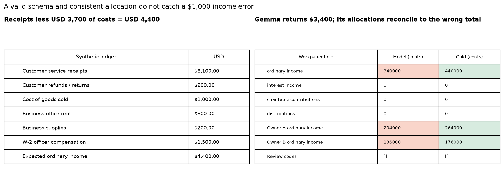
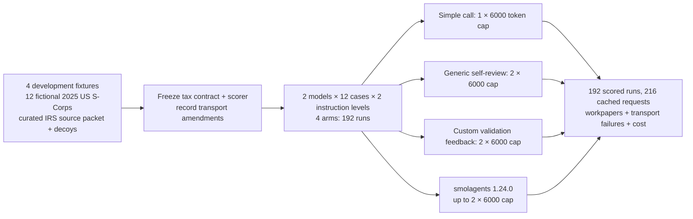
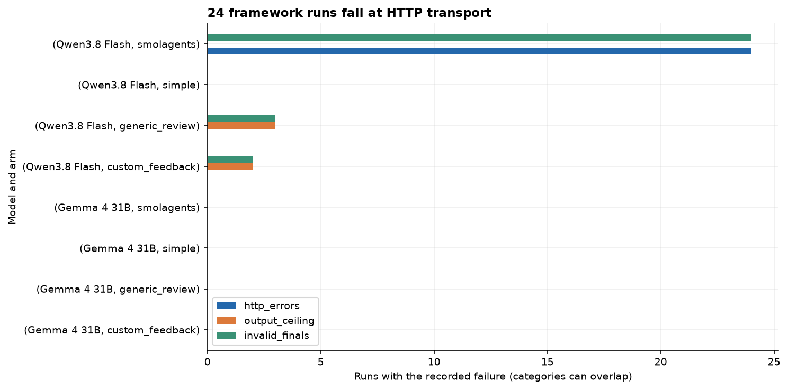
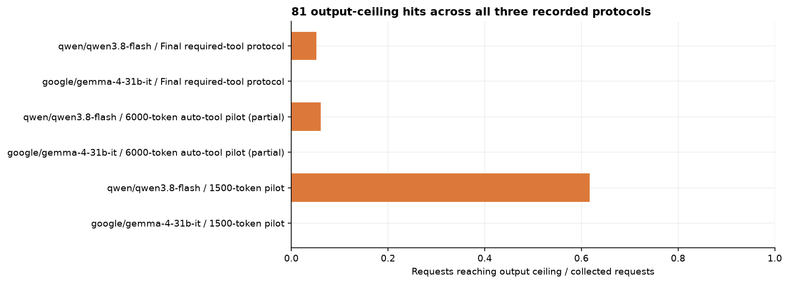
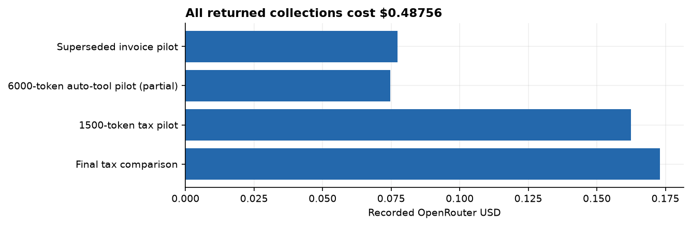

# Custom harnesses for US S-Corporation tax research and preparation

Qwen3.8 Flash direct calls passed 12/12 cases under both instruction conditions. Detailed custom feedback passed 11/12 and detailed generic self-review 9/12; Gemma 4 31B passed 0/12 in every arm. None of 12 predeclared paired contrasts had a 95% case-bootstrap interval above zero. All 24 Qwen framework runs failed at HTTP transport because its provider rejects required tool choice in thinking mode. The framework comparison therefore includes a transport failure. Twelve authored cases cannot establish general tax reliability.

The experiment tests whether detailed tax instructions and a custom validation loop improve draft workpapers
over a simple call, generic self-review or smolagents. It holds the model, facts, source packet and call cap fixed.

Calendar-year 2025 US federal S-Corps: ordinary business income, separately stated portfolio
interest/qualifying cash charity, cash distributions, constant-year shareholder allocations, applicable source
citations and preparer review issues. Twelve fictional test companies and four development fixtures; two models,
two instruction conditions and four arms produce 192 runs. This is a reviewable workpaper, not a complete return.

Full workpaper and source-coverage successes:

| Model | Instructions | Simple call | Generic self-review | Custom feedback | smolagents |
|---|---|---:|---:|---:|---:|
| Gemma 4 31B | short | 0/12 | 0/12 | 0/12 | 0/12 |
| Gemma 4 31B | detailed | 0/12 | 0/12 | 0/12 | 0/12 |
| Qwen3.8 Flash | short | 12/12 | 12/12 | 11/12 | 0/12 |
| Qwen3.8 Flash | detailed | 12/12 | 9/12 | 11/12 | 0/12 |

0/12 paired contrasts meet the predeclared supported-gain rule (95% case-bootstrap interval
strictly above zero). See the exact differences and intervals in the notebook; a zero-width empirical interval
on this tiny set cannot establish equivalence. No result proves broad industry superiority.






All arms receive the same current-year source summaries and wrong-year/entity
decoys. The primary references are the [2025 Form 1120-S instructions](https://www.irs.gov/pub/irs-prior/i1120s--2025.pdf),
[2025 shareholder K-1 instructions](https://www.irs.gov/pub/irs-prior/i1120ssk--2025.pdf), and
[IRS compensation guidance](https://www.irs.gov/businesses/small-businesses-self-employed/s-corporation-compensation-and-medical-insurance-issues).
Summaries are authored paraphrases, with section names and original URLs saved in `data/sources.json`.
Missing support, ownership changes, loss limitations, zero wages with owner services, and a hostile client note
test when the system should ask for review rather than invent an adjustment or cite inapplicable authority.

A 1,500-token pilot frequently exhausted Qwen before final text. The final run gives every model and arm
the same 6,000-token ceiling. The earlier adapter also forced automatic tool choice and dropped framework
stop sequences. The final adapter preserves smolagents' required-tool default and generation options.
The complete lower-budget collection is in `data/budget_pilot/`; the interrupted automatic-tool collection
is in `data/transport_pilot/`. Protocol 3's initial error records are in `data/protocol_v3/`; protocol 4
reuses successful request hashes and repeats only the 24 uncached error requests to save their envelopes. Neither collection is mixed into the final accuracy table. Cases, prompts,
sources, validator and scoring were not changed in response to tax accuracy.

Short and detailed prompts contain the same legal facts and task contract. The detailed
condition adds a checklist. Generic and custom feedback each receive two calls at the same 6,000-token cap,
sharing the first response. The custom validator checks schema, source applicability and allocation arithmetic;
it cannot see gold, classify the ledger or calculate the correct tax workpaper. The actual pinned
`smolagents==1.24.0` ToolCallingAgent receives the same facts and validator with a two-call cap. A simple call
uses one call. Native tool protocol and default framework prompts remain different and are reported as system differences.

A deterministic reference checks all nine fields, exact amounts, owner allocation, review codes,
year/research status, and coverage of required available sources. Extra applicable primary citations are allowed.
Invalid finals count as failures. Gold workpapers are not independently CPA reviewed. Operational review
tripwires are benchmark policy, not a complete statement of tax requirements. A positive wage is not a
reasonable-compensation safe harbor; a corporate loss does not establish a shareholder's deductible loss.

This tests source selection/application over a curated packet, not open-web tax research or a full
return. No live taxpayers, payroll corrections, state taxes, QBI, complex elections or filing actions are modeled.
Twelve authored cases and one sample cannot establish professional reliability. Larger validation needs
representative files, original authority and independent tax-professional review. No forms are filed or payments made.

Synthetic facts and authored summaries under this repository's MIT licence. Original IRS
material is US federal government material; source provenance is separate. smolagents is Apache-2.0.

The final comparison saved 192 model responses and 24 HTTP error envelopes: $0.17300 in recorded
OpenRouter usage. Including both tax calibration collections and the superseded invoice pilot, recorded
OpenRouter spend was $0.48756. Phase counts and costs are in `data/all_collection_spend.csv`. The HTTP
errors and interrupted requests expose no complete billing amount, so these are recorded costs rather
than an account invoice. There are no closed-provider calls in this experiment.

From this folder:

```bash
python -m jupyter nbconvert --to notebook --execute --inplace 12_tax_research_harnesses.ipynb
```

Install root requirements, including pinned smolagents. Replay is strict, needs no key, and makes zero new
model calls. Collection needs `NB_LIVE=1` and `OPENROUTER_API_KEY`. Preserve the frozen design and executable
protocol snapshot. For a changed design or smoke collection, use a new data folder/version. No generated
code, browser or tax-filing tool is exposed by this harness.







`data/all_collection_spend.csv` includes both tax calibration runs and the superseded invoice pilot. The
interrupted run may include unreturned in-flight charges whose costs were not exposed. Model endpoint
behavior includes hosting and provider settings; exact deployed weight revisions are unverified. The 24 final HTTP error envelopes and the prior 24
uncached errors expose no billing amount. Only the unrelated account identifier in error metadata was
redacted; request hashes and provider diagnostic messages are retained.
