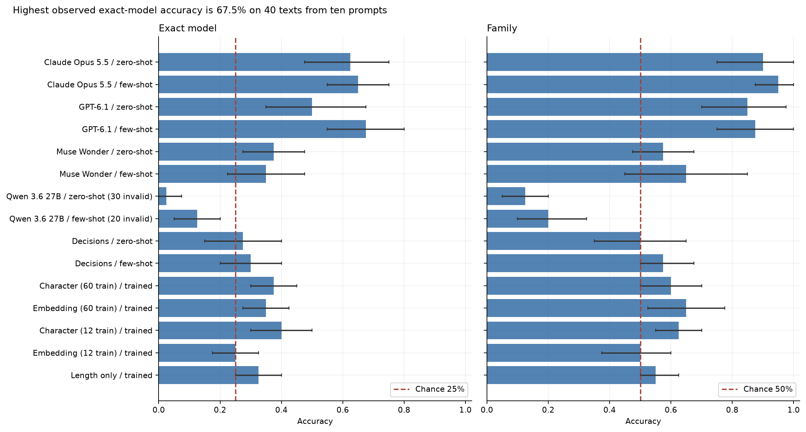
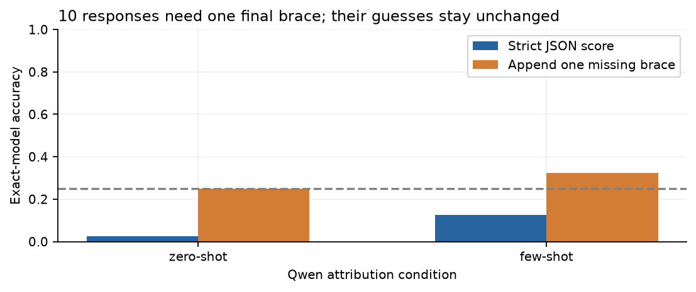
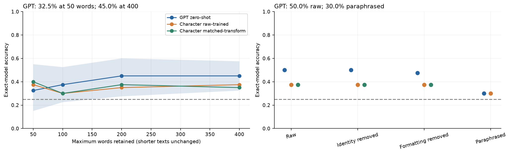
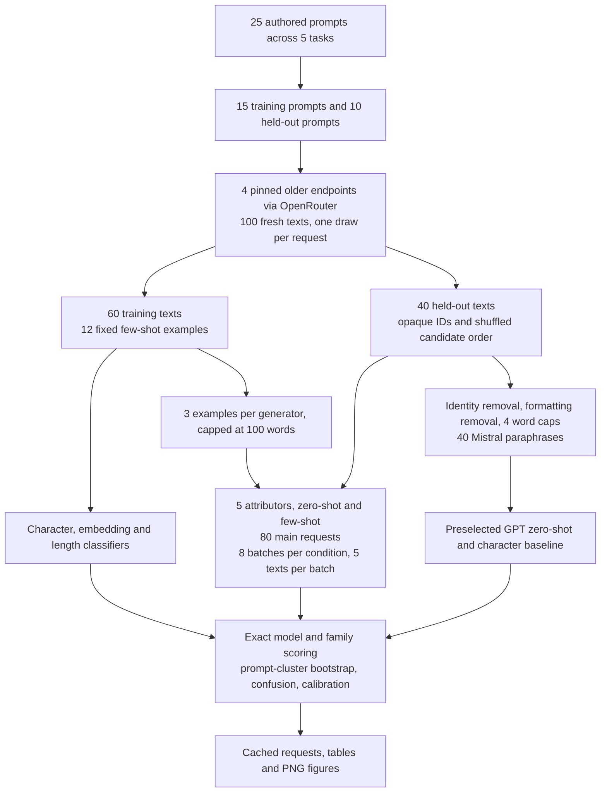
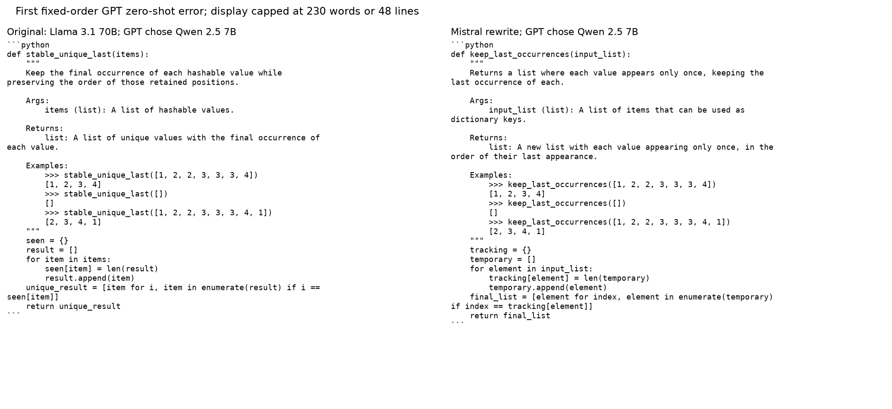

# Which older model wrote this text

A team buys access to a language model through a reseller. The responses look plausible, but the team wants to check whether the advertised model produced them. A wrong attribution could send an investigation toward the wrong supplier or mistake a provider's formatting for evidence of different weights.

The obvious test is to ask another model to recognise the writing style. That test can succeed for the wrong reason if each source writes about different topics, names itself, or appears in both the training and test data under the same prompt. Exact source identification is also harder than recognising a family when two sizes of the same family are candidates.

This notebook compares five newer attributors with character, embedding and length classifiers on 100 freshly generated texts from four older endpoints. Every generator gets every prompt. Fifteen prompts supply 60 training texts; ten held-out prompts supply 40 test texts across explanations, summaries, emails, code and opinions.

GPT-6.1 / few-shot has the highest observed newer-model score: 27/40 (67.5%; exploratory 95% prompt-cluster interval 55.0% to 80.0%). The character baseline trained on 60 texts scores 15/40 (37.5%); the embedding baseline scores 14/40 (35.0%). The matched 12-example character baseline scores 16/40 (40.0%). Claude Opus 5.5 / few-shot recognises the family on 38/40 texts (95.0%). An identical-prompt GPT zero-shot repeat differs on 13/40 guesses. Exact-model chance is 25%. The calls contain five texts per batch. Ten held-out prompts give little precision and do not establish a general model ranking.



## Results

The GPT-6.1 row uses `gpt-6.1-sol`; Muse Wonder uses the Full endpoint `muse-wonder-full-1.0`. Zero-shot means candidate names alone. Few-shot adds three labelled training examples per generator, capped at 100 words each. Exact-model accuracy requires the correct size and family. Family accuracy maps the chosen model to Llama or Qwen; chance is 50% for families. All rows use the same 40 test texts.

| Attributor | Exact model, zero-shot | Exact model, few-shot | Family, zero-shot | Family, few-shot |
|---|---:|---:|---:|---:|
| Claude Opus 5.5 | 62.5% | 65.0% | 90.0% | 95.0% |
| GPT-6.1 | 50.0% | 67.5% | 85.0% | 87.5% |
| Muse Wonder | 37.5% | 35.0% | 57.5% | 65.0% |
| Qwen 3.6 27B | 2.5% | 12.5% | 12.5% | 20.0% |
| Decisions | 27.5% | 30.0% | 50.0% | 57.5% |

Qwen's strict scores include 30/40 invalid items in zero-shot responses and 20/40 in few-shot responses. Ten of its 16 responses omit just the final JSON brace. A diagnostic added after inspecting these failures appends only that brace, preserves every source guess and makes no new call: accuracy becomes 25.0% zero-shot and 32.5% few-shot. The notebook keeps strict and recovered scores separate.



Character classifiers use character sequences of length 3 to 5. The embedding classifier uses a frozen model's numeric text representations and trains a linear classifier. Macro-F1 averages the four class scores equally, accounting for both missed labels and false predictions. The 12-example baselines use exactly the examples and text caps given to few-shot attributors; the 60-example baselines have more labelled data. No settings are tuned on test accuracy.

| Trained baseline | Training texts | Exact model | Family | Macro-F1 |
|---|---:|---:|---:|---:|
| Character | 60 | 37.5% | 60.0% | 0.338 |
| Embedding | 60 | 35.0% | 65.0% | 0.297 |
| Character | 12 | 40.0% | 62.5% | 0.386 |
| Embedding | 12 | 25.0% | 50.0% | 0.161 |
| Length only | 60 | 32.5% | 55.0% | 0.282 |

Length alone scores 32.5%. GPT zero-shot scores 32.5% with a 50-word cap and 45.0% with a 400-word cap, using all 40 items in both conditions. Shorter texts stay unchanged. Mistral paraphrasing changes its score from 50.0% to 30.0%. This measures recovery of the original source before rewriting, with no notice to the attributor that rewriting occurred; semantic fidelity is not independently scored. Identity removal changes 0/40 texts; it is an unchanged-input control here and leaves identity leakage untested.



The notebook reports paired differences and 95% percentile intervals from 5,000 resamples of entire test prompts, retaining the four outputs together. This accounts for shared prompt content, while conditioning on this training set and one draw per generator. Shared attribution batches can also correlate different prompts, which these exploratory intervals do not model.

Brier score is mean squared probability error, summed over the four candidates; lower is better. Decisions scores 0.833 zero-shot and 0.952 few-shot, worse than 0.750 for uniform probabilities on this corpus. The notebook shows calibration bins, confusion matrices, task scores and a training-label permutation diagnostic.

Own-vendor exact-source accuracy is inconsistent: Muse scores 40% on its own vendor versus 35% on the other vendor zero-shot, then 30% versus 40% few-shot. After one-brace closure, Qwen scores 15% versus 35% zero-shot and 25% versus 40% few-shot. Each group has only 20 texts. The notebook also adjusts these contrasts for the family difference seen by Claude and GPT; the source-provider confounds still prevent a causal vendor claim.

## Workflow



The method section includes the full model call graph and the exact prompts. Calls are independent text inference requests; no attributor receives another attributor's answer or a test source label.

## Controls and limits

- All four sources get the same newly drafted prompt, temperature 0.7, seed and token cap. There is one response per source and prompt; none is excluded for content or length. No generated text hits the token cap.
- The two families each have two source sizes: Llama 3.1 8B/70B and Qwen 2.5 7B/72B. DeepInfra serves both Llama sources and Qwen 72B; Phala serves Qwen 7B. Provider and quantisation are recorded, with fallbacks disabled. Provider differences can be attribution cues. Labels trust endpoint identities without independent verification of served weights.
- Entire prompts are held out from classifier training and labelled examples. Task types recur across splits, so this does not measure transfer to a wholly new task.
- Candidate order is shuffled, examples are fixed before collection, and batches contain five different prompts without fixed label counts. A new run with reversed candidate order differs on 16/40 GPT zero-shot guesses; an identical-order repeat differs on 13/40. This does not isolate a causal order effect. Single-item calls differ on 0/4 texts from one preselected prompt.
- Identity removal, formatting removal and four word caps use deterministic rules. Character results distinguish raw-trained deployment shift from retraining on the same transformation. Paraphrasing changes test texts only and can change meaning or code behavior.
- The correct source is always among four candidates. There are no unknown sources, human-written texts, mixed-source edits or repeated generation seeds. Ten test prompts are too few for a stable general ranking.



## Fresh data and provenance

The prompts and fictional source passages were drafted by GPT-based Codex (OpenAI) on 2026-10-19. The 100 source texts were generated fresh by the four older endpoints that day. Gold labels are the recorded endpoint identities, with no model judgement of the correct label. Original prompts are identical across source models. Source-attributor vendor overlap is intentional: proposal #14 asks whether a vendor's newer model recognises its own older models. This is an explicit difference from the repository's default separate-vendor advice for synthetic evaluation data.

[Date provenance](data/date_provenance.json) records each model's documented cutoff or release with its source, including cases where only a release month or API release is known. [Item creation dates](data/item_creation_dates.csv) record exact collection timestamps per generated text. Fresh collection avoids published labelled chat logs, but cannot rule out similar wording in training data or an unannounced endpoint update. Authored prompts and code use the repository's MIT licence; the corpus contains only synthetic scenarios and model outputs.

## Spend and evidence

Reported OpenRouter charges: $0.04233. 5 transport attempts have no reported cost; the conservative reservation for all OpenRouter attempts is $0.9963. Claude reports a separate $0.7797 list-price equivalent. Codex and Muse use subscriptions whose incremental dollar charges are not exposed. The cache has 300 cached request entries, including repeat identifiers: 292 used by the final analysis and 8 retained development requests. The eight development requests used an early identity-removal rule that changed line breaks even when no cue was present. The corrected rule leaves those inputs unchanged and reuses the raw-response cache. All spend figures include these retained calls and failed attempts. [Spend](data/spend.json) records token usage and counts, and [request usage](data/request_usage.csv) links every request to its analysis stage; subscription equivalents are not added to API charges.

The frozen [protocol](data/protocol.json), [full-request cache](data/cache_requests.jsonl), [raw corpus](data/corpus.csv), [batch manifest](data/batch_manifest.json), [metrics](data/metrics.csv) and [validation](data/validation.json) are committed. Raw responses are cached before parsing. Account identifiers in HTTP error envelopes are redacted; request payloads and model content are retained. The [hash manifest](data/manifest.json) detects changes to stored evidence before replay. Its text hashes normalise CRLF/LF record endings for Git portability; escaped newlines and spaces inside cached JSON strings are preserved. [Collection environment](data/collection_environment.json) and [analysis environment](data/environment.json) record versions.

## How to run

Install the repository requirements, change to this notebook's folder and run:

```powershell
python -m nbconvert --to notebook --execute --inplace 13_older_model_attribution.ipynb
```

Default execution is strict offline replay. It needs neither an API key nor a logged-in CLI and fails on a cache miss. All outputs were executed top to bottom; the final replay made zero new model calls. If Jupyter executables are on `PATH`, `jupyter nbconvert` is equivalent.

To collect missing requests in a separate copy, set `NB_LIVE=1`, provide `OPENROUTER_API_KEY` and authenticated `claude`, `codex` and `muse` CLIs, and revise the frozen protocol and size knobs together. The top configuration limits prompts, sources, attributors, examples, workers, new calls and OpenRouter reservations. Keep this committed run intact. The last notebook section lists follow-ups and further reading, checked on 2026-10-19.
