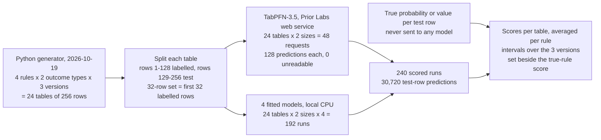

# Predicting from a small table: a pretrained model against fitted ones

## A repair desk with a short record

A small repair desk keeps a record of every finished job. Each job is one row in a table. Some columns describe what was known when the job came in, such as the age of the device and the number of faults the customer reported. Two columns are filled in afterwards: whether a specialist was needed, and how many hours the job took.

After a few months the record holds about 40 jobs. When a new job arrives, the desk would like two predictions from that table before work starts: will this job need the specialist, and how long will it take? A wrong answer costs something either way. Booking the specialist for a job that did not need one wastes an expensive hour, and missing one leaves the device stuck on the bench. An estimate of two hours for a five-hour job leaves the afternoon's work unfinished; the reverse leaves staff waiting.

Tables this small are common wherever a process has only just started recording outcomes: a new product line, a new clinic, a trial scheme. The rows whose outcomes are already known are called labelled rows. Predicting a yes/no outcome such as "specialist needed" is called classification, and predicting a number such as hours is called regression. This experiment tests both.

### An illustrative example

This example is made up, and much smaller than the tables tested below.

| Job | Device age | Fault type | Faults reported | Specialist needed | Hours |
|---|---|---|---:|---|---:|
| A | 1 year | mechanical | 1 | yes | 1.0 |
| B | 6 years | mechanical | 2 | no | 2.0 |
| C | 2 years | electrical | 3 | no | 3.5 |
| D | 7 years | electrical | 4 | yes | 4.0 |

Start with hours, the ordinary case. The usual approach is to fit a model: pick a formula with some adjustable numbers, then adjust them until the formula reproduces the labelled rows as closely as it can. Here "one hour per reported fault" reproduces all four jobs to within half an hour. A new job with three faults gets an estimate of three hours, about what a person would guess from jobs B, C and D.

Now the complication. The specialist column follows a less tidy rule: old devices with electrical faults need the specialist, and so do new devices with mechanical faults, while the other two combinations do not. Neither column helps on its own. Of the two old devices, one needed a specialist and one did not, and the same holds for the two electrical faults. A formula that adds "points for age" to "points for fault type" can never reproduce this, whatever numbers it uses. A formula built from questions ("is the device older than four years? if so, is the fault electrical?") can, but only if the record holds enough jobs of each combination to show the pattern. With 40 jobs spread over four combinations, and other columns that turn out not to matter, a fitted formula can easily take a coincidence for a pattern or miss the real one.

A person with only this record would struggle in the same way. An experienced service manager who has run several desks might suspect "it depends on the combination" after a handful of jobs, because the shape is familiar from elsewhere. Their experience fills in what the desk's short record cannot show.

### A model with experience of many tables

A pretrained table model tries to bring that kind of experience. Before it sees your table, it is trained on many made-up tables, each generated from a random rule, and learns to fill in hidden outcomes from the visible rows. The first published version of TabPFN, the model tested here, was trained this way ([Hollmann et al., 2022](https://arxiv.org/abs/2207.01848)). To predict for your table, it reads your labelled rows and the new rows together and returns predictions directly. Nothing inside it is adjusted to your table.

This is sometimes called zero-shot prediction, because the model is not trained on your task. The name is a little misleading: the model still needs your labelled rows. It uses them as examples to read rather than as data to fit.

The two approaches differ in exactly this way. A fitted model starts from scratch on each table and must choose its formula from the labelled rows alone. The pretrained model starts from what it learned on other tables and treats the labelled rows as evidence. With few rows that head start might be worth a lot. It might also mislead, if your table follows a pattern unlike the ones it was trained on.

### Why test it, and how to test it fairly

The makers of TabPFN report that it does better than fitted models on small tables. The first paper found it "clearly outperforms boosted trees", a common fitted method, on 18 benchmark tables of up to 1,000 rows ([Hollmann et al., 2022](https://arxiv.org/abs/2207.01848)), and Prior Labs says the 2026 version ranks first on two public table benchmarks. A desk thinking of switching needs to know whether that holds at its own size, a few dozen or about a hundred rows, and where the pretrained model does worse. One such place is a job unlike any in the record: a device with nine faults when the most the desk has seen is four. "One hour per fault" says nine hours. A method that predicts from similar past jobs can only say "like the biggest job so far", about four hours. Which answer is better depends on whether the trend continues.

A fair test gives every method the same labelled rows and scores every method on the same new rows, whose outcomes none of them saw. To know which answer is right, it also helps to know the true rule. So this experiment does not use a real desk's records. It generates tables in code from four known rules, including a combination rule like the specialist example and a straight-line rule whose new rows lie outside the range of the labelled ones. The tables were created after the model's release, so it cannot have seen them in training.

## The question

When only 32 or 128 rows with known outcomes are available, does a pretrained table model that reads those rows, without being fitted to them, predict the outcomes of new rows better than standard models fitted to the same rows? And where does it do worse? The test uses 24 tables generated for this experiment, 12 with yes/no outcomes and 12 with numbers, built from four known rules and scored on 128 new rows each.

A team with a small table needs both answers to decide whether to use the pretrained model and when to check its answers against a simpler formula.

## Study summary

TabPFN-3.5, a pretrained table model from Prior Labs reached through its web service (called TabPFN below), was compared with three standard fitted models, Linear, Random forest and Gradient boosting, and with a constant guess. Every method received the same 32 or 128 labelled rows from each of the 24 tables and predicted the same 128 test rows: 48 TabPFN requests and 192 fitted-model runs. Because the tables come from known rules, each score can also be set beside the true-rule score, the best any method could expect when outcomes contain random noise.

- With 128 labelled rows, TabPFN's balanced accuracy on yes/no outcomes (the share predicted correctly among the yes rows and among the no rows, averaged) was **82.9%**, against 71.3% to 71.7% for the three fitted models, 50% for the constant guess and 84.2% for the true rule. Most of that gap comes from the combination rule, where TabPFN scored 87.4% and the best fitted model 65.6%. On the other three rules its lead was 0 to 5 points.
- On number outcomes with 128 labelled rows, TabPFN's average error was 0.198 times the constant guess's error, against 0.479 to 0.517 for the fitted models and 0.140 for the true rule.
- With 32 labelled rows TabPFN had no advantage on yes/no outcomes: 65.7% against 68.5% for Linear, and it beat every fitted model on only 1 of the 12 yes/no tables. On numbers it still had the lowest average error, 0.441 against 0.534 for Linear.
- When the new rows lay outside the range of the labelled rows, Linear's straight line was far better on numbers: 0.054 times the constant guess's error against 0.187 for TabPFN. TabPFN pulled 351 of its 384 predictions there back toward the range it had seen.
- All 48 TabPFN responses passed the format checks, so every miss is a wrong prediction, not an unreadable reply. On the out-of-range yes/no tables TabPFN and Linear both reached the true-rule ceiling of 97.2%, so that comparison cannot rank them.

In the original situation: the desk's 40 jobs sit nearest the 32-row condition, where the pretrained model's yes/no answers were no better than a straight-line formula's. Once the record reaches about 130 jobs, its predictions would be closer than a fitted formula's, by a wide margin if the specialist rule depends on a combination of columns. For a job far bigger than any in the record, its estimate of hours would come out too small, because it continues the trend only part of the way.

The main caveat is that these are 24 small numeric tables from four simple rules, three versions of each. Earlier TabPFN versions were trained on tables generated from rules, so tables like these may suit it better than real records with missing values, text and messy outcomes. The results show where its advantage comes from and where it fails, not how accurate it would be on a real desk's data.

## Contents

1. [The tables and the four rules](#1-the-tables-and-the-four-rules)
2. [How the experiment runs](#2-how-the-experiment-runs)
3. [The models and the measures](#3-the-models-and-the-measures)
4. [Results when the outcome is yes or no](#4-results-when-the-outcome-is-yes-or-no)
5. [Results when the outcome is a number](#5-results-when-the-outcome-is-a-number)
6. [Time and usage](#6-time-and-usage)
7. [Error analysis](#7-error-analysis)
8. [What the evidence supports](#8-what-the-evidence-supports)
9. [Limitations](#9-limitations)
10. [Spend, data and how to run](#10-spend-data-and-how-to-run)
11. [Future work and further reading](#11-future-work-and-further-reading)

## 1. The tables and the four rules

Each table has 256 rows and eight number columns, `x0` to `x7`, each drawn at random between −1 and 1. Only `x0`, `x1` and `x2` affect the outcome. The other five are there to tempt a method into finding patterns in noise, as unhelpful columns do in real records. The first 128 rows are the labelled rows and the last 128 are the test rows. The 32-row condition uses the first 32 of the same labelled rows, so both sizes are scored on identical test rows.

Each table follows one of four rules, which gives every row a value f:

| Rule (figure label; data name) | Formula for f | What it tests |
|---|---|---|
| Straight-line (Linear; `linear`) | 2·x0 − x1 + 0.5·x2 | The easiest case: the shape a straight-line formula assumes |
| Curved (Smooth nonlinear; `smooth`) | 2·sin(π·x0) + x1² − 0.5·x2 | A wave and a bend that a straight line cannot follow |
| Combination (Threshold interaction; `threshold`) | +2 when x0 and x1 have the same sign, −2 otherwise; +1.5 when x2 > 0; then −0.75 | The specialist pattern from the opening: neither x0 nor x1 helps on its own |
| Out-of-range (Unseen input ranges; `range_shift`) | Same as straight-line | Labelled rows have x0 between −1 and 1; test rows have x0 between 1.5 and 3 or between −3 and −1.5 |

For a number outcome, the outcome is f plus random noise with a standard deviation of 0.3. For a yes/no outcome, the row is "yes" with probability 1 / (1 + e^(−f)), drawn at random. A combination-rule row with f = 2.75 is yes with probability 0.94 and still comes out "no" about one time in 17. This noise is deliberate. It means no method can be right every time, and it lets the analysis tell a bad prediction from bad luck. The generator's true probability or value for each row is stored beside the outcome (column `oracle_value` in `data/fixtures/`) and is never sent to any method.

Each rule appears in three versions, generated with random seeds 101, 202 and 303, for each outcome type: 4 rules × 2 outcome types × 3 versions = 24 tables. A table's name gives all three, for example `threshold_101_classification`. In the figures, the rule labelled "Linear" is the straight-line rule, not the Linear model.

The first rows of `linear_101_classification`, as the notebook displays them (columns `x3` to `x7` omitted):

| Row | x0 | x1 | x2 | Outcome | True probability of yes |
|---|---:|---:|---:|---:|---:|
| linear-101-classification-000 | 0.980 | 0.164 | −0.259 | 1 | 0.841 |
| linear-101-classification-001 | −0.983 | −0.743 | −0.903 | 0 | 0.158 |
| linear-101-classification-002 | −0.667 | 0.771 | −0.603 | 0 | 0.083 |
| linear-101-classification-003 | −0.469 | 0.977 | 0.332 | 0 | 0.148 |

All 24 tables were generated by Python code in the notebook on 2026-10-19 and saved with SHA-256 hashes (`data/fixture_manifest.json`, field `created_date`). TabPFN-3.5 was released on 2026-09-15 (`data/model_provenance.json`); Prior Labs does not publish a training cutoff for it. No public benchmark rows and no text written by a language model are used, so no date filter was needed. New rows rule out memorised examples but not familiarity with this kind of rule, as the study summary's caveat explains. The fitted models learn only from the labelled rows, so the question does not arise for them. The tables and the code are released under the repository's MIT licence.

## 2. How the experiment runs



Each TabPFN prediction is one request to the Prior Labs web service. The notebook uploads the labelled rows with their outcomes, then the test rows without outcomes, and gets back either a probability of yes for each test row or a predicted number. The service has a step called "fit", but it prepares the rows rather than training anything: on all 48 requests the server reported 0.0 seconds of fitting (`fit_s` in each `data/cache/tabpfn_*.json`). The fitted models run on the collecting machine with scikit-learn, the standard Python library for these methods.

### Worked example: one table from start to finish

This is `threshold_101_classification`: the combination rule, yes/no outcomes, version 101, with 128 labelled rows. Its first labelled rows:

| Row | x0 | x1 | x2 | Outcome | True probability of yes |
|---|---:|---:|---:|---:|---:|
| threshold-101-classification-000 | −0.146 | −0.887 | 0.991 | 1 | 0.940 |
| threshold-101-classification-001 | 0.732 | 0.288 | 0.167 | 1 | 0.940 |
| threshold-101-classification-002 | 0.187 | −0.982 | 0.189 | 1 | 0.223 |
| threshold-101-classification-003 | −0.669 | 0.925 | 0.705 | 1 | 0.223 |

The first two rows have x0 and x1 of the same sign and x2 above zero, so f = 2 + 1.5 − 0.75 = 2.75 and the probability of yes is 0.940. The next two have opposite signs: f = −2 + 1.5 − 0.75 = −1.25, probability 0.223, and both still came out yes. With noise like this the pattern shows only across many rows; 55 of the 128 labelled rows are yes.

The request, saved in `data/cache/tabpfn_516e18311fee75be044240f7ca383a73cc87f4b519483a5d0b812257081920b5.json`, holds the 128 labelled rows with their outcomes, the 128 test rows without outcomes, and the settings: model selector `v3.5_default`, 8 internal passes, seed 101, standard preprocessing and output type "probabilities". The response begins (rounded):

```json
"prediction": [[0.928, 0.072], [0.023, 0.977], [0.051, 0.949], [0.038, 0.962], ...]
```

Each pair is the probability of "no" and of "yes", in the class order `[0, 1]` that the response's metadata states. The notebook takes the second number and predicts "yes" when it is at least 0.5. The whole request took 8.33 seconds; the server's prediction step took 0.30 of them.

Take test row `threshold-101-classification-131`. Its x0 (−0.407) and x1 (−0.973) have the same sign and x2 (0.510) is above zero, so the true probability of yes is 0.940. TabPFN gave 0.962 and predicted yes; Linear gave 0.429 and predicted no. The outcome was yes. Row `threshold-101-classification-129` sits in the same group: TabPFN gave 0.977 and predicted yes, and the outcome was no. That miss is bad luck, not a bad prediction.

Scoring the table: 61 test rows are yes and 67 are no. TabPFN predicted yes on 53 of the 61 yes rows (0.869) and no on 59 of the 67 no rows (0.881), so its balanced accuracy is (0.869 + 0.881) / 2 = 0.875. Linear caught 15 of 61 and 47 of 67, (0.246 + 0.701) / 2 = 0.474, below the constant guess. Predicting with the true probability would have scored 0.891.

Averages over the four groups of test rows show what each model picked up:

| Test rows in this table | Rows | True probability | TabPFN mean | Linear mean | Share actually yes |
|---|---:|---:|---:|---:|---:|
| Opposite signs, x2 ≤ 0 | 38 | 0.060 | 0.159 | 0.384 | 0.000 |
| Opposite signs, x2 > 0 | 27 | 0.223 | 0.148 | 0.495 | 0.222 |
| Same sign, x2 ≤ 0 | 26 | 0.777 | 0.881 | 0.350 | 0.885 |
| Same sign, x2 > 0 | 37 | 0.940 | 0.882 | 0.483 | 0.865 |

TabPFN separated the same-sign rows (means of 0.88) from the opposite-sign rows (0.15 and 0.16) but did not pick up the smaller step at x2 = 0. Linear did the reverse. Its group means stay between 0.35 and 0.50 and are higher only when x2 is above zero, the one part of the rule a weighted sum of columns can express. Counted from `data/predictions.csv` (this table, 128 labelled rows) and `data/fixtures/threshold_101_classification.csv`.

## 3. The models and the measures

| Model | Pinned version | Provider and how called | Size and precision | Settings | Why included |
|---|---|---|---|---|---|
| TabPFN-3.5 | Selector `v3.5_default` requested; every response reported checkpoint file `tabpfn-v3.5-20260909.safetensors` and server package 9.0.0 (`data/model_runtime.json`); no checkpoint hash is exposed | Prior Labs hosted REST API; released 2026-09-15 ([release page](https://priorlabs.ai/technical-reports)); training cutoff not published; used under Prior Labs' API terms | Not published; the server reported a CUDA graphics processor (model not named) and inference precision "auto" | 8 internal passes (`n_estimators`), standard execution with preprocessing; the service's optional Thinking mode and weight fine-tuning off; probabilities for yes/no, the median for numbers; seeds 101, 202, 303 requested, 0 reported | The pretrained model under test; Prior Labs' release page says it ranks first on the TabArena and BeyondArena table benchmarks |
| Linear | scikit-learn 1.9.0 | Local, on the collecting machine | Not applicable | Columns standardised; logistic regression (C = 1) for yes/no, ridge regression (alpha = 1) for numbers | A weighted sum of the columns: the right shape for the straight-line and out-of-range rules |
| Random forest | scikit-learn 1.9.0 | Local | Not applicable | 200 trees, at least 2 rows per leaf, all columns considered at each split | Averages many question-based trees, each built on a resampled copy of the rows; tree methods are the usual strong choice on tables ([Grinsztajn et al., 2022](https://arxiv.org/abs/2207.08815)) |
| Gradient boosting | scikit-learn 1.9.0 (histogram gradient boosting) | Local | Not applicable | 100 rounds, at most 15 leaves, at least 5 rows per leaf, L2 penalty 1, learning rate 0.1, no early stopping | The other common tree method: builds trees one after another, each correcting the errors of the ones before |
| Constant guess | scikit-learn 1.9.0 | Local | Not applicable | Predicts the share of yes in the labelled rows, or their average outcome | The floor any useful method must beat |

In the figures and data files the constant guess is called Dummy. The fitted models ran on the collecting machine (Windows 11, an Intel processor with 22 logical cores, Python 3.13.5; `data/environment.json`), one thread each. Their median time per fit and prediction was 0.017 s for the constant guess, 0.019 s for Linear, 0.199 s for Random forest and 0.063 s for Gradient boosting (`data/metrics.csv`, `wall_seconds`). `data/` does not record scikit-learn's licence or release date. All settings were fixed before scoring and none was tuned, so this is a comparison with standard settings, not with the best each method could reach. TabPFN's eight internal passes are also more computation than one fit of a fitted model.

### The measures

Balanced accuracy is the main yes/no measure. A method predicts yes when its probability of yes is at least 0.5. Balanced accuracy is the share of actual yes rows predicted yes and the share of actual no rows predicted no, averaged; higher is better. Suppose 10 test rows are yes and 30 are no. A method that catches 8 of the 10 yes rows and 27 of the 30 no rows scores (0.8 + 0.9) / 2 = 0.85. Always answering no would be right on 30 of 40 rows, 75%, but scores (0 + 1) / 2 = 0.5. That is why the constant guess sits at exactly 0.5, and why this measure is used instead of plain accuracy.

Log loss and the Brier score measure the probabilities rather than the yes/no answers; for both, lower is better. The Brier score is the squared gap between the probability of yes and the outcome (1 or 0), averaged. A probability of 0.8 on a row that comes out yes costs (1 − 0.8)² = 0.04, and answering 0.5 every time costs 0.25. Log loss uses the logarithm of the probability given to what happened, so a confident wrong probability is punished heavily; answering 0.5 every time gives 0.693.

For numbers the measure is the mean absolute error (MAE), the average size of a miss ignoring its direction. Tables differ in scale (out-of-range outcomes reach about ±7), so each method's MAE is divided by the constant guess's MAE on the same table with the same labelled rows. This relative MAE is 1 for the constant guess, and lower is better. If the constant guess misses by 2 hours on average and a method by 0.5, the method's relative MAE is 0.25, 75% less error. Averages give each table equal weight.

The true-rule score is the score from predicting with the generator's true probability (yes when it is at least 0.5) or true value. It is the best a method could expect: the noise keeps it below perfect. On the 12 yes/no tables it averages a balanced accuracy of 0.842, and on the 12 number tables a relative MAE of 0.140 against the 128-row constant guess. It is computed from `data/fixtures/*.csv` (columns `oracle_value`, `target` and `split`). A method near the true-rule score has little left to gain on that table.

Each table version is one draw from its rule, so the uncertainty comes from the three versions. The intervals in the figures, `data/summary.csv` and `data/paired_differences.csv` resample the three versions with replacement 2,000 times and take the middle 95% of the resulting averages. With three versions this range is rough, and it says nothing about rules or tables outside the experiment.

## 4. Results when the outcome is yes or no

Balanced accuracy with 128 labelled rows, by rule:

| Rule | True rule | TabPFN | Linear | Random forest | Gradient boosting | Constant guess |
|---|---:|---:|---:|---:|---:|---:|
| Straight-line | 0.736 | 0.722 | 0.700 | 0.672 | 0.670 | 0.500 |
| Curved | 0.760 | 0.748 | 0.700 | 0.693 | 0.683 | 0.500 |
| Combination | 0.901 | 0.874 | 0.479 | 0.626 | 0.656 | 0.500 |
| Out-of-range | 0.972 | 0.972 | 0.972 | 0.878 | 0.841 | 0.500 |
| Average of 12 tables | 0.842 | 0.829 | 0.713 | 0.717 | 0.713 | 0.500 |
| Log loss, average | | 0.458 | 0.525 | 0.559 | 0.663 | 0.694 |
| Brier score, average | | 0.142 | 0.179 | 0.187 | 0.212 | 0.250 |

The same with 32 labelled rows (the true-rule score does not change, since the test rows are the same):

| Rule | TabPFN | Linear | Random forest | Gradient boosting | Constant guess |
|---|---:|---:|---:|---:|---:|
| Straight-line | 0.566 | 0.673 | 0.643 | 0.602 | 0.500 |
| Curved | 0.716 | 0.654 | 0.735 | 0.690 | 0.500 |
| Combination | 0.503 | 0.467 | 0.531 | 0.548 | 0.500 |
| Out-of-range | 0.841 | 0.945 | 0.768 | 0.760 | 0.500 |
| Average of 12 tables | 0.657 | 0.685 | 0.669 | 0.650 | 0.500 |
| Log loss, average | 0.638 | 0.634 | 0.653 | 0.857 | 0.705 |
| Brier score, average | 0.221 | 0.212 | 0.221 | 0.266 | 0.256 |

Averaged per rule from `data/metrics.csv`; the averages over 12 tables match `data/summary.csv`.


How to read this figure. The left panel has one line per method, joining its average balanced accuracy over the 12 yes/no tables at 32 and at 128 labelled rows; the bars are 95% intervals over the three table versions. The right panel breaks the 128-row results down by rule. Within each rule the dots are offset vertically in a fixed order: Gradient boosting at the top, then Random forest, Linear on the gridline, the constant guess (Dummy) and TabPFN at the bottom. The dotted line at 0.5 is the constant guess. The row labelled "Linear" is the straight-line rule. The title reports the 128-row result only and does not say that TabPFN was behind at 32 rows.

With 128 labelled rows TabPFN scored 0.829, 11 to 12 points above the three fitted models (0.713 to 0.717) and 1.3 points below the true rule's 0.842. The paired difference from the closest fitted model, Random forest, is +0.112 (95% interval 0.072 to 0.168), and from Linear +0.116 (0.099 to 0.132) (`data/paired_differences.csv`). Table by table, TabPFN scored highest on 8 of the 12, equal to Linear on the 3 out-of-range tables, and lower on 1 (`linear_202_classification`, 0.773 against Linear's 0.785).

The gap is mostly one rule. On the combination rule TabPFN scored 0.874, within 0.03 of the true rule, while Gradient boosting reached 0.656 and Linear 0.479, below the constant guess. A weighted sum of columns cannot express "x0 and x1 have the same sign", and the tree methods found the pattern only in part with 128 noisy rows. On the other three rules TabPFN's lead over the best fitted model was 2.2 points (straight-line), 4.8 points (curved) and 0 (out-of-range). Averaged over those nine tables, TabPFN scored 0.814 and Linear 0.791. For a desk, the size of the gain therefore depends on whether its outcome hinges on a combination of columns.

With 32 labelled rows the order reversed. Linear led with 0.685 and TabPFN scored 0.657; the paired difference is −0.028 (−0.062 to −0.002). TabPFN beat every fitted model on only 1 of the 12 tables (`threshold_101_classification`) and tied Linear on another (`range_shift_202_classification`). Its weakest rule was the straight-line rule, 0.566 against Linear's 0.673; section 7 shows what its predictions there looked like. On the combination rule TabPFN and the three fitted models sat between 0.467 and 0.548, at the floor of 0.5: 32 noisy rows were not enough for any of them to find the pattern, so that row cannot rank them.

On probabilities TabPFN had the lowest log loss and Brier score at 128 rows. At 32 rows Gradient boosting's log loss, 0.857, was worse than the constant guess's 0.705 although its balanced accuracy, 0.650, was better. It gave confident probabilities that were often wrong, which matters to anyone who acts on the probability rather than the yes/no answer.

## 5. Results when the outcome is a number

Relative MAE with 128 labelled rows (lower is better; the constant guess scores 1.000 on every rule):

| Rule | True rule | TabPFN | Linear | Random forest | Gradient boosting |
|---|---:|---:|---:|---:|---:|
| Straight-line | 0.194 | 0.204 | 0.205 | 0.295 | 0.284 |
| Curved | 0.202 | 0.226 | 0.699 | 0.328 | 0.297 |
| Combination | 0.112 | 0.175 | 0.981 | 0.781 | 0.686 |
| Out-of-range | 0.051 | 0.187 | 0.054 | 0.664 | 0.648 |
| Average of 12 tables | 0.140 | 0.198 | 0.485 | 0.517 | 0.479 |

With 32 labelled rows:

| Rule | TabPFN | Linear | Random forest | Gradient boosting |
|---|---:|---:|---:|---:|
| Straight-line | 0.231 | 0.225 | 0.461 | 0.413 |
| Curved | 0.469 | 0.757 | 0.506 | 0.468 |
| Combination | 0.815 | 1.054 | 0.935 | 0.848 |
| Out-of-range | 0.250 | 0.101 | 0.705 | 0.702 |
| Average of 12 tables | 0.441 | 0.534 | 0.652 | 0.608 |

Averaged per rule from `data/metrics.csv` (column `relative_mae`); the true-rule column is computed from `data/fixtures/*.csv` as described in section 3.


How to read this figure. The layout matches the yes/no figure, but lower is better and the constant guess (Dummy) sits at 1.0 by construction. The dotted line in the right panel marks 1.0. The title's "80.2%" is 1 − 0.198, TabPFN's average reduction in error against the constant guess at 128 rows. The title does not mention the out-of-range rule, where TabPFN lost, and in the left panel the legend covers part of TabPFN's 32-row interval. The row labelled "Linear" is again the straight-line rule.

With 128 labelled rows TabPFN's relative MAE averaged 0.198, against 0.479 for Gradient boosting and 0.485 for Linear; the paired difference from Gradient boosting is −0.281 (−0.297 to −0.260). TabPFN had the lowest error on 8 of the 12 tables. On the straight-line rule TabPFN and Linear tied: 0.204 and 0.205, with no table differing by more than 0.0011, and both within 0.011 of the true rule. That is the noise floor, so neither could do better. On the curved rule Linear could not bend (0.699), while TabPFN came within 0.024 of the true rule. On the combination rule TabPFN's 0.175 compares with 0.686 for the best fitted model.

The out-of-range rule is the exception. Linear's 0.054 is almost the true rule's 0.051, because its straight line is the right shape and carries on past the labelled range. TabPFN's 0.187 is more than three times that error. The tree methods, at 0.648 and 0.664, did worst: a tree's prediction is an average of labelled outcomes, so it cannot go beyond the largest outcome it has seen. Linear had the lower error on all 3 out-of-range tables, at both sizes.

With 32 labelled rows TabPFN still had the lowest average, 0.441 against 0.534 for Linear (paired difference −0.093, −0.180 to −0.039), but the lowest error on only 4 of the 12 tables. Its lead in the average comes from Linear's failures on the curved and combination rules and from one large win, `threshold_101_regression` (0.528 against 0.973 for the best fitted model). On the other two combination tables TabPFN scored 0.930 and 0.986, close to the constant guess.

## 6. Time and usage


How to read this figure. Each bar is one method's median time per table and labelled-row count, on a log scale where each gridline is ten times the one before. TabPFN's time is measured from the notebook and includes uploading the rows to the service, waiting in its queue and the prediction; the fitted models' time is fitting and predicting on the local processor with one thread. The two are not a comparison of processor speeds.

A TabPFN request took 8.11 seconds at the median (fastest 6.02 s, slowest 82.47 s; `data/metrics.csv`). The timings the server reported for its own steps, queue waits included, add up to a median of 2.5 seconds per request (`fit_response.timings` and `raw_response.timings` in each cache file); the rest is spent outside those steps, in uploads and network round trips. The fitted models took between 0.017 and 0.199 seconds. For a desk predicting a handful of jobs a day, eight seconds is no obstacle; for scoring many tables in a loop, the round trips dominate.

The service meters "computation tokens", a unit of work, not words. It quoted 10,000 tokens per request for both table sizes, and the account's counter rose by exactly the 480,000 quoted for 48 requests. It reports no price in dollars.

## 7. Error analysis

### Wrong yes/no answers: bad luck or bad prediction

Because every test row's true probability is known, each wrong yes/no answer can be sorted into two kinds. Either the method agreed with the true rule and the less likely outcome happened (bad luck), or it disagreed with the true rule (a bad prediction).

| Method, 128 labelled rows | Wrong answers of 1,536 | Agreed with the true rule, outcome went the other way | Disagreed with the true rule |
|---|---:|---:|---:|
| TabPFN | 264 | 200 | 64 |
| Linear | 441 | 176 | 265 |
| Random forest | 436 | 189 | 247 |
| Gradient boosting | 443 | 172 | 271 |
| Constant guess | 756 | 124 | 632 |

Counted from `data/predictions.csv` (columns `prediction`, `oracle_value` and `actual`) for the 12 yes/no tables. Predicting with the true rule itself would get 242 of the 1,536 rows wrong. Three quarters of TabPFN's wrong answers, 200 of 264, are rows where its answer was the better bet. Its 64 bad predictions compare with 247 to 271 for the fitted models. With 32 labelled rows the picture changes: TabPFN made 372 bad predictions, more than Linear's 322.

The notebook lists TabPFN's six most confident wrong answers at 128 rows, and all six are this kind of bad luck. For `threshold-101-classification-224` the true probability of yes was 0.940, TabPFN gave 0.980, and the outcome was no. Its probability was close to the true one; the outcome was the unlikely one. A confident wrong answer is a model error only when the confidence is far from the true probability.

Near a true probability of 0.5, even the best answer is a coin flip. In `linear-101-classification-214` the true probability was 0.525, TabPFN gave 0.474 and predicted no, and the outcome was yes. The straight-line and curved tables hold 69 and 72 of their 384 test rows with true probabilities between 0.4 and 0.6, which is why their true-rule scores are only 0.736 and 0.760. The combination and out-of-range tables have none.

### Combination rule: the remaining errors sit on the boundaries

All 12 of TabPFN's disagreements with the true rule on the combination tables at 128 rows are rows within 0.1 of x0 = 0 or x1 = 0, where a row moves from one group to the other; 75 of the 384 test rows lie that close. In `threshold-101-classification-193`, x0 is −0.592 and x1 is 0.003, just above zero, which puts the row in the opposite-sign group with a true probability of 0.060. TabPFN gave 0.755. Linear's 196 disagreements on the same tables are spread across the whole range, with only 33 near a boundary, because it never found the groups. TabPFN's errors are at the edges of regions it found; the fitted models' errors come from not finding them. Counted from `data/predictions.csv` and the `x0` and `x1` columns of `data/fixtures/threshold_*_classification.csv`.

### Thirty-two rows: answers that stayed close to the base rate

The table in the notebook's request example, `linear_101_classification` with 32 labelled rows, shows TabPFN's weakness at the small size. Fourteen of the 32 labelled rows are yes. TabPFN's probabilities for the 128 test rows ranged only from 0.360 to 0.552 (median 0.450), and it predicted yes for 10 rows when 67 were yes. Linear's ranged from 0.044 to 0.938, and it predicted yes for 58. Their balanced accuracies were 0.559 and 0.714.

| Row, 32 labelled rows | True probability | Outcome | TabPFN | Linear |
|---|---:|---:|---:|---:|
| linear-101-classification-128 | 0.312 | 0 | 0.448 (no, right) | 0.343 (no, right) |
| linear-101-classification-129 | 0.063 | 0 | 0.360 (no, right) | 0.069 (no, right) |
| linear-101-classification-130 | 0.723 | 1 | 0.483 (no, wrong) | 0.602 (yes, right) |

On the same table with 128 labelled rows, TabPFN's probabilities widened to between 0.065 and 0.759, it predicted yes for 71 rows, and it scored 0.670 against Linear's 0.627. Across the three straight-line yes/no tables at 32 rows, the standard deviation of TabPFN's probabilities was 0.105, against 0.270 for Linear (`data/predictions.csv`).

The observation is that, with 32 rows, TabPFN's probabilities stayed close to the share of yes among the labelled rows. One possible explanation is that a model trained to give well-judged probabilities across many random tables treats a faint pattern in 32 noisy rows as too weak to act on, while logistic regression follows the pattern in the rows it was fitted to. This experiment cannot test that explanation.

### Out-of-range numbers: predictions pulled back toward the labelled range


How to read this figure. Both panels show table `range_shift_101_regression` (out-of-range rule, number outcome, version 101) with 128 labelled rows. The horizontal axis is x0, and the shaded band from −1 to 1 is the range covered by the labelled rows. On the left, pale grey dots are labelled rows, dark grey dots are the actual test outcomes, and teal and orange dots are TabPFN's and Linear's predictions. On the right, each dot is one prediction minus the actual outcome, so zero is a perfect prediction, dots above zero are too high and dots below are too low. This table was chosen after scoring as the out-of-range number table where TabPFN's MAE exceeded Linear's by the most.

TabPFN's MAE here is 0.899 against 0.234 for Linear. The labelled outcomes run from −3.51 to 2.84, while the test outcomes run from −7.05 to 7.42. TabPFN's predictions span −5.30 to 5.37, so it continued the trend beyond the labelled range, but only part of the way. Linear's predictions span −7.00 to 7.26. The right panel shows the result: TabPFN's predictions are too high on the left (mean error +0.85) and too low on the right (mean error −0.90), and its misses grow with distance. Its MAE is 0.39 for test rows whose x0 lies 1.5 to 2.25 from zero and 1.28 for those 2.25 to 3 from zero, while Linear's is 0.22 and 0.25.

| Test row | x0 | Actual | Linear | TabPFN | Gradient boosting |
|---|---:|---:|---:|---:|---:|
| range_shift-101-regression-148 | 2.993 | 7.406 | 7.259 | 5.259 | 2.414 |
| range_shift-101-regression-139 | −2.968 | −5.446 | −4.964 | −3.339 | −0.628 |

Across all three out-of-range number tables, 351 of TabPFN's 384 predictions were on the centre side of the actual outcome, against 215 of 384 for Linear, roughly the half expected when misses come from noise alone. Gradient boosting stopped at the edge of the labelled outcomes, with a mean error of about ±3. Counted from `data/predictions.csv` and `data/fixtures/range_shift_*_regression.csv`. For the desk this is the nine-fault job: TabPFN would estimate more than the largest past job, but less than the trend implies.

### Where a score hides a difference

On the three out-of-range yes/no tables, TabPFN and Linear have identical balanced accuracy (0.954, 0.977 and 0.984), equal to the true rule. Their probabilities are not alike. The true probabilities there are close to 0 or 1, and on all 384 test rows TabPFN's probability was closer to 0.5 than the true one. Its mean distance from the true probability was 0.197, against 0.017 for Linear, and its log loss and Brier score were 0.294 and 0.071 against 0.146 and 0.029. This is the yes/no form of the same pull toward the labelled range. Balanced accuracy checks only which side of 0.5 a probability falls on, so it cannot see it. A desk that called the specialist only when the probability passed 0.9 would. Counted from `data/predictions.csv`.

### What these examples cannot show

They show what each method predicted, not why; the explanation for TabPFN's caution at 32 rows is a hypothesis. The boundary errors, the pull toward the labelled range and the coin-flip misses are measured, but only on four simple rules with three versions each.

## 8. What the evidence supports

- On a small numeric table with around 100 or more labelled rows, TabPFN is a reasonable first choice. It predicted closer to the truth than three standard fitted models on average, and far closer when the outcome depended on a combination of columns, without any tuning.
- With around 30 labelled rows, do not assume it beats a straight-line formula on yes/no outcomes. Hold back some labelled rows and compare it with Linear on them before relying on it.
- When new rows can fall outside the range of the labelled ones, flag them, and compare TabPFN's number predictions with a straight-line formula's. Its estimates there lean toward the labelled range, and its probabilities are less extreme than the truth.
- Judge yes/no predictions by their probabilities too, not only by which side of 0.5 they fall. Two methods with the same balanced accuracy differed by a factor of two in log loss.

The uncertainty that most needs another experiment is whether TabPFN's lead holds on real tables collected after its release, with missing values, categories and text, and at sizes between 32 and 128 rows, where the yes/no advantage appeared.

## 9. Limitations

- Four simple rules, numeric columns only, and three versions of each. The intervals resample those three versions and say nothing about other rules or real data.
- The rules may suit the model. Earlier TabPFN versions were trained on generated tables, and new rows rule out memorised examples but not familiarity with this kind of formula.
- The fitted models used fixed standard settings with no tuning, and TabPFN's eight internal passes are more computation than one fit. A tuned baseline might narrow the gap.
- One pretrained model family. Other pretrained table models were not tested.
- The version is pinned by a checkpoint file name, not a hash. The service reported seed 0 for every request although seeds 101, 202 and 303 were asked for, so whether it used them is unknown; the table versions differ either way. The saved responses are the reproducibility boundary.
- The comparison settings were fixed before scoring, but some analysis came after the results were known: the choice of the error example, the naming of the "best" fitted model, and the true-rule scores and wrong-answer breakdown in sections 3 and 7, computed later from the saved data. Run settings and history are in [`data/PROTOCOL.md`](data/PROTOCOL.md).
- Timing includes network and upload time and is not a comparison of processor speeds.

## 10. Spend, data and how to run

The run made 48 TabPFN requests and 192 local fitted-model runs, giving 30,720 scored test-row predictions. Prior Labs quoted 480,000 computation tokens for the requests, and the account's counter rose by exactly that much, against a daily allowance of 5,000,000. The service does not report a charge in dollars, and no paid top-up was made. The local runs cost nothing. No request failed or was retried.

| File in `data/` | What it holds |
|---|---|
| `fixtures/`, `fixture_manifest.json` | The 24 frozen tables, their creation date, hashes and licence |
| `cache/tabpfn_*.json` | Every TabPFN request with its raw fit and prediction responses, server metadata and measured time; temporary upload links and credentials are left out |
| `cache/baseline_*.json` | Every fitted-model run with its predictions and time |
| `metrics.csv`, `predictions.csv` | One scored row per method, table and size; one row per test-row prediction |
| `summary.csv`, `paired_differences.csv`, `headline.json` | Averages with intervals, paired differences and the headline numbers |
| `calls.csv`, `model_runtime.json`, `model_provenance.json` | Per-request quotes and times, server-reported settings, release and access sources |
| `provider_preflight.json`, `usage_after.json`, `spend.json` | The service's settings and quotes before collection, and the usage counters |
| `environment.json`, `requirements-lock.txt`, `api_schema.json` | The collecting machine, package versions and the service's documented API |
| `PROTOCOL.md` | Run history and settings |

From this folder, with Python 3.13, the notebook replays everything from the saved files without network access or a key:

```bash
python -m pip install -r data/requirements-lock.txt
python -m nbconvert --to notebook --execute --inplace 14_tabular_zero_shot.ipynb
```

A request missing from the cache stops the replay before any network call. A new collection needs `NB_LIVE=1` and a `PRIORLABS_API_KEY`; the rules, outcome types, versions, labelled-row counts, models, pass count and a token cap are set at the top of the notebook, and its section 9 lists the files to clear first. The service is called as described in the [Prior Labs REST guide](https://docs.priorlabs.ai/api/rest-quickstart), under its [API terms](https://priorlabs.ai/pricing). The full analysis is in [14_tabular_zero_shot.ipynb](14_tabular_zero_shot.ipynb).

## 11. Future work and further reading

### Future work

- Use 30 versions of each rule and labelled sets of 32, 64, 128 and 512 rows, and measure where TabPFN's yes/no lead begins. Motivated by the reversal between 32 rows (−2.8 points against Linear) and 128 rows (+11.6), each resting on three versions.
- Add real numeric and categorical tables whose outcomes were recorded after each model's release, with missing values and text, and measure whether the order of the methods survives. Motivated by the caveat that generated rules may suit a model trained on generated tables.
- Compare TabPFN-3.5 with TabICLv2 and Google TabFM on exactly these frozen rows, at a matched number of passes or time where possible, rule by rule. This study contains only one pretrained model family.
- Add a straight-line trend column, or fit a straight line first and let TabPFN predict what it leaves over, without looking at test outcomes, and measure out-of-range MAE. Motivated by `range_shift_101_regression`, where TabPFN's MAE was 0.899 against Linear's 0.234.
- Recalibrate probabilities on a separate validation split and test outcomes where yes is rare, measuring log loss and the Brier score. Motivated by TabPFN's too-cautious probabilities out of range (log loss 0.294 against 0.146) and Gradient boosting's 32-row log loss above the constant guess's.

### Further reading

The first four links were checked on 2026-10-19; the TabPFN paper and Prior Labs' release page were checked on 2026-10-28.

- [Why do tree-based models still outperform deep learning on tabular data?](https://arxiv.org/abs/2207.08815) (Grinsztajn et al., 2022). Shows that tree methods do well on tables with unhelpful columns and irregular patterns, the reason they are the comparison here.
- [On Calibration of Modern Neural Networks](https://arxiv.org/abs/1706.04599) (Guo et al., 2017). Explains why predicted probabilities need checking beyond the share of correct answers, as in the out-of-range yes/no tables.
- [Cross-validation failure: small sample sizes lead to large error bars](https://arxiv.org/abs/1706.07581) (Varoquaux, 2018). Why the three-version intervals here are a limited description of these tables.
- [TabICLv2: A better, faster, scalable, and open tabular foundation model](https://arxiv.org/abs/2602.11139) (Qu et al., 2026). An open pretrained table model for a comparison on the same rows.
- [TabPFN: A Transformer That Solves Small Tabular Classification Problems in a Second](https://arxiv.org/abs/2207.01848) (Hollmann et al., 2022). The first TabPFN, trained on generated tables to predict from labelled rows without further training, the approach this notebook tests in its 2026 version.
