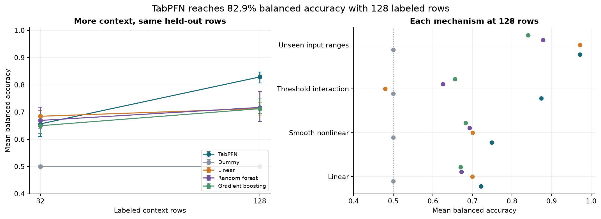
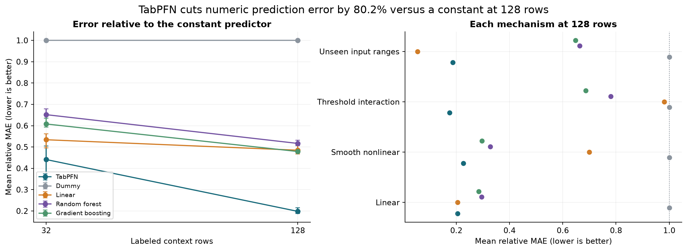
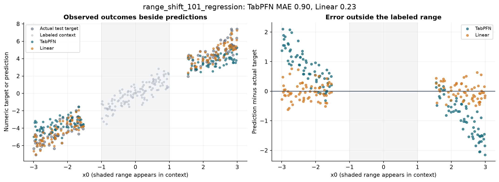
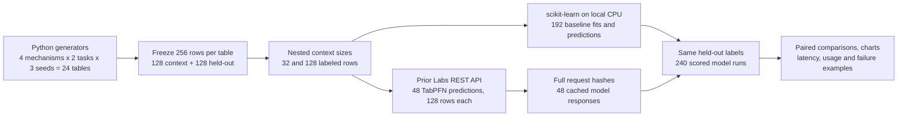
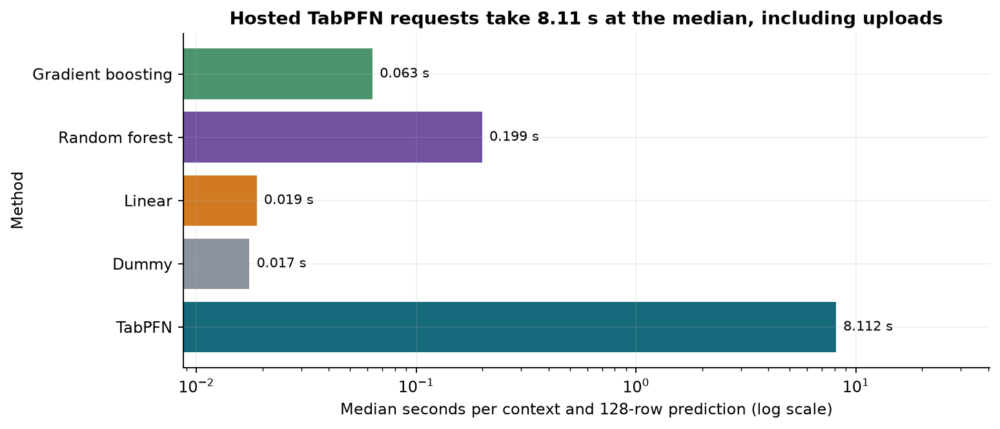

# Zero-shot prediction from small tables

Suppose a repair desk has only 40 completed jobs. It needs to flag which new jobs will need a specialist and estimate their duration. A wrong category wastes review time; a wrong duration estimate leaves staff idle or work unfinished.

A pretrained tabular model can take labeled rows as context and predict new rows without updating its weights. Ordinary fitted models can also work well on small tables. An average score can hide a specific failure, such as predicting beyond every input value in the labeled examples. This experiment makes those cases explicit and gives every method the same rows.

We compare hosted TabPFN-3.5 with four fitted baselines on 24 new synthetic numeric tables: four mechanisms, binary classification and regression, and three random seeds. Each method sees either 32 or 128 labeled rows and predicts the same 128 held-out rows. Zero-shot here means no task-specific weight training; labeled examples are still required.

At 128 context rows, TabPFN has **82.9% balanced accuracy**, versus 71.7% for Random forest. Its numeric prediction error is **0.198 times Dummy's error**, versus 0.479 for Gradient boosting. The main caveat is scope: four hand-chosen numeric mechanisms and three seeds cannot establish accuracy on real business tables.

## Results at 128 labeled rows

Balanced accuracy averages the fraction correct within each class; a constant classifier scores 0.5. Log loss penalizes probability assigned to the wrong label. Brier score is mean squared probability error. Both are better when smaller. Relative mean absolute error (MAE) divides a method's numeric error by the constant context-mean predictor's error on the same table; smaller is better and Dummy scores 1. Results average tables equally. Linear is logistic regression for categories and ridge regression for numbers.

| Method | Balanced accuracy | Log loss | Brier score | Relative MAE |
|---|---:|---:|---:|---:|
| TabPFN | 0.829 | 0.458 | 0.142 | 0.198 |
| Dummy | 0.500 | 0.694 | 0.250 | 1.000 |
| Linear | 0.713 | 0.525 | 0.179 | 0.485 |
| Random forest | 0.717 | 0.559 | 0.187 | 0.517 |
| Gradient boosting | 0.713 | 0.663 | 0.212 | 0.479 |


At 32 labeled rows, TabPFN scores 65.7% balanced accuracy, below Linear at 68.5%. The classification advantage appears at 128 rows in this run.





The notebook also reports both context sizes, per-mechanism results and paired differences against every fixed baseline. Its 95% bootstrap intervals resample the three seed blocks, with the mechanisms held fixed. They do not describe unseen real-world tasks. No baseline was tuned on test labels; the best mean baseline named above was identified after all methods were scored.

## An error outside the context range



For `range_shift_101_regression`, TabPFN MAE is 0.899, compared with 0.234 for Linear. Test `x0` values lie outside [-1, 1], the range available in context. The label rule is still linear. This example was selected after scoring to show the largest TabPFN-minus-Linear error in the shifted-range regression condition.

## Workflow



## Method

Each table has eight numeric features. The rules are linear, smooth nonlinear, threshold interactions and a linear rule tested outside the labeled input range. Five features are irrelevant. Regression adds Gaussian noise with standard deviation 0.3. Classification draws a binary outcome from a known probability, so even the correct rule cannot predict every random outcome. The oracle values are retained for error analysis and never sent as features.

The 32-row context is a prefix of the 128-row context. Test rows stay fixed. All fixtures were generated in Python on 2026-10-19, after the [2026-09-15 model release](https://priorlabs.ai/technical-reports), and frozen as CSVs with SHA-256 hashes. No public benchmark rows or LLM-authored records are used. The fixtures and generator code have the repository's MIT licence; model access follows [Prior Labs API terms](https://priorlabs.ai/pricing).

TabPFN uses `v3.5_default`, eight estimators and standard preprocessing through the [Prior Labs REST API](https://docs.priorlabs.ai/api/rest-quickstart). There is no Thinking or task-specific weight fine-tuning. Dummy returns a constant or class proportions; Linear uses standardized logistic/ridge regression; random forest uses 200 trees with minimum leaf size 2; histogram gradient boosting uses 100 iterations, 15 leaves and minimum leaf size 5. All settings are fixed before scoring.

The server reports checkpoint `tabpfn-v3.5-20260909.safetensors`, package 9.0.0, eight estimators and standard execution. Its metadata reports model seed 0 even though the requests specify seeds 101, 202 and 303. Both values are retained; the three data-generating seeds remain independent. No claim is made that the provider honored the requested model seed or that its mutable selector pins an immutable checkpoint hash.

## Latency and limits



Median hosted wall time is 8.11 seconds, including uploads, preprocessing and waits. Baseline timings cover local CPU fitting and prediction with one computational thread. The API reports CUDA but no accelerator model, so this is a user-visible timing comparison, not a CPU/GPU speed test.

The study has no text, categorical strings, missing values, entity groups or time ordering. It compares fixed baselines with eight pretrained model passes, not equal compute or tuned systems. New rows prevent exact-example memorization but the mathematical families may resemble model pretraining. Only one tabular foundation-model family is evaluated.

## Spend and saved evidence

There are 48 hosted prediction requests and 192 fitted baseline runs, producing 30,720 scored row predictions. The two pilot requests are included in the 48 and reused from cache. No prediction requests failed or were retried during collection. Estimates sum to 480,000 computation tokens; the saved account counters increased by 480,000. The daily allowance checked before collection was 5,000,000 tokens. The API does not expose a USD charge; no paid top-up was initiated. Computation tokens measure inference work, not words in a prompt.

- `data/fixtures/` and `fixture_manifest.json`: 24 frozen tables, generation date and input hashes.
- `data/cache/`: full logical requests, raw fit and prediction responses, metadata and original wall times. Temporary signed upload URLs and credentials are excluded.
- `data/model_provenance.json`, `model_runtime.json`, `environment.json`, `api_schema.json`: release sources, requested and reported settings, local versions and the API schema.
- `data/metrics.csv`, `predictions.csv`, `summary.csv`, `paired_differences.csv`, `calls.csv`: scored outputs and paired uncertainty.
- `data/provider_preflight.json`, `usage_after.json`, `spend.json`: saved estimates and numeric usage counters; currency charge is unknown.

## How to run

Use Python 3.13 from this folder:

```bash
python -m pip install -r data/requirements-lock.txt
python -m nbconvert --to notebook --execute --inplace 14_tabular_zero_shot.ipynb
```

Replay uses the saved requests and needs no API key or network access. `NB_SMOKE=1` selects two already-cached configurations. A full replay with HTTP requests disabled was checked before committing.

To collect a new run, copy the folder and follow section 8 of the notebook to clear the old caches and usage evidence. Set `NB_LIVE=1` and `PRIORLABS_API_KEY`. Controls at the top include `MECHANISMS`, `TASKS`, `SEEDS`, `N_CONTEXT`, `N_CONTEXT_POOL`, `N_TEST`, `MODELS`, `N_ESTIMATORS` and `MAX_USAGE_TOKENS`. The notebook refuses an offline cache miss, a token-cap breach or an uncertain prediction retry. Windows live collection can read the key from the current user's environment registry. Neither key is committed.

The notebook ends with five follow-up experiments and four further-reading links checked on 2026-10-19.
