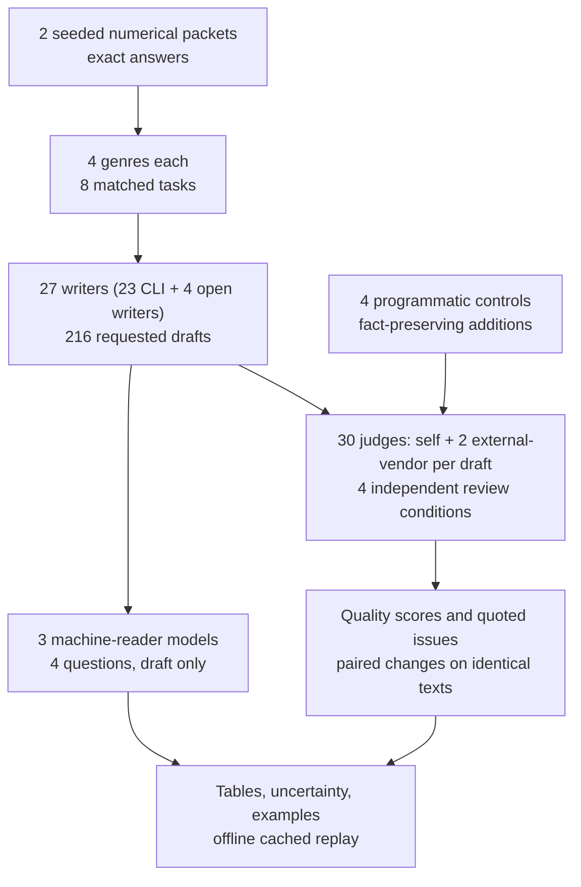
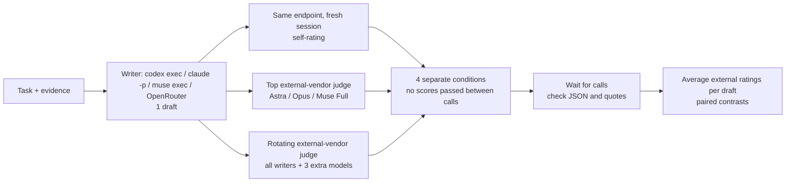
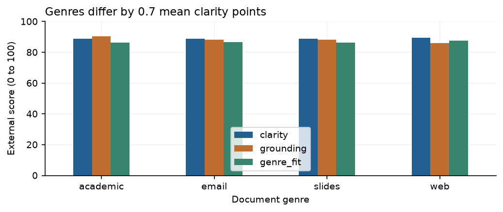
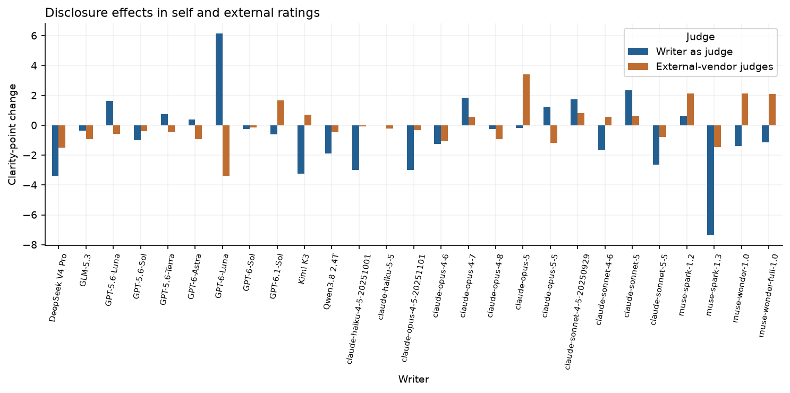
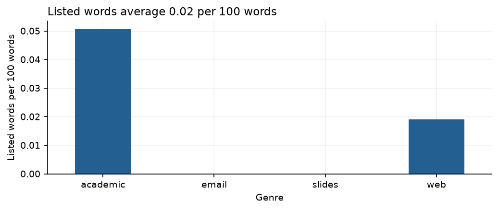

# Analytical writing and the reliability of its reviews

People increasingly ask AI to turn evidence into emails, reports and presentations. The reader may never see the source data or check the arithmetic. They rely on the document to show the main finding, explain its limits and connect it to a decision. If an opening recommendation conflicts with the numbers later in the text, a busy reader can leave with the wrong answer even when the calculation is eventually correct.

This is a question about analytical writing: writing that helps someone reason from evidence. The familiar complaint about “AI slop” covers several possible problems, including padded sentences, vague advice and repeated conclusions. Some criticisms are easier to defend than others. An unexplained reference can interrupt a reader, while a repeated main number may help an audience following slides. A technical term is not automatically a fault.

Using another AI model as a reviewer offers a quick way to inspect many drafts, but that reviewer is also part of the experiment. It may score more harshly when explicitly asked to find prose faults. It may react to the writer’s name, or disagree with a second reviewer about the same sentence. We therefore test both the documents and the stability of their reviews.

This pilot asks 27 accessible writers for four-slide text, web articles, short academic analyses and emails on two newly generated numerical cases: 216 drafts requested, 213 usable. Writers receive the evidence and a document brief without writing-style advice. The same drafts then receive reviews with their author hidden or named, under neutral questions or an explicit prose audit. Self-ratings are kept separate from the headline external-vendor scores.

Anonymous external clarity averages **88.9/100** across 211 rated drafts. Anonymous audits locate 2.19 issues per draft, or 0.76 per 100 words. The audit changes clarity by -1.66 points; naming the author under neutral review changes it by -0.06. These are model judgments on two cases. The audit changes both the review criteria and the AI-slop cue, and human comprehension is unmeasured.

## A reading guide

- [The task and the evidence](#the-task-and-the-evidence)
- [How the reviews work](#how-the-reviews-work)
- [What the writer and genre charts show](#what-the-writer-and-genre-charts-show)
- [What changes when review instructions change](#what-changes-when-review-instructions-change)
- [Actual drafts and reviewer disagreements](#actual-drafts-and-reviewer-disagreements)
- [Checks on the measurements](#checks-on-the-measurements)
- [Limits and the validation extension](#limits-and-the-validation-extension)
- [Spend and reproduction](#spend-and-reproduction)

## The task and the evidence

Both cases ask whether to expand an operational pilot. The rule is deliberately explicit: expand only if added value minus both the implementation cost and the vendor fee is positive. The source supplies segment counts, a value for each extra success and both costs. Writers must show the calculation and distinguish the financial decision from the strength of the evidence.

| Evidence | Service appointments, C1 | Order fulfilment, C2 |
|---|---:|---:|
| Extra standard successes | 75 | 84 |
| Extra complex successes | -8 | 10 |
| Total extra successes | 67 | 94 |
| Value per extra success | $32 | $42 |
| Added gross value | $2,144 | $3,948 |
| Implementation cost | $544 | $3,648 |
| Vendor fee | $1,000 | $900 |
| Net value | +$600 | -$600 |
| Decision under the stated rule | Expand | Do not expand |

C2 has more extra successes but a negative financial result because its costs are higher. Both cases compare an observational before/after pilot at unchanged segment volumes, with no random assignment or concurrent control. That means the change could reflect other events as well as the pilot. “The rule permits expansion” and “the pilot is proven to have caused an improvement” are different claims.

The cases are generated in code, with an exact answer key, rather than copied from a public benchmark. Their numbers, creation dates and MIT licence are frozen in [cases.json](data/cases.json). The four document formats reuse each case, creating eight matched tasks rather than eight independent subject areas. Every format receives the same short 240 to 320 word target.

For example, the C1 slide task begins:

> Write text for a four-slide analytical deck for the operations leadership team. Analyze the pilot and recommend whether to expand it. Use 240 to 320 words. Use the following evidence packet.

The full packet follows that instruction, including its source metadata and decision rule. The [task file](data/tasks.json) preserves every exact prompt. Examples 1 to 3 show different writers responding to this same brief.



The workflow has two kinds of model output: drafts and reviews of those drafts. The numerical answer key is checkable arithmetic; a reviewer’s prose label is another model judgment that needs validation.

## How the reviews work

A writer generates a document. A judge reads it and assigns ratings. A vendor is the company supplying a model. An external-vendor judge comes from a company other than the writer’s; a self-judge is the same model endpoint in a fresh session. For example, a GPT draft can receive Claude and Muse reviews. Those roles are assigned during analysis. In anonymous conditions, reviewers are not given the writer’s identity, although stylistic recognition remains possible.

Each draft is assigned its writer as a self-judge, a top external judge and a rotating external judge. Thirty model endpoints participate as judges across the experiment. This is a sparse panel: it keeps the paid-call budget small, but every writer is not reviewed by every judge. The historical collection includes open-weight judges; this explanatory update adds no new judging or generation.

| Review condition | Writer identity | Review instructions |
|---|---|---|
| Anonymous neutral | Hidden | Assess writing quality for the intended reader |
| Disclosed neutral | True model name supplied | Same neutral questions |
| Anonymous audit | Hidden | Inspect possible AI-slop prose using eight categories |
| Disclosed audit | True model name supplied | Same prose audit |

Each review uses a fresh session or request. Up to four drafts share a request, with opaque IDs and order varied across conditions. No previous score is passed into a new review. Batching may still affect judgments; the repeat check later in this report examines a combination of order and sampling variation.



Overall quality, clarity, grounding and genre fit use 0 to 100 rating scales. Clarity asks whether the reasoning is easy to follow. Grounding means factual support in the supplied evidence. Genre fit asks whether the response suits the requested document. A clarity score of 90 is a reviewer’s rating, not a finding that 90% of readers understood the document.

The neutral instructions do not name AI slop or list unwanted habits. The audit adds a rubric, meaning a set of explicit criteria: vague abstraction, unnecessary jargon, empty emphasis, repeated conclusions, padded construction, formulaic framing, stacked hedges and unclear references. An issue must have a quote and a local explanation. Zero is allowed. Duplicate or overlapping quoted spans count once; absent quotes remain available for inspection but do not enter the located count.

## What the writer and genre charts show


Read each row across both panels. The blue bar shows a writer’s mean anonymous neutral clarity, averaging external reviewers within a draft and then its available tasks. The orange bar shows located audit flags per 100 words from a separate review condition. It adjusts for length; it is not the percentage of words proven bad. The marks on clarity bars come from repeatedly resampling the available tasks and recalculating the mean. They describe variation in this small task set, not uncertainty across all possible writing topics.

Writer means range from 70.1 to 95.4. Claude Opus 5.5 and Sonnet 5.5 tie at 95.4, while Haiku 5.5 has the lowest mean audit density, 0.13 flags per 100 words. These are observed outcomes under the assigned panels. Restricting scores to the assigned top external judge changes writer means by up to 5.38 points, so small differences are not a stable general ordering. The [writer table](data/writer_summary.csv) gives coverage as well as intervals; missing ratings are not converted to zero.

| Genre | Rated drafts | Neutral clarity /100 | Neutral overall /100 | Audit flags per 100 words |
|---|---:|---:|---:|---:|
| Slides | 53 | 88.7 | 84.8 | 0.66 |
| Web article | 54 | 89.4 | 84.9 | 0.98 |
| Academic analysis | 52 | 88.8 | 86.6 | 0.66 |
| Email | 52 | 88.8 | 85.4 | 0.72 |



The blue bars are close: genre means differ by only 0.7 clarity points. Grounding and genre fit are separate dimensions, so similar readability ratings do not imply equally well-supported claims. Every format uses two cases and the same word target. These results do not establish that one genre is intrinsically easier for people to read.


In this heatmap, each row is a genre, each column is a prose category, and darker means more located flags per 100 words on average. Vague abstraction is most frequent overall, at about 0.20 per 100 words. Web articles attract more total flags than the other formats. Valid zero-issue reviews are included. The figure describes the rubric’s labels, not independently verified defects. Example 4 shows why that distinction matters: one reviewer flags a whole article thirteen times while another flags it once.

## What changes when review instructions change

A paired change compares the exact same draft reviewed by the exact same judge under two instructions. The analysis keeps judge-document pairs with all four conditions available, averages external judges within documents, then calculates the reported task-level effect. It covers 206 documents and 357 complete external judge-document pairs.


A point left of zero means the second instruction lowered clarity. The horizontal line is an interval from resampling the eight case-by-genre tasks. The audit changes clarity by -1.66 points, with an interval from -2.17 to -1.12. Naming the author during neutral review changes it by -0.06, with an interval from -0.38 to +0.25. Naming the author during the audit changes it by -0.07, with an interval from -0.57 to +0.56. The final row asks whether the disclosure effect differs between neutral and audit review; its mean is approximately zero.

The audit effect changes both the AI-slop cue and the criteria. It cannot isolate the effect of the warning alone. The disclosure intervals cross zero, allowing small effects in either direction on these tasks. Truthful source disclosure also reveals AI authorship, so it does not isolate brand reputation. Neither instruction changes a word of the document.



Each writer has two bars: one from its own reviews and one from external-vendor reviews. Above zero means naming the writer raises clarity; below zero means it lowers clarity. The pattern varies rather than showing uniform self-endorsement. Individual bars combine a few tasks, differing panels and fresh-session variation. An average close to zero can coexist with large changes on particular documents. Example 1 supplies the four actual scores for one unchanged Opus draft.

## Actual drafts and reviewer disagreements

These six examples were selected after viewing the results to explain a same-prompt contrast, a large disagreement and all four formats. They illustrate mechanisms rather than their frequency. The judge saw the whole document and evidence, not only the displayed excerpt. All scores are for that full document. A listed objection does not explain every deducted point.

Full prompts, drafts, raw review responses and cache keys are copied into [the example evidence file](data/reading_guide_examples.json). The original [ratings](data/ratings.json), [located issue records](data/issues.csv) and model-response cache remain unchanged.

### Example 1. Claude Opus 5.5 leads with the decision and its number

Writer: Claude Opus 5.5. Task: `C1_slides`. Document: `2d73ecb6c6ba0542`. The excerpt is unchanged.

> **The pilot clears the decision rule with a net gain of $600.**

> After the $1,000 vendor fee and $544 implementation cost, net value is **+$600**.

| External judge | Neutral clarity | Audit clarity | Located audit flags |
|---|---:|---:|---:|
| GPT-6 Astra | 93 | 91 | 2 |
| Kimi K3 | 98 | 94 | 0 |

The first slide makes the financial result easy to find. Its arithmetic matches the packet: 67 × $32 - $1,000 - $544 = $600. The two external neutral clarity ratings average 95.5. During the audit, Astra flags two repetitions while Kimi flags none. Whether repeating the main number on the opening and economics slides is helpful emphasis or padding depends on how the deck is used; this study does not measure audience comprehension. Opus ties Sonnet 5.5 for the highest mean clarity across the pilot’s available tasks, at 95.4, but that broader ordering depends on the assigned reviewers.

GPT-6 Astra flags this as repeated conclusion:

> After the $1,000 vendor fee and $544 implementation cost, net value is **+$600**.

> Reviewer explanation: Repeats the same slide’s highlighted net result; the cost breakdown also appears on the economics slide.

For this same Opus draft, the four clarity ratings from each external judge are:

| Judge | Hidden, neutral | Named, neutral | Hidden, audit | Named, audit |
|---|---:|---:|---:|---:|
| GPT-6 Astra | 93 | 95 | 91 | 96 |
| Kimi K3 | 98 | 93 | 94 | 94 |

The document stays fixed across all four columns. For Astra, the audit changes hidden-author clarity from 93 to 91, while naming the author in the neutral condition changes it from 93 to 95. Kimi moves in the opposite direction on disclosure, from 98 to 93. One document illustrates the comparisons; the paired-effects figure averages the eligible matched reviews.

### Example 2. GPT-6 Luna contradicts its own calculation on the identical prompt

Writer: GPT-6 Luna. Task: `C1_slides`. Document: `095e21dba04adb61`. The excerpt is unchanged.

> The pilot does not meet the stated expansion rule: extra value minus both costs is negative.

> **Conditional recommendation: expand in a measured, staged rollout**, prioritizing standard appointments and monitoring complex outcomes separately.

| External judge | Neutral clarity | Audit clarity | Located audit flags |
|---|---:|---:|---:|
| Claude Opus 4.8 | 40 | 45 | 2 |
| Claude Opus 5.5 | 30 | 25 | 3 |

This is the same C1 four-slide task as example 1. The first heading says not to expand, the opening sentence says net value is negative, but the draft calculates +$600 and later recommends expansion. The contradiction is checkable against the packet, independent of anyone’s preference about prose style. The external neutral clarity ratings average 35.0, compared with 95.5 for the Opus draft. The two drafts have different judge panels, so that numerical gap is not a fully controlled writer comparison. Its more defensible lesson is visible in the text: a reader encounters conflicting recommendations even though the arithmetic later becomes correct.

Claude Opus 4.8 flags this as unclear reference:

> extra value minus both costs is negative

> Reviewer explanation: States the result is negative, but the computed net value is +$600, directly contradicting the next sentences

Claude Opus 5.5 flags this as repeated conclusion:

> The arithmetic is favorable, but causal evidence is limited.

> Reviewer explanation: Restates the caveat given in the two preceding sentences without adding anything.

### Example 3. Astra slides attract four audit flags from one reviewer and none from another

Writer: GPT-6 Astra. Task: `C1_slides`. Document: `c76cf2350f61af8a`. The excerpt is unchanged.

> The service appointment pilot meets the stated financial decision rule: estimated extra value exceeds the vendor fee and implementation cost by **$600**.

> Expansion economics should be recalculated if costs, volumes, or performance change.

| External judge | Neutral clarity | Audit clarity | Located audit flags |
|---|---:|---:|---:|
| Claude Sonnet 5.5 | 88 | 85 | 4 |
| Muse Wonder Full | 95 | 91 | 0 |

Both judges receive the same full draft. Muse gives anonymous neutral clarity 95 and lists no audit issues; Claude Sonnet 5.5 gives 88 under neutral review, then 85 with four audit issues. Sonnet calls the second quoted sentence generic advice without a trigger, threshold or owner. It also flags repeated reminders about costs and causal uncertainty. These are local editorial objections to a financially correct document. Their presence does not establish that removing the sentences would improve comprehension.

Claude Sonnet 5.5 flags this as vague abstraction:

> Expansion economics should be recalculated if costs, volumes, or performance change.

> Reviewer explanation: Generic advice with no trigger, threshold or owner, so it does not tell the reader what to do.

### Example 4. The same web article receives one versus thirteen audit flags

Writer: Claude Sonnet 4.5 (20250929). Task: `C1_web`. Document: `ebff159de2886d93`. The excerpt is unchanged.

> A recent pilot program tested new protocols for service appointments across 1,900 items, yielding a net gain of 67 successful appointments when compared to baseline performance.

> The $600 positive margin provides runway to validate results more rigorously while capturing immediate value from standard appointments, where evidence is strongest.

| External judge | Neutral clarity | Audit clarity | Located audit flags |
|---|---:|---:|---:|
| Nemotron 3.5 | 85 | 65 | 13 |
| GPT-6 Astra | Missing | 91 | 1 |

This is the draft shown in the disagreement figure. Astra locates one audit issue: the metaphor “provides runway” does not specify what validation the $600 can fund. Nemotron locates thirteen, including a stock opening, undefined descriptions and an unclear reference. Some flags question broad descriptions such as “mixed segment-level results” even though the next sentences give the segment numbers. The excerpts let an editor inspect how much local context each criticism uses. The one-versus-thirteen difference is an observed disagreement, not evidence that either reviewer has the right total. Astra has no valid anonymous neutral score for this draft, so its missing cell is left visible.

GPT-6 Astra flags this as vague abstraction:

> provides runway to validate results more rigorously

> Reviewer explanation: Does not specify what validation the $600 margin could fund or how much time it would support.

Nemotron 3.5 flags this as formulaic framing:

> A recent pilot program tested new protocols for service appointments across 1,900 items, yielding a net gain of 67 successful appointments when compared to baseline performance.

> Reviewer explanation: Stock opener that repeats the headline and adds no information.

### Example 5. A high-scoring academic report keeps source limitations visible

Writer: Claude Opus 5.5. Task: `C1_academic`. Document: `5cee9130256f988d`. The excerpt is unchanged.

> The source is a seeded arithmetic fixture, so the figures illustrate the decision logic rather than describe a real operation.

> Each additional success is valued at $32, so the 67 net extra successes yield $2,144. Subtracting the fixed vendor fee ($1,000) and the implementation cost ($544) leaves a net value of **+$600**.

| External judge | Neutral clarity | Audit clarity | Located audit flags |
|---|---:|---:|---:|
| Gemma 4 31B | 100 | 100 | 0 |
| GPT-6 Astra | 96 | 96 | 0 |

The draft explains that the source is synthetic, distinguishes the observational comparison from a causal test, and shows both costs in the financial result. Gemma gives 100 on all four neutral dimensions; Astra gives clarity 96 and grounding 94. Both external anonymous audits list zero issues. Zero is a permitted response rather than a missing observation. It does not certify perfect writing: the report has 325 words under the notebook’s counter, slightly above the requested 320-word ceiling. The common short target also means this is not a full-length academic paper.

### Example 6. An email includes drafting narration and duplicates the analysis

Writer: Claude Haiku 4.5 (20251001). Task: `C2_email`. Document: `5f6f4678d3bdc579`. The excerpt is unchanged.

> I'll analyze the pilot data and draft the email for the director.

> The pilot demonstrated genuine improvements across both customer segments.

| External judge | Neutral clarity | Audit clarity | Located audit flags |
|---|---:|---:|---:|
| GPT-6 Astra | Missing | 82 | 5 |
| Nemotron 3.5 | 95 | 78 | 4 |

Haiku 4.5 supplies a preliminary financial analysis, then the director-facing email and another financial analysis. Astra flags the drafting narration because it addresses the assistant’s work rather than the director’s decision, and flags the duplicated working notes. Both external auditors object to “genuine improvements” because the uncontrolled comparison does not establish what caused the change. The correct C2 calculation is still present: 94 × $42 - $3,648 - $900 = -$600. This example separates a correct decision from problems in the document’s delivery and claims about the evidence.

GPT-6 Astra flags this as formulaic framing:

> I'll analyze the pilot data and draft the email for the director.

> Reviewer explanation: Announces the requested work instead of contributing to the director-facing email.

GPT-6 Astra flags this as empty emphasis:

> demonstrated genuine improvements

> Reviewer explanation: Adds certainty about the improvements despite the uncontrolled observational design.


The left side is example 4’s Sonnet 4.5 article; the right side puts the exact numerical answer key beside selected audit excerpts. The key establishes 67 extra successes and +$600, but supplies no gold prose labels. The figure was selected for its one-versus-thirteen count gap, not as a representative article. A correctly located quote only establishes that a reviewer quoted the draft accurately. It does not establish that the criticism would improve the document if followed.

## Checks on the measurements


The left histogram asks whether reviewers find phrases deliberately inserted by code into a short control document. Across valid control reviews, they locate 91.4% of the known additions on average. One inserted opening is:

> In a rapidly changing world, the path ahead requires careful consideration.

The numerical facts are unchanged. This tests sensitivity to selected additions, not precision on ordinary drafts. Plain controls can still attract flags. Both controls miss the main task’s length target, and adding phrases changes length, so their overall scores cannot isolate a pure style penalty.

The middle histogram measures fresh neutral repeats, with the draft order reversed and new IDs. The mean absolute clarity change is 3.30 points. Most repeats move less, while a few move much more. Model sampling and order both vary, so this is not a clean measurement of order bias. The absolute repeat change is also different from the signed average audit effect; comparing their sizes is a consistency check, not a statistical test of the audit effect.

The right panel shows machine readers recovering three varying answers: extra successes, net value and the expansion decision. Mean accuracy reaches 100%, leaving this task little room to distinguish drafts. The fourth question asks whether causality was established, but its answer is false in both cases and is reported separately. These are model readers, not people. A model can reconstruct the correct decision from available numbers even if the draft’s prose is contradictory, as example 2 illustrates.



The word-list diagnostic averages about 0.02 hits per 100 words across drafts. Its fixed sixteen-word list has zero mean hits in slides and emails here, even though some drafts have contradictions or receive audit flags. This figure records frequency; it is not a validated slop detector. A model can write poorly without using a listed word, and a listed word can be appropriate in context.

The same fixed word counter puts 36 of 213 drafts outside the requested 240 to 320 words. It counts letter/digit sequences with internal apostrophes or hyphens, so punctuation in large numbers can change a borderline count. Length compliance is separate from reasoning and prose quality.

## Limits and the validation extension

Two numerical cases cannot represent analytical writing in general. Four genres reuse the same evidence; resampling those tasks cannot create independent domains. Every task supplies the values and the decision rule, so this does not test finding evidence, constructing an argument from conflicting sources or writing a literature review. The short shared word target also makes an academic report unlike a full paper. Only slide text is tested, not layout, illustrations or spoken delivery.

The judge panel is sparse, reviewers differ, and up to four drafts share a request. Self-ratings are excluded from the main averages, but outside-vendor ratings still do not provide a common panel for every writer. Known injections test whether reviewers find deliberately added phrases; they do not validate every natural-text criticism. No human reading accuracy, reading time or editor labels were collected in this pilot.

The [validation extension in notebook 17](../17-writing-validation-extension/) follows up with 24 fresh cases, genre-specific lengths, repeated generation, fresh passage reviews and a warning comparison that keeps the rubric fixed. It also prepares human editor and reader materials, with results pending. That is a separate collection with different models and panels; its results should not be pooled into this pilot’s averages. Its panel-dependent ranking reinforces the need to inspect who supplied each score.

The original collection is an amended exploratory pilot. Before judging, truncated OpenRouter drafts could receive one identical-prompt retry with a higher token cap, as recorded in the [protocol amendment](data/protocol_amendment.json). A later [judge-setting correction](data/judge_protocol_correction.json) made low/off reasoning explicit before comparisons; earlier attempts remain in the cache and spending record. Completed drafts were not regenerated to improve quality. Provider defaults and product instructions differ across services, so this compares the recorded configurations rather than bare models under identical system prompts.

The 27 accessible writers include seven Codex, twelve Claude, four Muse and four open-weight models. Three extra open-weight models serve only as judges. Availability is a successful dated probe, not a claim about what is currently available or best. Failed probes, exact endpoints and source dates remain in the [availability table](data/availability.csv), [catalogue](data/model_catalog.json) and [model date table](data/model_dates.csv).

## Spend and reproduction

OpenRouter reported USD 3.1877. Unknown-cost responses have a bound of USD 1.0933, and an interrupted collection has a separate bound of USD 0.1690, giving a total charged-or-reserved bound of USD 4.4500 for this pilot. CLI subscription usage is separate. The extension carries this uncertainty forward; the combined notebook 15 plus 17 bound remains USD 4.6316 against the cumulative USD 10 cap. This explanatory update makes no new model calls and incurs no new model spending.

The collection has 1,550 cached requests and 1,606 recorded attempts. Of 672 main review requests, 637 passed transport and JSON validation. All raw responses and failures are cached by full request. Missing reviews reduce coverage; they do not become zero scores. The [protocol](data/protocol.json), [evidence manifest](data/manifest.json) and [usage records](data/request_usage.csv) make these checks inspectable.

Install the repository requirements, then run from this folder:

```powershell
python -m jupyter nbconvert --to notebook --execute --inplace 15_analytical_writing_style.ipynb
```

Default execution uses only the cached responses, checks the evidence manifest and stops on a missing entry. It needs no keys and makes zero model calls. For a separate collection, copy only the notebook to a new folder, change the seed and protocol version, use a clean instruction context and follow its live-collection instructions. Keep the committed evidence intact.

The notebook ends with five follow-up experiments and four checked readings on model judges, self-preference and vocabulary diagnostics. Its conclusions remain about these drafts and reviewers. The next decisive evidence is whether the same concerns predict independent readers’ accuracy and effort.
