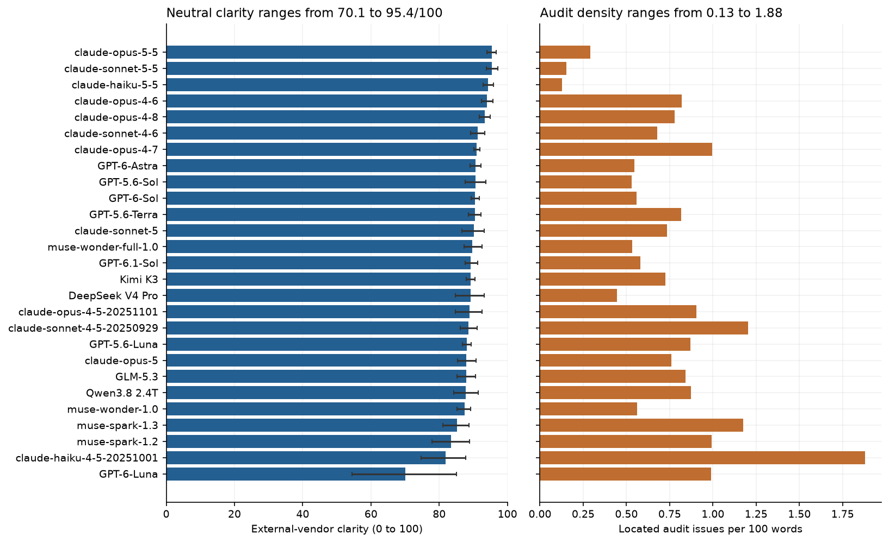
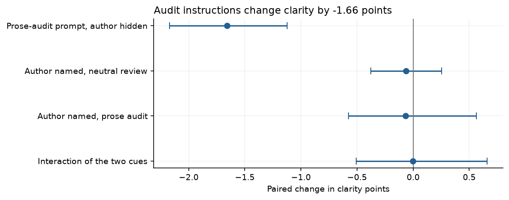
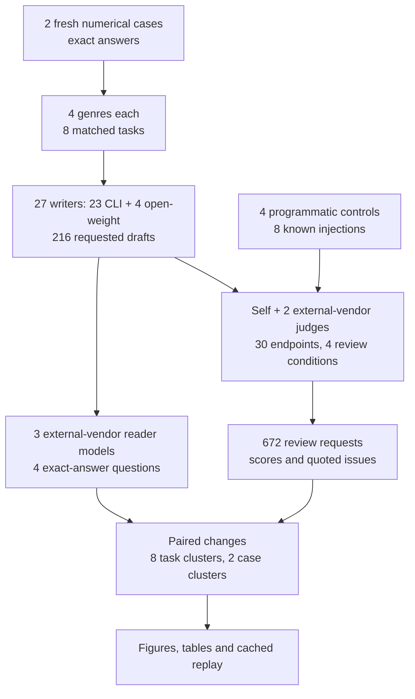
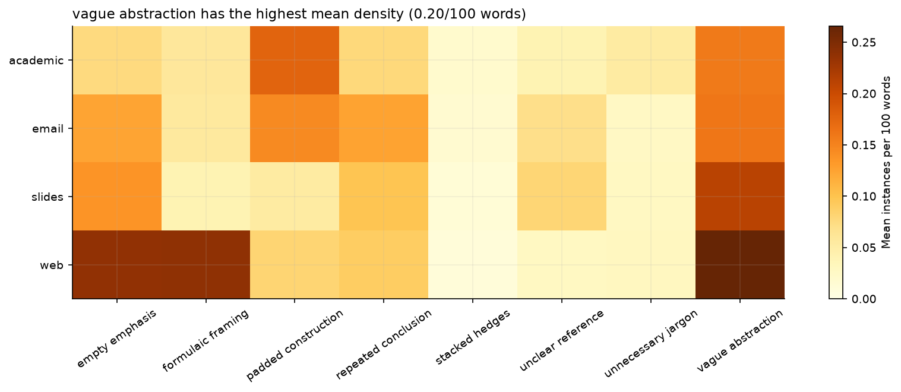
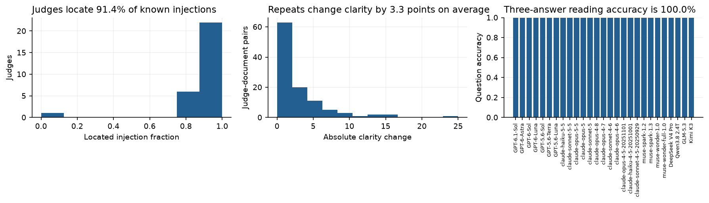
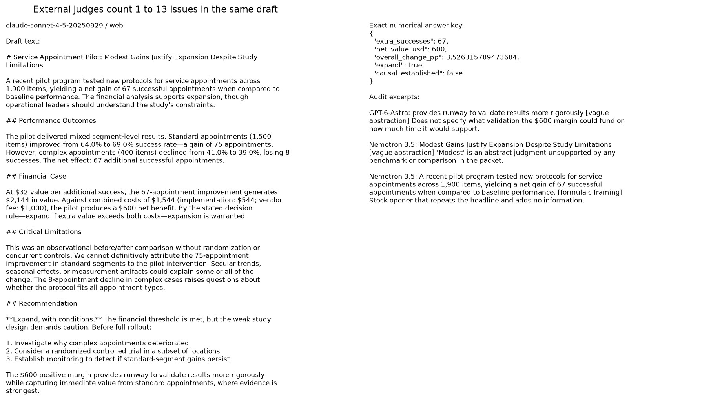

# Analytical writing and judge framing

A director must decide whether to expand a service pilot. The analyst has the segment counts, the value of a successful outcome and the implementation costs. If the draft hides a cost or buries its recommendation, the director can approve a program whose added value does not cover its costs.

Counting fashionable words cannot establish whether an analysis is easy to follow. A technical term can be needed, and polished prose can still get arithmetic wrong. A judge may also score the same passage differently after being told who wrote it or that it might contain AI slop. We therefore hold the draft fixed and change those two cues separately.

We asked 27 accessible writers for four-slide text, web articles, academic-style reports and emails on two fresh numerical packets: 216 drafts requested. Each draft has a self-judge, a top judge from another vendor and a rotating judge from another vendor. The 30 judge endpoints include the writers and three extra models.

Of 213 usable drafts, 211 received anonymous external ratings, with mean clarity of **88.9/100**. The anonymous prose audit located 2.19 issues per draft (0.76 per 100 words). The audit changed clarity by -1.66 points (task-cluster interval -2.17 to -1.12); naming the author during neutral review changed it by -0.06 points (task-cluster interval -0.38 to +0.25). These are model ratings on two cases, not measurements of human comprehension.

| Genre | Rated drafts | Neutral clarity /100 | Neutral overall /100 | Audit issues /100 words |
|---|---|---|---|---|
| slides | 53 | 88.7 | 84.8 | 0.66 |
| web | 54 | 89.4 | 84.9 | 0.98 |
| academic | 52 | 88.8 | 86.6 | 0.66 |
| email | 52 | 88.8 | 85.4 | 0.72 |



The [full writer table](data/writer_summary.csv) includes task-cluster intervals and coverage. Scores average external judges within a draft before averaging drafts. Self-ratings do not enter the headline. Two independent cases are too few to rank writers in general.



## Workflow



## Measures

Neutral reviews request overall quality, clarity, grounding and genre fit on identical 0 to 100 scales. They mention neither AI slop nor its categories. The audit adds vague abstraction, unnecessary jargon, empty emphasis, repeated conclusions, padded construction, formulaic framing, stacked hedges and unclear references. Every instance needs a quote and a reason. Zero issues is allowed. Duplicate and overlapping spans count once; absent quotes do not count.

Primary OpenRouter judges use advertised low reasoning where supported, or reasoning off where low is unavailable. CLI judges request low effort. Earlier default-effort OpenRouter reviews often exhausted their token budget and remain diagnostic evidence; their spend is included. The [dated judge correction](data/judge_protocol_correction.json) records this change before score comparisons. This is an amended exploratory pilot.

The four conditions cross hidden or disclosed authors with neutral or audit instructions. Each uses a fresh CLI session or API call. Opaque IDs and order change across conditions. Paired estimates compare the same text and judge. The sparse panel keeps the study inside the $10 paid-call budget; not every writer receives every judge. Using only the assigned top external judge shifts writer means by up to 5.38 points, so small differences should not be treated as a stable ranking. [Anchor-only scores](data/anchor_sensitivity.csv) show one sensitivity check.



## Checks and examples

Audits located 91.4% of the known injections on average. These test detection of deliberate phrases, not the correctness of every natural-text criticism. Plain and injected controls differ in length and miss the main task's word target, so their overall scores do not isolate a style penalty.

Fresh neutral repeats changed clarity by 3.30 points in mean absolute value. Order and sampling both change in this check. Machine readers recovered 100.0% of the three varying answers on average across drafts. The fourth question, causal design, has a constant false answer and is reported separately as a negative control. Missing facts and wrong analysis can also lower this score.





A quote may be located correctly yet criticized unfairly. The numerical key is objective; prose labels are not human gold labels. [Issue records](data/issues.csv) preserve the quotes, reasons, categories and location checks.

## Scope and data

Writers are seven visible Codex models, twelve accessible Claude versions, four Muse versions and four OpenRouter models: DeepSeek V4 Pro, Qwen3.8 2.4T A95B, GLM-5.3 and Kimi K3. Mistral Large 4, Gemma 4 31B and Nemotron 3.5 Super VL are judge-only additions. Both Claude Fable probes returned safeguard errors on the arithmetic access check and were excluded. This does not establish whether they could answer other prompts. [Availability](data/availability.csv) and the [catalogue](data/model_catalog.json) give exact IDs, serving providers and failed probes.

The [numerical packets](data/cases.json) are sampled by seeded code after access probes, with frozen values and exact answers. There are no real people or client data. Synthetic fixtures and code use the repository's MIT licence. Unknown training cutoffs stay unknown; OpenRouter catalogue creation dates are release proxies. The [model date table](data/model_dates.csv) gives sources and caveats.

Only slide text is evaluated. No rendered deck, human reading time, human comprehension or human prose labels are measured. One generation per task, two cases, product-specific CLI instructions, default temperatures and batched sparse judging limit the findings. The audit changes both framing and rubric. Truthful author disclosure also reveals AI authorship, so brand reputation is not isolated.

## Spend and replay

OpenRouter reported **USD 3.1877**. Unknown-cost responses have a bound of USD 1.0933; an interrupted collection has a separate bound of USD 0.1690. Total charged-or-reserved cost is at most USD 4.4500, below the user's $10 ceiling. CLI subscription usage is separate. [Usage records](data/request_usage.csv) give tokens and available list-price estimates.

The run has 1550 cached requests and 1606 recorded attempts. Of 672 main review requests, 637 passed transport and JSON validation. [The cache](data/cache_requests.jsonl) contains full requests, raw responses and failures. [The protocol](data/protocol.json) fixes the design and [the manifest](data/manifest.json) checks evidence integrity.

Run from this folder with the root requirements environment:

```powershell
python -m jupyter nbconvert --to notebook --execute --inplace 15_analytical_writing_style.ipynb
```

Default execution is offline and stops on a missing cache entry. It needs no keys and makes no model calls. For a new collection, copy only the notebook to an empty folder, change SEED and PROTOCOL_VERSION, and set NB_LIVE=1 with logged-in CLIs and OPENROUTER_API_KEY. Use a clean global instruction context as well as a temporary workspace. The notebook reserves paid costs before dispatch. A dated [protocol amendment](data/protocol_amendment.json) records the longer token cap used only for truncated drafts, and [collection events](data/collection_events.json) record scheduling changes and isolated reading calls. Its last section gives follow-up experiments and checked further-reading links.
