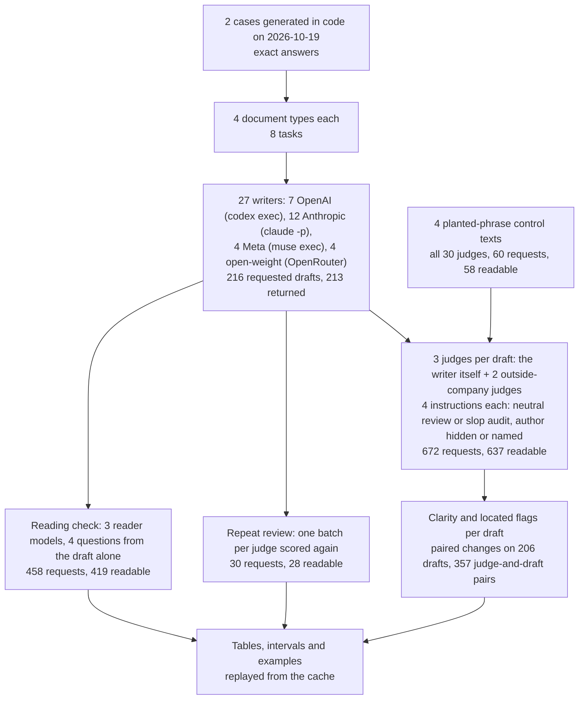
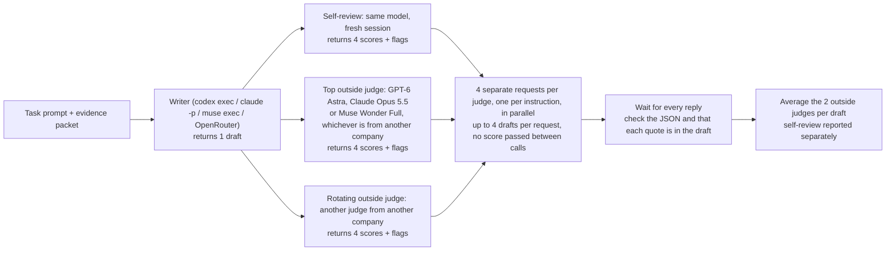

# What changes an AI judge's score for a short decision document?

## Four slides and a yes-or-no decision

A team runs a three-month trial of a new way to handle service appointments. At the end, a director has to decide whether to roll it out everywhere. The director will not open the spreadsheet. They will read four slides, the first one most carefully, and decide.

Writing like this has one job: to carry the reader from the evidence to the decision. It is often called analytical writing. A good version states the decision, shows the few numbers that justify it and says how far the evidence can be trusted. A poor version can contain every right number and still mislead, by burying the answer, repeating itself or contradicting its own conclusion.

### An illustrative example

This example is made up, with easy numbers. It is a simplified version of the two cases tested below.

The trial produced 10 more successful appointments than the months before it. Each success is worth $50, so the gain is $500. Running the new process costs $300. The director set a rule in advance: expand only if the gain minus the costs is positive. Here $500 - $300 = +$200, so the answer is "expand".

In the ordinary case, slide 1 says "Expand: the trial adds $200 after costs". Slide 2 shows the 10 extra appointments, slide 3 the costs, and slide 4 warns that a before-and-after comparison cannot prove the trial caused the change. The director reads slide 1, glances at the rest and approves.

Now add one complication. Slide 1 says "Do not expand: value minus costs is negative", but slide 3 works out +$200 and slide 4 recommends expanding. Every number in the deck is right, yet a director who acts on the first line makes the wrong decision. A careful reader would check each claim against the numbers and see that the opening sentence disagrees with the arithmetic. This fault has nothing to do with style. It is a fault in what the document says.

### Why AI judges are used, and why they need testing

Many documents like this are now drafted by AI models. A common complaint about them is "AI slop": padded sentences, stock openings, empty emphasis and conclusions repeated three times. A team that wants to check many drafts quickly often hands them to another AI model and asks for a score and a list of problems. That second model is the **judge**. It is fast and cheap, and its scores get used to choose which model writes the team's documents and which passages to cut.

A judge's score is only useful if it reflects the document, and three things outside the document could move it. The first is the instruction: a judge told to hunt for AI slop may find more faults, and give a lower score, than one asked plain questions about quality. The second is the author's name: a judge told which model wrote a draft might favour some models, including itself; earlier research found that models prefer their own writing ([Panickssery et al., 2024](https://arxiv.org/abs/2404.13076)). The third is the judge itself: two judges may disagree about which sentences are faults, or one may simply score everything higher. If any of these moves a score as much as a real difference between documents, a team would pick writers and cut passages for reasons unrelated to the text.

### What this experiment does

Twenty-seven AI models (the **writers**) each write the same eight short decision documents from two sets of figures. Each draft is then scored several times while its text stays fixed. A judge either gets plain quality questions, the **neutral review**, or is told the text may contain AI slop and given a list of eight habits to count, the **slop audit**. The judge is either told nothing about the author or told the writer's model name. Comparing the same draft, scored by the same judge under two instructions, shows how much the instruction alone moves the score.

Each draft also goes to two judges made by companies other than the writer's company, the **outside-company judges**, so their scores and the passages they object to can be compared. The figures in both cases were generated in code with exact answers, so a contradiction like the one above can be checked against the numbers.

## The question

When 27 AI models write short decision documents from the same two sets of figures, how much does an AI judge's clarity score depend on things outside the document: being told to hunt for AI slop, being told who wrote it, and which judge reads it? And do two judges object to the same passages?

## Study summary

Each writer was asked for 8 documents: 2 cases in 4 document types (text for four slides, a web article, a short academic-style report and an email), 216 requests in all, of which 213 returned a draft. Every draft was scored by its own writer and by two outside-company judges, under four instructions. The main measure is **clarity**, a 0 to 100 rating of how easy the analysis is to follow. 206 drafts had all four scores from both outside judges (357 judge-and-draft pairs).

- Telling judges to hunt for AI slop lowered clarity by 1.66 points out of 100 on the same drafts (95% interval -2.17 to -1.12). That is smaller than the 3.30 points a score moved, on average, when the same judge scored the same draft again in a fresh session.
- Telling judges who wrote the draft changed clarity by -0.06 (interval -0.38 to +0.25). No effect was detectable.
- The judge mattered more than either instruction. On the same four short control texts, GPT-6 Astra gave 81.5 clarity on average and Claude Opus 5.5 gave 55.0. Claude writers were never scored by Claude Opus 5.5 and OpenAI writers never by GPT-6 Astra, so the writer averages (70.1 to 95.4) mix the writing with which judges each writer drew.
- Two judges seldom objected to the same passages. On 194 drafts that both outside judges audited, 303 of their 830 flags (36.5%) overlapped a passage the other judge also flagged. On one web article, GPT-6 Astra flagged 1 passage and Nemotron 3.5 Super VL flagged 13.
- The lowest-scoring draft had a fault in its content, not its style. GPT-6 Luna's slides opened with "does not meet the stated expansion rule" and later recommended expanding (clarity 35.0, against 95.5 for Claude Opus 5.5 on the same task).

Unreadable replies are counted apart from scores: 35 of 672 judge requests returned nothing usable (9 empty, 26 broken JSON) and are left out, never scored as zero. A separate reading check, in which three models answered questions from each draft alone, was correct on every readable reply: a ceiling at which it cannot tell drafts apart.

In the director's terms: an AI judge will flag about two "slop" passages per draft (2.19 on average), but which two depends on the judge, and the slop instruction moves a score less than a second reading does. The check that protects the director is whether the opening recommendation agrees with the numbers.

The main caveat is that these are model judgments of two invented cases written to a short word target, with no human readers. A clarity of 90 is a judge's rating, not a share of readers who understood the slides.

## Contents

1. [The cases and the documents](#1-the-cases-and-the-documents)
2. [How the experiment runs](#2-how-the-experiment-runs)
3. [The models, the judges and the measures](#3-the-models-the-judges-and-the-measures)
4. [Results: how the drafts scored](#4-results-how-the-drafts-scored)
5. [Results: what moves the score of an unchanged draft](#5-results-what-moves-the-score-of-an-unchanged-draft)
6. [Results: checks on the judges](#6-results-checks-on-the-judges)
7. [Error analysis](#7-error-analysis)
8. [What the evidence supports](#8-what-the-evidence-supports)
9. [Limitations](#9-limitations)
10. [Spend, data and how to run](#10-spend-data-and-how-to-run)
11. [Future work and further reading](#11-future-work-and-further-reading)

## 1. The cases and the documents

Both cases ask whether to expand an operational trial. The rule is stated in the evidence: expand only if the value of the extra successes, minus both the implementation cost and a vendor fee, is positive. The evidence gives the counts for two customer segments, a dollar value per extra success and both costs. Writers must show the calculation and keep the money question apart from how strong the evidence is.

| Evidence | Service appointments (case C1) | Order fulfilment (case C2) |
|---|---:|---:|
| Extra standard successes | 75 | 84 |
| Extra complex successes | -8 | 10 |
| Total extra successes | 67 | 94 |
| Value per extra success | $32 | $42 |
| Added gross value | $2,144 | $3,948 |
| Implementation cost | $544 | $3,648 |
| Vendor fee | $1,000 | $900 |
| Net value | +$600 | -$600 |
| Decision under the stated rule | Expand | Do not expand |

C2 has more extra successes but a negative result, because its costs are higher. Both cases are before-and-after comparisons at unchanged segment volumes, with no random assignment and no comparison group running at the same time. The change could reflect other events as well as the trial, so "the rule permits expansion" and "the trial caused the improvement" are different claims, and a good draft keeps them apart.

The two evidence packets were generated in code from a fixed seed on 2026-10-19, with the exact answers computed before any model saw them, and are saved with their MIT licence in [`data/cases.json`](data/cases.json). No model can have seen them in training. Training cutoffs are not published for the 23 models called through company command-line tools; for the seven open-weight models the catalogue's creation date (between 2026-04-02 and 2026-10-15) stands in for a release date ([`data/model_dates.csv`](data/model_dates.csv)). Each packet's source field reads "Seeded arithmetic fixture generated by notebook code", and 19 drafts from 13 writers copied the phrase "seeded arithmetic fixture" into their text (counted from [`data/drafts.json`](data/drafts.json)).

Each case is written up in four document types, giving eight tasks. The four types reuse the same evidence, so they are eight variations on two problems, not eight independent subjects. Every task asks for 240 to 320 words. The slide task, for example, reads:

> Write text for a four-slide analytical deck for the operations leadership team. Analyze the pilot and recommend whether to expand it. Use 240 to 320 words. Use the following evidence packet.

The evidence packet follows, as JSON. The prompt gives no writing advice and does not mention AI slop, judges or authorship. Every exact prompt is in [`data/tasks.json`](data/tasks.json).

## 2. How the experiment runs



One draft travels through it like this. Claude Opus 5.5 receives the C1 slide prompt and returns one draft. That draft is scored by Claude Opus 5.5 itself in a fresh session, by GPT-6 Astra and by Kimi K3, each four times, once per instruction. The two outside judges' scores are averaged for the draft, and the differences between instructions become that draft's paired changes.

Each draft gets three judges, and each judge four separate requests:



### Worked example: one draft from prompt to paired change

Claude Opus 5.5 answered the C1 slide prompt with a 316-word deck (document `2d73ecb6c6ba0542`). Its first slide opens:

> **The pilot clears the decision rule with a net gain of $600.**
>
> After the $1,000 vendor fee and $544 implementation cost, net value is **+$600**.

The arithmetic matches the packet: 67 × $32 - $1,000 - $544 = $600. The draft then went to its three judges. Its top outside judge was GPT-6 Astra, and its rotating outside judge was Kimi K3. In the neutral review with the author hidden, Astra received the draft under the meaningless label `e924f0bd9a`, in one request with other drafts, and replied in JSON. The start of its record for this draft:

```text
{"id":"e924f0bd9a","overall":86,"clarity":93,"grounding":92,"genre_fit":80,
 "issues":[{"category":"length",...
```

The program maps the label back to the draft, checks that every quoted passage occurs in the text and records a clarity of 93. Kimi K3 gave 98, so the draft's neutral clarity is (93 + 98) / 2 = 95.5. The same two judges scored the same text three more times:

| Outside judge | Author hidden, neutral review | Author named, neutral review | Author hidden, slop audit | Author named, slop audit |
|---|---:|---:|---:|---:|
| GPT-6 Astra | 93 | 95 | 91 | 96 |
| Kimi K3 | 98 | 93 | 94 | 94 |

A **paired change** subtracts two scores of the same draft by the same judge. The slop audit's paired change is Astra 91 - 93 = -2 and Kimi 94 - 98 = -4, an average of -3 for this draft. Naming the author in the neutral review gives Astra +2 and Kimi -5, an average of -1.5. The two judges move in opposite directions on the same text. The study averages these per-draft changes within each of the eight tasks and then across tasks; that is the -1.66 for the audit and -0.06 for naming in the study summary.

Under the slop audit, Astra flagged two passages as repeated conclusions, including the second line quoted above ("Repeats the same slide's highlighted net result"); Kimi flagged none. Whether repeating the main number helps a slide audience is not measured here.

## 3. The models, the judges and the measures

The writers were every model that the three companies' command-line tools listed and that answered a test question on 2026-10-19 (7 from OpenAI, 12 from Anthropic, 4 from Meta), plus four large open-weight models. The Codex list left out models it marks as reserved or needing approval. Two more Anthropic models, Claude Fable 5 and Fable 5.1, were listed, but Anthropic's safeguards stopped the test request for both ([`data/availability.csv`](data/availability.csv)). Three more open-weight models served only as judges. Older models such as the 2025 Claude 4.5 versions are included because the tool still offered them, which gives the writers several model generations.

| Model | Version recorded | Called through | Size, precision | Role and why included |
|---|---|---|---|---|
| GPT-6.1 Sol | `gpt-6.1-sol` | `codex exec` | not published | Writer, judge; Codex list |
| GPT-6 Astra | `gpt-6-astra` | `codex exec` | not published | Writer, judge, top outside judge, reader model |
| GPT-6 Sol | `gpt-6-sol` | `codex exec` | not published | Writer, judge; Codex list |
| GPT-6 Luna | `gpt-6-luna` | `codex exec` | not published | Writer, judge; Codex list |
| GPT-5.6 Sol | `gpt-5.6-sol` | `codex exec` | not published | Writer, judge; Codex list |
| GPT-5.6 Terra | `gpt-5.6-terra` | `codex exec` | not published | Writer, judge; Codex list |
| GPT-5.6 Luna | `gpt-5.6-luna` | `codex exec` | not published | Writer, judge; Codex list |
| Claude Opus 5.5 | `claude-opus-5-5` | `claude -p` | not published | Writer, judge, top outside judge, reader model |
| Claude Sonnet 5.5 | `claude-sonnet-5-5` | `claude -p` | not published | Writer, judge; Claude Code list |
| Claude Haiku 5.5 | `claude-haiku-5-5` | `claude -p` | not published | Writer, judge; Claude Code list |
| Claude Opus 5 | `claude-opus-5` | `claude -p` | not published | Writer, judge; Claude Code list |
| Claude Sonnet 5 | `claude-sonnet-5` | `claude -p` | not published | Writer, judge; Claude Code list |
| Claude Opus 4.8 | `claude-opus-4-8` | `claude -p` | not published | Writer, judge; Claude Code list |
| Claude Opus 4.7 | `claude-opus-4-7` | `claude -p` | not published | Writer, judge; Claude Code list |
| Claude Opus 4.6 | `claude-opus-4-6` | `claude -p` | not published | Writer, judge; Claude Code list |
| Claude Sonnet 4.6 | `claude-sonnet-4-6` | `claude -p` | not published | Writer, judge; Claude Code list |
| Claude Opus 4.5 | `claude-opus-4-5-20251101` | `claude -p` | not published | Writer, judge; older generation still listed |
| Claude Haiku 4.5 | `claude-haiku-4-5-20251001` | `claude -p` | not published | Writer, judge; older generation still listed |
| Claude Sonnet 4.5 | `claude-sonnet-4-5-20250929` | `claude -p` | not published | Writer, judge; older generation still listed |
| Muse Spark 1.2 | `muse-spark-1.2` | `muse exec` | not published | Writer, judge; Muse list |
| Muse Spark 1.3 | `muse-spark-1.3` | `muse exec` | not published | Writer, judge; Muse list |
| Muse Wonder | `muse-wonder-1.0` | `muse exec` | not published | Writer, judge; Muse list, released 2026-10-12 |
| Muse Wonder Full | `muse-wonder-full-1.0` | `muse exec` | not published | Writer, judge, top outside judge, reader model |
| DeepSeek V4 Pro | `deepseek/deepseek-v4-pro-20260813` | OpenRouter, Baidu | not published; FP8 | Writer, judge; large open-weight model |
| Qwen3.8 2.4T | `qwen/qwen3.8-2.4t-a95b-20260812` | OpenRouter, Novita | 2.4T (95B active); precision not stated | Writer, judge; large open-weight model |
| GLM-5.3 | `z-ai/glm-5.3-20260816` | OpenRouter, Wafer | not published; FP4 | Writer, judge; large open-weight model |
| Kimi K3 | `moonshotai/kimi-k3-20260715` | OpenRouter, Sail Research | 2.8T; FP4 | Writer, judge; large open-weight model |
| Mistral Large 4 | `mistralai/mistral-large-4-0-20261006` | OpenRouter, Mistral | not published; precision not stated | Judge only; more outside-company judges |
| Gemma 4 31B | `google/gemma-4-31b-it-20260402` | OpenRouter, Parasail | 30.7B dense; FP8 | Judge only; more outside-company judges |
| Nemotron 3.5 Super VL | `nvidia/nemotron-3.5-super-vl-20261015` | OpenRouter, DeepInfra | 120B (12B active); FP4 | Judge only; more outside-company judges |

OpenAI models were called through the Codex command-line tool (`codex exec`, version 0.160.1), Anthropic models through Claude Code (`claude -p`, 2.1.296) and Meta models through `muse exec` (1.4.11). The version column gives what the call recorded. Claude Code reported the model ID it used; the Codex and Muse tools reported no dated version, so none is pinned for OpenAI or Meta. Each open-weight request pinned one serving provider with fallback off; the dated name is the catalogue's name for that provider's endpoint ([`data/model_catalog.json`](data/model_catalog.json)). Command-line models ran at low reasoning effort, open-weight writers at the provider's default and open-weight judges at low or no reasoning ([`data/PROTOCOL.md`](data/PROTOCOL.md) has the history). Temperatures were each service's default.

### Who judged each draft

Each draft had three judges: its own writer in a fresh session (the **self-review**), one **top outside judge** and one **rotating outside judge**. The top outside judge was whichever of GPT-6 Astra, Claude Opus 5.5 and Muse Wonder Full came from a different company, balanced so each scored 71 drafts. The rotating outside judge was drawn from the remaining judges of other companies, again balancing the load. This sparse panel keeps paid requests few, but writers from different companies were scored by different judges. Self-reviews are reported separately and never enter the main averages. Judges scored up to four drafts per request under meaningless labels, with the order changed between instructions, each request in a fresh session.

### The four instructions

| Instruction | Author | What the judge is asked |
|---|---|---|
| Neutral review, author hidden | Hidden | Score the writing for its intended reader; list problems with exact quotes |
| Neutral review, author named | The writer's model name | The same questions |
| Slop audit, author hidden | Hidden | The same questions, plus: "This is an audit of possible AI-slop prose", count instances of eight habits |
| Slop audit, author named | The writer's model name | The same audit |

The **eight habits** are vague abstraction, unnecessary jargon, empty emphasis, repeated conclusion, padded construction, formulaic framing, stacked hedges and unclear reference. The audit allows zero instances and says that a needed technical term, a justified hedge or a heading is not a fault on its own. The slop audit therefore changes two things at once: it adds the words "AI slop" and it adds the list of habits. Its effect on scores is the effect of both together.

### The measures

Judges gave four 0 to 100 ratings. **Clarity** asks how easy the analysis is to follow; it is the main measure. **Factual support** asks whether the claims match the evidence (the data files call it `grounding`). **Fit to the document type** asks whether it reads as the requested email, slides, article or report (`genre_fit`). **Overall quality** is a fourth rating. Higher is better on all four. They are judges' ratings, not measurements of readers.

A **flag** is a passage a judge quoted under one of the eight habits in a slop audit. A flag counts only if its quote is found in the draft and does not overlap a flag already counted; otherwise it is kept for inspection but not counted. **Flags per 100 words** divides a judge's counted flags by the draft's length: Astra's 2 flags on the 316-word deck above are 0.63 per 100 words. A counted flag shows only that the judge quoted the draft correctly, not that the criticism is right.

Intervals are 95% intervals from resampling the eight tasks 2,000 times and recalculating the average. They show how much a result depends on which of these eight tasks happen to be included. They cannot stand in for new subjects, because all eight tasks rest on two cases.

### Three checks on the judges

Three smaller collections test the judges rather than the drafts. In the **planted-phrase** check, code wrote a five-sentence plain summary of each case and a copy with four phrases added: a stock opening ("In a rapidly changing world, the path ahead requires careful consideration."), a padded sentence, an inflated claim and a repeated recommendation. All 30 judges scored all four texts, author hidden, under both instructions; a judge finds a phrase if it flags it under the intended habit. In the **repeat review**, one batch of drafts per judge was scored again under the neutral review in a new session, with new labels and the order reversed. In the **reading check**, GPT-6 Astra, Claude Opus 5.5 and Muse Wonder Full read drafts from other companies, one per request, without the evidence, and answered four questions: the extra successes, the net value, whether to expand, and whether the study established a cause (the answer is always "no", so it is reported separately).

## 4. Results: how the drafts scored


Read each row across both panels. The left bar is a writer's mean clarity from its outside-company judges, under the neutral review with the author hidden, averaged within each draft and then over the writer's tasks. The black marks are 95% intervals from resampling those tasks. The right bar is flags per 100 words from the slop audit, a separate request. The axis label "External-vendor" means outside-company, and the row labels are model IDs: `claude-opus-5-5` is Claude Opus 5.5 and `GPT-6-Luna` is GPT-6 Luna.

The 211 drafts with neutral scores average 88.9 clarity. Writer means run from 70.1 (GPT-6 Luna) to 95.4 (Claude Opus 5.5 and Claude Sonnet 5.5, tied), and 21 of the 27 writers sit between 87 and 95. The three Claude 5.5 models also drew the fewest flags (Haiku 5.5 0.13, Sonnet 5.5 0.15 and Opus 5.5 0.29 per 100 words), while Claude Haiku 4.5 drew the most (1.88). Across all drafts, the slop audit counted 2.19 flags per draft, or 0.76 per 100 words.

These means are not a ranking, because writers from different companies had different judges. On the four planted-phrase control texts, which every judge scored, the top outside judges' neutral clarity was 81.5 for GPT-6 Astra, 70.0 for Muse Wonder Full and 55.0 for Claude Opus 5.5, on identical words; across the 29 judges with four readable scores it ran from 32.5 (Qwen3.8 2.4T) to 83.0 (GPT-6.1 Sol) (counted from [`data/control_judgments.csv`](data/control_judgments.csv)). Every Claude writer drew Astra or Muse Wonder Full as its top judge, and every OpenAI writer drew Claude Opus 5.5 or Muse Wonder Full, so part of the gap between Claude and OpenAI writers may be a gap between judges. Using only the top outside judge's score moves writer means by up to 5.38 points ([`data/anchor_sensitivity.csv`](data/anchor_sensitivity.csv)).

### The lowest score: slides that contradict themselves

GPT-6 Luna's 70.1 rests largely on one draft. On the same C1 slide prompt as the worked example (document `095e21dba04adb61`), the first slide is headed "Decision: Do not expand" and opens:

> The pilot does not meet the stated expansion rule: extra value minus both costs is negative.

Three sentences later the same slide calculates +$600 and says "the rule actually supports expansion", and slide 4 gives a "Conditional recommendation: expand in a measured, staged rollout". This is the complication from the opening, produced by a real model. Its two outside judges gave neutral clarity 40 (Claude Opus 4.8) and 30 (Claude Opus 5.5), an average of 35.0 against 95.5 for the Opus deck on the same task. Claude Opus 4.8 flagged the first sentence: "States the result is negative, but the computed net value is +$600, directly contradicting the next sentences". The two drafts had different judges, so the 60-point gap is not a controlled comparison, but the contradiction can be checked against the packet without any judge.

### Document types

| Document type | Drafts with neutral scores | Clarity | Overall quality | Factual support | Fit to the document type | Flags per 100 words |
|---|---:|---:|---:|---:|---:|---:|
| Slide text | 53 | 88.7 | 84.8 | 88.3 | 86.4 | 0.66 |
| Web article | 54 | 89.4 | 84.9 | 86.1 | 87.7 | 0.98 |
| Academic-style report | 52 | 88.8 | 86.6 | 90.4 | 86.3 | 0.66 |
| Email | 52 | 88.8 | 85.4 | 88.1 | 86.5 | 0.72 |


Each group is one document type; the three bars are clarity, factual support (legend `grounding`) and fit to the document type (legend `genre_fit`), all from outside-company judges under the neutral review. The bars are nearly level: clarity differs by 0.7 points across types. Web articles drew the most flags (0.98 per 100 words, against 0.66 to 0.72) and the lowest factual support (86.1). All four types reuse the same two cases and the same word target, so these numbers do not show that one type is easier to read.

### Which habits judges flagged, and whether they agreed


Each cell is the average number of flags per 100 words for one habit in one document type, counting reviews that flagged nothing as zero. Darker means more. Vague abstraction is the most common habit overall, 0.20 flags per 100 words, and is darkest in web articles. Web articles also drew more empty emphasis and formulaic framing. Stacked hedges almost never appear. The map shows which labels the audit produced, not which habits readers notice.

Two judges audited most drafts, so their flags can be compared directly. On the 194 drafts where both outside judges returned a readable slop audit, they counted 830 flags between them. 303 of those flags (36.5%) overlapped a passage that the other judge also flagged, and 186 (22.4%) overlapped one flagged under the same habit. On 58 of the 194 drafts one judge flagged nothing while the other flagged at least one passage; on 18 both flagged nothing. These counts were made for this README from [`data/issues.csv`](data/issues.csv) (columns `valid`, `start`, `end`) and the judge roles in [`data/judgments.csv`](data/judgments.csv). Their neutral clarity scores differed too: by 6.1 points on average across the 180 drafts that both scored.

The largest disagreement is a 275-word web article by Claude Sonnet 4.5 (document `ebff159de2886d93`). In the slop audit with the author hidden, GPT-6 Astra flagged one passage and Nemotron 3.5 Super VL flagged thirteen.


The left side is the whole draft. The right side gives the case's answer key (67 extra successes, +$600, expand, no cause established) and three of the flags, with each judge's label and reason. The figure title's "External judges" means the outside-company judges. Astra's single flag was the metaphor in the last line:

> The $600 positive margin provides runway to validate results more rigorously

with the reason "Does not specify what validation the $600 margin could fund". Nemotron's thirteen included the opening sentence, flagged as formulaic framing ("Stock opener that repeats the headline and adds no information"), and the title word "Modest", flagged as vague abstraction. Some call phrases such as "mixed segment-level results" vague although the next sentences give the segment numbers. Every number in the article is right. Nemotron's audit clarity was 65 (85 in its neutral review); Astra's was 91. The draft was chosen for the largest gap in flag counts, so it shows how far two judges can diverge; the overlap counts above give the typical picture.

## 5. Results: what moves the score of an unchanged draft


Each row is one paired change, averaged over the 206 drafts that had all four scores from both outside judges. A point left of the vertical zero line means the second instruction gave a lower clarity score than the first. The bars are 95% intervals from resampling the eight tasks. The first row is the slop audit with the author hidden; the next two name the author under each instruction; the last asks whether naming the author has a different effect under the audit than under the neutral review.

The slop audit lowered clarity by 1.66 points (interval -2.17 to -1.12) and overall quality by 1.54. The effect was similar in both cases (-1.79 in C1, -1.53 in C2). Across the 357 outside judge-and-draft pairs it lowered the score in 201, left it unchanged in 63 and raised it in 93 (counted from [`data/paired_changes.csv`](data/paired_changes.csv)). So the audit pushes scores down a little on average, but for any one draft a second reading moves the score about twice as much (3.30 points, section 6). Because the audit changes the wording and the habit list together, it cannot say whether the words "AI slop" or the list did the work.

Naming the author changed clarity by -0.06 under the neutral review (interval -0.38 to +0.25) and -0.07 under the audit (interval -0.57 to +0.56). Across the 357 pairs, naming the author lowered the score 131 times, raised it 130 times and left it unchanged 96 times. Naming the author also tells the judge the text came from an AI model, so this does not separate reputation from the fact of AI authorship. Neither instruction changed a word of the draft.


Each writer has two bars: the change from naming the author in its own self-review (blue, legend "Writer as judge") and in its outside-company judges' reviews (orange, legend "External-vendor judges"). Above zero means naming the author raised clarity. Labels are model IDs. If models favoured their own writing once they knew it was theirs, the blue bars would sit above zero. They do not: across 189 self-review pairs, naming the author changed clarity by -0.69 on average, lowering it 81 times and raising it 61 times. The largest blue bars point both ways: GPT-6 Luna raised its own scores (its contradictory slides went from 62 with the author hidden to 84 when it was told it wrote them), while Muse Spark 1.3 lowered its own by about 7 points. Each bar averages at most eight drafts, so individual bars are noisy.

## 6. Results: checks on the judges


Read the three panels as three separate questions: can judges find faults planted on purpose, how much does a score move on a second reading, and can another model recover the decision facts from each draft?

Judges found the planted phrases. 22 of the 29 judges with a readable audit found all eight phrases under the intended habit, and 6 found six of eight, for a mean of 91.4% (the left panel's title calls the phrases "known injections"). The one judge at zero, Nemotron 3.5 Super VL, is a format failure, not a miss. Its reply quoted all eight phrases under the right habits but wrote several flags inside one JSON object with the same keys repeated, so the parser kept only the last flag in each object and none of the eight was counted (read from the raw reply in [`data/control_ratings.json`](data/control_ratings.json)). Without Nemotron the mean is 94.6% over 28 judges; Kimi K3 returned no readable audit of these texts. Finding planted phrases shows the audit can see deliberate faults, not that its flags on real drafts are fair.

A second reading moved scores more than the slop audit did. Across 108 repeat judge-and-draft pairs, clarity changed by 3.30 points on average (median 2, 58% within 2 points, largest 25). The repeat changes the session, the labels and the draft order at once, so it cannot isolate an effect of order. Set against the -1.66 audit effect it is a guide to scale, not a test: one measures movement in either direction, the other an average shift.

The reading check is at its ceiling. Every readable reply answered every question correctly, including "no" for an established cause, so the check cannot separate drafts. Even GPT-6 Luna's contradictory slides contain enough correct numbers for a model to reconstruct the right answer. All 39 unreadable replies came from Claude Opus 5.5, out of its 117 reading requests. Each one began with a line of arithmetic before the JSON, for example:

```text
Checks: 1191−1124=67; 67×32=2144; 2144−1000−544=600.

{"answers":[{"id":"96197b6c20","extra_successes":67,"net_value_usd":600,"expand":true,"causal_established":false}]}
```

The strict parser rejects the whole reply. Read from the cache with a parser that skips that first line, all 39 answer all four questions correctly ([`data/readings.json`](data/readings.json) and the cache; counted for this README). The notebook keeps the strict result, and the conclusion does not change.


The last check counts sixteen words often named in complaints about AI writing (the list is in the notebook). They are rare here: 0.02 per 100 words on average, with 11 of 213 drafts using any of them, and none in slides or emails. Judges still flagged about two passages per draft, so the word list and the judges are measuring different things. A draft can be hard to follow without any listed word, and a listed word can be the right one. The same word counter puts 36 of the 213 drafts outside the requested 240 to 320 words; it counts the parts of a number such as "1,900" separately, so borderline counts can shift.

## 7. Error analysis

### Content faults weigh more than style

The two writers with the lowest means, GPT-6 Luna (70.1) and Claude Haiku 4.5 (81.9), each have a draft whose main fault is in what it says. Luna's slides (section 4) contradict their own conclusion. Claude Haiku 4.5's email for C2 (document `5f6f4678d3bdc579`) opens with a line addressed to the person who asked for it, then gives a working analysis, then the email, then the analysis again:

> I'll analyze the pilot data and draft the email for the director.

It also claims more than the evidence allows: "The pilot demonstrated genuine improvements across both customer segments." GPT-6 Astra flagged the first line as formulaic framing ("Announces the requested work instead of contributing to the director-facing email") and "demonstrated genuine improvements" as empty emphasis ("Adds certainty about the improvements despite the uncontrolled observational design"), and gave audit clarity 82. The arithmetic is right (94 × $42 - $3,648 - $900 = -$600) and so is the decision. Here the habit labels point at real problems, but the problems are a leftover working note and an overclaimed cause, which the labels "formulaic framing" and "empty emphasis" describe only loosely. Claude Haiku 4.5 had the highest flag rate of any writer (1.88 per 100 words).

### One judge's fault is another's emphasis

GPT-6 Astra's own slides for C1 (document `c76cf2350f61af8a`) are financially correct. Muse Wonder Full gave them neutral clarity 95 and flagged nothing in the audit. Claude Sonnet 5.5 gave 88, then 85 in the audit with four flags, including this closing sentence as vague abstraction:

> Expansion economics should be recalculated if costs, volumes, or performance change.

Its reason was "Generic advice with no trigger, threshold or owner, so it does not tell the reader what to do". That is a defensible editorial point, and so is Muse's acceptance of a short standard caveat. This is the pattern behind the 36.5% overlap figure in section 4: most flags are one judge's preference, not a fault both judges see.

### A typical success

Claude Opus 5.5's academic-style report for C1 (document `5cee9130256f988d`) says plainly that "the figures illustrate the decision logic rather than describe a real operation", keeps the before-and-after comparison apart from a causal claim and shows both costs. Gemma 4 31B gave it 100 on all four ratings and GPT-6 Astra gave clarity 96; neither flagged anything in the audit. A zero is a valid answer, not a missing one, but it does not certify the draft: at 325 words it runs over the 320-word ceiling.

### Unreadable judge replies

The 35 unreadable judge replies (of 672) are left out of every average and never scored as zero. They fall into a few kinds, counted from [`data/ratings.json`](data/ratings.json) and the cache:

| Kind | Requests | Judges |
|---|---:|---|
| Empty reply, the command-line tool exited with an error | 6 | GPT-5.6 Sol |
| Empty reply, rate limit (HTTP 429) | 3 | Mistral Large 4 |
| Complete ratings missing only the final `]}` | 12 | GPT-6 Astra (11), GPT-6.1 Sol (1) |
| Text before the JSON, or other broken JSON | 14 | Claude Sonnet 4.5, Claude Haiku 4.5, Nemotron 3.5 Super VL and five others |

The twelve replies that lack only their closing brackets contain complete ratings; the strict parser drops them. Eleven of them are GPT-6 Astra's, which is why Astra, assigned to 71 drafts as top outside judge, has fewer readable neutral scores than the other two top judges. A separate failure removed three drafts: GPT-5.6 Sol's command-line tool exited with an error on every attempt for its C1 report, C1 email and C2 slides, so it has 5 drafts instead of 8.

### What these examples cannot show

The examples were chosen after the results were known: a same-prompt contrast, the largest disagreements and all four document types. They show what judges wrote, not why. A flag with a correct quote shows only that the judge quoted the draft accurately. Whether following any flag would help a reader is not measured here.

## 8. What the evidence supports

- Use an AI judge's flags as suggestions for an editor, not as a count of faults. Two judges agreed on about a third of each other's flags, and a single judge's total varied from 1 to 13 on the same article.
- Check the opening recommendation against the numbers before anything else. The worst draft in the study was a contradiction, and the reading check could not catch it, because the right numbers were still in the text.
- Do not read a one- or two-point change in an AI judge's clarity score as a real difference. The slop audit moved scores by 1.66 on average, and a second reading by the same judge moved them by 3.30.
- Compare writers only on scores from the same judges, and report each judge separately. On identical control texts, judges' average clarity ran from 32.5 to 83.0, and the judges each writer drew depended on its company.
- Whether to tell the judge who wrote the draft made no measurable difference here.

The uncertainty that most needs another experiment is whether any of these flags predicts what a human reader misses or misreads.

## 9. Limitations

- The study rests on two invented cases. The four document types reuse the same two sets of figures, and every task supplies the numbers and the decision rule. Finding evidence, weighing conflicting sources or building an argument are not tested. The shared 240 to 320 word target makes the report much shorter than a real paper and tests slide text, not slide layout.
- Only models judged the drafts; no person read any of them. Clarity is a judge's rating; the reading check sits at a ceiling and so cannot stand in for reader comprehension.
- Different writers had different judges. The sparse panel kept requests few, but judges differ widely in strictness, and a writer's company decided which top judge it could draw. Writer means are not a ranking.
- The slop audit changes two things at once: it adds the words "AI slop" and the habit list. Naming the author also reveals AI authorship, so brand and authorship are not separated. Hiding the name cannot stop a judge from recognising a style.
- There is one draft per writer and task. Each writer's mean rests on at most eight drafts, and command-line products bring their own built-in instructions and default temperatures, so this compares configured products, not bare models.
- The protocol changed during collection. Two changes were made after drafting began and before any comparison of scores: open-weight drafts cut off by the 1,800-token limit were requested once more with a 16,000-token limit, and open-weight judges were switched from the providers' high default reasoning to low or none after many of their replies were cut off. Neither change used any writing score. This is an exploratory study, not a preregistered test; the full record is in [`data/PROTOCOL.md`](data/PROTOCOL.md).

## 10. Spend, data and how to run

- OpenRouter reported $3.19 for writers and judges. Replies that came back without a price are bounded at $1.09, and requests interrupted before their reply was saved at $0.17, so the most that could have been charged is $4.45, under a $10 cap.
- OpenAI, Anthropic and Meta calls ran on subscriptions with no per-call charge. Claude Code reported a list-price equivalent of $22.59.
- The cache holds 1,550 distinct requests and 1,606 attempts, including failures and the superseded open-weight judge replies.

| File in `data/` | What it holds |
|---|---|
| `cases.json`, `tasks.json`, `drafts.json` | Evidence packets with answers, writer prompts and all 216 draft requests |
| `panel.json`, `ratings.json` | Judges assigned to each draft, and every judge reply with its parsed scores |
| `judgments.csv`, `issues.csv` | One row per score, and one row per flag with its location |
| `document_scores.csv`, `paired_changes.csv`, `effects.csv` | Per-draft scores, paired changes and summary effects |
| `control_*.json/csv`, `repeat_checks.csv`, `reading_scores.csv` | The three checks on the judges |
| `reading_guide_examples.json` | Prompts, drafts and raw judge replies for the documents quoted above |
| `model_catalog.json`, `availability.csv`, `model_dates.csv` | Model list, serving providers, prices and test results |
| `cache_requests.jsonl` | Every request and reply, keyed by the full request |
| `PROTOCOL.md` | Run history: settings, amendments, interruptions and spend detail |

Running the notebook replays everything from these files with no network calls and no keys, and stops if a cached reply is missing:

```bash
jupyter nbconvert --to notebook --execute --inplace 15_analytical_writing_style.ipynb
```

A new collection needs `NB_LIVE=1`, an `OPENROUTER_API_KEY` and signed-in `codex`, `claude` and `muse` command-line tools. Copy the notebook to an empty folder, change the seed and protocol version, and keep this folder's evidence unchanged. The full analysis is in [15_analytical_writing_style.ipynb](15_analytical_writing_style.ipynb).

## 11. Future work and further reading

### Future work

- Give the same drafts to people who have not seen the evidence, and measure answer accuracy and reading time. This would test whether any flag or clarity score predicts reading difficulty, which nothing here measures. A later study in this repository, [notebook 17](../17-writing-validation-extension/), prepared reader and editor forms for this; no responses had been collected when it was written.
- Move from two arithmetic packets to at least 30 cases with uncertain forecasts, conflicting evidence and randomised as well as before-and-after studies, so that the causal question is not always "no" and the reading check has room below its ceiling.
- Have every outside judge score every draft, one draft per request, three times. This separates judge strictness, batch effects and sampling noise, which the sparse panel leaves mixed together (judges' average clarity on the same control texts ran from 32.5 to 83.0).
- Score the same drafts with the habit list alone and with the list plus the words "AI slop", to find which part of the slop audit lowers scores. Notebook 17 ran this comparison on new drafts.
- Randomly assign correct names, wrong names and no name to the same drafts, to separate a model's reputation from the fact of AI authorship.

### Further reading

Links checked on 2026-10-22.

- [Judging LLM-as-a-Judge with MT-Bench and Chatbot Arena](https://arxiv.org/abs/2306.05685) (Zheng et al., 2023). Documents position, length and self-preference biases in model judges; it motivates the repeat review and the separate self-review.
- [LLM Evaluators Recognize and Favor Their Own Generations](https://arxiv.org/abs/2404.13076) (Panickssery et al., 2024). Finds that models score their own writing higher; here, naming the author in a self-review did not raise scores on average.
- [Delving into LLM-assisted writing in biomedical publications through excess vocabulary](https://arxiv.org/abs/2406.07016) (Kobak et al., 2025). Measures the rise of AI-associated words across scientific abstracts; the word-list check here uses that idea as a frequency count, not a quality score.
- [Why Does ChatGPT "Delve" So Much? Exploring the Sources of Lexical Overrepresentation in Large Language Models](https://arxiv.org/abs/2412.11385) (Juzek and Ward, 2024). Explains why some words are overused by models; it supports keeping a word's frequency apart from whether a sentence is clear.
