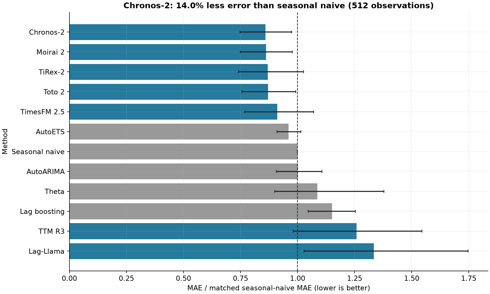
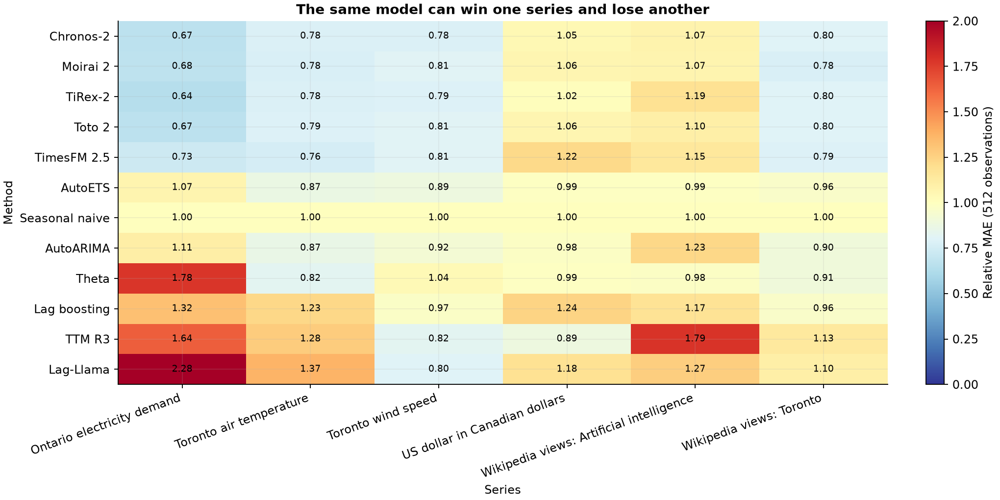
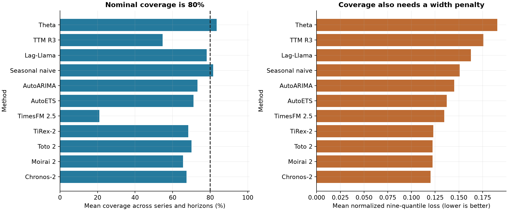
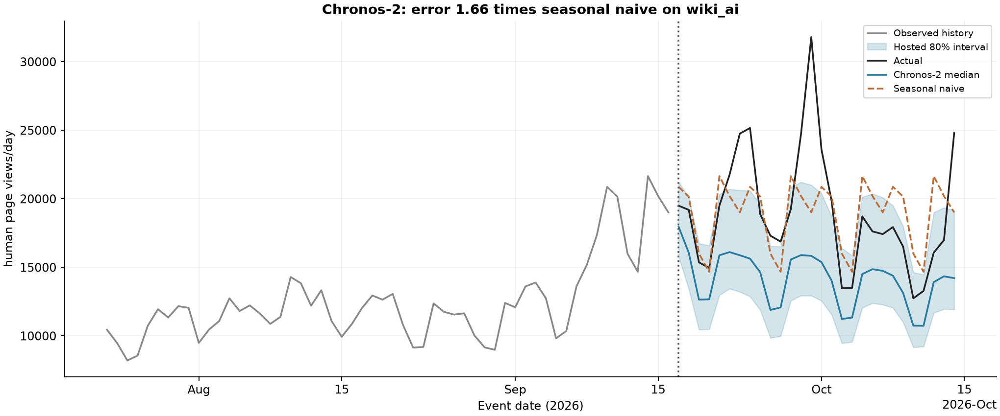
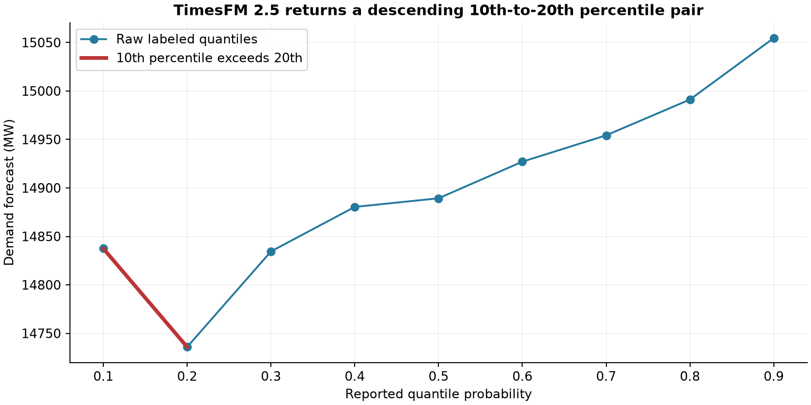
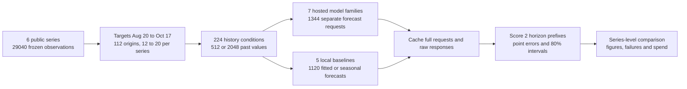
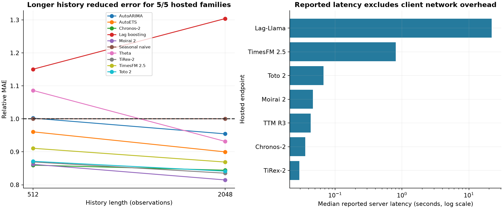

# Zero-shot time-series forecasting on six fresh series

An electricity planner needs next week's demand before it happens. A traffic analyst needs to know whether tomorrow's page views will exceed the usual pattern. Repeating a recent cycle is cheap; fitting a separate model to every series takes work. A pretrained model might remove that fitting step, but a missed change or an overconfident interval still leads to a bad decision.

The obvious test, an old public benchmark, may reuse data that helped train the model. A few overlapping forecast windows can also make the evidence look larger than it is. This experiment freezes recent targets after public weight availability, uses the same history for every method, and compares errors within each series before averaging across units.

The question is whether seven hosted forecasting families beat five seasonal or fitted baselines on six series. There are 112 rolling origins (20 per series except 12 for USD/CAD), 512 or 2,048 past observations, and two horizon prefixes: 24/168 hourly steps or 7/28 daily observation steps. Targets are August 20 to October 17, 2026.

Chronos-2 had 0.860 relative MAE (14.0% less error than seasonal naive) at 512 observations; the best baseline, AutoETS, had 0.961. Chronos-2's nominal 80% interval coverage averaged 67.4% across series and horizons. The main caveat is the six-series sample with overlapping origins. Hosted revision and training-data lineage are also unverified, so this measures the cached endpoints.

## Results

Relative MAE is a method's held-out mean absolute error divided by seasonal naive's error on the same series, origins and horizon. Below 1 is better than repeating the last seasonal cycle. Each series and each horizon receives equal weight. The 2,048 condition omits two unsupported families.

| Method | Relative MAE, 512 inputs | Relative MAE, 2,048 inputs |
|---|---:|---:|
| Chronos-2 | 0.860 | 0.844 |
| Moirai 2 | 0.862 | 0.815 |
| TiRex-2 | 0.869 | 0.835 |
| Toto 2 | 0.871 | 0.841 |
| TimesFM 2.5 | 0.911 | 0.869 |
| AutoETS | 0.961 | 0.900 |
| Seasonal naive | 1.000 | 1.000 |
| AutoARIMA | 1.002 | 0.954 |
| Theta | 1.086 | 0.932 |
| Lag boosting | 1.150 | 1.304 |
| TTM R3 | 1.258 | Not served |
| Lag-Llama | 1.334 | Not served |



Chronos-2's 95% whole-series resampling interval at 512 inputs is 0.748 to 0.974. It describes variation among these six series; it does not correct for selecting the best method after evaluation. The paired difference from AutoETS is -0.101, with a descriptive 95% interval from -0.233 to 0.015. That interval spans zero, so this sample does not establish an advantage over AutoETS.



Coverage is the fraction of actual values inside the 10th-to-90th-percentile interval. The target is 80%; wider intervals are penalized by the nine-quantile loss. The provider returned quantiles for every hosted family, including TTM R3, but does not expose how each wrapper constructs them.



At 2026-09-17, Chronos-2's wiki_ai forecast had MAE 4827.627, against 2901.607 for seasonal naive (1.66 times the error). This is the winner's worst individual long-horizon ratio, selected after scoring.



TimesFM 2.5 returned a 10th percentile above its 20th percentile at all 23,072 forecast steps across both contexts. Its raw-label 80% coverage was 21.0%. This is an inconsistent hosted quantile contract; the native model's interval quality cannot be inferred from this endpoint result. Fitted baselines use the point forecast as a median approximation in the nine-quantile score, which can also introduce crossings for asymmetric intervals.



## Workflow



Each rolling origin is a separate single-input forecast request inside `/v1/forecast/batch`. Histories from later origins are never extra inputs to earlier forecasts. A single maximum-horizon forecast is scored at two prefixes; a separate short-horizon call could differ. No future covariates or start timestamps are sent. The cadence is hourly or daily; USD/CAD's daily hint means a published observation step, without filling weekends or holidays.

The fitted baselines are AutoETS (automatic error/trend, additive seasonality), bounded AutoARIMA (up to 20 candidate models), Theta with additive decomposition, and recursive gradient boosting on lagged observations. Seasonal naive repeats a 168-step demand cycle, 24-step weather cycle, seven-step page-view cycle or five-observation exchange-rate cycle. All settings are fixed before scoring.

## Data and models

The frozen input table has 29,040 observations; 4,405 distinct observations appear as test targets. Electricity demand is from IESO, weather reanalysis/analysis from Open-Meteo, human page views from Wikimedia, and USD/CAD from the Bank of Canada. [The manifest](data/data_manifest.json) records URLs, hashes, clocks, retrieval dates and licences; [attribution](data/ATTRIBUTION.md) preserves source notices. Weather is reconstructed analysis, not a station observation. Exchange-rate horizons count published observations. No missing values are filled or clipped.

Public availability bounds below precede the target window. Training cutoffs are not consistently published. Most bounds conservatively use the last public repository modification; TiRex-2 uses the actual July 2 weight commit because its October edit concerns other files; TTM R3 uses IBM's later March 31 public announcement. Official release evidence is recorded alongside the repository dates. [Provenance](data/model_provenance.json) records immutable Hugging Face revisions, licence sources and the selected weight hash. The API cannot be pinned to those revisions.

| Hosted family | Public availability bound | Weight licence |
|---|---|---|
| [Chronos-2](https://huggingface.co/amazon/chronos-2) | 2026-06-05 | apache-2.0 |
| [TimesFM 2.5](https://huggingface.co/google/timesfm-2.5-200m-pytorch) | 2025-10-02 | apache-2.0 |
| [Moirai 2](https://huggingface.co/Salesforce/moirai-2.0-R-small) | 2026-01-29 | cc-by-nc-4.0 |
| [TiRex-2](https://huggingface.co/NX-AI/TiRex-2) | 2026-07-02 | apache-2.0 |
| [Toto 2](https://huggingface.co/Datadog/Toto-2.0-2.5B) | 2026-06-04 | apache-2.0 |
| [TTM R3](https://huggingface.co/ibm-research/ttm-r3) | 2026-03-31 | cc-by-nc-sa-4.0 |
| [Lag-Llama](https://huggingface.co/time-series-foundation-models/Lag-Llama) | 2024-05-14 | apache-2.0 |

Moirai 2 and TTM R3 are used for noncommercial research; no weights are redistributed. TimesFM 3 was absent from the hosted catalog. This implements [proposal #13](https://github.com/k-sandhu/experiment-notebooks/issues/13) with hosted models, wind instead of air quality, and no optional general-purpose LLM arm. Local foundation-model setup, GPU memory and hardware comparisons are outside the measured results.

## Context, latency and limits

Longer history lowered error for 5/5 hosted families that support both lengths. Server latency excludes client network overhead; batch wall time includes network and queueing. The local baselines run on different hardware. These timings are operational evidence, not a controlled speed comparison.



Origins overlap; the two weather series share a location; six hand-selected series do not estimate a population ranking. Data are frozen at their current vintage, which may differ from what was available at a historical origin. Event dates are recorded, but exact original publication times are not. Hosted revisions, training cutoffs, random seeds, hardware and interval wrappers are not independently verified. Freshness assumes the service serves the documented released checkpoints; an unreported update could invalidate it. Wider baseline searches, calendar features, or local pinned weights could change the comparison.

## Spend and cached evidence

The run has 1,344 unique hosted forecast requests, 1368 experiment attempts and 9 probe requests. It made 177 experiment batch HTTP calls. There were 24 additional forecast attempts after connection failures; failed envelopes remain in the batch cache. No incomplete origin is dropped from the reported comparisons.

The published rate was $0.25 per 1,000 forecast requests ([pricing](https://tsfm.ai/pricing), checked October 19, 2026). Account usage increased by $0.34425, consuming 1377 credits. The attempt-based estimate is $0.34425; the collection cap was $3. No top-up or subscription was activated. The account reports usage cost; this is not a paid-invoice confirmation. Local baseline fit-and-predict wall time sums to 1147.9 seconds on the recorded machine.

`data/cache_hosted/` contains full requests and selected raw responses; `data/batches/` preserves every batch response or transport failure, and per-request history links recovery attempts. `data/probes/` contains capability checks. `data/cache_baselines/` records full histories, settings, outputs, warnings and time. Caches are keyed by SHA-256 of the full request. `data/origins.csv` and `data/target_dates.csv` define the test set; score tables, [spend](data/spend.json), [run metadata](data/run_manifest.json) and [validation](data/validation.json) are committed alongside the plots.

## How to run

From this notebook's folder, create a Python 3.13 environment and run:

```bash
python -m pip install -r requirements.txt
python -m ipykernel install --user --name experiment-ts16 --display-name "Python (TS16)"
python -m nbconvert --to notebook --execute --inplace 16_time_series_zero_shot.ipynb
```

Default replay is offline and needs no key. The notebook rebuilds normalized values from the frozen raw sources, verifies hashes, replays forecasts, and recalculates scores and figures. Validation blocks all Requests HTTP operations and confirms zero attempts and identical derived results. Missing hosted caches stop with an error before any call.

For new collection only, set `TS16_LIVE=1` and `TSFMAI_API_KEY`. Top-cell knobs control origins, models, context lengths, concurrency and the $3 cap. A smaller origin count can choose new origins and require new calls. Existing failures are not retried automatically: reconcile the account first, then explicitly use the recovery helper with smaller batches. Keep all request intents and caches. Fresh source collection is a separate opt-in helper and requires a new provenance/date check.

The notebook ends with five follow-up experiments tied to these results and five checked reading links.
