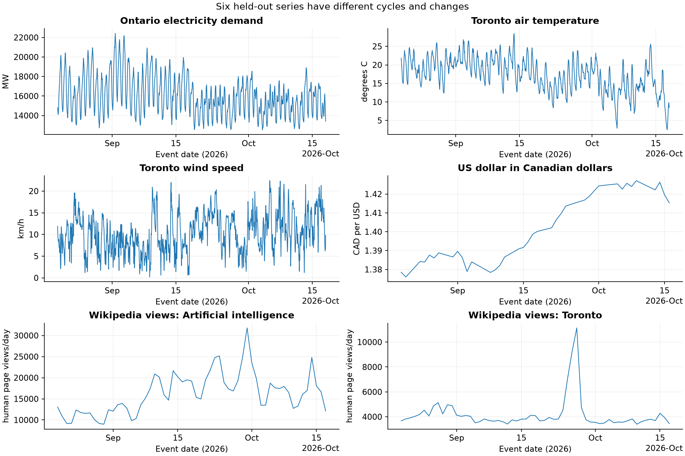
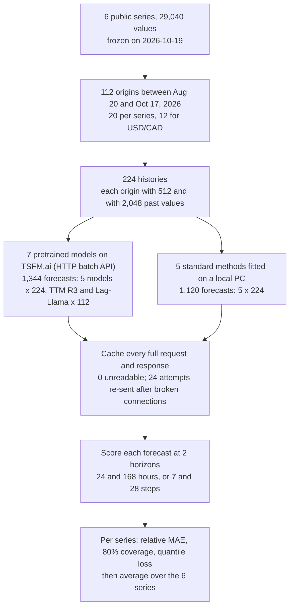

# Can a pretrained model forecast a new series without being fitted to it?

## What a forecast is for

A forecast is a statement about a number that has not happened yet: how much electricity Ontario will use at 5 p.m. tomorrow, how many people will read a Wikipedia article next week, or how many Canadian dollars one US dollar will cost at the end of the month. People plan with these numbers. A grid operator decides a day to a week ahead which power plants to have ready; a website team decides how many servers to run; a business that buys in one currency and sells in another decides how much to set aside.

A useful forecast lands close to what actually happens and comes with an honest range, so the planner knows how much to keep in reserve. A forecast that is too high pays for plants that sit idle; one that is too low leaves the grid short at the peak. A range that is too narrow is a quieter failure: the planner holds too little in reserve and finds out only on the day the value falls outside it.

### An illustrative example

This example is made up, with easy numbers. A small town uses electricity in a daily rhythm: low at night, rising in the morning, highest in the early evening when people come home and cook. Last Tuesday at 6 p.m. the town used 100 units. What should the forecast for next Tuesday at 6 p.m. be?

The simplest answer is 100: copy the value from the same hour one week earlier. This rule sounds naive, and forecasters call it exactly that, **seasonal naive** ("seasonal" because it repeats the last full cycle). It is hard to beat, because daily and weekly routines really do repeat. Any method that claims to be useful has to make smaller errors than this rule.

Now add one complication. Last Tuesday was the hottest day of the summer, air conditioners ran all evening, and the town used 130 units at 6 p.m. This week is mild and the town uses 100. Seasonal naive copies the heat wave and forecasts 130, an error of 30. A person looking at the numbers would see that last week was unusual and would forecast something lower, perhaps by looking further back or by noticing that the hot spell had ended. Better forecasting methods try to make that adjustment automatically.

### Two ways to do better than repeating last week

The first way is to fit a model to the town's own history. A statistical method reads the past few weeks, estimates the usual level, any drift and the shape of the daily cycle, and projects them forward. Such methods have been used for decades. The cost is that each series needs its own fitting, and the fitted model knows only what that one series has shown it.

The second way is newer. A model is first trained, once, on a very large collection of other series, such as electricity use, weather or web traffic from elsewhere. You then hand it the town's recent history and it continues the series, with no fitting to the town at all. Such a model is called a **pretrained forecasting model** (researchers also call it a time-series foundation model), and using it without any training on your series is called **zero-shot** forecasting. The promise is that a planner can get a good forecast for a new series in one request. The risk is that the model has never seen this town and may misjudge it, for example by treating last week's heat wave as normal, or a lasting change as a passing blip.

### Ranges as well as single numbers

Most forecasting methods also give a range. A statement such as "between 90 and 115 units, 8 times in 10" is an **80% interval**, and its promise can be checked: over many forecasts, the share of actual values that fell inside is the interval's **coverage**. An 80% interval that covers only 6 times in 10 is too narrow, and a planner who trusted it held too little in reserve. One that covers 10 times in 10 is probably so wide that it tells the planner little.

### Why the test needs fresh data

A fair test of a pretrained model has to use numbers the model cannot have seen in training. The public series a tester would reach for first (electricity demand, weather, Wikipedia page views, exchange rates) are the kind of data training collections contain; TimesFM 2.5's model card, for one, lists Wikimedia page views. If the test period was in the training data, a good score could come from memory rather than skill.

So this experiment forecasts only values that happened after every model's weights were public. Older history is still allowed as input, because a real user would hand the model their own past data. The rule is about the values being predicted, not the values given as context.

### What this experiment does

It forecasts six public series that behave in different ways, from regular electricity demand to news-driven Wikipedia traffic and a nearly random exchange rate, over August 20 to October 17, 2026. Seven pretrained models, reached through a hosting service, and five standard methods receive exactly the same history before each forecast, and both their best guesses and their 80% intervals are checked against what happened.

## The question

If you need forecasts an hour to a week ahead for an hourly series, or a day to four weeks ahead for a daily one, does a pretrained model given only the series' recent history make smaller errors than repeating the last cycle? Does it make smaller errors than standard methods fitted to that same history? And when it says a value will fall inside an 80% interval, does it, about 80% of the time?

A planner who could answer yes would be able to stand up a usable forecast for a new series without building and maintaining a fitted model for it.

## Study summary

Seven pretrained models (Chronos-2, Moirai 2, TiRex-2, Toto 2, TimesFM 2.5, TTM R3 and Lag-Llama) and five standard methods (seasonal naive, AutoETS, AutoARIMA, Theta and Lag boosting) forecast six public series from 112 origins (starting points) between August 20 and October 17, 2026, each given either the last 512 or the last 2,048 values. That is 1,344 forecasts from the pretrained models and 1,120 from the standard methods, checked against 4,405 distinct actual values. Error is measured as **relative MAE**: a method's average error divided by the error of repeating the last cycle on the same forecasts, so 0.86 means 14% less error than seasonal naive. All 1,344 hosted forecasts were returned and could be scored; none was empty or malformed, and 24 requests had to be sent a second time after a connection broke.

- With 512 past values, Chronos-2 had a relative MAE of **0.860**. Moirai 2 (0.862), TiRex-2 (0.869) and Toto 2 (0.871) were within 0.011 of it, too close for this test to order the four. AutoETS was the best fitted method at 0.961.
- The lead over AutoETS is not established. Across the six series, Chronos-2's relative MAE was 0.101 lower than AutoETS's on average, but the 95% interval from resampling the series runs from 0.233 lower to 0.015 higher.
- The pattern depends on the series. On Ontario electricity demand the four leading pretrained models had 0.641 to 0.678, against 1.069 for AutoETS. On the AI page-view and USD/CAD series all four did worse than repeating the last cycle (1.015 to 1.187).
- TTM R3 (1.258) and Lag-Llama (1.334) did worse than repeating the last cycle overall.
- Giving 2,048 past values instead of 512 lowered error for all five pretrained models that accept that much; Moirai 2 reached 0.815 and AutoETS 0.900.
- The 80% intervals of the four leaders were too narrow: they contained the actual value 65.5% to 70.1% of the time. TimesFM 2.5's intervals were unusable through this service: its reported 10th percentile sat above its 20th percentile at every one of 23,072 forecast steps.

In the original situation: a grid planner could hand the last three weeks of hourly demand to one of the four leading pretrained models and, on this evidence, expect about a third less error than repeating last week, with nothing fitted. The planner should still widen the model's 80% interval, which missed 21% to 31% of Ontario hours rather than one in five, and should not expect the same gain on series driven by news or markets.

The main caveat is that these are six hand-picked series over one two-month window, with forecast windows that overlap heavily, so the results describe these six series rather than a ranking that would hold everywhere. The hosting service also does not say which version of each model it ran.

## Contents

1. [The six series and the date rule](#1-the-six-series-and-the-date-rule)
2. [How a forecast is made and scored](#2-how-a-forecast-is-made-and-scored)
3. [The methods](#3-the-methods)
4. [Results: forecast error](#4-results-forecast-error)
5. [Results: history length and speed](#5-results-history-length-and-speed)
6. [Results: forecast intervals](#6-results-forecast-intervals)
7. [Error analysis](#7-error-analysis)
8. [What the evidence supports](#8-what-the-evidence-supports)
9. [Limitations](#9-limitations)
10. [Spend, data and how to run](#10-spend-data-and-how-to-run)
11. [Future work and further reading](#11-future-work-and-further-reading)

## 1. The six series and the date rule

The six public series were chosen to behave differently, and all were downloaded and frozen on October 19, 2026.

| Series (code name) | Source and licence | Steps | Cycle repeated by seasonal naive | Horizons scored | Origins | Distinct target values |
|---|---|---|---|---|---:|---:|
| Ontario demand (`ontario_demand`) | IESO hourly demand report; IESO terms | Hourly, MW | 168 hours (one week) | 24 and 168 hours | 20 | 1,416 |
| Toronto temperature (`toronto_temperature`) | Open-Meteo reanalysis, not a weather station; CC BY 4.0 | Hourly, °C | 24 hours | 24 and 168 hours | 20 | 1,416 |
| Toronto wind (`toronto_wind`) | Open-Meteo, same grid cell; CC BY 4.0 | Hourly, km/h | 24 hours | 24 and 168 hours | 20 | 1,416 |
| Toronto page views (`wiki_toronto`) | Wikimedia, English Wikipedia "Toronto", human views; CC0 | Daily views | 7 days | 7 and 28 days | 20 | 59 |
| AI page views (`wiki_ai`) | Wikimedia, "Artificial intelligence", human views; CC0 | Daily views | 7 days | 7 and 28 days | 20 | 59 |
| USD/CAD (`usd_cad`) | Bank of Canada daily rate; Bank of Canada terms | Business days, CAD per USD | 5 business days | 7 and 28 business days | 12 | 39 |

Counts are from `data/origins.csv` and `data/target_dates.csv`; sources, hashes and licences are in [`data/data_manifest.json`](data/data_manifest.json) and [`data/ATTRIBUTION.md`](data/ATTRIBUTION.md). The frozen table holds 29,040 values. Hourly series start on January 1, 2026, the page-view series in 2019 and USD/CAD in 2017, so even the 2,048-value history fits before every origin. Nothing was filled in, smoothed or clipped. USD/CAD has no weekend or holiday values, so one step is one business day, and only 12 origins leave room for 28 more business days before the data ends.



Each panel shows the values that were forecast, with the date on the x-axis and the series' own unit on the y-axis. Ontario demand shows the clearest rhythm: a daily rise and fall with a weekly pattern on top, and weekly peaks of 20,400 to 22,400 MW up to mid-September, then 17,200 to 19,900 MW. Temperature has a daily cycle on top of the slow cooling into autumn. Wind has a weak daily cycle and frequent gusty spells. USD/CAD drifts rather than cycles, rising from about 1.38 to about 1.42 over the window. The page-view series have a weekly rhythm and sudden spikes: AI page views rose from about 10,600 a day in late August to a peak of 31,799 on September 30, and Toronto page views, usually about 3,800 a day, jumped to 11,137 on September 27. A method that only repeats cycles should do well on the first three and struggle with the drift and spikes of the last three.

### The date rule

Every value that is scored happened between August 20 and October 17, 2026. Each value's date is the date of the event it measures (the hour of demand, the day of page views); the exact time each source first published it was not recorded. The models' makers do not publish a training cutoff for these checkpoints (recorded as "not established" in [`data/model_provenance.json`](data/model_provenance.json)), so the notebook uses a conservative public date for each model instead: the last change to its public repository, a later announcement where there is one, and for TiRex-2 the upload of its weight file (its repository changed again in October, but not that file). A model cannot have been trained on data later than the date its weights were public, so these dates are later than any training cutoff:

| Model | Public release evidence | Date bound used | Days before the first target |
|---|---|---|---:|
| TiRex-2 | Paper, 2026-07-01 | 2026-07-02, the public weight upload | 49 |
| Chronos-2 | Announcement, 2025-10-20 | 2026-06-05, last change to its Hugging Face repository | 76 |
| Toto 2 | Announcement, 2026-05-14 | 2026-06-04, last repository change | 77 |
| TTM R3 | Announcement, 2026-03-31 | 2026-03-31, the announcement (later than its last repository change) | 142 |
| Moirai 2 | Announcement, 2025-08-08 | 2026-01-29, last repository change | 203 |
| TimesFM 2.5 | Model card, 2025-10-02 | 2025-10-02, last repository change | 322 |
| Lag-Llama | Not recorded | 2024-05-14, last repository change | 828 |

The latest bound, TiRex-2's July 2 weight upload, falls 49 days before the first target. TimesFM 2.5's model card gives two partial training cutoffs: November 2023 for its Wikimedia page-view data and the end of 2022 for Google Trends. Both are long before the target window. The date rule assumes the hosting service runs these published checkpoints; the service does not say, which is a limitation discussed in section 9.

## 2. How a forecast is made and scored

### Origins, history lengths and horizons

A single forecast starts at an **origin**: a moment inside the target window where the history is cut off. Everything before the origin may be used; nothing after it may. The method forecasts the next 168 hours (hourly series) or 28 steps (daily series).

Each series has up to 20 origins spread evenly across the window, chosen by date before any forecast was seen. For the hourly series they fall about 2.7 days apart, so consecutive week-long forecasts overlap. For the daily series they fall one or two days apart and each forecast covers 28 days, so the overlap is heavy: at each history length, each AI page-view day is scored in about 9.5 forecasts and each Ontario demand hour in about 2.4 (horizons summed from `data/origins.csv`, divided by the target values in `data/target_dates.csv`). Overlapping forecasts are not independent evidence, which is why results are compared series by series rather than forecast by forecast.

Each origin is forecast twice, once with the last 512 values as history and once with the last 2,048. For the hourly series 512 values are about 21 days and 2,048 about 85 days; for the page-view series they are about 1.4 and 5.6 years.

Each forecast is scored at two **horizons**, a short one (the first 24 hours, or the first 7 steps) and a long one (all 168 hours, or all 28 steps). The short horizon is the first part of the same long forecast, not a separate request; a model asked for only 24 hours might answer slightly differently.

Every method gets the same numbers and nothing else: no dates, holiday calendar, weather forecast or other series. This keeps the comparison fair, and it means no method can know that a Monday is a holiday or that a cold front is coming.

### How the experiment runs



TTM R3 and Lag-Llama accept at most 512 and 1,024 past values on this service, so they appear only in the 512-value comparison. Each pretrained-model request asks for a median forecast and nine quantiles (explained below). Requests were sent eight at a time, but each forecast is its own request, so no forecast ever sees another origin's history.

### Worked example: one forecast from start to finish

This is origin `ontario_demand_5544_512`: Ontario demand, forecast from midnight at the start of August 20, 2026, using the 512 hours from 4 p.m. on July 29 to 11 p.m. on August 19. The last six hours of that history show the usual evening decline: 20,564, 19,939, 19,106, 17,758, 16,661 and 15,576 MW.

The request to Chronos-2 contains those 512 numbers, the frequency "h", a prediction length of 168 and the nine quantile levels 0.1 to 0.9. The service reported 218 milliseconds of server time (response id `2fce385b-dfba-4e21-8d8d-7ba0eea0c3c4`). For the first hour, midnight to 1 a.m. on August 20, it returned:

| | Value (MW) |
|---|---:|
| Chronos-2, 10th percentile | 14,665 |
| Chronos-2, median (50th percentile), used as its forecast | 14,917 |
| Chronos-2, 90th percentile | 15,067 |
| Seasonal naive (the same hour one week earlier) | 15,873 |
| Actual demand | 14,820 |

Chronos-2 was 97 MW too high and the actual value fell inside its 80% interval. Seasonal naive was 1,053 MW too high. The same pattern held at the day's peak: at 5 p.m. demand was 20,166 MW, Chronos-2 said 20,389 and seasonal naive 22,212. The week before had used more electricity (average 18,119 MW, peak 22,353 MW) than the week being forecast (average 16,571 MW, peak 20,684 MW), so copying it overshot. These values were recomputed from the frozen series and the cached response.

Averaged over the first 24 hours, Chronos-2's error was 227 MW and seasonal naive's 1,578 MW. Over the full 168 hours they were 980 MW and 1,561 MW (`data/metrics.csv`, column `mae`). Chronos-2's 80% interval contained the actual value in all 24 of the first 24 hours and in 140 of the 168 hours of the week.

### How errors are measured

The **mean absolute error (MAE)** is the average size of the misses, in the series' own unit, ignoring whether they are too high or too low. For the example above, Chronos-2's 168-hour MAE is 980 MW.

MAE cannot be averaged across series, because megawatts, degrees and page views are not comparable. So each method's error is divided by seasonal naive's error on exactly the same forecasts. This is **relative MAE**. In the example, 980 / 1,561 = 0.628: Chronos-2 made 37% less error than repeating last week at this one origin. Below 1 is better than seasonal naive, above 1 is worse, and seasonal naive itself is 1.000 by definition.

Over many forecasts, the absolute errors for each series and horizon are added up and divided by seasonal naive's total. The two horizons are then averaged, and the six series are averaged with equal weight, so a daily series with 59 target days counts as much as an hourly one with 1,416 target hours. To show how much the result depends on which six series were chosen, the notebook resamples the six series with replacement 10,000 times and reports the middle 95% of the averages. That interval is descriptive, not a significance test, and it does not correct for picking the best method after seeing the scores.

### How intervals are measured

Each pretrained model returns nine **quantiles**, the values it expects the actual number to fall below 10%, 20%, ... 90% of the time. The 10th and 90th percentiles bound its 80% interval, and coverage should come out at 80%.

Coverage alone rewards intervals that are too wide, so the notebook also reports **weighted quantile loss** (WQL, called quantile loss below). For each of the nine quantiles it charges a penalty that grows with the distance between the quantile and the actual value, weighted so that, for example, an actual value above the 90th percentile costs nine times as much as one the same distance below it. The total is divided by the size of the actual values so that series can be compared. Lower is better, and a low score needs intervals that are both well placed and no wider than necessary.

## 3. The methods

### Pretrained models

All seven were reached through [TSFM.ai](https://tsfm.ai/pricing), a service that hosts many forecasting models behind one HTTP API. The families are the seven named in the experiment's [proposal](https://github.com/k-sandhu/experiment-notebooks/issues/13); within each family the newest checkpoint the service listed on October 19, 2026 was used, and for Toto 2.0 the largest of its sizes ([`data/catalog_snapshot.json`](data/catalog_snapshot.json)). The proposal planned to run the weights locally; the claim issue for this notebook (#22) records that hosted execution replaced that route at the owner's request.

| Model | Version | Provider, how called | Size, precision | Settings | Why included |
|---|---|---|---|---|---|
| Chronos-2 (Amazon) | `amazon/chronos-2`, ref. `29ec376` | TSFM.ai, HTTP batch API | Not recorded | 512 or 2,048 past values, 168 or 28 steps, 9 quantiles | Newest Chronos checkpoint listed |
| Moirai 2 (Salesforce) | `Salesforce/moirai-2.0-R-small`, ref. `30f43ff` | TSFM.ai, HTTP batch API | "Small" variant (from its name); not recorded | Same | Only Moirai 2.0 size listed |
| TiRex-2 (NX-AI) | `NX-AI/TiRex-2`, ref. `30788a3` | TSFM.ai, HTTP batch API | Not recorded | Same | Newest weights in the set; sets the date rule |
| Toto 2 (Datadog) | `Datadog/Toto-2.0-2.5B`, ref. `51a2812` | TSFM.ai, HTTP batch API | 2.5B parameters (from its name); precision not recorded | Same | Largest of five Toto 2.0 sizes listed |
| TimesFM 2.5 (Google) | `google/timesfm-2.5-200m-pytorch`, ref. `1d95242` | TSFM.ai, HTTP batch API | 200M parameters (from its name); precision not recorded | Same | Newest TimesFM listed (TimesFM 3 was not) |
| TTM R3 (IBM) | `ibm-research/ttm-r3`, ref. `aca5d49` | TSFM.ai, HTTP batch API | Not recorded | 512 past values only (service limit) | Newest Tiny Time Mixers checkpoint listed |
| Lag-Llama | `time-series-foundation-models/Lag-Llama`, ref. `72dcfc2` | TSFM.ai, HTTP batch API | Not recorded | 512 past values only (service limit 1,024) | Only Lag-Llama listed; the oldest model here (2024) |

The service does not let a request pin a revision. The "ref." values are the Hugging Face revisions recorded on October 19, 2026, for reference only; the full hashes, licence sources and release evidence are in [`data/model_provenance.json`](data/model_provenance.json). The requests set no sampling options, and the service returned the model name asked for in all 1,344 responses.

| Model | Weight licence | GPU class listed in the service's catalog | Median server time per forecast |
|---|---|---|---:|
| Chronos-2 | Apache 2.0 | T4 | 0.036 s |
| Moirai 2 | CC BY-NC 4.0 (non-commercial) | T4 | 0.046 s |
| TiRex-2 | Apache 2.0 | L40S | 0.029 s |
| Toto 2 | Apache 2.0 | L40S | 0.067 s |
| TimesFM 2.5 | Apache 2.0 | T4 | 0.808 s |
| TTM R3 | CC BY-NC-SA 4.0 (non-commercial) | T4 | 0.043 s |
| Lag-Llama | Apache 2.0 | L40S | 21.9 s |

The GPU class is the catalog's claim, not something this experiment could check, and peak memory is not reported. Server times are the service's `latency_ms` (`data/latency.csv`) and leave out the network. Moirai 2 and TTM R3 carry non-commercial licences; this experiment is non-commercial research and redistributes no weights.

### Standard methods

All five ran on a Windows PC with an Intel processor and 22 logical CPUs (`data/run_manifest.json`), on the same histories, with settings fixed before any score was seen.

| Method | What it does | Settings | Median local time per forecast | Why included |
|---|---|---|---:|---|
| Seasonal naive | Repeats the last full cycle | Interval from past one-cycle-ago errors | under 0.001 s | The reference every method must beat |
| AutoETS | Exponential smoothing: tracks a level, a trend and a repeating seasonal pattern, choosing the form automatically | statsforecast, "ZZA" | 0.570 s | The usual first automatic method fitted per series |
| AutoARIMA | Predicts each value from recent values and recent errors, searching for the best small model | statsforecast, at most 20 candidates | 0.419 s | The other standard automatic family |
| Theta | Draws a smoothed trend line and adds the seasonal pattern | statsforecast, additive season | 0.049 s | A simple trend-plus-season method |
| Lag boosting | Small decision trees predict the next value from earlier values (1, 2 and 3 steps back, one and two cycles back, and 24, 48 and 168 hours or 7, 14 and 21 days back), feeding each prediction back in | scikit-learn, 100 rounds, seed 1601 | 0.161 s | A machine-learning model a data team might build by hand |

Lag boosting gives no interval. AutoETS, AutoARIMA and Theta return intervals but no separate median, so their point forecast stands in for the 50th percentile in the quantile loss. The 1,120 standard-method forecasts took 1,147.9 seconds, 849 of them AutoARIMA's. Every AutoARIMA fit logged convergence warnings and 152 of its searches stopped at the 20-model limit (fields `wall_seconds` and `warnings` in `data/cache_baselines/`), so it is a modest version of that method.

## 4. Results: forecast error

| Method | Kind | Relative MAE, 512 values (95% interval over series) | Relative MAE, 2,048 values | Forecasts scored (unreadable) |
|---|---|---:|---:|---:|
| Chronos-2 | Pretrained | 0.860 (0.748 to 0.974) | 0.844 | 224 (0) |
| Moirai 2 | Pretrained | 0.862 (0.750 to 0.977) | 0.815 | 224 (0) |
| TiRex-2 | Pretrained | 0.869 (0.740 to 1.026) | 0.835 | 224 (0) |
| Toto 2 | Pretrained | 0.871 (0.756 to 0.992) | 0.841 | 224 (0) |
| TimesFM 2.5 | Pretrained | 0.911 (0.768 to 1.070) | 0.869 | 224 (0) |
| AutoETS | Fitted | 0.961 (0.909 to 1.014) | 0.900 | 224 (0) |
| Seasonal naive | Reference | 1.000 | 1.000 | 224 (0) |
| AutoARIMA | Fitted | 1.002 (0.908 to 1.107) | 0.954 | 224 (0) |
| Theta | Fitted | 1.086 (0.899 to 1.379) | 0.932 | 224 (0) |
| Lag boosting | Fitted | 1.150 (1.046 to 1.254) | 1.304 | 224 (0) |
| TTM R3 | Pretrained | 1.258 (0.980 to 1.545) | not served | 112 (0) |
| Lag-Llama | Pretrained | 1.334 (1.028 to 1.747) | not served | 112 (0) |

Values are from `data/summary.csv`; the forecast counts include both history lengths. No forecast from any method was unreadable, so scores on readable forecasts and on all forecasts are the same.


Each bar is one method's relative MAE with 512 past values, lowest error at the top. The figure has no legend: blue bars are the seven pretrained models and grey bars the five standard methods. Bars ending left of the dashed line at 1.0 beat seasonal naive. The black whiskers are the 95% interval from resampling the six series.

Five pretrained models beat seasonal naive on average: Chronos-2 at 0.860, Moirai 2 at 0.862, TiRex-2 at 0.869, Toto 2 at 0.871 and TimesFM 2.5 at 0.911. The four leaders are within 0.011 of each other and their whiskers almost coincide, so their order is not a finding. Of the fitted methods only AutoETS beat seasonal naive (0.961); AutoARIMA tied it (1.002), and Theta and Lag boosting did worse. TTM R3 and Lag-Llama, the two pretrained models limited to 512 values here, did worse than seasonal naive too.

A planner deciding whether to skip fitting needs the best pretrained model against the best fitted one. Chronos-2's relative MAE was lower than AutoETS's on four of six series, and 0.101 lower on average, but the 95% interval for that difference runs from 0.233 lower to 0.015 higher (`data/paired_comparison.json`). Both winners were also picked after seeing the scores. This sample therefore does not establish that Chronos-2 beats AutoETS in general, even though it is ahead here.

### The average hides different series


Each cell is one method's relative MAE on one series with 512 past values, averaged over the two horizons. Blue cells beat seasonal naive, yellow cells are close to it and red cells lose to it. The column labels use the sources' titles: "Wikipedia views: Artificial intelligence" is the AI page-view series and "US dollar in Canadian dollars" is USD/CAD.


On Ontario demand, every one of the five leading pretrained models beat seasonal naive by a wide margin, from 0.641 (TiRex-2) to 0.732 (TimesFM 2.5). Every fitted method lost to seasonal naive there: AutoETS 1.069, AutoARIMA 1.109, Lag boosting 1.322 and Theta 1.780. The worked example in section 2 shows how repeating last week goes wrong when demand shifts from one week to the next; why the fitted methods did even worse on this series was not examined.

On the two weather series and Toronto page views, the five leading pretrained models were ahead of the fitted methods by less: 0.762 to 0.795 on temperature, 0.785 to 0.812 on wind and 0.780 to 0.803 on Toronto page views, against fitted methods between 0.821 and 1.227. Lag-Llama (0.803) and TTM R3 (0.821) also did well on wind.

On AI page views and USD/CAD, the pretrained leaders lost to seasonal naive: 1.070 to 1.187 on AI page views and 1.015 to 1.058 on USD/CAD (1.224 for TimesFM 2.5). These are the two series without a dependable cycle, one driven by news and one by markets. The best methods there were Theta (0.983) and AutoETS (0.987) on AI page views and, unexpectedly, TTM R3 on USD/CAD (0.887), the second-worst method overall. Section 7 looks at both.

Each cell rests on 12 or 20 overlapping forecasts from one two-month period, so a single unusual week, such as the late-September spike in Toronto page views, can move it.

## 5. Results: history length and speed


In the left panel each line joins one method's relative MAE with 512 past values (left end) and 2,048 (right end); a line that slopes down means more history helped. The title mentions only the five pretrained models, but the panel also draws the five standard methods. The right panel shows the median server time per forecast on a logarithmic scale, where each grid line is ten times the one before.

All five pretrained models that accept 2,048 values improved with them, by 0.015 (Chronos-2, 0.860 to 0.844) to 0.047 (Moirai 2, 0.862 to 0.815), which made Moirai 2 the lowest-error method in that condition (`data/context_comparison.csv`). The fitted methods gained as much or more: AutoETS from 0.961 to 0.900, AutoARIMA from 1.002 to 0.954 and Theta from 1.086 to 0.932, the largest change of any method. Lag boosting got worse (1.150 to 1.304). The gap between the best pretrained model and AutoETS narrowed slightly, from 0.101 to 0.085.

On speed, five pretrained models answered in under a tenth of a second of server time, TimesFM 2.5 in 0.8 s and Lag-Llama in 21.9 s. The standard methods ran on a different machine, so their times are not a controlled comparison: most fits took under a second, and AutoARIMA's slowest 5% took over 21 seconds. Server times leave out the network: batches that contained a Lag-Llama request (115 of 177) took a median of 65 seconds from sending to receiving, and batches without one 3.7 seconds (`data/batches/`, fields `wall_seconds` and `request`).

## 6. Results: forecast intervals

| Method | 80% interval coverage | Quantile loss (lower is better) | Steps with crossed quantiles |
|---|---:|---:|---:|
| Chronos-2 | 67.4% | 0.120 | 0 of 23,072 |
| Moirai 2 | 65.5% | 0.122 | 0 of 23,072 |
| Toto 2 | 70.1% | 0.122 | 0 of 23,072 |
| TiRex-2 | 68.3% | 0.123 | 0 of 23,072 |
| TimesFM 2.5 | 21.0% | 0.134 | 23,072 of 23,072 |
| AutoETS | 71.1% | 0.137 | 0 of 23,072 |
| AutoARIMA | 73.2% | 0.145 | 0 of 23,072 |
| Seasonal naive | 81.6% | 0.151 | 0 of 23,072 |
| Lag-Llama | 78.1% | 0.163 | 0 of 11,536 |
| TTM R3 | 54.7% | 0.176 | 0 of 11,536 |
| Theta | 83.4% | 0.190 | 36 of 23,072 |

Coverage and quantile loss are for 512 past values, averaged over series and horizons (`data/interval_summary.csv`); crossed steps count every forecast step at both history lengths (`data/quantile_diagnostics.csv`).


In the left panel each bar is the share of actual values inside a method's 80% interval, and the dashed line marks the promised 80%; bars short of it mean intervals that were too narrow. In the right panel each bar is the quantile loss, where shorter is better. A well-calibrated method has a left bar that reaches the line and a short right bar.

The four leading pretrained models had the lowest quantile loss (0.120 to 0.123), so their quantiles sat closest to the actual values, but their 80% intervals contained only 65.5% to 70.1% of them. A planner trusting Chronos-2's 80% interval would have been outside it about one time in three, not one in five. The shortfall was larger at the long horizon (64.2% for Chronos-2 over 168 hours or 28 steps) than the short one (70.7%; `data/series_scores.csv`, column `coverage80`), and largest on AI page views, where Chronos-2's 28-day intervals contained 39.8% of the actual values.

Coverage alone would point to the wrong methods. Seasonal naive (81.6%), Lag-Llama (78.1%) and Theta (83.4%) came closest to 80%, but they had three of the four worst quantile losses (0.151, 0.163 and 0.190), because their intervals were wide: in the worked example, Theta's 168-hour 80% interval averaged 15,428 MW wide against Chronos-2's 3,250 MW (`data/metrics.csv`, column `width80`). Theta's 36 crossed steps come from inserting its point forecast as the 50th percentile, which can fall outside its own narrowest interval.

TimesFM 2.5's 21.0% does not measure its intervals; section 7 explains why.

## 7. Error analysis

The examples show a typical case, two kinds of large miss, a disagreement between methods and a measure that misleads, each identified by its origin ID from `data/origins.csv`.

### A typical success

At origin `ontario_demand_6398_512` (2:00 p.m. on September 24), Chronos-2's 168-hour forecast had an MAE of 646 MW against seasonal naive's 834, a relative MAE of 0.775. This is the middle of Chronos-2's 20 Ontario origins at the long horizon; it beat seasonal naive at 16 of the 20. Its 80% interval contained 148 of the 168 actual hours. Moirai 2 (619 MW), Toto 2 (665 MW) and TiRex-2 (673 MW) were close; AutoETS (2,707 MW) and AutoARIMA (2,442 MW) missed by far more. Ordinary weeks on the regular series look like this: a modest gain over repeating last week.

### When the level drops: the model keeps the old peaks

At origin `ontario_demand_6201_512` (9:00 a.m. on September 16), Chronos-2 made its worst long-horizon Ontario forecast: MAE 1,453 MW against seasonal naive's 1,160, a relative MAE of 1.252. Its median forecast put the peak of each 24-hour period between 19,100 and 19,600 MW for all seven periods. Actual peaks fell from 19,946 MW in the first period to between 15,764 and 17,151 MW in periods four to seven. 93 of the 168 actual hours fell below Chronos-2's 10th percentile, so its 80% interval contained only 44% of them. Seasonal naive copied the previous week's peaks (18,335 to 20,116 MW), which were also too high, but less so on the later days.

The measured part is that the model kept forecasting late-summer peaks after demand had dropped. A plausible cause, which the data cannot confirm because no method was given temperatures, is the end of a warm spell. This is the opening example's situation, a high week followed by a lower one, and it is the kind of change a model given only past demand cannot see coming.

### When the level rises: the model expects a return to normal

At origin `wiki_ai_2816_512` (September 17), Chronos-2's 28-day forecast of AI page views had an MAE of 4,828 views a day against seasonal naive's 2,902, a relative MAE of 1.66 (`data/error_example.json`). This is Chronos-2's worst long-horizon ratio of all its 512-value forecasts, selected after scoring.


The grey line is the last 56 days of history, the dotted line is the origin, and to its right the black line is what happened, the blue line and band Chronos-2's median and 80% interval, and the orange dashed line seasonal naive. The title's `wiki_ai` is the AI page-view series.

Daily views averaged 11,839 in the fifth week before the origin and 18,940 in the final week. Chronos-2's median fell back toward the older level, averaging 14,160 over the 28 days, while actual views stayed high (average 18,980) and spiked to 31,799 on September 30. Ten of the 28 days were above its 90th percentile and none below its 10th. Seasonal naive repeated the high final week, which happened to match the next four weeks' average almost exactly.

The two Ontario and AI cases are mirror images: in one the series fell and the model expected it to stay up, in the other the series rose and the model expected it to come down. In both, the miss is a change of level that the history alone did not announce, and in both the 80% interval was too narrow to warn of it. This fits the heat map, where the pretrained models did worst on the two series that drift and spike rather than cycle, though these cases cannot show that level changes are the whole reason. On AI page views Chronos-2 beat seasonal naive at only 10 of 20 long-horizon origins, against 16 of 20 on Ontario demand.

### A disagreement: the worst model wins on USD/CAD

TTM R3 was the second-worst method overall (1.258) but the best on USD/CAD (0.887), and it beat seasonal naive at all 12 USD/CAD origins at the 28-step horizon, with relative MAEs from 0.604 to 0.851 (`data/metrics.csv`). At origin `usd_cad_2411_512` (September 1), TTM R3's median rose from 1.3874 to 1.3982 CAD over 28 business days, while Chronos-2's and TiRex-2's stayed flat near 1.386. The actual rate rose from 1.3896 to 1.4222. A forecast that drifted upward was rewarded because the rate happened to rise through the whole window.

This does not show skill. The 12 origins are the first 12 business days of the window and their 28-day forecasts overlap almost completely, so the series offers one rising stretch scored twelve times; a near-random series over one period cannot separate skill from a lucky direction. TTM R3's interval was also very wide (0.178 CAD at step 28, against 0.054 for Chronos-2), which is why its USD/CAD coverage reached 100%.

### When the intervals are mislabelled: TimesFM 2.5

Quantiles must rise with their probability: the 10th percentile cannot be above the 20th. TimesFM 2.5's responses broke this rule at every one of its 23,072 forecast steps.


The x-axis is the probability label the service attached to each value and the y-axis forecast demand in MW, for the first hour of the worked example. The red segment marks the crossing: the value labelled 0.1 (14,837 MW) is above the value labelled 0.2 (14,736 MW). The other seven values rise normally to 15,055 MW at 0.9. The actual demand was 14,820 MW (`data/quantile_anomaly.json`).

A check of the cached responses made for this write-up adds a clue. Each response also carries a separate `mean` field. For Chronos-2, Moirai 2, TiRex-2, Toto 2 and TTM R3 it equals the value labelled 0.5 at every forecast step. For TimesFM 2.5 it equals the value labelled 0.6 at all 23,072 steps, and the value labelled 0.5 only once (counted from `data/cache_hosted/`, fields `outputs[0].mean` and `outputs[0].quantile_predictions`). That is what one would see if the service shifted TimesFM 2.5's labels by one place, but the service does not document its mapping and the notebook does not repair it.

So TimesFM 2.5's 21.0% coverage and its quantile loss describe mislabelled numbers, not the model's intervals. Its point error may be affected too, because the notebook takes the value labelled 0.5 as each model's forecast. Rescoring TimesFM 2.5 with the `mean` field instead, using the notebook's scoring rule, gives a relative MAE of 0.886 at 512 values (instead of 0.911) and 0.844 at 2,048 (instead of 0.869). This rescoring was done after the results were seen, and the tables keep the notebook's numbers. Either way TimesFM 2.5 stays behind the four leaders at 512 values; at 2,048 values the rescored 0.844 would tie Chronos-2.

### What these examples cannot show

The examples show where forecasts went wrong, not why; the models give no reasons, and the explanations offered (a warm spell ending, a rate that happened to rise) are possible causes, not measured ones. Two cases were chosen as the worst, so they show how large a miss can be, not how often.

## 8. What the evidence supports

- For hourly series with strong daily and weekly cycles, such as electricity demand and weather, one of the four leading pretrained models (Chronos-2, Moirai 2, TiRex-2 or Toto 2) is a reasonable first forecast. They beat repeating last week by 19% to 36% on those series without any fitting, and on Ontario demand they beat every fitted method. This test does not pick one of the four.
- Give the model as much history as it accepts. All five pretrained models that accept 2,048 values did better with them.
- Widen their 80% intervals, or calibrate them on past forecasts, before using them to size reserves. As returned, they contained 65.5% to 70.1% of actual values.
- Do not expect a pretrained model to beat repeating the last cycle on series driven by news or markets. On AI page views and USD/CAD the four leaders did worse than seasonal naive.
- Do not use TimesFM 2.5's intervals through this service, and check any hosted service's quantiles for ordering before trusting them; that check would have caught this problem on the first response.
- TTM R3 and Lag-Llama, as served here and limited to 512 values, are not general-purpose choices; both did worse than seasonal naive overall.

The uncertainty that most needs another experiment is whether the pretrained leaders really beat a fitted method such as AutoETS. On six series the interval for the difference still includes zero, and only many more series with forecast windows that do not overlap can settle it.

## 9. Limitations

- Six hand-picked series are a case study, not a sample of all series. The two weather series come from one place, and the six-series average depends on which series were picked.
- Forecast windows overlap heavily, especially for the daily series, and all of them fall in one two-month period. The resampling intervals treat each series as one unit to allow for this, but with six units they are wide and only descriptive.
- The service does not say which version of each model it ran, on what hardware, or how it builds the quantiles. Training cutoffs are not published either, so the date rule rests on public weight dates and on the service serving those weights. If it runs a newer checkpoint, the rule could be broken without anyone seeing it.
- The series were downloaded as they stood on October 19, 2026. Electricity and weather data can be revised after first release, so the history at an early origin may differ slightly from what a forecaster would have had that day.
- Every method saw only the past values of one series: no dates, holidays, weather forecasts or related series. Pretrained models such as Chronos-2 can use such extra inputs, and fitted methods can take holiday calendars, so both sides could do better in practice.
- The fitted methods use fixed, bounded settings. AutoARIMA's search was capped at 20 models and logged convergence warnings on every fit; a wider search or tuned settings could change the fitted results.
- TimesFM 2.5's scores depend on how the service labels its outputs, as section 7 shows.

## 10. Spend, data and how to run

- The pretrained models cost $0.00025 per forecast request at the service's [published price](https://tsfm.ai/pricing) (checked October 19, 2026). The account's reported usage rose by $0.34425, or 1,377 credits: 1,344 forecasts, 24 repeated requests after three batches broke off mid-transfer, and 9 capability checks. The run was capped at $3, and the account stayed on its free plan with no top-up (`data/spend.json` and the `data/billing_*.json` snapshots).
- All 1,344 forecasts were eventually returned and read. The run history, including the broken connections and how the requests were repeated, is in [`data/PROTOCOL.md`](data/PROTOCOL.md).
- The standard methods cost nothing and took 1,147.9 seconds of local computing.

| File in `data/` | What it holds |
|---|---|
| `raw/`, `series.csv`, `data_manifest.json`, `ATTRIBUTION.md` | Frozen sources, the 29,040-value table, hashes and licences |
| `origins.csv`, `target_dates.csv` | The 224 forecast cases and 4,405 target values |
| `model_provenance.json`, `catalog_snapshot.json` | Release evidence, licences, revisions and the service's catalog |
| `cache_hosted/`, `cache_baselines/` | Every forecast request and response, keyed by a hash of the full request |
| `batches/`, `intents/`, `probes/` | Every batch sent, including the three that broke off, and the capability checks |
| `metrics.csv`, `series_scores.csv`, `summary.csv`, `interval_summary.csv` | Scores per forecast, per series and overall |
| `spend.json`, `run_manifest.json`, `validation.json` | Spend, settings, hardware and the offline replay check |

Running the notebook replays everything from these files with no network calls and no key. From this folder, with Python 3.13:

```bash
python -m pip install -r requirements.txt
python -m ipykernel install --user --name experiment-ts16 --display-name "Python (TS16)"
python -m nbconvert --to notebook --execute --inplace 16_time_series_zero_shot.ipynb
```

New collection needs `TS16_LIVE=1` and a `TSFMAI_API_KEY`; the size knobs and the $3 cap are at the top of the notebook, and a missing cached response stops the run before any call. Newer source data would make a new experiment with a new date check. The full analysis is in [16_time_series_zero_shot.ipynb](16_time_series_zero_shot.ipynb).

## 11. Future work and further reading

### Future work

- Repeat the comparison on at least 50 unrelated series with forecast windows that do not overlap, to see whether the leaders' advantage over AutoETS (0.101, with an interval that includes zero) holds beyond six series.
- Calibrate the intervals on the last part of each history, without touching the targets, and measure coverage and width afterwards. The leaders' 80% intervals covered 65.5% to 70.1% here.
- Request each short horizon separately on the same histories and measure how much the short-horizon results change, since this run scored only the first part of each long forecast.
- Run the published weights locally at pinned revisions and compare their forecasts with the hosted ones. This would test whether TimesFM 2.5's crossed labels come from the service, and would add the memory and hardware measurements the service does not report.
- Add calendar information and a simple level-change detector built only from past values, and test whether the AI page-view miss at September 17 (1.66 times seasonal naive's error) and the Ontario miss at September 16 (1.25 times) shrink.

### Further reading

Links checked on October 19, 2026.

- [Forecasting: principles and practice, the forecaster's toolbox](https://otexts.com/fpp3/toolbox.html) (Hyndman and Athanasopoulos, 2021). Introduces seasonal naive forecasts, scaled errors and interval evaluation, the measures used here.
- [Chronos-2: from univariate to universal forecasting](https://arxiv.org/abs/2510.15821) (Ansari et al., 2025). Describes Chronos-2's group attention and its use of richer inputs than the single-series requests sent here.
- [TiRex-2: generalizing TiRex to multivariate data and streaming](https://arxiv.org/abs/2607.01204) (Podest et al., 2026). Describes the newest model in the set, whose July 2026 weight release is the latest date the target window had to follow.
- [Toto 2.0: time series forecasting enters the scaling era](https://arxiv.org/abs/2605.20119) (Khwaja et al., 2026). Describes a probabilistic pretrained model whose hosted intervals are scored here.
- [StatsForecast model reference](https://nixtlaverse.nixtla.io/statsforecast/src/core/models.html) (Nixtla, 2026). Documents the AutoETS, AutoARIMA and Theta implementations and their intervals.
