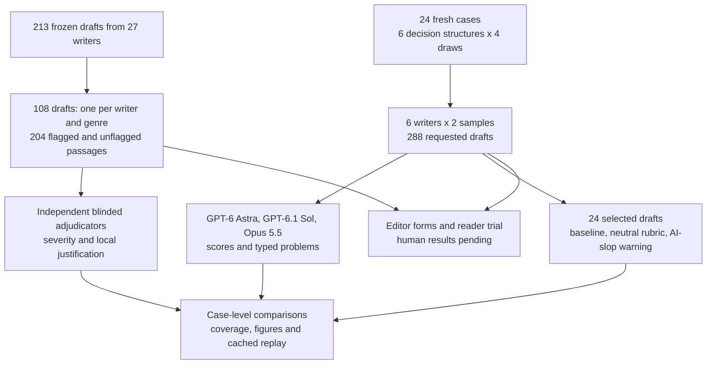

# Writing validation on longer documents

A reviewer calls a passage vague and recommends cutting it. Another reviewer accepts it. Before choosing a writer or rewriting the analysis, an editor needs to know whether the criticism identifies a reading problem, a factual mistake or an editorial preference. A confident score can hide that distinction.

Notebook 15 rated 213 short drafts from 27 writers on two numerical cases. Its judges sometimes disagreed on the same passage, and its machine reading check reached 100%. That left human comprehension unmeasured. This extension obtains blinded second reviews of existing flags, broadens the cases and prepares independent human review.

We sampled 108 existing drafts, one per original writer and genre, without using their scores. We selected 204 flagged or unflagged passages and requested new blinded assessments. Separately, six writers produced two responses to each of 24 fresh cases: 288 drafts across six decision structures, four fictional settings and four document genres. All new judges are GPT-6 Astra and GPT-6.1 Sol through Codex, and Claude Opus 5.5 through Claude Code.

The run returned **288/288 usable drafts**. On the sampled previously flagged passages, model reviewers reported a prose problem at a mean rate of **1.6%**, versus 16.1% for any problem type. Adding an AI-slop warning to an unchanged prose rubric changed clarity by -0.31 points. These are model opinions; human comprehension and editor validation remain pending. The prepared human materials contain no collected participant responses.

Outside-vendor scores use different panels for Claude and Codex writers. The [common-panel sensitivity](data/common_panel_sensitivity.csv), which includes own-vendor scores and weights judge vendors equally, changes the observed ordering. Neither panel is an unbiased substitute for human outcomes. GPT-6 Astra moves from sixth under outside-vendor averages to first under the common panel.

Clarity means ease of following the analysis; grounding means factual support in the evidence; reasoning means whether the conclusion follows. These judgment scales are not human answer-accuracy percentages.

| Writer | Cases | External clarity /100 | Grounding /100 | Reasoning /100 |
|---|---|---|---|---|
| claude-opus-5-5 | 24 | 95.5 | 90.9 | 91.4 |
| claude-haiku-5-5 | 24 | 95.1 | 91.2 | 89.6 |
| claude-sonnet-5-5 | 24 | 94.9 | 91.2 | 90.3 |
| DeepSeek V4 Pro | 24 | 92.8 | 94.4 | 92.4 |
| muse-wonder-full-1.0 | 24 | 92.4 | 95.8 | 94.4 |
| GPT-6-Astra | 24 | 88.2 | 93.0 | 90.5 |


Scores average samples within case before averaging cases. The [full writer table](data/writer_summary.csv) includes case and six-family resampling intervals. The [judge-specific table](data/judge_specific.csv) exposes panel differences, and [vendor-weight sensitivity](data/vendor_balance_sensitivity.csv) gives each judge vendor equal weight before averaging. Restricting judges to two vendors leaves no common outside-vendor judge for a Claude-versus-OpenAI comparison; this table does not establish a general writer ranking.

## What changed

Fresh cases cover value thresholds, procurement constraints, changing case mix, capacity bottlenecks, uncertain scenarios and randomized trials with operational guardrails. Four parameter draws per structure give 24 distinct packets, not 24 unrelated real-world datasets. Each case has one genre in a balanced rotation. Every writer receives identical task and evidence, twice in fresh sessions.

Email targets are 180 to 280 words; six-slide text, 200 to 320; articles, 700 to 1,000; academic reports, 1,000 to 1,400. Completed drafts outside their targets are retained. Under the fixed word counter, 76/288 drafts miss their requested range. The study evaluates slide text, not visual layout. Source dates and licences are recorded separately from the model-facing evidence to prevent their being mistaken for operating facts.


## Blinded review of old flags

Old flags are sampled only when at least two new judges can assess them without being the exact writer or original flagging model. Unflagged comparison sentences avoid every located external audit flag in that document. Neither group has human gold labels.

204/204 passages received at least two valid assessments. For sampled old flags, reviewers reported any problem at a mean rate of 16.1% and specifically a prose problem at 1.6%. For previously unflagged sentences the corresponding rates were 5.2% and 1.2%. Reviewers disagreed on problem presence for 8.3% of old-flag passages. These rates average reviewer opinions within a passage before averaging passages; they are not precision or false-positive estimates.


The neutral passage-review task differs from the original AI-slop audit. Its low uphold rate can reflect different instructions and categories as well as disagreement with the criticism. The original corpus contains only two underlying cases. A quote being located correctly does not establish that the criticism is justified. [Passage assessments](data/passage_assessments.csv) preserve each explanation, type and severity.

## Rubric and warning

Twenty-four seeded drafts, one per fresh case, are reviewed alone under general quality questions, a neutral prose rubric, and the same rubric plus an AI-slop warning. Text and criteria are held fixed for the last two; opaque IDs and fresh-session sampling vary. The neutral rubric changed clarity by -0.32 points relative to baseline. The warning changed clarity by -0.31, with a case-resampling interval [-0.70, +0.02] and a six-family interval [-0.70, +0.03]. Small intervals remain conditional on these cases and judges.


## Human validation is pending

The [human-study instructions](data/human/README.md) explain distribution and import. Distribute only the [reader page](data/human/participant/reader.html) or [editor page](data/human/participant/editor.html); keep administrator keys separate. Download these HTML files and open them locally. GitHub's source viewer does not run the forms.

There are 64 reader schedules covering 396 documents and paired editor booklets for 204 passages. Each reader sees one version per case. The reader page records timed reading, four answers, confidence and effort; the editor page permits no-problem assessments and separates prose, facts, reasoning and format. The pages render headings and tables and export JSON without sending responses to a service.

Place complete human exports in `data/human/submissions/` and replay the notebook. It checks assignments, schemas and duplicates, computes answer accuracy, and prepares crossed reader-case intervals and independent editor agreement. The CSV outputs currently contain headers only. Human-reviewed rewrites and a causal comparison of prose edits are not yet available.

## Workflow



## Spend, evidence and replay

This extension reports USD 0.1816 in OpenRouter charges and retains USD 0.0000 for any unknown extension charges. Notebook 15's full charged-or-reserved bound of USD 4.4500 remains reserved. The combined bound is **USD 4.6316**, below the user's USD 10 ceiling. Reported charges across both runs total USD 3.3693. CLI subscription tokens and available list-price estimates are separate, not an incremental invoice.

The [protocol](data/protocol.json) and cases were committed before collection in `3b26cf0`. This is an amended exploratory study: a [dated parser amendment](data/parser_amendment.json) permits only missing outer `]}` after complete, fully validated records. It recovers 51 main review requests, 0 adjudication requests and 27 instruction requests. [Strict-only writer](data/strict_json_writer_sensitivity.csv), [passage](data/strict_json_adjudication_sensitivity.csv) and [instruction](data/strict_json_instruction_sensitivity.csv) tables retain the original parsing rule as a sensitivity check. Raw text, scores and explanations are unchanged. All model responses and attempts are cached by full request. The copied legacy evidence makes this notebook self-contained. There are 429/432 valid main review requests and 216/216 valid instruction requests. Failures and malformed outputs remain visible rather than becoming zero scores.

Install the repository requirements and this folder's small [rendering requirements](requirements.txt), then run from this folder:

```powershell
python -m jupyter nbconvert --to notebook --execute --inplace 17_writing_validation_extension.ipynb
```

Default execution is strict offline replay and needs no keys. It verifies frozen model evidence and makes zero model calls. Human submissions are mutable inputs outside that manifest. For a separate new collection, copy the notebook and documented legacy inputs into a new folder, change the protocol version and seed, carry forward the latest cumulative spend bound into `PRIOR_BOUND`, and use `NB_LIVE=1` with logged-in CLIs and an OpenRouter key. The size knobs and cumulative budget guard are at the top. Keep the committed cache intact.
