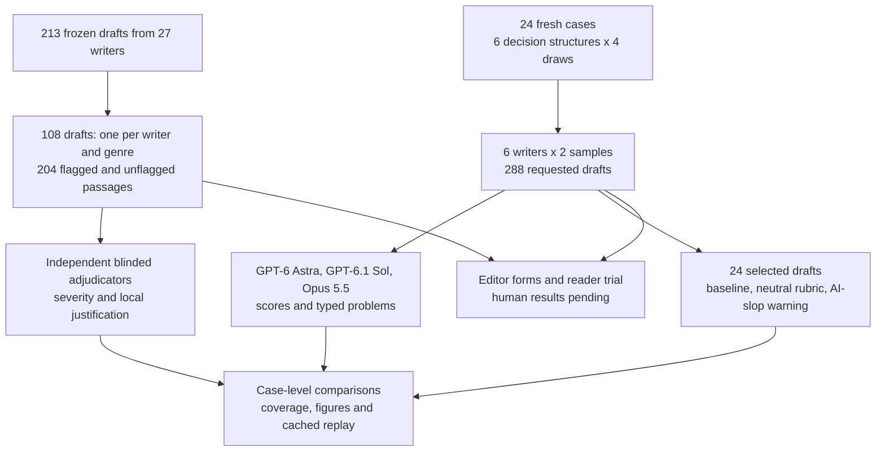
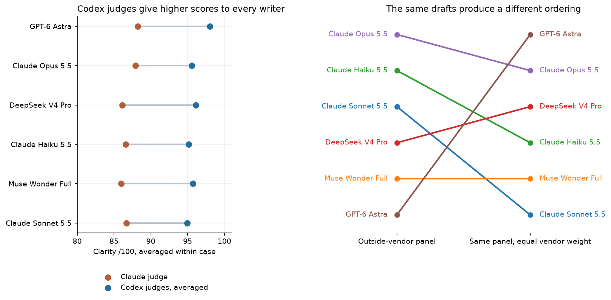

# Writing that readers can follow: testing the writers and the judges

An analytical document helps someone make a decision from evidence. A manager reading an email needs to see what is recommended and why. A reader of a report needs to distinguish an observed change from a claim that a program caused it. A slide audience needs the main number before the meeting moves on. If the writing buries those connections, correct calculations can still lead to a poor decision.

AI can produce these documents quickly. The harder question is whether the result is easy to follow. People often use *AI slop* to describe repeated conclusions, empty emphasis or formulaic prose. The label combines several different objections, and reasonable editors can disagree about a particular sentence. Counting a fashionable word does not tell us whether a reader missed the finding. A polished report can also contain a factual error that has little to do with its style.

We therefore study the writing and the way it is evaluated. A writer model receives an evidence packet and a document brief. A judge model reads the resulting document without the author's identity and assigns scores. We check whether those assessments survive a different reviewer, whether they change when AI slop is mentioned, and what still needs testing with people.

The [earlier pilot](../15-analytical-writing-style/) collected 213 short drafts from 27 writers on two numerical cases. Its automated readers answered the varying questions correctly on average, leaving little room to distinguish drafts. This extension samples 108 old drafts, reviews 204 passages, and adds 288 longer documents from six writers on 24 fresh cases. Its three new judges are GPT-6 Astra and GPT-6.1 Sol through Codex, and Claude Opus 5.5 through Claude Code.

The clearest result is that the judging design changes the ranking. GPT-6 Astra moves from sixth to first when every writer receives the same vendor-balanced panel. The text is unchanged. Previously flagged passages receive prose concerns at a mean reviewer rate of 1.6%, and adding an AI-slop warning to a fixed rubric changes clarity by -0.31/100. These are model judgments; human comprehension and editor agreement remain pending.

## A reading guide

- [What was compared](#what-was-compared)
- [Why Astra moved from sixth to first](#why-astra-moved-from-sixth-to-first)
- [Actual texts and judge explanations](#actual-texts-and-judge-explanations)
- [Rechecking earlier prose flags](#rechecking-earlier-prose-flags)
- [Whether an AI-slop warning changes scores](#whether-an-ai-slop-warning-changes-scores)
- [Document lengths and delivery](#document-lengths-and-delivery)
- [What remains for human readers](#what-remains-for-human-readers)
- [Limits, evidence and reproduction](#limits-evidence-and-reproduction)

## What was compared

There are two related parts. The old-draft part asks whether fresh reviewers agree with earlier criticisms. The new-draft part asks writers to analyze more varied decisions at lengths closer to an actual email, article or report. Both parts use cached responses, so a replay needs no new model calls.

| Part | Material | What the result can tell us |
|---|---|---|
| Longer writing tasks | 24 cases × 6 writers × 2 generations = 288 drafts | How the selected writers respond to these briefs and how judges score them |
| Fresh passage review | 96 previously flagged and 108 unflagged passages | Whether new model reviewers find a locally justified concern |
| Review instructions | 24 selected drafts under baseline, rubric and warning conditions | How scores change when instructions change while the document stays fixed |
| Prepared human study | 396 documents and paired booklets for 204 passages | Reader accuracy, effort and editor agreement once people submit responses |

The 24 fresh cases cover six reasoning problems: whether added value exceeds costs, which supplier meets capacity and budget constraints, how a changing mix affects comparisons, where a process bottleneck sits, how uncertain scenarios affect a decision, and whether a trial clears all operational guardrails. Each structure has four parameter draws. Each case is assigned one genre; all writers receive that identical prompt twice in fresh sessions. No writing-style advice or AI-slop warning is given to the writers.

For a concrete input, the first email packet has 65 more standard successes and 18 fewer complex successes. Each success is worth $41; implementation costs $1,027 and the vendor fee is $400. The stated rule permits expansion only when added value minus both costs is positive. The resulting calculation is (65 - 18) × $41 - $1,027 - $400 = $500. The draft must connect that number to the recommendation and explain the different segment results. Examples 1 and 2 show two writers answering this exact prompt. Its task instructions are:

> Write an analytical email for the director making the decision. Analyze the evidence and recommend a decision under the stated rule. Use 180 to 280 words. Use the following evidence packet.

The full evidence packet is preserved with both drafts in the linked example evidence.



The workflow separates original documents from reviews of those documents. This matters because a review is another model output that can contain an error; it is not automatically a correct label.

## Why Astra moved from sixth to first

Each judge scores clarity, factual support, reasoning and genre fit on a 0 to 100 scale. Clarity means ease of following the analysis. Factual support asks whether claims match the supplied evidence. Reasoning asks whether the conclusion follows. Genre fit asks whether the response suits the requested document. A score of 90 is a reviewer's rating, not a finding that 90% of people understood the text.

Here, a vendor is the company supplying a model: the GPT models are from OpenAI and the Claude models are from Anthropic. Codex and Claude Code are the tools used to call those model families. “Own-vendor” is a label applied during analysis; the judges were not told the author or company that produced a draft.

The original outside-vendor calculation excludes judges from the writer's own vendor. For an OpenAI writer, that leaves Claude. For a Claude writer, that leaves the two Codex judges. Muse and DeepSeek retain all three judges. This creates different panels for different writers, and the panels use the score scale differently.

The common-panel calculation includes all three judges for every writer, including own-vendor reviews. It averages the two Codex judges first, then gives that average and Claude equal weight. Scores average the two generations within case before averaging cases.

| Writer | Codex judges | Claude judge | Outside-vendor score (rank) | Common-panel score (rank) |
|---|---:|---:|---:|---:|
| GPT-6 Astra | 98.00 | 88.21 | 88.21 (6) | 93.10 (1) |
| Claude Opus 5.5 | 95.54 | 87.92 | 95.54 (1) | 91.73 (2) |
| DeepSeek V4 Pro | 96.12 | 86.15 | 92.80 (4) | 91.14 (3) |
| Claude Haiku 5.5 | 95.12 | 86.58 | 95.12 (2) | 90.85 (4) |
| Muse Wonder Full | 95.72 | 85.96 | 92.42 (5) | 90.84 (5) |
| Claude Sonnet 5.5 | 94.94 | 86.71 | 94.94 (3) | 90.82 (6) |

For Astra, the common-panel calculation is (98.00 + 88.21) / 2 = 93.10. For Claude Opus, it is (95.54 + 87.92) / 2 = 91.73. The outside-vendor calculation had instead compared Astra's 88.21 from the stricter Claude judge with Opus's 95.54 from the more generous Codex judges. That comparison placed Astra last even though it has the highest mean clarity under either judge vendor separately.



Read the left panel across each row: the Claude dot is lower than the Codex average for every writer, including Claude's own models. Across the 282 documents with all three scores, the Codex average is 9.01 clarity points above Claude on average. Read the right panel as a sensitivity check: the connecting lines move because the panel changes, not because a draft was rewritten. Neither ordering is established as the one human readers would prefer. Including own-vendor reviews fixes panel consistency but introduces a different concern about self-preference.


The left side of the original score figure shows outside-vendor writer means with intervals from resampling cases: we repeatedly draw cases from the observed set and recalculate the average to show how much it moves. These intervals describe variation in these cases, conditional on the selected judges. The right side exposes which judges supplied those scores. Tight intervals on the left cannot repair systematic differences between the panels on the right. The [judge-specific scores](data/judge_specific.csv), [panel components](data/judge_panel_components.csv) and [common-panel sensitivity](data/common_panel_sensitivity.csv) preserve the calculation.

## Actual texts and judge explanations

These six examples were chosen after viewing the results to explain specific disagreements, compare one identical prompt, and inspect a checkable error. They do not estimate how common each problem is. All judges saw the whole draft and evidence, with author identity hidden. The scores below apply to the full draft. Reviewers could list up to three concerns, so those lists do not explain every point deducted.


Each row is one unchanged document, and each column is one judge. The numbers show that a gap appears for Astra, Claude and Muse texts. The academic example is the largest gap among fully reviewed drafts, so it should be read as an extreme illustration. Full prompts, complete drafts, review text and cache keys are in [the example evidence](data/explanation_examples.json).

### Example 1. An Astra email: 100, 99 and 88 for the same text

Writer: GPT-6 Astra · email · case `F1-1` · sample 1 · document `6d8506c6cd7f46c4`.

> I recommend expanding the program under the stated rule: expand only if the value of additional successful service appointments exceeds both the implementation cost and vendor fee. The study’s quarterly results meet that threshold, with an estimated net benefit of $500.

| Judge | Clarity | Factual support | Reasoning | Genre fit |
|---|---:|---:|---:|---:|
| GPT-6 Astra | 100 | 100 | 100 | 100 |
| GPT-6.1 Sol | 99 | 100 | 99 | 98 |
| Claude Opus 5.5 | 88 | 92 | 88 | 84 |

The packet gives 65 additional standard successes and 18 fewer complex successes. The email correctly computes (65 - 18) × $41 - $1,027 - $400 = $500. Both Codex judges list no problems. Claude lists only a format concern: the signature is left as `[Your Name]`. That concern is real in a ready-to-send email, but the review does not explain how the clarity score of 88 was allocated. The recorded concerns are not an itemized explanation of every lost point.

Selected review excerpts, quoted exactly:

- Claude Opus 5.5, format, on “[Your Name]”: “An unfilled placeholder signature means the email is not ready to send as written.”

### Example 2. Claude Opus on the identical email prompt

Writer: Claude Opus 5.5 · email · case `F1-1` · sample 1 · document `6aab6b1c14691720`.

> Under the decision rule (expand only if extra value exceeds implementation and vendor costs), the evidence supports expansion, but the margin is thin and comes entirely from standard appointments.

| Judge | Clarity | Factual support | Reasoning | Genre fit |
|---|---:|---:|---:|---:|
| GPT-6 Astra | 95 | 96 | 94 | 96 |
| GPT-6.1 Sol | 96 | 97 | 95 | 98 |
| Claude Opus 5.5 | 88 | 92 | 85 | 88 |

This uses the exact same F1-1 email prompt and the first generation from each writer. Opus recommends limiting expansion to standard appointments and gives a $1,238 net value for that narrower rollout. Claude flags the assumption that costs stay unchanged, although the email later asks the reader to confirm it. The two Codex judges list no problems. Claude gives both this email and the Astra email clarity 88, while the Codex judges give the Astra email higher clarity. The aggregate reversal cannot be read as Claude selecting its own email over Astra on this example.

Selected review excerpts, quoted exactly:

- Claude Opus 5.5, reasoning, on “Counting standard alone, the net is about +$1,238.”: “This assumes the full implementation and vendor costs apply unchanged to a one-segment rollout. The email flags this later, but the figure is presented here without that qualifier.”

### Example 3. Astra slides: a local wording objection versus perfect scores

Writer: GPT-6 Astra · slides · case `F1-2` · sample 1 · document `0615bc9bc930e621`.

> Hold expansion. Investigate the complex-order decline and assess whether standard-order gains are repeatable. Before reconsideration, obtain a concurrent comparison and updated economics that include both costs. Expand only when credible incremental value exceeds their combined total.

| Judge | Clarity | Factual support | Reasoning | Genre fit |
|---|---:|---:|---:|---:|
| GPT-6 Astra | 100 | 100 | 100 | 100 |
| GPT-6.1 Sol | 100 | 100 | 100 | 100 |
| Claude Opus 5.5 | 88 | 95 | 92 | 90 |

Both Codex judges give 100 on every dimension and list no problems. Claude objects to the referent of “their” and to switching from “orders” to “items” elsewhere in the draft. A reader can inspect whether “both costs” in the preceding sentence resolves the reference. This is an editorial disagreement about how much explicitness the reader needs; its effect on comprehension has not been tested.

Selected review excerpts, quoted exactly:

- Claude Opus 5.5, prose, on “Expand only when credible incremental value exceeds their combined total.”: “The antecedent of 'their' is unclear; it should name implementation cost and vendor fee explicitly.”

- Claude Opus 5.5, prose, on “across 900 items”: “Switching from 'orders' to 'items' within the deck is inconsistent and mildly confusing.”

### Example 4. An Astra academic report: a 24-point clarity gap

Writer: GPT-6 Astra · academic · case `F1-4` · sample 1 · document `2881ca4f1e31ec4e`.

> The evidence does not support expanding the account onboarding program under the stated decision rule. Across the two segments, the program quarter recorded 34 more successful onboardings than the prior comparison quarter at equal volumes. Valuing each additional success at USD 38 produces USD 1,292 in incremental gross value. However, implementation costs of USD 1,292 and a vendor fee of USD 500 bring total costs to USD 1,792, leaving a net incremental value of negative USD 500.

| Judge | Clarity | Factual support | Reasoning | Genre fit |
|---|---:|---:|---:|---:|
| GPT-6 Astra | 95 | 99 | 99 | 97 |
| GPT-6.1 Sol | 97 | 99 | 99 | 97 |
| Claude Opus 5.5 | 72 | 90 | 78 | 68 |

The report has 1,197 words, inside its 1,000 to 1,400 target. Claude gives clarity 72 and raises three different issues: a claim about causal uncertainty, missing section headings, and repeated reminders that the net value is negative. The Codex judges give clarity 95 and 97 with no listed problems. This example shows why a single “AI slop” count would lose information: reasoning, report structure and repeated prose are separate objections. It is the largest Codex-versus-Claude clarity gap among the 282 fully reviewed drafts, selected here for that reason.

Selected review excerpts, quoted exactly:

- Claude Opus 5.5, reasoning, on “This financial conclusion is reinforced by uncertainty about whether the observed improvement was caused by the program.”: “Causal uncertainty cuts both ways. The report later concedes the true effect 'could be smaller or larger', so the uncertainty does not reinforce rejection.”

- Claude Opus 5.5, format, on “The study compares outcomes in a prior quarter with those in a program quarter, with equal onboarding volumes within each segment.”: “An academic-style report would normally use section structure such as methods, results, limitations and recommendation. This one runs as continuous paragraphs with no headings.”

- Claude Opus 5.5, prose, on “This percentage provides supplementary context; the decisive finding remains the negative dollar balance under the stated rule.”: “The report repeatedly restates that the negative balance is decisive, which pads the length and pushes it toward the upper word limit.”

### Example 5. Muse slides show that the score gap extends beyond self-scoring

Writer: Muse Wonder Full · slides · case `F4-3` · sample 2 · document `bce3310018aed73c`.

> Increasing completed service appointments

| Judge | Clarity | Factual support | Reasoning | Genre fit |
|---|---:|---:|---:|---:|
| GPT-6 Astra | 100 | 100 | 100 | 100 |
| GPT-6.1 Sol | 100 | 100 | 100 | 100 |
| Claude Opus 5.5 | 86 | 92 | 90 | 85 |

This line sits beneath the first slide heading, followed by “Recommendation: Option B.” Claude calls the line an unexplained fragment. Both Codex judges return 100 on all four dimensions and list no problems. Muse is from neither judge vendor, so this example helps separate a general difference in scoring strictness from a claim that the gap is entirely self-preference.

Selected review excerpts, quoted exactly:

- Claude Opus 5.5, prose, on “Increasing completed service appointments”: “This is an unexplained fragment under the slide title that reads as a leftover heading rather than a framed objective.”

### Example 6. A Claude article: agreement on an arithmetic error, with a judge error too

Writer: Claude Opus 5.5 · web · case `F5-3` · sample 1 · document `4b18caca8fb62c3f`.

> If the low scenario were 30% likely instead of 20%, with the remaining probability taken from the high case, expected gross value would fall to $2,820. Expected net value would then be **–$140**, and the expansion would fail Test 1.

| Judge | Clarity | Factual support | Reasoning | Genre fit |
|---|---:|---:|---:|---:|
| GPT-6 Astra | 94 | 79 | 82 | 94 |
| GPT-6.1 Sol | 93 | 80 | 79 | 95 |
| Claude Opus 5.5 | 85 | 68 | 72 | 85 |

All three judges identify the same wrong sensitivity calculation, despite giving different scores. The stated revised probabilities are 30%, 50% and 20%; the scenario values are $1,200, $3,000 and $5,400. The correct gross value is 0.30 × $1,200 + 0.50 × $3,000 + 0.20 × $5,400 = $2,940; after the $2,960 cost, net value is -$20. The article’s recommendation under this changed scenario still fails its positive-value test, but its stated loss is wrong. There is also a check on the judge: in a separate concern Sol says $2,960 divided by 112 is about $26.79. It is about $26.43, as the article originally states. A judge can catch one mistake and make another in its explanation.

Selected review excerpts, quoted exactly:

- GPT-6 Astra, factual, on “If the low scenario were 30% likely instead of 20%, with the remaining probability taken from the high case, expected gross value would fall to $2,820. Expected net value would then be **–$140**, and the expansion would fail Test 1.”: “The revised probabilities are 30%, 50%, and 20%, giving expected gross value of $2,940 and net value of −$20. The test still fails, but the stated loss exaggerates the sensitivity.”

- Claude Opus 5.5, factual, on “expected gross value would fall to $2,820. Expected net value would then be **–$140**”: “With 30/50/20 weights, gross is 0.3×1200 + 0.5×3000 + 0.2×5400 = $2,940, so net is –$20, not –$140. The conclusion that Test 1 fails still holds, but the figures are wrong.”

- GPT-6.1 Sol, reasoning, on “Expected value stays positive down to about $26.43 per success. The low-scenario limit holds only down to **$25**.”: “As value per success falls, expected net value reaches zero first, at approximately $26.79 ($2,960 divided by 112), whereas the loss guardrail holds through $25. This sensitivity therefore contradicts the claim that the downside guardrail is the tighter constraint.”

## Rechecking earlier prose flags

The extension selects one available old draft per writer and genre, without looking at its score. Fresh reviewers then inspect selected passages without the writer's identity or the original criticism. At least two valid reviews are available for all 204 passages. The unflagged group avoids located old audit flags, but it has no human gold label declaring the prose good.


The “any problem” bar includes factual, reasoning, prose and format concerns. The prose bar counts only a reading or wording concern. Previously flagged passages receive any concern at a mean reviewer rate of 16.1%, compared with 5.2% for unflagged passages. The corresponding prose rates are 1.6% and 1.2%. These average reviewer opinions within each passage, then average passages; they are not the percentage of original flags proven wrong. The neutral task differs from the earlier AI-slop audit, so a change in instructions can explain part of the difference.

One exact old passage from an Astra academic report reads:

> The packet also identifies the evidence as a seeded arithmetic fixture

Claude Opus marks a mild prose problem: the testing term is unexplained and could be replaced by a plain statement that the data are synthetic. GPT-6.1 Sol marks no problem because identifying synthetic evidence is relevant to an academic audience. Both explanations have a connection to the task; people must decide whether the phrase actually interrupts reading.


The visual puts the original criticism beside fresh reviewer explanations. It is selected for disagreement, rather than as a typical passage. Its purpose is to make the judgment inspectable. The [individual assessments](data/passage_assessments.csv) retain the full sample, including agreement and no-problem reviews.

## Whether an AI-slop warning changes scores

To distinguish a cue from a change in criteria, the extension reviews the same 24 selected drafts under three instructions: general quality questions, a neutral prose rubric, and that identical rubric plus a warning that the text might contain AI slop. The rubric supplies the criteria; the warning adds the label. Fresh sessions and opaque document IDs vary across conditions.


The neutral rubric lowers clarity by 0.32 points relative to baseline. Adding the warning lowers it by another 0.31 points, with a case-resampling interval from -0.70 to +0.02 and a six-family interval from -0.70 to +0.03. The warning interval crosses zero, so these data support a small or absent average effect, conditional on the cases and judges. This is a tighter question than the earlier pilot's 1.66-point drop, which changed both the review criteria and the AI-slop framing at once.

## Document lengths and delivery

The run produces 288 usable drafts, but 76 (26.4%) miss their requested word range. Keeping these responses avoids quietly replacing poor compliance with a better second attempt.

| Document | Requested words | Within range | Total |
|---|---:|---:|---:|
| Email | 180 to 280 | 63 | 72 |
| Six-slide text | 200 to 320 | 69 | 72 |
| Web article | 700 to 1,000 | 42 | 72 |
| Academic report | 1,000 to 1,400 | 38 | 72 |


Each dot is a returned draft; the thick segment marks its requested range. The article and academic tasks have lower compliance than the shorter briefs. Length compliance is a separate outcome from prose quality: the 974-word Claude article in example 6 fits its target but contains a wrong sensitivity calculation. The study scores slide text only; it does not test a rendered presentation's layout or spoken delivery.

## What remains for human readers

We still need evidence that a prose concern predicts reader difficulty. The prepared [reader page](data/human/participant/reader.html) records timed reading, four answers, confidence and effort. The [editor page](data/human/participant/editor.html) asks people to distinguish prose, factual, reasoning and format problems, with “no problem” allowed. Authors and administrator answer keys are hidden from participants.

There are 64 reader schedules covering 396 documents and paired editor booklets for 204 passages. A reader sees only one version of each case, reducing the chance that a previous version gives away the answer. All human result files currently contain headers only. No model or test response has been entered as a human result. Human-reviewed rewrites and a causal comparison of edited prose are also pending.

The [administrator guide](data/human/README.md) explains distribution and importing responses. Download participant HTML files and open them locally; GitHub's source viewer does not run the forms. Keep the separate administrator keys private from participants.

## Limits, evidence and reproduction

The new cases are synthetic and have exact numerical rules, which makes calculations checkable. They cover six decision structures with four draws each, not the full range of analytical writing. Each case has one genre, so differences between genres also reflect different cases. There are two generations per writer. The old passage sample comes from only two original cases. Human reading time, comprehension and editorial validity have not yet been measured.

The common-panel ordering remains a diagnostic result, not a general writer leaderboard. Models differ in review strictness; they can also make errors in their criticism, as example 6 shows. The new examples and panel decomposition were added after collection to explain the frozen results, not preregistered as new hypotheses.

The protocol and source packets were committed before model collection in `3b26cf0`. This is an amended exploratory study: a [dated parser amendment](data/parser_amendment.json) permits only missing outer `]}` after complete, fully validated records. It recovers 51 main review requests and 27 instruction requests without changing their raw text, scores or explanations. Strict-only [writer](data/strict_json_writer_sensitivity.csv), [passage](data/strict_json_adjudication_sensitivity.csv) and [instruction](data/strict_json_instruction_sensitivity.csv) tables keep the original parsing rule visible. There are 429/432 valid main review requests and 216/216 valid instruction requests. Failures remain missing rather than becoming zero scores.

This extension reports USD 0.1816 in OpenRouter charges. Reserving notebook 15's full uncertain bound gives a combined charged-or-reserved bound of USD 4.6316, below the USD 10 ceiling. Reported charges across both runs total USD 3.3693. CLI subscription tokens and available list-price estimates are recorded separately. This explanatory update makes no new model calls and adds no model spending.

Install the repository requirements and this folder's [rendering requirements](requirements.txt), then run from this folder:

```powershell
python -m jupyter nbconvert --to notebook --execute --inplace 17_writing_validation_extension.ipynb
```

Default execution verifies frozen evidence and replays the cached responses with zero model calls. The new explanatory figures and example evidence are generated by the notebook from those caches. Place complete participant exports in `data/human/submissions/` to include future human results. For a separate collection, use a new folder, change the protocol version and seed, carry forward the latest cumulative spending bound, and follow the notebook's live-collection instructions. Keep the committed evidence intact.

The notebook's final section lists five follow-up experiments and four checked readings on human evaluation and structured testing. The next measurement that would change the interpretation is whether these model judgments predict independent readers' accuracy and effort on the same documents.
