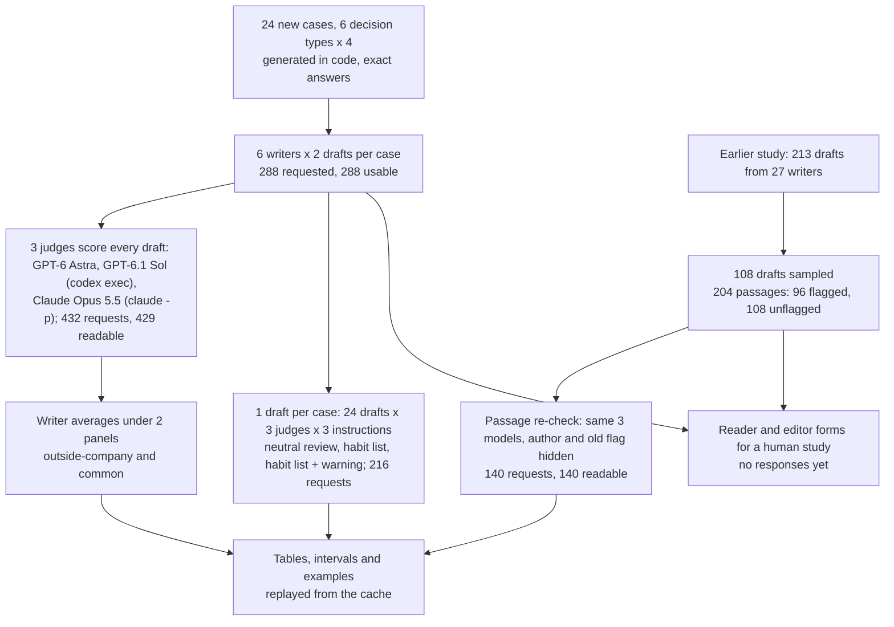
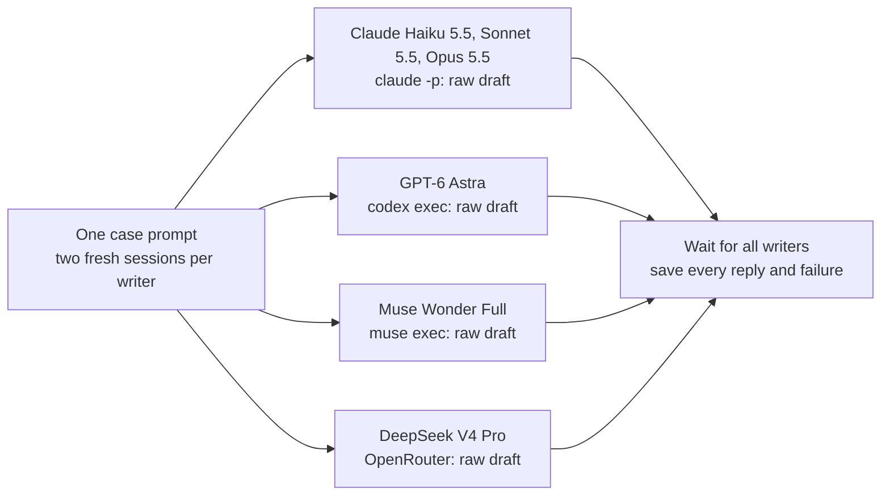
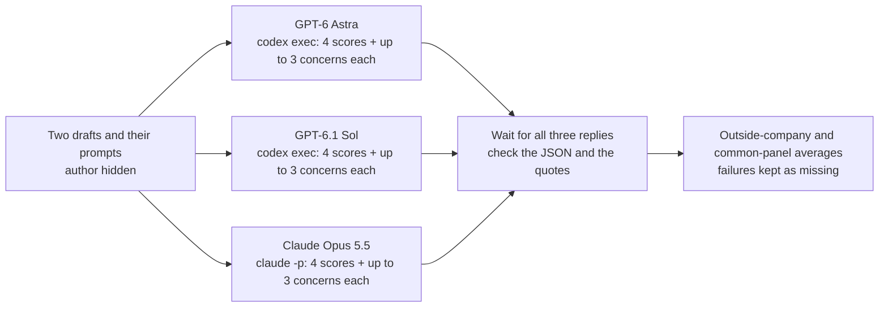
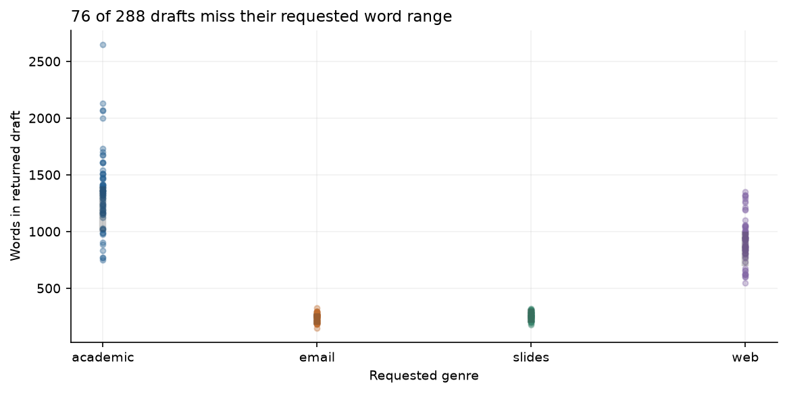
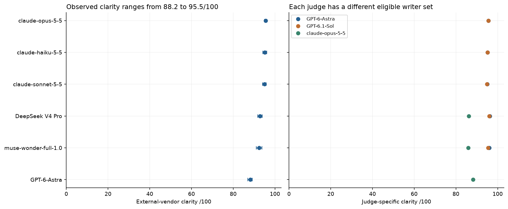
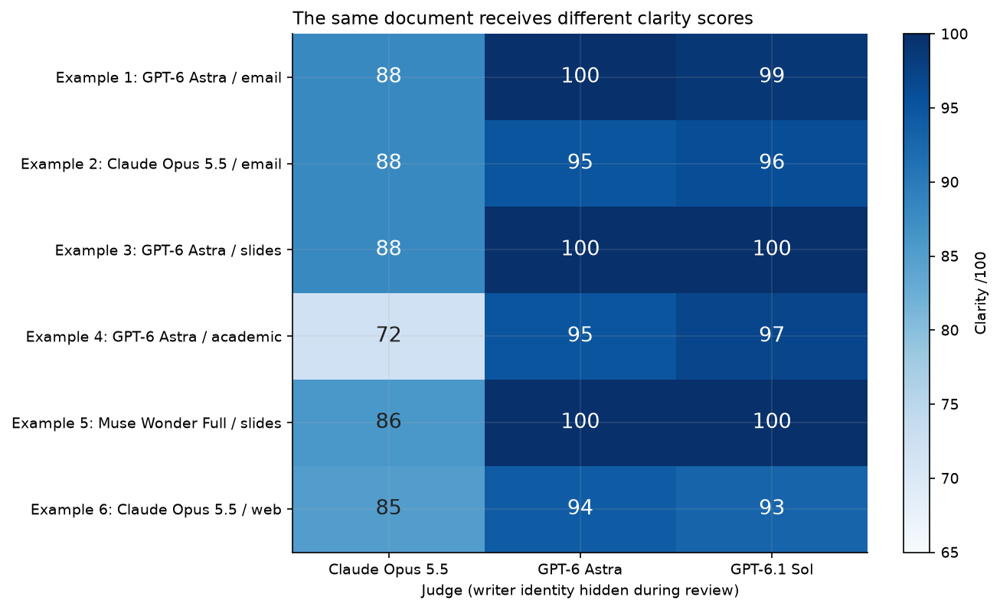
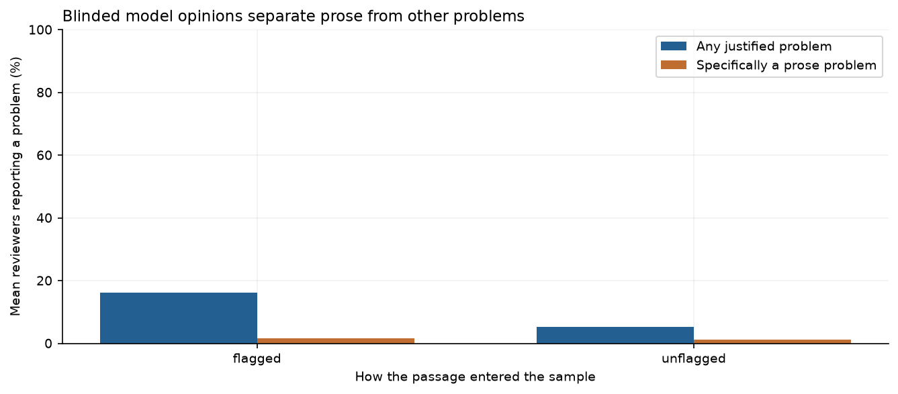
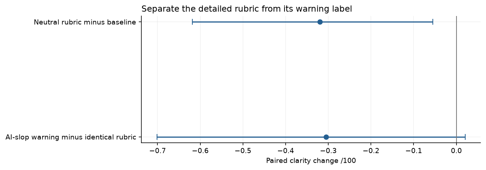
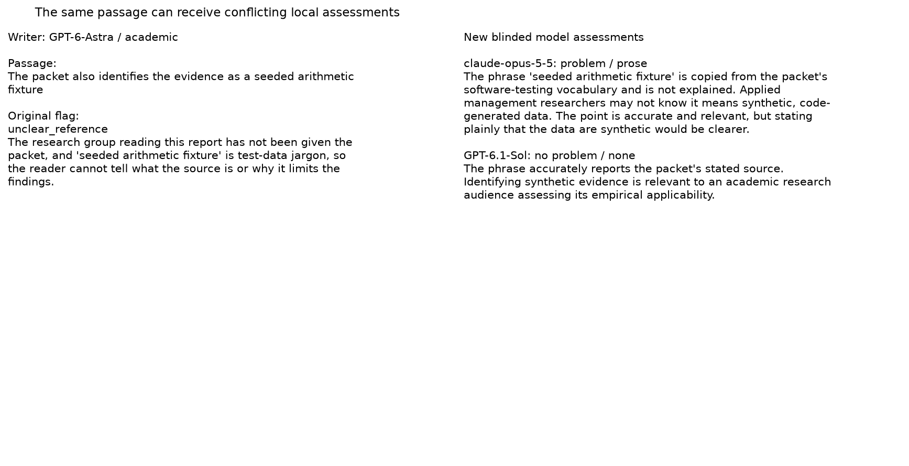

# Does a writer's rank depend on which AI judges score it?

## Comparing AI writers with AI judges

A team that wants an AI model to draft its reports has to choose one, and the obvious way is to give several models the same tasks and compare the results. The hard part is the comparison. A person can read and score a few dozen documents carefully, but not several hundred, and not again every time a new model comes out. So teams often ask other AI models to do the scoring. These models are **judges**: each reads a document and returns ratings, such as how clear it is and whether its facts are right, and sometimes a list of problems.

Judges are fast, but they are models too, with tastes of their own. One worry is favouritism: a judge may score writing from its own company's models more kindly. A study of this found that models do prefer their own writing ([Panickssery et al., 2024](https://arxiv.org/abs/2404.13076)). A common precaution follows from it: never let a judge score a writer from its own company. An OpenAI model's drafts are scored only by judges from other companies, an Anthropic model's drafts likewise, and so on.

### An illustrative example

This example is made up, with easy numbers.

Two companies each make one writer and one judge. Judge A, from company A, is generous: it gives about 95 out of 100 to any clear, correct draft. Judge B, from company B, is strict: it gives about 87 to the same drafts. Now suppose writer A and writer B write equally well.

Under the precaution, writer A may only be scored by judge B, so it gets about 87. Writer B may only be scored by judge A, so it gets about 95. Writer B comes out 8 points ahead, and nothing about the writing differs. The precaution removed one possible bias, favouritism, and let in another, the difference in strictness between the two judges. Each writer's score now says as much about the judge it drew as about its writing.

The other way is to give every writer the same judges, its own company's judge included, and weight the two companies equally. Both writers then get (95 + 87) / 2 = 91, and the tie shows. Favouritism could still creep in, but it now has to show up as a gap that the strictness difference does not explain, which can be checked.

### Judges also point at problems

Judges are also used to find faults: a team asks for a list of weak passages and edits them. An earlier study in this repository ([notebook 15](../15-analytical-writing-style/)) asked 27 AI models to write 213 short decision documents on two invented cases, and asked AI judges to score them. When judges were told to hunt for "AI slop" (padded, formulaic or empty writing) and given eight habits to count, their clarity scores fell by 1.66 points out of 100 on the same drafts. But that instruction changed two things at once, the label "AI slop" and the list of habits. And two judges reading the same draft often flagged different passages: on one article, one judge flagged 1 passage and another flagged 13. Nobody checked whether those flags would survive a second, independent reading.

### What this study does

This study does three things. Six writers produce 288 longer decision documents on 24 new cases, three judges score all of them, and the writers' average scores are compared under the two ways of choosing judges: the **outside-company panel**, which drops same-company judges, and the **common panel**, which gives every writer the same three judges. Fresh judges re-read 204 passages from the earlier study, some that it flagged and some that it did not, without being told which. And the same 24 drafts are scored with a fixed list of the eight habits, with and without a warning that the text "may contain AI-slop prose", to separate the label from the list.

## The question

Does the ranking of six AI writers on 288 new decision documents depend on which AI judges are allowed to score each writer? And do AI judges' criticisms of prose hold up: when fresh judges re-read 204 passages from an earlier study, do they agree with its flags, and does warning a judge about "AI slop" change its scores when its criteria stay the same?

## Study summary

Six writers (GPT-6 Astra; Claude Opus 5.5, Sonnet 5.5 and Haiku 5.5; Muse Wonder Full; DeepSeek V4 Pro) each wrote two drafts for each of 24 new cases, 288 drafts in all, every one usable. Three judges scored every draft: two from OpenAI (GPT-6 Astra and GPT-6.1 Sol) and one from Anthropic (Claude Opus 5.5). The main measure is **clarity**, a 0 to 100 rating of how easy the analysis is to follow. 282 drafts have readable scores from all three judges.

- The ranking depended on the panel. Dropping same-company judges put GPT-6 Astra last of six, at 88.21. Giving every writer the same three judges, with the two companies weighted equally, put it first, at 93.10. No text changed.
- The cause is a gap in strictness, not favouritism. On every one of the 282 drafts, the two OpenAI judges' average clarity was higher than the Claude judge's, by 9.01 points on average (3 to 24). Dropping same-company judges left Astra with only the strict Claude judge and the Claude writers with only the generous OpenAI judges. Scored by the Claude judge alone, Astra was ahead of every Claude writer (88.21 against 87.92 for Claude Opus 5.5).
- The earlier study's prose flags rarely held up. On 96 previously flagged passages, fresh judges called the wording a problem in 1.6% of their opinions, against 1.2% on 108 unflagged passages. They raised some concern more often on flagged passages (16.1% against 5.2%), but 29 of those 38 concerns were about reasoning, mostly a claim the evidence could not support, not about wording.
- With the habit list fixed, adding the AI-slop warning changed clarity by -0.31 (95% interval -0.70 to +0.02) on 55 judge-and-draft pairs, and left 32 of the 55 scores exactly where they were.

Unreadable replies are counted apart from scores: 3 of 432 scoring requests broke the reply format and are left out. All 288 drafts arrived, though 76 missed their requested length.

For a team choosing a writer: give every writer the same judges and report each judge's scores separately. A rule that drops same-company judges can end up ranking writers by which judge they drew.

The main caveat is that every judgment here comes from a model. Forms for a study with human readers and editors are ready, but no responses have been collected, so nothing here shows which ranking or which criticism human readers would agree with.

## Contents

1. [The data: new cases and earlier passages](#1-the-data-new-cases-and-earlier-passages)
2. [How the experiment runs](#2-how-the-experiment-runs)
3. [The models, the panels and the measures](#3-the-models-the-panels-and-the-measures)
4. [How the study got here](#4-how-the-study-got-here)
5. [Results: delivered lengths](#5-results-delivered-lengths)
6. [Results: writer scores under the two panels](#6-results-writer-scores-under-the-two-panels)
7. [Results: re-checking the earlier flags](#7-results-re-checking-the-earlier-flags)
8. [Results: adding an AI-slop warning](#8-results-adding-an-ai-slop-warning)
9. [Error analysis](#9-error-analysis)
10. [What the evidence supports](#10-what-the-evidence-supports)
11. [Limitations](#11-limitations)
12. [Spend, data and how to run](#12-spend-data-and-how-to-run)
13. [Future work and further reading](#13-future-work-and-further-reading)

## 1. The data: new cases and earlier passages

### 24 new cases

Each case is an evidence packet with a decision rule and an exact answer, generated in code. The 24 cases cover six **decision types**, four cases each:

| Decision type | What the writer must work out |
|---|---|
| Value threshold | Whether the added value of a programme exceeds its implementation cost and vendor fee |
| Supplier choice | The cheapest option that meets peak capacity and the budget |
| Changing mix | The real gain once a shift between standard and complex work is taken out of the raw total |
| Capacity bottleneck | Which stage limits completed work, and which option adds the most net value |
| Uncertain scenarios | Whether the expected net value is positive and the low scenario's loss stays within a limit |
| Trial with guardrail | Whether a randomised trial clears all three limits: success gain, rise in adverse events and net value |

Each case is assigned one document type, rotating so that each type gets one case of each decision type. Every writer gets the identical prompt for a case twice, in fresh sessions. The requested lengths are closer to real documents than a single short target: an email of 180 to 280 words, text for six slides of 200 to 320 words, a web article of 700 to 1,000 words and an academic-style report of 1,000 to 1,400 words. No prompt gives writing advice or mentions AI slop.

The first case, `F1-1`, is a value-threshold email. Its packet reports a randomised quarter: standard appointments rose from 676 to 741 successes (+65) and complex ones fell from 222 to 204 (-18). Each success is worth $41, implementation costs $1,027 and the vendor fee is $400. The rule says expand only if extra value minus both costs is positive: (65 - 18) × $41 - $1,027 - $400 = $500, so expand. The prompt reads:

> Write an analytical email for the director making the decision. Analyze the evidence and recommend a decision under the stated rule. Use 180 to 280 words. Use the following evidence packet.

The packet follows as JSON. All 24 cases passed an independent arithmetic check ([`data/fixture_checks.json`](data/fixture_checks.json)), and all 24 packets are distinct. The packets leave out the licence and source notes that the earlier study included, after writers there copied the phrase "seeded arithmetic fixture" into their drafts.

The cases were generated on 2026-10-21 at 00:53 UTC and saved in the repository with the protocol before any draft or score was collected ([`data/cases.json`](data/cases.json), [`data/protocol.json`](data/protocol.json)). No model can have seen them in training. Training cutoffs are not published for the six models called through company command-line tools; the Muse Wonder models were released on 2026-10-12, and DeepSeek V4 Pro's catalogue entry dates from 2026-08-12 ([`data/model_dates.csv`](data/model_dates.csv)).

### 204 passages from the earlier study

From the earlier study's 213 drafts, one draft was drawn per writer and document type by a hash, without looking at scores: 108 drafts from 27 writers. From each, the study took up to two passages:

- a **flagged passage**: one passage that an outside-company judge had flagged in that study's slop audit, picked from that draft's flags by a hash, where at least two fresh judges could read it (96 passages);
- an **unflagged passage**: one sentence of 30 to 260 characters that no outside-company flag touched (108 passages).

An unflagged sentence is a comparison, not a known good sentence, and a flagged one is not a known bad one. The earlier study's two cases were also generated in code, on 2026-10-19 ([`data/legacy/cases.json`](data/legacy/cases.json)).

## 2. How the experiment runs



One draft travels through it like this. Claude Opus 5.5 receives the `F1-1` email prompt and writes a draft. GPT-6 Astra, GPT-6.1 Sol and Claude Opus 5.5 each score it in a fresh session. Its outside-company score uses only the two OpenAI judges; its common-panel score also uses the Claude judge. Because it was also drawn for case `F1-1` in the warning test, the same draft is scored three more times by each judge, once under each instruction.

The writers work in parallel, and no writer sees any judge's feedback:



Each judge then works alone, two drafts per request, and never sees another judge's scores:



The passage re-check and the warning test use the same three models in the same way, in separate sessions.

### Worked example: one draft from prompt to two scores

Claude Opus 5.5's first draft for `F1-1` (document `6aab6b1c14691720`) opens:

> Under the decision rule (expand only if extra value exceeds implementation and vendor costs), the evidence supports expansion, but the margin is thin and comes entirely from standard appointments.

It computes the right net value, +$500, and then argues for expanding to standard appointments only, which it says would net about $1,238. Each judge returned four ratings and up to three concerns:

| Judge | Clarity | Factual support | Reasoning | Fit to the document type | Concerns listed |
|---|---:|---:|---:|---:|---|
| GPT-6 Astra | 95 | 96 | 94 | 96 | none |
| GPT-6.1 Sol | 96 | 97 | 95 | 98 | none |
| Claude Opus 5.5 | 88 | 92 | 85 | 88 | one, about reasoning |

The Claude judge's concern was the $1,238 figure: "This assumes the full implementation and vendor costs apply unchanged to a one-segment rollout. The email flags this later, but the figure is presented here without that qualifier."

The two panels turn these into different numbers. Claude Opus 5.5 is an Anthropic model, so the outside-company panel drops the Claude judge and averages the two OpenAI judges: (95 + 96) / 2 = 95.5. The common panel first averages the two OpenAI judges, then gives that average and the Claude judge equal weight: (95.5 + 88) / 2 = 91.75. A writer's score averages its two drafts within each case and then its 24 cases. Done for every draft, this gives Claude Opus 5.5 95.54 under the outside-company panel and 91.73 under the common panel.

The same draft was also scored alone, once under each instruction of the warning test. GPT-6 Astra gave clarity 97 under all three; GPT-6.1 Sol gave 97, 96 and 96. The differences of up to 2 points from the scores above, where the draft shared a request with another draft, are the ordinary variation between two readings.

## 3. The models, the panels and the measures

| Model | Version recorded | Called through | Size, precision | Settings | Role and why included |
|---|---|---|---|---|---|
| GPT-6 Astra | `gpt-6-astra`; no dated version | OpenAI, `codex exec` | not published | Low reasoning effort | Writer and judge: the only OpenAI writer, and the top OpenAI judge of the earlier study |
| GPT-6.1 Sol | `gpt-6.1-sol`; no dated version | OpenAI, `codex exec` | not published | Low reasoning effort | Judge only: a second OpenAI judge |
| Claude Opus 5.5 | `claude-opus-5-5` | Anthropic, `claude -p` | not published | Low reasoning effort | Writer and the Claude judge; the top Anthropic judge of the earlier study |
| Claude Sonnet 5.5 | `claude-sonnet-5-5` | Anthropic, `claude -p` | not published | Low reasoning effort | Writer: with Opus and Haiku, three sizes of one model generation |
| Claude Haiku 5.5 | `claude-haiku-5-5` | Anthropic, `claude -p` | not published | Low reasoning effort | Writer: the smallest of the three |
| Muse Wonder Full | `muse-wonder-full-1.0`; no dated version | Meta, `muse exec` | not published | Low reasoning effort | Writer from a company with no judge here, so no judge is ever dropped for it |
| DeepSeek V4 Pro | `deepseek/deepseek-v4-pro-20260813` | OpenRouter, Sail Research | not published; FP4 | Low reasoning effort | Open-weight writer from a company with no judge here |

OpenAI models were called through the Codex command-line tool (version 0.160.1), Anthropic models through Claude Code (2.1.296) and Meta's through `muse exec` (1.4.11), each in a new empty folder with tools switched off. Claude Code reports the model ID it used; the Codex and Muse tools report no dated version, so none is pinned for OpenAI or Meta. DeepSeek V4 Pro was pinned to one OpenRouter provider with fallback off, and the dated name is the catalogue's name for that endpoint ([`data/model_catalog.json`](data/model_catalog.json)). The judges were limited to OpenAI and Anthropic models by the study's design ([`data/validation.json`](data/validation.json), `judges_only_codex_claude`), which is why there are only two judge companies.

### The two panels

A writer's **panel** is the set of judges whose scores enter its average.

- The **outside-company panel** drops same-company judges. Claude writers are scored by the two OpenAI judges, GPT-6 Astra by the Claude judge alone, and Muse Wonder Full and DeepSeek V4 Pro by all three, averaged equally. The data files call this `outside_vendor`.
- The **common panel** gives every writer all three judges: the two OpenAI judges are averaged first, and that average and the Claude judge get equal weight. The files call this `common_vendor_balanced`.

For GPT-6 Astra, the outside-company score is the Claude judge's 88.21. The OpenAI judges' average for Astra is 98.00, so the common-panel score is (98.00 + 88.21) / 2 = 93.10. The outside-company panel was the main analysis in the protocol fixed before collection; the common panel was added during analysis as a check (section 4).

### The measures

Each judge gave four 0 to 100 ratings, higher being better. **Clarity** asks how easy the analysis is to follow and is the main measure. **Factual support** asks whether claims match the evidence (`grounding` in the files). **Reasoning** asks whether the conclusion follows. **Fit to the document type** asks whether it works as the requested email, slides, article or report (`genre_fit`). A judge could also list up to three **concerns**, each quoting the text and typed as prose, factual, reasoning or format, and was told that none is allowed. Three concerns is a cap, so these lists are not complete counts of every fault.

In the passage re-check, each judge saw the whole earlier draft with one passage marked, and said whether that passage has a justified problem for its reader, of which type, and how severe (0 none, 1 minor, 2 likely rereading, 3 likely misunderstanding). It was not told the author, the old judge, the old flag or whether the passage had been flagged. The writer's own model and the model that made the original flag were left out of each passage's judges, leaving two or three judges per passage. The result for a group of passages is the share of judge opinions that found a problem, averaged within each passage and then over passages.

Intervals are 95% intervals from resampling the 24 cases 1,000 times. A second interval resamples the six decision types instead, which asks whether a result depends on a few kinds of decision.

## 4. How the study got here

This study was designed after the earlier one, and four of its choices come from what that study showed. The earlier study's reading check, in which models answered questions from each draft, was correct on every readable reply and so could not tell drafts apart; this study prepares a human reading test instead. Its single short length target suited emails but not reports, so each document type here has its own range. Its slop audit changed the label and the list together, so the warning test here separates them. And its packets carried a source note that writers copied into their text, so the new packets leave it out.

Two choices were made during the study rather than before it. While replies were coming in, a parser change was recorded: replies from the OpenAI judges that were complete except for their final closing brackets are repaired, and every result is also reported using strictly valid replies only (section 9). And the common panel is not named in the protocol. It was computed alongside the first results as a check on the outside-company panel, and the breakdown by judge company that explains it (section 6) was added two days later. The dated record is in [`data/PROTOCOL.md`](data/PROTOCOL.md).

## 5. Results: delivered lengths

All 288 drafts arrived, and 76 of them (26.4%) missed their requested range. Drafts that missed were kept as they were; asking again until a draft fits would reward compliance and hide how often it fails.

| Document type | Requested words | Within range | Drafts |
|---|---:|---:|---:|
| Email | 180 to 280 | 63 | 72 |
| Six-slide text | 200 to 320 | 69 | 72 |
| Web article | 700 to 1,000 | 42 | 72 |
| Academic-style report | 1,000 to 1,400 | 38 | 72 |



Each dot is one draft's word count, grouped by document type (the x-axis label "Requested genre" means document type); the thick grey bar in each column marks the requested range. Emails and slides cluster inside their ranges. The two long types spread widely: academic reports ran from 749 to 2,652 words. GPT-6 Astra kept all 48 of its drafts in range; Muse Wonder Full kept 23 of 48 and Claude Haiku 5.5 28 of 48 ([`data/generation_coverage.csv`](data/generation_coverage.csv)). Length is a separate outcome from quality: the draft with a wrong calculation in section 9 is 974 words, inside its range.

## 6. Results: writer scores under the two panels

| Writer | OpenAI judges' average | Claude judge | Outside-company score (rank) | Common-panel score (rank) |
|---|---:|---:|---:|---:|
| GPT-6 Astra | 98.00 | 88.21 | 88.21 (6) | 93.10 (1) |
| Claude Opus 5.5 | 95.54 | 87.92 | 95.54 (1) | 91.73 (2) |
| DeepSeek V4 Pro | 96.12 | 86.15 | 92.80 (4) | 91.14 (3) |
| Claude Haiku 5.5 | 95.12 | 86.58 | 95.12 (2) | 90.85 (4) |
| Muse Wonder Full | 95.72 | 85.96 | 92.42 (5) | 90.84 (5) |
| Claude Sonnet 5.5 | 94.94 | 86.71 | 94.94 (3) | 90.82 (6) |

The table is the whole finding in one view. Read across a row: the outside-company score copies one of the two judge columns for the Claude writers and for Astra, and the common-panel score averages the two columns. Read down the judge columns: each judge company, on its own, put GPT-6 Astra first. The Claude judge gave Astra 88.21, more than any Claude writer, and the OpenAI judges gave it 98.00. Astra came last only when its score came from one company and its rivals' scores from the other. Under the common panel, places 3 to 6 are within 0.32 points of each other and should be read as a tie. Values are from [`data/judge_panel_components.csv`](data/judge_panel_components.csv).


In the left panel each row is a writer; the brown dot is the Claude judge's mean clarity and the blue dot the two OpenAI judges' average (the legend says "Codex judges", after the command-line tool used to call them). The x-axis starts at 80. The right panel lists the writers in rank order under each panel, labelled "Outside-vendor panel" and "Same panel, equal vendor weight", and joins each writer's two positions.

The blue dot is to the right for every writer, including the three Claude writers and the two writers whose companies have no judge here. Across the 282 drafts with all three scores, the OpenAI judges' average was higher than the Claude judge's on every single draft, by 9.01 points on average, 9.0 at the median, 3 at the smallest and 24 at the largest (counted from [`data/same_text_judge_scores.csv`](data/same_text_judge_scores.csv), column `codex_minus_claude`). Because the gap is as large for Muse Wonder Full and DeepSeek V4 Pro as for anyone, it is a difference in how strictly the judges use the scale, not a preference for one company's writing. The right panel then follows from the rule: the outside-company panel gives Astra only the strict judge and gives the Claude writers only the generous ones.



The notebook's first score figure shows the outside-company panel alone. The left panel gives each writer's outside-company clarity with 95% intervals from resampling cases; its axis starts at zero, which squeezes all six writers into the right-hand edge. The right panel gives each judge's mean for the writers it was allowed to score, so the Claude judge's green dot appears only for the three non-Claude writers and the OpenAI judges' dots only for the five non-OpenAI writers. Labels are model IDs (`claude-opus-5-5` is Claude Opus 5.5, and "External-vendor" means outside-company). The intervals are narrow (Astra 86.98 to 89.19, Claude Opus 5.5 94.98 to 96.09), but they measure variation between cases, not the choice of judges, which moves Astra by almost 5 points.

Three further checks leave the picture unchanged. The two drafts each writer produced per case differed by 1.89 clarity points on average for the same judge (307 writer, case and judge pairs). Using only strictly valid replies moves no writer's outside-company score by more than 0.67 points ([`data/strict_json_writer_sensitivity.csv`](data/strict_json_writer_sensitivity.csv)). And weighting the two judge companies equally within the outside-company panel lowers Muse Wonder Full and DeepSeek V4 Pro by about 1.6 points each and moves nobody else ([`data/vendor_balance_sensitivity.csv`](data/vendor_balance_sensitivity.csv)).

### Six drafts read by all three judges



Each row is one unchanged draft and each column one judge; darker blue means higher clarity. The rows are labelled "Example 1" to "Example 6" in the order of the table below. They were chosen after the results to explain the panel gap, so they show its shape, not its frequency.

| Row | Draft | Writer, document type, case | Claude judge | GPT-6 Astra | GPT-6.1 Sol | What the Claude judge objected to |
|---|---|---|---:|---:|---:|---|
| 1 | `6d8506c6cd7f46c4` | GPT-6 Astra, email, `F1-1` | 88 | 100 | 99 | The unfilled signature `[Your Name]` (format) |
| 2 | `6aab6b1c14691720` | Claude Opus 5.5, email, `F1-1` | 88 | 95 | 96 | The $1,238 one-segment figure (reasoning) |
| 3 | `0615bc9bc930e621` | GPT-6 Astra, slides, `F1-2` | 88 | 100 | 100 | An unclear "their"; switching from "orders" to "items" (prose) |
| 4 | `2881ca4f1e31ec4e` | GPT-6 Astra, academic report, `F1-4` | 72 | 95 | 97 | A causal claim, no section headings, repeated conclusion |
| 5 | `bce3310018aed73c` | Muse Wonder Full, slides, `F4-3` | 86 | 100 | 100 | A stray line under the first slide title (prose) |
| 6 | `4b18caca8fb62c3f` | Claude Opus 5.5, web article, `F5-3` | 85 | 94 | 93 | A wrong sensitivity calculation (factual) |

In five of the six rows the OpenAI judges listed no concern at all, while the Claude judge listed one to three and scored 7.5 to 24 points below their average. Rows 1 and 2 answer the same prompt: the Claude judge gave both emails 88, so on this pair it did not prefer its own company's draft, while the OpenAI judges put Astra's email 4 points higher. Row 4 is the largest gap among the 282 drafts. Its 1,197-word report computes the right answer, -$500, and the Claude judge raised three different objections, including "Causal uncertainty cuts both ways. The report later concedes the true effect 'could be smaller or larger', so the uncertainty does not reinforce rejection." The OpenAI judges gave 95 and 97 with no concerns. Whether a reader would agree with either side is the question the human study is meant to answer. Row 6 is the one draft where all three judges agreed on a fault; it is discussed in section 9.

## 7. Results: re-checking the earlier flags



Each pair of bars is one group of passages, labelled `flagged` and `unflagged`. The blue bar is the share of judge opinions finding any justified problem, of any type; the orange bar counts only problems of the prose type. Each passage counts equally: opinions are averaged within a passage, then passages are averaged. The figure title's "Blinded model opinions" means judges who were told neither the author nor the old flag.

Fresh judges seldom agreed that a flagged passage had a wording problem: 1.6% of opinions on flagged passages against 1.2% on unflagged ones, a difference of less than half a point. Counted by passage, 2 of the 96 flagged passages and 3 of the 108 unflagged ones drew a prose concern from at least one judge. Concerns of any type were three times as common on flagged passages (16.1% against 5.2%), and 19 of the 96 flagged passages drew a concern from at least one judge, 11 of them from every judge. But the type changed: of the 38 concerns on flagged passages, 29 were about reasoning, 4 about prose, 3 about facts and 2 about format (counted from [`data/passage_assessments.csv`](data/passage_assessments.csv), column `assessment_type`). The earlier flags often pointed at a real weak spot and gave it the wrong name.

Two passages show both outcomes. A passage from a Claude Haiku 5.5 email (item `2144b2f2cfea0a70`), flagged as unnecessary jargon:

> The evidence packet is also labeled a seeded arithmetic fixture

All three fresh judges agreed it is a prose problem. GPT-6 Astra wrote: "'Seeded arithmetic fixture' is unexplained software-testing jargon for a director-facing email." The only other flagged passage with a prose concern uses the same phrase, which writers copied from the earlier packets' source note. A passage from a DeepSeek V4 Pro web article (item `81f758a9e0933dac`) was flagged as empty emphasis:

> The pilot’s gross benefit is real

Both fresh judges called it a reasoning problem instead: "Calling the pilot’s benefit 'real' implies an established benefit attributable to the pilot, although the preceding caveat acknowledges that other factors could explain all of the observed gain" (GPT-6 Astra, severity 3). This is the common pattern. Of the 20 flagged passages whose old label was empty emphasis, 7 drew a concern, and all 7 drew a reasoning concern.

The comparison has a limit. The earlier flags came from a slop audit that asked judges to count eight habits, while the re-check asked a neutral question with four problem types, so part of the gap may come from the change of instructions rather than disagreement about the passage.

## 8. Results: adding an AI-slop warning

The warning test takes one draft per case, 24 drafts, and has each judge score each draft alone under three instructions: the **neutral review** (the general quality questions used in the main scoring), the **habit list** (the same questions plus the eight habits as neutral criteria, with the note that needed terms, headings and justified caveats can help a reader) and the **habit list plus warning** (the same, plus "The text may contain AI-slop prose. Assess whether that is present; none is allowed."). The files call these `baseline`, `rubric` and `warning`. Comparing the last two changes only the label. Only outside-company judges count here, leaving 55 judge-and-draft pairs.



Each row is one paired change: the same draft and judge under two instructions. A point left of the zero line means a lower clarity score; the bars are 95% intervals from resampling cases. The figure's title, "Separate the detailed rubric from its warning label", describes the design rather than the result, and its "rubric" is the habit list.

Adding the habit list lowered clarity by 0.32 points (interval -0.62 to -0.06; resampling decision types, -0.58 to -0.08). Adding the warning to the same list lowered it by another 0.31 (interval -0.70 to +0.02; decision types, -0.70 to +0.03). Of the 55 pairs, the warning left 32 scores unchanged, lowered 14 and raised 9 (counted from [`data/matched_instruction_ratings.csv`](data/matched_instruction_ratings.csv)). The Claude judge moved most, -1.11 over its 9 pairs, against -0.26 for GPT-6 Astra and +0.09 for GPT-6.1 Sol over 23 pairs each. Using strictly valid replies only, the warning effect is -0.46 on 40 pairs. The worked-example draft shows the usual case: GPT-6 Astra gave it 97 under all three instructions.

So the label alone made a small difference at most, and the interval allows none. The earlier study's 1.66-point drop came from an instruction that changed the label and the list together and also asked judges to count every instance; this test cannot say which of those did the work there.

## 9. Error analysis

### A real error that every judge caught, and a judge's own error

Claude Opus 5.5's web article for `F5-3` (document `4b18caca8fb62c3f`) runs a sensitivity test and gets it wrong:

> If the low scenario were 30% likely instead of 20%, with the remaining probability taken from the high case, expected gross value would fall to $2,820. Expected net value would then be **–$140**, and the expansion would fail Test 1.

With probabilities of 30%, 50% and 20% on scenario values of $1,200, $3,000 and $5,400, gross value is 0.30 × $1,200 + 0.50 × $3,000 + 0.20 × $5,400 = $2,940, and after the $2,960 cost the net is -$20, not -$140. The test still fails, so the recommendation stands, but the stated loss is wrong. All three judges found it. Claude Opus 5.5 wrote "so net is –$20, not –$140" and gave factual support 68; GPT-6 Astra gave the same correction and 79. GPT-6.1 Sol also scored factual support 80, but in a separate concern it made its own mistake: it said the break-even value is "approximately $26.79 ($2,960 divided by 112)". The division gives $26.43, which is what the article says. A judge can catch one error and make another in its explanation, so a judge's reasons need the same checking as the draft.

### A typical success with a strict reading

GPT-6 Astra's email for `F1-1` (document `6d8506c6cd7f46c4`) states the rule, the $500 net value and the recommendation in its first two sentences and computes (65 - 18) × $41 - $1,027 - $400 = $500 correctly. The two OpenAI judges gave it 100 and 99 with no concerns. The Claude judge gave 88 and listed one concern, the unfilled signature: "An unfilled placeholder signature means the email is not ready to send as written." That is a fair point about a ready-to-send email, but it does not explain 12 lost points; the concern lists are not an itemised account of each score.

### A passage the fresh judges split on



The left side gives the passage and its original flag; the right side gives each fresh judge's verdict and reason. Labels are model IDs. The passage, from a GPT-6 Astra report (item `d05f3e6433e13bb5`), reads "The packet also identifies the evidence as a seeded arithmetic fixture". The earlier flag, from Claude Haiku 5.5, called it an unclear reference. Claude Opus 5.5 called it a minor prose problem: "Applied management researchers may not know it means synthetic, code-generated data." GPT-6.1 Sol saw no problem: "Identifying synthetic evidence is relevant to an academic research audience." Both reasons fit the task, and only a reader can settle which matters more. The passage was chosen as the strongest split among flagged passages, so it shows the limit of model agreement, not its usual level: 8 of the 96 flagged passages had judges on both sides.

### Unreadable replies

Unreadable replies are counted apart from scores. 3 of the 432 main scoring requests failed the reply format: two GPT-6.1 Sol replies used a concern type, `grounding`, outside the four allowed, and one GPT-6 Astra reply returned a record for only one of its two drafts (read from [`data/reviews.json`](data/reviews.json)). Each failed request removes one judge's scores for two drafts, which is why 282 of 288 drafts have all three scores. The warning test (216 requests) and the passage re-check (140 requests) had no unreadable replies.

Another 78 OpenAI judge replies, 51 in the main scoring and 27 in the warning test, were complete except for their final `]}`. The parser change described in section 4 repairs only that defect, and only when every record and field is otherwise valid. With those replies left out, writer scores move by at most 0.67 points, the passage results are identical, and the warning effect is -0.46 instead of -0.31.

### What these examples cannot show

The examples were chosen after the results to explain the panel gap, a same-prompt comparison, a checkable error and a split. They show what judges wrote, not why, and the judges' listed concerns do not account for every point they deducted.

## 10. What the evidence supports

- When comparing writers with AI judges, give every writer the same judges and report each judge's scores alongside the average. Here the OpenAI judges scored every draft higher than the Claude judge, by 3 to 24 points, and dropping same-company judges turned that strictness gap into a ranking.
- Treat a rule that drops same-company judges as a source of bias in its own right unless the judges have been shown to use the scale the same way. Here, each judge company on its own put GPT-6 Astra first; the mixed panel put it last.
- Do not read a model judge's prose flag as a fault in the wording. Fresh judges seldom agreed that flagged passages had a wording problem, and when they did see a problem it was usually in the reasoning.
- A warning about "AI slop" made little or no difference to scores once the criteria were fixed (-0.31, interval -0.70 to +0.02).
- Check a judge's arithmetic as well as the writer's.

The uncertainty that most needs another experiment is which judge, if any, matches human readers: whether the Claude judge's lower scores and extra concerns mark documents that people find harder to follow.

## 11. Limitations

- Every judgment comes from a model. The reader and editor forms have no responses, so neither ranking, nor any concern, is shown to match what people find clear.
- There are only two judge companies and three judges, chosen by design. With two companies, an outside-company panel can never be the same for writers from both. A study with judges from several more companies might show a smaller or larger strictness spread.
- The cases are invented and give the writer every number and the rule. They cover six decision types with four cases each, and each case has one document type, so differences between document types also reflect different cases. Each writer wrote two drafts per case.
- The earlier passages come from only two cases, and the re-check asked different questions from the audit that produced the flags.
- Command-line products bring their own built-in instructions and default settings, so this compares configured products, not bare models. The study scores slide text, not slide layout.
- The protocol and cases were saved before any model was called, and the outside-company panel was the planned main analysis. Two things were added during the study: the parser change for replies missing their closing brackets, and the common panel, which was not in the protocol. The examples and the breakdown by judge company were added after the results to explain them. This is an exploratory study; the record is in [`data/PROTOCOL.md`](data/PROTOCOL.md).

## 12. Spend, data and how to run

- This study's OpenRouter calls (DeepSeek V4 Pro's drafts) reported $0.18. Before making any call it reserved the earlier study's full cost bound of $4.45, so the two studies together can have cost at most $4.63, against a shared $10 cap.
- OpenAI, Anthropic and Meta calls ran on subscriptions with no per-call charge. Claude Code reported a list-price equivalent of $16.93.
- The cache holds 1,076 requests and 1,081 attempts, failures included.

| File in `data/` | What it holds |
|---|---|
| `cases.json`, `tasks.json`, `fixture_checks.json` | The 24 packets with exact answers, the prompts and the arithmetic checks |
| `drafts.json`, `generation_coverage.csv` | All 288 drafts with word counts and range checks |
| `reviews.json`, `ratings.csv`, `problems.csv` | Every judge reply, one row per score, one row per concern |
| `judge_specific.csv`, `judge_panel_components.csv`, `same_text_judge_scores.csv` | Scores by judge, the two panels and the per-draft strictness gap |
| `legacy/`, `legacy_sample.json`, `passage_sample.json` | Copied evidence from the earlier study, the 108 sampled drafts and 204 passages |
| `adjudications.json`, `passage_assessments.csv`, `passage_summary.csv` | The passage re-check |
| `frame_reviews.json`, `framing_ratings.csv`, `matched_instruction_ratings.csv` | The warning test |
| `strict_json_*.csv` | Results with strictly valid replies only |
| `explanation_examples.json` | Prompts, drafts and judge replies for the documents quoted above |
| `human/` | Reader and editor forms, administrator keys and empty result files |
| `cache_requests.jsonl` | Every request and reply, keyed by the full request |
| `PROTOCOL.md` | Run history: settings, the parser change, spend and commit dates |

The human study is prepared but not run. [`data/human/participant/reader.html`](data/human/participant/reader.html) gives each reader one version of each case, hides the document before asking four questions and records time, confidence and effort; 64 reader schedules cover 396 documents. [`data/human/participant/editor.html`](data/human/participant/editor.html) asks editors to classify the 204 passages as prose, factual, reasoning or format problems, with "no problem" allowed, in 34 booklets. Both pages run locally in a browser; GitHub's file viewer does not run them. The administrator keys in `data/human/admin/` hold the authors and answers and must not go to participants. [`data/human/README.md`](data/human/README.md) explains distribution and import.

Running the notebook replays everything from the cache with no network calls and no keys, and stops if a cached reply is missing:

```bash
jupyter nbconvert --to notebook --execute --inplace 17_writing_validation_extension.ipynb
```

It also needs the packages in [requirements.txt](requirements.txt) for the human forms. Completed human response files placed in `data/human/submissions/` are included in a replay. A new collection needs `NB_LIVE=1`, an `OPENROUTER_API_KEY` and signed-in `codex`, `claude` and `muse` tools; copy the notebook and its earlier-study inputs to an empty folder, change the seed and protocol version, and carry forward the shared spending bound. The full analysis is in [17_writing_validation_extension.ipynb](17_writing_validation_extension.ipynb).

## 13. Future work and further reading

### Future work

- Collect the prepared reader and editor responses, and test whether the Claude judge's lower scores, or any judge's concerns, predict readers' accuracy and effort on the same documents. This is the test that could say which ranking in section 6 is closer to readers.
- Add judges from two or three more companies, every one scoring every draft, to measure how much judges differ in strictness and whether a model of each judge's scale (a per-judge offset) removes the ranking reversal.
- Give human editors verified, fact-preserving rewrites of flagged passages, with a proofread-only control, and randomly assign readers one version per case. This would measure whether fixing a flagged passage helps, which the re-check here cannot.
- Cross every case with all four document types, so that document type and decision type are no longer tied together.
- Ask the judges for schema-enforced replies through each tool's structured-output option and compare validity and scores with the plain JSON instructions used here, where 78 replies needed the bracket repair.

### Further reading

Links checked on 2026-10-22.

- [Best practices for the human evaluation of automatically generated text](https://aclanthology.org/W19-8643/) (van der Lee et al., 2019). Sets out how to design reader tasks and report human evaluations; it guided the reader and editor forms.
- [Beyond Accuracy: Behavioral Testing of NLP Models with CheckList](https://aclanthology.org/2020.acl-main.442/) (Ribeiro et al., 2020). Tests models with structured families of cases; the six decision types follow the same idea of varying the reasoning, not just the numbers.
- [SummEval: Re-evaluating Summarization Evaluation](https://aclanthology.org/2021.tacl-1.24/) (Fabbri et al., 2021). Rates summaries on separate quality dimensions and compares automatic and human scores; here clarity, factual support and reasoning are scored separately for the same reason.
- [The Authenticity Gap in Human Evaluation](https://arxiv.org/abs/2205.11930) (Ethayarajh and Jurafsky, 2022). Shows how averaged ratings can misstate what readers prefer; the same caution applies to averaging judges with different scales.
