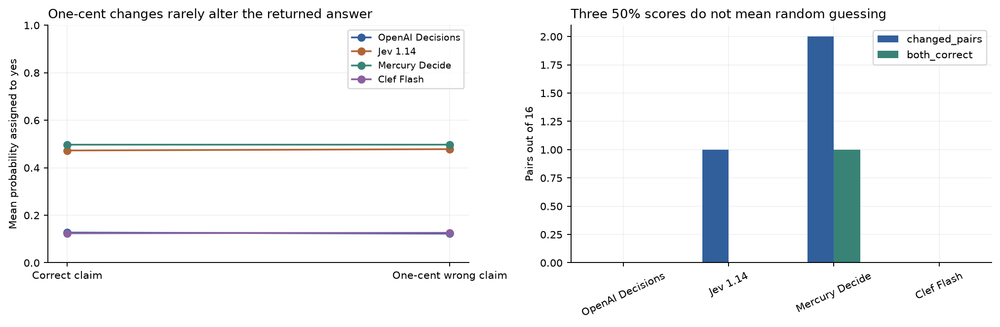
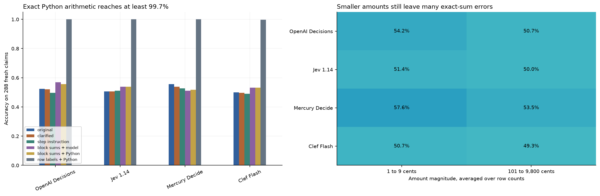
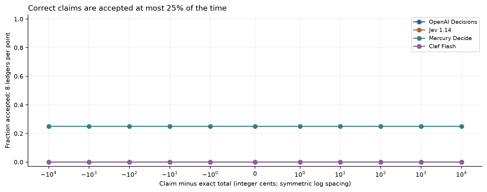
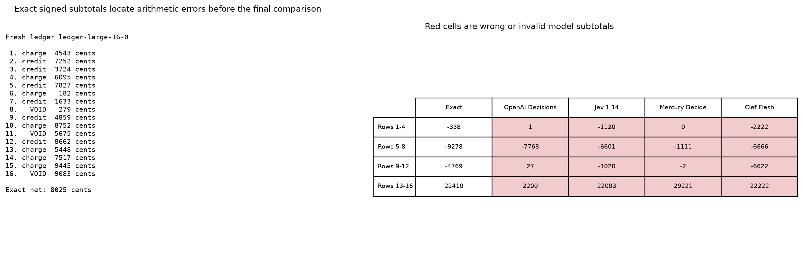
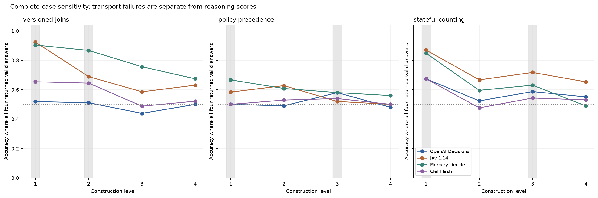
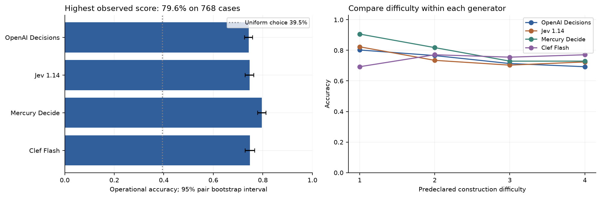
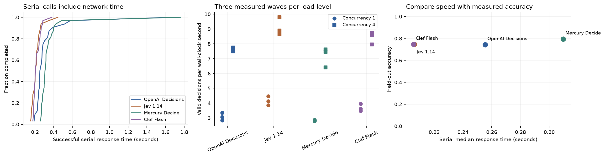
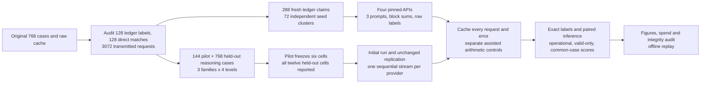
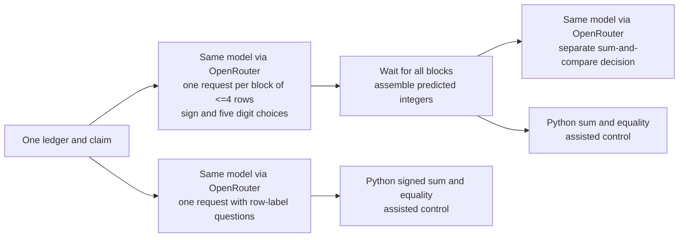

# Four decision models as tasks get harder

A payment check approves a total that is one cent out. A queue routes work using an obsolete ownership record. A shipment counter counts three updates as three shipments. Each decision is small, but the next step relies on it.

An easy record comparison can give every model 100%. A balanced ledger test can give every constant answer 50%. Neither result says which model performs the required calculation. The comparison needs opposite-answer pairs, explicit shortcut checks, and difficulty levels that avoid both ceilings and shared failure.

This follow-up tests whether clearer prompts or separate calculations fix the ledger failures, and which tasks distinguish OpenAI Decisions (GPT-6 Luna), TypeSafe Jev 1.14, Inception Mercury Decide and Cloudflare Clef Flash. It audits the original 768 cases, tests 288 fresh ledger claims in 72 seed clusters, and uses 144 pilot cases plus 768 held-out cases for versioned joins, policy precedence and latest-state counting.

Clearer prompts do not reliably improve exact arithmetic. Model-computed block sums give small, inconsistent changes; row classification followed by Python arithmetic reaches **99.7–100%**, an assisted system. Joins and counting give useful differences on held-out cases. Request failures still prevent a clean four-model reasoning ranking, and the synthetic, pilot-selected suite does not estimate general production accuracy.

## Ledger diagnosis

The earlier README incorrectly said all four models scored 50% on the hardest ledger checks. The raw data show 16/32 for OpenAI, Mercury and Clef, and 15/32 (46.9%) for Jev. Original predictions and aggregate scores were already correct.

OpenAI and Clef answered no to all 32 claims. Mercury changed its answer within only 2/16 opposite-answer pairs; Jev changed within 1/16. An independent Decimal calculation from the exact transmitted row text verifies all 128 original ledger labels. These results point to weak sensitivity to the computed total, rather than a scorer mismatch.



Fresh ledgers cross 4, 8 and 16 rows with amounts of 1–9 or 101–9,800 cents. Every ledger has an exact claim and a one-cent mismatch. Each seed shares its row signs and void mask across both magnitudes; inference keeps all four claims together.

| Model | Original wording | Clarified | Step instruction | Block sums + model | Block sums + Python | Row labels + Python |
|---|---:|---:|---:|---:|---:|---:|
| OpenAI Decisions | 52.4% | 52.1% | 49.7% | 56.9% | 55.6% | 100.0% |
| Jev 1.14 | 50.7% | 50.7% | 51.0% | 53.8% | 53.8% | 100.0% |
| Mercury Decide | 55.6% | 53.8% | 52.8% | 51.0% | 51.7% | 100.0% |
| Clef Flash | 50.0% | 49.7% | 49.0% | 53.1% | 53.1% | 99.7% |

Each entry uses 288 claims; failed or invalid responses count as wrong. Clarified-versus-original paired 95% intervals include zero for every model. The step instruction is one typed decision, so it does not establish that a scratchpad was produced or followed. The full method intervals, request budgets and costs are in [ledger_summary.csv](data/followup/ledger_summary.csv).

The staged method asks for a sign and five digits for each block of at most four rows, assembles the predicted subtotals in code, then makes a separate sum-and-compare decision. Digits have fixed 0–9 choices, with no gold-dependent candidate list. This particular decomposition is unreliable: exact large-amount block accuracy ranges from 0% to 3.6%. Supplying exact block subtotals still gives only 8/16 or 10/16 control claims correct. Supplying the exact net gives all four 16/16. This small control localizes an arithmetic bottleneck, without identifying a model's private computation.



The two Python columns are assisted systems. Python either combines predicted block sums or computes the full total after the model labels rows add, subtract or ignore. The latter solves 288/288 claims for OpenAI, Jev and Mercury and 287/288 for Clef. Perfect results over 72 independent clusters still permit error; the conservative one-sided 95% lower bound is 95.9%. Assisted and exact-intermediate controls do not rank standalone models.

On eight large 16-row ledgers, we varied claim errors from zero through ±1, ±10, ±100, ±1,000 and ±10,000 cents. OpenAI and Clef accepted 0%; Jev and Mercury accepted 25%, at every offset. A larger mismatch did not restore sensitivity. We plot acceptance rather than accuracy because ten incorrect claims and one correct claim would reward an always-no answer.





## Audit of perfect scores

Direct dictionary equality solves 128/128 original evidence cases. The model sees the authoritative record and either a copy or a one-field change. This is a useful control for parsing and applying a direct instruction, but it cannot rank these endpoints. Corrected severity scoring and exact-status lookup are also simple controls; their ceilings do not contribute to the new reasoning comparison.

The audit found no explicit gold field or case identifier in 3,072 original primary request bodies. All 384 opposite-label pairs share opaque references and choice order. This is a finite structural audit, not proof that every statistical shortcut is absent.

Nine of 24 primary family-level cells have a shared 100% ceiling: evidence 1–4, routing 1–3 and policy 2–3. Routing matches current attributes against supplied option descriptions; policy applies a single fixed Boolean rule. They test direct operations with little ambiguity. The evidence generator also samples 11–90 for renewal_month, a realism defect despite correct equality labels. The follow-up replaces these easy constructions with version selection, overlapping rules and latest-state aggregation.

The original severity v1 diagnostic had a real answer-in-reference leak. It was rejected and recollected with opaque references in the original experiment; both versions remain cached and counted in spend. Only v2 enters severity results. This follow-up does not erase that evidence or change original scores.

New joins deliberately put both the correct claim value and its foil in approved records, so finding any matching value gives only 50%. Ignoring policy eligibility also gives 50%; counting events without latest-state selection gives 56.2%. A fact-free metadata control gives 50% among valid replies by construction. OpenAI refused 8/12 such questions, so its operational control score is 16.7%, not 50%.

## Tests that discriminate better

| Family | Four construction levels | Required operation |
|---|---|---|
| Versioned joins | 1, 2, 3 or 4 ownership links, with shuffled old, approved and draft records | Follow the target entity, then select its latest approved revision |
| Policy precedence | 4, 8, 12 or 16 overlapping Boolean rules | Ignore ineligible high-priority rules, then select the highest-priority match |
| Stateful counting | 4, 8, 12 or 20 shipments with three shuffled updates each | Select each shipment's latest state, filter and count distinct shipments |

The pilot uses six seed pairs per family-level cell. Before held-out calls, it selects cells with pooled accuracy between 55% and 95% and a model range of at least eight points, taking up to two per family closest to 75%. It selects joins 1 and 2, policy 1 and 3, and counting 1 and 3. Every one of the twelve held-out cells is still evaluated on 32 new seed pairs; no test item is dropped.

The first held-out collection had connection failures across endpoints and Clef serving limits. We retained it, froze a replication protocol, and repeated all 768 cases with unchanged request bodies and one sequential stream per provider. The replication has no connection errors. Clef still has 200 rate-limit errors and two HTTP 502 errors among its 768 calls; the other three return 768/768 valid answers.

| Model | Correct / 384 | Operational accuracy (95% pair interval) | Valid answers | Accuracy among valid | Accuracy on 287 common valid cases |
|---|---:|---:|---:|---:|---:|
| OpenAI Decisions | 212 | 55.2% (52.1% to 58.3%) | 384 | 55.2% | 56.1% |
| Jev 1.14 | 269 | 70.1% (66.7% to 73.2%) | 384 | 70.1% | 71.8% |
| Mercury Decide | 277 | 72.1% (69.0% to 75.0%) | 384 | 72.1% | 74.9% |
| Clef Flash | 170 | 44.3% (40.4% to 48.2%) | 287 | 59.2% | 59.2% |

These scores use the six cells chosen by the pilot, 384 cases per model. Operational accuracy counts failures as wrong. Valid-only scores use different cases across models. Common-case scores use the same 287 cases, but missingness can bias them and remove one member of a balanced pair. The plotted common-case curves are a sensitivity check. Grey bands mark the frozen pilot choices.



Mercury leads Jev by 2.1 percentage points on the selected operational score; the paired 95% interval is -1.6 to +6.0 points, so this run does not establish a winner between them. Both exceed OpenAI on this selected suite. Clef's availability prevents an equivalent clean reasoning comparison.

Four of six pilot choices retain the operational difficulty-and-range rule: joins 1 and 2 and counting 1 and 3. Those are candidates for the next frozen suite. For example, joins level 2 gives OpenAI 50.0%, Jev 67.2% and Mercury 85.9% on the same 64 cases; Clef gets 64.4% among 45 valid answers. The two policy cells remain near a common floor and should be redesigned before another ranking study. The current six-cell score is retained, including those weak cells. Confirming a new selection requires fresh test seeds rather than rescoring only the favourable cells.

## Retained original accuracy, time and cost

The original comparison uses 768 cases across routing, policy, direct evidence, tracking, ledger and graph tasks. It remains available for comparison and for the separate performance measurements. Its overall score includes ceiling and floor tasks, so use the follow-up to interpret its limits.

| Endpoint | Correct / 768 | Accuracy (95% pair interval) | Serial p50 / p95 | Reported USD / 1,000 | Concurrency 4, valid/s |
|---|---|---|---|---|---|
| OpenAI Decisions | 571 | 74.3% (72.7% to 75.9%) | 0.255 / 0.545 s | $0.0347 | 7.59 |
| Jev 1.14 | 573 | 74.6% (72.9% to 76.3%) | 0.206 / 0.302 s | $0.0247 | 8.90 |
| Mercury Decide | 611 | 79.6% (77.9% to 81.2%) | 0.310 / 0.451 s | $0.0067 + unpriced errors | 7.46 |
| Clef Flash | 574 | 74.7% (72.9% to 76.7%) | 0.206 / 0.283 s | $0.0086 | 8.58 |

Accuracy includes failed requests. The 95% intervals resample whole seed pairs within each family and level, with all model answers aligned. Two primary Mercury HTTP 502 errors are unpriced; valid-only accuracy is 79.8%. Other primary requests returned valid choices. Serial performance uses 32 common cases per endpoint; p95 and tiny median differences have limited precision. Throughput is the median of three actual 16-request waves at client concurrency four.



The original 128-case family accuracies and probability-review curves remain in notebook sections 4–10. All four get 128/128 direct evidence cases correct. At the hardest tracking level, OpenAI gets 6/32, Jev 11/32, Mercury 12/32 and Clef 19/32. Construction levels do not guarantee monotonically decreasing accuracy.



A probability threshold of 0.9 accepts 20 wrong answers for OpenAI, 11 for Jev, 15 for Mercury and 44 for Clef in the original set. Confidence is not a substitute for a task that requires the right evidence and calculation.

## Workflow and model calls





The four models run independently. No model sees another model's answer, and no model judge supplies a label. Block calls are independent; the final calculation waits for them. Exact-net and exact-block controls explicitly receive computed intermediates and are excluded from standalone ranking.

## Evidence, spend and limits

Follow-up reported cost is USD 0.5833 across 13,730 cached attempts, with 702 unpriced failures. The original run reports USD 0.1125 across 4,948 attempts with two unpriced failures. Combined reported cost is USD 0.6957, plus 704 attempts with unknown cost. Reservations estimate exposure, not a billing upper bound. Cache replay spends USD 0.

- [The follow-up protocol](data/followup/protocol.json) freezes ledger and benchmark design; [the replication protocol](data/followup/replication_protocol.json) records the serving change.
- [Ledger summary](data/followup/ledger_summary.csv), [paired method differences](data/followup/ledger_method_differences.csv) and [replication summary](data/followup/benchmark_replication_summary.csv) retain denominators, intervals and costs.
- [All held-out cells](data/followup/benchmark_replication_cells.csv), [valid-only cells](data/followup/benchmark_replication_valid_cells.csv) and [common-valid cells](data/followup/benchmark_replication_complete_cells.csv) expose floors, selection instability and missingness.
- data/followup/cache_requests.jsonl retains 10,658 initial attempts; cache_replication_requests.jsonl retains 3,072 replication attempts. The partition preserves every raw line and request key. The original raw cache is unchanged.
- [Validation](data/followup/validation.json), [offline transport audit](data/followup/offline_network_audit.json), [spend](data/followup/spend.json) and [manifest](data/followup/manifest.json) support reproduction. Hashes normalize text line endings to LF.

All fixtures were generated in Python on 2026-10-20 under the repository MIT licence, with exact labels checked independently from transmitted states. The coding assistant authored templates, so wording and template bias remain. No model call writes test data or labels. Sources, licences and model-date records are linked from [follow-up attribution](data/followup/ATTRIBUTION.md).

Calls use OpenRouter Decisions with pinned providers and no fallback. OpenAI, Jev and Mercury use dated IDs; Clef has no dated checkpoint in the saved catalog. Provider identity is checked, but Clef checkpoint immutability remains unverified. These results concern those endpoints and synthetic templates. The staged method tests one digit encoding, not every possible decomposition. Comparisons are conditioned on a small pilot, and arithmetic interventions use different request budgets. Thirty-two test pairs per cell and one collection day do not establish stable deployment rankings.

## Run

```powershell
python -m pip install -r requirements-replay.txt
python -m nbconvert --to notebook --execute --inplace 18_decisions_api_comparison.ipynb
```

Run from this folder. Default execution replays every phase without a key or network access, using saved token counts. All code is inside the notebook. Original and follow-up sample sizes, pins and guards are in the setup cell.

To collect only the follow-up in a separate copy, retain the original data, start with an empty data/followup folder, set NB18_FOLLOWUP_LIVE=1 and OPENROUTER_API_KEY, and leave NB18_LIVE unset. The frozen 12,500-new-call guard applies per execution; a full 13,730-attempt collection needs a second execution that resumes cached requests. New serving failures can change that count. Do not overwrite these committed responses. The original phase has its own NB18_LIVE switch and USD 5 guard.

The last numbered notebook section lists five follow-up experiments and six checked primary readings.
