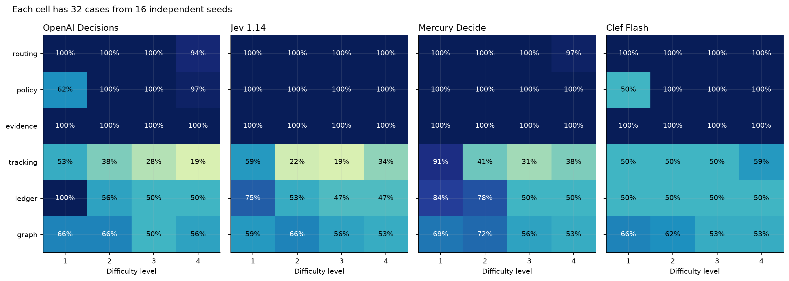
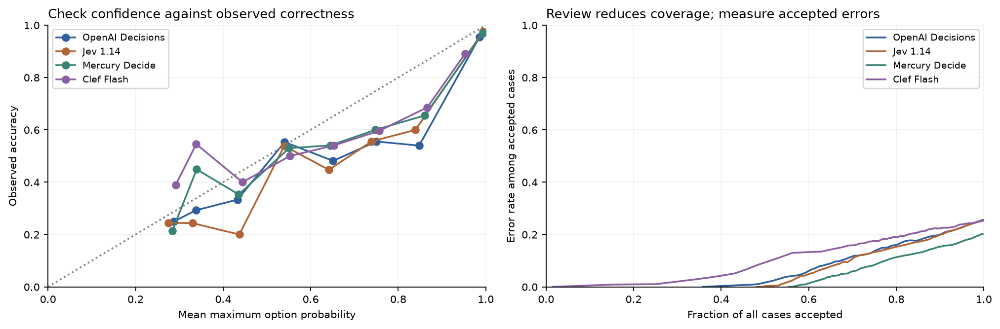
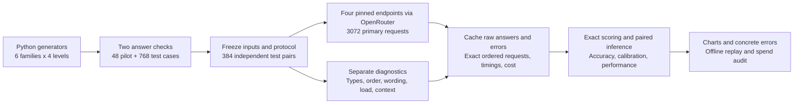
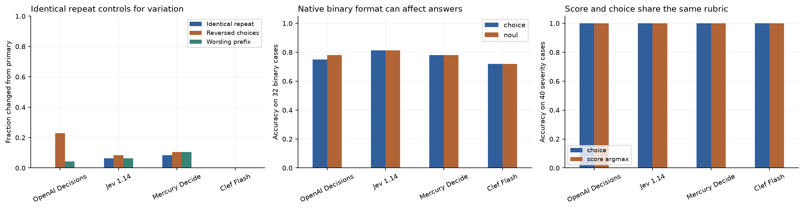
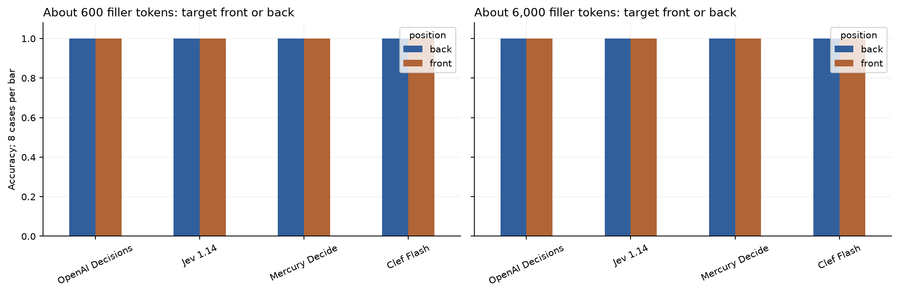
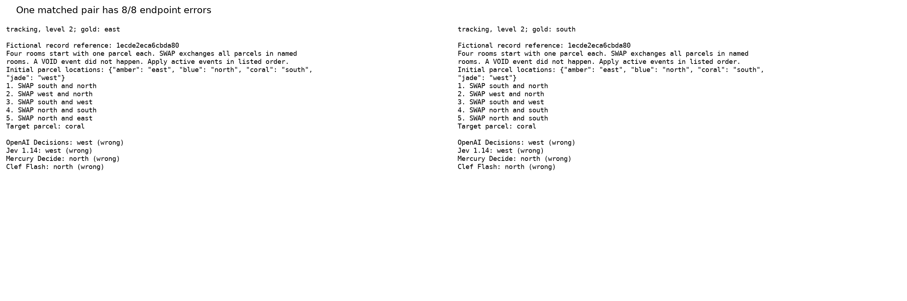

# Four decision models as tasks get harder

A support queue sends a request to the wrong team. A payment check approves a total that is one cent out. A parcel tracker reads a list of moves but names the wrong room. Each decision is small, but the next step relies on it.

An easy classification score can hide those failures. A model can match every field in a record and still fail to apply a sequence of moves or add ten ledger rows. Response probabilities also need checking: a confident wrong answer can bypass review.

This experiment compares OpenAI Decisions (GPT-6 Luna), TypeSafe Jev 1.14, Inception Mercury Decide and Cloudflare Clef Flash on 768 fresh synthetic cases. Six task families each have four construction levels and 16 seed pairs per level. Each pair changes one fact and changes the correct answer. Labels are computed in Python with separate construction checks.

Mercury Decide gets **611/768 (79.6%)**, compared with Clef Flash 74.7%, Jev 1.14 74.6% and OpenAI Decisions 74.3%. Clef and Jev both have serial medians near 0.21 seconds. Fixed synthetic generators and only 16 pairs per family-level cell limit this result; it is not a ranking across all real decisions.

## Accuracy, time and cost

| Endpoint | Correct / 768 | Accuracy (95% pair interval) | Serial p50 / p95 | Reported USD / 1,000 | Concurrency 4, valid/s |
|---|---|---|---|---|---|
| OpenAI Decisions | 571 | 74.3% (72.7% to 75.9%) | 0.255 / 0.545 s | $0.0347 | 7.59 |
| Jev 1.14 | 573 | 74.6% (72.9% to 76.3%) | 0.206 / 0.302 s | $0.0247 | 8.90 |
| Mercury Decide | 611 | 79.6% (77.9% to 81.2%) | 0.310 / 0.451 s | $0.0067 + unpriced errors | 7.46 |
| Clef Flash | 574 | 74.7% (72.9% to 76.7%) | 0.206 / 0.283 s | $0.0086 | 8.58 |

Accuracy includes failed requests. The 95% intervals resample whole seed pairs within each family and level, with all model answers aligned. Two primary Mercury HTTP 502 errors are unpriced; valid-only accuracy is 79.8%. Other primary requests returned valid choices. Serial performance uses 32 common cases per endpoint; p95 and tiny median differences have limited precision. Throughput is the median of three actual 16-request waves at client concurrency four.


## What difficulty exposes

| Task family | OpenAI Decisions | Jev 1.14 | Mercury Decide | Clef Flash |
|---|---|---|---|---|
| routing | 98.4% | 100.0% | 99.2% | 100.0% |
| policy | 89.8% | 100.0% | 100.0% | 87.5% |
| evidence | 100.0% | 100.0% | 100.0% | 100.0% |
| tracking | 34.4% | 33.6% | 50.0% | 52.3% |
| ledger | 64.1% | 55.5% | 65.6% | 50.0% |
| graph | 59.4% | 58.6% | 62.5% | 58.6% |

All four answer every exact record check correctly (128/128 each). Arithmetic and state tracking separate them. At the hardest tracking level, OpenAI gets 6/32, Jev 11/32, Mercury 12/32 and Clef 19/32. All four are at 50% on the hardest one-cent ledger check. Levels change construction rules and do not guarantee monotonically decreasing accuracy; the simple policy case is a counterexample.



## Probabilities and review

Probability is the mass assigned to the returned option, rather than the provider's separate confidence field. Coverage is the fraction accepted without review; accepted accuracy is correctness among accepted cases.

| Endpoint | Accepted / 768 at p >= 0.9 | Accepted accuracy | Accepted errors |
|---|---|---|---|
| OpenAI Decisions | 444 | 95.5% | 20 |
| Jev 1.14 | 433 | 97.5% | 11 |
| Mercury Decide | 488 | 96.9% | 15 |
| Clef Flash | 405 | 89.1% | 44 |

At probability 0.9, Clef still accepts 44 wrong answers. Raising the threshold trades coverage for fewer errors. The notebook also shows Brier score (squared probability error), log loss (penalty for little probability on gold), ten-bin calibration gaps, uniform baselines and a pilot-selected threshold. Synthetic review results do not certify a production error rate.



## Workflow



The notebook's call graph shows each endpoint, provider, returned probabilities and the wait for four independent results. No model receives another answer and no judge determines correctness.

## Controlled diagnostics

- Forty-eight fixed cases have an identical-request repeat, reversed choices and a neutral wording change. Repeat variation is the control; one repeat cannot isolate a causal order effect.
- Thirty-two binary cases compare choice with native yes/no. Forty separate severity cases compare choice with ordered score using one shared input and rubric.
- Thirty-two long-input cases put a target record before or after about 600 or 6,000 filler tokens. The primary accuracy set stays short.
- Thirty-two common serial cases, four fresh connections per endpoint and three load waves at concurrency one and four measure performance separately from accuracy collection.






## Concrete error pair

The figure shows the pair with the most model errors, selected deterministically. Both inputs and all answers appear in the notebook. It illustrates errors rather than estimating their frequency.



## Method and limits

The six families are current-record routing, eligibility policy, exact claim support, parcel swaps, ledger reconciliation and directed route budgets. Four levels increase choice count, required facts, distractors, sequence length, row count or graph size. A seed produces two inputs with different gold answers; choice order stays constant within the pair and varies across seeds.

Every primary case and the protocol were frozen before collection. Pilot seeds are disjoint. Requests are shuffled across models and use one attempt without retry. Six paired sign tests compare winning versus losing seed pairs with Holm correction; the bootstrap estimates accuracy differences. Intervals condition on these generators. Neutral references vary even when a simple policy pattern repeats, so seed counts do not imply equal semantic variety.

Calls use OpenRouter's Decisions endpoint with a pinned provider and no fallback. OpenAI, Jev and Mercury use dated permaslugs. Clef has no dated permaslug in its catalog; its PrimeIntellect provider and returned identity are saved, with checkpoint immutability unverified. This does not measure Workers AI truncation. The notebook excludes images, audio, subjective labels and natural customer language.

The initial severity diagnostic encoded gold in its reference. The audit rejected it and recollected all four endpoints with opaque references. Original inputs and raw responses remain saved and counted in spend; only severity_cases_v2.json enters final severity results. No primary case was removed or replaced. A scoring audit normalizes probability sums within 0.02 equally across providers after finding a Jev vector summing to 0.99. Raw evidence is unchanged.

## Spend and evidence

Reported OpenRouter cost is **$0.1125** across 4,948 cached attempts, with 2 unpriced attempts. Reservations estimate exposure; they are not a billing guarantee. Replay costs $0.

- data/protocol.json, cases.json and primary_schedule.json freeze the design and test.
- data/model_catalog.json and model_dates.json record pins, prices, release dates, cutoff sources and freshness.
- data/cache_requests.jsonl stores every ordered request, raw response or error, provider, timing and usage. Local draw IDs distinguish repeats and are not transmitted.
- data/request_usage.csv marks rejected severity requests as excluded while retaining their spend.
- data/performance_waves.json stores measured live wall time; replay cannot time cache hits as API throughput.
- data/manifest.json verifies evidence with SHA256 after normalizing CRLF to LF. data/validation.json records raw-response, gold, provider and offline checks.

Sources and licences are in [data/ATTRIBUTION.md](data/ATTRIBUTION.md). Test records are newly authored fictional fixtures under the repository MIT licence. No paid generation call creates inputs or labels.

## Run

```powershell
python -m pip install -r requirements-replay.txt
python -m nbconvert --to notebook --execute --inplace 18_decisions_api_comparison.ipynb
```

Run from this folder. Default replay verifies evidence, uses saved token counts and makes zero network requests. For collection, copy the notebook to a new folder with empty data, set NB18_LIVE=1 and OPENROUTER_API_KEY, then execute. Sample sizes, pins and a $5 reported-spend guard are at the top. An interrupted load wave needs a new draw identity before recollection.

The notebook closes with five follow-up experiments and four checked primary readings.
