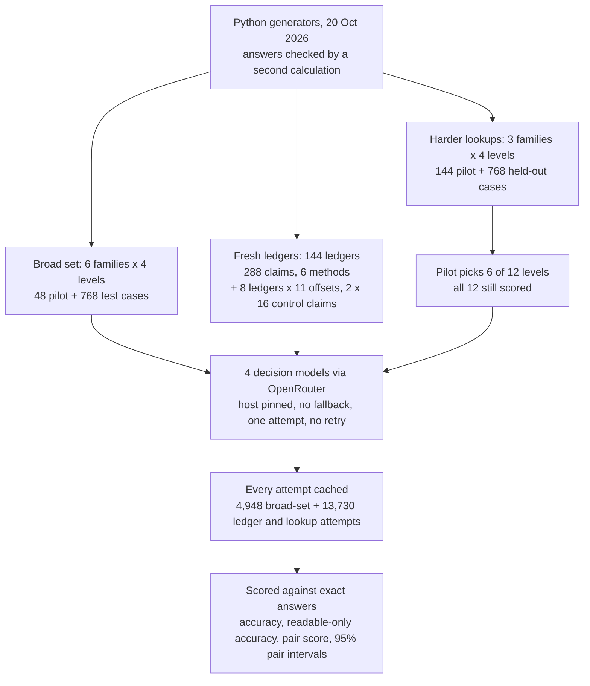
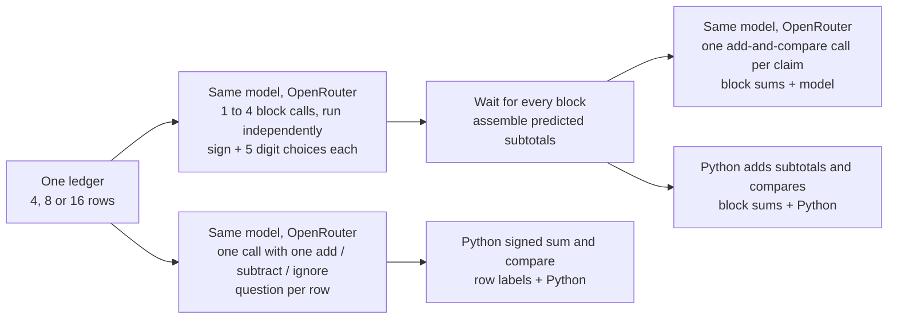

# Four decision models on checks that take several steps

## Checking a claimed total

A supplier sends a short statement with a total at the bottom. Before the payment goes out, someone checks that the total matches the lines. Here is one such statement. It is a real test item from this study (`ledger-small-4-0`), and its amounts are in cents so that no rounding is involved.

| Row | Kind | Amount | Status |
|---|---|---:|---|
| 1 | charge | 9 cents | active |
| 2 | credit | 2 cents | active |
| 3 | charge | 8 cents | active |
| 4 | credit | 1 cent | VOID |

The statement claims a net amount of 15 cents. A charge adds to the total, a credit takes away from it, and a VOID row was cancelled and counts for nothing. A person checking it adds the two charges (9 + 8 = 17), takes off the active credit (17 - 2 = 15) and skips row 4. The claim matches, so the answer is yes.

Now change one thing. The same four rows arrive with a claimed net of 14 cents. Every row is identical and the claim is one cent lower, but the answer is now no. A checker that forms a general impression of the rows ("these numbers look about right") cannot tell the two statements apart. Only a checker that does the sum can.

Real statements have dozens of rows and larger amounts, but the rule is the same, and so is the cost of a mistake. A wrong yes lets an incorrect payment through; a wrong no sends a correct statement to a person who finds nothing wrong. Checks like this (does the total add up, is this the current record, how many orders are still open) sit inside many automated workflows, and the next step trusts the answer.

### A model that answers with probabilities

Such checks are now often handed to a **decision model**. A decision model does not write text. It receives evidence, called the state (here, the four rows and the claim), and a question with a fixed list of allowed answers (yes or no). It returns a probability for each answer and picks the most probable one. Asked about the 15-cent claim, one model in this study returned `{"no": 0.72, "yes": 0.28}` and so answered no. Because nothing is written, a decision costs a small fraction of a cent and takes about a quarter of a second, and the probability can decide which answers are accepted automatically and which go to a person. [OpenAI's Decisions guide](https://developers.openai.com/api/docs/guides/decisions) describes the format.

Several companies now offer decision models through the same interface on OpenRouter, a service that forwards requests to many model providers. A team choosing one wants to know which checks it can hand over and which model gets more of them right.

### Testing a checker fairly

A test of a yes/no checker has a trap. If half the test claims are correct and half are wrong, a checker that always says "no" scores 50% without reading anything. A score near 50% on such a test means the checker has shown no skill, not that it is half right.

This study avoids the trap by building every test case as one of a pair, like the 15-cent and 14-cent claims above. The two members differ in one detail and have opposite answers. A checker that gives the same answer to both members gets exactly one right; a checker that does the work gets both right. Counting the pairs a model gets fully right shows the difference directly.

### Two ways to put a model on the ledger check

The first way asks the model the whole question: is the claimed amount exactly equal to the net of the active rows? The study tries three wordings of that question: the original one, a clarified one that spells out the rule ("a one-cent difference is a mismatch"), and one that adds numbered steps.

The second way splits reading from arithmetic. The model is asked only what each row is (add it, subtract it or ignore it), a lookup it can answer from the text, and a few lines of ordinary code add the amounts and compare the result with the claim. A middle way has the model compute a subtotal for each block of up to four rows, which the model or code then adds. If the models fail at the whole question but succeed at the row labels, the weak step is the arithmetic, and the fix is to keep it in code.

### Lookups that combine several facts

Many checks need no arithmetic but still take more than one step. To confirm a stock quantity, you may have to follow a link from one record to another, then take the newest approved version of that record and ignore a newer draft. To decide whether a policy allows something, you need the highest-priority rule that actually applies, not the highest-priority rule on the page. To count open shipments, you keep only each shipment's latest update. The study builds three task families of this kind, designed so that obvious shortcuts, such as "is the claimed number anywhere in the approved records?", do no better than a coin flip at most levels.

A useful outcome is a short list: which checks can be handed to a decision model alone, which need code beside it, and which model to choose for multi-step lookups.

## The question

When a decision model must combine several facts before answering yes or no (add up a ledger, follow a chain of records, keep only the latest update), how often does each of four models get it right? Does rewording the question fix the ledger failures, or does the arithmetic have to move into code?

The four models are OpenAI Decisions (GPT-6 Luna), TypeSafe's Jev 1.14, Inception's Mercury Decide and Cloudflare's Clef Flash. They answer three sets of fresh synthetic cases: a broad set of 768 cases in six task families, 288 ledger claims asked six ways, and 768 harder lookup cases. A team choosing a decision model, or deciding how much code to put around one, needs exactly this comparison.

## Study summary

Every case has a twin with the opposite answer, computed exactly in code. **Accuracy** is the share of cases answered correctly, with unreadable replies (failed requests, rate-limit errors, malformed answers) counted as wrong; the share among readable replies is given where the two differ.

- Direct lookups sit at a ceiling. In the broad set, all four models scored 100% in 9 of the 24 family-and-level cells, such as checking a claim against one record. Those cells cannot rank the models.
- Ledger checks sit at a floor. On the 288 fresh ledger claims, every way of having the model do the check scored between 49.0% and 56.9%, where always answering "no" scores 50%. Clearer wording changed accuracy by -1.7 to 0.0 points, and every 95% interval included zero. On eight 16-row ledgers with claims up to 10,000 cents off, OpenAI Decisions, Jev 1.14 and Clef Flash accepted no claim, not even the 8 exact ones; Mercury Decide accepted the same two ledgers whatever the claim.
- Labelling rows and adding in code solves the ledger. When the model only labelled each row and Python did the sum, OpenAI Decisions, Jev 1.14 and Mercury Decide were right on 288 of 288 claims and Clef Flash on 287.
- On the harder lookups (six levels chosen on a separate pilot, 384 cases per model), **Mercury Decide scored 72.1%** and Jev 1.14 70.1%, ahead of OpenAI Decisions at 55.2%. Mercury's 2.1-point lead over Jev has a 95% interval of -1.6 to +6.0 points, so this test does not separate them. Clef Flash scored 44.3%, because its host refused 97 of its 384 requests with a rate-limit error; on the 287 cases all four answered, it scored 59.2% against OpenAI's 56.1%.

In the original situation: do not let a decision model check a total by itself. Ask it how each line counts and add the amounts in code. For lookups that follow records or keep the latest update, Mercury Decide and Jev 1.14 got about seven in ten right here, better than OpenAI Decisions but not good enough to accept without review.

The main caveat is that all cases come from a few templates written by the coding assistant that built the notebook, the lookup levels were chosen on a pilot of 6 pairs per level, each level has 32 test pairs, and every call was made on one evening. The results show which kinds of check fail and how the models differ on these templates, not accuracy rates for real documents.

## Contents

1. [The test cases](#1-the-test-cases)
2. [How the experiment runs](#2-how-the-experiment-runs)
3. [The models and the measures](#3-the-models-and-the-measures)
4. [How the study got here](#4-how-the-study-got-here)
5. [Results: lookups and multi-step checks in the broad set](#5-results-lookups-and-multi-step-checks-in-the-broad-set)
6. [Results: checking a ledger total](#6-results-checking-a-ledger-total)
7. [Results: the harder lookups](#7-results-the-harder-lookups)
8. [Speed, cost and confidence](#8-speed-cost-and-confidence)
9. [Error analysis](#9-error-analysis)
10. [What the evidence supports](#10-what-the-evidence-supports)
11. [Limitations](#11-limitations)
12. [Spend, data and how to run](#12-spend-data-and-how-to-run)
13. [Future work and further reading](#13-future-work-and-further-reading)

## 1. The test cases

Every case was generated in Python on 20 October 2026 (Toronto time), after the latest model release on 14 October, so no model can have seen these items in training. The records are fictional. Each answer is computed by the generator and checked by a second calculation, which for the ledgers and lookups parses the exact text sent to the models. No model wrote any case or answer; the templates were written by the coding assistant that built the notebook, as [`data/ATTRIBUTION.md`](data/ATTRIBUTION.md) records. Both members of a pair carry the same opaque reference string and list the answers in the same order.

### The broad set: six task families

Each family has four construction levels, and each family-and-level cell has 16 pairs: 768 test cases, plus 48 pilot cases (one pair per cell) used only to check the setup.

| Family | What the model decides | Level 1 | Level 2 | Level 3 | Level 4 |
|---|---|---|---|---|---|
| Routing | Which queue matches the customer's current attributes | 4 queues, 2 attributes | 8 queues, 3 attributes | 16 queues, old values listed | 32 queues, old values listed |
| Policy | Is the customer eligible under stated conditions | 1 condition | 3 conditions | 5 and an exception | 7 and an overriding block |
| Evidence | Does a record support every field of a claim | 1 field | 3 fields | 5, similar records | 8, similar records |
| Tracking | Which room holds a parcel after swaps | 2 swaps | 5 swaps | 10 events, some void | 18 events, some void |
| Ledger | Does a claimed net equal the active rows | 2 rows | 5 rows | 10 rows, voids | 16 rows, voids and credits |
| Graph | Is there an allowed route within a budget | 4 nodes | 6 nodes | 9 nodes, blocked links | 12 nodes, blocked links |

The two members of a pair differ in one attribute, one decisive policy fact, one claim value, the final swap, the claimed amount by one cent, or the budget by one point.

### Fresh ledgers

The ledger study uses 144 new ledgers: 24 seeds at three lengths (4, 8 or 16 rows) and two amount sizes (1 to 9 cents, or 101 to 9,800 cents). The small and large versions of a seed share their pattern of charges, credits and void rows, isolating the effect of bigger numbers. Each ledger gets an exact claim and a claim one cent off: 288 claims in 72 independent groups (one per seed and length). Eight of the large 16-row ledgers also get claims from 1 to 10,000 cents off, and two control conditions on the same 8 ledgers hand the model the exact block subtotals or the exact net.

### Harder lookups

| Family | What changes across levels 1 to 4 | Exact answer |
|---|---|---|
| Versioned joins | Follow 1, 2, 3 or 4 ownership links among shuffled old, approved and draft records | Follow the chain, take the target's newest approved revision, compare its quantity with the claim |
| Policy precedence | 4, 8, 12 or 16 overlapping rules, some high-priority rules not applying | Find the rules whose conditions hold, take the highest priority, check whether it allows |
| Stateful counting | 4, 8, 12 or 20 shipments with three shuffled status updates each | Keep each shipment's latest update, filter by region, status and value, count distinct shipments |

Each level has 6 pilot pairs and 32 test pairs: 144 pilot cases and 768 held-out cases. The cases were built against named shortcuts ([`data/followup/shortcut_baselines.csv`](data/followup/shortcut_baselines.csv)). In joins, the wrong claimed value is also another record's newest approved quantity, so "is the value in an approved record?" scores 50% at every level; "take the highest priority and ignore conditions" scores 50% at every policy level. "Count matching events without keeping only the latest" scores 50.0% to 51.6% at counting levels 2 to 4 but 71.9% at level 1 (section 9).

## 2. How the experiment runs



All four models receive the identical state and question; no model sees another's answer or judges any answer. For the ledger, the methods that use more than one call per ledger run like this:



Per model, the block step made 336 block calls, and the row-label step made 144 calls (one per ledger, covering both of its claims).

### Worked example: one ledger through every method

This is `ledger-small-4-0` from the opening. The state sent to every model reads, word for word:

```text
Fictional record reference: ea8fe1f928786bba
Fictional ledger, integer cents. Add active charges and subtract active credits. Ignore VOID rows. No tax, rounding or other adjustments.
Row 1: charge, 9 cents, active
Row 2: credit, 2 cents, active
Row 3: charge, 8 cents, active
Row 4: credit, 1 cents, VOID
Claimed net amount: 15 cents.
```

With the original wording, the question is `"Is the claimed amount EXACTLY equal to the net of active rows?"` with two allowed answers, yes and no. The twin case `ledger-small-4-0:-1` is identical except for the last line, "14 cents". The raw replies give these probabilities of yes:

| Model | P(yes), claim 15 (answer yes) | P(yes), claim 14 (answer no) | Right out of 2 |
|---|---:|---:|---:|
| OpenAI Decisions | 0.28 | 0.28 | 1 |
| Jev 1.14 | 0.87 | 0.55 | 1 |
| Mercury Decide | 0.994 | 0.679 | 1 |
| Clef Flash | 0.272 | 0.1645 | 1 |

Each model scores 50% on this pair and a pair score of 0. OpenAI Decisions returned the identical reply, `{"no": 0.72, "yes": 0.28}`, to both claims. Mercury Decide and Jev 1.14 lowered their probability for the wrong claim, but not below one half, so they said yes twice; Clef Flash said no twice.

With row labels + Python, each model gets one request with four questions such as "How should Row 1 [1cd220082de04262] contribute to the net?" (add, subtract or ignore). OpenAI Decisions answered add, subtract, add, ignore, each with probability 1, and the other three chose the same labels. Python computes 9 - 2 + 8 = 15 and says yes to the 15-cent claim and no to the 14-cent one: both right for all four models.

With block sums, the four rows form one block, and the model is asked the sign of its subtotal and the digit at each of five places. OpenAI Decisions chose 5 for the ones digit (probability 0.38) and 0 for the tens digit (0.27): a subtotal of 5 instead of 15. The others returned 14 (Jev 1.14), 1 (Mercury Decide) and 6 (Clef Flash). With every subtotal wrong, both block methods say no twice and get one claim right. These replies are in [`data/followup/ledger_predictions.json`](data/followup/ledger_predictions.json), [`block_predictions.csv`](data/followup/block_predictions.csv) and [`row_label_predictions.csv`](data/followup/row_label_predictions.csv).

## 3. The models and the measures

| Model | Pinned version | Provider and how called | Size and precision | Settings | Why included |
|---|---|---|---|---|---|
| OpenAI Decisions | `openai/gpt-6-luna-decisions-20261006`, returned by every reply | OpenAI, pinned on OpenRouter's Decisions endpoint, no fallback | Not published | No sampling settings sent; one attempt per question | OpenAI's decision model (released 2026-10-06; base model GPT-6 Luna, training cutoff 2026-05-18); the most expensive here, $0.10 per million input tokens |
| Jev 1.14 | `typesafe/jev-1.14-20261014` | TypeSafe, pinned the same way | Not published | As above | TypeSafe's decision model (released 2026-10-14, cutoff not published); $0.042 per million |
| Mercury Decide | `inception/mercury-decide-20260930` | Inception, pinned the same way | Not published | As above | Inception's decision model (released 2026-09-30, cutoff not published); the cheapest, $0.020 per million |
| Clef Flash | `cloudflare/clef-flash`; no dated version in the catalog, so the checkpoint is not pinned | PrimeIntellect host, pinned the same way | 9B, a fine-tune of Qwen3.5-9B (catalog description); precision unknown | As above | The one open-weight decision model, small and fast (released 2026-10-01); $0.021 per million, 16,384-token context |

Dates, prices and sources are in [`data/model_dates.json`](data/model_dates.json) and [`data/model_catalog.json`](data/model_catalog.json). Every readable reply was checked to come from the pinned model and host.

The measures:

- Accuracy, as defined above, is the share of cases answered correctly, with unreadable replies counted as wrong. Higher is better.
- A reply is **unreadable** when the program could not score it: a failed connection, an HTTP error (rate limit, server error, refusal), or probabilities that do not sum to 1 within 0.02 or whose chosen answer is not the most probable. Unreadable replies are counted apart from wrong answers.
- The **accuracy on readable replies** leaves them out. The harder lookups also report accuracy on the cases all four models answered.
- The **pair score** counts pairs with both members right. Answering both members the same way scores 0 on that pair.
- The **95% interval** comes from re-drawing whole pairs (or ledger groups) at random 5,000 times within each family and level and taking the middle 95% of scores. When a method is right in all 72 ledger groups, a one-sided lower bound of 95.9% replaces it: the lowest true rate that still gives 72 of 72 at least 5% of the time.

A small example with Clef Flash on the harder lookups: 384 questions, 97 refused by its host, 287 readable replies, 170 right. Accuracy is 170 / 384 = 44.3%; accuracy on readable replies is 170 / 287 = 59.2%. The first is what a team got from this host that evening; the second is closer to what the model does when it answers.

## 4. How the study got here

All calls were made on the evening of 20 October 2026, Toronto time (01:07 to 03:32 UTC on 21 October, from the caches' `started_at` fields), in four steps, each shaping the next.

1. The broad set (768 cases) came first. Nine of its 24 cells gave every model 100% and the 16-row ledgers about 50%, so its overall score mixed tasks that could not separate the models. Its results still answer part of the question (section 5).
2. An audit with no new calls re-derived all 128 broad-set ledger answers from the text sent and found no scoring error, found no answer field or case ID in the 3,072 requests, and showed that comparing two dictionaries in code solves all 128 evidence cases. The ceilings came from easy tasks and the ledger floor from the models.
3. The ledger study tested whether wording or splitting the arithmetic fixes the floor (section 6).
4. The harder lookups replaced the ceiling tasks with three families built against shortcuts. A pilot of 144 cases chose six of the twelve levels before any held-out case was sent. The first collection of the 768 held-out cases sent up to eight requests at a time and lost 483 of 3,072 requests: 443 failed connections across all four models, 38 rate-limit refusals for Clef Flash and 2 server errors for Mercury Decide. A repeat collection sent the identical 3,072 requests with one request in flight per provider and lost 202 (200 Clef Flash rate-limit refusals, 2 Mercury Decide server errors). This page reports the repeat, because the first mixed connection failures into every model's score. The first collection's selected-level scores (OpenAI Decisions 47.4%, Jev 1.14 59.1%, Mercury Decide 63.0%, Clef Flash 45.3%) give the same order and stay in [`data/followup/benchmark_selected_summary.csv`](data/followup/benchmark_selected_summary.csv).

The run history, frozen protocols and a correction to an earlier version of this page are in [`data/PROTOCOL.md`](data/PROTOCOL.md).

## 5. Results: lookups and multi-step checks in the broad set

The broad set answers the first half of the question in its simplest form: across six kinds of check, which ones do decision models handle, and does any model stand out? Each cell below is correct answers out of 128 (four levels of 32 cases), counted from [`data/predictions.json`](data/predictions.json).

| Family | OpenAI Decisions | Jev 1.14 | Mercury Decide | Clef Flash | Always "no" or a random answer |
|---|---:|---:|---:|---:|---:|
| Evidence | 128 | 128 | 128 | 128 | 64 |
| Routing | 126 | 128 | 127 | 128 | 15 (one queue in 4 to 32) |
| Policy | 115 | 128 | 128 | 112 | 64 |
| Graph | 76 | 75 | 80 | 75 | 64 |
| Ledger | 82 | 71 | 84 | 64 | 64 |
| Tracking | 44 | 43 | 64 | 67 | 32 (one room in four) |
| All 768 cases | 571 (74.3%) | 573 (74.6%) | 611 (79.6%) | 574 (74.7%) | |
| 95% interval | 72.7% to 75.9% | 72.9% to 76.3% | 77.9% to 81.2% | 72.9% to 76.7% | |
| Pairs with both right / 384 | 215 | 223 | 247 | 211 | |
| Unreadable replies | 0 | 0 | 2 | 0 | |


Each panel is one model; rows are families, columns levels, and each cell is accuracy on 32 cases (darker is higher). Compare the top three rows with the bottom three.

The checks that need only one lookup sit at a ceiling. Every model answered all 128 evidence cases correctly, and routing was 126 to 128 of 128. In 9 of the 24 cells (evidence levels 1 to 4, routing 1 to 3, policy 2 and 3) all four models scored 100%. Most policy misses came at level 1, the simplest level, where OpenAI Decisions scored 62% and Clef Flash 50%.

The checks that need several steps are much lower. On tracking, where the model must apply a list of room swaps in order, accuracy fell from 50% to 91% at level 1 to 19% to 59% at level 4; OpenAI Decisions' 6 of 32 at level 4 is below the 8 of 32 that picking a random room would give. Ledger accuracy reached 100% for OpenAI Decisions on two-row ledgers but was 47% to 50% for every model at levels 3 and 4. Graph routes stayed at 50% to 72%.

Mercury Decide leads overall, 611 of 768 against 571 to 574, and its lead over each model has a 95% interval that excludes zero (5.2 points over OpenAI Decisions, interval 3.1 to 7.3). The lead comes from tracking against OpenAI Decisions and Jev 1.14 (64 against 44 and 43 of 128) and from ledger and policy against Clef Flash. With a third of the cells at a ceiling and the long ledgers at a floor, this overall score says little about checks of medium difficulty, which the next two sections test.

## 6. Results: checking a ledger total

### The broad set's longest ledgers: answers that ignore the claim

On the 32 cases of 16-row ledgers in the broad set, OpenAI Decisions, Mercury Decide and Clef Flash were right on 16 and Jev 1.14 on 15. A score of 50% could mean random guessing or a fixed answer.


The left panel shows each model's average probability of yes for the exact and the one-cent-wrong claim; a model that checks the sum would draw a steeply falling line. All four lines are flat, near 0.12 for OpenAI Decisions and Clef Flash and near 0.47 to 0.50 for the other two. The right panel counts pairs, out of 16, where the answer changed between members (blue, `changed_pairs`) and where both were right (green, `both_correct`). OpenAI Decisions and Clef Flash answered no to all 32 claims; Jev 1.14 changed its answer in 1 pair and Mercury Decide in 2. The 50% scores come from answers that do not depend on the claim.

### Six ways of asking, on 288 fresh claims

| Method | OpenAI Decisions | Jev 1.14 | Mercury Decide | Clef Flash |
|---|---:|---:|---:|---:|
| Original wording | 52.4% | 50.7% (1) | 55.6% | 50.0% (1) |
| Clarified wording | 52.1% (1) | 50.7% (1) | 53.8% | 49.7% (2) |
| Step instruction | 49.7% (1) | 51.0% | 52.8% | 49.0% (2) |
| Block sums + model | 56.9% | 53.8% (24) | 51.0% | 53.1% |
| Block sums + Python | 55.6% | 53.8% (24) | 51.7% | 53.1% |
| Row labels + Python | 100.0% | 100.0% | 100.0% | 99.7% |
| Pairs with both right / 144, original wording | 8 | 7 | 27 | 3 |

Each cell is accuracy on 288 claims, with unreadable replies (in parentheses) counted as wrong. Intervals, request counts and cost are in [`data/followup/ledger_summary.csv`](data/followup/ledger_summary.csv).


Each group of bars on the left is one model, in the table's method order (grey is row labels + Python); there is no 50% line, so read 0.5 on the axis as always answering no. The right panel's printed values stand in for its missing colour scale.

Every method in which a model does the arithmetic stayed between 49.0% and 56.9%, and on readable replies alone none passes 58.7% (Jev 1.14's block sums, 155 of 264), so format failures do not explain the floor. Clarified wording changed accuracy by -0.3, 0.0, -1.7 and -0.3 points for OpenAI Decisions, Jev 1.14, Mercury Decide and Clef Flash, all with 95% intervals that include zero. The step instruction lowered OpenAI Decisions by 2.8 points (interval -4.9 to -0.7). Block sums + model raised OpenAI Decisions by 4.5 points (1.4 to 7.3) and lowered Mercury Decide by 4.5 (-8.7 to -0.3). Small amounts helped by at most 4.1 points. Differences are in [`data/followup/ledger_method_differences.csv`](data/followup/ledger_method_differences.csv).

Row labels + Python was right on 1,151 of 1,152 claims; Clef Flash's one miss came from a wrongly labelled row in a readable reply. A perfect 72 of 72 ledger groups bounds the true rate below at 95.9%, far above the 49% to 57% of every other method.

The block calls show where the arithmetic goes wrong. On small amounts the models computed the exact four-row subtotal in 47.0% (OpenAI Decisions), 54.2% (Jev 1.14), 15.5% (Mercury Decide) and 19.6% (Clef Flash) of 168 blocks; on large amounts in 2.4%, 3.6%, 0% and 0.6%. Two controls on 8 large 16-row ledgers (16 claims) isolate the last steps. Given the exact net, all four models were right 16 of 16 times: comparing two numbers works. Given the four exact block subtotals, they were right only 10 (OpenAI Decisions, Mercury Decide) or 8 (Jev 1.14, Clef Flash) times: adding four given integers already fails.

### Claims far from the total

If the models only missed small differences, a claim $100 off should be easy to reject. The offset sweep gives 8 large 16-row ledgers claims 0, ±1, ±10, ±100, ±1,000 and ±10,000 cents from the exact net: 88 claims per model.


The horizontal axis is the claim minus the exact total in cents, on a scale that spaces 1 to 10,000 evenly on both sides of zero; the vertical axis is the share of the 8 ledgers accepted. A model that checks the sum would show a spike, 100% at zero and 0% elsewhere. Acceptance is plotted instead of accuracy because always answering no would score 10 of 11. OpenAI Decisions, Jev 1.14 and Clef Flash overlap at 0, so only Clef's purple line shows.

No model formed a spike. Three models accepted none of their 88 claims, all 8 exact totals included. Mercury Decide accepted the same two ledgers (`ledger-large-16-1` and `ledger-large-16-6`) at every offset, counted from [`data/followup/offset_sweep.csv`](data/followup/offset_sweep.csv): its answer depended on the ledger, not the claim.

## 7. Results: the harder lookups

### Choosing levels on a pilot

A level that every model gets right, or gets 50% on, cannot separate them. Before any held-out case was sent, the pilot (6 pairs per level) kept levels with pooled accuracy between 55% and 95% and a spread of at least 8 points between models, up to two per family closest to 75%: joins 1 and 2, policy 1 and 3, counting 1 and 3. All twelve levels were still collected. The selection is in [`data/followup/pilot_selection.json`](data/followup/pilot_selection.json).

### Scores on the six chosen levels

| Model | Correct / 384 | Accuracy (95% interval) | Unreadable | Accuracy on readable | Accuracy on the 287 cases all four answered | Pairs with both right / 192 |
|---|---:|---|---:|---:|---:|---:|
| OpenAI Decisions | 212 | 55.2% (52.1% to 58.3%) | 0 | 55.2% | 56.1% | 30 |
| Jev 1.14 | 269 | 70.1% (66.7% to 73.2%) | 0 | 70.1% | 71.8% | 83 |
| Mercury Decide | 277 | 72.1% (69.0% to 75.0%) | 0 | 72.1% | 74.9% | 86 |
| Clef Flash | 170 | 44.3% (40.4% to 48.2%) | 97 | 59.2% | 59.2% | 22 |

Sources: [`benchmark_replication_summary.csv`](data/followup/benchmark_replication_summary.csv); pair counts from [`benchmark_replication_predictions.json`](data/followup/benchmark_replication_predictions.json).

Mercury Decide and Jev 1.14 are well ahead of OpenAI Decisions: 16.9 and 14.8 points, with 95% intervals of 12.8 to 21.1 and 10.4 to 19.0 points. Between Mercury Decide and Jev 1.14 the gap is 2.1 points (interval -1.6 to +6.0); of the pairs where they differed, Jev won 28 and Mercury 33, so this test cannot order them. OpenAI Decisions gave the same answer to both members in 152 of 192 pairs, against 103 for Jev 1.14 and 105 for Mercury Decide, and answered no to 268 of 384 cases although half the answers are yes. Contrasts are in [`benchmark_replication_contrasts.csv`](data/followup/benchmark_replication_contrasts.csv).

Clef Flash's 44.3% is mostly its host: 97 of its 384 requests came back with a rate-limit error, although one request at a time was sent. On the 287 cases all four answered, its 59.2% is close to OpenAI Decisions' 56.1%. Those cases are not a random sample (a pair loses a member when Clef missed one), so this is a check, not a replacement score.

### All twelve levels

Accuracy on 64 cases per cell, unreadable counted as wrong, from [`data/followup/benchmark_replication_cells.csv`](data/followup/benchmark_replication_cells.csv). Levels marked * were chosen by the pilot.

| Family and level | OpenAI Decisions | Jev 1.14 | Mercury Decide | Clef Flash |
|---|---:|---:|---:|---:|
| Joins 1 * | 53.1% | 92.2% | 92.2% | 53.1% |
| Joins 2 * | 50.0% | 67.2% | 85.9% | 45.3% |
| Joins 3 | 43.8% | 59.4% | 75.0% | 31.2% |
| Joins 4 | 46.9% | 59.4% | 70.3% | 37.5% |
| Policy 1 * | 53.1% | 56.2% | 64.1% | 37.5% |
| Policy 2 | 53.1% | 57.8% | 60.9% | 42.2% |
| Policy 3 * | 54.7% | 51.6% | 56.2% | 42.2% |
| Policy 4 | 50.0% | 50.0% | 54.7% | 39.1% |
| Counting 1 * | 62.5% | 82.8% | 75.0% | 48.4% |
| Counting 2 | 53.1% | 67.2% | 60.9% | 31.2% |
| Counting 3 * | 57.8% | 70.3% | 59.4% | 39.1% |
| Counting 4 | 56.2% | 64.1% | 54.7% | 40.6% |


The figure scores the same twelve levels only on cases where all four returned a readable answer (41 to 52 per level, [`benchmark_replication_complete_counts.csv`](data/followup/benchmark_replication_complete_counts.csv)), which removes Clef's missing replies. Grey bands mark the pilot-chosen levels; the dotted line is 50%.

Joins separate the models best: Mercury Decide stays at 70% or above, Jev 1.14 falls from 92.2% to 59.4%, and OpenAI Decisions stays near 50% (43.8% to 53.1%) even for a single link. Policy precedence sits near a floor for everyone: no model exceeds 64.1% at any level, so it cannot rank them and should be redesigned. Counting falls in between, with Jev 1.14 ahead at every level. Four of the six pilot choices met the same selection rule on the held-out cases (both join levels and both counting levels); the two policy levels did not.

A fact-free control sent each model only the reference string and the question for 12 pairs; one answer covers both members, so any readable answer scores exactly 50%. Three models answered all 12, and OpenAI Decisions refused 8 ([`metadata_only_summary.csv`](data/followup/metadata_only_summary.csv)).

## 8. Speed, cost and confidence

These measurements come from the broad set ([`data/performance.csv`](data/performance.csv), [`data/selective_accuracy.csv`](data/selective_accuracy.csv)).

| Model | Median time per call | Decisions per second, 4 at a time | Reported cost per 1,000 decisions | At p ≥ 0.9: accepted of 768, wrong among them |
|---|---:|---:|---:|---:|
| OpenAI Decisions | 0.255 s | 7.59 | $0.0347 | 444, 20 |
| Jev 1.14 | 0.206 s | 8.90 | $0.0247 | 433, 11 |
| Mercury Decide | 0.310 s | 7.46 | $0.0067 | 488, 15 |
| Clef Flash | 0.206 s | 8.58 | $0.0086 | 405, 44 |

Response times are measured at the client, network included, on 32 cases sent one at a time; throughput is the median of three waves of 16 requests (the notebook plots both). All four answer in about a quarter of a second, and 32 calls per model cannot rank them on speed. OpenAI Decisions cost about five times as much per decision as Mercury Decide.


The left panel compares stated probability with observed accuracy; points on the dotted diagonal would mean the probability can be taken at face value. All four fall below it between about 0.6 and 0.9 and come close near 1.0. The right panel shows that accepting more cases automatically lets more errors through. At a threshold of 0.9, Clef Flash let through 44 errors, two to four times as many as the others.

On subsets of the broad set, reversing the answer order changed 11 of 48 OpenAI Decisions answers against 0 for an identical repeat, while the other models changed at most one more answer than their repeat. The native yes/no question type matched the two-option choice within one answer on 32 cases. A 40-case severity rating and 32 exact-record lookups placed before or after 600 or 6,000 tokens of unrelated records were all answered correctly, a ceiling ([`sensitivity_summary.csv`](data/sensitivity_summary.csv), [`native_binary.csv`](data/native_binary.csv), [`ordinal_predictions.csv`](data/ordinal_predictions.csv), [`context_summary.csv`](data/context_summary.csv)).

On the ledger, row labels + Python cost about two and a half times as much as the original wording ($0.0229 against $0.0087 for OpenAI Decisions over 288 claims) at a similar median time, 0.49 s against 0.46 s ([`ledger_summary.csv`](data/followup/ledger_summary.csv)).

## 9. Error analysis

Each example illustrates one pattern in the aggregate results and is identified by its case ID in `data/`.

### Answers that do not move when the decisive detail changes


Pair `test-tracking-L2-002` is one of 4 broad-set pairs, all tracking, that every model got wrong on both members (the figure calls the models "endpoints"). The coral parcel starts in the south room, and swaps 1 to 4 move it to north, west, south and north. Only swap 5 differs: "north and east" sends it east, "north and south" sends it south. OpenAI Decisions and Jev 1.14 answered west for both, where coral was after swap 2; Mercury Decide and Clef Flash answered north, where it was before the last swap. No answer moved with the decisive swap, as with the ledgers. Every chosen answer had probability 0.31 to 0.49, so a 0.9 review threshold would have caught all eight.

### Subtotals that go wrong digit by digit


`ledger-large-16-0` is the large 16-row ledger with the most block errors. The table gives each block's exact subtotal beside the number each model assembled from its digit choices; all 16 model cells are shaded as wrong. Some are far off in size (OpenAI Decisions gave 1 for -338 and 2,200 for 22,410). Several repeat one digit (Clef Flash -2,222, -6,666 and 22,222; Mercury Decide -1,111), which looks like digits chosen one at a time rather than read off one computed number. With subtotals like these, both the model and Python reach a wrong total, which is why the block methods stay near 50%.

### A record chain where the shortcut answer appears

Pair `test:versioned joins:1:1` asks the model to follow one ownership link, take the newest approved revision of the record reached and compare its quantity with the claim. The start entity `ae5772ec1fb35139` links to `994aa379907185e6`, which has three records:

| Revision | Status | Quantity |
|---:|---|---:|
| 70 | approved | 37 |
| 84 | approved | 85 |
| 86 | draft | 94 |

The first member claims 85 (yes); the second claims 94 (no), the newer draft's value. The trap is that 94 is also the newest approved quantity of another entity, `8c4e367e6b0287a0`, which the chain does not reach. Jev 1.14, Mercury Decide and Clef Flash answered yes and no. OpenAI Decisions answered yes twice, as the shortcut "is the value in an approved record?" would. Of the 32 level-1 join pairs, OpenAI Decisions got both members right in 5, Jev 1.14 in 28 and Mercury Decide in 27, so this is typical.

### A hard case: overlapping rules

Pair `test:policy precedence:1:0` has four rules. The highest priority (455, allow) requires `region_ok` to be false, but it is true, so that rule does not apply. Of the two that apply, priority 435 allows and 434 denies, so the answer is yes. In the second member the deny rule has priority 436 and the answer becomes no. Jev 1.14 and Mercury Decide got both right; OpenAI Decisions answered no to both; Clef Flash's host refused the first and it answered the second wrongly. Mercury Decide got only 10 of the 32 level-1 policy pairs fully right (Jev 1.14 5, OpenAI Decisions 3, Clef Flash 1), so this shows what the task asks, not what usually happened.

### Where a shortcut beats chance

At counting level 1, counting every matching event without keeping only each shipment's latest update gets 46 of 64 cases right (71.9%), more than OpenAI Decisions (62.5%) and Clef Flash (48.4%) and not far below Mercury Decide (75.0%) and Jev 1.14 (82.8%). The pilot chose this level, so part of every score on it may come from that shortcut. At levels 2 to 4 the shortcut scores 50.0% to 51.6%.

### Replies that could not be scored

- Clef Flash's host answered 200 of its 768 repeat-collection requests (97 of 384 on the chosen levels) with HTTP 429, "Too many concurrent hosted model requests. Try again shortly.", although one request at a time was sent. They fall on every level (12 to 22 each): a serving limit, not a wrong answer.
- In 13 of its 336 block replies, Jev 1.14 chose a digit that was not its most probable one (in one, 6 at probability 0.13 when 1 had 0.14). A ledger needs every block, so 24 claims in 12 ledgers became unreadable; on readable claims the block methods still reached only 58.7%.
- OpenAI Decisions answered 8 of the 12 fact-free control questions with HTTP 502, "OpenAI refused to answer question": a reasonable refusal that affects only that control.
- Mercury Decide had 2 server errors in the broad set and 2 in the repeat collection, none on a chosen level. The direct ledger questions lost 9 of 3,456 requests to failed connections or time-outs.

### When a score misleads

Mercury Decide's 25% acceptance in the offset sweep was the same two ledgers at every offset; the 50% scores on the broad set's longest ledgers came from answering no to every claim; Clef Flash's 44.3% on the harder lookups is mostly refused requests. In each case the pair view or the unreadable count shows what happened.

### What these examples cannot show

They show what the models returned, not how. That answers do not change with the claim is measured; that decision models do not add multi-digit numbers internally is one explanation consistent with the block results, not something this data can show.

## 10. What the evidence supports

- Do not ask a decision model to check a total. No wording or step instruction lifted any of the four above 56.9% on balanced claims, and none accepted an exact 16-row total reliably. Ask it how each line counts (add, subtract, ignore) and do the sum in code: 1,151 of 1,152 claims were right that way, for one request per ledger.
- For lookups that follow records or keep the latest update, prefer Mercury Decide or Jev 1.14 to OpenAI Decisions, which was near 50% on record chains at every level. Even the best were wrong on about three cases in ten, so put the join or latest-state step in code where possible (a database query does both exactly) and review the rest.
- Test any yes/no checker on pairs with opposite answers and score the obvious shortcuts. Here, pairs exposed 50% ledger scores as fixed answers, and the shortcut check exposed counting level 1.
- Clef Flash's PrimeIntellect host refused 26% of requests even at one request at a time, and its probabilities let the most errors through a review threshold. Using it needs another host or retries.

The uncertainty that most needs another experiment is whether the lookup gap between Mercury Decide and Jev 1.14 on one side and OpenAI Decisions on the other holds on real records with natural wording and with more than 32 pairs per level.

## 11. Limitations

- All cases come from a few templates written by the coding assistant that built the notebook, with explicit field names; seeds vary values more than logical structure. Real documents would add reading errors.
- The six lookup levels were chosen on a pilot of 6 pairs per level, and two of them (both policy levels) turned out to be near a floor on the held-out cases. Counting level 1 can be partly solved by a shortcut.
- Each level has 32 test pairs and each ledger length 24 seeds; the intervals describe new cases from the same generators, not other tasks.
- Every call was made on one evening, through one host per model. Clef Flash has no dated version, so its checkpoint may have changed since; its host's rate limits cost it a quarter of its lookup answers.
- The ledger methods use different numbers of requests, and the block method tests one way of splitting the arithmetic (independent digit questions). Code-assisted methods are a different system, not a better score for the model alone.
- The protocols and the pilot selection were saved before the calls they governed. Two decisions came after results were visible: a 0.02 tolerance for probabilities that do not sum exactly to 1, added during scoring after one Jev 1.14 reply summed to 0.99 (it normalises 133 broad-set replies), and the repeat collection of the harder lookups, which replaces the first collection's scores but sent identical requests for every case. Details are in [`data/PROTOCOL.md`](data/PROTOCOL.md).

## 12. Spend, data and how to run

OpenRouter reported $0.1125 for the broad set and its smaller checks (4,948 attempts, 2 failed and unpriced) and $0.5833 for the ledger study and the harder lookups (13,730 attempts, 702 failed and unpriced): $0.6957 in total. Failed attempts report no cost. Replaying the notebook from its caches costs nothing.

| File in `data/` | What it holds |
|---|---|
| `cases.json`, `predictions.json`, `cache_requests.jsonl` | The broad set, its scored answers and every raw attempt, keyed by a hash of the full request |
| `followup/ledger_cases.json`, `followup/ledger_predictions.json`, `followup/offset_sweep.csv` | The fresh ledgers, answers for all six methods and the offset sweep |
| `followup/benchmark_cases.json`, `followup/benchmark_replication_predictions.json` | The harder lookups and the repeat collection used in the results (`benchmark_predictions.json` holds the replaced first collection) |
| `followup/cache_requests.jsonl`, `followup/cache_replication_requests.jsonl` | Every ledger and lookup attempt (10,658 and 3,072) |
| `PROTOCOL.md`, `model_dates.json`, `ATTRIBUTION.md` | Run history, model versions and dates, sources and licences |

The folder `followup/` holds everything collected after the broad set. From this folder, the notebook replays everything from the saved files without contacting any model:

```powershell
python -m pip install -r requirements-replay.txt
python -m nbconvert --to notebook --execute --inplace 18_decisions_api_comparison.ipynb
```

A request missing from a cache stops the replay. New collection belongs in a separate copy: `NB18_LIVE=1` collects the broad set and `NB18_FOLLOWUP_LIVE=1` the rest, with an `OPENROUTER_API_KEY`; size settings, call limits and a $5 guard per part are in the setup cell. The full analysis is in [18_decisions_api_comparison.ipynb](18_decisions_api_comparison.ipynb).

## 13. Future work and further reading

### Future work

- Compare other ways of splitting the arithmetic (a running total kept row by row, subtotals chosen from a short list) with row labels + Python, measuring intermediate values and final accuracy. Motivated by digit-by-digit subtotals that were right in 0% to 3.6% of large blocks.
- Rewrite the ledgers, joins and counts in natural language, paraphrased by a vendor outside the four tested and keeping the exact answers, and measure the drop from the templated versions. Motivated by the templated cases here.
- Re-run the joins and counting levels with at least 100 fresh pairs per level, and redesign policy precedence, to see whether Mercury Decide and Jev 1.14 separate. Motivated by their 2.1-point gap (interval -1.6 to +6.0) and policy scores no higher than 64.1%.
- Test row labels + Python on rendered invoices, where the model must also read the amounts, counting reading and arithmetic errors separately. Motivated by 1,151 of 1,152 correct claims when amounts were given as text.
- Repeat the chosen lookup levels on several days and through more than one host per model, including Clef Flash on another host, and measure how stable the scores and order are. Motivated by the one-evening collection and Clef's 200 refused requests.

### Further reading

Links checked on 20 October 2026.

- [On Calibration of Modern Neural Networks](https://arxiv.org/abs/1706.04599) (Guo et al., 2017). The calibration checks used on the broad set's probabilities.
- [Beyond Accuracy: Behavioral Testing of NLP Models with CheckList](https://arxiv.org/abs/2005.04118) (Ribeiro et al., 2020). Minimal-change test pairs and targeted shortcut tests, the design of every case here.
- [Statistical Comparisons of Classifiers over Multiple Data Sets](https://jmlr.org/papers/v7/demsar06a.html) (Demšar, 2006). Why comparisons over a selected set of tasks need care, as with the pilot-chosen levels.
- [PAL: Program-aided Language Models](https://arxiv.org/abs/2211.10435) (Gao et al., 2022). Runs the arithmetic in code while the model writes the steps, the split behind row labels + Python.
- [Program of Thoughts Prompting](https://arxiv.org/abs/2211.12588) (Chen et al., 2023). Separates numerical computation from reasoning for numeric tasks.
- [Lost in the Middle: How Language Models Use Long Contexts](https://arxiv.org/abs/2307.03172) (Liu et al., 2023). Models can miss evidence depending on its position, the reason for the long-input check.
