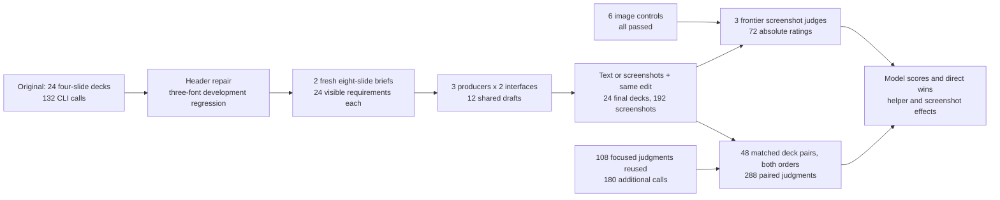

# 19. PowerPoint harnesses and screenshot judges

A committee changes its preferred project option before a meeting. The new investment and savings must reach the recommendation, scenario chart, payback calculations and final funding request. A deadline shift must also reach the roadmap without losing its dependencies. A deck can look finished while a chart label, table cell or decision threshold remains wrong.

Layout helpers can reduce the work of placing objects, but a helper can also repeat a defect on every slide. An isolated 9/10 rating is difficult to interpret when deck length and content change. This experiment therefore combines matched feature comparisons with blinded, head-to-head judging of complete decks on the same brief, in both presentation orders.

## Question

Do layout helpers and screenshot feedback improve editable PowerPoint decks, and which models win under each interface? Three producers cross primitive or helper authoring with text or screenshot review on two fresh synthetic briefs. They make 12 shared drafts and 24 final eight-slide decks. Three frontier judges provide 72 absolute ratings and 288 head-to-head judgments across 48 matched deck pairs, using only task-card images and slide screenshots.

## Result

Across both review modes, helpers earned 38.2% head-to-head win credit against primitives. Across both interfaces, screenshots earned 61.1% against text review.

Absolute-score order agreed with direct preference on 37/40 non-tied pairs. Judge preferences differed between the two presentation orders on 32/144 judge-pair checks.

All 24 final decks rendered. Absolute ratings changed by -1.1/100 with helpers and +1.6 with screenshots; GPT-6.1 Sol had the highest model mean, 87.5/100. Judges marked 52/1728 requirement checks unmet. These counts are judge responses, not unique deck errors. The full grid was frozen after focused results were available. It includes every remaining planned comparison and reuses 108 earlier judgments unchanged; it is not an independent replication. There are still only two related briefs and one generation per cell.

## Models in all four conditions

| Producer | Primitives + text | Primitives + screenshots | Helpers + text | Helpers + screenshots |
|---|---:|---:|---:|---:|
| GPT-6.1 Sol | 83.3% | 89.6% | 95.8% | 81.2% |
| Claude Opus 5.5 | 66.7% | 60.4% | 52.1% | 66.7% |
| Muse Wonder Full | 0.0% | 0.0% | 2.1% | 2.1% |


Win credit is 1 for a win, 0.5 for a tie and 0 for a loss. The two orders are averaged within a judge before averaging judges and briefs. Each table cell covers four matched pairings: two opponents on two briefs. These pairings are not four independent source tasks. Cross-condition differences also change the opponents' decks; use the matched factor comparisons below to test each feature.

Pooled across the four conditions: GPT-6.1 Sol 87.5%; Claude Opus 5.5 61.5%; Muse Wonder Full 1.0%. Excluding both producing vendors' judges: GPT-6.1 Sol 82.8%; Claude Opus 5.5 65.6%; Muse Wonder Full 1.6%. Only one judge vendor remains per model matchup in that sensitivity check, and the judge differs across opponent pairs. These results do not establish a general model ranking.


## Helpers and screenshot review

| Treatment and control setting | Win credit | Other-vendor credit | Pair wins/ties/losses | Score change /100 |
|---|---:|---:|---:|---:|
| Helpers, text review fixed | 48.6% | 54.2% | 2/1/3 | -0.4 |
| Helpers, screenshots fixed | 27.8% | 27.1% | 1/0/5 | -1.8 |
| Screenshots, helpers fixed | 52.8% | 50.0% | 3/1/2 | +0.9 |
| Screenshots, primitives fixed | 69.4% | 68.8% | 4/1/1 | +2.2 |


Each row contains six matched deck pairs: three producers on two briefs. Pair wins, ties and losses use the order-averaged three-judge preference. Helper comparisons hold review mode fixed; screenshot comparisons hold authoring interface fixed. Other-vendor factor results exclude the producer's vendor and retain two judges. The absolute-score difference uses the same decks.


Legibility win credit was 35.4% for helpers and 69.4% for screenshot review. The five dimension votes are secondary diagnostics. They retain overall preference as the primary outcome and cannot isolate an individual helper's contribution.


The following figure shows how preference for each feature changes when the other feature is present. A percentage point is a difference between two percentages. These are changes in direct preference, not an additive measure of slide quality, so they need not match the absolute-score interaction.


## Scores, order and concrete disagreements

Absolute-score order agreed with direct preference on 37/40 non-tied pairs. Judge preferences differed between the two presentation orders on 32/144 judge-pair checks. Judges returned ties in 51/288 individual decisions. Pairs tied on either score ordering or direct preference are excluded from the agreement fraction. Differences across orders combine position sensitivity and response variability; repeated same-order controls would be needed to separate them. This provides a local reference for the rating scale, not a universal conversion from 9/10 to a probability of winning.


The notebook shows the largest score-order disagreement, both decks' roadmap slides and the judges' exact reasons. That example is selected mechanically by absolute score margin; no generated deck was repaired after evaluation. The complete PPTX files and screenshots remain available.

| Producer | Primitive/text baseline | Helpers/screenshots |
|---|---|---|
| GPT-6.1 Sol | [PPTX](data/harder/artifacts/180b0686bfd85db8/deck.pptx), [preview](data/harder/artifacts/180b0686bfd85db8/contact.png) | [PPTX](data/harder/artifacts/beba013335974f93/deck.pptx), [preview](data/harder/artifacts/beba013335974f93/contact.png) |
| Claude Opus 5.5 | [PPTX](data/harder/artifacts/494bc96620387047/deck.pptx), [preview](data/harder/artifacts/494bc96620387047/contact.png) | [PPTX](data/harder/artifacts/2555ca16c56d227b/deck.pptx), [preview](data/harder/artifacts/2555ca16c56d227b/contact.png) |
| Muse Wonder Full | [PPTX](data/harder/artifacts/a2298a70bdc31a0c/deck.pptx), [preview](data/harder/artifacts/a2298a70bdc31a0c/contact.png) | [PPTX](data/harder/artifacts/005b8e576ac75c08/deck.pptx), [preview](data/harder/artifacts/005b8e576ac75c08/contact.png) |


## Header repair and harder tasks

The first four-slide pilot passed all 864 factual checks and exposed a wrapped-title collision. The revised [header helper](harness.py) measures installed font glyphs, inserts explicit breaks into a two-line band, and reserves a separate subtitle line. Titles use 24-27 points, subtitles 10-12 points, and body content starts at y=1.7 inches. Overlong headers fail explicitly. Collisions fell from 6 to 0 across 12 development headers in Arial, Calibri and Georgia.

The primitive compiler produced identical expanded scenes, slide XML, chart XML and embedded workbook content on 18 original primitive decks; ZIP timestamps were excluded. The other three helpers stayed unchanged. A post-collection check found all 156 fitted header text objects clear of the next header band, although 34 titles extend 0.72 points below their nominal text boxes. Those outputs remain unchanged. Header geometry is an engineering check, separate from the model quality judgments.


The eight-slide task requires a financial decision, six-month chart, option table, scenario economics, five-site capacity table, connected two-lane roadmap, risk matrix and final funding/gate decision. The revision changes the chosen option and its derived values, one month and totals, gate/rollout timing and a new risk. Other facts must survive. Each judge sees three final task-card images and eight full-resolution slide images per deck. Final decks contain at least two native charts and two tables, with 48 charts and 108 tables in total.


## Workflow and controls



GPT-6.1 Sol, Claude Opus 5.5 and Muse Wonder Full produce declarative JSON scenes through `codex exec`, `claude -p` and `muse exec`. The compiler makes editable native objects; Microsoft PowerPoint exports the actual slides at 1440 by 810 pixels. Each final deck receives one draft and one independent revision. Review modes share their initial draft and factual edit. A 75,000-character output cap applies to every generation condition.

GPT-6 Astra, Claude Opus 5.5 and Muse Wonder Full judge only images, without producer names, extracted deck text, source files or earlier ratings. Their five equally weighted dimensions are design, legibility, visual communication, coherence and requirements. Absolute scores use 0-5 per dimension, scaled to 100. Pair judges choose A, B or tie overall and by dimension, citing both decks. Calls use independent empty directories, tools disabled, medium effort and concurrency at most three.

All six image controls passed: reading an image-only code and preferring clean typography over overlapping low-contrast text in both orders. The full grid contains 24 producer pairs, 12 helper pairs and 12 screenshot-review pairs. Every pair is matched on brief. The earlier 18-pair phase remains in notebook section 14; section 15 adds all remaining comparisons. It does not change the deck generation or absolute ratings.

One Muse absolute response had 25 identical true checklist values instead of 24. Offline parsing removes one indistinguishable excess entry; every possible deletion yields the same vector. All five quality scores and the raw response remain unchanged. One earlier GPT paired response was lost during a local disk-full cache append, then its identical request was repeated once. The lost attempt and request are recorded separately. The extension adds disk-space checks and local write retries without model retries. After collection, the active writer was changed to unbuffered appends with short-write handling so rollback does not need to flush buffered data. The frozen collector and all responses remain unchanged; this last writer change was tested locally without model calls.

## Limits and decision

Keep the primitive baseline as the default in this tested interface. Screenshot review wins more direct preference credit than text review across these tasks. The frozen absolute-score expansion rule is still reported separately; neither feature passed all its requirements. The paired extension is descriptive and does not replace that rule after the results are known.

There are only two briefs, one generation per cell and a shared task structure. Annual savings are fixed by the template, and both briefs drew the same selected investment; monthly and site data differ. GPT assistance wrote the templates and deterministic data generator, which can introduce author preferences. Helpers are available rather than compulsory, and the notebook measures adoption. The comparison says little about photographs, animations, imported templates, unrestricted authoring code or open-ended source documents.

The original four-slide pilot remains unchanged in `data/` and notebook sections 1-10: 24/24 decks rendered, GPT-6.1 Sol averaged 94.5/100, helpers changed scores by -2.9 and screenshots by +0.2. The old/new score difference cannot isolate the header repair because the tasks changed. The full paired expansion adds comparisons, not new task diversity. A next study should first add distinct structures and multiple generation repeats.

## Spend and evidence

The extension made 180 additional CLI calls, reusing 108 earlier judgments. Claude reported $19.66 additional list-price equivalent. The harder study now has 403 CLI attempts, including the earlier lost response, and $42.97 known Claude equivalent. Dollar costs for 269 other attempts and incremental subscription charges are unknown. Including the original pilot, there are 535 attempts and $48.65 known Claude equivalent; this is not the total bill.

The harder cumulative cap is 430 attempts. The expansion has 60 new Claude calls capped at $3 each, a $180 additional ceiling. No direct provider HTTP APIs or OpenRouter calls were used. A fresh full-grid run without the earlier storage incident needs 402 attempts.

The active code remains one harness file and one self-contained notebook with pinned requirements. Earlier manifests and response caches stay unchanged. `data/harder/paired_full/` holds the expansion protocol, collector snapshot, 180 new responses, the combined 288 judgments, derived tables and its own manifest. All scored responses include full requests and image hashes. Data are synthetic and MIT licensed; creation dates and model date sources remain in `date_provenance.json`.

## How to run

Offline replay verifies all three manifests and calls no models:

```bash
python -m pip install -r requirements.txt
python -m nbconvert --to notebook --execute --inplace 19_powerpoint_harness.ipynb
```

Notebook section 17 gives fresh collection commands. To expand an existing focused run, make a separate copy with the current collector and earlier evidence, omitting the frozen `data/harder/paired_full/` subfolder, then run:

```bash
python harness.py paired-expand --profile harder --max-calls 430
python harness.py paired-collect --profile harder --pair-scope full --live --max-calls 430
python harness.py paired-manifest --profile harder
```

The size controls are `--n-briefs`, `MODELS`, `JUDGES`, `--pair-scope` and `--max-calls`. Raising the brief count changes numerical draws, not story structures. Live generation needs Windows, PowerPoint and authenticated CLIs. The frozen replay expects the complete study; a new design needs its own report. No semantic retries or provider substitutions occur automatically.

## Research and further reading

Links checked on 2026-10-21. The research log, exact prompts and source snapshots are retained with the evidence. Notebook section 18 lists the follow-up experiments.

- [PPTAgent](https://arxiv.org/abs/2501.03936) motivates separate content, design and coherence outcomes.
- [DECKBench](https://arxiv.org/abs/2602.13318) motivates generation followed by editing and preservation checks.
- [PresentBench](https://presentbench.github.io/) motivates a task-specific visible checklist.
- [Judging LLM-as-a-judge](https://arxiv.org/abs/2306.05685) motivates multiple judges, vendor exclusion and swapped presentation order.
- [Text fitting analysis](https://python-pptx.readthedocs.io/en/latest/dev/analysis/txt-fit-text.html) explains why actual font metrics matter.
- [PowerPoint Slide.Export](https://learn.microsoft.com/en-us/office/vba/api/powerpoint.slide.export) documents the common renderer.
