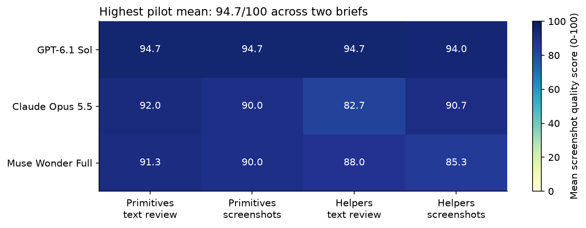
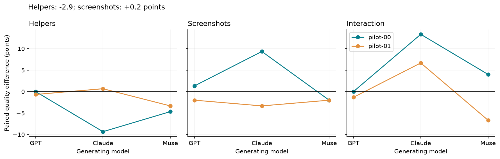
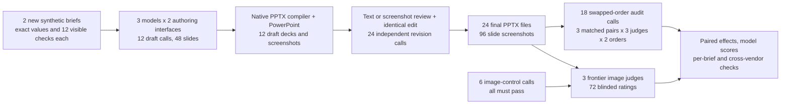
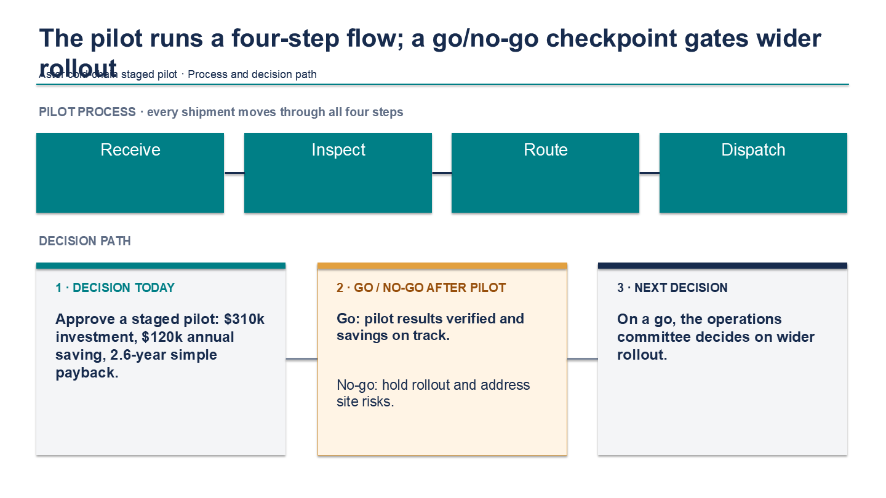

# 19. PowerPoint harnesses and screenshot judges

An analyst updates a deck before a decision meeting. A changed investment figure must reach the headline, the payback calculation and the final recommendation. The deck also needs readable charts and a process diagram that makes the next step clear. A slide that looks finished can still carry the old number or hide a needed label.

Producing a valid PowerPoint file is easier than producing a useful presentation. Strong models can write accurate text and still choose poor spacing. Extra review can help, but an extra model call is also extra computation. To test what the harness contributes, the text and screenshot review branches start from exactly the same draft and get the same numerical edit request.

## Question

On two fresh synthetic briefs, do optional layout helpers and screenshot feedback improve the quality of four-slide editable decks? How does that depend on GPT-6.1 Sol, Claude Opus 5.5 or Muse Wonder Full? The crossed design produces 12 drafts and 24 final decks. GPT-6 Astra, Claude Opus 5.5 and Muse Wonder Full provide 72 blinded ratings using only images.

## Result

24/24 final decks rendered. GPT-6.1 Sol had the highest model average, 94.5/100 across four harness conditions. Helpers changed quality by -2.9 points and screenshot feedback by +0.2 points on average.

Three GPT conditions tied at 94.7/100: primitives with text review, primitives with screenshots, and helpers with text review. Excluding the producer vendor narrows the GPT versus Claude model-average gap to 1.0 point (92.0 versus 91.0). These are descriptive scores on two related numerical decision briefs, with one generation per cell. They do not establish a general model ranking or the best presentation backend. Scores reflect three model judges' rubrics, not human audience outcomes.

| Producer | Harness | Mean quality / 100 | Other-vendor judges / 100 |
|---|---|---:|---:|
| Claude Opus 5.5 | helpers text | 82.7 | 85.0 |
| Claude Opus 5.5 | helpers vision | 90.7 | 93.0 |
| Claude Opus 5.5 | primitive text | 92.0 | 94.0 |
| Claude Opus 5.5 | primitive vision | 90.0 | 92.0 |
| GPT-6.1 Sol | helpers text | 94.7 | 93.0 |
| GPT-6.1 Sol | helpers vision | 94.0 | 91.0 |
| GPT-6.1 Sol | primitive text | 94.7 | 92.0 |
| GPT-6.1 Sol | primitive vision | 94.7 | 92.0 |
| Muse Wonder Full | helpers text | 88.0 | 87.0 |
| Muse Wonder Full | helpers vision | 85.3 | 83.0 |
| Muse Wonder Full | primitive text | 91.3 | 92.0 |
| Muse Wonder Full | primitive vision | 90.0 | 89.0 |

The quality score averages five equally weighted 0-5 dimensions: design, legibility, visual communication, coherence and requirements, then scales the result to 100. Other-vendor scores exclude a judge from the producer's vendor. Every deck still has two external-vendor ratings. The notebook reports dimensions, each brief's feature effects, checklist failures and native-object checks separately.





The following files show the same first brief using primitives plus text review, the retained comparison baseline.

| Producer | Editable deck | Rendered preview |
|---|---|---|
| GPT-6.1 Sol | [PowerPoint](data/artifacts/180b0686bfd85db8/deck.pptx) | [Four-slide preview](data/artifacts/180b0686bfd85db8/contact.png) |
| Claude Opus 5.5 | [PowerPoint](data/artifacts/494bc96620387047/deck.pptx) | [Four-slide preview](data/artifacts/494bc96620387047/contact.png) |
| Muse Wonder Full | [PowerPoint](data/artifacts/a2298a70bdc31a0c/deck.pptx) | [Four-slide preview](data/artifacts/a2298a70bdc31a0c/contact.png) |

## Workflow



The full call graph is beside the method in [the executed notebook](19_powerpoint_harness.ipynb).

## What the harness does

[harness.py](harness.py) contains the compiler, rendering wrapper, three command-line interface (CLI) adapters, cache and collection commands. A model returns a JSON scene with text, rectangles, lines, native charts and native tables. The helper condition also exposes headers, key performance indicator (KPI) blocks, columns and connected flows. Those helpers expand into the same primitives. Both conditions retain free placement and theme choices.

The harness creates and edits decks by compiling complete scenes into PPTX files. Microsoft PowerPoint exports each actual slide at 1440 by 810 pixels. All content is editable; charts have native data. Models can inspect their own draft screenshots only in the screenshot arm. The revision changes investment and payback, preserves the remaining facts and adds a go/no-go checkpoint. There is no automatic factual correction or cosmetic repair of experimental outputs.

Every branch has one draft call and one revision call. Shared drafts reduce collection to 36 generation calls while retaining a matched comparison. Screenshot branches consume extra image tokens, so call matching is not token or reasoning-time matching. The experiment tests access to helpers and screenshots inside this interface. It does not compare authoring libraries.

## Research behind the design

Sources checked on 2026-10-21; the complete decision log is in [data/research.json](data/research.json).

- [PPTAgent](https://arxiv.org/abs/2501.03936) separates content, design and coherence and studies editing workflows. This pilot keeps those outcomes separate.
- [DECKBench](https://github.com/morgan-heisler/DeckBench) includes creation and later edits. This pilot tests a numerical change and preservation of unrelated facts.
- [PresentBench](https://presentbench.github.io/) motivates task-specific visible checks. Our card has 12 checks, judged in one call per deck to keep the pilot bounded.
- [LLM-as-a-judge research](https://arxiv.org/abs/2306.05685) motivates blind labels, multiple judges, vendor exclusion and swapped presentation order.
- [python-pptx](https://python-pptx.readthedocs.io/en/latest/) provides native editable objects; [PowerPoint Slide.Export](https://learn.microsoft.com/en-us/office/vba/api/powerpoint.slide.export) supplies the common rendering engine.

## Evaluation and failures

Judges receive one image of the final task requirements and four slide screenshots. They receive no source code, extracted text, author names, compiler scores or provider labels. The generic rubric asks for concrete slide evidence with each score. The judge CLI has no tools and runs in an empty temporary directory.

All six image-access controls passed. The controls require reading an image-only code and preferring clean typography over overlapping low-contrast text in both orders. The separate order audit kept the same mapped preference in 9/9 comparisons. These checks establish basic image access and some preference stability; they do not calibrate artistic taste against people.

All 864 visible checklist ratings were true, so the pilot does not distinguish the models on factual edit compliance. All three judges flagged title/subtitle overlap in the lowest-scoring deck (74.7/100). Its fixed header helper leaves too little room when the title wraps. A next version should test title-height measurement and fit diagnostics on new briefs.

The error figure is selected by a fixed rule: lowest mean-scoring rendered deck, then the slide most often named as its worst by the judges. The notebook shows the judges' reasons alongside exact source values.



## Limits and next experiment

The two briefs share one four-slide decision structure. The interface has no photographs, freeform SVG, animations, imported templates or long source documents. The helper treatment bundles several layout choices. Different CLI system prompts and vendor token accounting remain part of the tested systems. The author used GPT assistance for the code and fixed wording; deterministic numbers prevent memorized labels but do not remove prompt-author preferences.

Helpers: does not pass the predeclared expansion gate. Screenshots: does not pass the predeclared expansion gate. Passing the gate requires at least 90% valid decks, a positive effect on both briefs and no cross-vendor reversal. A pass recommends a larger test, not a final design choice.

Retain primitives plus text review as the comparison baseline. First repair and test the header helper on development fixtures; do not adopt the current helper bundle or screenshot loop as a default on this evidence.

For expansion, add at least 12 distinct brief structures and three repeats, then compare the strongest pilot conditions against unrestricted PptxGenJS/Artifact Tool code and template retrieval. Add separate geometry-feedback and extra-review controls. Use paired task-level intervals, keep model ratings separate from task counts, and freeze the new protocol before collecting held-out results. The current `--n-briefs` knob changes seeds but does not itself supply new task structures.

## Spend and evidence

There were 132 external CLI calls: 6 controls, 36 generation calls, 72 quality ratings and 18 order-audit calls. No OpenRouter calls were used. Claude reported $5.68 as a list-price equivalent. Dollar costs for 88 other calls and incremental subscription charges are unknown, so $5.68 is not the experiment's total bill. Per-call latency and available token counts are retained.

The synthetic source data is MIT licensed and was created on 2026-10-21, after the recorded training cutoffs or release dates. [data/date_provenance.json](data/date_provenance.json) records the source for each model date. All requested model IDs, prompts and protocol settings are frozen in [data/protocol.json](data/protocol.json). [data/runtime.json](data/runtime.json) records CLI versions, a test-only correction and later initialization options for future collections. No pilot prompt or compiler behavior changed.

The folder contains one reusable Python harness, one analysis notebook, this README and pinned requirements. Generated evidence stays under `data/`:

```text
data/
  protocol.json, cases.json, research.json, date_provenance.json
  cache.jsonl                 full requests and raw CLI responses, including failures
  drafts.json, runs.json      experimental mapping and integrity records
  judgments.json, audit.json  parsed screenshot ratings and order checks
  artifacts/<opaque-id>/     scene.json, deck.pptx, four PNGs, contact.png
  tasks/, controls/           image-only judge references
  *.csv, spend.json           derived results
  manifest.json               SHA-256 hashes of all evidence
figures/                      notebook charts and selected error example
```

## How to run

Offline replay needs Python, the files in this folder and the analysis packages. It never invokes a CLI or PowerPoint:

```bash
python -m pip install -r requirements.txt
python -m nbconvert --to notebook --execute --inplace 19_powerpoint_harness.ipynb
```

Live collection needs Windows, Microsoft PowerPoint and authenticated `codex`, `claude` and `muse` CLIs. Use a fresh copy, preserve the committed caches, and follow notebook section 11. Size knobs are `init --n-briefs 2`, the `MODELS`/`JUDGES` dictionaries and a cumulative `--max-calls 150`. Missing requests fail without `--live`. There are no semantic retries or silent provider substitutions. Runtime package versions are pinned in [requirements.txt](requirements.txt).
