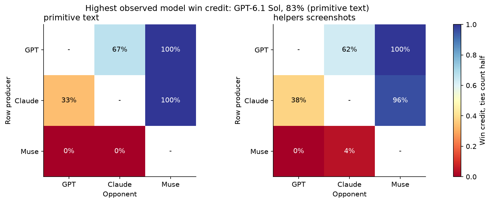
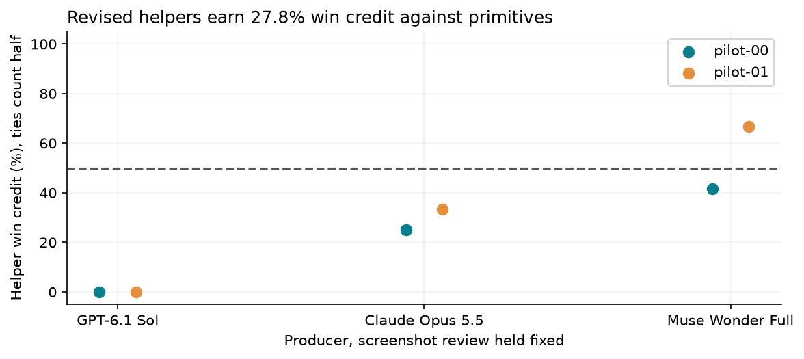
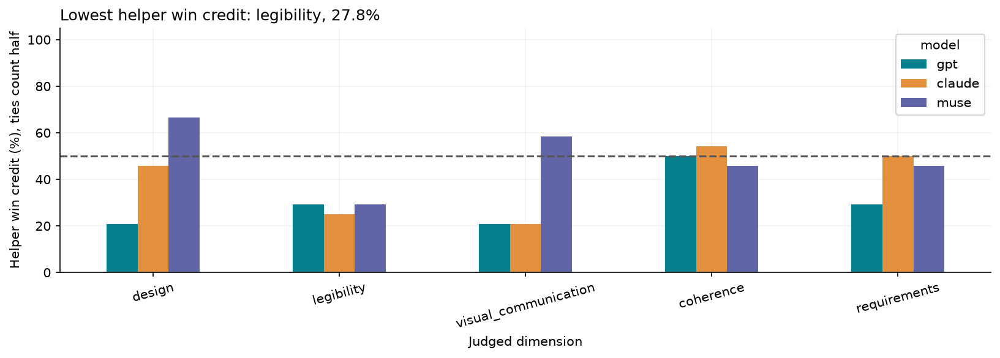
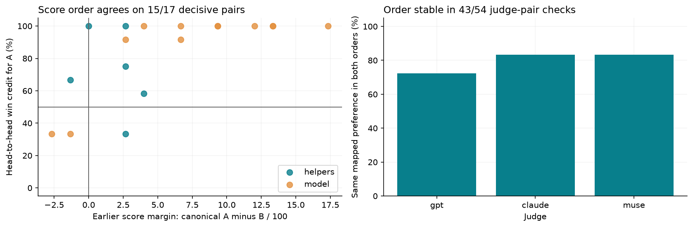
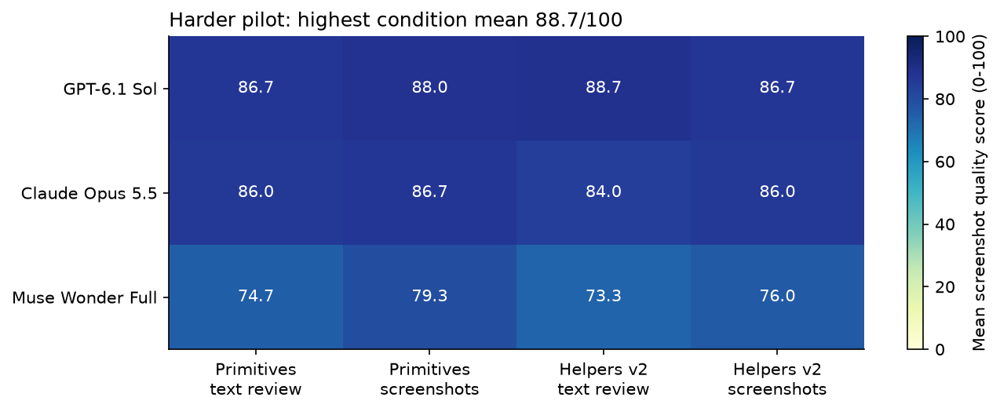
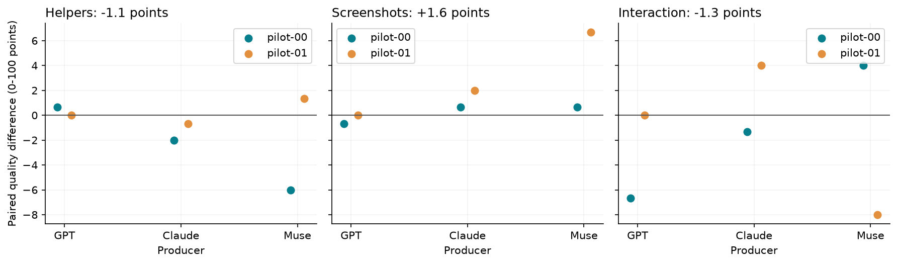
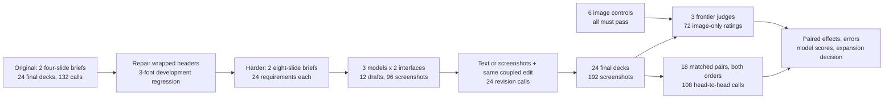

# 19. PowerPoint harnesses and screenshot judges

A committee changes its preferred project option before a meeting. The new investment and savings must reach the recommendation, scenario chart, payback calculations and final funding request. A deadline shift must also reach the roadmap without losing its dependencies. A deck can look finished while a chart label, table cell or decision threshold remains wrong.

Reusable layout helpers can reduce the work of placing objects, but a helper can introduce a defect on every slide. The first pilot found a wrapped-title collision and passed all 864 factual checks, so its tasks were too easy to test preservation. The follow-up repairs the header and adds longer decks with linked edits. Text and screenshot review receive the same draft and change request; the primitive compiler stays unchanged.

## Question

On two fresh synthetic briefs, do revised helpers improve eight-slide editable decks compared with primitives? Does screenshot review change that effect, and which complete decks win head to head? Three generators cross two authoring interfaces with two review modes, producing 12 drafts and 24 final decks. GPT-6 Astra, Claude Opus 5.5 and Muse Wonder Full provide 72 blinded ratings and 108 paired judgments using only task-card images and slide screenshots.

## Result

Revised helpers earned 27.8% head-to-head win credit against primitives with screenshot review held fixed (27.1% using other-vendor judges). Absolute-score order agreed with direct preference on 15/17 non-tied comparisons.

24/24 eight-slide decks rendered. Revised helpers changed quality by -1.1 points; screenshots by +1.6. GPT-6.1 Sol had the highest model mean, 87.5/100.

Judges marked 52/1728 requirement checks unmet, compared with 0/864 in the first pilot. These are judgments, not unique deck errors. The helper-by-screenshot interaction is -1.3 points. These are two synthetic briefs with one generation per cell and three model judges, not a general model ranking. Both briefs share one structure.

## Head-to-head comparisons

| Producer | Authoring and review | Win credit | Other-vendor credit | Pair wins / ties / losses |
|---|---|---:|---:|---:|
| Claude Opus 5.5 | helpers vision | 66.7% | 75.0% | 3 / 0 / 1 |
| GPT-6.1 Sol | helpers vision | 81.2% | 75.0% | 3 / 0 / 1 |
| Muse Wonder Full | helpers vision | 2.1% | 0.0% | 0 / 0 / 4 |
| Claude Opus 5.5 | primitive text | 66.7% | 75.0% | 3 / 0 / 1 |
| GPT-6.1 Sol | primitive text | 83.3% | 75.0% | 3 / 0 / 1 |
| Muse Wonder Full | primitive text | 0.0% | 0.0% | 0 / 0 / 4 |


A win credit is 1 for a win, 0.5 for a tie and 0 for a loss. Each judge sees both orders; average within judge before averaging judges and briefs. Each row contains four matched deck pairs: two opponents on two briefs. Wins, ties and losses use the three-judge, order-averaged preference. Other-vendor model comparisons exclude both producers, leaving only one judge vendor per matchup. Helper comparisons retain two external judges.

Excluding both producing vendors leaves Claude Opus 5.5 and GPT-6.1 Sol tied at 75.0% model win credit. Only one judge vendor remains per model matchup, so this does not establish a clear ranking between them.

The focused plan compares all three producer pairs under primitive/text and helper/screenshot authoring (12 pairs) and helpers against primitives with screenshots held fixed for every producer (6 pairs). It does not directly measure the screenshot effect or every possible model-condition comparison. The plan was frozen after generation and before aggregate absolute scores were inspected. No earlier ratings were shown to paired judges.







Mapped preferences stayed the same in 43/54 judge-pair order checks, with 8/108 individual judgments returning ties. The score-order comparison excludes pairs tied on either measure. These two-brief results provide a local reference for the scores, not a universal conversion from 9/10 to a win probability.



## Absolute ratings

| Producer | Condition | Quality / 100 | Other-vendor / 100 | Checklist passed |
|---|---|---:|---:|---:|
| Claude Opus 5.5 | helpers text | 84.0 | 84.0 | 97.9% |
| Claude Opus 5.5 | helpers vision | 86.0 | 86.0 | 97.9% |
| Claude Opus 5.5 | primitive text | 86.0 | 86.0 | 97.9% |
| Claude Opus 5.5 | primitive vision | 86.7 | 87.0 | 97.9% |
| GPT-6.1 Sol | helpers text | 88.7 | 89.0 | 98.6% |
| GPT-6.1 Sol | helpers vision | 86.7 | 86.0 | 97.9% |
| GPT-6.1 Sol | primitive text | 86.7 | 86.0 | 100.0% |
| GPT-6.1 Sol | primitive vision | 88.0 | 88.0 | 100.0% |
| Muse Wonder Full | helpers text | 73.3 | 71.0 | 95.8% |
| Muse Wonder Full | helpers vision | 76.0 | 75.0 | 93.8% |
| Muse Wonder Full | primitive text | 74.7 | 73.0 | 93.1% |
| Muse Wonder Full | primitive vision | 79.3 | 78.0 | 93.1% |


The score averages design, legibility, visual communication, coherence and requirements, each rated 0-5, then scales to 100. Other-vendor scores exclude the producer's vendor; the two-judge panels differ between producers. Checklist pass rate is reported separately from aesthetic quality. A failed generation receives zero, and incomplete judge panels stop the analysis.





| Producer | Primitive + text baseline | Revised helpers + screenshots |
|---|---|---|
| GPT-6.1 Sol | [PPTX](data/harder/artifacts/180b0686bfd85db8/deck.pptx), [preview](data/harder/artifacts/180b0686bfd85db8/contact.png) | [PPTX](data/harder/artifacts/beba013335974f93/deck.pptx), [preview](data/harder/artifacts/beba013335974f93/contact.png) |
| Claude Opus 5.5 | [PPTX](data/harder/artifacts/494bc96620387047/deck.pptx), [preview](data/harder/artifacts/494bc96620387047/contact.png) | [PPTX](data/harder/artifacts/2555ca16c56d227b/deck.pptx), [preview](data/harder/artifacts/2555ca16c56d227b/contact.png) |
| Muse Wonder Full | [PPTX](data/harder/artifacts/a2298a70bdc31a0c/deck.pptx), [preview](data/harder/artifacts/a2298a70bdc31a0c/contact.png) | [PPTX](data/harder/artifacts/005b8e576ac75c08/deck.pptx), [preview](data/harder/artifacts/005b8e576ac75c08/contact.png) |


## What changed

The [header helper](harness.py) measures installed font glyphs and inserts explicit breaks into a reserved two-line band. Titles use 24-27 points, subtitles 10-12 points on a separate line, and body content starts at y=1.7 inches. Headers that exceed the band fail explicitly. On the original failing scene in Arial, Calibri and Georgia, title/subtitle collisions fell from 6 to 0 across 12 tested headers. This geometry check is not a quality judgment.

The primitive compiler produced identical expanded scenes, slide XML, chart XML and embedded workbook content on 18 original primitive decks; ZIP timestamps were excluded. The KPI, flow and columns helpers are unchanged. Both new conditions share the same native renderer and a 75,000-character generation cap. Each final deck has one draft and one revision; shared drafts reduce generation to 36 calls.

A post-collection PowerPoint geometry check found all 156 fitted header text objects clear of the next header band. Of these, 34 titles have font bounds 0.72 points below their nominal text box. That small overshoot is retained and reported in [data/harder/native_audit.json](data/harder/native_audit.json); it does not change quality scores. All final decks contain at least two native charts and two native tables, with 48 charts and 108 tables in total.


Each eight-slide brief contains a decision, six-month actual/target chart, option table, scenario chart with derived financial values, five-site capacity table, connected roadmap, risk matrix and final go/no-go decision. The edit changes the chosen option and its derived economics, M4 actual and totals, gate/rollout timing and a new risk. Other values and dependencies must remain. Judges see three image cards with exact final facts and 24 checks, then eight full-resolution slide images.

## Workflow



The notebook's sections 11 and 14 give the model call graphs, exact prompts, raw response examples and frozen settings. Each CLI runs in a new empty directory with tools disabled. Models return declarative JSON scenes; no generated code executes. Microsoft PowerPoint exports actual slides at 1440 by 810 pixels. Charts and tables remain editable. Rendering is serial; independent CLI calls have concurrency at most three.

## Errors and judge checks

All six image controls passed: read an image-only code and prefer clean typography over overlapping low-contrast text in both orders. The original planned harder order audit is a subset of the new paired phase: helpers versus primitives under screenshot review on the first brief. Mapped preferences were consistent in 5/9 checks in that subset; no duplicate audit calls were made. These checks do not establish agreement with a human audience.

One Muse absolute response returned 25 identical true checklist entries instead of 24. Offline parsing removes one indistinguishable excess entry; every possible single deletion gives the same vector. All five quality scores are unchanged, and the raw response and original failed parse remain cached. Mixed excess values or missing entries would still fail. No new call was made.

The error example is selected mechanically: lowest mean-scoring rendered deck, then the slide most often nominated as worst by the judges. Their exact reasons and checklist disagreements appear in notebook section 13. Experimental defects are preserved.


## Original pilot and limits

The original four-slide pilot remains unchanged in `data/`, notebook sections 1-10 and its original manifest. It rendered 24/24 decks; GPT-6.1 Sol averaged 94.5/100, helpers changed scores by -2.9 and screenshots by +0.2. Its 864/864 factual checks all passed. New evidence is isolated in `data/harder/`. Changing task length, edits, checklist and output allowance means old/new score differences cannot identify the effect of the header fix.

Both pilots use two instances of a prescribed structure, one generation per cell and three model judges. They have no photographs, animations, imported templates, open-ended source documents or alternative authoring backend. GPT assistance wrote the fixed templates and code; seeded facts prevent memorized labels but do not remove author preferences. CLI system prompts, model alias changes and uneven token accounting remain part of the tested systems. Model judges may favor their own vendor, so dimensions, individual judges and other-vendor sensitivities are retained.

Annual saving amounts are fixed by the template, and both harder briefs also drew the same selected investment; monthly and site values differ. Financial-edit coverage is therefore narrow. Models can also choose how many helpers to use, so the contrast measures availability of the helper bundle. The notebook reports adoption rather than assuming every helper was used.

## Decision

Helpers: does not pass the expansion rule. Screenshots: does not pass the expansion rule. The predeclared rule requires at least 90% valid decks, a positive effect on both briefs under both full and other-vendor panels, no requirement loss on either brief and a checklist below complete ceiling. A pass recommends a larger study, not a universal default. The added paired phase is descriptive and does not replace this frozen rule.

Keep the primitive baseline. The harder pilot does not justify making the revised helper bundle the default; test the remaining failure modes on new development fixtures before another held-out run. Expansion should add at least 12 distinct task structures and multiple generation repeats. Raising `--n-briefs` alone only changes numerical draws.

## Research and further reading

Links checked on 2026-10-21. The original decision log is in [data/research.json](data/research.json); follow-up sources and runtime details are in [data/harder/runtime.json](data/harder/runtime.json).

- [PPTAgent](https://arxiv.org/abs/2501.03936) motivates separate content, design and coherence outcomes.
- [DECKBench](https://arxiv.org/abs/2602.13318) (Jang et al., 2026) motivates generation plus later editing and preservation checks.
- [PresentBench](https://presentbench.github.io/) motivates a task-specific visible checklist.
- [LLM-as-a-judge](https://arxiv.org/abs/2306.05685) motivates multiple judges, vendor exclusion and swapped order.
- [Text fitting analysis](https://python-pptx.readthedocs.io/en/latest/dev/analysis/txt-fit-text.html) explains the role of actual font metrics.
- [PowerPoint Slide.Export](https://learn.microsoft.com/en-us/office/vba/api/powerpoint.slide.export) documents the common renderer.

## Spend and evidence

The harder pilot made 223 CLI attempts: 6 controls, 36 generation/revision calls, 72 absolute ratings, 108 saved paired judgments and one paired response lost to a local disk-full cache failure. Only that identical missing request was repeated after space became available. The 222 usable responses and the full failed-storage request are retained; the lost response itself could not be recovered. Claude reported $23.31 as a list-price equivalent; dollar costs for 149 other calls and incremental subscription charges are unknown. The original pilot used 132 calls and reported $5.68. Together, the known equivalent is $28.99, which is not the total bill. No OpenRouter or direct provider HTTP calls were used. Claude has a $3 per-call limit, or $222 for its 74 planned calls in this expanded harder pilot.

There is one reusable harness file, one executed analysis notebook and pinned requirements. Each profile caches full requests, saved raw responses, errors, usage and image hashes; the storage incident records the one unavailable response. Synthetic inputs are MIT licensed; creation dates and model cutoff/release sources are recorded in each profile's `date_provenance.json`. Generation prompts and source hashes were frozen before generation. The paired protocol and its separate collector snapshot were frozen before paired judging.

```text
harness.py, 19_powerpoint_harness.ipynb, README.md, requirements.txt
data/                         original pilot, unchanged
  harder/                     second pilot, independent manifest and protocol
    cache.jsonl               full CLI requests and responses
    cases.json, tasks/        synthetic facts and three task-card images per brief
    drafts.json, runs.json    mapping, failures and native-object measurements
    judgments.json, paired_judgments.json, audit.json
    protocol.json, paired_protocol.json, *_at_freeze.py
    artifacts/<opaque-id>/    scene, PPTX, eight slide PNGs, contact sheet
    header_regression/        old and fixed development images
    *.csv, spend.json         derived analysis
figures/                      plots from both pilots
```

## How to run

Offline replay imports no harness, calls no models and needs no PowerPoint:

```bash
python -m pip install -r requirements.txt
python -m nbconvert --to notebook --execute --inplace 19_powerpoint_harness.ipynb
```

For live collection, use a separate copy with an empty `data/harder/`, keep the original evidence, and follow notebook section 16. It needs Windows, PowerPoint and authenticated model CLIs. The size knobs are `--n-briefs`, `MODELS`, `JUDGES`, `--pair-scope` and `--max-calls`; defaults remain a two-brief pilot. The focused paired plan uses a cumulative cap of 240 calls. A full paired grid on the same two briefs has 48 pairs and 288 paired calls, or 402 total, and requires an explicit larger cap in a fresh collection. Select `--profile harder` for the new eight-slide collector or `--profile original` for the retained four-slide behavior. Missing requests fail without `--live`. No semantic retries or provider substitutions are automatic.
