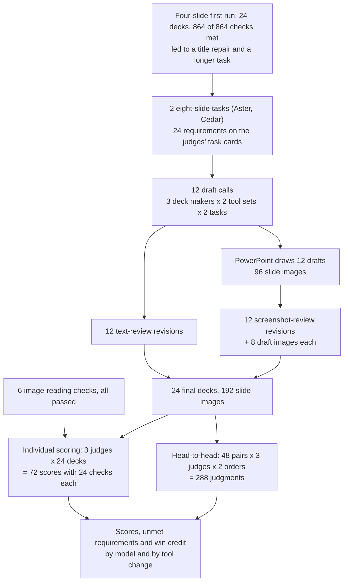
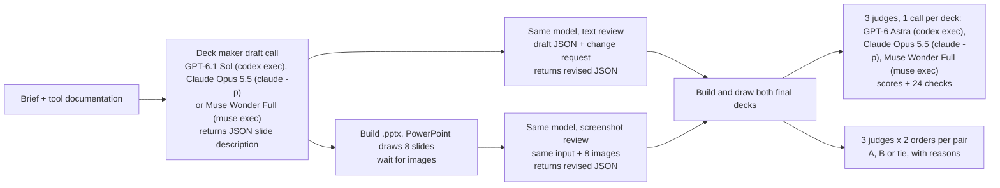
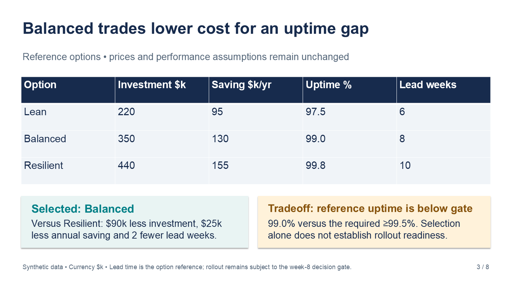
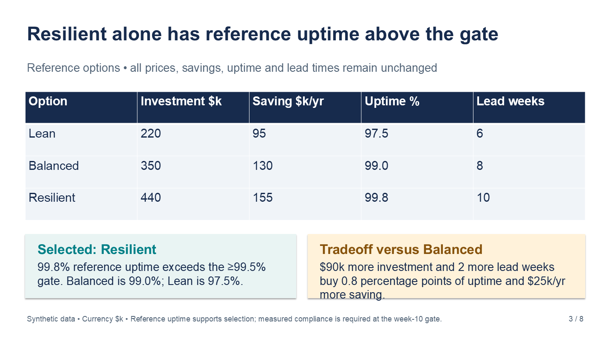
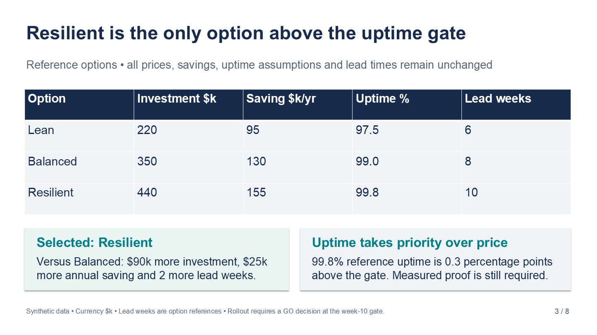
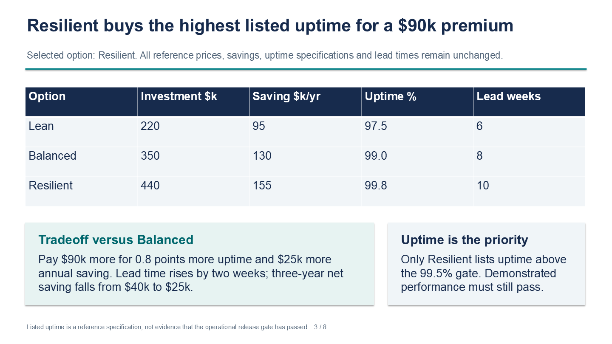
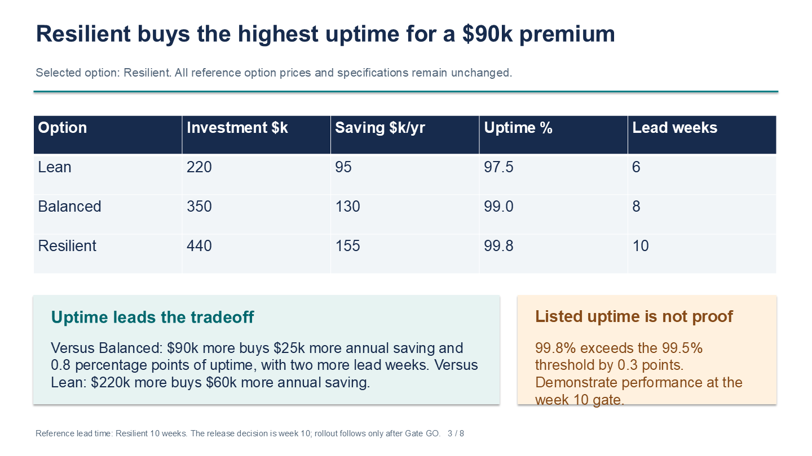
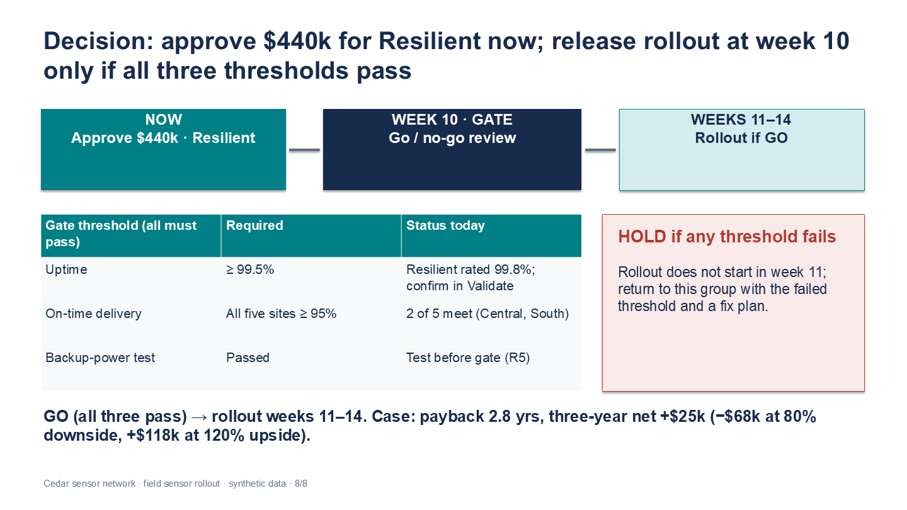
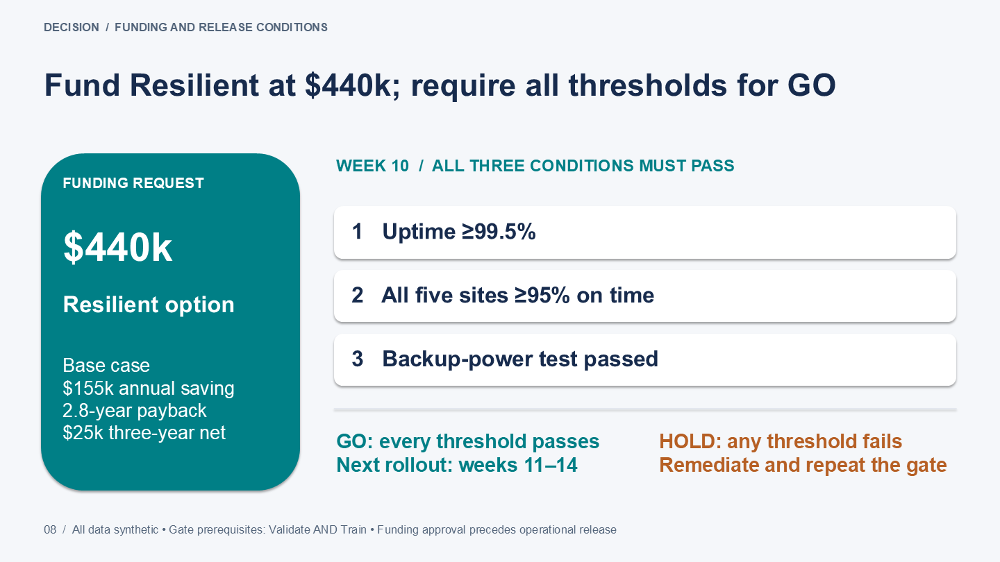
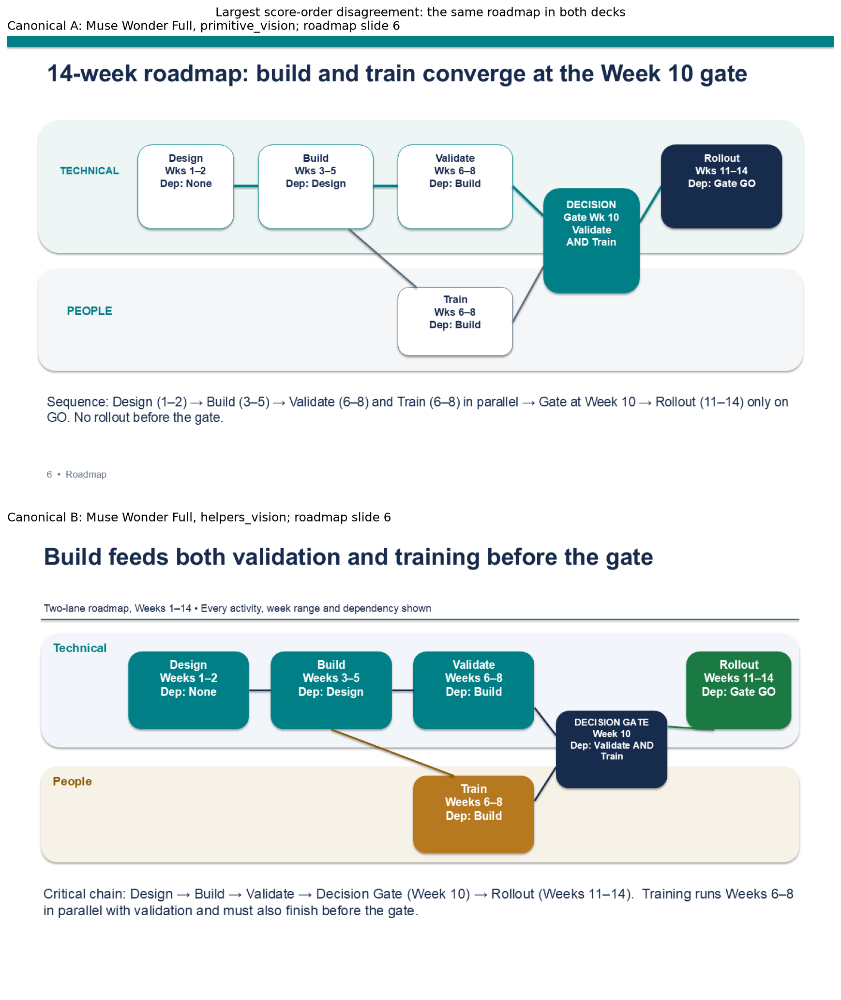

# Which model, and which tools, make a better slide deck?

## A deck that has to change

A project team has spent a month comparing three ways to upgrade its distribution network, called Lean, Balanced and Resilient. The team lead now has to present the choice to the operations committee in eight slides: the recommendation and its cost, the monthly results so far, a table of the three options, what happens if savings come in lower or higher than expected, the capacity of each site, a timeline, a chart of the main risks, and the decision the committee is asked to take.

A good deck lets the committee find the recommendation at once and check every number behind it. That takes two kinds of work. One is getting the facts right: costs, savings and dates must match the plan, and a figure that appears on three slides must be the same on all three. The other is presentation: titles that fit their space, tables that can be read from the back of the room, and a risk chart in which each risk sits in the right square.

### An illustrative example

This example is a simplified version of the first of the two tasks given to the models in this study.

In the ordinary case the deck recommends Balanced: an investment of $350k that saves $130k a year. The payback, the investment divided by the yearly saving, is 350 / 130 = 2.7 years. Over three years the option saves 3 × 130 − 350 = $40k more than it costs. These figures appear on the opening slide, in a chart of low, expected and high savings, and again on the closing slide, where the committee is asked to approve the money.

Then the plan changes. The committee decides that reliability matters more than price, and the recommendation becomes Resilient: $440k invested, $155k saved a year. The payback becomes 440 / 155 = 2.8 years, and the three-year figure falls to 3 × 155 − 440 = $25k. Each of those numbers has to change on every slide that shows it. Some things must not change: the option table still lists all three options at their original prices. The plan also adds a new risk, R5, which has to appear on the risk chart at likelihood 3 and impact 5.

A careful person lists every slide where a changed number appears, recalculates each one, and then looks at the finished slides, because a longer title can wrap into the text below it and a risk can land in the wrong square even when its label is right. The mistakes that get through are quiet ones: an old payback left on the closing slide, or R5 drawn one square too low. A committee can approve or reject a plan because of either.

### Why this is hard for a language model

A language model can write the words for a slide, but it cannot see the slide. In this study each model describes every slide in a structured text format: a text box with this wording at this position and size, a table with these cells here, a bar chart with these values there. A program turns that description into an editable PowerPoint file. The model chooses coordinates and font sizes, but it never sees where PowerPoint breaks a line, so it cannot tell whether a title fits until the slide is drawn.

### Two kinds of help

Two kinds of help might make this easier.

The first is a small set of ready-made layout blocks, here called **layout helpers**: a title area that measures its own text and keeps the title clear of the subtitle, a card with one large number and its label, a row of connected steps, and a set of equal columns. With helpers the model can ask for "a key-number card saying 2.8 years" instead of placing every box and line itself. Without them it builds everything from **basic tools**: text boxes, rectangles, lines, charts and tables. Helpers might prevent positioning mistakes; they might also push the content into a layout that does not suit it.

The second is a look at the draft, here called **screenshot review**. When the model revises its deck after the plan changes, it receives pictures of its own draft slides as PowerPoint drew them. Without the pictures it revises from its own text description alone, called **text review** here. The pictures might let it notice a crowded box or a title running into its subtitle; they also give it much more to read.

The tools and inputs placed around a model are often called a harness. This study compares four harness setups: basic tools or layout helpers, each with text review or screenshot review.

### How to tell which deck is better

There is no answer key for a good slide, so the study uses other language models as judges. Judges see only images: the finished slides, and three "task card" images that list the correct facts and 24 requirements, such as "Gate week 10 and rollout weeks 11-14 agree on slides 6 and 8". They are not told which model made a deck.

They judge in two ways. In **individual scoring** a judge rates one deck on five aspects (design, legibility, visual communication, coherence and meeting the requirements) and marks each of the 24 requirements as met or not. In a **head-to-head comparison** a judge sees two decks made for the same task and picks the better one, or calls a tie. A score of 87 out of 100 is hard to interpret on its own; a head-to-head choice answers the practical question of which of two decks you would rather present.

A useful outcome is a setup to try first for this kind of deck, and a short list of the mistakes a person still needs to check.

## The question

When a language model builds an eight-slide decision deck and then updates it after the plan changes, which of three models makes the decks that judges prefer? And does either kind of help, layout helpers or screenshot review before revising, make the decks better?

A team that wants a model to draft its decks needs both answers: which model to use, and whether building helpers or a draw-and-look step is worth the effort.

## Study summary

Three models, GPT-6.1 Sol, Claude Opus 5.5 and Muse Wonder Full, each made one deck in each of the four setups for two eight-slide tasks written for this study: 24 final decks. Three judge models scored every deck alone (72 scores) and compared 48 matched pairs of decks head to head, each pair in both orders (288 judgments). Head-to-head results are given as **win credit**: the share of judgments a deck or setup won, with a tie counting half, so 50% means no preference.

- Judges preferred GPT-6.1 Sol's decks in all four setups, with 81% to 96% win credit against the other two models. It won all 48 judgments against Muse Wonder Full and 34 of 48 against Claude Opus 5.5 (10 lost, 4 ties). Most of the margin over Claude comes from one task, on which all four Claude decks left the $155k yearly saving off the closing slide and GPT won 22 of 24 judgments. On the other task GPT won 12, Claude 9, with 3 ties.
- Muse Wonder Full won none of its 96 head-to-head judgments (2 were ties), a floor. Six of its eight risk charts put likelihood on the vertical axis, the opposite of the judges' task card, and judges also reported axis numbers that did not line up with the grid.
- Screenshot review was preferred over text review: 61% win credit across 12 matched pairs of decks, 69% with basic tools and 53% with layout helpers. Layout helpers were not: 38% against basic tools, 28% when combined with screenshot review. Individual scores moved the same way by little (+1.6 and −1.1 points out of 100), and neither change passed the adoption rule set before the decks were made.
- All 24 decks built and rendered, and no deck or head-to-head judgment was lost to an unreadable reply. One of the 72 individual scores needed a narrow repair. The comparisons are about judged quality, not broken output.

In the original situation: for a deck like the one in the example, start with GPT-6.1 Sol, let it draw with the basic tools, and show it pictures of its draft before it revises. Whichever model drafts the deck, check the closing slide's figures and the risk chart against the plan yourself, because every requirement the judges marked unmet was on one of those two slides.

The main caveat is that the test is small and uneven: two tasks with the same structure, one deck per model and setup, and two details (the yearly saving on the closing slide, and likelihood on the horizontal axis of the risk chart) that were written on the judges' task cards but not in the deck makers' instructions. One omission on one task accounts for most of the gap between GPT and Claude.

## Contents

1. [The tasks and the change request](#1-the-tasks-and-the-change-request)
2. [How a deck is made and judged](#2-how-a-deck-is-made-and-judged)
3. [The models and the measures](#3-the-models-and-the-measures)
4. [How the study got here](#4-how-the-study-got-here)
5. [Results: which model's decks judges preferred](#5-results-which-models-decks-judges-preferred)
6. [Results: what layout helpers and screenshot review changed](#6-results-what-layout-helpers-and-screenshot-review-changed)
7. [Results: how far scores, preferences and judges agree](#7-results-how-far-scores-preferences-and-judges-agree)
8. [Error analysis](#8-error-analysis)
9. [What the evidence supports](#9-what-the-evidence-supports)
10. [Limitations](#10-limitations)
11. [Spend, data and how to run](#11-spend-data-and-how-to-run)
12. [Future work and further reading](#12-future-work-and-further-reading)

## 1. The tasks and the change request

The two tasks are fictional decision briefs generated in Python from fixed templates and seeded random numbers, so every correct value is known exactly. Both follow the outline of the opening example:

| Slide | What the brief asks for |
|---|---|
| 1 | Recommendation, chosen investment, yearly saving, payback and three-year net saving |
| 2 | Six-month actual-versus-target chart with all 12 values, totals and the gap |
| 3 | Option table with every cell, and the selected option's tradeoff |
| 4 | Chart of downside, base and upside savings (80%, 100%, 120%), with three paybacks and three-year figures |
| 5 | Five-site table with every cell, total daily demand and capacity, and the sites that lack capacity |
| 6 | Two-lane roadmap (Technical and People) with a decision gate and its dependencies |
| 7 | Likelihood-by-impact risk chart with labelled axes, risk IDs at the right coordinates, and all mitigations |
| 8 | Funding and go/no-go decision: gate timing, every threshold, HOLD if any threshold fails, and the rollout |

The first task, **Aster** (code `pilot-00`), is about distribution capacity for an operations committee, counted in shipments. The second, **Cedar** (code `pilot-01`), is a sensor rollout for an engineering steering group, counted in readings. Their monthly results and site tables differ; their option prices are almost the same (only Lean differs, $220k against $210k), and both change to Resilient at $440k and $155k a year.

Each model first drafts the deck recommending Balanced. It then gets one change request with linked edits:

| Requested change | What a correct revision must do | What must stay the same |
|---|---|---|
| Select Resilient at $440k investment and $155k yearly saving | Update the opening and closing decision; payback 440 / 155 = 2.8 years; three-year net 3 × 155 − 440 = $25k | The reference prices and savings in the option table |
| Recalculate the downside, base and upside cases | Savings $124k / $155k / $186k, paybacks 3.5 / 2.8 / 2.4 years, three-year nets −$68k / $25k / $118k | The 80% / 100% / 120% definitions |
| Correct month 4's actual value (Aster 910 to 1080 shipments; Cedar 980 to 1150 readings) | Update that bar, the total actual and the remaining gap to target | The other months and all targets |
| Move the gate to week 10 and rollout to weeks 11-14 | Update the roadmap and the final decision; Validate and Train both stay gate prerequisites | Other activity weeks and all thresholds |
| Add risk R5 at likelihood 3, impact 5 | Place it on the risk chart with "Test backup power before gate" | R1 to R4, their mitigations, and every site-table cell |

The judges' 24 requirements turn this into yes-or-no checks. The deck makers never saw that list, only the brief, the facts and the change request, and on two points the list is more specific. Requirement 3 asks for the investment and the yearly saving on slides 1 and 8, while the brief asks slide 8 for the "funding and go/no-go decision". Requirements 20 and 21 check the risk chart against a task card that says "likelihood on x, impact on y", while the brief asks only for a "likelihood-by-impact risk matrix with labeled axes". Both points matter in the results.

The tasks are synthetic, MIT licensed and newer than every model: generated on 2026-10-21, against training cutoffs of 2026-04-30 (GPT-6.1 Sol, GPT-6 Astra) and June 2026 (Claude Opus 5.5) and Muse Wonder Full's release on 2026-10-12 (`data/harder/date_provenance.json`).

## 2. How a deck is made and judged

Each model writes a draft from the brief with either the basic tools or the basic tools plus layout helpers. That draft is revised twice, independently, with text review and with screenshot review, both given the same change request: 3 models × 2 tasks × 4 setups = 24 final decks from 12 drafts. Every final deck costs one draft call and one revision call, so the two review modes are matched in calls but not in input size or time.



The model calls for one draft and its two final decks are below. There is no loop: each call gets one prompt and returns one reply, at most three calls run at once, and each step waits for the outputs it needs.



Every call runs in an empty folder with the model's tools off, at medium effort; the study's program ([harness.py](harness.py)), not the model, builds the file. Judges get no model names, source files or extracted text. Before judging, each judge had to read a code from an image and prefer a clean slide over a damaged copy in both orders; all six checks passed.

### Worked example: one deck from brief to result

This is GPT-6.1 Sol's Aster deck with basic tools and screenshot review, deck `3ac382cc672b488c`.

1. Draft. Given the basic-tools documentation and the Aster brief, GPT-6.1 Sol returned a 16,493-character slide description in 137 seconds. PowerPoint drew it as draft `9fb3815fe53d4f18`: eight slides, 2 charts, 5 tables and 8 connector lines.
2. Revision. The text-review call received the draft description and the change request. The screenshot-review call received the same plus eight slide images and the line "The attached images show your actual rendered draft, in slide order. Use them to find visual defects." It returned a 15,361-character description in 98 seconds whose first slide is titled "Choose Resilient: uptime now outranks price".
3. The final decks. Below is slide 3 of the draft, the text-review deck `180b0686bfd85db8` and the screenshot-review deck `3ac382cc672b488c`. The draft's boxes fit. The text-review revision rewrote the right-hand box, and its last words "more saving." run past the bottom edge; the screenshot-review revision kept both boxes short enough to fit.

| Draft (shared) | Text review | Screenshot review |
|---|---|---|
| [](data/harder/artifacts/9fb3815fe53d4f18/slide-3.png) | [](data/harder/artifacts/180b0686bfd85db8/slide-3.png) | [](data/harder/artifacts/3ac382cc672b488c/slide-3.png) |

4. Individual scores. All three judges gave the screenshot-review deck 4 for design, legibility and visual communication and 5 for coherence and requirements, and all three marked all 24 requirements met. The average of the five ratings is 4.4 out of 5, which is 88.0 out of 100. GPT-6 Astra's most important fix was to "stagger slide 2's M4 value labels so 1080 actual and 1040 target are immediately distinguishable".
5. Head to head. This deck won all 6 judgments against its text-review twin (pair `5dc18af4c096d50f`; Claude Opus 5.5 as judge: "Deck A has visible text overflow: on A3 the tradeoff callout's 'more saving.' spills below its box"), all 6 against GPT's layout-helper deck with screenshot review, and all 6 against Muse's deck. Against Claude's deck in the same setup it won 4, tied 1 and lost 1, which section 3 turns into win credit.

## 3. The models and the measures

| Model | Pinned version | Provider and how called | Size and precision | Settings | Role and why included |
|---|---|---|---|---|---|
| GPT-6.1 Sol | Requested `gpt-6.1-sol`; Codex returned no version | OpenAI, `codex exec` (CLI 0.160.1) | Not published | Medium effort; tools off; empty folder; reply up to 75,000 characters; 600 s timeout | Deck maker from one of the three companies whose models this repository calls through their own tools; cutoff 2026-04-30 |
| Claude Opus 5.5 | `claude-opus-5-5`, reported by the CLI in all 178 calls; no dated version | Anthropic, `claude -p` (CLI 2.1.296) | Not published | As above; $3 cap per call | Deck maker and judge; cutoff June 2026 |
| Muse Wonder Full | Requested `muse-wonder-full-1.0`; the CLI returned no version | Meta, `muse exec` (CLI 1.4.11-R6667.1) | Not published | As above | Deck maker and judge; the newest model here, released 2026-10-12 |
| GPT-6 Astra | Requested `gpt-6-astra`; no version returned | OpenAI, `codex exec` (CLI 0.160.1) | Not published | As above | Judge only. The data do not record why a different OpenAI model judges than the one that makes decks |

Claude Opus 5.5 and Muse Wonder Full judge decks they made themselves. To check whether that matters, the **other-vendor check** repeats each result using only judges from companies whose model did not make either deck in the comparison. For a comparison between two models this leaves a single judge.

An individual score works like this. Each judge rates five aspects from 0 to 5, where 3 means "usable with noticeable defects" and 4 means "polished with minor defects". The five ratings are averaged, multiplied by 20 to give a score out of 100, and averaged over the three judges. Higher is better. The requirement checks are reported separately as the number of "unmet" marks.

For win credit, a head-to-head win counts 1, a tie 0.5 and a loss 0. Each judge sees each pair twice, once in each order, and its two answers are averaged; the three judges are then averaged. Higher is better for the deck or setup named, and 50% means the judges had no preference. For example, deck `3ac382cc672b488c` (GPT) against deck `e481d71c6ece0a7d` (Claude), both with basic tools and screenshot review on the Aster task:

| Judge | First order | Second order | Credit for GPT's deck |
|---|---|---|---:|
| Claude Opus 5.5 | GPT | GPT | (1 + 1) / 2 = 100% |
| GPT-6 Astra | tie | GPT | (0.5 + 1) / 2 = 75% |
| Muse Wonder Full | Claude | GPT | (0 + 1) / 2 = 50% |
| Average | | | 75% |

A model's win credit in one setup averages its four pairs: two opponents on two tasks. GPT's 89.6% with basic tools and screenshot review is the average of 75% and 83.3% against Claude and 100% and 100% against Muse. For a tool change, win credit averages six pairs (three models on two tasks) of decks that differ only in that tool. Win credit says how often judges preferred a deck, not how much better it was: a deck that wins every judgment narrowly gets 100%.

The protocol ruled out confidence intervals and p-values from two tasks, since judges and orders add views of the same decks, not tasks; the results give the spread by task and the pairs won instead.

## 4. How the study got here

The study began with four-slide decks (recommendation, an eight-value chart, a site table and a four-step process) and a smaller change request, with the same models, setups and judges: 132 calls, 24 decks, all rendered. That run changed the design in two ways.

First, the requirement checks were at a ceiling: judges marked all 864 of them met (24 decks × 12 requirements × 3 judges), so the run could not show whether any setup kept facts better. GPT-6.1 Sol averaged 94.5 out of 100, with three of its setups tied at 94.7; layout helpers changed scores by −2.9 points and screenshot review by +0.2. Neither passed the rule set for adopting it.

Second, the lowest-scoring deck (Claude Opus 5.5, layout helpers with text review, 74.7 out of 100) failed because of a helper. All three judges named the same fault: on slides 2 and 4 the title wrapped onto a second line and ran into the subtitle. The original title helper placed both lines in fixed boxes.

So the title helper (code name `header`) was repaired, and the task was made longer. The repaired helper measures the text with the installed font, reserves a two-line band for a 24 to 27 point title and a separate band for a 10 to 12 point subtitle, starts the slide body 1.7 inches from the top, and refuses a title that still does not fit. Redrawing the four titles of the failing deck in each of the three allowed fonts gave 6 collisions with the old helper and 0 with the repaired one. The other three helpers and the basic tools did not change: 18 four-slide basic-tools decks rebuilt to identical slide, chart and workbook content.

In the figure below, the left copy is slide 4 of the failing deck (`data/artifacts/85f6a9f3611d0a54`) with the old title helper, and the right copy is the same slide description with the repaired helper. Compare the first two lines of each.


The collision is gone. This check cannot show whether the repair improves whole decks, because the eight-slide task changed at the same time.

The eight-slide study then used the task in section 1. Its individual-scoring plan, including the rule for adopting a feature, was fixed before any deck was made. The head-to-head comparisons were added after the decks existed, while the individual scores were being collected. A first set of 18 pairs was fixed before any head-to-head judgment; the remaining 30 pairs, which complete every comparison, were added after those 18 had been judged. The results below use all 48 pairs, with the first 18 included unchanged. The run history is in [data/PROTOCOL.md](data/PROTOCOL.md).

## 5. Results: which model's decks judges preferred

Read the table down a column: each column compares the three models with the same tools on the same two tasks. Each cell gives win credit against the other two models and, in brackets, the mean individual score out of 100.

| Deck maker | Basic tools + text review | Basic tools + screenshot review | Layout helpers + text review | Layout helpers + screenshot review | Mean score |
|---|---:|---:|---:|---:|---:|
| GPT-6.1 Sol | 83.3% (86.7) | 89.6% (88.0) | 95.8% (88.7) | 81.2% (86.7) | 87.5 |
| Claude Opus 5.5 | 66.7% (86.0) | 60.4% (86.7) | 52.1% (84.0) | 66.7% (86.0) | 85.7 |
| Muse Wonder Full | 0.0% (74.7) | 0.0% (79.3) | 2.1% (73.3) | 2.1% (76.0) | 75.8 |

The figure splits each model's win credit by opponent. Each panel is one setup, titled with code names: "primitive" means basic tools, "helpers" means layout helpers, and "text" and "screenshots" are the two review modes. Each cell gives the row model's win credit against the column model, averaged over two tasks, three judges and both orders, so opposite cells add to 100%. Blue favours the row model and red the column model. The 81.2% to 95.8% in the title is GPT's row of the table above.


GPT-6.1 Sol led in every setup. GPT won all 48 judgments against Muse Wonder Full, and Claude Opus 5.5 won 46 of 48 against Muse with 2 ties, so Muse won none of its 96. That is a floor: the test cannot say how far behind Muse was. Its individual scores say the same more mildly, 75.8 against 85.7 and 87.5, lowest on visual communication (3.1 out of 5 against 4.0 and 4.2).

The comparison that matters for choosing a model is GPT against Claude. Over 48 judgments GPT won 34, Claude 10, and 4 were ties, and GPT won 6 of the 8 deck pairs. But the two tasks tell different stories:

| Task | GPT wins | Claude wins | Ties | GPT's win credit | GPT's credit, other-vendor judge only |
|---|---:|---:|---:|---:|---:|
| Aster | 12 | 9 | 3 | 56.3% | 31.3% |
| Cedar | 22 | 1 | 1 | 93.8% | 100% |

On Aster the two were close: each won two of the four deck pairs, Claude's decks had slightly higher individual scores (87.7 against 87.0), and Muse Wonder Full, the only judge whose company made neither deck, preferred Claude. On Cedar GPT won almost everything. The reason is one figure: all four of Claude's Cedar decks left the $155k yearly saving off slide 8, and 23 of the 24 judges' reasons in those comparisons point this out. Section 8 shows the slide.

The judges' choices on the five aspects show where each model was preferred. Against Claude, GPT's decks got 80% of the credit for design and 84% for legibility, but only 18% for visual communication, the aspect that asks whether charts, tables and diagrams clarify relationships (computed from `data/harder/paired_full/votes.csv`, GPT-against-Claude rows, aspect columns).

With other-vendor judges only, averaged over the four setups, GPT gets 82.8%, Claude 65.6% and Muse 1.6%, against 87.5%, 61.5% and 1.0% with all judges; with one judge per comparison this check is weak. A final deck took on average 232 seconds of model time for GPT (draft plus revision), 305 for Claude and 162 for Muse (`data/harder/engineering.csv`, `two_call_s`).

## 6. Results: what layout helpers and screenshot review changed

These comparisons hold the model and the task fixed and change one tool. Each row covers six pairs of decks (three models on two tasks), every pair judged by three judges in both orders.

| Change | Kept the same | Win credit for the change | Pairs won / tied / lost | Other-vendor judges only | Change in mean score |
|---|---|---:|---:|---:|---:|
| Add screenshot review | Basic tools | 69.4% | 4 / 1 / 1 | 68.8% | +2.2 |
| Add screenshot review | Layout helpers | 52.8% | 3 / 1 / 2 | 50.0% | +0.9 |
| Add layout helpers | Text review | 48.6% | 2 / 1 / 3 | 54.2% | −0.4 |
| Add layout helpers | Screenshot review | 27.8% | 1 / 0 / 5 | 27.1% | −1.8 |

Pooled over both settings, screenshot review earned 61.1% win credit (58.3% on Aster, 63.9% on Cedar) and layout helpers 38.2% (31.9% on Aster, 44.4% on Cedar). Both features point the same way on both tasks.

The next figure shows the six pairs behind each row. Each panel is one row of the table, and each dot is one model on one task: teal for Aster (`pilot-00` in the legend) and orange for Cedar (`pilot-01`). The vertical axis, labelled "treatment win credit", is the win credit for the added tool; dots above the dashed 50% line favour adding it. The panel title gives the average of the six dots.


Screenshot review helped most when the model drew with basic tools: 4 of 6 pairs won. The one loss was Muse on Aster (16.7%); GPT's Aster pair is the worked example in section 2, won in all 6 judgments. With layout helpers the result was close to even, and it split by model: 20.8% for GPT, 54.2% for Claude, 83.3% for Muse.

Layout helpers lost more than they won, and they lost most when combined with screenshot review: 5 of 6 pairs, including both of GPT's at 0%. The two features did not add up. Adding screenshot review lowered the helpers' credit from 48.6% to 27.8%, and adding helpers lowered screenshot review's credit from 69.4% to 52.8%. With text review, helpers earned 91.7% for GPT on Aster and 16.7% on Cedar, so a pooled average can hide a poor combination for one model ([per-model numbers](data/harder/paired_full/factors_by_model.csv)).

The models also used the helpers differently. Where helpers were offered, Claude and Muse used them on every slide (19.5 helper blocks per deck, including a title block on all 8 slides), while GPT used 8.25 per deck and the title block on 3.5 slides (`data/harder/engineering.csv`, `helper_objects` and `headers`).

Judges also chose a winner on each of the five aspects. In the next figure rows are the four comparisons and columns the five aspects; each cell is the win credit for the added tool on that aspect alone. Blue favours adding the tool, red favours leaving it out.


Legibility separates the two features most clearly: screenshot review earned 73.6% and 65.3% on legibility, layout helpers 43.1% and 27.8%. Coherence, whether the eight slides tell one story, stayed near 50% in every row, which fits tools that change layout rather than content.

The worked example in section 2 showed slide 3 of GPT's two Aster decks with basic tools: screenshot review fixed nothing in the draft, which already fit, but avoided the overflow that the text-review revision introduced. GPT's two layout-helper decks for the same task, below, go the other way. Both are revisions of one helper draft; the screenshot-review deck added a comparison with Lean, and its right-hand box runs past its edge at "week 10 gate."

| Layout helpers + text review, `499a039c76dbef27` | Layout helpers + screenshot review, `beba013335974f93` |
|---|---|
| [](data/harder/artifacts/499a039c76dbef27/slide-3.png) | [](data/harder/artifacts/beba013335974f93/slide-3.png) |

The option-table values are the same on all four GPT slides. Judges compared whole decks, so one slide shows only part of their reasoning. For these four GPT decks, screenshot review earned 100% with basic tools and 16.7% with helpers, and helpers earned 91.7% with text review and 0% with screenshot review, against study averages of 69.4%, 52.8%, 48.6% and 27.8%: one model on one task can point either way.

The adoption rule, fixed before the eight-slide decks were made, used individual scores: at least 90% of decks built, a score gain on both tasks with all judges and with other-vendor judges, no loss on requirement checks, and checks no longer all met. Layout helpers failed it (−2.4 points on Aster, +0.2 on Cedar). Screenshot review gained on both tasks with all judges (+0.2 and +2.9) but not with other-vendor judges on Aster (0.0), and its decks drew 28 unmet marks of 864 against 24 for text review, the 4 extra all on the risk chart (`data/harder/check_failures.csv`). Screenshot review is the better feature on this evidence but did not meet the bar the study set itself.

## 7. Results: how far scores, preferences and judges agree

If the two judging methods agree, the higher-scoring deck of a pair should usually win head to head. In the left panel of the next figure each dot is one of the 48 pairs. The horizontal axis is the difference in individual score, the first deck minus the second, in points out of 100 (the label's "canonical A" means the deck listed first in the plan, not the one shown first). The vertical axis is the first deck's head-to-head win credit. Dots in the upper-right and lower-left quarters agree; colours mark model comparisons ("model"), helper comparisons ("helpers") and screenshot comparisons ("vision"). The right panel shows, for each judge, the share of pairs where it chose the same deck in both orders.


The two methods mostly agree. In the 40 pairs with no tie on either measure, the higher-scoring deck won head to head in 37; the other 8 pairs were tied on at least one measure. Two of the three disagreements are close calls, such as the worked example's pair against Claude, whose deck scored 1.3 points higher but got 25% of the head-to-head credit. The largest is in section 8.

Judges are less consistent about order. In 32 of 144 cases a judge answered differently when the two decks were swapped (Claude Opus 5.5 in 9 of 48, GPT-6 Astra in 11, Muse Wonder Full in 12). That can be position preference or ordinary variation between calls; this study cannot separate them. Of the 288 judgments 51 were ties, 25 from GPT-6 Astra and 32 in screenshot comparisons, where the two decks share a draft.

Judges rating their own company's decks did not drive the model result. Muse Wonder Full scored Muse decks 79.0, against 74.0 and 74.5 from the other judges, but never preferred a Muse deck head to head; Claude Opus 5.5 scored GPT's decks slightly above Claude's (86.0 against 85.5).

## 8. Error analysis

Error analysis starts from the requirement checks: which of the 24 requirements did judges mark unmet? In the next figure the horizontal axis is the requirement number on the judges' third task card, and the vertical axis counts "unmet" marks across 24 decks and 3 judges, out of 72 possible per requirement.


Judges marked 52 of the 1,728 checks unmet, and all 52 fall on three requirements: 3 (investment and yearly saving on slides 1 and 8), 20 (risk chart axes and the positions of R1 to R4) and 21 (R5's position and mitigation). Counted by deck, 21 deck-and-requirement combinations got at least one unmet mark and 13 got all three judges' marks. Everything else, including every recalculated figure on slides 1, 2, 4 and 6, was marked met by every judge. By the judges' checks the models made the arithmetic edits correctly; the failures are about where a figure goes.

### The closing slide that dropped a figure

All four of Claude Opus 5.5's Cedar decks (`5781b5b3676fea1c`, `b1d7dd21666bd88a`, `db3ee5e500743b69`, `c1f4a30b85449b30`) show the $440k investment on slide 8 but not the $155k yearly saving. All three judges marked requirement 3 unmet on all four, 12 of the 12 marks on that requirement. GPT-6.1 Sol's deck in the same setup puts both on slide 8:

| Claude Opus 5.5, `5781b5b3676fea1c` | GPT-6.1 Sol, `47680068f2692550` |
|---|---|
| [](data/harder/artifacts/5781b5b3676fea1c/slide-8.png) | [](data/harder/artifacts/47680068f2692550/slide-8.png) |

Claude's slide is otherwise complete; it even adds each threshold's current status. GPT-6 Astra's evidence reads: "Slide 8 includes the $440k Resilient recommendation, week-10 gate, weeks 11–14 rollout and all three gate conditions, but omits the required $155k annual saving."

The gap was already in both Claude drafts, whose closing slides showed $350k but not the $130k saving (`ed5008f41aa1aeda`, `b2d6cfcbb7c3a2cb`). All four revisions updated the investment and none added the saving, with or without pictures of the draft: a picture shows what is on a slide, not what is missing. And the deck makers were never asked for the saving on slide 8; their brief asked for the "funding and go/no-go decision", and only the judges' card added the saving. This one difference decides most of the GPT-against-Claude comparison, and it is the clearest case here of a result that depends on judges knowing something the deck makers were not told.

### The risk chart drawn the other way round

The next figure is slide 7 of the lowest-scoring eight-slide deck, Muse Wonder Full with layout helpers and text review on Aster (`2cc2fcb8f8547e7d`, 70.7 out of 100; the title shows the code name `helpers_text`). Compare the grid with the table beside it.


The table gives each risk's likelihood and impact correctly. The grid puts likelihood on the vertical axis, as its subtitle says, while the judges' card asks for likelihood on the horizontal axis. And the vertical axis numbers 1 to 5 sit squeezed into the upper part of the grid, so R1, drawn in the fourth row, reads as likelihood 2. All three judges asked for the chart to be redrawn; Claude Opus 5.5 asked to "put likelihood on the x-axis and impact on the y-axis as specified".

Requirement 20 was marked unmet on all 8 Muse decks and requirement 21 on 7. Six of the eight Muse charts put likelihood on the vertical axis and say so in their labels, such as "likelihood (vertical) by impact (horizontal)" (counted from each deck's `scene.json`, slide 7). The two Cedar decks with layout helpers used the specified orientation and were still marked unmet on requirement 20 (`9bed9e7c71e2d69e` by one judge, `bc776bc485d6f216` by all three), for axis numbers that do not line up with the grid. The word "matrix" appears in 70 of the 96 judges' reasons in Muse's head-to-head pairs. Muse's decks also got only 12% of the design and legibility credit against GPT, so the chart is not the only reason Muse lost, and this data cannot say how Muse would have done had its instructions fixed the orientation. GPT's two flagged decks (`be985f7f5749eb4a`, `71d7446101a259d8`, Cedar with layout helpers) failed on orientation alone; GPT-6 Astra noted that "all five likelihood/impact pairs and mitigations remain visibly correct under its own axis labels".

### When the score and the head-to-head result disagree

The largest disagreement between the two judging methods is pair `ed747770f5aeeece`: two Muse Wonder Full decks for Cedar with screenshot review, one with basic tools (`bc42acd2f0f36cb8`, 81.3) and one with layout helpers (`bc776bc485d6f216`, 78.7). The basic-tools deck scored 2.7 points higher, yet the helper deck won 66.7% of the head-to-head credit.

The figure shows slide 6, the roadmap, of both decks ("canonical A" is the basic-tools deck; `primitive_vision` and `helpers_vision` are the code names of the two setups).



The judges compared all eight slides. Claude Opus 5.5 preferred the helper deck "narrowly on design, visual communication and coherence" while saying the basic-tools deck "wins on legibility and requirements because its risk matrix is the more accurate one". Muse Wonder Full preferred the helper deck because its risk chart followed the specified orientation; GPT-6 Astra preferred it for clearer organisation, noting that "neither risk matrix is fully correct". The individual scores weighted the risk chart's accuracy more, the head-to-head choice the richer presentation elsewhere.

### Typical successes

GPT-6.1 Sol's four basic-tools decks drew no unmet marks (0 of 288 checks), and its Aster deck with screenshot review (section 2) won 22 of its 24 head-to-head judgments. Claude Opus 5.5's Aster decks also drew none, and its `e481d71c6ece0a7d` (89.3) tied GPT's `499a039c76dbef27` for the highest individual score. Among the best decks, presentation, not facts, decided the judgments.

### What these examples cannot show

They show what model judges preferred, not what a committee would, and which slides failed, not why. With one deck per setup, each model's failure could be one habit or the wording of these briefs.

## 9. What the evidence supports

- For an eight-slide decision deck like these, try GPT-6.1 Sol with basic tools and screenshot review first: its decks were preferred in every setup, its basic-tools decks met every requirement, and screenshot review won 4 of 6 pairs with basic tools.
- Claude Opus 5.5 was close to GPT where it did not drop a figure: on Aster judges split 12 to 9 with 3 ties, and the only judge from a third company preferred Claude.
- Do not make this set of layout helpers the default. It lost 8 of 12 pairs against basic tools, and legibility was its weakest aspect. The repaired title helper fixed the collision it was built for, but the bundle as a whole did not help.
- Whichever model drafts the deck, give it the requirement list the reviewer will use, and check the closing slide and any chart where position carries meaning. Every unmet requirement here was on such a slide, and a picture of the draft did not catch a missing figure.

The uncertainty that most needs another experiment is whether GPT's lead over Claude survives when both models get the full requirement list and more varied tasks.

## 10. Limitations

- Two tasks with the same outline, the same final investment and saving, and one deck per model and setup. Judges and orders add views of the same 24 decks, not new tasks. One omission on one task decided most of one model comparison.
- The judges' task cards were more specific than the deck makers' instructions on two points: the saving on slide 8 and the risk chart's orientation. All 52 unmet marks fell on those two slides.
- The rule for adopting a feature and the individual-scoring analysis were fixed before the eight-slide decks were made. The head-to-head comparisons, which give the win-credit numbers, were added after the decks existed, and 30 of the 48 pairs were chosen after the first 18 had been judged. No deck was regenerated or selected on its result. Details are in [data/PROTOCOL.md](data/PROTOCOL.md).
- Judges are language models, and two of them also made decks. The other-vendor check leaves one judge per model comparison. In 32 of 144 cases a judge changed its answer when the order was swapped.
- Each feature is a bundle: the four helpers are tested together, and screenshot review adds eight images, so input size and time are not matched.
- One authoring format: a fixed JSON description, with no templates, photographs or free code. Models writing presentation code directly might rank differently.
- The task templates and the collection code were written with GPT assistance (`data/harder/date_provenance.json`, field `authoring`). OpenAI also makes GPT-6.1 Sol and GPT-6 Astra.
- No dated model versions were recorded, only requested names and tool versions. The title repair's effect on deck quality is not measured.

## 11. Spend, data and how to run

Models were called only through `codex exec`, `claude -p` and `muse exec`. Claude's tool reports a list-price equivalent, not the subscription charge; the other two report no dollar cost.

| Work | Model-call attempts | Known Claude list-price equivalent |
|---|---:|---:|
| Four-slide first run | 132 | $5.68 |
| Eight-slide decks, individual scores and the first 18 head-to-head pairs | 223 (one reply lost to a full disk) | $23.31 |
| The remaining 30 head-to-head pairs | 180 | $19.66 |
| Total | 535 | $48.65 |

The dollar cost of the 357 GPT and Muse calls is unknown. One head-to-head reply was lost to a full disk before anyone read it; the identical request was sent once more.

| File or folder in `data/` | What it holds |
|---|---|
| `harder/cases.json`, `harder/tasks/` | The two tasks and the judges' task-card images |
| `harder/runs.json`, `harder/drafts.json` | Which deck ID is which model, task and setup |
| `harder/artifacts/<id>/` | Each deck's description, `.pptx`, slide images and overview |
| `harder/cache.jsonl` | Every request and reply except the last 180 head-to-head judgments |
| `harder/judgments.json`, `deck_scores.csv`, `check_failures.csv` | Individual scores and requirement checks |
| `harder/paired_full/` | All 288 head-to-head judgments, the 180 new replies, and tables by vote, pair, model and tool change |
| top level | The four-slide first run (its deck IDs repeat the eight-slide ones; IDs here are eight-slide decks) |
| `PROTOCOL.md` | Run history, plan versions and amendments |

To reproduce the analysis from the saved replies, with no model calls and no PowerPoint, run from this folder:

```bash
python -m pip install -r requirements.txt
python -m nbconvert --to notebook --execute --inplace 19_powerpoint_harness.ipynb
```

The notebook checks every evidence file against saved hashes first. Collecting new decks needs Windows, PowerPoint and signed-in `codex`, `claude` and `muse` tools; the commands and size controls (`--n-briefs`, `--max-calls`, `--pair-scope`) are in the notebook's reproduction section and [harness.py](harness.py). The full analysis is in [19_powerpoint_harness.ipynb](19_powerpoint_harness.ipynb).

## 12. Future work and further reading

### Future work

- Give the deck makers the judges' requirement list. Re-run the eight-slide task with the 24 requirements in the instructions and measure whether GPT's lead over Claude remains (motivated by Claude's slide 8, which decided most of the 24 Cedar judgments against GPT, and by the risk chart, which drew 40 of the 52 unmet marks).
- More and different tasks. Write at least 12 briefs with different outlines (a research talk, a training plan, a budget review), make three decks per setup, and report intervals that resample tasks rather than judge votes (motivated by GPT's 56% against Claude on one task and 94% on the other).
- Test the helpers one at a time: title block, key-number card, row of steps and columns, each against basic tools, with legibility as the main measure (motivated by the helpers' 28% to 43% legibility credit and GPT's 92% and 17% on the two tasks).
- Compare review steps at equal cost: an extra revision with screenshots, with geometry problems found by the program, or with a slide-by-slide check against the requirement list (motivated by screenshot review's 69% with basic tools and its failure to catch a missing figure).
- Repeat some head-to-head requests in the same order to separate order effects from ordinary variation between calls (motivated by 32 changed answers in 144 order checks).

### Further reading

Links checked on 2026-10-28.

- [DECKBench: Benchmarking Multi-Agent Frameworks for Academic Slide Generation and Editing](https://arxiv.org/abs/2602.13318) (Jang et al., 2026). Tests slide generation followed by multi-turn edits, the create-then-change design used here.
- [PPTAgent: Generating and Evaluating Presentations Beyond Text-to-Slides](https://arxiv.org/abs/2501.03936) (Zheng et al., 2025). Scores content, design and coherence separately, as the five judged aspects here do.
- [PresentBench: A Fine-Grained Rubric-Based Benchmark for Slide Generation](https://presentbench.github.io/) (Chen et al., 2026). Checks each deck against a written list of yes-or-no requirements, like the 24 checks here.
- [Judging LLM-as-a-Judge with MT-Bench and Chatbot Arena](https://arxiv.org/abs/2306.05685) (Zheng et al., 2023). Documents position and self-preference in model judges, the reasons for both orders and the other-vendor check.
- [Self-Refine: Iterative Refinement with Self-Feedback](https://arxiv.org/abs/2303.17651) (Madaan et al., 2023). The draft, review and revise pattern that screenshot review is one instance of.
- [Text - Fit text to shape](https://python-pptx.readthedocs.io/en/latest/dev/analysis/txt-fit-text.html) (python-pptx documentation). Explains why fitting text to a box needs the font's measurements, the problem the repaired title helper solves.
