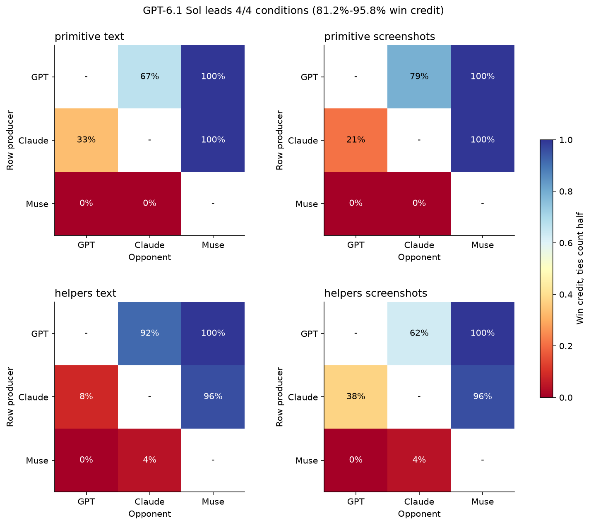
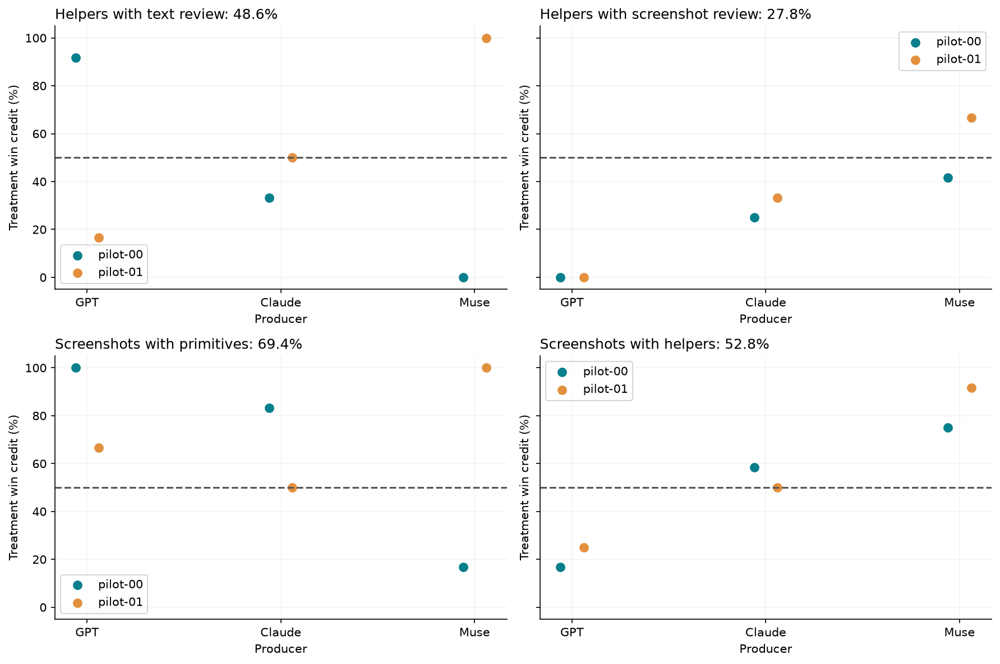
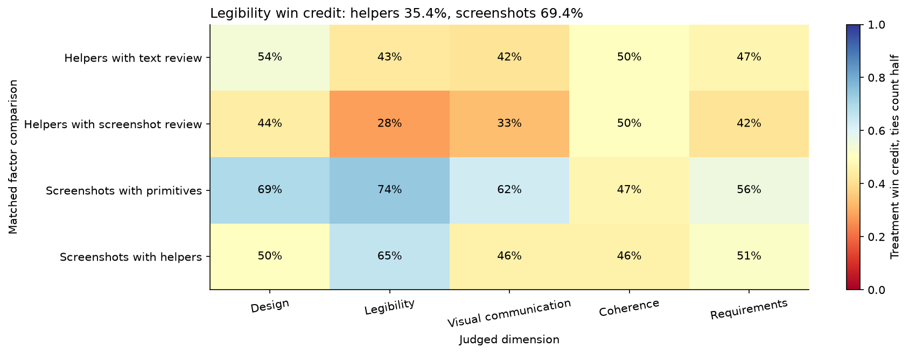
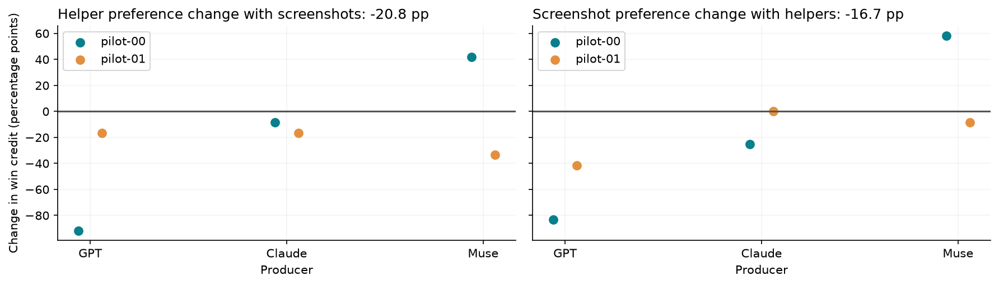
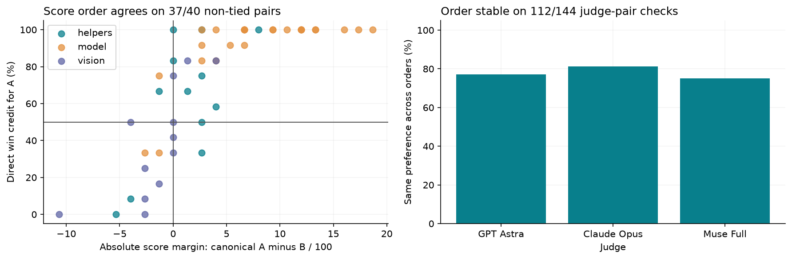
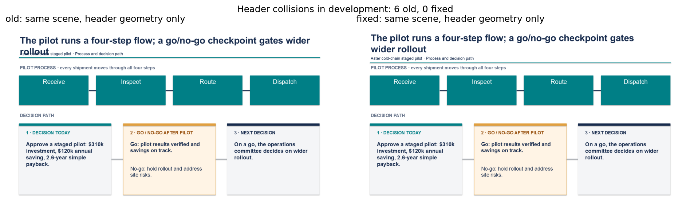
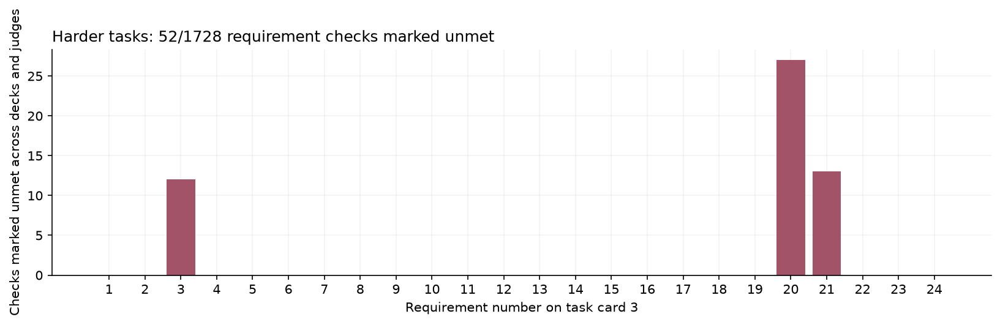
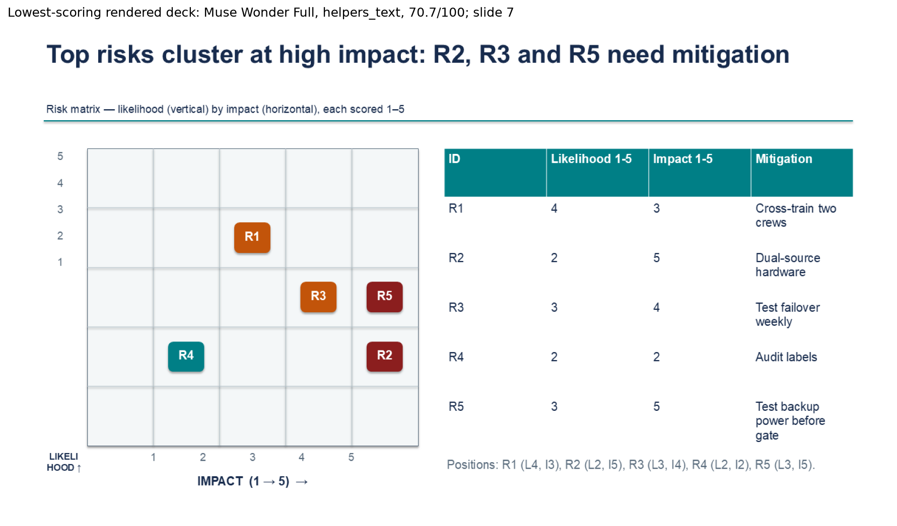
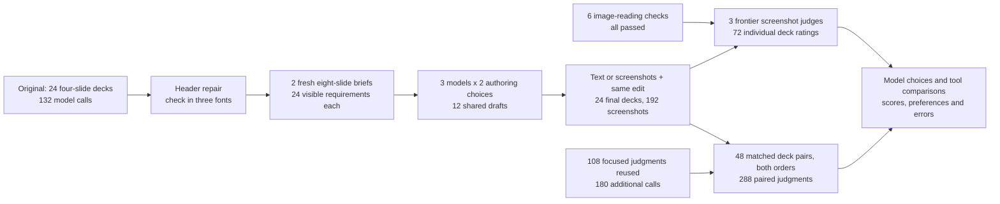

# 19. PowerPoint harnesses and screenshot judges

Preparing a presentation means shaping ideas and numbers into something an audience can follow. In a project review, the slides might compare a few options and explain the figures behind a recommendation. When the plan changes, keeping those figures and the timeline consistent helps the discussion stay clear.

Language models can help draft these slides, but it is less clear which tools help them produce better decks. This experiment looks at reusable layout helpers and the ability to review screenshots. It also asks how best to compare the results: a 9/10 rating can be hard to interpret across decks of different lengths and complexity. Alongside individual scores, model judges compare complete decks made for the same brief.

## Question

Which model and set of authoring tools should we try for a presentation with charts, financial tables and a delivery plan? We compare three models using four tool setups on two newly written project briefs, producing 24 editable eight-slide decks.

## Result

GPT-6.1 Sol led the model comparisons in all four setups. Giving a model screenshots to review earned 61.1% win credit against text review. Adding layout helpers earned 38.2% against basic drawing tools.

**Win credit** counts a win as 1, a tie as 0.5 and a loss as 0, then averages the results. A result above 50% favors the option being tested. It measures how often judges prefer a deck, not how much better the deck is.

For similar decks, these results suggest trying GPT-6.1 Sol with basic drawing tools and screenshot review first. That is a starting point from this pilot: all 24 decks come from just two related briefs, with one generated deck per model and setup on each brief.

## What the four setups mean

A harness is the tools and instructions a model uses to create and revise a deck. This experiment changes two parts of that harness: how the model places content, and what it can see when reviewing its draft.

- Primitives are basic drawing tools for text, shapes, lines, charts and tables. The model chooses where they go.
- Helpers add optional shortcuts for headers, key-number cards, process flows and columns. They use the same drawing tools underneath.
- Text review gives the model its draft's written specification, including content and layout, plus a change request.
- Screenshot review gives it that same material and images of its actual draft slides.

Combining the two authoring choices with the two review choices gives the four columns below. All setups produce editable PowerPoint objects. The text and screenshot versions start from the same draft and get the same requested changes.

## Choosing a model

GPT-6.1 Sol is the strongest candidate in this test. Each column compares models using the same tools on the same briefs. For example, its 89.6% under primitives plus screenshots is its average win credit against Claude and Muse in that setup.

| Model making the deck | Primitives + text | Primitives + screenshots | Helpers + text | Helpers + screenshots |
|---|---:|---:|---:|---:|
| GPT-6.1 Sol | 83.3% | 89.6% | 95.8% | 81.2% |
| Claude Opus 5.5 | 66.7% | 60.4% | 52.1% | 66.7% |
| Muse Wonder Full | 0.0% | 0.0% | 2.1% | 2.1% |


Claude generally beat Muse but lost more often to GPT. Muse received little preference credit in this particular authoring interface. All 24 final decks rendered successfully, so these differences concern judged quality rather than whether PowerPoint could render a file.

Read this table down a column when choosing a model. GPT's 95.8% with helpers plus text does not establish that this is its best tool setup: its opponents' decks also change between columns. The next section compares tools while keeping the model fixed.



Each table cell covers four deck pairs: two opponents on two briefs. Every pair is judged in both orders. We average the two orders within each judge, then weight judges and briefs equally.

To check whether judges favor their own vendor, we also exclude judges from the two vendors whose decks are being compared. Averaged across all four setups, that leaves GPT at 82.8%, Claude at 65.6% and Muse at 1.6%. The ordering remains, but this check has only one judge vendor per matchup. It is a useful check on the result, with limited evidence for a general ranking.

## Choosing a harness

Screenshot review looks most useful when paired with primitives. It earned 69.4% win credit against text review in that setting. With helpers, the result was much closer to even at 52.8%.

These comparisons change one tool choice at a time for the same model and brief. Each row averages six deck pairs: three models on two briefs.

| Change being tested | Other choice kept the same | Win credit for the change |
|---|---|---:|
| Add helpers to primitives | Text review | 48.6% |
| Add helpers to primitives | Screenshot review | 27.8% |
| Add screenshots to text review | Primitives | 69.4% |
| Add screenshots to text review | Helpers | 52.8% |

Helpers were close to even under text review and lost more often under screenshot review. The header repair fixed the observed title collision, but the helper bundle still did not earn a place as the default in this pilot. This tests the particular helpers supplied here; it does not show that reusable layouts are generally unhelpful.



The comparisons within GPT support trying primitives plus screenshots first: on these two briefs, that setup earned 83.3% credit against GPT's primitives plus text, and 100% against GPT's helpers plus screenshots. We did not directly compare GPT's primitives plus screenshots with its helpers plus text, so the experiment has not identified a winner among every possible setup for GPT.

The effect also depends on the model. With helpers, screenshot review earned only 20.8% for GPT but 83.3% for Muse. An average across models can hide a poor combination for the model you plan to use. The [per-model comparisons](data/harder/paired_full/factors_by_model.csv) give the full breakdown.

Legibility helps explain what to investigate next. Helpers earned 35.4% credit on this dimension, while screenshot review earned 69.4%. These votes describe what judges preferred; they cannot identify which individual helper caused a problem.



The tools' effects do not simply add up. Helper credit fell from 48.6% with text review to 27.8% with screenshots, a difference of 20.8 percentage points. The figure below shows those changes separately for each model and brief. A percentage point is the difference between two percentages; these values describe changes in preference.



The earlier individual ratings point in the same broad direction: helpers changed the average score by -1.1/100 and screenshots by +1.6/100. The [full comparison table](data/harder/paired_full/factors.csv) includes score changes and results excluding each deck maker's own vendor. With primitives, screenshot review still earned 68.8% under that second judge panel.

## What the scores tell us

Individual scores and direct comparisons usually agreed: the higher-scoring deck also won the head-to-head comparison in 37 of 40 pairs without a tie on either measure. Three pairs disagreed, and eight more were tied on at least one measure. GPT's mean individual score was 87.5/100, but the paired results give that number context by showing which alternatives judges preferred.

Judges also returned different preferences between the two presentation orders on 32 of 144 judge-pair checks. That can reflect both sensitivity to order and ordinary variation between responses; this study cannot separate them. Keeping both orders helps avoid relying on a single presentation of the decks. Across all 288 decisions, judges chose a tie 51 times.

For the next study, keep individual scores to describe a deck's strengths and weaknesses, and keep head-to-head comparisons to support choices between alternatives. These results do not turn a 9/10 score into a universal measure across different topics or deck lengths.



## Look at the decks

The suggested starting setup is available as a [GPT primitives-plus-screenshots deck](data/harder/artifacts/3ac382cc672b488c/deck.pptx) and a [slide preview](data/harder/artifacts/3ac382cc672b488c/contact.png). The examples below use that same first brief, so you can inspect the different models' output on the same content. Experimental defects have been left in place.

| Model making the deck | Primitives + text | Helpers + screenshots |
|---|---|---|
| GPT-6.1 Sol | [PPTX](data/harder/artifacts/180b0686bfd85db8/deck.pptx), [preview](data/harder/artifacts/180b0686bfd85db8/contact.png) | [PPTX](data/harder/artifacts/beba013335974f93/deck.pptx), [preview](data/harder/artifacts/beba013335974f93/contact.png) |
| Claude Opus 5.5 | [PPTX](data/harder/artifacts/494bc96620387047/deck.pptx), [preview](data/harder/artifacts/494bc96620387047/contact.png) | [PPTX](data/harder/artifacts/2555ca16c56d227b/deck.pptx), [preview](data/harder/artifacts/2555ca16c56d227b/contact.png) |
| Muse Wonder Full | [PPTX](data/harder/artifacts/a2298a70bdc31a0c/deck.pptx), [preview](data/harder/artifacts/a2298a70bdc31a0c/contact.png) | [PPTX](data/harder/artifacts/005b8e576ac75c08/deck.pptx), [preview](data/harder/artifacts/005b8e576ac75c08/contact.png) |

Notebook section 15 also shows the pair with the largest score difference where the direct comparison went the other way. It includes both roadmap slides and the judges' exact reasons, chosen by a fixed rule rather than by how persuasive the example looks.

## Why we made the tasks harder

The first pilot used four-slide decks. Judges marked all 864 factual checks as passed, which left little room to tell whether the tools helped preserve facts. We also found a title wrapping into its subtitle. The revised [header helper](harness.py) measures the text and reserves separate space for each line. Collisions fell from 6 to 0 across 12 development headers in three fonts.

This checks that the repair addresses the known layout problem. Whether the resulting decks are better is a separate question, answered by the model judges.



The harder task asks for eight slides, including financial comparisons, charts, a two-lane delivery plan and a risk matrix. A later change request updates the selected option and its calculations, a monthly result, project timing and a risk. Those edits must reach the right slides while the other facts stay intact. The 24 final decks contain 48 editable charts and 108 editable tables.

Judges marked 52 of 1,728 requirement checks as unmet on these longer decks. Those are individual judge responses, so several can refer to the same deck error. These failures give us concrete examples of where edits and fact preservation need more work.



The example below is the lowest-scoring deck, showing the slide judges most often picked as its weakest. Notebook section 13 includes their reasons and the checklist disagreements.



## How the study works

Each model makes a draft using either primitives or helpers. That draft then takes two separate revision paths, one with text review and one with screenshots. Both paths receive the same change request. This creates 24 final decks from 12 drafts.



GPT-6.1 Sol, Claude Opus 5.5 and Muse Wonder Full make the decks. They return structured descriptions of the slides; the [harness](harness.py) turns those descriptions into editable PowerPoint objects. PowerPoint itself produces the screenshots, so the judges see the rendered output.

The judges are GPT-6 Astra, Claude Opus 5.5 and Muse Wonder Full. They see only slide screenshots and images of the task requirements. They do not receive the deck maker's name, source files, extracted slide text or earlier ratings. Each deck gets a score for design, legibility, visual communication, coherence and meeting requirements. The five scores have equal weight and are converted to a total out of 100.

In a head-to-head comparison, each judge chooses deck A, deck B or a tie, and gives reasons. The study has 24 pairs comparing models, 12 comparing helpers and 12 comparing screenshot review. Every pair uses the same brief. Three judges seeing each of the 48 pairs in both orders gives 288 judgments.

All six preliminary image checks passed: judges could read an image-only code and preferred clean text over a damaged version with overlapping, low-contrast text. These checks establish basic image use; they do not establish agreement with a human audience.

## How far to take the recommendation

The recommendation to try GPT with primitives and screenshots applies to decks like these. The two briefs share a structure, and each model gets only one attempt at each draft and revision. More judge votes give us more views of those decks, but they do not create more independent tasks.

The tasks also have narrow financial coverage: annual savings are fixed by the template, and both briefs drew the same selected investment. Monthly and site values differ. GPT assistance wrote the templates and data-generation code, which can introduce author preferences. Helpers are optional, so the experiment tests access to them rather than forcing the same layout on every model.

Before collecting the harder pilot, we set a rule for expanding a feature into a larger study. It required at least 90% valid decks, better scores on both briefs under both judge panels, no loss on requirement checks, and tasks hard enough to produce some checklist failures. Neither helpers nor screenshots met every part of that rule. The later head-to-head results help choose what to try next, but do not replace that earlier rule after seeing the outcomes.

The next step is to test distinct presentation structures and repeated generations, and to examine the helper components separately. This pilot does not cover photographs, animations, imported templates or unrestricted authoring code. It also cannot isolate the quality effect of the header repair, because the tasks became harder at the same time.

## Spend and saved evidence

Models were called through their command-line programs (CLIs): `codex exec`, `claude -p` and `muse exec`. Claude reports a list-price equivalent, which is not the same as an incremental subscription charge. The other CLIs do not expose dollar costs.

| Work covered | Model-call attempts | Known Claude list-price equivalent |
|---|---:|---:|
| Additional comparisons completing the full paired study | 180 | $19.66 |
| Entire harder pilot, including those comparisons | 403 | $42.97 |
| Both pilots combined | 535 | $48.65 |

These rows include earlier work, so they should not be added together. Dollar costs for 269 attempts in the harder pilot are unknown. The known amounts therefore do not give the total bill.

The [notebook](19_powerpoint_harness.ipynb) contains the analysis, and [harness.py](harness.py) contains the authoring and collection code. Requests, model responses, decks and screenshots are saved under `data/`; the full paired extension is in `data/harder/paired_full/`. File hashes let the replay check that its evidence has not changed. The synthetic inputs are MIT licensed, with creation dates and model date sources recorded in each pilot's `date_provenance.json`.

## How to run

To read and reproduce the results, run these commands from this notebook's folder. They use saved responses, verify the evidence files and regenerate the analysis without calling models or requiring PowerPoint:

```bash
python -m pip install -r requirements.txt
python -m nbconvert --to notebook --execute --inplace 19_powerpoint_harness.ipynb
```

Collecting new decks needs Windows, PowerPoint and authenticated CLIs. Notebook section 17 gives the commands. The size controls are `--n-briefs`, `MODELS`, `JUDGES`, `--pair-scope` and `--max-calls`. Raising the brief count changes numerical inputs but does not create new presentation structures.

<details>
<summary>Extending a focused run and checking the collection details</summary>

To extend an existing focused run, make a separate copy with the current collector and earlier evidence, omitting the frozen `data/harder/paired_full/` subfolder, then run:

```bash
python harness.py paired-expand --profile harder --max-calls 430
python harness.py paired-collect --profile harder --pair-scope full --live --max-calls 430
python harness.py paired-manifest --profile harder
```

The full comparison plan was frozen after the focused results were available. It includes every remaining planned pair, reuses 108 earlier judgments unchanged and adds 180 calls. It adds no new decks. Notebook section 14 retains the focused results, and section 15 reports the full comparison. A new design needs its own report; the committed notebook checks this specific complete study.

The harder study has a cap of 430 attempts. Its 60 additional Claude calls had a $3 per-call cap, or $180 combined. A fresh full run without the earlier storage incident needs 402 attempts. No direct provider HTTP APIs or OpenRouter calls were used, and responses are not automatically retried because of their content.

Each model call runs in a separate empty directory with tools disabled and medium effort, with at most three calls running at once. Each generation has a 75,000-character output cap. PowerPoint exports slides at 1440 by 810 pixels. Judges receive three task-card images and eight slide images per deck.

One Muse rating had 25 identical true checklist entries instead of 24. Offline parsing removes one excess entry; every possible deletion gives the same answer vector. The raw response and all five quality scores are preserved. One earlier GPT paired response was lost during a disk-full cache write, then its identical request was repeated once. The incident and request are recorded. The extension adds free-space checks and retries local writes without another model call. After collection, the active writer was changed to use unbuffered writes and handle short writes; local tests checked that change while retaining the frozen collector.

The header repair uses 24-27 point titles and 10-12 point subtitles in separate bands, with body content starting at y=1.7 inches. Headers that do not fit fail explicitly. All 156 fitted header text objects stayed clear of the next band, although 34 titles extend 0.72 points below their nominal text boxes. These outputs are preserved. On 18 original primitive decks, expanded scenes, slide and chart XML, and embedded workbook content matched the old compiler; ZIP timestamps were excluded. The other three helpers stayed unchanged.

The original four-slide pilot remains in notebook sections 1-10 and its own evidence files: 24/24 decks rendered, GPT averaged 94.5/100, helpers changed scores by -2.9 and screenshots by +0.2. The harder pilot and full paired extension each have separate manifests, lists of saved file hashes, so all three sets of evidence can be checked independently.

</details>

## Research and further reading

Links checked on 2026-10-21. The research log, exact prompts and source snapshots are retained with the evidence. Notebook section 18 lists the follow-up experiments.

- [PPTAgent](https://arxiv.org/abs/2501.03936) motivates separate content, design and coherence outcomes.
- [DECKBench](https://arxiv.org/abs/2602.13318) motivates generation followed by editing and preservation checks.
- [PresentBench](https://presentbench.github.io/) motivates a task-specific visible checklist.
- [Judging LLM-as-a-judge](https://arxiv.org/abs/2306.05685) motivates multiple judges, vendor exclusion and swapped presentation order.
- [Text fitting analysis](https://python-pptx.readthedocs.io/en/latest/dev/analysis/txt-fit-text.html) explains why actual font metrics matter.
- [PowerPoint Slide.Export](https://learn.microsoft.com/en-us/office/vba/api/powerpoint.slide.export) documents the common renderer.
