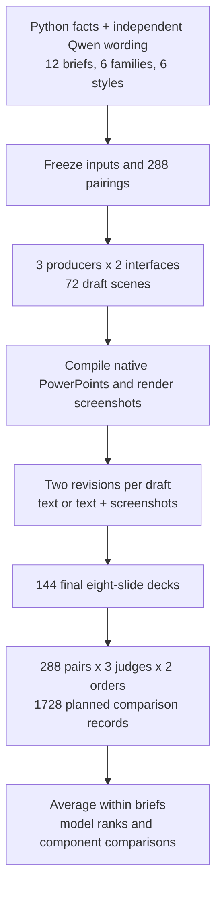

# 20. Slide generation across deck types and styles

A board presentation helps people choose an investment. A training deck teaches someone how to do a task. An incident review explains what happened and what is still uncertain. Each uses slides, but the useful presentation looks different for each audience.

Slide generation combines content decisions with visual ones. A model has to preserve facts, choose charts, place editable objects, fit text and revise the deck when the source changes. Seeing a rendered draft may help it find mistakes. Layout helpers may save work, but a fixed layout can also fit some themes poorly.

This follow-up compares three producers across 12 fresh eight-slide briefs, six deck families and six balanced styles. It keeps all four conditions from notebook 19: primitives or optional helpers, each with text review or screenshot review. Three frontier judges compare complete decks using screenshots alone, in both presentation orders.

## Collection status

Collection is incomplete. The disk-space guard stopped new calls when less than 1 GiB remained on C:. All 72 draft responses and 111 of 144 revision responses are cached, including one Muse revision that reached the fixed time limit. No paired judging has run yet. These counts are progress, not quality results.

The saved requests and image hashes have been checked. After storage is available, the collector resumes missing requests from the same frozen protocol. Completed responses, including failures, are not repeated. The analysis notebook is prepared but has not been executed because the final decks and judge panel are incomplete.

## The comparison

The families are board decisions, research summaries, training lessons, product launches, incident reviews and community campaigns. Each has two numerical variants. Six styles rotate across families, each appearing twice. This gives a broader test of model and harness rankings, but it does not isolate style effects on identical content.

| Condition | Authoring interface | Revision input |
| --- | --- | --- |
| Primitives + text | Text, rectangles, lines, native charts and tables | Draft scene and changed facts |
| Primitives + screenshots | Same primitives | Same material plus eight draft images |
| Helpers + text | Primitives plus optional header, KPI, flow and column helpers | Draft scene and changed facts |
| Helpers + screenshots | Same optional helpers | Same material plus eight draft images |

One draft per producer, interface and brief gives 72 drafts. Each draft branches into two independent revisions. The resulting 144 final decks enter 288 matched comparisons: model pairs within a condition, helper comparisons holding review mode fixed, and screenshot comparisons holding the interface fixed.



Producers are GPT 6.1 Sol, Claude Opus 5.5 and Muse Wonder. Judges are GPT 6 Astra, Claude Opus 5.5 and Muse Wonder. OpenAI, Anthropic and Meta models are called only through their CLIs. Each judge receives images of the task and both decks, with no source JSON, producer identities or earlier scores.

Win credit assigns 1 to a win, 0.5 to a tie and 0 to a loss. The analysis averages both orders, judges and briefs. Delivery failures are recorded separately: a failed deck loses to a delivered deck, and two failures tie. A separate comparison uses only pairs where both decks rendered. An incomplete judge panel remains missing and prevents a complete-study claim.

## Resume and replay

The frozen inputs, raw responses, editable decks and screenshots are in `data/`. The notebook defines its own offline analysis. The live collector is `harness.py`, with explicit call caps and model settings at the top.

Once at least 3 GiB is free on C:, resume from this folder:

```powershell
python harness.py run --live
```

After collection finishes, refresh the evidence manifest and execute the notebook:

```powershell
python harness.py manifest
jupyter nbconvert --to notebook --execute --inplace --ExecutePreprocessor.timeout=600 20_powerpoint_generalization.ipynb
```

The notebook replay makes no model calls. Live collection requires Windows, Microsoft PowerPoint and authenticated model CLIs. Independent fixture authoring used Qwen through OpenRouter; its 11 development calls cost $0.0893. Claude reports $22.95 in list-price equivalent so far. GPT and Muse dollar costs are unavailable, so these figures are partial accounting.

The final report will compare the broader run with notebook 19, show side-by-side slides and explain which model and harness choices the evidence supports. Until judging finishes, it cannot establish whether the earlier rankings hold.
