# Synthetic data needs an answer key and a reason to keep each row

An operations analyst receives a message thread saying an order changed twice. One reply quotes an old price, another cancels the order, and a later message confirms the SKU. A useful dataset row must describe the final order and point to the messages that support each field. A fluent-looking row can still be wrong if it uses an outdated value or cites a sentence that merely repeats the obsolete value.

For example, suppose a thread says “Order O-481 is 4 cases of part AX-7,” then defines each case as 12 units. The quantity in individual units is 48, and both messages support it. A row that says 48 but cites only the first message has the right value and incomplete evidence. That distinction matters when generated examples will be reviewed, used to test extraction software, or considered for a later training project.

Synthetic data means records made for an experiment rather than copied from real people or businesses. It can provide exact answers, but generation alone does not make it useful. A curation pipeline must check values, evidence, variety, duplicates, difficult cases, and whether a suggested repair actually fixed the failure. This experiment studies that pipeline on newly authored fictional order threads.

Recursive self-improvement (RSI) research often studies loops in which systems propose tasks, produce solutions, check them, and use observed weaknesses to guide later data collection ([Shi et al., 2026](https://arxiv.org/abs/2605.14392); [Zhao et al., 2025](https://arxiv.org/abs/2505.03335)). Here, the models’ weights stay fixed. The experiment tests the data pipeline around that loop: generating exact-answer tasks, checking answers and evidence, removing semantic duplicates, attempting bounded repairs, and adapting which cases are sampled. It does not train a model or test recursive self-improvement.

## Experiment summary

The first protocol contains 180 collection slots and 20 layout-audit cases. In collection, GPT-6 Luna passed 303/360 responses and GPT-6.1 Sol passed 360/360; on the audit they passed 18/20 and 20/20. The score requires valid schema, seven exact values, and sufficient citations. The cases use a small set of explicit rules, and repeated responses to one case are correlated. A separate post-hoc status-evidence sensitivity review accepts 310/360 Luna and 360/360 Sol collection responses; the frozen strict counts remain the primary result.

A separate eight-case interface pilot produced 32 original responses. 32/32 had all seven values correct and 30/32 passed the evidence check too (GPT-6 Luna 14/16 accepted; GPT-6.1 Sol 16/16 accepted). It is saved under `data/pilot/` and is not included in the main totals. Each pilot batch used 19,105–19,799 input tokens and 904 output tokens; the four calls took 10.9–16.6 seconds each. Most input usage is CLI instruction and setup overhead, so these token counts are not the size of the message text alone.


The harder follow-up uses 64 longer procurement packs and 16 layout-audit cases. It asks for the units still to ship and the net unit price after rebates. Sol passes all 128 collection answers. Luna has 127 wrong-value answers and one value-correct answer with insufficient evidence. All 24 selected repairs pass, but add zero newly solved cases because Sol already covers all 64 sources. This exposes a limit of this data-generation method: it produces corrections for Luna without finding an observed Sol error. The documents and task semantics changed, so these results are reported separately from the first protocol.


The Sol-miss follow-up uses a separate generator and protocol. The pilot found 1, 0, 1 Sol value/schema miss cases across its three eight-case levels, never reaching the two-miss threshold; the declared level-three fallback was used. In 48 collection cases, Sol returned all seven values correctly on 45/48 cases and Luna on 0/48. On the separate 12-case audit, Sol passed 12/12 and Luna 0/12. A fresh Sol retry and Sol repair each corrected and passed all three selected Sol misses; Luna cross-repair passed 0/3. Both Sol arms recover the same three cases, and neither establishes a training gain. Its responses and scores remain separate from v1 and hard-v2.

## Contents

- [1. Task and question](#1-task-and-question)
- [2. Setup](#2-setup)
- [3. Fresh data](#3-fresh-data)
- [4. Candidate collection](#4-candidate-collection)
- [5. Verification and curation](#5-verification-and-curation)
- [6. Corrections](#6-corrections)
- [7. Failure-guided sampling](#7-failure-guided-sampling)
- [8. Audit and error analysis](#8-audit-and-error-analysis)
- [9. Limitations](#9-limitations)
- [10. Reproduction and cost](#10-reproduction-and-cost)
- [11. Harder realistic follow-up](#11-harder-realistic-follow-up)
- [12. Testing whether a model can recover its own extraction misses](#12-testing-whether-a-model-can-recover-its-own-extraction-misses)
- [13. Future work and further reading](#13-future-work-and-further-reading)

```mermaid
flowchart LR
    source["Seeded fictional order events<br/>180 collection slots"] --> render["Deterministic message renderers<br/>threads, IDs, hashes, exact answer keys"]
    render --> select["Shared, fixed, adaptive samples<br/>duplicates tracked by semantic hash"]
    select --> sol["GPT-6.1 Sol<br/>codex exec, 380 original rows"]
    select --> luna["GPT-6 Luna<br/>codex exec, 380 original rows"]
    audit --> sol
    audit --> luna
    sol --> verifier["Per-case verifier<br/>case ID, values, evidence"]
    luna --> verifier
    verifier -->|"original collection failures only"| repair["36 repair items + re-verification<br/>maximum 40; original output + field feedback"]
    verifier -->|"accepted collection answers + natural comparisons"| exports
    verifier -->|"prior shared/adaptive labels; next round"| select
    repair --> exports["Deduplicated accepted examples<br/>paired preferences, repair records, rejects"]
    audit_seed["Pre-specified audit rule and seed"] --> audit["20 cases generated after collection selection<br/>held-out archive layout, one draw per model"]
    verifier --> results["Metrics, examples, figures, cached responses"]
    exports --> review["Post-collection evidence review<br/>7 status-citation decisions reversed"]
    review --> reviewed["Reviewed exports<br/>162 examples, 28 pairs, 29 repair conversations"]
    reviewed --> results
    hard_events["Hard follow-up: fresh structured events<br/>32 shared, then 16 fixed + 16 adaptive cases"] --> hard_docs["Long procurement packs<br/>open balances and discounted unit prices"]
    hard_docs --> hard_models["Sol and Luna through codex exec<br/>256 collection + 32 audit answers"]
    hard_audit["16 cases generated after selection<br/>new layout, one draw per model"] --> hard_models
    hard_models --> hard_verify["Hard verifier<br/>values checked separately from evidence"]
    hard_verify -->|"prior shared value failures; one further round"| hard_events
    hard_verify -->|"24 selected original failures; one attempt each"| hard_repair["Sol repairs Luna outputs<br/>source and failed-field feedback, no gold"]
    hard_verify --> hard_exports["64 accepted cases + 64 value-error pairs<br/>24 repair records; zero newly solved cases"]
    hard_repair --> hard_exports
    hard_exports --> results
    sol_v3_seed["Fresh v3 pilot ladder<br/>24 cases, 48 answers, 24 CLI requests"] --> sol_v3_level["Freeze level 3<br/>declared fallback; threshold not met"]
    sol_v3_level --> sol_v3_original["48 collection + 12 audit cases<br/>Sol and Luna via codex exec; 120 original answers"]
    sol_v3_original --> sol_v3_select["Verifier selects 3 Sol collection misses<br/>audit excluded; cap 24 unused"]
    sol_v3_select --> sol_v3_arms["Blind Sol retry, Sol repair, Luna repair<br/>9 answers in 6 paired CLI requests"]
    sol_v3_arms --> sol_v3_results["Re-verify values and evidence<br/>paired recoveries, new cases, token use"]
    sol_v3_results -. "new protocol; separate cache" .-> results
```

The first branch uses batches of at most ten cases. The harder branch uses batches of four and keeps its sources and responses in a separate cache. Its fixed and adaptive arms receive equal original-answer budgets. The third branch uses two-case batches, selects three Sol collection misses after scoring the originals, and leaves the twelve audit cases out of repair. Counts label source cases, response rows or repair items explicitly. For one example, the generator creates a structured order and its exact final answer, renders the events into a message thread, and sends only the task instructions and thread to a model. The verifier compares the returned fields and cited message IDs with the source events. A failed candidate may be sent to the other model with the original output and field-level reasons. That adds supervision from the verifier, though the repair request never includes the answer key.

## 1. Task and question

The practical problem is to make synthetic extraction examples that are both correct and inspectable. A plain label such as “correct” hides two different checks. First, the extracted order fields must match the final state. Second, each field must cite enough source messages to support that value. A wrong answer can teach the wrong rule; a correct answer with a weak citation can conceal a guess.

The experiment compares GPT-6.1 Sol with GPT-6 Luna through `codex exec`. Each gets the same newly generated cases and exact task instructions. Collection cases receive two separate draws per model. These are repeated calls, not independent samples, because the same model and case are reused. A separate set of cases uses a held-out archive-export layout, and each model gets one draw on each audit case. The question is how often each model returns a schema-valid answer with every field and every field citation accepted, and whether repairs or failure-guided sampling change the number and mix of usable examples.

The main result below reports the measured collection and audit counts. The collection score is a response-level rate: accepted responses divided by attempted original responses. Responses to the same case share its wording and are not independent, so the sample size is not the number of model replies. The audit is a small descriptive check on a changed document layout, not proof of performance on new companies or order systems.

The table separates collection from the sealed layout audit. “All fields exact” checks the seven values and ignores citations; “accepted” also requires valid schema and sufficient citations for every field. Each denominator is the original response count for that model and split. The interval uses one first-draw response per distinct collection case and the Wilson binomial formula. It is descriptive: cases in the same CLI batch share prompt overhead and the source templates create dependence.

| Model | Collection: accepted | All fields exact | First draw exact, descriptive 95% interval | Audit: accepted | Audit: all fields exact |
|---|---:|---:|---:|---:|---:|
| GPT-6 Luna | 303/360 (84.2%) | 360/360 (100.0%) | 162/162 [97.7%, 100.0%] | 18/20 (90.0%) | 20/20 (100.0%) |
| GPT-6.1 Sol | 360/360 (100.0%) | 360/360 (100.0%) | 162/162 [97.7%, 100.0%] | 20/20 (100.0%) | 20/20 (100.0%) |

The verifier accepted 663/720 original collection responses (92.1%) after checking all seven values and their citations. GPT-6.1 Sol accepted 360/360 and GPT-6 Luna accepted 303/360; Sol's observed acceptance rate was 15.8 points higher in this fixed sample. On the 20-case layout audit, Sol accepted 20/20 and Luna accepted 18/20. These are descriptive counts from the cases and prompt batches in this run. The full workflow and the limits of this sample are explained below.

## 2. Setup

The hard-v2 live smoke-size knob is `N_HARD_LIVE_CASES = 8`. Sol-v3 also shows `SOL_V3_LIVE = False` and `N_SOL_LIVE_CASES = 8`; its optional eight-case demonstration writes to `data/tmp/sol_v3_live_demo` and leaves saved results in place.

The notebook uses Python to generate cases, call the two installed Codex models through their CLI, validate output, and save the results. It imports no project helper at run time: fixture generation, transport, scoring, and plotting are embedded below as code cells. The normal run is offline and reads cached replies. A cache miss stops the notebook; setting `NB_LIVE=1` explicitly permits a new Codex call.

Each request names the model, stage, prompt, case documents, sample number, protocol version, reasoning setting, and runner limits. The full request is hashed and stored with raw CLI output, parsed JSON, usage, elapsed time, and errors. The call runner uses an empty temporary folder and a read-only sandbox, with shell, apps, plugins, browser, and subagents disabled. Prompts contain only the task instructions and selected case documents; observed tool events are checked in the saved attempts.

The two model IDs are service aliases, not immutable dated snapshots. The saved usage and model metadata describe what the CLI reported for this run. OpenAI lists knowledge cutoffs of April 30, 2026 for GPT-6.1 Sol and May 18, 2026 for GPT-6 Luna. The generated source records are dated October 24, 2026, after both cutoffs. The comparison is about this frozen extraction protocol; it does not claim a general ranking of the models.

## 3. Fresh data

The source records are programmatic fictional orders, not real customer data and not examples written by either model. A seeded generator chooses facts such as order numbers, SKUs, quantities, prices, dates, amendments, and cancellation states. A deterministic renderer turns those events into message threads with explicit revision numbers; timestamps and display order do not decide which amendment wins. The exact answer is derived from the structured events before the model sees the rendered text.

The full protocol has 180 collection slots: 60 shared cases, then 30 fixed and 30 adaptive cases in each of two rounds. It also has 20 sealed audit cases. Ten percent of collection slots are replaced with differently formatted siblings; those siblings retain a link to their source and a shared semantic hash. The resulting 200 slots represent 182 distinct source records when all replacement rules are applied. Deduplication is measured by semantic meaning, not by text alone.

The eight case families cover a direct order, chronological amendments, an obsolete value inside a quote, conflicting updates, cancellation, distractor orders, conversion from cases to units, and conditional requests followed by partial amendments. The audit rule and seed were specified in advance, but its cases were generated after collection selection. The audit changes the archive-export layout while keeping message wording rules the same. It uses the same semantic families, so it tests a format shift rather than new business rules.

All source cases are generated for this run on October 24, 2026. There is no historical data filter because no historical examples are used. The stored [`provenance.json`](data/provenance.json) records the date, model cutoff sources, model alias limitation, and rights note. Generated model responses are service outputs. Their presence here does not grant permission for unrestricted downstream training use.

The worked examples in section 5 begin with a direct order (`case-02bb329d435cda91b3db`). Each stable case ID connects its document, answer key, candidate outputs and verifier record. The notebook's data display also prints the first collected thread, an amendment case (`case-d21ea1f31fe9e00804b7`).

## 4. Candidate collection

Each collection case is sent to each model twice. The shared first round establishes a common starting point. Later rounds compare a fixed sample, which preserves the balanced family mix, with an adaptive sample that gives more slots to families where prior shared or adaptive candidates failed. Both arms keep a slot for every family. The adaptive weights use original candidate failures only; fixed-arm results, audit results, and repairs do not affect selection.

The candidate request contains the common task instructions plus the selected case ID and rendered document. It does not contain the family label, gold fields, evidence answer, split label, or semantic hash. Keeping those evaluator fields out prevents the model from receiving the answer through metadata. A batch can contain up to ten cases; separate calls for models, samples, and batches can run concurrently. Within one batch the model returns several results in one response, so item outcomes in that response share the same prompt and transport event.

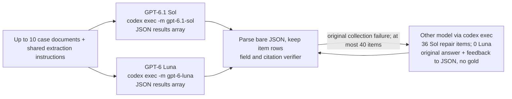

The two original model calls for a batch can run at the same time; repair waits until a candidate has been checked. The 4-worker cap applies to independent CLI requests. The repair edge loops back through the same verifier and does not modify the original answer record or the sampling history.

The exact instruction sent with each case is shown here. The following document data is the only case-specific input; evaluator labels and answers are omitted.

<details><summary>Exact shared task instructions</summary>

```text
Extract the final state of the TARGET ORDER from the message thread.
Return one JSON object with exactly these keys: case_id, answer, evidence.
case_id must equal the supplied case ID. answer must contain exactly order_id,
sku, quantity_units, unit_price_cents, currency, ship_date, status. order_id and
sku are strings; quantity_units and unit_price_cents are integers or null;
currency is a three-letter code or null; ship_date is YYYY-MM-DD or null;
status is active, cancelled, or ambiguous. Never put a Boolean in an integer field.
Prices are per individual unit, in integer cents. Convert cases to individual
units using the stated packing definition. Do not invent absent information.

Only approved messages for the target order change its state. Higher revision
numbers supersede lower revisions for EACH FIELD separately; display order and
message timestamps do not decide precedence. A partial amendment leaves other
fields unchanged. A conditional request explicitly marked unconfirmed has no
effect. Quoted historical messages and messages for other orders have no effect.
If the highest approved revision for a field has conflicting values, return null
for that field and ambiguous status. Equal values at the same revision agree.
A cancellation overrides all commercial fields: quantity_units, unit_price_cents,
currency and ship_date become null; order_id and sku remain known, status is cancelled.
An explicitly withdrawn shipping date is null but does not itself make status ambiguous.

evidence must have exactly the same seven field names, each mapped to a nonempty
list of distinct message IDs. Cite messages that establish that field's current
value. Any equally sufficient current source is accepted.
Earlier same-valued assignments remain valid only if no equal-or-higher revision
supplies a different value for that field. An old value that was changed and
later restored needs evidence from the restoration, not the old assignment.
For a conflict cite the contradictory highest-revision messages; for a conversion
cite the quantity
message AND the packing definition. Cite the cancellation for cleared fields and
cancelled status. For ambiguous status cite a complete conflicting pair. Extra
citations are allowed only when they also support the same current field, or are
necessary conversion context. Stale, quoted, unrelated, or nonexistent citations
are rejected. Do not add explanations or any extra keys to the JSON object.
```

</details>

The live subprocess removes the final stdin marker from the option list, then builds its argument vector as `[codex_executable, *CLI_OPTIONS[:-1], '-m', model_id, '-']`; the final `-` passes the request prompt on standard input. The exact frozen `CLI_OPTIONS` prefix is:

```json
[
  "exec",
  "--skip-git-repo-check",
  "--ephemeral",
  "--ignore-user-config",
  "--ignore-rules",
  "--sandbox",
  "read-only",
  "--disable",
  "shell_tool",
  "--disable",
  "unified_exec",
  "--disable",
  "apps",
  "--disable",
  "plugins",
  "--disable",
  "multi_agent",
  "--disable",
  "browser_use",
  "--disable",
  "computer_use",
  "--disable",
  "image_generation",
  "--disable",
  "code_mode",
  "--disable",
  "code_mode_host",
  "--disable",
  "shell_snapshot",
  "-c",
  "model_reasoning_effort=\"low\"",
  "--json"
]
```

The output is one JSON object with a `results` array. Each row carries a case ID, seven answer fields, and one list of cited message IDs per field. A quantity, unit price, currency, or ship date may be `null` when the task requires it, including cancellation, missing values, or ambiguity; all other values still need the required type. The notebook keeps the raw response before parsing it. A malformed item does not erase its parseable neighbors, but it fails that item's answer check.

## 5. Verification and curation

The verifier performs three separate checks. Schema validity asks whether the answer has the exact field names and types. Exact-field accuracy asks whether all seven values equal the final structured order state. Evidence acceptance asks whether every field cites a sufficient set of source messages and contains no unsupported or irrelevant citations. A response is accepted only if all three checks pass.

For example, if a message changes quantity from 4 cases to 5 cases and another says one case contains 12 individual units, the final unit quantity is 60. The field needs both the latest quantity message and the packing definition. A citation to the earlier quantity is obsolete. The checker allows any sufficient evidence set; it does not require one arbitrarily chosen citation order. This tests agreement with the generated support rules, not whether the renderer's prose sounds natural to a human reader.

Accepted records are deduplicated by semantic hash before export. Separately, naturally occurring good and bad answers to the same case can form a preference pair. No failures are injected to create such pairs. Verification controls are deliberately mutated checker inputs and are reported separately; they are not model responses, training examples, or evidence of model failure.

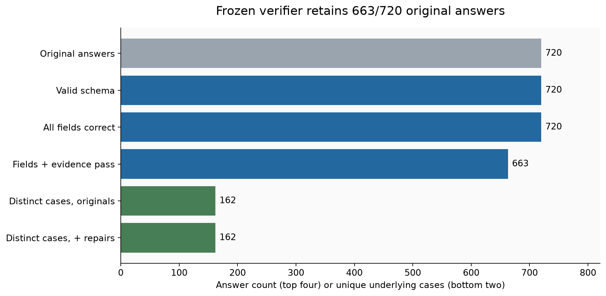

Read from top to bottom as successive filters. The first four bars count responses, while the last two count distinct underlying cases, so the chart changes units at semantic deduplication. The gap between exact fields and accepted responses is where citation failures appear. Accepted exports pass the same verifier by construction; that describes the filter and is not an independent estimate of real-world quality.

All 720 original collection responses had valid schemas (720) and exact values (720); 57 still failed evidence checks. The missing or unsupported citation fields were SKU (50) and status (7). 49 SKU failures were cancellations: the model cited the cancellation message, which says to retain the SKU but does not state its value; the earlier order message supplies that value. Seven strict status-citation rejections are reviewed separately below because an approved partial amendment can support an unchanged field.

The saved run contains 663 accepted original responses and 699 accepted responses when successful repairs are counted. Semantic deduplication keeps 162 accepted cases and removes 537 repeated responses. The exports contain 162 accepted examples, 35 naturally occurring same-case preference pairs, 36 repair conversations, and 57 rejected examples. Preference pairs are emitted only where a natural accepted and rejected candidate share one source case; no synthetic error was inserted to fill the file.

The frozen verifier remains the primary result. A separate, post-collection sensitivity review changes only a narrow status-citation rule; it does not add model calls, change the sampler, or rewrite the strict metrics. The rule requires a literal current message saying the order is active, plus cited approved partial amendments for the same order that explicitly retain unstated fields and support another current field. It excludes cancellations, quotes, conditional or stale messages, conflicts, wrong values, and other evidence failures. The rule was selected after seeing the answers, so this is a sensitivity analysis, not an independent quality estimate.

| Model | Strict accepted | Reviewed accepted | Change |
|---|---:|---:|---:|
| GPT-6 Luna | 303/360 | 310/360 | +7 |
| GPT-6.1 Sol | 360/360 | 360/360 | +0 |

The review changed 7 of 720 collection rows. All seven were GPT-6 Luna status citations in shared round 1. The strict sampler used those original labels, and its later selection history is preserved. For both models combined, collection acceptance changes from 663/720 to 670/720. For Luna specifically, it changes from 303/360 to 310/360; GPT-6.1 Sol remains 360/360.

For `case-cff45be46a031d721591`, GPT-6 Luna returned status `active` and cited `M01, M03`. The strict verifier rejected that status evidence. The cited source text is:

`M01`: [M01] APPROVED order message. Order ORD-939991. Revision 0. SKU WASH-393; ship 16 individual units; unit price 40.94 CAD per individual unit; billing currency CAD; ship on 2026-11-09; order is active.

`M03`: [M03] APPROVED order message. Order ORD-939991. Revision 1. unit price 41.11 CAD per individual unit; shipping date withdrawn; no replacement date is confirmed. Only the fields stated here are amended.

The first citation states the current active status. The later approved amendment says only stated fields change, so it supplies context that status remains active while supporting the changed price/date fields. The review accepts this specific citation set; it does not grant blanket credit to extra citations. This is a code-based post-hoc review, not a human annotation.

Reviewed exports retain only rows that pass this rule. Counts, strict to reviewed: accepted examples 162 to 162 (removed 0); preference pairs 35 to 28 (removed 7); repair conversations 36 to 29 (removed 7); rejected examples 57 to 50 (removed 7). The original files under `data/exports/` remain frozen; the separate files under `data/exports_reviewed/` provide the sensitivity view.

### Example 1: Simple task, `case-02bb329d435cda91b3db`

This is a measured simple case selected by a stated category, not a hand-written failure. Its rendered thread is:

```text
TARGET ORDER: ORD-446561
Case ID: case-02bb329d435cda91b3db
Fictional order thread. Revision numbers determine authority, independently for each field.
[M01] APPROVED order message. Order ORD-446561. Revision 0. SKU SEAL-829; ship 7 individual units; unit price 35.25 USD per individual unit; billing currency USD; ship on 2026-11-01; order is active.

[M02] APPROVED order message. Order ORD-446561. Revision 1. SKU SEAL-829; ship 7 individual units; unit price 35.25 USD per individual unit; billing currency USD; ship on 2026-11-01; order is active. Only the fields stated here are amended.
```

Selected candidate `case-02bb329d435cda91b3db:gpt-6-luna:generate:0` from GPT-6 Luna, sample 0.

Expected answer:

```json
{
  "currency": "USD",
  "order_id": "ORD-446561",
  "quantity_units": 7,
  "ship_date": "2026-11-01",
  "sku": "SEAL-829",
  "status": "active",
  "unit_price_cents": 3525
}
```

Parsed model row:

```json
{
  "case_id": "case-02bb329d435cda91b3db",
  "answer": {
    "currency": "USD",
    "order_id": "ORD-446561",
    "quantity_units": 7,
    "ship_date": "2026-11-01",
    "sku": "SEAL-829",
    "status": "active",
    "unit_price_cents": 3525
  },
  "evidence": {
    "currency": [
      "M02"
    ],
    "order_id": [
      "M02"
    ],
    "quantity_units": [
      "M02"
    ],
    "ship_date": [
      "M02"
    ],
    "sku": [
      "M02"
    ],
    "status": [
      "M02"
    ],
    "unit_price_cents": [
      "M02"
    ]
  }
}
```

Observed fields:

```json
{
  "currency": "USD",
  "order_id": "ORD-446561",
  "quantity_units": 7,
  "ship_date": "2026-11-01",
  "sku": "SEAL-829",
  "status": "active",
  "unit_price_cents": 3525
}
```

This selected row scored 7/7 fields exact; 7/7 fields have sufficient citations; overall it was **accepted**. A response is accepted only when schema, all seven values, and every field's citations pass. Across both models and two draws, this case has 4 original responses; the selected row is identified by candidate ID and the saved JSONL records.

The selected model row is shown as JSON above. Its full batched request and raw CLI reply are preserved in [`data/cache/aa2b270072ef698b3e906c45c660c486bced52838926c386216e363f72e8d79b.json`](data/cache/aa2b270072ef698b3e906c45c660c486bced52838926c386216e363f72e8d79b.json).

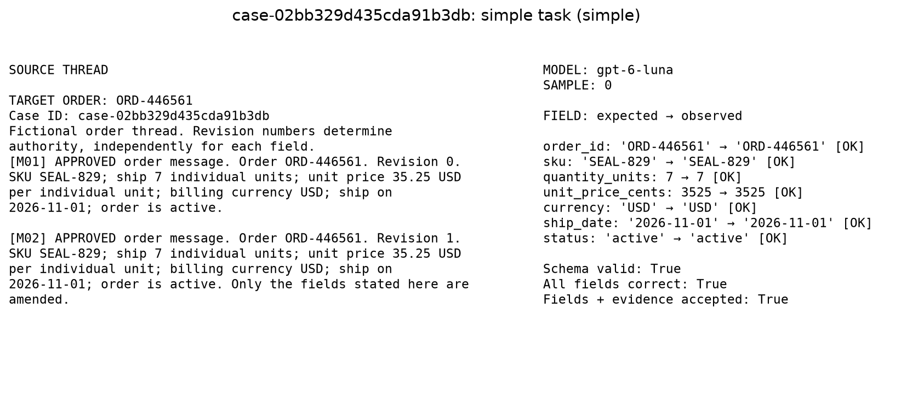

### Example 2: Conversion end-to-end, `case-10ef5f52f2daad6d57ee`

This is a measured case to unit case selected by a stated category, not a hand-written failure. Its rendered thread is:

```text
TARGET ORDER: ORD-451562
Case ID: case-10ef5f52f2daad6d57ee
Fictional order thread. Revision numbers determine authority, independently for each field.
[M01] APPROVED order message. Order ORD-451562. Revision 0. SKU WASH-806; unit price 45.95 EUR per individual unit; billing currency EUR; ship on 2026-10-30; order is active; ship 5 cases (not individual units).

[M02] Packing definition for SKU WASH-806: one case contains exactly 24 individual units.
```

This end-to-end example converts 5 cases into individual units. The order is in `M01` and the packing rule is in `M02`: 5 × 24 = **120 units**. Both message IDs must support the quantity field. The score counts exact field values (7/7) and fields with sufficient citations (7/7); acceptance also requires the required answer shape.

Selected candidate `case-10ef5f52f2daad6d57ee:gpt-6-luna:generate:0` from GPT-6 Luna, sample 0.

Expected answer:

```json
{
  "currency": "EUR",
  "order_id": "ORD-451562",
  "quantity_units": 120,
  "ship_date": "2026-10-30",
  "sku": "WASH-806",
  "status": "active",
  "unit_price_cents": 4595
}
```

Parsed model row:

```json
{
  "case_id": "case-10ef5f52f2daad6d57ee",
  "answer": {
    "currency": "EUR",
    "order_id": "ORD-451562",
    "quantity_units": 120,
    "ship_date": "2026-10-30",
    "sku": "WASH-806",
    "status": "active",
    "unit_price_cents": 4595
  },
  "evidence": {
    "currency": [
      "M01"
    ],
    "order_id": [
      "M01"
    ],
    "quantity_units": [
      "M01",
      "M02"
    ],
    "ship_date": [
      "M01"
    ],
    "sku": [
      "M01"
    ],
    "status": [
      "M01"
    ],
    "unit_price_cents": [
      "M01"
    ]
  }
}
```

Observed fields:

```json
{
  "currency": "EUR",
  "order_id": "ORD-451562",
  "quantity_units": 120,
  "ship_date": "2026-10-30",
  "sku": "WASH-806",
  "status": "active",
  "unit_price_cents": 4595
}
```

This selected row scored 7/7 fields exact; 7/7 fields have sufficient citations; overall it was **accepted**. A response is accepted only when schema, all seven values, and every field's citations pass. Across both models and two draws, this case has 4 original responses; the selected row is identified by candidate ID and the saved JSONL records.

The selected model row is shown as JSON above. Its full batched request and raw CLI reply are preserved in [`data/cache/97ae1a06c704b50ee5428c807d3d5c4298c14dc250062bf11a24ca72106535db.json`](data/cache/97ae1a06c704b50ee5428c807d3d5c4298c14dc250062bf11a24ca72106535db.json).

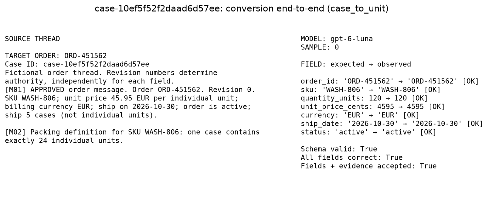

### Example 3: Ordinary success, `case-01e8f866cb3dd07f9ea2`

This is a measured conflicting updates case selected by a stated category, not a hand-written failure. Its rendered thread is:

```text
TARGET ORDER: ORD-456405
Case ID: case-01e8f866cb3dd07f9ea2
Fictional order thread. Revision numbers determine authority, independently for each field.
[M01] APPROVED order message. Order ORD-456405. Revision 0. SKU BOLT-467; ship 13 individual units; unit price 38.75 EUR per individual unit; billing currency EUR; ship on 2026-11-05; order is active.

[M02] APPROVED order message. Order ORD-456405. Revision 1. ship 15 individual units. Only the fields stated here are amended.

[M03] APPROVED order message. Order ORD-456405. Revision 1. ship 17 individual units. Only the fields stated here are amended.
```

Selected candidate `case-01e8f866cb3dd07f9ea2:gpt-6-luna:generate:0` from GPT-6 Luna, sample 0.

Expected answer:

```json
{
  "currency": "EUR",
  "order_id": "ORD-456405",
  "quantity_units": null,
  "ship_date": "2026-11-05",
  "sku": "BOLT-467",
  "status": "ambiguous",
  "unit_price_cents": 3875
}
```

Parsed model row:

```json
{
  "case_id": "case-01e8f866cb3dd07f9ea2",
  "answer": {
    "currency": "EUR",
    "order_id": "ORD-456405",
    "quantity_units": null,
    "ship_date": "2026-11-05",
    "sku": "BOLT-467",
    "status": "ambiguous",
    "unit_price_cents": 3875
  },
  "evidence": {
    "currency": [
      "M01"
    ],
    "order_id": [
      "M01"
    ],
    "quantity_units": [
      "M02",
      "M03"
    ],
    "ship_date": [
      "M01"
    ],
    "sku": [
      "M01"
    ],
    "status": [
      "M02",
      "M03"
    ],
    "unit_price_cents": [
      "M01"
    ]
  }
}
```

Observed fields:

```json
{
  "currency": "EUR",
  "order_id": "ORD-456405",
  "quantity_units": null,
  "ship_date": "2026-11-05",
  "sku": "BOLT-467",
  "status": "ambiguous",
  "unit_price_cents": 3875
}
```

This selected row scored 7/7 fields exact; 7/7 fields have sufficient citations; overall it was **accepted**. A response is accepted only when schema, all seven values, and every field's citations pass. Across both models and two draws, this case has 4 original responses; the selected row is identified by candidate ID and the saved JSONL records.

The selected model row is shown as JSON above. Its full batched request and raw CLI reply are preserved in [`data/cache/a73a6fc4b13a9e3921bce50b0969e7b12020381bf45815f599adeabb2131a08a.json`](data/cache/a73a6fc4b13a9e3921bce50b0969e7b12020381bf45815f599adeabb2131a08a.json).

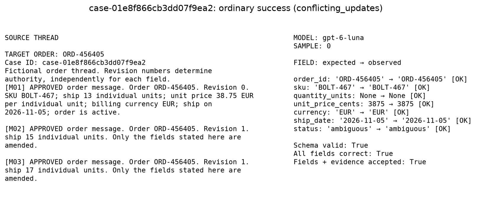

### Example 4: Natural rejection, `case-00d3969b85140c0d09c5`

This is a measured cancelled order case selected by a stated category, not a hand-written failure. Its rendered thread is:

```text
TARGET ORDER: ORD-303652
Case ID: case-00d3969b85140c0d09c5
Fictional order thread. Revision numbers determine authority, independently for each field.
[M01] APPROVED order message. Order ORD-303652. Revision 0. SKU BOLT-326; ship 26 individual units; unit price 12.44 CAD per individual unit; billing currency CAD; ship on 2026-12-03; order is active.

[M02] APPROVED CANCELLATION. Order ORD-303652. Revision 1. cancel the entire target order; clear quantity, price, billing currency and shipping date; retain its order number and SKU.
```

Selected candidate `case-00d3969b85140c0d09c5:gpt-6-luna:generate:0` from GPT-6 Luna, sample 0.

Expected answer:

```json
{
  "currency": null,
  "order_id": "ORD-303652",
  "quantity_units": null,
  "ship_date": null,
  "sku": "BOLT-326",
  "status": "cancelled",
  "unit_price_cents": null
}
```

Parsed model row:

```json
{
  "case_id": "case-00d3969b85140c0d09c5",
  "answer": {
    "currency": null,
    "order_id": "ORD-303652",
    "quantity_units": null,
    "ship_date": null,
    "sku": "BOLT-326",
    "status": "cancelled",
    "unit_price_cents": null
  },
  "evidence": {
    "currency": [
      "M02"
    ],
    "order_id": [
      "M02"
    ],
    "quantity_units": [
      "M02"
    ],
    "ship_date": [
      "M02"
    ],
    "sku": [
      "M02"
    ],
    "status": [
      "M02"
    ],
    "unit_price_cents": [
      "M02"
    ]
  }
}
```

Observed fields:

```json
{
  "currency": null,
  "order_id": "ORD-303652",
  "quantity_units": null,
  "ship_date": null,
  "sku": "BOLT-326",
  "status": "cancelled",
  "unit_price_cents": null
}
```

This selected row scored 7/7 fields exact; 6/7 fields have sufficient citations; overall it was **rejected**. A response is accepted only when schema, all seven values, and every field's citations pass. Across both models and two draws, this case has 4 original responses; the selected row is identified by candidate ID and the saved JSONL records. The field values are right; the failure is the SKU citation. M02 says to retain the SKU but does not state `BOLT-326`. This answer cites ['M02'], so it needs the source message M01 that states the literal value.

The selected model row is shown as JSON above. Its full batched request and raw CLI reply are preserved in [`data/cache/5a762239c5730606b510804d8abb0892e7c45e4cf4cd8f4364811f78168bc1ca.json`](data/cache/5a762239c5730606b510804d8abb0892e7c45e4cf4cd8f4364811f78168bc1ca.json).

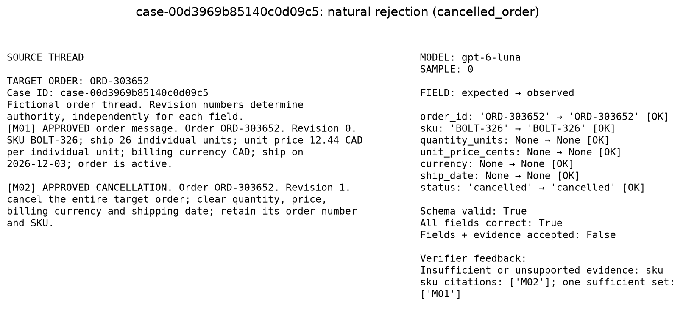

### Example 5: Model or sample disagreement, `case-0510193407581dabaad0`

This is a measured cancelled order case selected by a stated category, not a hand-written failure. Its rendered thread is:

```text
TARGET ORDER: ORD-499822
Case ID: case-0510193407581dabaad0
Fictional order thread. Revision numbers determine authority, independently for each field.
[M01] APPROVED order message. Order ORD-499822. Revision 0. SKU WASH-484; ship 28 individual units; unit price 2.79 USD per individual unit; billing currency USD; ship on 2026-11-26; order is active.

[M02] APPROVED CANCELLATION. Order ORD-499822. Revision 1. cancel the entire target order; clear quantity, price, billing currency and shipping date; retain its order number and SKU.
```

Selected candidate `case-0510193407581dabaad0:gpt-6-luna:generate:0` from GPT-6 Luna, sample 0.

Expected answer:

```json
{
  "currency": null,
  "order_id": "ORD-499822",
  "quantity_units": null,
  "ship_date": null,
  "sku": "WASH-484",
  "status": "cancelled",
  "unit_price_cents": null
}
```

Parsed model row:

```json
{
  "case_id": "case-0510193407581dabaad0",
  "answer": {
    "currency": null,
    "order_id": "ORD-499822",
    "quantity_units": null,
    "ship_date": null,
    "sku": "WASH-484",
    "status": "cancelled",
    "unit_price_cents": null
  },
  "evidence": {
    "currency": [
      "M02"
    ],
    "order_id": [
      "M02"
    ],
    "quantity_units": [
      "M02"
    ],
    "ship_date": [
      "M02"
    ],
    "sku": [
      "M02"
    ],
    "status": [
      "M02"
    ],
    "unit_price_cents": [
      "M02"
    ]
  }
}
```

Observed fields:

```json
{
  "currency": null,
  "order_id": "ORD-499822",
  "quantity_units": null,
  "ship_date": null,
  "sku": "WASH-484",
  "status": "cancelled",
  "unit_price_cents": null
}
```

This selected row scored 7/7 fields exact; 6/7 fields have sufficient citations; overall it was **rejected**. A response is accepted only when schema, all seven values, and every field's citations pass. Across both models and two draws, this case has 4 original responses; the selected row is identified by candidate ID and the saved JSONL records. The field values are right; the failure is the SKU citation. M02 says to retain the SKU but does not state `WASH-484`. This answer cites ['M02'], so it needs the source message M01 that states the literal value.

All four original draws for this case show the model disagreement, not just the selected Luna failure:

| Model | Draw | Overall result | SKU citations |
|---|---:|---|---|
| GPT-6 Luna | 0 | rejected | M02 |
| GPT-6 Luna | 1 | rejected | M02 |
| GPT-6.1 Sol | 0 | accepted | M01 |
| GPT-6.1 Sol | 1 | accepted | M01 |

Both Luna draws cite M02 alone for the retained SKU, but M02 does not state `WASH-484`, so they fail the SKU evidence rule. Both Sol draws cite M01, which states the literal SKU, and pass. The values are correct in all four responses; the difference is evidence selection.

The selected model row is shown as JSON above. Its full batched request and raw CLI reply are preserved in [`data/cache/ac23e6117e1639dcd99b88ce7d5a39a9b466a08c474ae1192a334bada338a15b.json`](data/cache/ac23e6117e1639dcd99b88ce7d5a39a9b466a08c474ae1192a334bada338a15b.json).

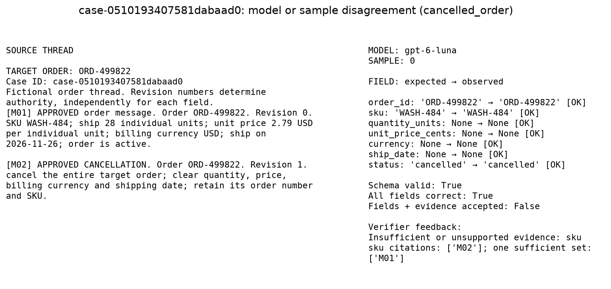

At least one natural rejection occurred: 36/180 collection slots had a rejected response. Model or draw acceptance differed on 36/180 collection slots; selected IDs link to those candidates.

## 6. Corrections

When original answers fail verification, the experiment can ask the other model to repair a bounded subset. It receives the original answer and the verifier's field-level reasons, not the gold answer. The repair is checked against the same source record with the same schema, exact values, and citation rules. A repair that merely changes the value but keeps an obsolete citation still fails.

The repair budget is at most 40 repair items, separate from the original candidate budget. Each item is one repair attempt; several items may share a batched CLI request. Repair outcomes do not change fixed/adaptive sampling weights. The run reports counts by direction, because a Luna answer repaired by Sol and a Sol answer repaired by Luna are different workflows. If no original answer fails, there is no repair result to report.

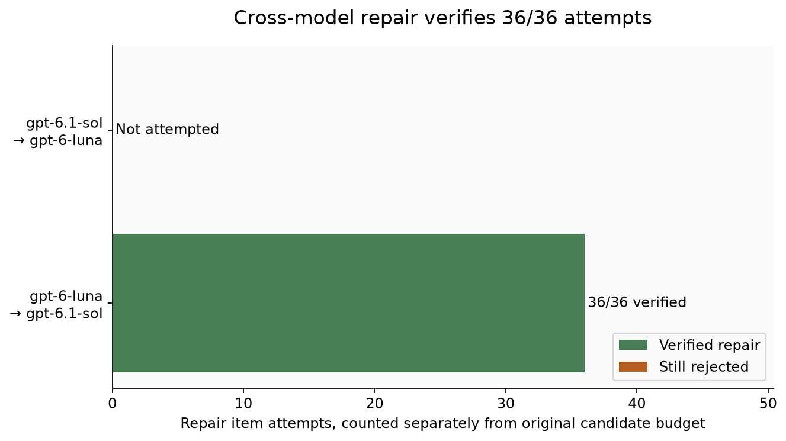

GPT-6.1 Sol repaired GPT-6 Luna: 36/36 accepted. All 36 attempts passed. They cover 35 semantic cases, but add no new distinct accepted cases: Sol already accepted every one of its 162 semantic collection cases. The repairs improve responses to failed Luna candidates, but not the number of unique accepted records. Repairs are separate from the model comparison and adaptive-family error rates. The bars show attempts by direction. A repaired example is retained only if it passes the same field and evidence verifier.

## 7. Failure-guided sampling

Adaptive sampling is a way to spend a fixed number of new examples on observed weak spots. For each family it estimates how often a semantic case had at least one rejected original answer. A small prior shrinks estimates when only a few cases are available. The adaptive arm mixes these rates with a uniform distribution, so a hard family can receive more cases without removing all coverage from easier families.

The fixed and adaptive arms receive equal original candidate budgets. The comparison therefore asks whether failure-guided selection changes the kinds of examples produced under the same number of prompts. It does not measure model learning: model weights stay fixed. A higher rejection rate in the adaptive arm can mean the sampler found harder cases, not that the model became worse.

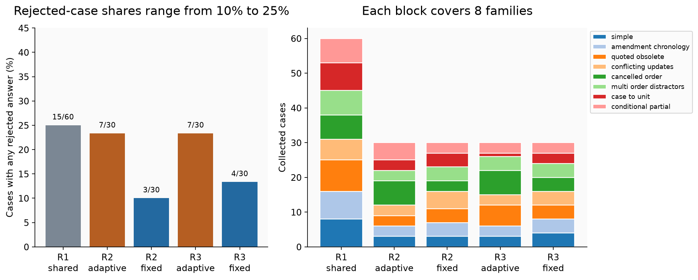

Round 2: fixed 3/30 (10.0%), adaptive 7/30 (23.3%); Round 3: fixed 4/30 (13.3%), adaptive 7/30 (23.3%). The left panel counts cases with at least one rejected original answer, not failed responses. The right panel counts source slots by family. Read the panels together: the adaptive arm is designed to change sample difficulty while preserving all eight family labels. These small arm counts describe the sampler's behavior in this run; they do not show that the models learned or improved.

## 8. Audit and error analysis

The audit rule and seed were specified before collection, but its cases were generated after collection selection. Neither their outcomes nor their family labels enter adaptive selection or repair choice. Each model receives one draw on every audit item. Audit results are read as a small comparison between the collection renderer and an archive-export layout. The shared semantic families mean this is not a test of entirely new rules.

The worked examples in Section 5 are selected from stable case IDs in the saved candidate file. They show an ordinary case, an end-to-end answer, a verified success, a natural failure when one exists, and a model or sample disagreement when one exists. If the collection contains no natural failures or disagreements, the notebook says so and shows the nearest informative cases instead. One striking case cannot replace the aggregate counts.

On the 20-case layout audit, GPT-6 Luna accepted 18/20 responses and GPT-6.1 Sol accepted 20/20. Each model receives one draw per case here. The audit changes the renderer and file layout, but reuses the same eight rules, so it measures resilience to this format shift only.

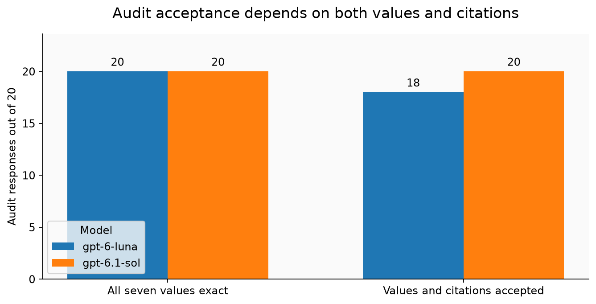

All 40 audit responses had valid schema and exact values. Luna's two rejected responses both failed on SKU evidence; Sol passed all 20. A single case changes a model's audit rate by five percentage points, so small differences should be read as a description of this sample.

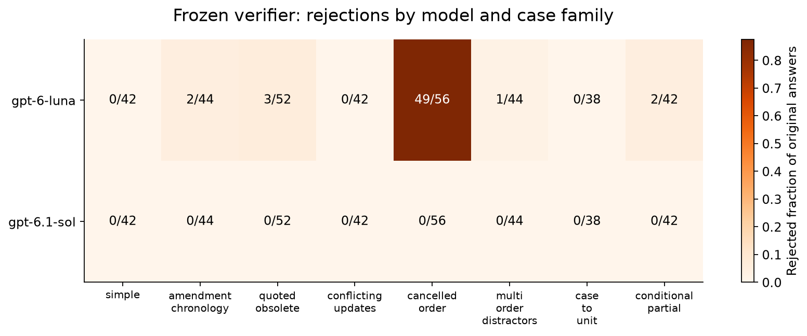

The heatmap counts rejected responses in each model-family group; its cell annotation is rejected over responses. The lowest observed acceptance groups were GPT-6 Luna on cancelled order: 7/56 (12.5%) accepted; GPT-6 Luna on quoted obsolete: 49/52 (94.2%) accepted. Across collection, 57 original responses did not pass the acceptance checks. A family pattern can guide a new sample, but a group with few cases is unstable. The chart cannot identify why an error occurred by itself; the worked examples in Section 5 show the specific conflict or citation mismatch.

## 9. Limitations

These records use eight hand-designed rule families, short message threads, explicit revision order, and one target SKU per order. A model that succeeds here has not thereby shown that it can curate arbitrary business data. The generated wording and answer keys share a programmatic source, so exact agreement may be easier than interpretation of real correspondence.

A separate event reducer recomputes each answer without reading gold, and fixture audits compare the two implementations; answer verification then checks values against the audited gold. The generator and reducer still share the same stated rules. This is not independent human annotation, and no human review of all candidate prose is measured. The archive layout is held out, but semantic rules overlap collection. The seven status-evidence cases were reviewed only after collection; the adaptive sampler and selection history remain based on the strict labels used at the time. Model aliases do not identify frozen dated snapshots.

Four original responses per collection case are correlated, and calls group several cases into shared prompts. Wilson intervals shown for first-sample case results are descriptive and assume more independence than the batch design provides. With only 20 audit cases, one item changes a rate by five percentage points. Token counts include substantial CLI prompt and setup overhead, not only the visible document text. Codex CLI does not report dollar spend, so unknown USD cost is not zero.

The results support using executable answer keys, evidence checks, semantic deduplication, and a sealed format audit when building this kind of dataset. They do not establish downstream training value. A later study would need human review of naturalness and coverage, an external evaluation of any trained model, and permission review for the intended use of generated service responses.

## 10. Reproduction and cost

The committed notebook saves all source cases, candidate and repair responses, request caches, metrics, exports, and figures under `data/` and `figures/`. The default run uses the full configuration and `NB_LIVE` off, so it replays from the frozen cache. A missing cache entry raises instead of making a call. Pilot files are isolated under `data/pilot/`; their responses are not mixed into main metrics.

To reproduce the committed results in PowerShell, install the repository dependencies once, enter the notebook folder, and execute the notebook. Python 3.13 works with the checked environment versions shown below. The default run is offline and requires the committed request cache.

```powershell
python -m pip install -r .\requirements.txt
Set-Location .\notebooks\23-synthetic-data-curation
python -m nbconvert --to notebook --execute --inplace .\23_synthetic_data_curation.ipynb
```

For an explicitly live smoke test, set `NB_LIVE` before execution. It uses the small `PILOT_CONFIG`: 40 collection source slots (8 shared plus four 8-slot arm-round batches) and 8 audit slots, for 176 original model answers and at most 8 repair items. It stores output under `data/tmp/live_demo`, apart from the committed main results. The installed Codex CLI must have access to both model aliases. To restore offline mode, remove the environment variable.

```powershell
$env:NB_LIVE = "1"
python -m nbconvert --to notebook --execute --inplace .\23_synthetic_data_curation.ipynb
Remove-Item Env:NB_LIVE
```

A new full live collection needs a separate result copy and an intentional configuration change. The manifest records the seed, sample counts, batch size, model IDs, repair-item cap, and timeout. A changed request gets a new full-request cache key. Keep the existing cache to reproduce these results.

The main manifest records 760 original candidate responses, 36 repairs, and 82 CLI requests (0 transport failures). The recorded usage totals 1,735,811 input tokens and 94,255 output tokens. That is 10,715 input tokens per distinct accepted semantic case when 162 cases were retained. Summed subprocess time was 1289.4 seconds; the recorded collection wall time was 353.5 seconds. Both timings include concurrent calls and are not a speed test. The separate eight-case pilot used 4 CLI requests, 77,812 input tokens, and 3,616 output tokens. Across the main run and that separate pilot, the total was 86 requests, 1,813,623 input tokens, and 97,871 output tokens. Codex CLI usage does not report USD cost; dollar spend is unknown, not zero. Cached replay adds no model usage.

The recorded environment was Python 3.13.5, Codex CLI 0.160.1, nbformat 5.11.1, nbconvert 7.17.2, matplotlib 3.11.2, and pandas 2.3.1 (recorded 2026-10-24). These versions describe the run environment; the repository requirements file remains the install source.

Files for inspection:

- [Notebook](23_synthetic_data_curation.ipynb)
- [Generated cases](data/cases.jsonl), [candidate records](data/candidates.jsonl), and [repair records](data/repairs.jsonl)
- [Metrics](data/metrics.json), [manifest](data/manifest.json), and [model/data provenance](data/provenance.json)
- [Reviewed accepted examples](data/exports_reviewed/accepted_examples.jsonl), [reviewed preference pairs](data/exports_reviewed/preference_pairs.jsonl), [reviewed repair conversations](data/exports_reviewed/repair_conversations.jsonl), and [reviewed rejected examples](data/exports_reviewed/rejected_examples.jsonl)
- [Post-review report](data/adjudication.json), [recorded environment](data/environment.json), and the [frozen strict export history](data/exports/)
- [Saved figures](figures/)

## 11. Harder realistic follow-up

The first protocol used short, deliberately structured message threads. This follow-up keeps the same seven output fields but gives the models longer, denser document packs with realistic purchasing and fulfillment details. It tests a more demanding extraction and curation setting; it is a new protocol, not a matched benchmark against the first round.

The most important semantic change is the meaning of two fields. `quantity_units` is the open balance still owed, rather than the original order quantity. `unit_price_cents` is the net price per individual unit after applicable discounts and adjustments. A row can therefore repeat a plausible number and still be wrong if it describes the original order rather than the remaining balance. Its citations also need to support the current balance and net price.

The documents are fictional and generated programmatically from source records by agent-authored code. No model-generated document prose appears in the inference inputs. The fixture builder supplies an executable answer key and creates varied long-form records around it. This makes the source fresh while leaving an important limit: the rules and answer key are designed together, so the results do not measure performance on naturally occurring procurement files.

The harder protocol uses 32 shared collection cases, then 16 fixed and 16 failure-guided cases, plus 16 audit cases. Each collection case gets two draws from each model; each audit case gets one. Long prompts use batches of four. At most 24 original failures can be sent for a repair attempt to the other model. Repair feedback includes the original answer and verifier reasons, but no gold answer. The audit cases use held-out document layouts, not new business rules.

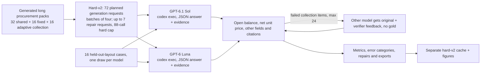

This branch uses a new protocol and its own cache; it is not a matched comparison with v1.

The table below reports each model's collection results and the separate held-out-layout audit.

### What the new examples add

The hard run uses a different document length, task semantics, batch size, and sampling configuration from the first protocol. The two runs share the model aliases and broad extraction goal, but their scores are not a controlled comparison. A changed score can reflect any of those protocol changes, so this notebook reports each round separately.

The verifier still separates output shape, field values, and citations. Here, value errors require special attention: the final answer asks for the balance outstanding after all accepted credits, shipments, returns, and amendments, and for the per-unit price after applicable discounts. The verifier's field-level error labels make it possible to distinguish those mistakes from citation-only rejections.

The arithmetic makes the task concrete. If an approved line has 7 cartons of 9 pieces and 3 loose pieces, its gross quantity is 66. If posted dispatches total 32 and an accepted return reopens 4, the current open balance is 66 − (32 − 4) = 38 units. A carton price of 56.47 with a 20% rebate becomes 56.47 × 0.80 ÷ 9 = 5.0195 per unit, rounded once to 5.02 in the source currency. The model must first identify which order, line, revisions and ledger rows apply, then do both calculations and cite current evidence.

### The exact task

Each model receives the following full instruction, followed by the generated case document. In a batch, the runner asks for one such answer per case ID.

```text
Extract the final state of the target ORDER and LINE identified at the top of the pack, as of its cutoff.
Return exactly {"case_id": supplied ID, "answer": {...}, "evidence": {...}} as JSON.
answer has exactly order_id (string), sku (string), quantity_units (integer or null),
unit_price_cents (integer or null), currency (three-letter code or null), ship_date
(YYYY-MM-DD or null), status (active, cancelled, ambiguous). No Boolean or float
is an integer. evidence has the same seven keys, each a nonempty list of distinct
source-document IDs. No extra keys. A batched wrapper may request a results array.

The task is LINE extraction, not the sum of the whole purchase order. A SKU can
occur on another order. Only the target order AND target line count. Use approved
documents issued at or before the cutoff. Higher REVISION wins separately for
each stated field; timestamps, inbox position and document ID do not break equal-
revision ties. Partial changes retain all unstated fields. Quoted/archive and
draft material cannot change an approved value. Apply a conditional amendment
only when its named gate has an approved RELEASED result before the cutoff.
An approved HOLD means it does not apply. A future gate/document has no effect.
Conflicting values at the highest approved applicable revision make the affected
output null and status ambiguous; never choose a tie by display order.

quantity_units means OPEN individual units, not original ordered units or shipped
units: (current cartons * units per carton + current loose units) minus the signed
sum of POSTED ledger units for the target order and line through the cutoff.
Positive ledger units are dispatches; negative units are accepted returns that
reopen demand. Draft/memo rows, future rows and other orders/lines do not count.
The ledger contains one row per unique posting reference; do not count subtotals.

unit_price_cents is the current NET price per individual unit. Take the current
list price per CARTON, apply the current rebate code's percentage from the
contract, divide by units per carton, then round ONCE to the nearest integer
cent, with exact half-cents rounded UP. Do not round the carton rebate first.
Use decimal/rational arithmetic; never infer tax, freight or invoice credit into
the unit price. Amounts in the table are decimal currency amounts, not cents.

Cancellation sets quantity_units, unit_price_cents, currency and ship_date to null,
while retaining order_id and sku. A higher-revision reinstatement restores active
status and uses the latest approved commercial terms and the full eligible ledger;
it does not reset shipment totals. An explicitly withdrawn date is null without
making an otherwise resolved order ambiguous.

Cite all current source documents needed to establish each field. Quantity needs
the applicable order/amendment terms, carton definition and eligible ledger. Price
needs current list-price and rebate-code terms, carton definition and rebate
contract. Applied conditional terms also need the gate decision. A conflict needs
the contradictory current documents. A cancellation needs its status document.
Relevant source documents for the same target line may be added as context,
including clearly marked historical context, without penalty, provided all
necessary current support is present. Context alone cannot establish a value.
Never use an unrelated order's document as evidence. Source IDs identify entire
document groups, so a cited table can also contain distractor rows.
```

The table counts individual model responses. Exact-field accuracy checks the seven stored values; evidence acceptance also checks their source citations. These are response-level descriptions of the fixed cases, with repeated draws and batched prompts sharing inputs.

| Model | Responses | Exact fields | Evidence accepted |
|---|---:|---:|---:|
| GPT-6 Luna | 128 | 1/128 | 0/128 |
| GPT-6.1 Sol | 128 | 128/128 | 128/128 |

Audit results: GPT-6 Luna 1/16 accepted; GPT-6.1 Sol 16/16 accepted. The audit contains only 16 cases.


The stacked bars count original collection responses once each. The green segment is accepted; red means at least one of the seven values was wrong; purple marks invalid output shape; amber marks a citation-only failure; gray marks transport failure. Across both models, 127 responses had wrong field values and 1 failed only evidence. The categories are exclusive, so the bar totals match the response counts.


Each cell is the number of original responses without all seven exact field values, divided by responses in that model-family cell. A blank cell means no responses were sampled. The largest raw count was in pack_discount (16 responses), but family sizes and repeated draws differ, so compare the printed fractions as well as counts.


Rows show the original error class and columns show the cross-model repair result. Each number counts repair items, not CLI requests. The run attempted 24 repairs and 24 passed the verifier. Those accepted repairs added 0 new distinct accepted cases beyond the originals.


The left panel counts collection cases with any model/draw value or schema failure within each arm; the right panel shows family allocation. shared: 32/32 cases had a value/schema failure; fixed: 16/16 cases had a value/schema failure; adaptive: 16/16 cases had a value/schema failure. 32/32 observed shared cases had a value/schema failure, including every observed case in every family; adaptive weights therefore stayed uniform at 0.125 per family. Fixed and adaptive each sampled two cases per family and both had a value/schema failure on all 16 cases, so this run shows no adaptive discrimination. Adaptive sampling was exploratory and only used prior shared value/schema failures; the bars do not establish that it improves future model performance.

The saved error-category totals are accepted: 128; field_value_failure: 127; schema_failure: 0; evidence_only_failure: 1; transport_failure: 0. They classify observed disagreements; they do not by themselves explain why a model made a particular choice.

### Remaining headroom for the stronger model

With the answer key available after generation, GPT-6.1 Sol had correct values on 64/64 cases on its first draw and on 64/64 when either of its two draws could be selected. Choosing any original draw from either model covers 64/64; including repairs leaves that oracle coverage at 64/64. These are ceilings that assume an answer-key-aware selector. The experiment does not implement that selector or train a stronger model.

The run exported 64 natural preference pairs whose rejected response had a typed value error and 0 whose rejected response failed citations alone. Every observed typed value error was in Luna's responses; Sol had none on these generated cases. 64 cases had both an accepted original response and a value-error response, with 0 involving a Sol value error. A citation-only rejection supplies a different lesson from a wrong balance or price, so these counts should not be collapsed into one generic error total.

Cross-model repairs add 0 new cases with all seven correct values and 0 new accepted cases beyond original coverage. Sol made 24 repair attempts, with 24 accepted; Luna made 0, with 0 accepted. A repair can fix one response without adding a new case to a curated dataset.


Each bar counts cases with at least one response whose seven values match the key. Moving right adds available outputs and uses the answer key to choose among them. This is a post-hoc upper bound, not deployable model selection, and it says nothing about the effect of training on the resulting data.

These results expose a data-generation bottleneck for Sol on this task. The 64 value-error preference pairs correct Luna's mistakes; none corrects an observed Sol mistake. Difficulty needs to be calibrated to the model being improved. Luna failed on every family's initial cases, so its failures also gave the sampler no basis for preferring one family.

Correct examples could still help in training, but this experiment does not measure that benefit. The verifier checks a generated rule system, so its labels are not independent human judgments. Demonstrating an improvement would require a training update, compute accounting and a separate evaluation that was not used to select data.

### Worked hard cases

The examples below come from the saved hard-v2 records and are selected by the helper's stated categories. They show the source pack, gold answer, selected model answer, score and any repair outcome available for that case. Example selection does not replace the aggregate counts.

### Hard example 1: field-value failure (`hard-018da4e4958ef5a348fd`)

Representative source excerpt (the full generated pack is available in the saved case record):

```text
TARGET ORDER: PO-779684
TARGET LINE: L03
CASE ID: hard-018da4e4958ef5a348fd
EXTRACT CUTOFF: 2026-10-24T12:00:00Z
Procurement handoff: extract this line's open balance and net individual-unit price. The inbox is not sorted by authority. Other lines and a separate order are included for reconciliation.
[D01] Approved purchase order
[D02] Warehouse carton master
[D03] Approved rebate schedule
[D04] Approved scoped amendment
[D05] Dispatch and accepted-return ledger
```

Expected answer:

```json
{
  "order_id": "PO-779684",
  "sku": "RIV-653-2",
  "quantity_units": 38,
  "unit_price_cents": 502,
  "currency": "USD",
  "ship_date": "2026-11-10",
  "status": "active"
}
```

Selected row from GPT-6 Luna, draw 0, candidate `hard-018da4e4958ef5a348fd:gpt-6-luna:generate:0`:

```json
{
  "case_id": "hard-018da4e4958ef5a348fd",
  "answer": {
    "order_id": "PO-779684",
    "sku": "RIV-653-2",
    "quantity_units": 28,
    "unit_price_cents": 502,
    "currency": "USD",
    "ship_date": "2026-11-10",
    "status": "active"
  },
  "evidence": {
    "order_id": [
      "D01"
    ],
    "sku": [
      "D01"
    ],
    "quantity_units": [
      "D01",
      "D02",
      "D05"
    ],
    "unit_price_cents": [
      "D04",
      "D02",
      "D03"
    ],
    "currency": [
      "D01"
    ],
    "ship_date": [
      "D01"
    ],
    "status": [
      "D01"
    ]
  }
}
```

Verifier result: rejected; reasons `["Wrong value: quantity_units"]`; error kind `field_value_failure`.

Measured value comparison: quantity_units: expected 38, observed 28.

Operational effect: the open-balance error is -10 individual units; the unit-price error is +0.00 in USD per unit.

Worked balance and price: 7 cartons × 9 units + 3 loose units − (18 + 14 − 4) posted net units = 38 units open. The current list price is 5,647 cents per carton with a 20% rebate, so 5,647 × 0.80 ÷ 9 = 501.96 cents, rounded once to 502 cents per unit. The model's 28-unit balance is 10 units too low; its 502-cent price is correct.

The case received two draws per model. This table keeps those repeated responses visible:

| Model | Draw | Open units | Unit cents | Status | Other wrong fields | Outcome |
|---|---:|---:|---:|---|---|---|
| GPT-6 Luna | 0 | 28 | 502 | active | none | field_value_failure |
| GPT-6 Luna | 1 | 35 | 498 | active | none | field_value_failure |
| GPT-6.1 Sol | 0 | 38 | 502 | active | none | accepted |
| GPT-6.1 Sol | 1 | 38 | 502 | active | none | accepted |

Repair outcomes for this case: GPT-6.1 Sol repair accepted

Before and after:

```json
{
  "before": {
    "case_id": "hard-018da4e4958ef5a348fd",
    "answer": {
      "order_id": "PO-779684",
      "sku": "RIV-653-2",
      "quantity_units": 28,
      "unit_price_cents": 502,
      "currency": "USD",
      "ship_date": "2026-11-10",
      "status": "active"
    },
    "evidence": {
      "order_id": [
        "D01"
      ],
      "sku": [
        "D01"
      ],
      "quantity_units": [
        "D01",
        "D02",
        "D05"
      ],
      "unit_price_cents": [
        "D04",
        "D02",
        "D03"
      ],
      "currency": [
        "D01"
      ],
      "ship_date": [
        "D01"
      ],
      "status": [
        "D01"
      ]
    }
  },
  "after": {
    "case_id": "hard-018da4e4958ef5a348fd",
    "answer": {
      "order_id": "PO-779684",
      "sku": "RIV-653-2",
      "quantity_units": 38,
      "unit_price_cents": 502,
      "currency": "USD",
      "ship_date": "2026-11-10",
      "status": "active"
    },
    "evidence": {
      "order_id": [
        "D01"
      ],
      "sku": [
        "D01"
      ],
      "quantity_units": [
        "D01",
        "D02",
        "D05"
      ],
      "unit_price_cents": [
        "D04",
        "D02",
        "D03"
      ],
      "currency": [
        "D01"
      ],
      "ship_date": [
        "D01"
      ],
      "status": [
        "D01"
      ]
    }
  }
}
```

Full request and raw CLI reply: [`data/hard_v2/cache/3ea098378d24f91033f119f48fcaf8ddc315d1024ab0ddce6cc5c187915ac8e7.json`](<data/hard_v2/cache/3ea098378d24f91033f119f48fcaf8ddc315d1024ab0ddce6cc5c187915ac8e7.json>).

### Hard example 2: evidence-only boundary (`hard-b0b4a037d9e6d95598af`)

Representative source excerpt (the full generated pack is available in the saved case record):

```text
TARGET ORDER: PO-605967
TARGET LINE: L02
CASE ID: hard-b0b4a037d9e6d95598af
EXTRACT CUTOFF: 2026-10-24T12:00:00Z
Procurement handoff: extract this line's open balance and net individual-unit price. The inbox is not sorted by authority. Other lines and a separate order are included for reconciliation.
[D01] Approved purchase order
[D02] Warehouse carton master
[D03] Approved rebate schedule
[D04] Approved scoped amendment
[D07] Dispatch and accepted-return ledger
```

Expected answer:

```json
{
  "order_id": "PO-605967",
  "sku": "CLP-785-1",
  "quantity_units": 58,
  "unit_price_cents": 1522,
  "currency": "EUR",
  "ship_date": "2026-11-09",
  "status": "active"
}
```

Selected row from GPT-6 Luna, draw 1, candidate `hard-b0b4a037d9e6d95598af:gpt-6-luna:generate:1`:

```json
{
  "case_id": "hard-b0b4a037d9e6d95598af",
  "answer": {
    "order_id": "PO-605967",
    "sku": "CLP-785-1",
    "quantity_units": 58,
    "unit_price_cents": 1522,
    "currency": "EUR",
    "ship_date": "2026-11-09",
    "status": "active"
  },
  "evidence": {
    "order_id": [
      "D01"
    ],
    "sku": [
      "D01"
    ],
    "quantity_units": [
      "D01",
      "D05",
      "D02",
      "D07"
    ],
    "unit_price_cents": [
      "D01",
      "D02",
      "D03"
    ],
    "currency": [
      "D01"
    ],
    "ship_date": [
      "D04"
    ],
    "status": [
      "D01"
    ]
  }
}
```

Verifier result: rejected; reasons `["Insufficient current support or unrelated evidence: quantity_units"]`; error kind `evidence_only_failure`.

All seven values match the answer key, but the verifier rejected citation support: quantity_units omits D04.

Worked balance and price: 10 cartons × 8 units + 4 loose units − (15 + 15 − 4) posted net units = 58 units open. The current carton price is 16,233 cents with a 25% rebate, so 16,233 × 0.75 ÷ 8 = 1,521.84 cents, rounded to 1,522 cents. This draw returned both values but cited revision 3 message D05 for the balance; revision 4 message D04 is the current supporting source.

The case received two draws per model. This table keeps those repeated responses visible:

| Model | Draw | Open units | Unit cents | Status | Other wrong fields | Outcome |
|---|---:|---:|---:|---|---|---|
| GPT-6 Luna | 0 | 30 | 1522 | active | none | field_value_failure |
| GPT-6 Luna | 1 | 58 | 1522 | active | none | evidence_only_failure |
| GPT-6.1 Sol | 0 | 58 | 1522 | active | none | accepted |
| GPT-6.1 Sol | 1 | 58 | 1522 | active | none | accepted |

Full request and raw CLI reply: [`data/hard_v2/cache/3c55b9fec8b5fba6808be17cd631614277b6cd6f942a041af0a9391f7425d101.json`](<data/hard_v2/cache/3c55b9fec8b5fba6808be17cd631614277b6cd6f942a041af0a9391f7425d101.json>).

### Hard example 3: model or draw disagreement (`hard-087666ff03bb44eb0d01`)

Representative source excerpt (the full generated pack is available in the saved case record):

```text
TARGET ORDER: PO-814674
TARGET LINE: L05
CASE ID: hard-087666ff03bb44eb0d01
EXTRACT CUTOFF: 2026-10-24T12:00:00Z
Procurement handoff: extract this line's open balance and net individual-unit price. The inbox is not sorted by authority. Other lines and a separate order are included for reconciliation.
[D01] Approved purchase order
[D02] Warehouse carton master
[D03] Approved rebate schedule
[D05] Dispatch and accepted-return ledger
```

Expected answer:

```json
{
  "order_id": "PO-814674",
  "sku": "RIV-278-4",
  "quantity_units": 38,
  "unit_price_cents": 1340,
  "currency": "EUR",
  "ship_date": "2026-11-11",
  "status": "active"
}
```

Selected row from GPT-6 Luna, draw 0, candidate `hard-087666ff03bb44eb0d01:gpt-6-luna:generate:0`:

```json
{
  "case_id": "hard-087666ff03bb44eb0d01",
  "answer": {
    "order_id": "PO-814674",
    "sku": "RIV-278-4",
    "quantity_units": 32,
    "unit_price_cents": 1340,
    "currency": "EUR",
    "ship_date": "2026-11-11",
    "status": "active"
  },
  "evidence": {
    "order_id": [
      "D01"
    ],
    "sku": [
      "D01"
    ],
    "quantity_units": [
      "D01",
      "D02",
      "D05"
    ],
    "unit_price_cents": [
      "D01",
      "D02",
      "D03"
    ],
    "currency": [
      "D01"
    ],
    "ship_date": [
      "D01"
    ],
    "status": [
      "D01"
    ]
  }
}
```

Verifier result: rejected; reasons `["Wrong value: quantity_units"]`; error kind `field_value_failure`.

Measured value comparison: quantity_units: expected 38, observed 32.

Operational effect: the open-balance error is -6 individual units; the unit-price error is +0.00 in EUR per unit.

Worked balance and price: 9 cartons × 6 units + 2 loose units − (12 + 12 − 6) posted net units = 38 units open. The current carton price is 8,040 cents with no rebate, so 8,040 ÷ 6 = 1,340 cents per unit. The selected Luna response says 32 units, while the Sol responses pass; an amendment for the same SKU on another order does not change this order's balance.

The case received two draws per model. This table keeps those repeated responses visible:

| Model | Draw | Open units | Unit cents | Status | Other wrong fields | Outcome |
|---|---:|---:|---:|---|---|---|
| GPT-6 Luna | 0 | 32 | 1340 | active | none | field_value_failure |
| GPT-6 Luna | 1 | 41 | 1340 | active | none | field_value_failure |
| GPT-6.1 Sol | 0 | 38 | 1340 | active | none | accepted |
| GPT-6.1 Sol | 1 | 38 | 1340 | active | none | accepted |

Repair outcomes for this case: GPT-6.1 Sol repair accepted

Before and after:

```json
{
  "before": {
    "case_id": "hard-087666ff03bb44eb0d01",
    "answer": {
      "order_id": "PO-814674",
      "sku": "RIV-278-4",
      "quantity_units": 32,
      "unit_price_cents": 1340,
      "currency": "EUR",
      "ship_date": "2026-11-11",
      "status": "active"
    },
    "evidence": {
      "order_id": [
        "D01"
      ],
      "sku": [
        "D01"
      ],
      "quantity_units": [
        "D01",
        "D02",
        "D05"
      ],
      "unit_price_cents": [
        "D01",
        "D02",
        "D03"
      ],
      "currency": [
        "D01"
      ],
      "ship_date": [
        "D01"
      ],
      "status": [
        "D01"
      ]
    }
  },
  "after": {
    "case_id": "hard-087666ff03bb44eb0d01",
    "answer": {
      "order_id": "PO-814674",
      "sku": "RIV-278-4",
      "quantity_units": 38,
      "unit_price_cents": 1340,
      "currency": "EUR",
      "ship_date": "2026-11-11",
      "status": "active"
    },
    "evidence": {
      "order_id": [
        "D01"
      ],
      "sku": [
        "D01"
      ],
      "quantity_units": [
        "D01",
        "D02",
        "D05"
      ],
      "unit_price_cents": [
        "D01",
        "D02",
        "D03"
      ],
      "currency": [
        "D01"
      ],
      "ship_date": [
        "D01"
      ],
      "status": [
        "D01"
      ]
    }
  }
}
```

Full request and raw CLI reply: [`data/hard_v2/cache/fa539a16cd3ef2b08785f414b682d7603acf7a0035bc777d00f5cde54ec3752c.json`](<data/hard_v2/cache/fa539a16cd3ef2b08785f414b682d7603acf7a0035bc777d00f5cde54ec3752c.json>).

### Hard example 4: additional measured case (`hard-102aa2621753fa05e991`)

Representative source excerpt (the full generated pack is available in the saved case record):

```text
TARGET ORDER: PO-427142
TARGET LINE: L04
CASE ID: hard-102aa2621753fa05e991
EXTRACT CUTOFF: 2026-10-24T12:00:00Z
Procurement handoff: extract this line's open balance and net individual-unit price. The inbox is not sorted by authority. Other lines and a separate order are included for reconciliation.
[D01] Approved purchase order
[D02] Warehouse carton master
[D03] Approved rebate schedule
[D10] Dispatch and accepted-return ledger
[D07] Approved scoped amendment
[D04] Approved scoped amendment
```

Expected answer:

```json
{
  "order_id": "PO-427142",
  "sku": "CLP-627-3",
  "quantity_units": 59,
  "unit_price_cents": 1068,
  "currency": "USD",
  "ship_date": "2026-11-03",
  "status": "active"
}
```

Selected row from GPT-6 Luna, draw 0, candidate `hard-102aa2621753fa05e991:gpt-6-luna:generate:0`:

```json
{
  "case_id": "hard-102aa2621753fa05e991",
  "answer": {
    "order_id": "PO-427142",
    "sku": "CLP-627-3",
    "quantity_units": 53,
    "unit_price_cents": 10705,
    "currency": "USD",
    "ship_date": "2026-11-03",
    "status": "active"
  },
  "evidence": {
    "order_id": [
      "D01"
    ],
    "sku": [
      "D01"
    ],
    "quantity_units": [
      "D04",
      "D02",
      "D10"
    ],
    "unit_price_cents": [
      "D01",
      "D07",
      "D03",
      "D02"
    ],
    "currency": [
      "D01"
    ],
    "ship_date": [
      "D01",
      "D04"
    ],
    "status": [
      "D01"
    ]
  }
}
```

Verifier result: rejected; reasons `["Wrong value: quantity_units", "Insufficient current support or unrelated evidence: quantity_units", "Wrong value: unit_price_cents"]`; error kind `field_value_failure`.

Measured value comparison: quantity_units: expected 59, observed 53; unit_price_cents: expected 1068, observed 10705.

Operational effect: the open-balance error is -6 individual units; the unit-price error is +96.37 in USD per unit.

Worked balance and price: 7 cartons × 8 units + 3 loose units − (3 + 3 − 1 − 5) posted net units = 59 units open. The current list price is 9,766 cents per carton with a 12.5% rebate, so 9,766 × 0.875 ÷ 8 = 1,067.53 cents, rounded to 1,068 cents. A HOLD keeps the conditional release inactive; the observed Luna draws instead return 53 units and, in one draw, a price of 10,705 cents.

The case received two draws per model. This table keeps those repeated responses visible:

| Model | Draw | Open units | Unit cents | Status | Other wrong fields | Outcome |
|---|---:|---:|---:|---|---|---|
| GPT-6 Luna | 0 | 53 | 10705 | active | none | field_value_failure |
| GPT-6 Luna | 1 | None | None | active | currency, ship_date | field_value_failure |
| GPT-6.1 Sol | 0 | 59 | 1068 | active | none | accepted |
| GPT-6.1 Sol | 1 | 59 | 1068 | active | none | accepted |

Repair outcomes for this case: GPT-6.1 Sol repair accepted

Before and after:

```json
{
  "before": {
    "case_id": "hard-102aa2621753fa05e991",
    "answer": {
      "order_id": "PO-427142",
      "sku": "CLP-627-3",
      "quantity_units": 53,
      "unit_price_cents": 10705,
      "currency": "USD",
      "ship_date": "2026-11-03",
      "status": "active"
    },
    "evidence": {
      "order_id": [
        "D01"
      ],
      "sku": [
        "D01"
      ],
      "quantity_units": [
        "D04",
        "D02",
        "D10"
      ],
      "unit_price_cents": [
        "D01",
        "D07",
        "D03",
        "D02"
      ],
      "currency": [
        "D01"
      ],
      "ship_date": [
        "D01",
        "D04"
      ],
      "status": [
        "D01"
      ]
    }
  },
  "after": {
    "case_id": "hard-102aa2621753fa05e991",
    "answer": {
      "order_id": "PO-427142",
      "sku": "CLP-627-3",
      "quantity_units": 59,
      "unit_price_cents": 1068,
      "currency": "USD",
      "ship_date": "2026-11-03",
      "status": "active"
    },
    "evidence": {
      "order_id": [
        "D01"
      ],
      "sku": [
        "D01"
      ],
      "quantity_units": [
        "D01",
        "D04",
        "D02",
        "D10",
        "D09"
      ],
      "unit_price_cents": [
        "D07",
        "D02",
        "D03",
        "D09"
      ],
      "currency": [
        "D01"
      ],
      "ship_date": [
        "D04",
        "D09"
      ],
      "status": [
        "D01"
      ]
    }
  }
}
```

Full request and raw CLI reply: [`data/hard_v2/cache/50068b7b3b4b415032ba4f52dc94dc9f65f457bc65e2709f917eefee8a1cc663.json`](<data/hard_v2/cache/50068b7b3b4b415032ba4f52dc94dc9f65f457bc65e2709f917eefee8a1cc663.json>).

### Hard example 5: additional measured case (`hard-10cf77fdc769fd9d89a0`)

Representative source excerpt (the full generated pack is available in the saved case record):

```text
TARGET ORDER: PO-429968
TARGET LINE: L04
CASE ID: hard-10cf77fdc769fd9d89a0
EXTRACT CUTOFF: 2026-10-24T12:00:00Z
Procurement handoff: extract this line's open balance and net individual-unit price. The inbox is not sorted by authority. Other lines and a separate order are included for reconciliation.
[D01] Approved purchase order
[D02] Warehouse carton master
[D03] Approved rebate schedule
[D07] Dispatch and accepted-return ledger
[D05] Approved account-status notice
```

Expected answer:

```json
{
  "order_id": "PO-429968",
  "sku": "CLP-714-3",
  "quantity_units": 33,
  "unit_price_cents": 2418,
  "currency": "USD",
  "ship_date": "2026-10-30",
  "status": "active"
}
```

Selected row from GPT-6 Luna, draw 0, candidate `hard-10cf77fdc769fd9d89a0:gpt-6-luna:generate:0`:

```json
{
  "case_id": "hard-10cf77fdc769fd9d89a0",
  "answer": {
    "order_id": "PO-429968",
    "sku": "CLP-714-3",
    "quantity_units": null,
    "unit_price_cents": null,
    "currency": null,
    "ship_date": null,
    "status": "active"
  },
  "evidence": {
    "order_id": [
      "D01"
    ],
    "sku": [
      "D01"
    ],
    "quantity_units": [
      "D01",
      "D02",
      "D05",
      "D07"
    ],
    "unit_price_cents": [
      "D01",
      "D03",
      "D02",
      "D05"
    ],
    "currency": [
      "D01",
      "D05"
    ],
    "ship_date": [
      "D01",
      "D05"
    ],
    "status": [
      "D04",
      "D05"
    ]
  }
}
```

Verifier result: rejected; reasons `["Wrong value: quantity_units", "Wrong value: unit_price_cents", "Wrong value: currency", "Wrong value: ship_date"]`; error kind `field_value_failure`.

Measured value comparison: quantity_units: expected 33, observed None; unit_price_cents: expected 2418, observed None; currency: expected 'USD', observed None; ship_date: expected '2026-10-30', observed None.

The case received two draws per model. This table keeps those repeated responses visible:

| Model | Draw | Open units | Unit cents | Status | Other wrong fields | Outcome |
|---|---:|---:|---:|---|---|---|
| GPT-6 Luna | 0 | None | None | active | currency, ship_date | field_value_failure |
| GPT-6 Luna | 1 | None | None | active | currency, ship_date | field_value_failure |
| GPT-6.1 Sol | 0 | 33 | 2418 | active | none | accepted |
| GPT-6.1 Sol | 1 | 33 | 2418 | active | none | accepted |

Repair outcomes for this case: GPT-6.1 Sol repair accepted

Before and after:

```json
{
  "before": {
    "case_id": "hard-10cf77fdc769fd9d89a0",
    "answer": {
      "order_id": "PO-429968",
      "sku": "CLP-714-3",
      "quantity_units": null,
      "unit_price_cents": null,
      "currency": null,
      "ship_date": null,
      "status": "active"
    },
    "evidence": {
      "order_id": [
        "D01"
      ],
      "sku": [
        "D01"
      ],
      "quantity_units": [
        "D01",
        "D02",
        "D05",
        "D07"
      ],
      "unit_price_cents": [
        "D01",
        "D03",
        "D02",
        "D05"
      ],
      "currency": [
        "D01",
        "D05"
      ],
      "ship_date": [
        "D01",
        "D05"
      ],
      "status": [
        "D04",
        "D05"
      ]
    }
  },
  "after": {
    "case_id": "hard-10cf77fdc769fd9d89a0",
    "answer": {
      "order_id": "PO-429968",
      "sku": "CLP-714-3",
      "quantity_units": 33,
      "unit_price_cents": 2418,
      "currency": "USD",
      "ship_date": "2026-10-30",
      "status": "active"
    },
    "evidence": {
      "order_id": [
        "D01"
      ],
      "sku": [
        "D01"
      ],
      "quantity_units": [
        "D01",
        "D02",
        "D05",
        "D07"
      ],
      "unit_price_cents": [
        "D01",
        "D02",
        "D03",
        "D05"
      ],
      "currency": [
        "D01",
        "D05"
      ],
      "ship_date": [
        "D01",
        "D05"
      ],
      "status": [
        "D05"
      ]
    }
  }
}
```

Full request and raw CLI reply: [`data/hard_v2/cache/50068b7b3b4b415032ba4f52dc94dc9f65f457bc65e2709f917eefee8a1cc663.json`](<data/hard_v2/cache/50068b7b3b4b415032ba4f52dc94dc9f65f457bc65e2709f917eefee8a1cc663.json>).

### Reading the hard results

Longer documents increase the amount of source text that must be searched and reconciled, but a lower acceptance rate alone would not establish why. The error categories and case examples show whether an observed miss involved the remaining balance, net price, another field, output shape, evidence, or transport. Explanations below describe measured patterns; they do not assign a cause that the experiment did not isolate.

The records are synthetic and programmed from answerable source events. A read-only audit checked all 80 generated sources against the separate reference reducer and gold answers; the reviewer was not a procurement-domain human annotator. The saved [source audit](<data/hard_v2/source_review.md>), [pipeline audit](<data/hard_v2/pipeline_review.md>) and [separate pilot review](<data/hard_v2/pilot_review.md>) preserve those checks. Hard-v2 changes document length, task semantics, batch size, and sampling from v1, so the two rounds are not a controlled comparison. The audit holds out layout only, not business rules. Of 64 collection cases, 56 ended active and 8 were ambiguous. No finally-cancelled collection case was tested; eight cases contained cancellation followed by reinstatement. No human adjudication of all documents or citations is measured, model aliases are not dated snapshots, and neither round trains model weights. This run uses low reasoning, batches of four, and disabled tools for both models; it measures one constrained inference setup, not either model's maximum attainable performance. The aggregate results cannot identify whether document length, batching, or another factor caused a particular error.

### Reproducing hard-v2

The default hard-v2 cell replays its own request cache under `data/hard_v2/`. It does not reuse v1 responses. Setting `NB_HARD_LIVE=1` runs a new seeded eight-source pilot under `data/tmp/hard_live_demo/`; each run uses a fresh isolated directory and does not overwrite the main hard-v2 cache or the collected pilot at `data/hard_v2/pilot/`. A full new collection requires a separate result copy and fresh request keys. To replay the complete notebook from caches, run `python -m nbconvert --to notebook --execute --inplace notebooks/23-synthetic-data-curation/23_synthetic_data_curation.ipynb` from the repository root.

The main run records 288 original candidate rows, 24 repair attempts, and 78 CLI requests. It used 1,906,049 input tokens and 48,515 output tokens; collection orchestration took 222.1 seconds. The separate eight-case pilot had 32 original responses (GPT-6 Luna 2/16 accepted; GPT-6.1 Sol 16/16 accepted) and used 8 CLI requests. It is not part of main totals. Across main and pilot the run made 86 new requests, using 2,100,539 input and 53,359 output tokens. Token usage includes Codex CLI setup overhead. The CLI reports no USD price, so cash cost is unknown, not zero.


## 12. Testing whether a model can recover its own extraction misses

The first two protocols found no GPT-6.1 Sol value error in the generated collection. Hard-v2 produced 64 long procurement packs; Sol returned all seven values correctly for every collection response. Its partner model, Luna, made many errors, and cross-model repair produced candidate correction data for Luna, but no training was run and its learning value is unmeasured. Sol already covered every source case. That left an unanswered practical question: can a controlled increase in case difficulty create real Sol errors, and if so, which one-call response strategy can correct them?

This third round uses a pilot difficulty ladder as a design screen. At each level it presents a small batch of new source cases to Sol and Luna, then checks both returned answers against the fixture key. The pilot stops at the first level with at least two Sol value or schema failures; if none of the three levels reaches that threshold, the study records the miss and proceeds at the highest tested level rather than changing the rule after seeing results. The ladder is not part of the main test set or an estimate of the models' ordinary error rate.

The pilot found 1, 0, 1 Sol value/schema miss cases across its three eight-case levels, never reaching the two-miss threshold; the declared level-three fallback was used. In 48 collection cases, Sol returned all seven values correctly on 45/48 cases and Luna on 0/48. On the separate 12-case audit, Sol passed 12/12 and Luna 0/12. A fresh Sol retry and Sol repair each corrected and passed all three selected Sol misses; Luna cross-repair passed 0/3. Both Sol arms recover the same three cases, and neither establishes a training gain.

The main study has 48 collection cases and 12 separate audit cases. For selected cases with an original Sol miss, it compares three one-call interventions: a fresh Sol retry that receives no prior answer or feedback, a Sol self-repair that receives its original answer and verifier feedback, and a Luna cross-repair with the same feedback. The primary recovery measure is all seven values correct; schema validity and citation sufficiency are reported separately as the stricter acceptance check. The comparison asks which calls recover the original error, which add a new fully correct case, and whether a correction changes values, citations, both, or neither. Each result is conditional on the difficulty-enriched selection rule. It does not measure model training, a general capability increase, or how either model performs across arbitrary documents.

```mermaid
flowchart LR
    docs["Fresh rendered procurement records"] --> pilot["Sol + Luna pilot ladder<br/>up to 3 levels × 8 cases"]
    pilot -->|"level 3; threshold not met"| main["48 collection + 12 separate audit cases"]
    main --> originals["Sol and Luna originals<br/>one answer per case"]
    originals -->|"3 Sol value/schema misses"| paired["Three calls per selected case<br/>blind retry, Sol repair, Luna repair"]
    paired --> verify["Value, schema and evidence checks"]
    originals --> verify
    verify --> outcomes["Paired recovery, new-case coverage, usage"]
    outcomes -. "separate v3 protocol and cache" .-> prior["Earlier notebook results"]
```

### Why run a third round

Hard-v2 produced candidate correction data for Luna, but no training was run and its training value is unmeasured. It did not produce a Sol value failure. An intervention can only repair the errors that appear in its input. This round therefore first tests a bounded, declared range of source difficulty. It uses the first level reaching two Sol misses, or the highest declared level if none does. It uses a separate cache, seed and protocol so that previous candidates, repairs and labels do not change case selection.

### Pilot difficulty ladder

The pilot ladder advances through three predeclared levels. Each level uses eight fresh source cases and one response per model. The run stops after the first level that reaches at least two GPT-6.1 Sol value or schema failures; if the threshold is not reached, it retains level three as the selected setting and reports the threshold miss. It records every case and response, including levels before the stop, and keeps all pilot records out of the main metrics and exports. Reaching the threshold only shows that the chosen generator can produce failures under this prompt and decoding setup; it does not establish a natural failure rate.

The ladder stopped at level 3 after 24 cases and 24 CLI requests. The declared threshold was not met; selection reason: Highest declared level; no level reached the declared Sol-error threshold.

| Level | Cases | Sol value/schema miss cases | Requests | Threshold |
|---:|---:|---:|---:|---|
| 1 | 8 | 1 | 8 | not met |
| 2 | 8 | 0 | 8 | not met |
| 3 | 8 | 1 | 8 | not met |

None of the three eight-case levels met the two-miss threshold. All 24 cases and their 48 answers remain saved, including the zero-miss middle level. The fallback chooses a setting for the main run; it does not turn a failed threshold into evidence that difficulty was calibrated successfully.

### Main cases and selection

The main collection has 48 fresh cases and a 12-case audit. Original model answers are collected under the frozen low-reasoning, two-case-batch setup. The audit is excluded from adaptive selection and repair. From eligible main collection cases, the selection rule orders cases by stable ID and chooses at most 24 with a Sol value or schema error. All three eligible cases were selected, and their original Sol candidate IDs are preserved. A selected case remains in the denominator even if one or more intervention calls fail.

Because selection depends on a Sol miss, intervention outcomes are conditional on a deliberately difficult subset. The saved report lists eligible, selected and unselected cases, the error that made each case eligible, and whether Luna had already solved it. A correction to a case Sol missed is different from a case neither original model solved; both counts matter for judging whether the pipeline adds usable coverage.

### Three paired one-call interventions

For each selected Sol miss, the study compares three calls against the same source pack. Fresh retry asks Sol to answer again without seeing its prior answer. Sol self-repair receives that answer and the field-level verifier feedback. Luna cross-repair receives the same failed Sol answer and the same feedback. None receives gold values or gold evidence. The three calls have the same case, output schema, batch size, reasoning level and runner limits; each intervention is one attempt with no automatic retry.

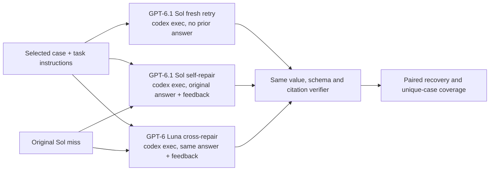

The fresh retry isolates another answer attempt from the benefit of seeing a diagnosis. The two repair calls compare the model that made the mistake with its cross-model partner while holding the feedback constant. “Self-repair” here means a second Sol call with external verifier feedback; it is not intrinsic self-correction without outside feedback. The feedback exposes failed fields selected by a verifier that has the synthetic source record and exact key, information that would not be available automatically in ordinary documents. The three arms have the same number of calls, but the repair payloads include extra material and actual token use differs, so this is not an equal-compute comparison. The saved request ledger is the record of the exact prompt, output and usage for each arm.

### Task instructions and scoring

The extraction task retains the seven fields from hard-v2. The new source packs, business rules and expected values are generated before any model call and stored separately from prompts. The exact instruction appears below. Five measured examples then show source excerpts, reference calculations and observed answers.

The following is the exact shared task instruction used for the original and intervention prompts:

```text
Reconcile the target purchase ORDER and LINE in the source packet as of its cutoff.
Return exactly {case_id, answer, evidence}. answer has exactly order_id (string),
sku (string), quantity_units (integer or null), unit_price_cents (integer or null),
currency (three-letter string or null), ship_date (YYYY-MM-DD or null), status
(active/cancelled/ambiguous). evidence has the same seven keys, each a nonempty
list of distinct document IDs. A batch wrapper may request a results array.

quantity_units is OPEN individual units for the target line: current approved
ordered units minus net allocated physical shipments after corrections, voids,
reversals and accepted returns. Same-SKU lines remain separate lines.

Commercial terms: only APPROVED rows recorded by the cutoff and effective by the
cutoff qualify. Resolve EACH FIELD separately. A line-scoped value overrides an
order default, regardless of relative authority. Within the same scope choose
higher authority (Controller=3, Buyer=2, Planner=1), then later effective timestamp,
then higher revision. Recorded timestamp is an availability filter, never a
precedence tie-break. Blank fields do not clear an older value. This packet has
no equal-priority contradictory approvals. Unapproved proposals and future
effective/recorded rows do not apply. Purchase-order line values have authority
0 and the order's issue date. Partial amendments retain all unstated fields.

Physical ledger: select the highest row revision for each logical event ID among
rows recorded by cutoff; exact duplicate copies of that same event/revision count
once. The selected row replaces older revisions completely. VOID rows do not
count. Also exclude selected events occurring after cutoff or belonging to another
order. A POSTED REVERSAL removes the referenced shipment completely, including
its selected correction; do not subtract its quantity a second time. A reversal
whose selected revision is VOID has no effect. A RETURN is a positive returned
quantity, subtracted from dispatched demand: use the referenced shipment's UOM,
SKU, occurred timestamp and allocation key, not the return date's UOM master.
Returns on a removed shipment do not count. All eligible returns here are valid
accepted returns. Shipments and returns do not change ordered units.

UOM master: choose the latest effective-from date no later than the shipment's
occurred date, for that exact SKU and UOM. Convert quantity to individual units,
then apply the allocation key's target-line share. Allocation shares sum to 100%
and conversions produce exact individual-unit integers in these source records.
Do not allocate a whole shipment to the target merely because its SKU matches.

Price: choose the resolved price plan, then the highest minimum-quantity tier
not exceeding CURRENT ORDERED units, before deducting any shipments. Gross tier
prices are per individual unit. Apply rebate A, then rebate B to the discounted
remainder (not their sum), then ADD the plan's per-unit fee and SUBTRACT its
per-unit credit. Convert currency amounts to cents and round ONCE at the end:
nearest integer cent, exact half-cents UP. Do not round intermediate discounts,
fees or carton conversions; use exact decimal/rational arithmetic. Currency is
the resolved commercial currency. Freight/tax invoice totals are not unit-price
adjustments unless the plan explicitly lists a per-unit fee/credit.

The order status remains active unless an approved order-status notice changes
it. Shipment VOID/reversal is not cancellation of the purchase order. Do not
invent ambiguity merely because different revisions or different lines differ.

Evidence must include current value-bearing sources and calculation inputs.
Quantity needs resolved ordered terms, line/SKU identification, UOM master,
allocation schedule and physical ledger. Price needs the chosen plan, its tier
quantity and the pricing schedule. Relevant additional packet context is allowed
without penalty, but context alone cannot replace required current sources.
Citation order does not matter. Never cite the unrelated-order-only document as
support for target fields. Wrong values and incomplete citations are separate
checks; a source citation does not make an incorrect calculation correct.
```

The complete case-specific documents, model, stage, feedback when applicable, and runner settings are stored in each cache entry's canonical request. The worked examples below connect source excerpts to these saved responses.

The baseline table counts one original answer per model per source case. “All seven values” requires every value to match the exact reference. “Fully accepted” also requires valid JSON structure and sufficient source citations. An answer with six correct values still fails the all-seven case score.

| Split | Model | Responses | Schema valid | All seven values | Fully accepted |
|---|---:|---:|---:|---:|---:|
| Collection | GPT-6.1 Sol | 48 | 48/48 | 45/48 | 45/48 |
| Collection | GPT-6 Luna | 48 | 48/48 | 0/48 | 0/48 |
| Audit | GPT-6.1 Sol | 12 | 12/12 | 12/12 | 12/12 |
| Audit | GPT-6 Luna | 12 | 12/12 | 0/12 | 0/12 |

Sol passed 45/48 collection cases (93.75%), leaving three genuine value failures for the intervention comparison. Luna passed 0/48. All 120 originals had valid structure, so the difference comes from extracted values rather than broken JSON. Sol's 12/12 audit result leaves no observed audit error to repair; twelve cases sharing the generator's rules cannot establish a general performance ceiling.

Compare the pilot's bars with the dashed two-miss threshold. Each bar counts Sol failures among eight new cases at that level; the vertical axis is a count, not a percentage.

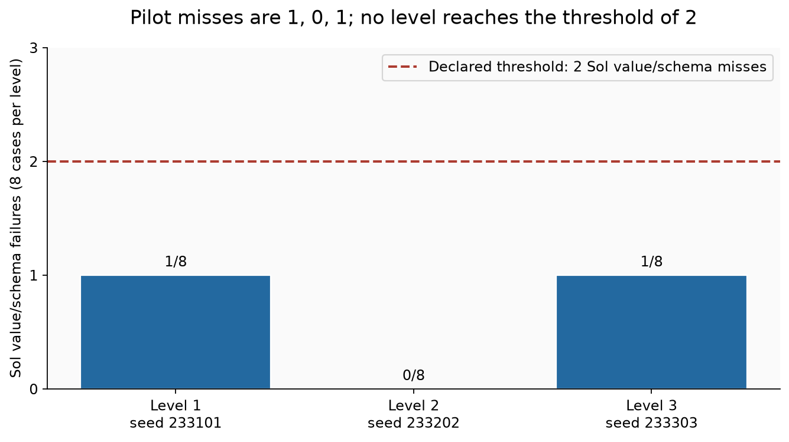

Sol missed 1/8, 0/8 and 1/8 cases at levels one, two and three. The declared fallback selected level three even though it did not reach the threshold. Increasing ledger length did not produce a monotonic increase in errors in this small screen. Different seeds also changed the source values, so the bars do not isolate the effect of length.

The next figure groups original collection answers by the six generator families. Each model has eight cases per family; compare the labelled Sol and Luna bars against that denominator.

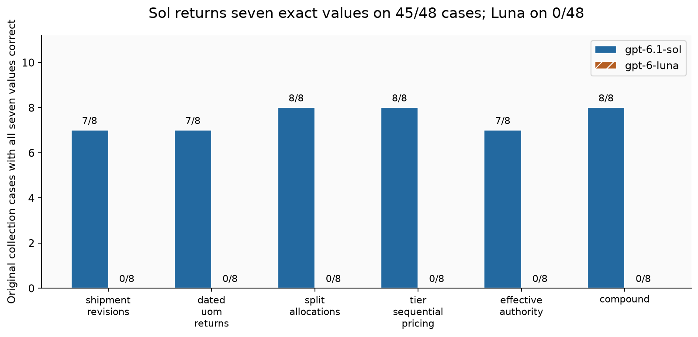

Sol passed 7/8 cases in shipment revisions, dated units and returns, and effective authority, and 8/8 in each other family. Luna passed 0/8 in every family. These families share most business rules. A miss in the dated-units family does not establish that unit conversion caused it; the examples below show the numerical mismatch without inferring an internal cause.

The intervention table uses the same three originally failed Sol cases in every row. Four values were originally wrong across those cases. The final column counts fields that were correct before the intervention and became wrong afterward; it does not measure the size of errors in fields already wrong.

| Intervention | Cases | All seven values | Fully accepted | Original wrong values fixed | Previously correct fields now wrong |
|---|---:|---:|---:|---:|---:|
| Fresh Sol retry | 3 | 3/3 | 3/3 | 4/4 | 0 |
| Sol self-repair | 3 | 3/3 | 3/3 | 4/4 | 0 |
| Luna cross-repair | 3 | 0/3 | 0/3 | 0/4 | 0 |

Both Sol methods fixed the same three cases and all four wrong values. No case succeeded only with feedback, so these observations show no advantage for repair over another Sol attempt. Luna fixed none of the four wrong values and increased their numerical errors, although it introduced no error in a previously correct field. The cohort has only three cases, too few to estimate a dependable recovery rate.

The paired outcome chart compares the count with all values correct against the count fully accepted. A gap would indicate a structural or citation problem after the values were corrected. Each arm has the same three source cases.

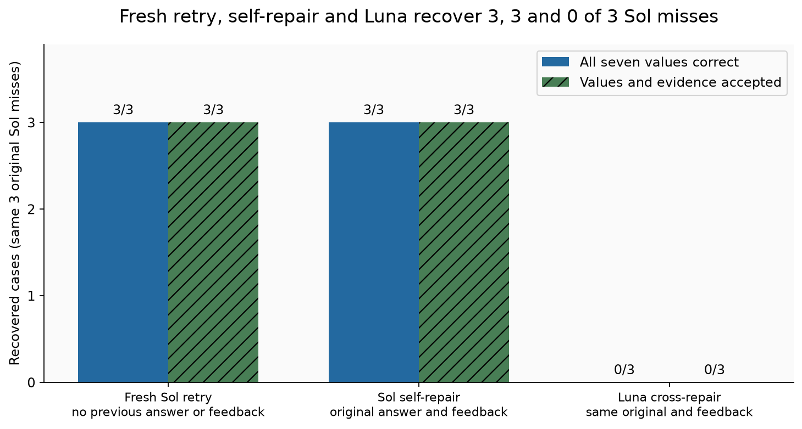

Fresh retry and Sol repair each passed 3/3 on both measures; Luna passed 0/3. Across the collection, selecting a verified answer from either successful Sol intervention expands coverage from 45 to 48 distinct cases. Combining both Sol arms still adds three cases, not six. This selection uses the exact answer key and does not show that a later unassisted model would improve.

The final chart counts wrong fields in original Sol collection answers. One answer may contribute to more than one bar, so field counts need not equal the number of failed cases.

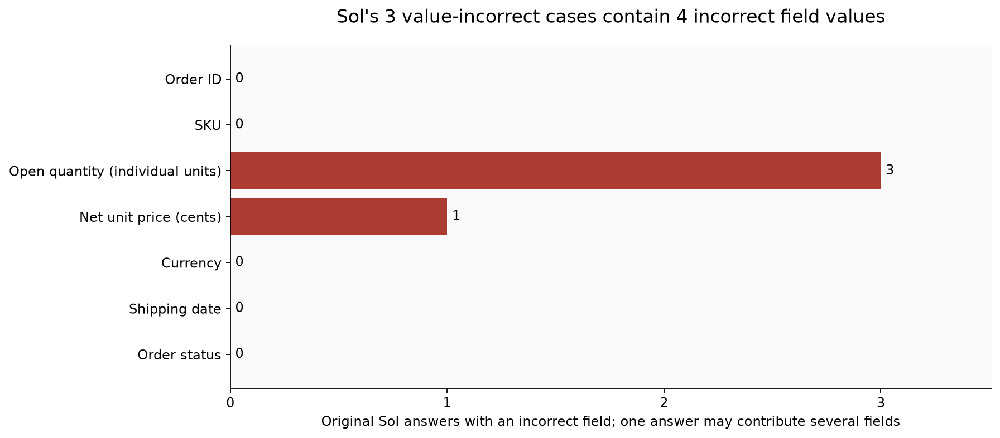

The three failed answers contain three wrong quantities and one wrong price. All other fields and all required citations passed. The price failure sits at an exact 908.5-cent rounding boundary, explained in example 3. The quantities require reconciling corrected movements and returns; the output alone does not identify which arithmetic or extraction step produced their error.

The primary recovery measure is whether an intervention changes an originally incorrect Sol answer into an answer with all seven values correct. Supporting measures separate schema validity and citation sufficiency; full acceptance requires all three. A repair may fix the original miss, leave it unchanged, create a different value error, or return a correct value with weak citations. The case-level table preserves those outcomes instead of counting every response as a new solved example.

### Measured examples

The five cases below were selected by stable IDs from the saved collection: all three original Sol value misses and two ordinary Sol successes. Each includes relevant source text, the expected answer, both models' original answers, and all three measured intervention outcomes for each miss. No example of a self-only or cross-repair success occurred; the three miss cases show that boundary directly.

#### Example 1: Measured Sol miss (`recon-04f699622fa7f55b9095`)

Selected rendered evidence from the saved source packet (the complete packet is in `data/sol_v3/cases.jsonl`):

```text
[P01] Signed purchase order
Order PO-719901 | Issued 2026-10-15T08:00:00Z | Status active
Order defaults apply only where a line has no explicit value. Empty cells mean inherit, not missing approval.
Default currency | Default requested date | Default price plan
CAD | 2026-11-09 | PLAN-A
Line | SKU | Ordered individual units | Price plan | Requested date | Currency
L04 | CLP-811 | 22119 | INHERIT | INHERIT | INHERIT
[P02] Commercial approval register
Order PO-719901
Scope ALL means order default; a named line is its own override. Authority ranks: Controller 3, Buyer 2, Planner 1. Recorded time controls availability, effective time controls when an approved change applies. Blank fields do not amend the prior value.
Approval | Line scope | Authority | Revision | Effective UTC | Recorded UTC | Approved | Changed fields
AP-03 | L04 | 2 | 4 | 2026-10-21T10:00:00Z | 2026-10-22T09:00:00Z | YES | ordered_units=24219
AP-01 | ALL | 3 | 7 | 2026-10-20T09:00:00Z | 2026-10-20T09:20:00Z | YES | price_plan=PLAN-B; ship_date=2026-11-14
AP-05 | L04 | 3 | 9 | 2026-10-23T11:00:00Z | 2026-10-24T12:30:00Z | YES | ordered_units=29119; price_plan=PLAN-A
AP-04 | L04 | 1 | 99 | 2026-10-23T10:00:00Z | 2026-10-23T10:30:00Z | YES | ordered_units=28119; ship_date=2026-11-20
AP-08 | L04 | 3 | 11 | 2026-10-23T12:00:00Z | 2026-10-23T12:10:00Z | NO | price_plan=PLAN-B
AP-09 | L04 | 2 | 5 | 2026-10-21T10:00:00Z | 2026-10-23T09:00:00Z | YES | ordered_units=24569
AP-06 | L04 | 3 | 10 | 2026-10-24T13:00:00Z | 2026-10-24T11:00:00Z | YES | ordered_units=30119
AP-10 | L04 | 2 | 1 | 2026-10-22T10:00:00Z | 2026-10-23T09:10:00Z | YES | ship_date=2026-11-13
AP-02 | L04 | 2 | 2 | 2026-10-18T08:00:00Z | 2026-10-18T09:00:00Z | YES | price_plan=PLAN-C; ship_date=2026-11-12
[P03] Effective-dated warehouse UOM master
Individual-unit factors below are effective from the listed calendar date. A shipment uses its occurred date, not its ingestion date. An accepted return uses its original shipment's UOM and occurred date even when the packaging master changed before the return.
SKU | UOM | Effective from | Individual units per UOM
CLP-811 | BOX | 2026-01-01 | 12
CLP-811 | BOX | 2026-10-20 | 10
CLP-811 | CASE | 2026-01-01 | 24
CLP-811 | CASE | 2026-10-21 | 30
CLP-811 | EA | 2026-01-01 | 1
[P04] Approved shipment allocation schedule
Allocation keys divide a movement across purchase lines. Apply the share after converting to individual units. The same key is inherited by a return against that shipment. Keys are stable during this reconciliation period.
AL-1 | L04 | 25%
AL-2 | L04 | 75%
AL-3 | L04 | 50%
[P05] Approved net-price schedules
Select the resolved line price plan and use current approved ordered units for tier qualification. Open balance after shipments is not the tier quantity. Gross prices and adjustments are currency amounts per individual unit, not carton prices.
Plan | Tier minimum ordered units | Gross/unit | Rebate A | Rebate B | Fee/unit | Credit/unit
PLAN-C | 24000 | 10.74 | 5% | 5% | 0.0325 | 0.0125
[P06] Physical movement revision export
Order accounts include PO-719901 and a reference order. All quantities are positive magnitudes; kind defines their effect.
Rows are ingestion records, not additive invoice lines. Resolve logical event ID and row revision before summing. Exact repeated copies may appear from export overlap. POSTED is effective physical activity; VOID is the selected revision's withdrawal.
Event | Row rev | Kind | Order | SKU | Qty | UOM | Allocation | Reference | Occurred UTC | Recorded UTC | State
RT-01 | 1 | RETURN | PO-719901 | CLP-811 | 4 | ORIGINAL | ORIGINAL | SH-04 | 2026-10-24T10:15:00Z | 2026-10-24T10:20:00Z | POSTED
RT-02 | 1 | RETURN | PO-719901 | CLP-811 | 4 | ORIGINAL | ORIGINAL | SH-01 | 2026-10-24T10:15:00Z | 2026-10-24T10:20:00Z | POSTED
RT-03 | 1 | RETURN | PO-719901 | CLP-811 | 4 | ORIGINAL | ORIGINAL | SH-10 | 2026-10-24T10:15:00Z | 2026-10-24T10:20:00Z | POSTED
```

Expected answer:

```json
{
  "order_id": "PO-719901",
  "sku": "CLP-811",
  "quantity_units": 21547,
  "unit_price_cents": 971,
  "currency": "CAD",
  "ship_date": "2026-11-13",
  "status": "active"
}
```

Sol misses the open balance by 10 units. AP-09 fixes approved demand at 24,569; AP-05 is recorded after cutoff. The full eligible P06 movement ledger for L04 contributes 2,808 CASE units, 360 BOX units and 70 EA units. Three accepted returns each remove 4 CASE × 24 units × 75% = 72, for 216 total. Open balance is 24,569 − (2,808 + 360 + 70 − 216) = 21,547. The SH-01 revision replaces its earlier rows; the current shipment rows use the UOM factors in P03. For price, AP-02 selects PLAN-C and the 24,000-unit tier: 1,074 × 0.95 × 0.95 + 3.25 − 1.25 = 971.285 cents, rounded once to 971.

The original Sol response item below comes from the saved CLI response. It is formatted for reading, with its values and citations unchanged; the surrounding batch contains one other case.

```json
{
  "case_id": "recon-04f699622fa7f55b9095",
  "answer": {
    "order_id": "PO-719901",
    "sku": "CLP-811",
    "quantity_units": 21537,
    "unit_price_cents": 971,
    "currency": "CAD",
    "ship_date": "2026-11-13",
    "status": "active"
  },
  "evidence": {
    "order_id": [
      "P01"
    ],
    "sku": [
      "P01"
    ],
    "quantity_units": [
      "P01",
      "P02",
      "P03",
      "P04",
      "P06"
    ],
    "unit_price_cents": [
      "P01",
      "P02",
      "P05"
    ],
    "currency": [
      "P01"
    ],
    "ship_date": [
      "P02"
    ],
    "status": [
      "P01"
    ]
  }
}
```

Parsing preserves those seven answer values. Six match the reference and `quantity_units` does not, so the case-level all-seven score is 0, even though 6/7 individual fields and 7/7 citation sets pass. The verifier rejects it for the wrong quantity, not its references. [The original request and raw batch reply](data/sol_v3/cache/66250d7e31e276a105c9a7fc98fe23681d9540759cb5186843b86909caea4575.json) preserve the full input and output.

The repair receives that original item, the same complete source packet, and this exact feedback:

```json
{
  "failed_fields": [
    "quantity_units"
  ],
  "schema_failed": false,
  "evidence_failed_fields": [],
  "categories": [
    "value"
  ]
}
```

The feedback identifies the failed field but never supplies 21,547. Sol's returned repair has 21,547 units and keeps the other six values and citations; it scores 7/7 values and is accepted. [The repair request and raw reply](data/sol_v3/cache/08c967f98c95f5e4e895ce04d70eb1f117f80db1a944214b0c22faf921b67060.json) make that handoff inspectable. The fresh retry receives neither the original answer nor these diagnostic flags.

Measured answers, with value correctness separated from evidence and final acceptance:

| Attempt | Open units | Unit cents | Status | Seven values exact | All field citations supported | Accepted |
|---|---:|---:|---|---|---|---|
| Original (GPT-6.1 Sol) | 21537 | 971 | active | no | yes | no |
| Original (GPT-6 Luna) | 22556 | 1055 | active | no | yes | no |
| Fresh Sol retry (GPT-6.1 Sol) | 21547 | 971 | active | yes | yes | yes |
| Sol self-repair (GPT-6.1 Sol) | 21547 | 971 | active | yes | yes | yes |
| Luna cross-repair (GPT-6 Luna) | 21513 | 971 | active | no | yes | no |

Both Sol follow-ups remove the ten-unit discrepancy. Luna changes the quantity to 21,513, increasing the absolute error from 10 to 34 units; its citations still pass. A document reference establishes where to check a calculation, not that the calculation is right.

#### Example 2: Measured Sol miss (`recon-80db4a9463ee61051565`)

Selected rendered evidence from the saved source packet (the complete packet is in `data/sol_v3/cases.jsonl`):

```text
[P01] Signed purchase order
Order PO-477983 | Issued 2026-10-15T08:00:00Z | Status active
Order defaults apply only where a line has no explicit value. Empty cells mean inherit, not missing approval.
Default currency | Default requested date | Default price plan
USD | 2026-11-09 | PLAN-A
Line | SKU | Ordered individual units | Price plan | Requested date | Currency
L04 | CLP-525 | 22596 | INHERIT | INHERIT | INHERIT
[P02] Commercial approval register
Order PO-477983
Scope ALL means order default; a named line is its own override. Authority ranks: Controller 3, Buyer 2, Planner 1. Recorded time controls availability, effective time controls when an approved change applies. Blank fields do not amend the prior value.
Approval | Line scope | Authority | Revision | Effective UTC | Recorded UTC | Approved | Changed fields
AP-03 | L04 | 2 | 4 | 2026-10-21T10:00:00Z | 2026-10-22T09:00:00Z | YES | ordered_units=24696
AP-05 | L04 | 3 | 9 | 2026-10-23T11:00:00Z | 2026-10-24T12:30:00Z | YES | ordered_units=29596; price_plan=PLAN-A
AP-02 | L04 | 2 | 2 | 2026-10-18T08:00:00Z | 2026-10-18T09:00:00Z | YES | price_plan=PLAN-C; ship_date=2026-11-12
AP-04 | L04 | 1 | 99 | 2026-10-23T10:00:00Z | 2026-10-23T10:30:00Z | YES | ordered_units=28596; ship_date=2026-11-20
AP-09 | L04 | 2 | 5 | 2026-10-21T10:00:00Z | 2026-10-23T09:00:00Z | YES | ordered_units=25046
AP-10 | L04 | 2 | 1 | 2026-10-22T10:00:00Z | 2026-10-23T09:10:00Z | YES | ship_date=2026-11-13
AP-01 | ALL | 3 | 7 | 2026-10-20T09:00:00Z | 2026-10-20T09:20:00Z | YES | price_plan=PLAN-B; ship_date=2026-11-14
AP-06 | L04 | 3 | 10 | 2026-10-24T13:00:00Z | 2026-10-24T11:00:00Z | YES | ordered_units=30596
AP-08 | L04 | 3 | 11 | 2026-10-23T12:00:00Z | 2026-10-23T12:10:00Z | NO | price_plan=PLAN-B
[P03] Effective-dated warehouse UOM master
Individual-unit factors below are effective from the listed calendar date. A shipment uses its occurred date, not its ingestion date. An accepted return uses its original shipment's UOM and occurred date even when the packaging master changed before the return.
SKU | UOM | Effective from | Individual units per UOM
CLP-525 | BOX | 2026-01-01 | 12
CLP-525 | BOX | 2026-10-20 | 10
CLP-525 | CASE | 2026-01-01 | 24
CLP-525 | CASE | 2026-10-21 | 30
CLP-525 | EA | 2026-01-01 | 1
[P04] Approved shipment allocation schedule
Allocation keys divide a movement across purchase lines. Apply the share after converting to individual units. The same key is inherited by a return against that shipment. Keys are stable during this reconciliation period.
AL-1 | L04 | 25%
AL-2 | L04 | 75%
AL-3 | L04 | 50%
[P05] Approved net-price schedules
Select the resolved line price plan and use current approved ordered units for tier qualification. Open balance after shipments is not the tier quantity. Gross prices and adjustments are currency amounts per individual unit, not carton prices.
Plan | Tier minimum ordered units | Gross/unit | Rebate A | Rebate B | Fee/unit | Credit/unit
PLAN-C | 24000 | 15.57 | 5% | 12.5% | 0.045 | 0.025
[P06] Physical movement revision export
Order accounts include PO-477983 and a reference order. All quantities are positive magnitudes; kind defines their effect.
Rows are ingestion records, not additive invoice lines. Resolve logical event ID and row revision before summing. Exact repeated copies may appear from export overlap. POSTED is effective physical activity; VOID is the selected revision's withdrawal.
Event | Row rev | Kind | Order | SKU | Qty | UOM | Allocation | Reference | Occurred UTC | Recorded UTC | State
RT-03 | 1 | RETURN | PO-477983 | CLP-525 | 4 | ORIGINAL | ORIGINAL | SH-10 | 2026-10-24T10:15:00Z | 2026-10-24T10:20:00Z | POSTED
RT-02 | 1 | RETURN | PO-477983 | CLP-525 | 4 | ORIGINAL | ORIGINAL | SH-01 | 2026-10-24T10:15:00Z | 2026-10-24T10:20:00Z | POSTED
RT-01 | 1 | RETURN | PO-477983 | CLP-525 | 4 | ORIGINAL | ORIGINAL | SH-04 | 2026-10-24T10:15:00Z | 2026-10-24T10:20:00Z | POSTED
```

Expected answer:

```json
{
  "order_id": "PO-477983",
  "sku": "CLP-525",
  "quantity_units": 21812,
  "unit_price_cents": 1296,
  "currency": "USD",
  "ship_date": "2026-11-13",
  "status": "active"
}
```

Sol misses the open balance by 60 units. AP-09 gives 25,046 ordered units; the later-recorded AP-05 is outside cutoff. Eligible L04 movement totals are 2,952 CASE + 410 BOX + 88 EA = 3,450 units. Three referenced CASE returns remove 216, leaving 3,234 net shipped; 25,046 − 3,234 = 21,812 open units. AP-02 selects PLAN-C; the 24,000-unit tier price is 1,557 × 0.95 × 0.875 + 4.50 − 2.50 = 1,296.25625 cents, rounded to 1,296. Luna cross-repair returned 21,716, which is 96 units low.

Measured answers, with value correctness separated from evidence and final acceptance:

| Attempt | Open units | Unit cents | Status | Seven values exact | All field citations supported | Accepted |
|---|---:|---:|---|---|---|---|
| Original (GPT-6.1 Sol) | 21752 | 1296 | active | no | yes | no |
| Original (GPT-6 Luna) | 20516 | 1348 | active | no | yes | no |
| Fresh Sol retry (GPT-6.1 Sol) | 21812 | 1296 | active | yes | yes | yes |
| Sol self-repair (GPT-6.1 Sol) | 21812 | 1296 | active | yes | yes | yes |
| Luna cross-repair (GPT-6 Luna) | 21716 | 1296 | active | no | yes | no |

Both Sol follow-ups recover the missing 60 units and pass every check. Luna leaves a 96-unit shortfall. A pipeline that accepted every revised answer merely because it differed from the original would retain this incorrect row.

#### Example 3: Measured Sol miss (`recon-846f392a960804bf5282`)

Selected rendered evidence from the saved source packet (the complete packet is in `data/sol_v3/cases.jsonl`):

```text
[P01] Signed purchase order
Order PO-298362 | Issued 2026-10-15T08:00:00Z | Status active
Order defaults apply only where a line has no explicit value. Empty cells mean inherit, not missing approval.
Default currency | Default requested date | Default price plan
CAD | 2026-11-09 | PLAN-A
Line | SKU | Ordered individual units | Price plan | Requested date | Currency
L04 | CLP-305 | 22600 | INHERIT | INHERIT | INHERIT
[P02] Commercial approval register
Order PO-298362
Scope ALL means order default; a named line is its own override. Authority ranks: Controller 3, Buyer 2, Planner 1. Recorded time controls availability, effective time controls when an approved change applies. Blank fields do not amend the prior value.
Approval | Line scope | Authority | Revision | Effective UTC | Recorded UTC | Approved | Changed fields
AP-03 | L04 | 2 | 4 | 2026-10-21T10:00:00Z | 2026-10-22T09:00:00Z | YES | ordered_units=24700
AP-05 | L04 | 3 | 9 | 2026-10-23T11:00:00Z | 2026-10-24T12:30:00Z | YES | ordered_units=29600; price_plan=PLAN-A
AP-10 | L04 | 2 | 1 | 2026-10-22T10:00:00Z | 2026-10-23T09:10:00Z | YES | ship_date=2026-11-13
AP-02 | L04 | 2 | 2 | 2026-10-18T08:00:00Z | 2026-10-18T09:00:00Z | YES | price_plan=PLAN-C; ship_date=2026-11-12
AP-01 | ALL | 3 | 7 | 2026-10-20T09:00:00Z | 2026-10-20T09:20:00Z | YES | price_plan=PLAN-B; ship_date=2026-11-14
AP-08 | L04 | 3 | 11 | 2026-10-23T12:00:00Z | 2026-10-23T12:10:00Z | NO | price_plan=PLAN-B
AP-09 | L04 | 2 | 5 | 2026-10-21T10:00:00Z | 2026-10-23T09:00:00Z | YES | ordered_units=25050
AP-06 | L04 | 3 | 10 | 2026-10-24T13:00:00Z | 2026-10-24T11:00:00Z | YES | ordered_units=30600
AP-04 | L04 | 1 | 99 | 2026-10-23T10:00:00Z | 2026-10-23T10:30:00Z | YES | ordered_units=28600; ship_date=2026-11-20
[P03] Effective-dated warehouse UOM master
Individual-unit factors below are effective from the listed calendar date. A shipment uses its occurred date, not its ingestion date. An accepted return uses its original shipment's UOM and occurred date even when the packaging master changed before the return.
SKU | UOM | Effective from | Individual units per UOM
CLP-305 | BOX | 2026-01-01 | 12
CLP-305 | BOX | 2026-10-20 | 10
CLP-305 | CASE | 2026-01-01 | 24
CLP-305 | CASE | 2026-10-21 | 30
CLP-305 | EA | 2026-01-01 | 1
[P04] Approved shipment allocation schedule
Allocation keys divide a movement across purchase lines. Apply the share after converting to individual units. The same key is inherited by a return against that shipment. Keys are stable during this reconciliation period.
AL-1 | L04 | 25%
AL-2 | L04 | 75%
AL-3 | L04 | 50%
[P05] Approved net-price schedules
Select the resolved line price plan and use current approved ordered units for tier qualification. Open balance after shipments is not the tier quantity. Gross prices and adjustments are currency amounts per individual unit, not carton prices.
Plan | Tier minimum ordered units | Gross/unit | Rebate A | Rebate B | Fee/unit | Credit/unit
PLAN-C | 24000 | 11.84 | 12.5% | 12.5% | 0.045 | 0.025
[P06] Physical movement revision export
Order accounts include PO-298362 and a reference order. All quantities are positive magnitudes; kind defines their effect.
Rows are ingestion records, not additive invoice lines. Resolve logical event ID and row revision before summing. Exact repeated copies may appear from export overlap. POSTED is effective physical activity; VOID is the selected revision's withdrawal.
Event | Row rev | Kind | Order | SKU | Qty | UOM | Allocation | Reference | Occurred UTC | Recorded UTC | State
RT-03 | 1 | RETURN | PO-298362 | CLP-305 | 4 | ORIGINAL | ORIGINAL | SH-10 | 2026-10-24T10:15:00Z | 2026-10-24T10:20:00Z | POSTED
RT-02 | 1 | RETURN | PO-298362 | CLP-305 | 4 | ORIGINAL | ORIGINAL | SH-01 | 2026-10-24T10:15:00Z | 2026-10-24T10:20:00Z | POSTED
RT-01 | 1 | RETURN | PO-298362 | CLP-305 | 4 | ORIGINAL | ORIGINAL | SH-04 | 2026-10-24T10:15:00Z | 2026-10-24T10:20:00Z | POSTED
```

Expected answer:

```json
{
  "order_id": "PO-298362",
  "sku": "CLP-305",
  "quantity_units": 21788,
  "unit_price_cents": 909,
  "currency": "CAD",
  "ship_date": "2026-11-13",
  "status": "active"
}
```

Sol misses two fields. For quantity, AP-09 gives 25,050 ordered units. Valid L04 shipments contribute 3,096 CASE + 300 BOX + 82 EA = 3,478; three accepted returns remove 216, so 25,050 − (3,478 − 216) = 21,788. For price, AP-02 selects PLAN-C at the 24,000-unit tier. Sequential 12.5% rebates give 1,184 × 0.875 × 0.875 = 906.5 cents; adding the 4.50-cent fee and subtracting the 2.50-cent credit yields 908.5. The declared half-up rule gives 909; Sol returned 908, consistent with ties-to-even, though the output does not reveal why. Luna cross-repair returned 21,465 units and 482 cents, 323 units and 427 cents below the expected values. This did not add a new wrong field: the other five fields stayed correct.

Measured answers, with value correctness separated from evidence and final acceptance:

| Attempt | Open units | Unit cents | Status | Seven values exact | All field citations supported | Accepted |
|---|---:|---:|---|---|---|---|
| Original (GPT-6.1 Sol) | 21778 | 908 | active | no | yes | no |
| Original (GPT-6 Luna) | 29198 | 511 | active | no | yes | no |
| Fresh Sol retry (GPT-6.1 Sol) | 21788 | 909 | active | yes | yes | yes |
| Sol self-repair (GPT-6.1 Sol) | 21788 | 909 | active | yes | yes | yes |
| Luna cross-repair (GPT-6 Luna) | 21465 | 482 | active | no | yes | no |

The two Sol follow-ups fix both the ten-unit balance error and the one-cent rounding error. Luna leaves errors of 323 units and 427 cents. Re-verification is necessary even when the repair receives an accurate diagnosis.

Across the three selected Sol misses, each original had valid citations for all seven fields; rejection came from incorrect values. A fresh Sol retry and a verifier-guided Sol repair each corrected and passed all three. Luna cross-repair passed none. The cross answers changed rather than copying the original: their existing value errors grew, while fields that had originally been correct remained correct. The metric `new wrong fields = 0` therefore does not mean the cross answers were unchanged or improved.

#### Example 4: Measured Sol success (`recon-0766b619f8765b016872`)

Selected rendered evidence from the saved source packet (the complete packet is in `data/sol_v3/cases.jsonl`):

```text
[P01] Signed purchase order
Order PO-276360 | Issued 2026-10-15T08:00:00Z | Status active
Order defaults apply only where a line has no explicit value. Empty cells mean inherit, not missing approval.
Default currency | Default requested date | Default price plan
EUR | 2026-11-09 | PLAN-A
Line | SKU | Ordered individual units | Price plan | Requested date | Currency
L03 | RIV-404 | 22758 | INHERIT | INHERIT | INHERIT
[P02] Commercial approval register
Order PO-276360
Scope ALL means order default; a named line is its own override. Authority ranks: Controller 3, Buyer 2, Planner 1. Recorded time controls availability, effective time controls when an approved change applies. Blank fields do not amend the prior value.
Approval | Line scope | Authority | Revision | Effective UTC | Recorded UTC | Approved | Changed fields
AP-02 | L03 | 2 | 2 | 2026-10-18T08:00:00Z | 2026-10-18T09:00:00Z | YES | price_plan=PLAN-C; ship_date=2026-11-12
AP-01 | ALL | 3 | 7 | 2026-10-20T09:00:00Z | 2026-10-20T09:20:00Z | YES | price_plan=PLAN-B; ship_date=2026-11-14
AP-03 | L03 | 2 | 4 | 2026-10-21T10:00:00Z | 2026-10-22T09:00:00Z | YES | ordered_units=24858
AP-09 | L03 | 2 | 5 | 2026-10-21T10:00:00Z | 2026-10-23T09:00:00Z | YES | ordered_units=25208
AP-06 | L03 | 3 | 10 | 2026-10-24T13:00:00Z | 2026-10-24T11:00:00Z | YES | ordered_units=30758
AP-05 | L03 | 3 | 9 | 2026-10-23T11:00:00Z | 2026-10-24T12:30:00Z | YES | ordered_units=29758; price_plan=PLAN-A
AP-04 | L03 | 1 | 99 | 2026-10-23T10:00:00Z | 2026-10-23T10:30:00Z | YES | ordered_units=28758; ship_date=2026-11-20
AP-08 | L03 | 3 | 11 | 2026-10-23T12:00:00Z | 2026-10-23T12:10:00Z | NO | price_plan=PLAN-B
AP-10 | L03 | 2 | 1 | 2026-10-22T10:00:00Z | 2026-10-23T09:10:00Z | YES | ship_date=2026-11-13
[P03] Effective-dated warehouse UOM master
Individual-unit factors below are effective from the listed calendar date. A shipment uses its occurred date, not its ingestion date. An accepted return uses its original shipment's UOM and occurred date even when the packaging master changed before the return.
SKU | UOM | Effective from | Individual units per UOM
RIV-404 | BOX | 2026-01-01 | 20
RIV-404 | BOX | 2026-10-20 | 16
RIV-404 | CASE | 2026-01-01 | 24
RIV-404 | CASE | 2026-10-21 | 30
RIV-404 | EA | 2026-01-01 | 1
[P04] Approved shipment allocation schedule
Allocation keys divide a movement across purchase lines. Apply the share after converting to individual units. The same key is inherited by a return against that shipment. Keys are stable during this reconciliation period.
AL-1 | L03 | 25%
AL-2 | L03 | 75%
AL-3 | L03 | 50%
[P05] Approved net-price schedules
Select the resolved line price plan and use current approved ordered units for tier qualification. Open balance after shipments is not the tier quantity. Gross prices and adjustments are currency amounts per individual unit, not carton prices.
Plan | Tier minimum ordered units | Gross/unit | Rebate A | Rebate B | Fee/unit | Credit/unit
PLAN-C | 24000 | 6.84 | 7.5% | 12.5% | 0.0275 | 0.0125
[P06] Physical movement revision export
Order accounts include PO-276360 and a reference order. All quantities are positive magnitudes; kind defines their effect.
Rows are ingestion records, not additive invoice lines. Resolve logical event ID and row revision before summing. Exact repeated copies may appear from export overlap. POSTED is effective physical activity; VOID is the selected revision's withdrawal.
Event | Row rev | Kind | Order | SKU | Qty | UOM | Allocation | Reference | Occurred UTC | Recorded UTC | State
RT-02 | 1 | RETURN | PO-276360 | RIV-404 | 4 | ORIGINAL | ORIGINAL | SH-01 | 2026-10-24T10:15:00Z | 2026-10-24T10:20:00Z | POSTED
RT-03 | 1 | RETURN | PO-276360 | RIV-404 | 4 | ORIGINAL | ORIGINAL | SH-10 | 2026-10-24T10:15:00Z | 2026-10-24T10:20:00Z | POSTED
RT-01 | 1 | RETURN | PO-276360 | RIV-404 | 4 | ORIGINAL | ORIGINAL | SH-04 | 2026-10-24T10:15:00Z | 2026-10-24T10:20:00Z | POSTED
```

Expected answer:

```json
{
  "order_id": "PO-276360",
  "sku": "RIV-404",
  "quantity_units": 21272,
  "unit_price_cents": 555,
  "currency": "EUR",
  "ship_date": "2026-11-13",
  "status": "active"
}
```

This ordinary Sol success combines ledger reconciliation and tiered pricing. AP-09 sets ordered demand at 25,208 units. Eligible shipments contribute 3,600 CASE + 464 BOX + 88 EA = 4,152; three accepted returns subtract 216, leaving 3,936 shipped and 21,272 open units. AP-02 selects PLAN-C, and the 24,000-unit ordered tier uses 684 cents gross. The two rebates apply in sequence: 684 × 0.925 × 0.875 + 2.75 − 1.25 = 554.71875 cents, which rounds to 555.

Measured answers, with value correctness separated from evidence and final acceptance:

| Attempt | Open units | Unit cents | Status | Seven values exact | All field citations supported | Accepted |
|---|---:|---:|---|---|---|---|
| Original (GPT-6.1 Sol) | 21272 | 555 | active | yes | yes | yes |
| Original (GPT-6 Luna) | 20174 | 604 | active | no | yes | no |

Sol passes this ordinary case on its first attempt. Luna misses both displayed numerical fields. This source is excluded from the Sol repair cohort because selection requires a Sol failure, not merely disagreement between the models.

#### Example 5: Measured Sol success (`recon-08e5076fb7fde1e5ed19`)

Selected rendered evidence from the saved source packet (the complete packet is in `data/sol_v3/cases.jsonl`):

```text
[P01] Signed purchase order
Order PO-747377 | Issued 2026-10-15T08:00:00Z | Status active
Order defaults apply only where a line has no explicit value. Empty cells mean inherit, not missing approval.
Default currency | Default requested date | Default price plan
CAD | 2026-11-09 | PLAN-A
Line | SKU | Ordered individual units | Price plan | Requested date | Currency
L04 | VAL-216 | 22720 | INHERIT | INHERIT | INHERIT
[P02] Commercial approval register
Order PO-747377
Scope ALL means order default; a named line is its own override. Authority ranks: Controller 3, Buyer 2, Planner 1. Recorded time controls availability, effective time controls when an approved change applies. Blank fields do not amend the prior value.
Approval | Line scope | Authority | Revision | Effective UTC | Recorded UTC | Approved | Changed fields
AP-05 | L04 | 3 | 9 | 2026-10-23T11:00:00Z | 2026-10-24T12:30:00Z | YES | ordered_units=29720; price_plan=PLAN-A
AP-09 | L04 | 2 | 5 | 2026-10-21T10:00:00Z | 2026-10-23T09:00:00Z | YES | ordered_units=25170
AP-10 | L04 | 2 | 1 | 2026-10-22T10:00:00Z | 2026-10-23T09:10:00Z | YES | ship_date=2026-11-13
AP-02 | L04 | 2 | 2 | 2026-10-18T08:00:00Z | 2026-10-18T09:00:00Z | YES | price_plan=PLAN-C; ship_date=2026-11-12
AP-08 | L04 | 3 | 11 | 2026-10-23T12:00:00Z | 2026-10-23T12:10:00Z | NO | price_plan=PLAN-B
AP-06 | L04 | 3 | 10 | 2026-10-24T13:00:00Z | 2026-10-24T11:00:00Z | YES | ordered_units=30720
AP-04 | L04 | 1 | 99 | 2026-10-23T10:00:00Z | 2026-10-23T10:30:00Z | YES | ordered_units=28720; ship_date=2026-11-20
AP-03 | L04 | 2 | 4 | 2026-10-21T10:00:00Z | 2026-10-22T09:00:00Z | YES | ordered_units=24820
AP-01 | ALL | 3 | 7 | 2026-10-20T09:00:00Z | 2026-10-20T09:20:00Z | YES | price_plan=PLAN-B; ship_date=2026-11-14
[P03] Effective-dated warehouse UOM master
Individual-unit factors below are effective from the listed calendar date. A shipment uses its occurred date, not its ingestion date. An accepted return uses its original shipment's UOM and occurred date even when the packaging master changed before the return.
SKU | UOM | Effective from | Individual units per UOM
VAL-216 | BOX | 2026-01-01 | 12
VAL-216 | BOX | 2026-10-20 | 10
VAL-216 | CASE | 2026-01-01 | 24
VAL-216 | CASE | 2026-10-21 | 30
VAL-216 | EA | 2026-01-01 | 1
[P04] Approved shipment allocation schedule
Allocation keys divide a movement across purchase lines. Apply the share after converting to individual units. The same key is inherited by a return against that shipment. Keys are stable during this reconciliation period.
AL-1 | L04 | 25%
AL-2 | L04 | 75%
AL-3 | L04 | 50%
[P05] Approved net-price schedules
Select the resolved line price plan and use current approved ordered units for tier qualification. Open balance after shipments is not the tier quantity. Gross prices and adjustments are currency amounts per individual unit, not carton prices.
Plan | Tier minimum ordered units | Gross/unit | Rebate A | Rebate B | Fee/unit | Credit/unit
PLAN-C | 24000 | 5.47 | 12.5% | 2.5% | 0.0325 | 0.025
[P06] Physical movement revision export
Order accounts include PO-747377 and a reference order. All quantities are positive magnitudes; kind defines their effect.
Rows are ingestion records, not additive invoice lines. Resolve logical event ID and row revision before summing. Exact repeated copies may appear from export overlap. POSTED is effective physical activity; VOID is the selected revision's withdrawal.
Event | Row rev | Kind | Order | SKU | Qty | UOM | Allocation | Reference | Occurred UTC | Recorded UTC | State
RT-03 | 1 | RETURN | PO-747377 | VAL-216 | 4 | ORIGINAL | ORIGINAL | SH-10 | 2026-10-24T10:15:00Z | 2026-10-24T10:20:00Z | POSTED
RT-02 | 1 | RETURN | PO-747377 | VAL-216 | 4 | ORIGINAL | ORIGINAL | SH-01 | 2026-10-24T10:15:00Z | 2026-10-24T10:20:00Z | POSTED
RT-01 | 1 | RETURN | PO-747377 | VAL-216 | 4 | ORIGINAL | ORIGINAL | SH-04 | 2026-10-24T10:15:00Z | 2026-10-24T10:20:00Z | POSTED
```

Expected answer:

```json
{
  "order_id": "PO-747377",
  "sku": "VAL-216",
  "quantity_units": 22024,
  "unit_price_cents": 467,
  "currency": "CAD",
  "ship_date": "2026-11-13",
  "status": "active"
}
```

This second ordinary Sol success shows why a return uses its referenced shipment's packaging rule. AP-09 gives 25,170 ordered units. The selected shipment totals are 3,024 CASE + 270 BOX + 68 EA = 3,362 units. The three 4-CASE returns each use the referenced October 18 shipment's 24-unit CASE factor and 75% allocation, removing 72 each. Open units are 25,170 − (3,362 − 216) = 22,024. PLAN-C at the 24,000-unit tier gives 547 × 0.875 × 0.975 + 3.25 − 2.50 = 467.409375 cents, rounded to 467.

Measured answers, with value correctness separated from evidence and final acceptance:

| Attempt | Open units | Unit cents | Status | Seven values exact | All field citations supported | Accepted |
|---|---:|---:|---|---|---|---|
| Original (GPT-6.1 Sol) | 22024 | 467 | active | yes | yes | yes |
| Original (GPT-6 Luna) | 21625 | 522 | active | no | yes | no |

Sol also passes this case on its first attempt, while Luna returns the wrong balance and price. Together these two ordinary examples show that the three repaired cases are exceptions within Sol's 45 original successes, not representative of every long packet.

### What the comparison can and cannot say

The paired design can describe which intervention recovered the selected original errors under this prompt and call budget. It cannot show that Sol improved generally, that errors are caused by a particular document feature, or that the repairs would help after training. The original and intervention answers share case text, and selection on original failure makes the selected sample unlike a random set of documents.

Sol answered 45/48 collection cases with all seven values correct at baseline; Luna answered 0/48. Choosing any original answer from either model covers 45/48 cases. Adding the intervention answers raises that oracle coverage to 48/48, a gain of 3 cases in this cohort. Fresh retry and Sol repair each recover the same three selected misses; Luna cross-repair adds none. Sol also passed all 12/12 audit cases, a measured ceiling on that small audit sample. These are answer-selection bounds, not observed training gains or claims about future capability.

The audit cases are held out from selection and repair. They measure only the declared layout or source variation. A fixed set of 12 cases is a descriptive check, not evidence of broad generalization. The tool records token usage and elapsed time, while Codex CLI does not provide a USD charge for these subscription calls; report cash cost as unavailable rather than zero.

### Limitations

The pilot tests 24 cases and did not reach its two-miss threshold; main intervention cases are selected for an original Sol value or schema miss. Results therefore describe a difficulty-enriched, selected subset. The 12-case audit is separate and excluded from selection. The main source families share most rules, so they are not isolated difficulty ablations; the v3 generator produces active orders by design, so no finally cancelled order was tested. Model aliases are not dated snapshots. Both models used low reasoning, batches of two, and disabled tools, so this is one inference setup rather than either model's performance ceiling. Prompt lengths differ by intervention because repairs include the previous answer and external verifier feedback; calls are matched by item count, not token or compute cost. The feedback is privileged: the verifier knows the exact synthetic record. A counterfactual check that added P01 to quantity citations where that missing source alone caused rejection changed zero acceptances among 129 main answers, but that narrow result does not establish that the verifier is generally correct. No model weights are updated, so corrected answers are candidate correction data, not evidence of training benefit. Synthetic source rules and programmatic scoring may not match naturally occurring purchasing records.

### Reproducing the v3 round

The normal notebook path replays only the saved v1, hard-v2 and Sol-miss-v3 caches. A missing cache entry must stop offline replay. The pilot ladder, main collection and intervention arms use separate request keys and directories. A live smoke run requires an explicit setting and a separate temporary root; it must not replace the saved pilot or main artifacts.

The main run had 66 CLI requests, 0 transport failures and 0 batch parse failures. It used 1,883,887 input tokens and 39,083 output tokens. Calls per arm were:

| Call group | CLI requests | Item attempts | Input tokens | Output tokens | Subprocess seconds |
|---|---:|---:|---:|---:|---:|
| audit | 12 | 24 | 347,166 | 7,092 | 121.9 |
| cross repair | 2 | 3 | 50,220 | 416 | 10.0 |
| fresh retry | 2 | 3 | 51,057 | 1,238 | 20.0 |
| original collection | 48 | 96 | 1,383,838 | 28,988 | 487.8 |
| self repair | 2 | 3 | 51,606 | 1,349 | 26.5 |

Each intervention used two CLI requests for its three cases, because the runner batches at most two cases. The seconds column sums subprocess durations; parallel calls overlap, so it is not wall-clock duration or a latency benchmark. Sol repair used 51,606 input and 1,349 output tokens, compared with 51,057 and 1,238 for fresh retry.

Pilot ladder requests are separate: 24 across 24 cases. Across all 90 pilot and main requests, usage was 2,536,509 input tokens and 50,306 output tokens. These are subscription CLI token counts; USD cost is unavailable, not zero. Cached replay makes no model calls.

The v3 study uses fixed model aliases, low reasoning, disabled tools and batches of two. Its findings describe this single inference setup. Any follow-up that changes batch size, reasoning or source length should pair conditions on the same cases and report usage as well as accuracy.


## 13. Future work and further reading

The linked sources were checked on October 24, 2026. The generated examples support a narrow extraction study; the follow-up work below addresses the remaining uncertainty.

### Future work

- Repeat the recovery comparison on a larger collection with independently authored source templates. The three selected Sol misses were all recovered by both Sol arms, so more misses are needed to estimate whether that pattern holds.
- Compare one-case and two-case batches, and low versus higher reasoning, on the same source packs with token use reported. This run used low reasoning and batches of two; it cannot explain why the three Sol misses occurred.
- Change one source rule at a time, such as revision authority, returns, unit conversion or tier rounding. The current families share most rules, and the pilot miss counts were 1, 0 and 1, so the ladder does not show a monotonic difficulty effect.
- Give the extractor a calculator or a small ledger-reconciliation tool on paired source packs. Measure balance and rounding errors plus tool cost; all four original Sol field errors here were numerical, but the current run disabled tools.
- If a later, separately approved study trains on these candidates, reserve new templates and a new model snapshot for evaluation. This notebook collected correction data but did not test whether training changes performance.

### Further reading

The links were checked on October 24, 2026.

- [Large Language Models Cannot Self-Correct Reasoning Yet](https://arxiv.org/abs/2310.01798) (Huang et al., 2024). Studies self-correction without external feedback; the v3 self-repair arm instead receives field labels from an external verifier with access to the synthetic answer key.

- [Learning to Build the Environment: Self-Evolving Reasoning RL via Verifiable Environment Synthesis](https://arxiv.org/abs/2605.14392) (Shi et al., 2026). Motivates executable task generation, verification, difficulty calibration and novelty checks; this notebook does not reproduce its training procedure.
- [Self-Evolve With a Reference: Anchored Training of Tool-Integrated Agents](https://arxiv.org/abs/2610.09856) (Liao et al., 2026). Motivates distinguishing curriculum-selection signals from correctness and learning; this notebook uses exact references, not historical policy anchors.
- [Absolute Zero: Reinforced Self-play Reasoning with Zero Data](https://arxiv.org/abs/2505.03335) (Zhao et al., 2025). Illustrates task proposal and executable answer verification in a training loop; this experiment stops after data collection.
- [Deduplicating Training Data Makes Language Models Better](https://aclanthology.org/2022.acl-long.577/) (Lee et al., 2022). Explains why repeated records and overlap need explicit accounting; this notebook measures retention without training a model.
- [Self-Instruct: Aligning Language Models with Self-Generated Instructions](https://aclanthology.org/2023.acl-long.754/) (Wang et al., 2023). An earlier example of generating instruction examples and filtering invalid or similar items.
