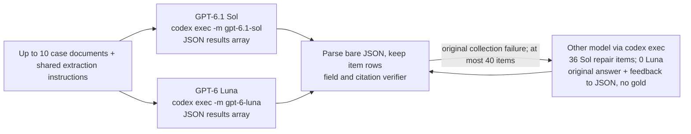

# Synthetic data needs an answer key and a reason to keep each row

An operations analyst receives a message thread saying an order changed twice. One reply quotes an old price, another cancels the order, and a later message confirms the SKU. A useful dataset row must describe the final order and point to the messages that support each field. A fluent-looking row can still be wrong if it uses an outdated value or cites a sentence that merely repeats the obsolete value.

For example, suppose a thread says “Order O-481 is 4 cases of part AX-7,” then defines each case as 12 units. The quantity in individual units is 48, and both messages support it. A row that says 48 but cites only the first message has the right value and incomplete evidence. That distinction matters when generated examples will be reviewed, used to test extraction software, or considered for a later training project.

Synthetic data means records made for an experiment rather than copied from real people or businesses. It can provide exact answers, but generation alone does not make it useful. A curation pipeline must check values, evidence, variety, duplicates, difficult cases, and whether a suggested repair actually fixed the failure. This experiment studies that pipeline on newly authored fictional order threads.

Recursive self-improvement (RSI) research often studies loops in which systems propose tasks, produce solutions, check them, and use observed weaknesses to guide later data collection ([Shi et al., 2026](https://arxiv.org/abs/2605.14392); [Zhao et al., 2025](https://arxiv.org/abs/2505.03335)). Here, the models’ weights stay fixed. The experiment tests the data pipeline around that loop: generating exact-answer tasks, checking answers and evidence, removing semantic duplicates, attempting bounded repairs, and adapting which cases are sampled. It does not train a model or test recursive self-improvement.

## Experiment summary

The full run contains 180 collection slots and 20 layout-audit cases. In collection, GPT-6 Luna passed 303/360 responses and GPT-6.1 Sol passed 360/360; on the audit they passed 18/20 and 20/20. The score requires valid schema, seven exact values, and sufficient citations. The cases use a small set of explicit rules, and repeated responses to one case are correlated. A separate post-hoc status-evidence sensitivity review accepts 310/360 Luna and 360/360 Sol collection responses; the frozen strict counts remain the primary result.

A separate eight-case interface pilot produced 32 original responses. 32/32 had all seven values correct and 30/32 passed the evidence check too (GPT-6 Luna 14/16 accepted; GPT-6.1 Sol 16/16 accepted). It is saved under `data/pilot/` and is not included in the main totals. Each pilot batch used 19,105–19,799 input tokens and 904 output tokens; the four calls took 10.9–16.6 seconds each. Most input usage is CLI instruction and setup overhead, so these token counts are not the size of the message text alone.

## Contents

- [1. Task and question](#1-task-and-question)
- [2. Setup](#2-setup)
- [3. Fresh data](#3-fresh-data)
- [4. Candidate collection](#4-candidate-collection)
- [5. Verification and curation](#5-verification-and-curation)
- [6. Corrections](#6-corrections)
- [7. Failure-guided sampling](#7-failure-guided-sampling)
- [8. Audit and error analysis](#8-audit-and-error-analysis)
- [9. Limitations](#9-limitations)
- [10. Reproduction and cost](#10-reproduction-and-cost)
- [11. Future work and further reading](#11-future-work-and-further-reading)

```mermaid
flowchart LR
    source["Seeded fictional order events<br/>180 collection slots"] --> render["Deterministic message renderers<br/>threads, IDs, hashes, exact answer keys"]
    render --> select["Shared, fixed, adaptive samples<br/>duplicates tracked by semantic hash"]
    select --> sol["GPT-6.1 Sol<br/>codex exec, 380 original rows"]
    select --> luna["GPT-6 Luna<br/>codex exec, 380 original rows"]
    audit --> sol
    audit --> luna
    sol --> verifier["Per-case verifier<br/>case ID, values, evidence"]
    luna --> verifier
    verifier -->|"original collection failures only"| repair["36 repair items + re-verification<br/>maximum 40; original output + field feedback"]
    verifier -->|"accepted collection answers + natural comparisons"| exports
    verifier -->|"prior shared/adaptive labels; next round"| select
    repair --> exports["Deduplicated accepted examples<br/>paired preferences, repair records, rejects"]
    audit_seed["Pre-specified audit rule and seed"] --> audit["20 cases generated after collection selection<br/>held-out archive layout, one draw per model"]
    verifier --> results["Metrics, examples, figures, cached responses"]
    exports --> review["Post-collection evidence review<br/>7 status-citation decisions reversed"]
    review --> reviewed["Reviewed exports<br/>162 examples, 28 pairs, 29 repair conversations"]
    reviewed --> results
```



The diagram counts collection slots, not model requests. A request contains at most ten cases. For one example, the generator creates a structured order and its exact final answer, renders the events into a message thread, and sends only the task instructions and thread to a model. The verifier compares the returned fields and cited message IDs with the source events. A failed candidate may be sent to the other model with the original output and field-level reasons. That adds supervision from the verifier, though the repair request never includes the answer key.

## 1. Task and question

The practical problem is to make synthetic extraction examples that are both correct and inspectable. A plain label such as “correct” hides two different checks. First, the extracted order fields must match the final state. Second, each field must cite enough source messages to support that value. A wrong answer can teach the wrong rule; a correct answer with a weak citation can conceal a guess.

The experiment compares GPT-6.1 Sol with GPT-6 Luna through `codex exec`. Each gets the same newly generated cases and exact task instructions. Collection cases receive two separate draws per model. These are repeated calls, not independent samples, because the same model and case are reused. A separate set of cases uses a held-out archive-export layout, and each model gets one draw on each audit case. The question is how often each model returns a schema-valid answer with every field and every field citation accepted, and whether repairs or failure-guided sampling change the number and mix of usable examples.

The main result below reports the measured collection and audit counts. The collection score is a response-level rate: accepted responses divided by attempted original responses. Responses to the same case share its wording and are not independent, so the sample size is not the number of model replies. The audit is a small descriptive check on a changed document layout, not proof of performance on new companies or order systems.

The table separates collection from the sealed layout audit. “All fields exact” checks the seven values and ignores citations; “accepted” also requires valid schema and sufficient citations for every field. Each denominator is the original response count for that model and split. The interval uses one first-draw response per distinct collection case and the Wilson binomial formula. It is descriptive: cases in the same CLI batch share prompt overhead and the source templates create dependence.

| Model | Collection: accepted | All fields exact | First draw exact, descriptive 95% interval | Audit: accepted | Audit: all fields exact |
|---|---:|---:|---:|---:|---:|
| GPT-6 Luna | 303/360 (84.2%) | 360/360 (100.0%) | 162/162 [97.7%, 100.0%] | 18/20 (90.0%) | 20/20 (100.0%) |
| GPT-6.1 Sol | 360/360 (100.0%) | 360/360 (100.0%) | 162/162 [97.7%, 100.0%] | 20/20 (100.0%) | 20/20 (100.0%) |

The verifier accepted 663/720 original collection responses (92.1%) after checking all seven values and their citations. GPT-6.1 Sol accepted 360/360 and GPT-6 Luna accepted 303/360; Sol's observed acceptance rate was 15.8 points higher in this fixed sample. On the 20-case layout audit, Sol accepted 20/20 and Luna accepted 18/20. These are descriptive counts from the cases and prompt batches in this run. The full workflow and the limits of this sample are explained below.

## 2. Setup

The notebook uses Python to generate cases, call the two installed Codex models through their CLI, validate output, and save the results. It imports no project helper at run time: fixture generation, transport, scoring, and plotting are embedded below as code cells. The normal run is offline and reads cached replies. A cache miss stops the notebook; setting `NB_LIVE=1` explicitly permits a new Codex call.

Each request names the model, stage, prompt, case documents, sample number, protocol version, reasoning setting, and runner limits. The full request is hashed and stored with raw CLI output, parsed JSON, usage, elapsed time, and errors. The call runner uses an empty temporary folder and a read-only sandbox, with shell, apps, plugins, browser, and subagents disabled. Prompts contain only the task instructions and selected case documents; observed tool events are checked in the saved attempts.

The two model IDs are service aliases, not immutable dated snapshots. The saved usage and model metadata describe what the CLI reported for this run. OpenAI lists knowledge cutoffs of April 30, 2026 for GPT-6.1 Sol and May 18, 2026 for GPT-6 Luna. The generated source records are dated October 24, 2026, after both cutoffs. The comparison is about this frozen extraction protocol; it does not claim a general ranking of the models.

## 3. Fresh data

The source records are programmatic fictional orders, not real customer data and not examples written by either model. A seeded generator chooses facts such as order numbers, SKUs, quantities, prices, dates, amendments, and cancellation states. A deterministic renderer turns those events into message threads with explicit revision numbers; timestamps and display order do not decide which amendment wins. The exact answer is derived from the structured events before the model sees the rendered text.

The full protocol has 180 collection slots: 60 shared cases, then 30 fixed and 30 adaptive cases in each of two rounds. It also has 20 sealed audit cases. Ten percent of collection slots are replaced with differently formatted siblings; those siblings retain a link to their source and a shared semantic hash. The resulting 200 slots represent 182 distinct source records when all replacement rules are applied. Deduplication is measured by semantic meaning, not by text alone.

The eight case families cover a direct order, chronological amendments, an obsolete value inside a quote, conflicting updates, cancellation, distractor orders, conversion from cases to units, and conditional requests followed by partial amendments. The audit rule and seed were specified in advance, but its cases were generated after collection selection. The audit changes the archive-export layout while keeping message wording rules the same. It uses the same semantic families, so it tests a format shift rather than new business rules.

All source cases are generated for this run on October 24, 2026. There is no historical data filter because no historical examples are used. The stored [`provenance.json`](data/provenance.json) records the date, model cutoff sources, model alias limitation, and rights note. Generated model responses are service outputs. Their presence here does not grant permission for unrestricted downstream training use.

The worked examples in section 5 begin with a direct order (`case-02bb329d435cda91b3db`). Each stable case ID connects its document, answer key, candidate outputs and verifier record. The notebook's data display also prints the first collected thread, an amendment case (`case-d21ea1f31fe9e00804b7`).

## 4. Candidate collection

Each collection case is sent to each model twice. The shared first round establishes a common starting point. Later rounds compare a fixed sample, which preserves the balanced family mix, with an adaptive sample that gives more slots to families where prior shared or adaptive candidates failed. Both arms keep a slot for every family. The adaptive weights use original candidate failures only; fixed-arm results, audit results, and repairs do not affect selection.

The candidate request contains the common task instructions plus the selected case ID and rendered document. It does not contain the family label, gold fields, evidence answer, split label, or semantic hash. Keeping those evaluator fields out prevents the model from receiving the answer through metadata. A batch can contain up to ten cases; separate calls for models, samples, and batches can run concurrently. Within one batch the model returns several results in one response, so item outcomes in that response share the same prompt and transport event.



The two original model calls for a batch can run at the same time; repair waits until a candidate has been checked. The 4-worker cap applies to independent CLI requests. The repair edge loops back through the same verifier and does not modify the original answer record or the sampling history.

The exact instruction sent with each case is shown here. The following document data is the only case-specific input; evaluator labels and answers are omitted.

<details><summary>Exact shared task instructions</summary>

```text
Extract the final state of the TARGET ORDER from the message thread.
Return one JSON object with exactly these keys: case_id, answer, evidence.
case_id must equal the supplied case ID. answer must contain exactly order_id,
sku, quantity_units, unit_price_cents, currency, ship_date, status. order_id and
sku are strings; quantity_units and unit_price_cents are integers or null;
currency is a three-letter code or null; ship_date is YYYY-MM-DD or null;
status is active, cancelled, or ambiguous. Never put a Boolean in an integer field.
Prices are per individual unit, in integer cents. Convert cases to individual
units using the stated packing definition. Do not invent absent information.

Only approved messages for the target order change its state. Higher revision
numbers supersede lower revisions for EACH FIELD separately; display order and
message timestamps do not decide precedence. A partial amendment leaves other
fields unchanged. A conditional request explicitly marked unconfirmed has no
effect. Quoted historical messages and messages for other orders have no effect.
If the highest approved revision for a field has conflicting values, return null
for that field and ambiguous status. Equal values at the same revision agree.
A cancellation overrides all commercial fields: quantity_units, unit_price_cents,
currency and ship_date become null; order_id and sku remain known, status is cancelled.
An explicitly withdrawn shipping date is null but does not itself make status ambiguous.

evidence must have exactly the same seven field names, each mapped to a nonempty
list of distinct message IDs. Cite messages that establish that field's current
value. Any equally sufficient current source is accepted.
Earlier same-valued assignments remain valid only if no equal-or-higher revision
supplies a different value for that field. An old value that was changed and
later restored needs evidence from the restoration, not the old assignment.
For a conflict cite the contradictory highest-revision messages; for a conversion
cite the quantity
message AND the packing definition. Cite the cancellation for cleared fields and
cancelled status. For ambiguous status cite a complete conflicting pair. Extra
citations are allowed only when they also support the same current field, or are
necessary conversion context. Stale, quoted, unrelated, or nonexistent citations
are rejected. Do not add explanations or any extra keys to the JSON object.
```

</details>

The live subprocess removes the final stdin marker from the option list, then builds its argument vector as `[codex_executable, *CLI_OPTIONS[:-1], '-m', model_id, '-']`; the final `-` passes the request prompt on standard input. The exact frozen `CLI_OPTIONS` prefix is:

```json
[
  "exec",
  "--skip-git-repo-check",
  "--ephemeral",
  "--ignore-user-config",
  "--ignore-rules",
  "--sandbox",
  "read-only",
  "--disable",
  "shell_tool",
  "--disable",
  "unified_exec",
  "--disable",
  "apps",
  "--disable",
  "plugins",
  "--disable",
  "multi_agent",
  "--disable",
  "browser_use",
  "--disable",
  "computer_use",
  "--disable",
  "image_generation",
  "--disable",
  "code_mode",
  "--disable",
  "code_mode_host",
  "--disable",
  "shell_snapshot",
  "-c",
  "model_reasoning_effort=\"low\"",
  "--json"
]
```

The output is one JSON object with a `results` array. Each row carries a case ID, seven answer fields, and one list of cited message IDs per field. A quantity, unit price, currency, or ship date may be `null` when the task requires it, including cancellation, missing values, or ambiguity; all other values still need the required type. The notebook keeps the raw response before parsing it. A malformed item does not erase its parseable neighbors, but it fails that item's answer check.

## 5. Verification and curation

The verifier performs three separate checks. Schema validity asks whether the answer has the exact field names and types. Exact-field accuracy asks whether all seven values equal the final structured order state. Evidence acceptance asks whether every field cites a sufficient set of source messages and contains no unsupported or irrelevant citations. A response is accepted only if all three checks pass.

For example, if a message changes quantity from 4 cases to 5 cases and another says one case contains 12 individual units, the final unit quantity is 60. The field needs both the latest quantity message and the packing definition. A citation to the earlier quantity is obsolete. The checker allows any sufficient evidence set; it does not require one arbitrarily chosen citation order. This tests agreement with the generated support rules, not whether the renderer's prose sounds natural to a human reader.

Accepted records are deduplicated by semantic hash before export. Separately, naturally occurring good and bad answers to the same case can form a preference pair. No failures are injected to create such pairs. Verification controls are deliberately mutated checker inputs and are reported separately; they are not model responses, training examples, or evidence of model failure.


Read from top to bottom as successive filters. The first four bars count responses, while the last two count distinct underlying cases, so the chart changes units at semantic deduplication. The gap between exact fields and accepted responses is where citation failures appear. Accepted exports pass the same verifier by construction; that describes the filter and is not an independent estimate of real-world quality.

All 720 original collection responses had valid schemas (720) and exact values (720); 57 still failed evidence checks. The missing or unsupported citation fields were SKU (50) and status (7). 49 SKU failures were cancellations: the model cited the cancellation message, which says to retain the SKU but does not state its value; the earlier order message supplies that value. Seven strict status-citation rejections are reviewed separately below because an approved partial amendment can support an unchanged field.

The saved run contains 663 accepted original responses and 699 accepted responses when successful repairs are counted. Semantic deduplication keeps 162 accepted cases and removes 537 repeated responses. The exports contain 162 accepted examples, 35 naturally occurring same-case preference pairs, 36 repair conversations, and 57 rejected examples. Preference pairs are emitted only where a natural accepted and rejected candidate share one source case; no synthetic error was inserted to fill the file.

The frozen verifier remains the primary result. A separate, post-collection sensitivity review changes only a narrow status-citation rule; it does not add model calls, change the sampler, or rewrite the strict metrics. The rule requires a literal current message saying the order is active, plus cited approved partial amendments for the same order that explicitly retain unstated fields and support another current field. It excludes cancellations, quotes, conditional or stale messages, conflicts, wrong values, and other evidence failures. The rule was selected after seeing the answers, so this is a sensitivity analysis, not an independent quality estimate.

| Model | Strict accepted | Reviewed accepted | Change |
|---|---:|---:|---:|
| GPT-6 Luna | 303/360 | 310/360 | +7 |
| GPT-6.1 Sol | 360/360 | 360/360 | +0 |

The review changed 7 of 720 collection rows. All seven were GPT-6 Luna status citations in shared round 1. The strict sampler used those original labels, and its later selection history is preserved. For both models combined, collection acceptance changes from 663/720 to 670/720. For Luna specifically, it changes from 303/360 to 310/360; GPT-6.1 Sol remains 360/360.

For `case-cff45be46a031d721591`, GPT-6 Luna returned status `active` and cited `M01, M03`. The strict verifier rejected that status evidence. The cited source text is:

`M01`: [M01] APPROVED order message. Order ORD-939991. Revision 0. SKU WASH-393; ship 16 individual units; unit price 40.94 CAD per individual unit; billing currency CAD; ship on 2026-11-09; order is active.

`M03`: [M03] APPROVED order message. Order ORD-939991. Revision 1. unit price 41.11 CAD per individual unit; shipping date withdrawn; no replacement date is confirmed. Only the fields stated here are amended.

The first citation states the current active status. The later approved amendment says only stated fields change, so it supplies context that status remains active while supporting the changed price/date fields. The review accepts this specific citation set; it does not grant blanket credit to extra citations. This is a code-based post-hoc review, not a human annotation.

Reviewed exports retain only rows that pass this rule. Counts, strict to reviewed: accepted examples 162 to 162 (removed 0); preference pairs 35 to 28 (removed 7); repair conversations 36 to 29 (removed 7); rejected examples 57 to 50 (removed 7). The original files under `data/exports/` remain frozen; the separate files under `data/exports_reviewed/` provide the sensitivity view.

### Example 1: Simple task, `case-02bb329d435cda91b3db`

This is a measured simple case selected by a stated category, not a hand-written failure. Its rendered thread is:

```text
TARGET ORDER: ORD-446561
Case ID: case-02bb329d435cda91b3db
Fictional order thread. Revision numbers determine authority, independently for each field.
[M01] APPROVED order message. Order ORD-446561. Revision 0. SKU SEAL-829; ship 7 individual units; unit price 35.25 USD per individual unit; billing currency USD; ship on 2026-11-01; order is active.

[M02] APPROVED order message. Order ORD-446561. Revision 1. SKU SEAL-829; ship 7 individual units; unit price 35.25 USD per individual unit; billing currency USD; ship on 2026-11-01; order is active. Only the fields stated here are amended.
```

Selected candidate `case-02bb329d435cda91b3db:gpt-6-luna:generate:0` from GPT-6 Luna, sample 0.

Expected answer:

```json
{
  "currency": "USD",
  "order_id": "ORD-446561",
  "quantity_units": 7,
  "ship_date": "2026-11-01",
  "sku": "SEAL-829",
  "status": "active",
  "unit_price_cents": 3525
}
```

Parsed model row:

```json
{
  "case_id": "case-02bb329d435cda91b3db",
  "answer": {
    "currency": "USD",
    "order_id": "ORD-446561",
    "quantity_units": 7,
    "ship_date": "2026-11-01",
    "sku": "SEAL-829",
    "status": "active",
    "unit_price_cents": 3525
  },
  "evidence": {
    "currency": [
      "M02"
    ],
    "order_id": [
      "M02"
    ],
    "quantity_units": [
      "M02"
    ],
    "ship_date": [
      "M02"
    ],
    "sku": [
      "M02"
    ],
    "status": [
      "M02"
    ],
    "unit_price_cents": [
      "M02"
    ]
  }
}
```

Observed fields:

```json
{
  "currency": "USD",
  "order_id": "ORD-446561",
  "quantity_units": 7,
  "ship_date": "2026-11-01",
  "sku": "SEAL-829",
  "status": "active",
  "unit_price_cents": 3525
}
```

This selected row scored 7/7 fields exact; 7/7 fields have sufficient citations; overall it was **accepted**. A response is accepted only when schema, all seven values, and every field's citations pass. Across both models and two draws, this case has 4 original responses; the selected row is identified by candidate ID and the saved JSONL records.

The selected model row is shown as JSON above. Its full batched request and raw CLI reply are preserved in [`data/cache/aa2b270072ef698b3e906c45c660c486bced52838926c386216e363f72e8d79b.json`](data/cache/aa2b270072ef698b3e906c45c660c486bced52838926c386216e363f72e8d79b.json).


### Example 2: Conversion end-to-end, `case-10ef5f52f2daad6d57ee`

This is a measured case to unit case selected by a stated category, not a hand-written failure. Its rendered thread is:

```text
TARGET ORDER: ORD-451562
Case ID: case-10ef5f52f2daad6d57ee
Fictional order thread. Revision numbers determine authority, independently for each field.
[M01] APPROVED order message. Order ORD-451562. Revision 0. SKU WASH-806; unit price 45.95 EUR per individual unit; billing currency EUR; ship on 2026-10-30; order is active; ship 5 cases (not individual units).

[M02] Packing definition for SKU WASH-806: one case contains exactly 24 individual units.
```

This end-to-end example converts 5 cases into individual units. The order is in `M01` and the packing rule is in `M02`: 5 × 24 = **120 units**. Both message IDs must support the quantity field. The score counts exact field values (7/7) and fields with sufficient citations (7/7); acceptance also requires the required answer shape.

Selected candidate `case-10ef5f52f2daad6d57ee:gpt-6-luna:generate:0` from GPT-6 Luna, sample 0.

Expected answer:

```json
{
  "currency": "EUR",
  "order_id": "ORD-451562",
  "quantity_units": 120,
  "ship_date": "2026-10-30",
  "sku": "WASH-806",
  "status": "active",
  "unit_price_cents": 4595
}
```

Parsed model row:

```json
{
  "case_id": "case-10ef5f52f2daad6d57ee",
  "answer": {
    "currency": "EUR",
    "order_id": "ORD-451562",
    "quantity_units": 120,
    "ship_date": "2026-10-30",
    "sku": "WASH-806",
    "status": "active",
    "unit_price_cents": 4595
  },
  "evidence": {
    "currency": [
      "M01"
    ],
    "order_id": [
      "M01"
    ],
    "quantity_units": [
      "M01",
      "M02"
    ],
    "ship_date": [
      "M01"
    ],
    "sku": [
      "M01"
    ],
    "status": [
      "M01"
    ],
    "unit_price_cents": [
      "M01"
    ]
  }
}
```

Observed fields:

```json
{
  "currency": "EUR",
  "order_id": "ORD-451562",
  "quantity_units": 120,
  "ship_date": "2026-10-30",
  "sku": "WASH-806",
  "status": "active",
  "unit_price_cents": 4595
}
```

This selected row scored 7/7 fields exact; 7/7 fields have sufficient citations; overall it was **accepted**. A response is accepted only when schema, all seven values, and every field's citations pass. Across both models and two draws, this case has 4 original responses; the selected row is identified by candidate ID and the saved JSONL records.

The selected model row is shown as JSON above. Its full batched request and raw CLI reply are preserved in [`data/cache/97ae1a06c704b50ee5428c807d3d5c4298c14dc250062bf11a24ca72106535db.json`](data/cache/97ae1a06c704b50ee5428c807d3d5c4298c14dc250062bf11a24ca72106535db.json).


### Example 3: Ordinary success, `case-01e8f866cb3dd07f9ea2`

This is a measured conflicting updates case selected by a stated category, not a hand-written failure. Its rendered thread is:

```text
TARGET ORDER: ORD-456405
Case ID: case-01e8f866cb3dd07f9ea2
Fictional order thread. Revision numbers determine authority, independently for each field.
[M01] APPROVED order message. Order ORD-456405. Revision 0. SKU BOLT-467; ship 13 individual units; unit price 38.75 EUR per individual unit; billing currency EUR; ship on 2026-11-05; order is active.

[M02] APPROVED order message. Order ORD-456405. Revision 1. ship 15 individual units. Only the fields stated here are amended.

[M03] APPROVED order message. Order ORD-456405. Revision 1. ship 17 individual units. Only the fields stated here are amended.
```

Selected candidate `case-01e8f866cb3dd07f9ea2:gpt-6-luna:generate:0` from GPT-6 Luna, sample 0.

Expected answer:

```json
{
  "currency": "EUR",
  "order_id": "ORD-456405",
  "quantity_units": null,
  "ship_date": "2026-11-05",
  "sku": "BOLT-467",
  "status": "ambiguous",
  "unit_price_cents": 3875
}
```

Parsed model row:

```json
{
  "case_id": "case-01e8f866cb3dd07f9ea2",
  "answer": {
    "currency": "EUR",
    "order_id": "ORD-456405",
    "quantity_units": null,
    "ship_date": "2026-11-05",
    "sku": "BOLT-467",
    "status": "ambiguous",
    "unit_price_cents": 3875
  },
  "evidence": {
    "currency": [
      "M01"
    ],
    "order_id": [
      "M01"
    ],
    "quantity_units": [
      "M02",
      "M03"
    ],
    "ship_date": [
      "M01"
    ],
    "sku": [
      "M01"
    ],
    "status": [
      "M02",
      "M03"
    ],
    "unit_price_cents": [
      "M01"
    ]
  }
}
```

Observed fields:

```json
{
  "currency": "EUR",
  "order_id": "ORD-456405",
  "quantity_units": null,
  "ship_date": "2026-11-05",
  "sku": "BOLT-467",
  "status": "ambiguous",
  "unit_price_cents": 3875
}
```

This selected row scored 7/7 fields exact; 7/7 fields have sufficient citations; overall it was **accepted**. A response is accepted only when schema, all seven values, and every field's citations pass. Across both models and two draws, this case has 4 original responses; the selected row is identified by candidate ID and the saved JSONL records.

The selected model row is shown as JSON above. Its full batched request and raw CLI reply are preserved in [`data/cache/a73a6fc4b13a9e3921bce50b0969e7b12020381bf45815f599adeabb2131a08a.json`](data/cache/a73a6fc4b13a9e3921bce50b0969e7b12020381bf45815f599adeabb2131a08a.json).


### Example 4: Natural rejection, `case-00d3969b85140c0d09c5`

This is a measured cancelled order case selected by a stated category, not a hand-written failure. Its rendered thread is:

```text
TARGET ORDER: ORD-303652
Case ID: case-00d3969b85140c0d09c5
Fictional order thread. Revision numbers determine authority, independently for each field.
[M01] APPROVED order message. Order ORD-303652. Revision 0. SKU BOLT-326; ship 26 individual units; unit price 12.44 CAD per individual unit; billing currency CAD; ship on 2026-12-03; order is active.

[M02] APPROVED CANCELLATION. Order ORD-303652. Revision 1. cancel the entire target order; clear quantity, price, billing currency and shipping date; retain its order number and SKU.
```

Selected candidate `case-00d3969b85140c0d09c5:gpt-6-luna:generate:0` from GPT-6 Luna, sample 0.

Expected answer:

```json
{
  "currency": null,
  "order_id": "ORD-303652",
  "quantity_units": null,
  "ship_date": null,
  "sku": "BOLT-326",
  "status": "cancelled",
  "unit_price_cents": null
}
```

Parsed model row:

```json
{
  "case_id": "case-00d3969b85140c0d09c5",
  "answer": {
    "currency": null,
    "order_id": "ORD-303652",
    "quantity_units": null,
    "ship_date": null,
    "sku": "BOLT-326",
    "status": "cancelled",
    "unit_price_cents": null
  },
  "evidence": {
    "currency": [
      "M02"
    ],
    "order_id": [
      "M02"
    ],
    "quantity_units": [
      "M02"
    ],
    "ship_date": [
      "M02"
    ],
    "sku": [
      "M02"
    ],
    "status": [
      "M02"
    ],
    "unit_price_cents": [
      "M02"
    ]
  }
}
```

Observed fields:

```json
{
  "currency": null,
  "order_id": "ORD-303652",
  "quantity_units": null,
  "ship_date": null,
  "sku": "BOLT-326",
  "status": "cancelled",
  "unit_price_cents": null
}
```

This selected row scored 7/7 fields exact; 6/7 fields have sufficient citations; overall it was **rejected**. A response is accepted only when schema, all seven values, and every field's citations pass. Across both models and two draws, this case has 4 original responses; the selected row is identified by candidate ID and the saved JSONL records. The field values are right; the failure is the SKU citation. M02 says to retain the SKU but does not state `BOLT-326`. This answer cites ['M02'], so it needs the source message M01 that states the literal value.

The selected model row is shown as JSON above. Its full batched request and raw CLI reply are preserved in [`data/cache/5a762239c5730606b510804d8abb0892e7c45e4cf4cd8f4364811f78168bc1ca.json`](data/cache/5a762239c5730606b510804d8abb0892e7c45e4cf4cd8f4364811f78168bc1ca.json).


### Example 5: Model or sample disagreement, `case-0510193407581dabaad0`

This is a measured cancelled order case selected by a stated category, not a hand-written failure. Its rendered thread is:

```text
TARGET ORDER: ORD-499822
Case ID: case-0510193407581dabaad0
Fictional order thread. Revision numbers determine authority, independently for each field.
[M01] APPROVED order message. Order ORD-499822. Revision 0. SKU WASH-484; ship 28 individual units; unit price 2.79 USD per individual unit; billing currency USD; ship on 2026-11-26; order is active.

[M02] APPROVED CANCELLATION. Order ORD-499822. Revision 1. cancel the entire target order; clear quantity, price, billing currency and shipping date; retain its order number and SKU.
```

Selected candidate `case-0510193407581dabaad0:gpt-6-luna:generate:0` from GPT-6 Luna, sample 0.

Expected answer:

```json
{
  "currency": null,
  "order_id": "ORD-499822",
  "quantity_units": null,
  "ship_date": null,
  "sku": "WASH-484",
  "status": "cancelled",
  "unit_price_cents": null
}
```

Parsed model row:

```json
{
  "case_id": "case-0510193407581dabaad0",
  "answer": {
    "currency": null,
    "order_id": "ORD-499822",
    "quantity_units": null,
    "ship_date": null,
    "sku": "WASH-484",
    "status": "cancelled",
    "unit_price_cents": null
  },
  "evidence": {
    "currency": [
      "M02"
    ],
    "order_id": [
      "M02"
    ],
    "quantity_units": [
      "M02"
    ],
    "ship_date": [
      "M02"
    ],
    "sku": [
      "M02"
    ],
    "status": [
      "M02"
    ],
    "unit_price_cents": [
      "M02"
    ]
  }
}
```

Observed fields:

```json
{
  "currency": null,
  "order_id": "ORD-499822",
  "quantity_units": null,
  "ship_date": null,
  "sku": "WASH-484",
  "status": "cancelled",
  "unit_price_cents": null
}
```

This selected row scored 7/7 fields exact; 6/7 fields have sufficient citations; overall it was **rejected**. A response is accepted only when schema, all seven values, and every field's citations pass. Across both models and two draws, this case has 4 original responses; the selected row is identified by candidate ID and the saved JSONL records. The field values are right; the failure is the SKU citation. M02 says to retain the SKU but does not state `WASH-484`. This answer cites ['M02'], so it needs the source message M01 that states the literal value.

All four original draws for this case show the model disagreement, not just the selected Luna failure:

| Model | Draw | Overall result | SKU citations |
|---|---:|---|---|
| GPT-6 Luna | 0 | rejected | M02 |
| GPT-6 Luna | 1 | rejected | M02 |
| GPT-6.1 Sol | 0 | accepted | M01 |
| GPT-6.1 Sol | 1 | accepted | M01 |

Both Luna draws cite M02 alone for the retained SKU, but M02 does not state `WASH-484`, so they fail the SKU evidence rule. Both Sol draws cite M01, which states the literal SKU, and pass. The values are correct in all four responses; the difference is evidence selection.

The selected model row is shown as JSON above. Its full batched request and raw CLI reply are preserved in [`data/cache/ac23e6117e1639dcd99b88ce7d5a39a9b466a08c474ae1192a334bada338a15b.json`](data/cache/ac23e6117e1639dcd99b88ce7d5a39a9b466a08c474ae1192a334bada338a15b.json).


At least one natural rejection occurred: 36/180 collection slots had a rejected response. Model or draw acceptance differed on 36/180 collection slots; selected IDs link to those candidates.

## 6. Corrections

When original answers fail verification, the experiment can ask the other model to repair a bounded subset. It receives the original answer and the verifier's field-level reasons, not the gold answer. The repair is checked against the same source record with the same schema, exact values, and citation rules. A repair that merely changes the value but keeps an obsolete citation still fails.

The repair budget is at most 40 repair items, separate from the original candidate budget. Each item is one repair attempt; several items may share a batched CLI request. Repair outcomes do not change fixed/adaptive sampling weights. The run reports counts by direction, because a Luna answer repaired by Sol and a Sol answer repaired by Luna are different workflows. If no original answer fails, there is no repair result to report.


GPT-6.1 Sol repaired GPT-6 Luna: 36/36 accepted. All 36 attempts passed. They cover 35 semantic cases, but add no new distinct accepted cases: Sol already accepted every one of its 162 semantic collection cases. The repairs improve responses to failed Luna candidates, but not the number of unique accepted records. Repairs are separate from the model comparison and adaptive-family error rates. The bars show attempts by direction. A repaired example is retained only if it passes the same field and evidence verifier.

## 7. Failure-guided sampling

Adaptive sampling is a way to spend a fixed number of new examples on observed weak spots. For each family it estimates how often a semantic case had at least one rejected original answer. A small prior shrinks estimates when only a few cases are available. The adaptive arm mixes these rates with a uniform distribution, so a hard family can receive more cases without removing all coverage from easier families.

The fixed and adaptive arms receive equal original candidate budgets. The comparison therefore asks whether failure-guided selection changes the kinds of examples produced under the same number of prompts. It does not measure model learning: model weights stay fixed. A higher rejection rate in the adaptive arm can mean the sampler found harder cases, not that the model became worse.


Round 2: fixed 3/30 (10.0%), adaptive 7/30 (23.3%); Round 3: fixed 4/30 (13.3%), adaptive 7/30 (23.3%). The left panel counts cases with at least one rejected original answer, not failed responses. The right panel counts source slots by family. Read the panels together: the adaptive arm is designed to change sample difficulty while preserving all eight family labels. These small arm counts describe the sampler's behavior in this run; they do not show that the models learned or improved.

## 8. Audit and error analysis

The audit rule and seed were specified before collection, but its cases were generated after collection selection. Neither their outcomes nor their family labels enter adaptive selection or repair choice. Each model receives one draw on every audit item. Audit results are read as a small comparison between the collection renderer and an archive-export layout. The shared semantic families mean this is not a test of entirely new rules.

The worked examples in Section 5 are selected from stable case IDs in the saved candidate file. They show an ordinary case, an end-to-end answer, a verified success, a natural failure when one exists, and a model or sample disagreement when one exists. If the collection contains no natural failures or disagreements, the notebook says so and shows the nearest informative cases instead. One striking case cannot replace the aggregate counts.

On the 20-case layout audit, GPT-6 Luna accepted 18/20 responses and GPT-6.1 Sol accepted 20/20. Each model receives one draw per case here. The audit changes the renderer and file layout, but reuses the same eight rules, so it measures resilience to this format shift only.


All 40 audit responses had valid schema and exact values. Luna's two rejected responses both failed on SKU evidence; Sol passed all 20. A single case changes a model's audit rate by five percentage points, so small differences should be read as a description of this sample.


The heatmap counts rejected responses in each model-family group; its cell annotation is rejected over responses. The lowest observed acceptance groups were GPT-6 Luna on cancelled order: 7/56 (12.5%) accepted; GPT-6 Luna on quoted obsolete: 49/52 (94.2%) accepted. Across collection, 57 original responses did not pass the acceptance checks. A family pattern can guide a new sample, but a group with few cases is unstable. The chart cannot identify why an error occurred by itself; the worked examples in Section 5 show the specific conflict or citation mismatch.

## 9. Limitations

These records use eight hand-designed rule families, short message threads, explicit revision order, and one target SKU per order. A model that succeeds here has not thereby shown that it can curate arbitrary business data. The generated wording and answer keys share a programmatic source, so exact agreement may be easier than interpretation of real correspondence.

A separate event reducer recomputes each answer without reading gold, and fixture audits compare the two implementations; answer verification then checks values against the audited gold. The generator and reducer still share the same stated rules. This is not independent human annotation, and no human review of all candidate prose is measured. The archive layout is held out, but semantic rules overlap collection. The seven status-evidence cases were reviewed only after collection; the adaptive sampler and selection history remain based on the strict labels used at the time. Model aliases do not identify frozen dated snapshots.

Four original responses per collection case are correlated, and calls group several cases into shared prompts. Wilson intervals shown for first-sample case results are descriptive and assume more independence than the batch design provides. With only 20 audit cases, one item changes a rate by five percentage points. Token counts include substantial CLI prompt and setup overhead, not only the visible document text. Codex CLI does not report dollar spend, so unknown USD cost is not zero.

The results support using executable answer keys, evidence checks, semantic deduplication, and a sealed format audit when building this kind of dataset. They do not establish downstream training value. A later study would need human review of naturalness and coverage, an external evaluation of any trained model, and permission review for the intended use of generated service responses.

## 10. Reproduction and cost

The committed notebook saves all source cases, candidate and repair responses, request caches, metrics, exports, and figures under `data/` and `figures/`. The default run uses the full configuration and `NB_LIVE` off, so it replays from the frozen cache. A missing cache entry raises instead of making a call. Pilot files are isolated under `data/pilot/`; their responses are not mixed into main metrics.

To reproduce the committed results in PowerShell, install the repository dependencies once, enter the notebook folder, and execute the notebook. Python 3.13 works with the checked environment versions shown below. The default run is offline and requires the committed request cache.

```powershell
python -m pip install -r .\requirements.txt
Set-Location .\notebooks\23-synthetic-data-curation
python -m nbconvert --to notebook --execute --inplace .\23_synthetic_data_curation.ipynb
```

For an explicitly live smoke test, set `NB_LIVE` before execution. It uses the small `PILOT_CONFIG`: 40 collection source slots (8 shared plus four 8-slot arm-round batches) and 8 audit slots, for 176 original model answers and at most 8 repair items. It stores output under `data/tmp/live_demo`, apart from the committed main results. The installed Codex CLI must have access to both model aliases. To restore offline mode, remove the environment variable.

```powershell
$env:NB_LIVE = "1"
python -m nbconvert --to notebook --execute --inplace .\23_synthetic_data_curation.ipynb
Remove-Item Env:NB_LIVE
```

A new full live collection needs a separate result copy and an intentional configuration change. The manifest records the seed, sample counts, batch size, model IDs, repair-item cap, and timeout. A changed request gets a new full-request cache key. Keep the existing cache to reproduce these results.

The main manifest records 760 original candidate responses, 36 repairs, and 82 CLI requests (0 transport failures). The recorded usage totals 1,735,811 input tokens and 94,255 output tokens. That is 10,715 input tokens per distinct accepted semantic case when 162 cases were retained. Summed subprocess time was 1289.4 seconds; the recorded collection wall time was 353.5 seconds. Both timings include concurrent calls and are not a speed test. The separate eight-case pilot used 4 CLI requests, 77,812 input tokens, and 3,616 output tokens. Across the main run and that separate pilot, the total was 86 requests, 1,813,623 input tokens, and 97,871 output tokens. Codex CLI usage does not report USD cost; dollar spend is unknown, not zero. Cached replay adds no model usage.

The recorded environment was Python 3.13.5, Codex CLI 0.160.1, nbformat 5.11.1, nbconvert 7.17.2, matplotlib 3.11.2, and pandas 2.3.1 (recorded 2026-10-24). These versions describe the run environment; the repository requirements file remains the install source.

Files for inspection:

- [Notebook](23_synthetic_data_curation.ipynb)
- [Generated cases](data/cases.jsonl), [candidate records](data/candidates.jsonl), and [repair records](data/repairs.jsonl)
- [Metrics](data/metrics.json), [manifest](data/manifest.json), and [model/data provenance](data/provenance.json)
- [Reviewed accepted examples](data/exports_reviewed/accepted_examples.jsonl), [reviewed preference pairs](data/exports_reviewed/preference_pairs.jsonl), [reviewed repair conversations](data/exports_reviewed/repair_conversations.jsonl), and [reviewed rejected examples](data/exports_reviewed/rejected_examples.jsonl)
- [Post-review report](data/adjudication.json), [recorded environment](data/environment.json), and the [frozen strict export history](data/exports/)
- [Saved figures](figures/)

## 11. Future work and further reading

The linked sources were checked on October 24, 2026. The generated examples support a narrow extraction study; the follow-up work below addresses the remaining uncertainty.

### Future work

- Increase the collection to at least 100 distinct source cases per arm and compare per-case accepted response rates with batch-clustered intervals. This run has 162 semantic collection cases, and each model returns several correlated items in one CLI batch.
- Add four new order rules and new renderer templates, then measure exact fields and evidence acceptance on a sealed split. The current audit changes layout but shares the same eight semantic families, so it does not test rule transfer.
- Have two human reviewers label a stratified sample of 40 raw threads and candidate citations, then measure agreement with the programmatic verifier. The present verifier checks generated source events and does not judge whether the rendered thread communicates them naturally.
- Train or adapt a small extraction model only after rights review, then compare its held-out exact-field and citation scores with a no-training baseline. This notebook exports 162 accepted semantic cases but measures no downstream training value.

### Further reading

- [Learning to Build the Environment: Self-Evolving Reasoning RL via Verifiable Environment Synthesis](https://arxiv.org/abs/2605.14392) (Shi et al., 2026). Motivates executable task generation, verification, difficulty calibration and novelty checks; this notebook does not reproduce its training procedure.
- [Self-Evolve With a Reference: Anchored Training of Tool-Integrated Agents](https://arxiv.org/abs/2610.09856) (Liao et al., 2026). Motivates distinguishing curriculum-selection signals from correctness and learning; this notebook uses exact references, not historical policy anchors.
- [Absolute Zero: Reinforced Self-play Reasoning with Zero Data](https://arxiv.org/abs/2505.03335) (Zhao et al., 2025). Illustrates task proposal and executable answer verification in a training loop; this experiment stops after data collection.
- [Deduplicating Training Data Makes Language Models Better](https://aclanthology.org/2022.acl-long.577/) (Lee et al., 2022). Explains why repeated records and overlap need explicit accounting; this notebook measures retention without training a model.
- [Self-Instruct: Aligning Language Models with Self-Generated Instructions](https://aclanthology.org/2023.acl-long.754/) (Wang et al., 2023). An earlier example of generating instruction examples and filtering invalid or similar items.
