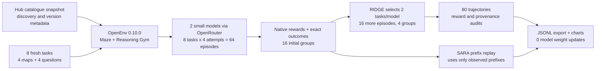
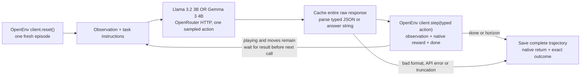
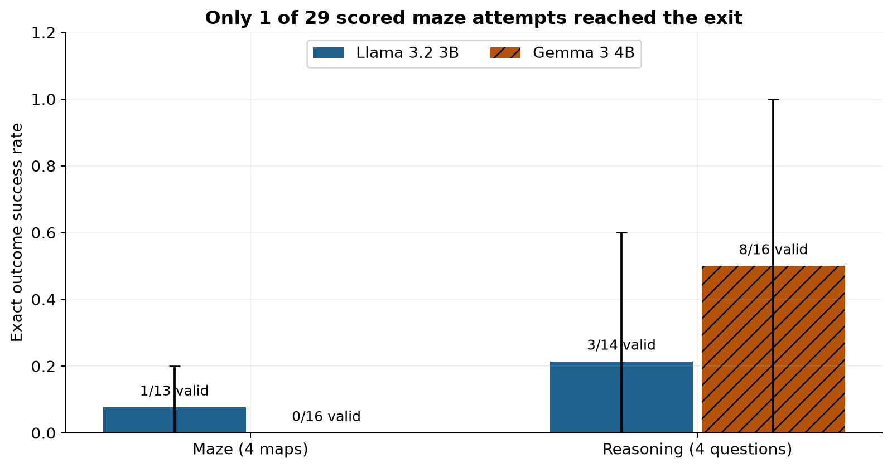
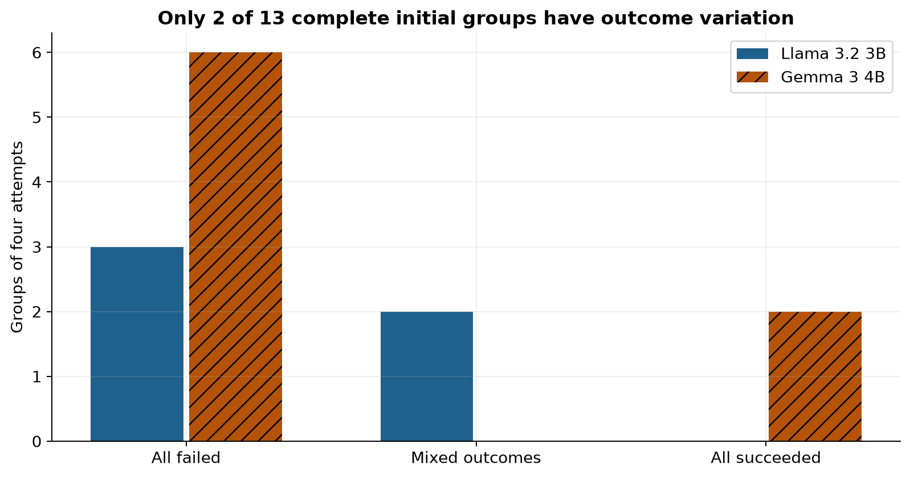
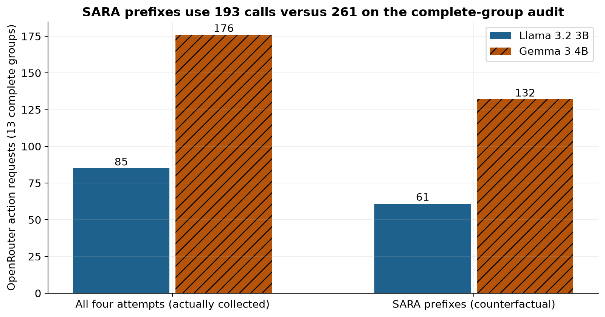
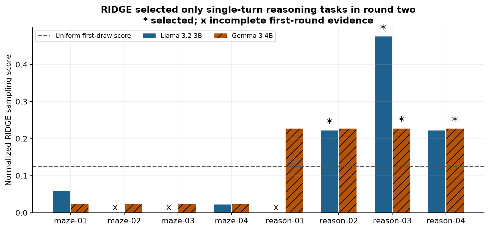
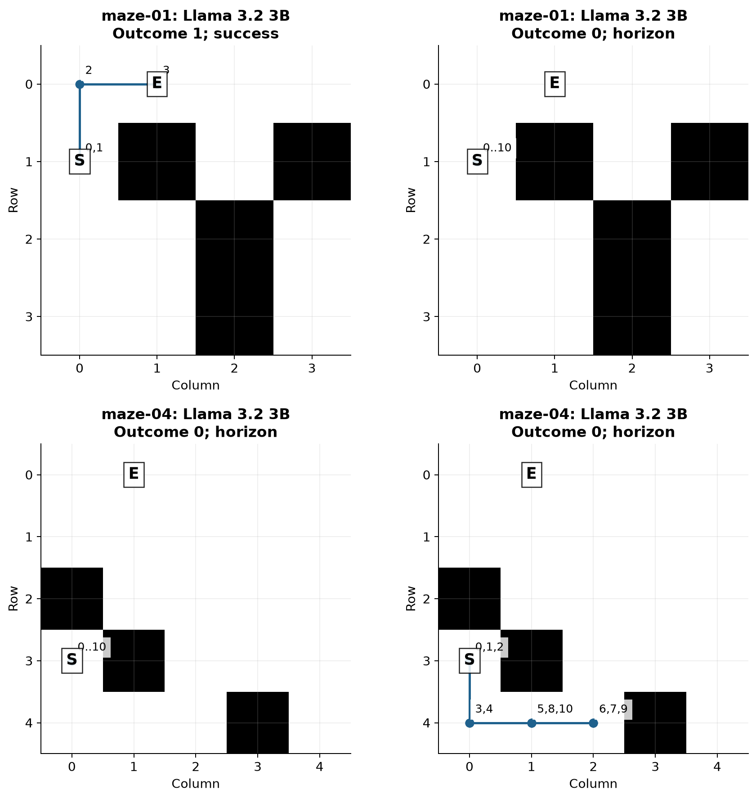
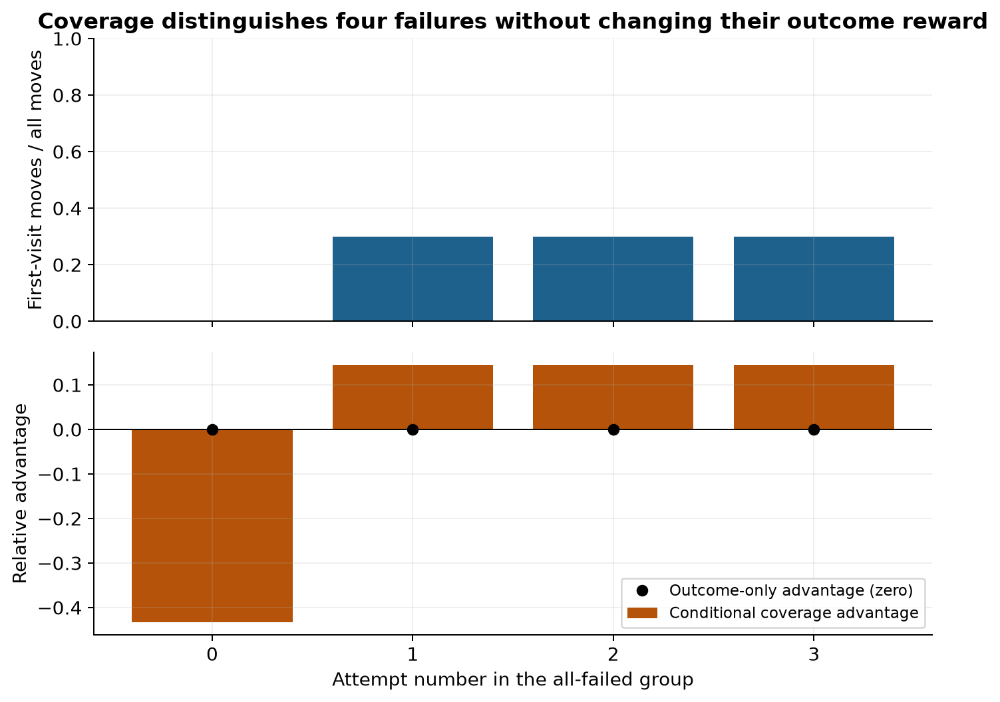

# Collecting rewards from Hugging Face RL environments

A small robot has a map, a starting square and an exit. It can ask to move up,
down, left or right. A route written in one answer may look plausible, but a
wrong turn can put the robot somewhere else. To judge the behaviour we need to
record what it actually did and what happened after each move.

An **environment** supplies that feedback. It presents an observation, accepts an
action and returns a new observation and a reward. A **rollout** is one complete
attempt, including the messages, actions and feedback. In reinforcement learning
(RL), a trainer uses many such attempts to change the model's weights, the numbers
that determine its predictions. This notebook stops at collecting and checking
the evidence a trainer would consume.

For an illustrative two-move route, the robot receives -0.05 after the first
move and +10 when it reaches the exit. Its native return is 9.95, the sum of
those two rewards. We also record a separate outcome reward of 1 for reaching
the exit within the move limit and 0 otherwise. Keeping these apart prevents a
movement penalty from being mistaken for an answer to whether the task succeeded.

The ordinary approach is to collect a fixed number of attempts for every task.
But four failures give a group-relative trainer no indication of which attempt
was better. Four successes have the same problem. We therefore examine reward
variation, a rule for stopping uninformative groups early, and a recent sampler
that chooses where to collect another group.

## Question and experiment summary

Can two small open-weight models produce traceable action/reward data through real
OpenEnv environments, and how do recent collection rules change the available
signal without changing any model weights?

The design uses four newly generated mazes and four generated reasoning questions,
Llama 3.2 3B and Gemma 3 4B through OpenRouter, and four separately seeded attempts per
model/task. A second collection round samples two tasks per model using RIDGE,
then collects four new attempts on each. That is 80 episodes in total, with a
600-request cap and a $2 conservative billing ceiling. Every public-network model
request is cached. Local OpenEnv WebSocket servers execute the actual reset/step
loop again during replay.

The 80 attempts produced 74 scored outcomes and six provider errors, using 336
measured action requests. Only **2 of 13 complete initial groups** mixed success
and failure. One additional all-failed maze group received a nonzero conditional
coverage signal. RIDGE selected four reasoning groups in the second round; three
were complete and none mixed outcomes. Its selection did not establish an
improvement in this sample.

On the 13 complete initial groups, SARA's recorded-prefix replay uses 193 action
requests instead of 261, 26.1% fewer, and retains both mixed groups. All audit
tails were actually collected. Spend including two setup probes was $0.015311
provider-reported plus at most $0.001867 reserved for requests without a reported
charge. Model weight updates: 0. This is a fixed-policy collection demonstration;
the small task pool and hosted-checkpoint uncertainty limit what a later trainer
could conclude.

## Contents

- [1. Setup and bounded collection](#1-setup-and-bounded-collection)
- [2. What Hugging Face released](#2-what-hugging-face-released)
- [3. Fresh tasks and exact answers](#3-fresh-tasks-and-exact-answers)
- [4. Real environment clients and the action loop](#4-real-environment-clients-and-the-action-loop)
- [5. Reward-aware collection methods](#5-reward-aware-collection-methods)
- [6. Collecting the rollouts](#6-collecting-the-rollouts)
- [7. Rewards and group variation](#7-rewards-and-group-variation)
- [8. Stopping and choosing what to collect next](#8-stopping-and-choosing-what-to-collect-next)
- [9. Worked cases and error analysis](#9-worked-cases-and-error-analysis)
- [10. Export and the boundary before weight updates](#10-export-and-the-boundary-before-weight-updates)
- [11. Limitations and reproduction](#11-limitations-and-reproduction)
- [12. Future work and further reading](#12-future-work-and-further-reading)



One maze passes through four sampled attempts for each model. Every move is sent
through the OpenEnv client and scored by the environment. The four outcome rewards
form one group; its spread determines whether an ordinary relative advantage can
distinguish the attempts. RIDGE may then select that maze for four new attempts.

## 1. Setup and bounded collection

The default is replay. A missing cached model response raises an error before any
paid request. `NB_LIVE=1` permits new requests; it never turns training on. The
limits below bound episodes, action requests, output length and dollar exposure.
The package requirements pin the released runtime and both official environment
packages to one OpenEnv commit. All helpers are defined in this notebook.

## 2. What Hugging Face released

[Welcome RL Environments to the hub](https://huggingface.co/blog/rl-environments)
(Burtenshaw et al., September 28, 2026) introduced discovery through dataset tags.
The Hub hosts tasksets; runtime libraries execute them. Adding a tag starts no
compute. OpenEnv is one supported runtime, alongside Harbor, Verifiers and NeMo
Gym. These interfaces have different loaders.

This experiment uses the official Maze and Reasoning Gym implementations from
[OpenEnv 0.10.0](https://github.com/huggingface/OpenEnv/tree/v0.10.0). It discovers
Hub entries and records metadata, then generates its own small taskset with those
implementations. It does not download or score an existing Hub benchmark. For
example, the [Procedural Pile](https://huggingface.co/datasets/reasoning-core/procedural-pile)
is discoverable with an OpenEnv tag, but its tasks and loader are not the ones
used here. Discovery metadata alone is insufficient to run a taskset.

## 3. Fresh tasks and exact answers

The maps and question instances are generated on October 24, 2026 and frozen in
`data/tasks.json`. Maze sizes and route lengths vary. Breadth-first search, which
checks every square at distance one before distance two, supplies a shortest
route and proves each exit is reachable within ten moves. The model sees the map
and legal moves, but never that route.

Reasoning Gym creates two arithmetic expressions and two lists to reverse. We
independently check the arithmetic with a restricted syntax-tree evaluator and
the reversal with Python list order. No language model authors the tasks or
grades another model. The existing vocabulary and task rules are old; the exact
sampled expressions, lists and boards are new compositions. This reduces exact
item memorization and does not test whether the task family was seen in training.

Llama 3.2 was released on September 25, 2024
([Meta model card](https://huggingface.co/meta-llama/Llama-3.2-3B-Instruct)); Gemma 3
was released on March 12, 2025
([Google announcement](https://blog.google/innovation-and-ai/technology/developers-tools/gemma-3/)).
We use these release dates as conservative freshness boundaries. The frozen
provenance file records model-card revisions, licences and cutoff information.
These models have open weights under custom terms, rather than unrestricted
open-source licences. Both fit the purpose of collecting successes and failures
from small policies that could later be trained locally.

## 4. Real environment clients and the action loop

We run the official OpenEnv server factory on loopback and use its official
WebSocket clients. Each connection gets its own environment instance. This small
typed-action example needs no Docker container: models can supply only a move
number or an answer string. A code-execution environment would require its own
isolation. This setup demonstrates the protocol and real reward implementations.

Maze requests contain the whole map, current coordinates, legal actions and the
remaining move budget. Coordinates are `(column, row)`, starting at the upper left.
The model returns a JSON object constrained by a schema to contain a move number. We neither repair answers nor supply a
fallback move. Invalid syntax ends the attempt and remains a measured failure.
API errors are recorded separately from task failures. Output-length truncation
and the ten-move horizon are explicit; reaching that horizon is not a natural
environment termination.



The two models act independently. Calls within an episode are sequential because
the next observation depends on the previous action. Seeds distinguish repeated
attempts and are recorded, although hosted seeds do not guarantee reproducibility
across provider upgrades. Exact replay comes from the caches.

## 5. Reward-aware collection methods

For four binary outcomes `[0, 1, 0, 1]`, the mean is 0.5 and the population
standard deviation is 0.5. A standardized relative advantage subtracts the mean
and divides by that spread: `[-1, +1, -1, +1]`. An unscaled, mean-centered variant
is `[-0.5, +0.5, -0.5, +0.5]`. Both are saved. Positive values mark actions a
trainer could increase in probability; no increase happens here. `[0, 0, 0, 0]`
produces four zeros. A mixed group contains a success and a failure. Its existence
is a signal diagnostic, not proof that a resulting gradient would be useful.

Group Relative Policy Optimization (GRPO) uses these within-task relative scores.
It is a policy-gradient method: a score weights how strongly a trainer changes
the probability of a sampled action. Proximal Policy Optimization (PPO) is a
related training method. Neither optimizer runs here.

The literature search was checked on October 24, 2026. We implement the
collection-side parts that make sense with a fixed hosted policy:

| Source | Implemented component | Boundary |
|---|---|---|
| [DAPO](https://arxiv.org/abs/2503.14476) (Yu et al., 2025) | Flag mixed groups and keep all discarded attempts in the audit | No PPO loss or dynamic redraw loop |
| [SARA](https://arxiv.org/abs/2607.26253) (Nomand et al., July 2026) | Beta-posterior group-effectiveness predictor and sequential stop rule | Replay the fixed stream; no claim of actual billing savings |
| [CovGPO v2](https://arxiv.org/abs/2607.22724v2) (Yang et al., October 9, 2026) | First-visit coverage rate and conditional fallback advantages | Maze only; an exploration heuristic, separate from outcome reward |
| [RIDGE](https://arxiv.org/abs/2610.25330) (Duncun et al., October 18, 2026) | Posterior uncertainty, Gaussian task sampling, mixed-only centre update | A real second collection round; no GRPO update |

SARA estimates the chance that a group will contain both outcomes by the fourth
attempt. With a uniform Beta(1,1) prior and `n` identical outcomes, that chance is
`(4-n)/5`. After two failures it is 0.4, so our predeclared 0.30 threshold continues.
After three failures it is 0.2, so it stops. Once outcomes mix, it commits. The
posterior assumption can be wrong when samples are correlated. It can abandon a
group whose fourth attempt would succeed, which the fully collected audit reveals.

CovGPO counts moves into positions not previously visited, divided by the number
of executed moves. Position is the observation key; clocks, reward fields and
previous-position fields are excluded so a loop cannot appear novel. Only an
all-failed group with nonzero coverage spread receives this fallback. We use a
fixed scale of 0.25. A high-coverage failure remains a failure.

RIDGE begins with Jeffreys counts `(0.5,0.5)` per task. Four initial outcomes update
the posterior mean and variance. Its Gaussian preference averages over that
uncertainty, then divides by estimated cost. We adapt the paper's web-tool cost to
mean model-action calls, and use cost 1 on single-turn reasoning. Two tasks per
model are sampled without replacement, followed by four new attempts each.
Only mixed groups move the centre and width. This is a small fixed-policy
adaptation, not a reproduction of the paper's training results.

[CERO](https://arxiv.org/abs/2610.09679) (Zong et al., October 7, 2026) allocates
budget over a training horizon; [TRACE](https://arxiv.org/abs/2606.11119) (Zou et al.,
August 2026 revision) uses predicted success at intermediate prefixes. Their
training-horizon and learned-predictor components are outside this no-training
experiment. We also save centered advantages to expose the normalization choice
discussed in [Dr. GRPO](https://arxiv.org/abs/2503.20783), without implementing its loss.

## 6. Collecting the rollouts

Every initial task receives four attempts before the RIDGE task selection is
calculated. All outcomes, including failures, remain in the initial evaluation.
The second round is explicitly labelled `ridge`; its selected task distribution
must not be pooled with the first round to claim a higher success rate.

Collection is resumable at the request cache. Its key covers the endpoint,
protocol version and complete JSON payload, including model, provider pin,
messages, seed and generation settings. HTTP failures are cached rather than
silently retried. An entire raw JSON response preserves reported token usage and
log probabilities when the provider returns them. No authorization headers are saved.

## 7. Rewards and group variation

Outcome success is a binary measurement. A maze succeeds only when the
environment reports a win within ten moves. A reasoning answer succeeds only if
its stripped text equals the frozen answer. The raw native score is also saved;
Reasoning Gym's default scorer can award fractional credit when a correct answer
is embedded in longer text. That fractional score is not exact task completion.

The first results chart compares success rates on the original task distribution.
Each bar starts from 16 attempts across four tasks; its denominator excludes API
errors with no known outcome. Vertical intervals are a seeded
95% percentile bootstrap that resamples the four task IDs, keeping their four
attempts together. They describe uncertainty across these generated tasks and
are coarse with only four per family. They do not support a general model ranking.

The group chart then asks how many sets of four have useful outcome variation.
Mixed groups have both 0 and 1. All-success and all-failed groups give zero ordinary
relative advantages. CovGPO's conditional alternative is examined separately.

| Model | Task family | Attempted | Known outcomes | Exact successes | Rate among known outcomes | API errors |
|---|---|---|---|---|---|---|
| Llama 3.2 3B | maze | 16 | 13 | 1 | 7.7% | 3 |
| Llama 3.2 3B | reasoning | 16 | 14 | 3 | 21.4% | 2 |
| Gemma 3 4B | maze | 16 | 16 | 0 | 0.0% | 0 |
| Gemma 3 4B | reasoning | 16 | 16 | 8 | 50.0% | 0 |


Gemma returned eight exact reasoning answers in 16 attempts (50.0%); Llama returned
three in 14 scored attempts (21.4%), with two additional API errors. Llama reached
one maze exit in 13 scored attempts (7.7%), with three API errors; Gemma reached
none in 16 attempts. These are measurements of this instruction and serving setup.
Llama's 4 known successes among 32 initial attempts imply a success fraction between
4/32 and 9/32 if its five unknown outcomes are assigned failure or success. Gemma's
8/32 lies inside that range. Provider errors and eight selected tasks prevent a
general model ranking.




Maze success was 1/29 across scored attempts; reasoning success was 11/30. The
comparison shows why recording a legal action and reaching a useful result are
different checks. All eight deterministic oracle checks passed through the same
clients before collection, so these generated tasks were solvable.

The intervals resample four task IDs with replacement 5,000 times and recompute
the ratio of successes to known outcomes. They keep each task's attempts together.
For Llama the intervals are 0-20% on mazes and 0-60% on reasoning; Gemma's reasoning
interval is 0-100%. Gemma's zero-width maze bootstrap reflects four observed zero
task rates. It is not a bound proving that future success has probability zero.
Missing outcomes need not be random, which the bootstrap cannot repair.




Llama had two mixed groups and three all-failed groups among five complete initial
groups. Three further groups were incomplete because of API errors. Gemma had six
all-failed and two all-success groups among eight complete initial groups. Thus
11/13 complete groups had zero ordinary outcome advantages even though some were
perfectly successful. All-success data can still support other training objectives;
the zero here refers specifically to a within-group outcome comparison.

The two informative groups were Llama's `maze-01` and `reason-03`, each with one
success in four attempts. Conditional coverage added variation in one different
group, Llama's `maze-04`. The raw reward was not changed. This yields three initial
groups with nonzero illustrative advantages under the conditional rule, compared
with two using outcomes alone. It does not show that using the extra group would
improve a trained policy.

## 8. Stopping and choosing what to collect next

SARA reads prefixes of the initial four attempts. Its decisions never inspect an
unobserved fourth reward. The audit does inspect that reward afterward to count
missed mixed groups. All four attempts were actually collected and billed in this
experiment. Therefore the chart shows a counterfactual collection cost on a frozen
stream, not money saved on this run. It does not test reallocating saved attempts
to new tasks at a matched budget.

RIDGE is different: its second-round task choices are made from first-round
rewards before the new responses are requested. The score table records posterior
means, uncertainty, cost estimates and the randomized keys used for sampling.
Its chart distinguishes a normalized sampling score from the uniform 1/8 score.
These scores govern the first draw; without-replacement inclusion probabilities
for the two selected tasks are not equal to those scores.



| Model | Complete groups | Full episodes | Prefix episodes | Full action requests | Prefix requests | Mixed groups retained |
|---|---|---|---|---|---|---|
| Llama 3.2 3B | 5 | 20 | 14 | 85 | 61 | 2 |
| Gemma 3 4B | 8 | 32 | 24 | 176 | 132 | 0 |


SARA consumes 38 of 52 episode prefixes and 193 of 261 action requests on complete
initial groups. The request reduction is 68/261 (26.1%). Both observed mixed
groups are committed; no fully observed mixed group is missed. Three incomplete
initial groups are logged but excluded from these cost and missed-group comparisons.
Stopping after an API error would otherwise look like a sampling efficiency gain.

The audit-tail requests remain in the actual bill. The rule reads only available
prefix rewards, while the full stream checks its decisions afterward. A group
whose first three attempts fail and whose fourth succeeds would be abandoned at
our threshold. That boundary case is tested in code and is an illustrative risk,
not an invented measured outcome. This experiment does not spend the counterfactual
saved calls on fresh tasks, so it cannot compare informative groups at equal spend.



| Model | Selected task | Posterior success mean | Estimated calls/episode | Normalized score |
|---|---|---|---|---|
| Llama 3.2 3B | reason-02 | 0.10 | 1.00 | 22.2% |
| Llama 3.2 3B | reason-03 | 0.30 | 1.00 | 47.6% |
| Gemma 3 4B | reason-03 | 0.90 | 1.00 | 22.7% |
| Gemma 3 4B | reason-04 | 0.10 | 1.00 | 22.7% |


RIDGE selected only reasoning tasks: `reason-02` and `reason-03` for Llama,
`reason-03` and `reason-04` for Gemma. The cost adjustment matters in this setup.
Llama's mixed `maze-01` group has an estimated 8.25 calls per episode and a 5.8%
normalized score; its mixed `reason-03` group costs one call and receives 47.6%.
Both had one observed success in four attempts. The random draw and the full
posterior still determine selection; the cost ratio alone does not prove why any
individual draw occurred.

The dashed 1/8 line is uniform sampling over the original eight-task pool. Llama
had only five eligible tasks after incomplete groups were excluded, while Gemma
had eight. The chart is a description of two different eligible pools. The scores
are first-draw probabilities, not two-task inclusion probabilities.

The 16 new episodes produced four Gemma successes, zero Llama successes among seven
known Llama outcomes, and one Llama API error. Three new groups were complete and
all had identical outcomes within the group. Neither model's RIDGE centre changed:
Llama stayed at 0.30 with width 0.05; Gemma stayed at the empty-mixed-set defaults
0.50 and 0.15. Recent sampling machinery can still collect no mixed group on a
small pool. No learning gain or superiority to uniform collection is established.

## 9. Worked cases and error analysis

The measured cases below are selected by a documented rule: the first successful
maze, the first maze failure, the first successful reasoning answer, the first
failed reasoning answer, and an all-failed maze group with the largest coverage
spread if one exists. If a category is absent, we say so rather than manufacture
an example. IDs connect each account to `episodes.jsonl` and the raw request cache.

Read the maze panels with the start marked S and exit E. Numbered circles trace
positions reached after each action; the table under each case records the exact
answer, native rewards and stop reason. Repeated squares and an efficient route
can then be compared directly. Coverage can reward new squares on the wrong route.




### A complete measured rollout

`uniform-maze-01-meta-llama-2` starts at `[0,1]` and must reach `[1,0]`.
The shortest legal route is `[0,3]`, up then right. This attempt first requests
right, which hits a wall, then goes up and right. It succeeds in three calls.
The top-left panel shows the two successful position changes; repeated position
labels also count the initial rejected move.

| Step | Raw assistant text | Parsed action | Position after action | Native reward |
|---|---|---|---|---|
| 0 | `{"action": 3}` | 3 | [0, 1] | -0.75 |
| 1 | `{"action": 0}` | 0 | [0, 0] | -0.05 |
| 2 | `{"action": 3}` | 3 | [1, 0] | 10.0 |


The return is -0.75 - 0.05 + 10 = 9.20; the outcome reward is 1. A shortest route
would return 9.95, but both would receive binary success. The observed rewards in
this model/task group are `[0,0,1,0]`. Their mean is 0.25 and population standard
deviation is about 0.433. This successful attempt's standardized advantage is
`(1-0.25)/0.433 = 1.732`; each failed attempt receives about -0.577. Those numbers
express a relative score only. They have not changed a token probability.

The exact first request text is shown below. Its map and legal actions come from
the environment; the oracle route and expected outcome are not sent.

```text
Reach the exit in this grid. Coordinates are [column,row]; [0,0] is top left. 0=up (row-1), 1=down (row+1), 2=left (column-1), 3=right (column+1). In the map 1 is a wall and 0 is a free square. Return ONLY JSON with one integer field, for example {"action": 3}. Choose a legal move toward the exit.
{"exit":[1,0],"legal_actions":[0,1],"map":[[0,0,0,0],[0,1,0,1],[0,0,1,0],[0,0,1,0]],"moves_remaining":10,"position":[0,1]}
```

The raw response's message excerpt is followed by the parsed action above:

```json
{
  "role": "assistant",
  "content": "{\"action\": 3}",
  "refusal": null,
  "reasoning": null
}
```

The full request, response, finish reason, token log probabilities and usage are in
[`the first response cache`](data/cache/07d7dfffe06f1640d4db7dcf301ae3abcf3a2dfb01d7270e3f33e677ab597428.json). The two later
requests include the actual previous assistant action and the next observation.
This makes the trajectory traceable beyond a final scalar score.

### A repeated wall action

`uniform-maze-01-meta-llama-0` faces the same map and returns `{"action":3}` ten
times. Each request hits the wall at `[1,1]`; the position stays `[0,1]`.
Ten penalties of -0.75 sum to -7.50. It has zero first-visit coverage and outcome
0 when the ten-move budget ends. The environment itself is still playing, so
`truncated=true` records the external horizon. The top-right panel shows a
stationary path, not a missing trace.

Across Llama's 125 executed initial maze moves, 72 were illegal wall or boundary
moves (57.6%). Gemma made zero illegal moves in 160 executed initial maze moves,
yet still reached no exit. All Gemma maze attempts reached the horizon. Repeated
legal moves can fail just as clearly as wall collisions. The literal action-3
example in the prompt could affect output frequencies; this experiment has no
prompt ablation that could establish that explanation.

### A typical exact answer

`uniform-reason-01-meta-llama-0` receives `Calculate 2 - 40.` and returns `-38`.
The independent arithmetic check and the environment agree: native score 1,
outcome 1. Llama has two exact answers among the three known initial outcomes for
this question and one API error. Gemma has four exact answers in four attempts.
A response string is enough to verify this answer; a future trainer still needs
its tokenization and model probabilities to use it in an update.

### A numerical failure

`uniform-reason-02-meta-llama-0` receives
`Calculate ( 551 * -29 ) + ( -355 * 717 - 71 ) * 164.` and returns `-66621503`.
The expected answer is `-41771363`: `551 * -29 = -15979`,
`-355 * 717 - 71 = -254606`, and `-15979 + -254606 * 164 = -41771363`.
The native and exact rewards are both 0. Both models fail all four initial
attempts on this task. This all-failed group supplies no ordinary relative signal;
Reasoning Gym answers have no multi-step position coverage fallback.

### A short-list disagreement

`reason-03` asks for the reverse of `it, in, say, the, stress, copies`. Its exact
answer is `copies, stress, the, say, in, it`. Llama succeeds once in four attempts;
Gemma succeeds in all four. For example, `uniform-reason-03-meta-llama-1` returns
`say, the, stress, copies, in, it`, which preserves some words but fails the order.
Gemma's trailing newline is removed by the declared whitespace-strip rule.

The Llama group has one positive and three negative relative advantages. Gemma's
perfect group has four zeros under the same group-relative rule. The better
task score therefore need not yield a larger within-group training signal. These
five measured accounts were selected by the first-success/first-failure rules in
the notebook, plus the shared reversal task to show the boundary. They describe
ordinary cases as well as the unusual one successful maze.




### Four failures with different coverage

`uniform-maze-04-meta-llama-0` does not leave its starting square in ten moves.
`uniform-maze-04-meta-llama-1` reaches three new positions along the bottom row,
but the exit is at `[1,0]`. Neither reaches it. The bottom panels above show this
difference. The stationary attempt returns -7.50, while the second returns -3.90.
Their task outcomes remain 0.

All four attempts in this group fail. Their first-visit coverage rates are
`[0.0,0.3,0.3,0.3]`. Outcome advantages are four zeros. With the fixed 0.25 scale,
the conditional coverage advantages are about `[-0.433,0.144,0.144,0.144]`.
The fallback activates for exactly one of nine complete all-failed initial groups.
Gemma's failed maze groups have identical coverage within each group, so they
remain zero even under this rule.

The coverage rate divides new-position moves by all executed moves, including
wall collisions. Repeated visits do not earn another first-visit count. The
positive fallback scores encourage state exploration within this failed group;
they do not establish that the bottom-row route is near success. The exit location
is a concrete counterexample to treating novelty itself as task completion.

## 10. Export and the boundary before weight updates

Each exported trajectory keeps full messages, typed actions, observations, native
step rewards, outcome reward, relative advantages, sampler phase, model/provider
identity and raw-cache keys. The step rows mark assistant versus environment
content. A trainer must tokenize its own exact chat template and construct token
loss masks; a message-role mask is not yet a token mask.

An **on-policy** rollout comes from the exact policy a trainer is currently
updating. Hosted model names alone do not establish that match.

In an actual policy-gradient update, the trainer would evaluate the probability
of each sampled assistant token, weight its log probability by the chosen
advantage and backpropagate through the model. PPO/GRPO-style updates may also need
behaviour-policy log probabilities for importance ratios and a reference model for
Kullback-Leibler (KL) regularization, a penalty for deviating from that
reference policy, depending on the configuration. A positive advantage alone is
not an update. The file below is an auditable collection artifact, not a drop-in
TRL training checkpoint or a guarantee of on-policy validity.

OpenRouter may return token log probabilities, but it does not attest an immutable
weight revision, tokenizer revision or the exact chat template used by the
provider. We retain returned values rather than invent missing token IDs. Future
on-policy training should recollect from the exact checkpoint and serving stack
being optimized. The export marks all trajectories `exact_on_policy_ready=false`.
No model or tokenizer weights, optimizer, backward pass or parameter updates are
used in this experiment.

| Collected artifact | Count or status |
|---|---|
| Fresh task instances | 8 |
| Episode attempts | 80 |
| Scored outcomes | 74 |
| Provider-error episodes | 6 |
| Environment transitions | 330 |
| Complete groups | 16 |
| Trajectories with defined group advantages | 64 |
| Nonzero outcome-relative advantages | 8 |
| Nonzero advantages with conditional coverage | 12 |
| Exact on-policy-ready records | 0 |
| Model weight updates | 0 |


The export has 80 records so the six provider errors remain visible. Group
advantages are defined for the 64 trajectories in 16 complete groups; ten other
scored trajectories belong to incomplete groups and receive no group advantage.
Only eight trajectories have a nonzero outcome-relative score, increasing to
twelve under the conditional coverage rule. The complete audit is retained rather
than keeping only the successful or nonzero-score rows.

The message text, action and reward together are useful evidence. They are still
insufficient for an exact on-policy update. A trainer should regenerate from the
checkpoint it owns or use an explicitly justified offline objective, and should
rebuild token masks from that checkpoint's chat template. This notebook supports
examining that boundary without loading or changing any weights.

## 11. Limitations and reproduction

Eight generated tasks illustrate the pipeline. They cannot rank either model in
general, validate an exploration bonus or establish a learning gain. All rollouts
use one fixed instruction policy at temperature 0.9. Provider seeds and model
identifiers do not attest identical weights. The two custom model licences must
be reviewed for a future training use.

The ten-move maze horizon is a task budget. A horizon failure can become a success
with more moves. Its outcome is 0 for this finite task, while the native environment
may still be playing. The export preserves both flags. A future continuing-task
trainer needs to decide whether to estimate future rewards beyond a truncated trajectory; this notebook
does not have a value function and does not invent that value.

SARA uses a fixed pool and a recorded order. Its counterfactual savings do not test
the value of reallocating budget. RIDGE's action-call cost is an adaptation of web
tool cost; small samples and its randomized selection can prefer cheap questions
over longer interactive work. Selected second-round success is descriptive only.
Coverage is a position heuristic and can favour wandering. Environment-native
scores and exact outcome rewards answer different questions and remain separate.

Install `requirements.txt` from this folder in a separate virtual environment,
register the kernel and execute the notebook as shown below with this folder as the working directory. Replay uses
only local package code, loopback servers and saved responses; it needs no key or
public network. Missing evidence fails closed. For a new collection, use a separate
copy, set `NB_LIVE=1` and `OPENROUTER_API_KEY`, and keep the size and spend limits.
Preserve the committed caches for the published results.

`data/cache/` contains full request/response JSON, `tasks.json` freezes inputs,
`episodes.jsonl` stores complete attempts, `steps.jsonl` stores transitions,
`advantages.jsonl` stores group scores, and `rollouts_for_training_demo.jsonl`
joins them for inspection. `manifest.json` records versions, hashes, counts and
spend. Hub and model-catalogue snapshots are discovery evidence. There are no
downloaded weights and no optimizer artifacts.

```bash
python -m pip install -r requirements.txt
python -m ipykernel install --user --name openenv-rewards
python -m nbconvert --to notebook --execute --inplace --ExecutePreprocessor.kernel_name=openenv-rewards 24_openenv_rewards.ipynb
```

For fresh requests, start with empty `data/cache/` and `data/pilot_cache/`
directories in that separate copy. Otherwise live mode still reuses existing
responses. Retain the catalogue snapshots and frozen tasks to repeat this taskset;
change the sampling seed for new attempts. To generate new task instances, remove
only the copy's `tasks.json` and change the generator seeds. Update the measured
narrative and figures after any new collection.

### Spend and collection failures

| Item | Recorded amount |
|---|---|
| Measured OpenRouter requests | 336 |
| Separate setup probes | 2 |
| Failed requests (all HTTP 429) | 7 |
| Provider-reported cost | $0.01531127 |
| Unreported-charge conservative upper bound | $0.00186659 |
| Known prompt tokens, including setup | 294780 |
| Known completion tokens, including setup | 3034 |
| Sum of observed request latencies | 234.1 seconds |
| Model weight updates | 0 |


The reported cost plus the unreported upper bound is under $0.018. All six
measured provider errors came from Llama's Parasail endpoint. A separate Gemma
Parasail setup probe returned HTTP 429; the final Gemma collection was pinned to
DeepInfra. The other setup probe showed that an unconstrained Llama response hit
a 16-token cap. Before the measured collection, the maze interface was fixed to
JSON constrained by a schema with 48 output tokens for both models. Both setup responses
are saved in `data/pilot_cache/`, excluded from task scores and included in spend.
No measured request was retried or repaired. Error payload account IDs are
redacted and that field removal is recorded.

Llama log probabilities are retained when returned. The selected Gemma endpoint
does not support that option, so they are absent rather than reconstructed. The
model catalogue, endpoint snapshots and `provenance.json` document this difference.
Latency is a sum of request durations, not an end-to-end benchmark or a GPU runtime.

## 12. Future work and further reading

Links were opened and checked on October 24, 2026.

### Future work

- Increase the generated task pool from eight to at least 100 and collect several
  sampling seeds. Measure mixed-group yield per dollar; the current per-task
  intervals and small pool make sampler comparisons uncertain.
- Reallocate SARA's unused fourth attempts to new tasks in an actual matched-budget
  collection. Measure missed mixed groups and new groups found; the present audit
  measures prefix cost only.
- Compare position coverage with distance-to-goal diagnostics on all-failed maze
  groups. Measure how often their rankings disagree; visiting new squares does not
  itself establish progress toward the exit.
- Recollect from an exact local 3B or 4B checkpoint with pinned tokenizer and chat
  template. Measure behaviour-log-probability alignment; the hosted export cannot
  establish exact on-policy readiness. Any subsequent training is a separate study.

- Restrict the action schema to the current legal moves and remove the literal
  action-3 example in a paired prompt comparison. Measure illegal moves and exits;
  72/125 Llama moves were illegal here, while Gemma made none and still failed all
  16 maze episodes. This separates syntax, legality and planning.

### Further reading

- [DeepSeekMath: Pushing the Limits of Mathematical Reasoning in Open Language Models](https://arxiv.org/abs/2402.03300)
  (Shao et al., 2024). Introduces the group-relative method whose reward comparison
  this notebook illustrates.
- [Reasoning Gym: Reasoning Environments for Reinforcement Learning with Verifiable Rewards](https://arxiv.org/abs/2505.24760)
  (Stojanovski et al., 2025). Describes procedural task generation and verifiable
  feedback behind the single-turn environment used here.
- [Proximal Policy Optimization Algorithms](https://arxiv.org/abs/1707.06347)
  (Schulman et al., 2017). Explains probability ratios and optimization that would
  follow rollout collection in a PPO-style trainer.
- [GRPO Trainer](https://huggingface.co/docs/trl/grpo_trainer)
  (Hugging Face, 2026 documentation). Documents reward handling, generation masks
  and loss choices for an eventual training implementation.

Read the [executed notebook](24_openenv_rewards.ipynb), [frozen tasks](data/tasks.json), [rollout export](data/rollouts_for_training_demo.jsonl), [results table](data/results.csv) and [version and billing manifest](data/manifest.json).
