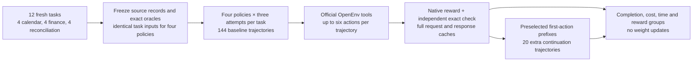
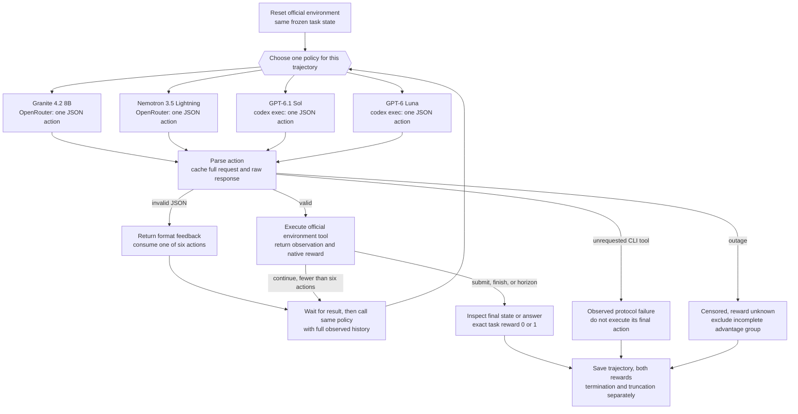
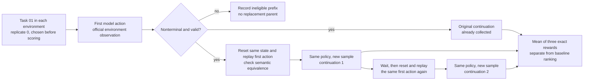

# Checking whether an assistant completed the work

Asking someone to arrange a meeting sounds simple. There is a reason for the meeting, a few people who need to attend, and a time to find. The job is finished when the right appointment is on the calendar and the people involved can use it.

A computer assistant might help with this work. It can be given a way to read a calendar and a way to change it. To decide whether that help is useful, we need to look at the calendar afterwards. A message saying "done" does not tell us whether the appointment has the right time or guests.

### Following one small job

Consider an illustrative meeting request. Alice and Bob need 45 minutes together. Alice is busy until 2:30 in the afternoon, and Bob is free from 2:30 until 3:30. A meeting from 2:30 to 3:15 fits both calendars. A person arranging it would check the two schedules, create the appointment and invite Bob.

Now suppose an assistant creates the appointment but forgets the invitation. The calendar software may report that the event was created successfully. The original job is still incomplete because Bob has not been included. A successful individual action and a successful piece of work are different things to check.

The same distinction can matter when reading figures. An assistant may find a revenue number correctly but use a yearly total when the question asks about a quarter. Each small step can look reasonable while the final answer misses the request. We need a check that follows the purpose of the job all the way to its outcome.

### Keeping enough evidence to check

One way to inspect the work is to save the whole attempt. We keep the original request, the assistant's actions, the information returned to it, and the final state or answer. That record lets a reviewer see where a mistake entered the process, instead of having only a final score.

We call that saved attempt a trajectory, or rollout. It is simply the record that lets us follow the job from the initial request to the outcome. We can then give the attempt a score: 1 when the whole job was completed and 0 otherwise. The record helps explain why it received that score.

Trying the same job more than once can show whether an assistant completes it consistently. It can also produce examples of successful and unsuccessful approaches. Such records may later be useful for training, but collecting and scoring them does not itself change the assistant.

The study below compares four assistants on the same small office tasks. We want to know how often the work is actually completed, whether the software's own success signals agree with that result, and what the saved attempts reveal about mistakes. For an assistant that already succeeds most of the time, we also ask how much useful failure evidence remains to collect.

## The study in brief

Each of four assistants makes three attempts at each of 12 tasks: arranging calendar events, answering questions from financial tables, and reconciling data records. That gives 36 attempts per assistant and 144 in the main comparison. The tasks run through OpenEnv, which supplies the tools and records their responses.

Granite 4.2 8B completed 16 of 36 attempts exactly. Nemotron 3.5 Lightning and GPT-6.1 Sol each completed 35; GPT-6 Luna completed 33. Completion means meeting the requested result and its conditions, rather than merely receiving a successful response from a tool.

The saved examples show why the final check matters, including extra calendar changes and answers that miss the requested numerical precision. These are results for only four task designs in each area. They support inspecting how these attempts succeeded or failed, rather than a general ranking of the assistants.

## Contents

- [1. Setup and collection budget](#1-setup-and-collection-budget)
- [2. Fresh tasks and exact answers](#2-fresh-tasks-and-exact-answers)
- [3. Policies and the comparison](#3-policies-and-the-comparison)
- [4. Environment loop and reward checks](#4-environment-loop-and-reward-checks)
- [5. Completion and trajectory comparison](#5-completion-and-trajectory-comparison)
- [6. Worked examples and error analysis](#6-worked-examples-and-error-analysis)
- [7. Reward groups and continuation estimates](#7-reward-groups-and-continuation-estimates)
- [8. Why improving the stronger policies gets harder](#8-why-improving-the-stronger-policies-gets-harder)
- [9. Time, spend and the update handoff](#9-time-spend-and-the-update-handoff)
- [10. Limits and what the evidence supports](#10-limits-and-what-the-evidence-supports)
- [11. Reproducing the frozen run](#11-reproducing-the-frozen-run)
- [12. Future work and further reading](#12-future-work-and-further-reading)



One `cal-01` attempt follows this path: load the seven-event fixture, send the shared task and tool schemas to one policy, execute its calendar actions, inspect the final database, then save the messages and both reward signals. Three fresh attempts use the same starting records. The continuation experiment restores one already observed first action before requesting two new continuations.


## 1. Setup and collection budget

Replay is the default. The notebook reads the frozen episodes, verifies the full-request cache identities and recomputes the result tables and figures without public HTTP requests or model calls. A missing cache raises an error. Live collection requires an explicit `NB25_LIVE=1` environment variable, a local installation of the pinned OpenEnv source and authenticated model access.

The size knobs are four tasks per environment, three attempts, four policies and six model-chosen actions per attempt. OpenRouter has a $2 total cap, including probes and continuation calls, and every request reserves a conservative token-cost allowance before it is sent. The CLI has a 180-second per-call timeout. Its interface exposes no output-token cap, so its generation limit differs from OpenRouter's 4,096-token cap.

All four policies receive the same task text and tool subset. The ordinary comparison uses a fixed rollout budget. Adaptive collection would change which tasks receive samples and would complicate that comparison, so the newer continuation strategy is measured separately. The delivered collection has 584 cached model requests, including six connectivity/version probes. Reported OpenRouter spend across every phase is $0.058115; the conservative total including any unreported-cost allowance is $0.058115. CLI charges are not exposed by subscription authentication.


## 2. Fresh tasks and exact answers

The data are small enough to inspect. Calendar has seven fictional events, two fictional people and two calendars. Alice owns a managed availability copy for Bob, which avoids relying on shared-calendar permission behaviour in the clone. The tasks are booking a handoff, moving a meeting, cancelling one of two same-title calls and converting New York and London local times before a booking. No real calendar or personal account is connected.

FinQA uses 104 factual numerical rows extracted from [IBM's 21 October 2026 release](https://newsroom.ibm.com/2026-10-21-IBM-RELEASES-THIRD-QUARTER-RESULTS). Each row has a metric, period, value and unit. Quarterly and year-to-date amounts are separate rows. Only the numerical extracts and short field labels are redistributed. The original article is identified by URL and content hash. The official FinQA package's bundled historical benchmark is evaluation-only; none of those questions or records are used here. Four new questions run through the official runtime with these new tables.

REPL is a persistent Python interpreter. It receives 16 public [US Treasury cash records](https://api.fiscaldata.treasury.gov/services/api/fiscal_service/v1/accounting/dts/operating_cash_balance?filter=record_date:gte:2026-10-19,record_date:lte:2026-10-23&page%5Bsize%5D=100) for four dates, 19–22 October 2026. October 23 was requested but had no records in the frozen response. The data are federal government public data. Two variants add clearly labelled synthetic export errors: a 7 million change to a closing amount and an old duplicate deposit version. The unmodified source snapshot remains available.

No LLM wrote these tasks. All questions and fictional records were authored on 24 October 2026. Target financial facts are later than 31 August, the conservative date filter chosen from the selected model provenance. GPT-6.1 Sol's documented cutoff is 30 April 2026 and GPT-6 Luna's is 18 May 2026. Nemotron reports post-training data through May 2026. Granite's inspected card does not give a cutoff, so its August release/catalogue dates are the proxy. Hosted services do not attest the exact weight revision served; fresh records reduce a known leakage risk but do not prove its absence. Dates, licences and inspected Hugging Face revisions are saved in `data/model_provenance.json` and `data/data_provenance.json`.

| ID      | Environment   | Required result      |
|:--------|:--------------|:---------------------|
| cal-01  | calendar      | 2026-10-27T14:30:00Z |
| cal-02  | calendar      | 2026-10-27T15:00:00Z |
| cal-03  | calendar      | recruit-02           |
| cal-04  | calendar      | 2026-11-02T14:30:00Z |
| fin-01  | finqa         | 8.254                |
| fin-02  | finqa         | 0.855                |
| fin-03  | finqa         | 12.805               |
| fin-04  | finqa         | 2563                 |
| repl-01 | repl          | 13266                |
| repl-02 | repl          | 8                    |
| repl-03 | repl          | 13266                |
| repl-04 | repl          | 50312                |

These answer keys are visible to the reader and verifier. They are absent from the model's input. The CLI policy runs in a new empty temporary directory with its external tools disabled. OpenRouter receives only the task, tool schemas and observed results. The next cell independently checks all 12 answer keys, including a minute-by-minute search for the earliest calendar slot, IANA timezone conversion and arithmetic over the frozen table rows.


## 3. Policies and the comparison

The two open-weight policies are later releases than the Llama 3.2 and Gemma 3 policies in experiment 24. [IBM released Granite 4.2 on 25 August 2026](https://research.ibm.com/blog/introducing-granite-4-2). The 8B label is a size family; its inspected repository reports 8.79 billion stored parameters. [NVIDIA released Nemotron 3.5 Lightning on 11 August 2026](https://developer.nvidia.com/blog/nvidia-nemotron-3-5-lightning-delivers-fast-accurate-specialized-task-execution-for-long-running-agents/). It is a mixture-of-experts model with 30B total and 3B active parameters. Active parameter count does not describe its full memory requirement.

| Policy | Access and pinned identifier | Price per million input / output tokens at collection | Model licence |
| --- | --- | --- | --- |
| Granite 4.2 8B | OpenRouter `ibm-granite/granite-4.2-8b-20260831`, DeepInfra BF16 | $0.06 / $0.25 | Apache 2.0 |
| Nemotron 3.5 Lightning | OpenRouter `nvidia/nemotron-3.5-lightning-20260807`, DeepInfra BF16 | $0.06 / $0.16 | OpenMDW 1.1 |
| GPT-6.1 Sol | `codex exec -m gpt-6.1-sol` | Subscription CLI does not expose billed dollars | Proprietary reference policy |
| GPT-6 Luna | `codex exec -m gpt-6-luna` | Subscription CLI does not expose billed dollars | Proprietary reference policy |

The dated OpenRouter identifiers were tested before collection, and provider fallbacks are disabled. The response identifies the resolved model and provider; the complete catalogue and endpoint prices are frozen in `data/sources/`. A dated identifier still does not attest a hosted weight or tokenizer hash.

The requested GPT policies are called only through the [documented non-interactive CLI](https://developers.openai.com/codex/noninteractive). Both use medium reasoning effort. OpenRouter uses low reasoning effort, temperature 0.7, top-p 0.95 and a separate seed per sampled call. Codex exposes neither matching sampling controls nor an equivalent bare model endpoint through this workflow. Its own instructions and token overhead remain part of the measured policy. These are repeated executions of four deployed policy configurations, with equal visible task information and action limits; they are not a controlled comparison of base weights or equal compute.

No model is a judge of its own output. The oracles are calendar-state predicates and exact arithmetic. The GPT trajectories are reference-policy evidence. The open-weight-only export contains the policies whose future updates the original demonstration was intended to inform.


## 4. Environment loop and reward checks

OpenEnv 0.10.0 is pinned to source commit `21fbb0ecb2a3e74110b59cf38a1b195decc75c88`. This notebook calls the official Calendar HTTP client and server, the official FinQA MCP environment and the official local REPL helper. MCP, the Model Context Protocol, supplies named tools with JSON argument schemas. The notebook owns policy calls, caches, action limits and the additional task checks. Those parts are visible in the cells below.

Calendar exposes five official tool names for this task subset: `list_events`, `get_event`, `create_event`, `patch_event` and `delete_event`. The notebook adds a local `finish` action. Optional fields irrelevant to these tasks are removed from the model-facing schemas. This same subset is used for every policy. The stock free/busy query returned per-calendar backend errors in the local SQLite build, so availability is read through event lists. The library source is unchanged. Event writes use UTC with a Z suffix, as the task explicitly requires.

Native Calendar reward is normally +1 for a successful HTTP operation, including reading a calendar. It never signals natural task termination. The independent check requires the correct event, times, attendee when requested, a successful availability read covering both calendars before a booking/move, no duplicate event and unchanged unrelated event fields and attendees. `finish` is wrapper termination; the action limit is truncation. Those are recorded separately from an environment's own `done` signal. FinQA and REPL can also set `done=True` when their internal step limit is reached. Analysis preserves that raw observation and normalizes those cases to truncation in the derived tables and export. Original collector flags remain in the raw episode records.

FinQA's native numeric checker accepts an error within about 1% relative or 0.01 absolute. The new finance tasks explicitly ask for three decimal places or an integer, so the independent checker uses the correctly rounded value. This distinction is observable in `fin-03`: a nearly correct answer can receive native reward 1 and exact reward 0. REPL uses the official restricted smolagents interpreter, persistent variables and its native terminal-answer rubric. Nested model calls are disabled. Allowed standard-library computation is sufficient for these tasks; no arbitrary host shell or unrestricted Python execution is provided.



The four policy workers run independently. Each owns a separate Calendar server because that environment's legacy HTTP route stores mutable request context. There is no cross-model messaging and no shared live task state. Model calls within one trajectory wait for the previous tool result. A normal calendar attempt needs two availability reads, one write and one `finish` call. FinQA discovers a table, reads its schema, queries its rows and submits a number. REPL can compute and finalize in one Python action.


Raw responses are retained even when parsing fails. A malformed action receives format feedback and consumes a turn. A model-request outage is unknown reward, not a fabricated failure score. An unrequested CLI tool is an observed protocol violation: its final textual action is withheld and the attempt receives reward 0. One Luna record was initially labelled `transport_error` by the collection wrapper; analysis corrects that category from its saved `collab_tool_call` event. The raw event and original collector status remain available. There are 1 such records in this run.


## 5. Completion and trajectory comparison

Compare each policy within the same environment first. A calendar task requires a correct database change, a financial task requires a precise submitted answer, and reconciliation requires executable computation over rows. Their difficulties are different. The table uses a common exact-completion rule, with 12 attempts per environment-policy cell and 36 per policy.

| Policy                 | Calendar   | Financial tables   | Reconciliation   | All exact tasks   |   Calls per trajectory |
|:-----------------------|:-----------|:-------------------|:-----------------|:------------------|-----------------------:|
| Granite 4.2 8B         | 10/12      | 5/12               | 1/12             | 16/36 (44.4%)     |                   4.17 |
| Nemotron 3.5 Lightning | 12/12      | 12/12              | 11/12            | 35/36 (97.2%)     |                   3.64 |
| GPT-6.1 Sol            | 12/12      | 11/12              | 12/12            | 35/36 (97.2%)     |                   3.17 |
| GPT-6 Luna             | 10/12      | 12/12              | 11/12            | 33/36 (91.7%)     |                   3.42 |

The heatmap gives every task the same space. A cell shows successes among three repeated attempts; a darker cell has more successes. The second figure groups the four task designs within each environment. Its vertical axis is the fraction of attempts accepted by the independent checker. The intervals resample the four task IDs 10,000 times while keeping each task's three attempts together. They describe variation among these task designs. With four tasks, intervals can collapse to a point when all observed outcomes agree; that does not establish a zero error rate on unseen work.


The 12 rows contain 144 paired attempts. Granite 4.2 8B: 16/36; Nemotron 3.5 Lightning: 35/36; GPT-6.1 Sol: 35/36; GPT-6 Luna: 33/36. Each row uses identical starting inputs across policies. The rows expose task-specific failures; they do not identify a cause for differences between model families.


Granite 4.2 8B: calendar 10/12, finqa 5/12, repl 1/12. Nemotron 3.5 Lightning: calendar 12/12, finqa 12/12, repl 11/12. GPT-6.1 Sol: calendar 12/12, finqa 11/12, repl 12/12. GPT-6 Luna: calendar 10/12, finqa 12/12, repl 11/12. The intervals keep the three repeats of a task together. They describe this small task set; a 12/12 cell still leaves performance on unseen tasks uncertain.

The paired table below subtracts each reference policy's per-task completion rate from the open policy's rate on that same task, then averages the 12 differences. Positive values favour the open policy. Its intervals resample those 12 paired differences 10,000 times. The comparison preserves the task pairing; it cannot account for unknown provider changes, different system instructions, or the small number of distinct source documents.

| Policy | Reference | Paired tasks | Difference (points) | 95% lower | 95% upper | Task wins | Task losses | Task ties |
|:-----------------------|:------------|---------------:|-------------------------------:|-------------------:|--------------------:|------------:|--------------:|------------:|
| Granite 4.2 8B         | GPT-6.1 Sol |             12 |                         -52.78 |             -72.22 |              -30.56 |           0 |             9 |           3 |
| Granite 4.2 8B         | GPT-6 Luna  |             12 |                         -47.22 |             -72.22 |              -19.38 |           1 |             9 |           2 |
| Nemotron 3.5 Lightning | GPT-6.1 Sol |             12 |                           0    |              -8.33 |                8.33 |           1 |             1 |          10 |
| Nemotron 3.5 Lightning | GPT-6 Luna  |             12 |                           5.56 |              -5.56 |               19.44 |           2 |             1 |           9 |


## 6. Worked examples and error analysis

Examples are selected by fixed descriptions rather than by visual drama: the first successful Nemotron handoff and finance question, the first failed Granite move, the first failed Sol margin calculation, the first failed Nemotron duplicate-row computation and the first successful Sol residual check. Each has a stable episode ID in `data/selected_examples.json`. The opening scheduling example introduces the task; the measured cases below show the boundary of what worked.

### One calendar trajectory from request to reward

`cal-01`, Nemotron, episode `0c03290c65fb77851ad3b99b`, starts from the seven saved events. The exact task text is:

> You act as Alice (alice@example.test). Calendar IDs are cal-alice and cal-bob. cal-bob is Alice's managed availability copy for Bob. Submit event writes in UTC with a Z suffix and timeZone UTC; convert named local times before writing. Do not change unrelated events. Create exactly one 45-minute event titled Vendor handoff on cal-alice, with bob@example.test as an attendee. Choose the earliest slot when both calendars are free on 27 October 2026 between 14:00 and 17:00 UTC. Check availability before writing. Stop when done.

The model reads both calendars. Alice's Budget review ends at 14:30; Bob's Operations starts at 15:30. The first shared 45-minute slot is 14:30–15:15. Its raw write response is shown without rewriting:

```json
{"tool":"create_event","arguments":{"calendarId":"cal-alice","start":{"dateTime":"2026-10-27T14:30:00","timeZone":"UTC"},"end":{"dateTime":"2026-10-27T15:15:00","timeZone":"UTC"},"summary":"Vendor handoff","attendees":[{"email":"bob@example.test"}]}}
```

The parsed action has `tool=create_event`, `calendarId=cal-alice`, the requested title and time fields, and Bob's attendee address. The official server returns HTTP 201 and a new event ID. The verifier reads that row, checks Bob's attendee record and compares all seven pre-existing events with their initial values. One correct new event plus unchanged existing events gives exact reward 1. It does not add native tool points to compute that binary score.

| Turn | Parsed tool | Native reward |
| --- | --- | --- |
| 1 | `list_events` | 1.0 |
| 2 | `list_events` | 1.0 |
| 3 | `create_event` | 1.0 |
| 4 | `finish` | 0.0 |

The native total is 3; the exact task reward is 1. Reading both calendars already earns two native points. That explains why native Calendar points cannot be read as a probability of completing the requested work.

### An extra write turns a correct move into a failed task

`cal-02`, Granite, episode `f9abd9044a9957305a6dea44`, moves event `budget` from 14:00–14:30 to the correct 15:00–15:30 slot. It then searches Bob's calendar for a matching meeting and creates another Budget review there. The task requested moving the existing meeting and preserving unrelated state. The new event violates that condition. Five successful official tool calls give native reward 5; the final-state check gives 0. This is a measured case of reward mismatch. It does not show that the policy intentionally sought extra reward.

### A financial success with the source rows visible

`fin-01`, Nemotron, episode `245d69ebfb2b5026b0b182b5`, must calculate quarterly Software revenue growth. The two source values are 7,804 million USD for 2026Q3 and 7,209 million for 2025Q3. `(7,804 / 7,209 - 1) × 100 = 8.253572…`, which rounds to 8.254%. The model submits `8.254`. Both native and exact rewards are 1. Its query selects the quarterly rows; using the YTD rows would answer another question. The full raw query and observations are saved beside the response.

### A native success can miss the requested precision

`fin-03`, GPT-6.1 Sol, episode `c8b260790389d84a0cdf0b50`, queries the correct Q3 rows: net income of 2,190 million and revenue of 17,103 million. The requested percentage is `2,190 / 17,103 × 100`, rounded to three decimals: 12.805. It submits `12.806`. Native FinQA reward is 1 because the difference falls inside its numeric tolerance; exact task reward is 0. The error is small in business terms, but it breaks the explicit output contract. This distinction must be considered before turning a verifier into a training reward.

### Executable code is part of a reconciliation answer

`repl-03`, Nemotron, episode `0e0e3e041be96c953b56337a`, needs to keep the highest version of each date/line record, then total deposits less withdrawals. The expected result is 13,266 million USD. Its second action has indentation immediately after `import json`. Later repair actions include literal backslash-n sequences rather than newline characters, and another calls a restricted internal method. The official interpreter rejects the code. The six-action limit arrives without a final answer, so exact reward is 0. Other attempts on this task succeed, which makes this a useful within-task failure for relative-reward diagnostics.

### The real source's rounded values affect the expected result

`repl-02`, GPT-6.1 Sol, episode `2017a9f5242efa8f256a35ad`, uses the perturbed 21 October records. Opening is 973,653 million, deposits 21,811 and withdrawals 50,312. Their displayed-value implied closing is 945,152. The source's published closing was 945,153; the labelled fixture adds 7, giving 945,160. The requested residual is therefore `945,160 - 945,152 = 8`, not 7. Sol submits 8 and earns 1. This is why the oracle uses the actual displayed records and documents the synthetic change separately.

### Replacing a persistent input with a placeholder loses the evidence

`repl-01`, Granite, episode `93606e8f18efef2504e8bbce`, begins with the full JSON already loaded in `context`. The observation also gives a short preview. Its first action assigns a partial invented string back to `context`, with a comment calling it a placeholder. That overwrites the real input in the persistent interpreter. A later action tries a restricted `globals()` call and fails. It finally submits `32776`, the first deposit visible in the preview, instead of the required 13,266 total. This is a different failure from Nemotron's syntax repairs: the policy changed its own working evidence before calculating. The saved traces allow both behaviours to be counted rather than grouped under a vague wrong-answer label.


The calendar panel uses actual final-state events; the hatched bar is the unwanted duplicate. The numerical panels put the observed answer beside its source values and expected calculation. The REPL panel describes the saved code errors. These examples explain observed failure types; the heatmap above gives their frequency and prevents a selected example from standing in for the full result.


## 7. Reward groups and continuation estimates

Repeated attempts are useful for a different reason than model comparison. **Group Relative Policy Optimization (GRPO)** compares an attempt's reward with rewards from the same policy on the same task. A group containing rewards `[1, 1, 0]` has mean 2/3. Dividing each deviation by the population standard deviation gives advantages about `[0.707, 0.707, -1.414]`. An **advantage** is a relative score that a future optimizer could use to increase or decrease the probability of sampled actions. It is not a model-weight change by itself.

**REINFORCE leave-one-out (RLOO)** compares each attempt with the mean of its other two peers. For `[1, 1, 0]`, the advantages are `[0.5, 0.5, -1]`. The notebook calculates both diagnostics only within complete task-policy groups. An all-success or all-failure group has zero outcome variance and zero centred advantages. A group with an unknown model-request outcome is marked incomplete and receives no advantage values.

There are 48 complete groups and 9 groups with both success and failure. Thus only 9/48 observed groups have a nonzero centred outcome signal, even though many trajectories completed their work. That finding motivates testing harder fresh tasks before spending more on repeats of easy tasks. Zero relative advantage is not proof that a trajectory has no value for another learning objective.


The left plot uses Calendar only because native reward scales differ across environments. A cross marks a failed exact task and a circle marks a completed task. Small vertical offsets keep policies visible; they do not change the binary rewards. Points with positive native scores and exact reward 0 expose a mismatch between tool success and requested work. The right plot counts groups, with the coloured part showing groups that contain both outcomes. Neither plot measures a gradient or any change in model quality.

The newest collection method tested here is an action-prefix adaptation of [Double-Rollout Reinforcement Learning with Sampling-based Reward Estimation](https://arxiv.org/abs/2610.16593) (Qian et al., submitted 12 October 2026). The paper samples continuations from truncated reasoning traces. Here, the checkpoint is the first environment action. This makes the idea observable through the available model interfaces: restore the same task state, replay that action and collect two fresh continuations. Their rewards, together with the original continuation's reward, estimate success conditional on that action prefix. The experiment does not test the paper's training claims.



The selection is fixed: first task in each environment, first replicate, after its first action. A terminal first action is ineligible and is not replaced with a more interesting parent. Each worker collects the two new continuations sequentially, resetting and replaying before each one. All 10 eligible parent prefixes have their two extra continuations. 20 extra trajectories require 60 additional model calls. Of those 10 estimates, 1 differ from the original single outcome. Three continuation rewards provide a small conditional sample; siblings share their prefix and are not extra independent tasks.

Calendar's event-list response stamps `updated` with the current read time. The first strict-byte restoration check therefore rejected calendar prefixes without making new model calls. Those diagnostics are retained in `data/restore_diagnostics/`. Restoration now requires the same saved initial database state and the same semantic observation after excluding presentation timestamps and etags. The next policy request still contains the original byte-identical observation. Both original and replay observations are saved for inspection.


The left plot connects each preselected task-policy prefix to its original outcome and mean continuation reward. A changed estimate shows that one continuation did not describe every sampled continuation from that state. An unchanged estimate with three successes is still a small sample. The right plot counts new model calls per baseline attempt; reused prefixes are excluded from the additional-call total. The branch results remain separate from baseline groups and are not used to inflate the completion comparison.


## 8. Why improving the stronger policies gets harder

GPT-6.1 Sol fails only 1 of 36 exact tasks in this run; GPT-6 Luna fails 3. Improving Sol from its observed 97.2% to a perfect score on these same attempts has just 2.8 percentage points of headroom. Granite has 20 failed attempts and 55.6 points of observed headroom. These are ceilings of this small measured comparison. They say nothing about the ultimate capability of any model, and GPT-6 Luna is the efficient reference configuration rather than a claim about the strongest model available.

There are several distinct collection problems behind that difference. First, the stronger policies mostly receive the same terminal reward on all three attempts. Sol has 11 all-success groups and only 1 mixed group out of 12. Luna has 10 all-success groups and 2 mixed groups. For the centred outcome advantages calculated here, the all-success groups contribute zero. More successful work is desirable, but repeatedly confirming it does not automatically provide a relative score that distinguishes one sampled trajectory from another.

| Policy | Failures /36 | Headroom (points) | All succeed groups | Mixed groups | All fail groups | Calls per mixed group | Oracle gain (points) |
|:-----------------------|---------------------:|-----------------------------:|---------------------:|---------------:|---------------------:|------------------------------:|--------------------------------:|
| Granite 4.2 8B         |                   20 |                        55.56 |                    3 |              5 |                    4 |                          30   |                           22.22 |
| Nemotron 3.5 Lightning |                    1 |                         2.78 |                   11 |              1 |                    0 |                         131   |                            2.78 |
| GPT-6.1 Sol            |                    1 |                         2.78 |                   11 |              1 |                    0 |                         114   |                            2.78 |
| GPT-6 Luna             |                    3 |                         8.33 |                   10 |              2 |                    0 |                          61.5 |                            8.33 |

The model-call cost per observed mixed group includes every baseline call, including calls in saturated groups. It is 114.0 for Sol and 61.5 for Luna in this run. This is collection cost for a diagnostic, not the cost of a measured learning improvement. Granite also has all-failure groups: simply making a task impossible can remove reward variation just as making it easy can.

The middle panel below is an explicitly illustrative calculation. If independent attempts on one fixed task succeed with probability `p`, a group of `G` is mixed with probability `1 - p^G - (1-p)^G`. With three attempts and `p=0.50`, that is 75%. With `p=0.97`, it is only 8.73%. Expected attempts per mixed group rise from 4 to about 34.4. Real tasks have different difficulties, and model attempts can be correlated, so this is not a fitted forecast for the four policies. It explains a mechanism that is compatible with the observed saturation.


The top panel counts the measured 12 groups per policy. The middle panel uses the stated independent-draw assumption and has no model measurements on its curves. The bottom panel compares the mean single-attempt success rate with whether any of the three saved attempts succeeded. Both GPT policies have at least one success on every task, so the oracle upper bound is 12/12. For Sol that changes 97.2% to 100%, only 2.8 points, while using three trajectories per task. The oracle inspects ground truth; these bars do not demonstrate an automatic answer selector or a parameter update. The remaining question is how to make the next single attempt reliable, not just how to find a good answer somewhere in a saved group.

Second, the reward must distinguish the errors that remain. Sol's one failed exact task is `fin-03`, where it submits 12.806 for the required 12.805. Native FinQA accepts it. Under the native checker all 12 Sol finance attempts receive reward 1, so even that mixed exact-reward group becomes saturated. An improvement in the task's requested precision would be invisible to that reward. The following agreement table uses this experiment's explicit contract as its reference. It does not make FinQA's wider tolerance wrong for other uses.

| Policy | Finance attempts | Native accepts | Exact accepts | Native accepts, exact fails | Native mixed groups | Exact mixed groups |
|:-----------------------|---------------------:|------------------:|-----------------:|-----------------------------------:|------------------------------:|-----------------------------:|
| Granite 4.2 8B         |                   12 |                10 |                5 |                                  5 |                             1 |                            2 |
| Nemotron 3.5 Lightning |                   12 |                12 |               12 |                                  0 |                             0 |                            0 |
| GPT-6.1 Sol            |                   12 |                12 |               11 |                                  1 |                             0 |                            1 |
| GPT-6 Luna             |                   12 |                12 |               12 |                                  0 |                             0 |                            0 |

Luna's three failures illustrate a different problem: one attempt stops after reading calendars without making the booking, one emits an unrequested CLI wait-tool event and its final action is withheld, and one submits a wrong reconciliation total. These saved events identify planning, interface protocol and computation failures. They do not establish that one training change would repair all three. Fixing CLI tool exposure is an integration experiment; changing numeric tolerance is a reward-design experiment. Both should be separated from a claim that model weights improved.

Third, creating a stronger-looking reward signal can change the target. Calendar awards points for successful reads and writes. Granite's unwanted duplicate earns a positive point, even though the final task is now wrong. Rewarding more tool activity would supply denser numbers while favouring that extra action. Reliable intermediate milestones, such as reading both calendars before an exact single booking, need their own checks. The no-update experiment shows that tradeoff without claiming that a policy intentionally exploited the verifier.

Recent research addresses different parts of this problem. [Where Groups Split](https://arxiv.org/abs/2610.25325) (Ellison et al., 18 October 2026) uses a trained probe to predict which prompts will retain reward variation. That probe requires weight updates, so this notebook reports the static group diagnostic and leaves the training method untested. [Save Your Saturated Data](https://arxiv.org/abs/2609.33126) (Yang et al., 27 September 2026) studies ways to recover a learning signal from saturated reasoning examples. Neither paper establishes results for these GPT policies. Their small-model training experiments motivate a next test, not a conclusion about our frozen policies.

Verifier errors also need to be described by kind and by the policy outputs that trigger them. [An Imperfect Verifier is Good Enough](https://arxiv.org/abs/2604.07666v2) (Plesner et al., revised 27 September 2026) shows that imperfect verification can still support learning in its tested settings. [Checking the Checkers](https://arxiv.org/abs/2610.17824) (Gupta and Joshi, 13 October 2026) reviews why structured, exploitable errors differ from random noise. This run measures a specific tolerance mismatch and an action-reward mismatch. It provides no estimate of training collapse or a universal verifier-accuracy threshold.

The evidence supports three priorities before another collection: find fresh tasks near each policy's current error boundary, verify the remaining errors at the precision the user actually needs, and evaluate on new held-out tasks after any future update. The zero centred advantages and small score headroom explain why more of these same easy attempts may deliver little additional reward discrimination. No weights change here, so whether those priorities improve a frontier model remains an experiment to run.


## 9. Time, spend and the update handoff

The comparison records model calls and their elapsed wall time. Time includes provider latency and, for Codex, process startup and the CLI's own work. It excludes waiting for another policy worker and most environment setup. Output tokens are the values reported by each transport; provider definitions and reasoning accounting differ. Input tokens include the CLI's instruction overhead and should not be interpreted as the size of the shared task alone.

| Policy                 |   Baseline calls |   Input tokens reported |   Output tokens reported |   Model-call seconds / trajectory | Reported baseline USD   |
|:-----------------------|-----------------:|------------------------:|-------------------------:|----------------------------------:|:------------------------|
| Granite 4.2 8B         |              150 |                  380190 |                    42839 |                             42.12 | $0.021771               |
| Nemotron 3.5 Lightning |              131 |                  293902 |                    71536 |                             11.71 | $0.029080               |
| GPT-6.1 Sol            |              114 |                 1561893 |                     6820 |                             18.09 | Not exposed by CLI      |
| GPT-6 Luna             |              123 |                 2755809 |                    19943 |                             20.3  | Not exposed by CLI      |


The chart separates tokens and seconds because neither is a currency conversion. The delivered `data/steps.csv` allows a reader to identify which calls account for a long trajectory. Reported OpenRouter spend for baseline, branches and all six probes is $0.058115. The conservative ceiling from missing cost metadata is $0.058115. This is the observed collection spend, not an estimated training cost. GPT dollar cost is unavailable from the authenticated subscription CLI, so no cross-provider dollar saving is claimed.

The file `data/openweight_rewarded_trajectories.jsonl` contains 72 baseline trajectories from the two open-weight policies, with prompt-cache references, actions, observations, exact rewards, native rewards, termination/truncation flags and group-relative diagnostics. The two GPT reference policies are available in the full episode set for comparison. Branch measurements and prefix estimates have their own tables.

A later weight-update run would also need the exact sampled policy/tokenizer revision, token IDs, action-token masks and, for likelihood-ratio methods, old-policy log probabilities that align with those tokens. Hosted responses here do not attest that information. The export explicitly sets `exact_on_policy_ready=false`, leaves those fields null and treats any censored group as incomplete. It demonstrates what is collected before optimization. It is not a complete PPO/GRPO training batch. A text trajectory replayed under different weights would be off-policy data and would need an objective that supports that use.

No optimizer, backward pass or model-weight load appears in the notebook. The saved audit records `weight_updates=0`. The exact reward rules and the behaviour they favour deserve review before using any of them to train a model.

### Collection and scoring details

The question is how two recent, inexpensive open-weight policies compare with GPT-6.1 Sol and GPT-6 Luna when collecting trajectories in three official [OpenEnv environments](https://huggingface.co/docs/openenv/environments): Calendar, FinQA and REPL. Four newly authored tasks per environment receive three repeated attempts per policy: 12 tasks and 144 baseline trajectories. The financial and reconciliation tasks use fresh public records; the calendar tasks use fictional office records created for this experiment.

The main measure is **exact task completion**: reward 1 when the requested result and required constraints hold, and 0 otherwise. For example, one successful attempt out of three gives 1/3, or 33.3%, for that task-policy group. Native reward is kept alongside this measure because the three environments use different scoring rules.

The baseline result is Granite 4.2 8B: 16/36; Nemotron 3.5 Lightning: 35/36; GPT-6.1 Sol: 35/36; GPT-6 Luna: 33/36. There are 20 additional continuation trajectories from 10 eligible prefixes. All results use the frozen collection from 24 October 2026. The main caveat is the small, deliberately bounded task set: four task designs per environment cannot establish a general model ranking. Financial answers are checked at the precision the task explicitly requests. This is stricter than FinQA's native tolerance.

A second question is why the stronger policies are harder to improve with these collected rewards. The added analysis measures their remaining errors, the scarcity of mixed reward groups, verifier blind spots and the limited headroom from extra sampling. It separates those observations from an illustrative probability calculation and from research about actual weight updates.

## 10. Limits and what the evidence supports

The evidence supports using these three OpenEnv runtimes to collect traceable work-task trajectories and compare native scoring with explicit task checks. It also supports reporting where task completion, tool reward and protocol adherence disagree. The examples identify concrete reasons for some failures: unwanted writes, numeric precision and code that the interpreter could not execute. They do not explain every model difference or establish a causal effect of model size.

There are only 12 authored task designs, and the finance questions share one IBM release. Reconciliation questions share one Treasury extract; two use synthetic errors. Treating every repeated trajectory as an independent new business problem would overstate the evidence. Task-resampled intervals preserve repeated attempts together but do not solve the small-source problem. The calendar is an API clone with a task-specific tool subset and fictional records. It cannot measure behaviour with real calendar permissions, recurring meetings or live user changes.

The policies have different reasoning controls, system instructions, token caps and access paths. The CLI emits more context than the visible task and produced 1 unrequested-tool record(s). The comparison therefore describes these four deployed configurations. An observed protocol failure is counted as a failure; a genuine transport failure is unknown. Raw records distinguish those cases and preserve the evidence for reanalysis.

Strict finance precision is an explicit experimental choice. A one-thousandth-of-a-percentage-point discrepancy can have little practical business impact while failing an exact contract. Native FinQA intentionally accepts a wider numeric tolerance. Readers should choose the tolerance their downstream use requires, then rerun scoring on the same cached answers. A different tolerance could change the relative completion counts without any new model calls.

The continuation experiment has only 10 eligible prefixes and three sampled outcomes each. It demonstrates the mechanics and extra call cost of action-prefix reward estimation. It cannot establish that the estimate is calibrated, that it reduces training variance, or that any model would improve after an update. Saturated groups and imperfect reward rules remain visible even when completion is high.


## 11. Reproducing the frozen run

The notebook is self-contained: it imports packages, not another experiment's helper files. All paths are relative to its folder. The delivered `.ipynb` includes outputs. Tables, figures and the README describe the same frozen run.

For ordinary replay, install `requirements-replay.txt`, select a Python kernel and run top to bottom. It needs no model credentials and makes no model calls. From the notebook directory:

```powershell
python -m pip install -r requirements-replay.txt
python -m nbconvert --to notebook --execute --inplace --ExecutePreprocessor.timeout=600 25_knowledge_work_rollouts.ipynb
```

Replay validates cache hashes, reconstructs exact rewards from saved answers/final states and regenerates result tables and figures. It does not start live environments. `data/oracle_audit.json` records the independent answer-key checks. `data/audit.json` records request identity, reward and tool-event checks. `data/manifest.json` hashes the frozen input, request and episode files; `data/runtime_versions.json` records the collection platform and library versions.

For a separate live collection, use a new experiment destination and keep this archive intact. Copy the notebook, requirements, `data/tasks.json`, the calendar seed and initial-events JSON, `data/finqa/`, `data/sources/` and provenance/version JSON files. Start with empty cache and episode directories; omit the old manifest, collection index, prefix-selection files and derived results. This keeps the new request cap and spend counter independent of the archived run. Install `requirements-live.txt`. The Calendar package has nested source modules, so use an editable install of the pinned checkout rather than relying on an incomplete wheel. In the new folder:

```powershell
git clone https://github.com/huggingface/OpenEnv.git data/tmp/OpenEnv
git -C data/tmp/OpenEnv checkout 21fbb0ecb2a3e74110b59cf38a1b195decc75c88
python -m pip install -r requirements-live.txt
python -m pip install --no-deps -e data/tmp/OpenEnv/envs/calendar_env -e data/tmp/OpenEnv/envs/finqa_env -e data/tmp/OpenEnv/envs/repl_env
```

Use authenticated `codex exec` for the two requested GPT policies and an `OPENROUTER_API_KEY` environment variable for the open-weight policies. Never write credentials into a notebook cell. Change the protocol name before setting `NB25_LIVE=1`, then rerun the setup and collection cells. The default run reuses completed cache entries and fails closed on an incomplete request record. A new paid request is reserved against the dollar and request caps before it is sent. The worked-example selections and rendered narrative describe this frozen run; select observed examples and update those explanations for a new collection before publishing it.

The cache layout is:

```text
data/
  sources/                       frozen catalogue, endpoint prices and public-source provenance
  tasks.json                     12 exact tasks, fresh records and hidden-from-policy answer keys
  calendar_seed.sql               fictional SQL seed consumed by the official Calendar server
  finqa/                         new question CSVs and factual financial table JSONs
  cache/<request-sha256>.json      full model request, raw response/events, usage and status
  episodes/<episode-id>.json      actions, observations, checks and final state
  restore_diagnostics/            rejected byte-level prefix restores, with no extra model calls
  prefix_eligibility/             fixed parent selection and reasons for ineligibility
  openweight_rewarded_trajectories.jsonl
  summary.csv, episodes.csv, steps.csv, groups.csv, advantages.csv
  paired_comparisons.csv, prefix_comparison.csv, worked_examples.json
```

The cache key covers the full request, model identifier, provider settings, sampling identity, policy protocol and CLI settings. API keys and request authorization headers are not saved. Failed requests are retained. The collection uses only public or fictional data. Environment libraries and their licences are identified in `data/environment_provenance.json`; no model weights are redistributed.

## 12. Future work and further reading

Links in this section were opened and checked on 24 October 2026.

### Future work

- Expand from four to at least 50 fresh task designs per environment, using several issuers and weeks of public records. Measure paired task completion and failure-type frequency. The present comparison rests on only 12 task designs and two public source extracts.
- Re-score the saved financial answers under several explicit tolerances, then collect the same tasks with a calculator tool available. Measure precision failures and native-versus-exact agreement. The accepted `12.806` answer for a `12.805` target motivates separating arithmetic assistance from reward tolerance.
- Compare fixed allocation with a predeclared adaptive rollout allocator such as VIGOR or SARA on a larger fresh task pool and the same call budget. Measure mixed-group yield and total successful work. Only 9/48 complete groups in this run contain both outcomes.
- Collect more action-prefix continuations at several checkpoint positions, including nonterminal REPL states. Measure repeatability of conditional reward estimates and added call cost. Only 10 eligible prefixes and three outcomes per prefix cannot establish calibration or a training benefit.
- Repeat the small-model collection against self-hosted, revision-pinned weights with token IDs, log probabilities and action masks. Measure exact export completeness and agreement with hosted task results. The current hosted export cannot attest an exact on-policy training batch.

### Further reading

- [Back to Basics: Revisiting REINFORCE Style Optimization for Learning from Human Feedback in LLMs](https://arxiv.org/abs/2402.14740) (Ahmadian et al., 2024). Explains leave-one-out reward baselines related to the RLOO diagnostic in this notebook.
- [ToolSandbox: A Stateful, Conversational, Interactive Evaluation Benchmark for LLM Tool Use Capabilities](https://arxiv.org/abs/2408.04682) (Lu et al., 2024; revised 2025). Gives a broader setting for state-dependent tools and final-state evaluation.
- [Learning as Reasoning Unfolds: Progressive Rollout Allocation for Efficient Reinforcement Learning](https://arxiv.org/abs/2607.22002) (Jiang et al., 2026). Proposes VIGOR, a possible follow-up to the observed scarcity of mixed reward groups.
- [Early Verdicts, Better Budgets: Sequential Adaptive Rollout Allocation for Compute-Efficient RLVR](https://arxiv.org/abs/2607.26253) (Nomand et al., 2026). Proposes SARA and motivates testing allocation decisions against a fixed rollout budget.
- [Where Groups Split: A Probe Prior for Nonzero Within-Group Variance in RL Post-Training](https://arxiv.org/abs/2610.25325) (Ellison et al., 2026). Studies a trained-probe strategy for the saturation problem that the frontier diagnostic makes visible.
- [Checking the Checkers: A Synthesis of Verifier Noise and Robustness in RLVR](https://arxiv.org/abs/2610.17824) (Gupta and Joshi, 2026). Explains why the type of verifier error matters when measuring remaining mistakes.


[Open the executed notebook](25_knowledge_work_rollouts.ipynb) · [Saved results](data/summary.csv) · [Collection audit](data/audit.json)
