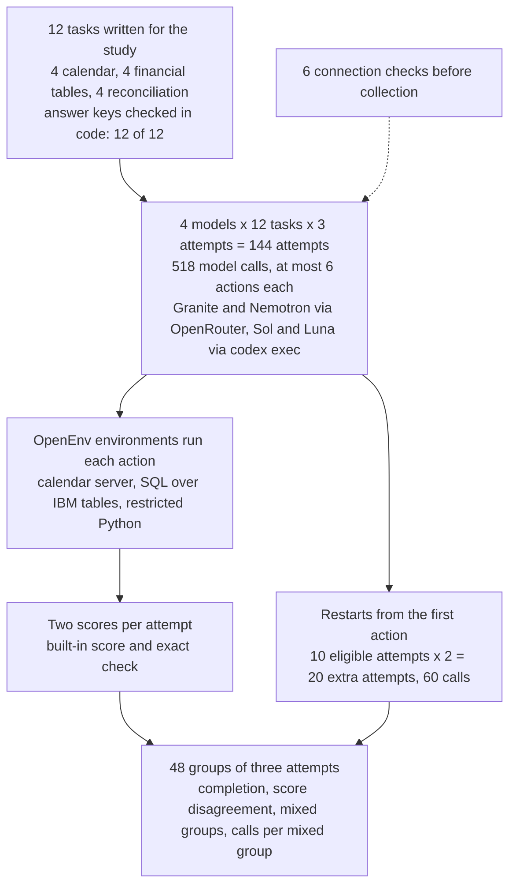
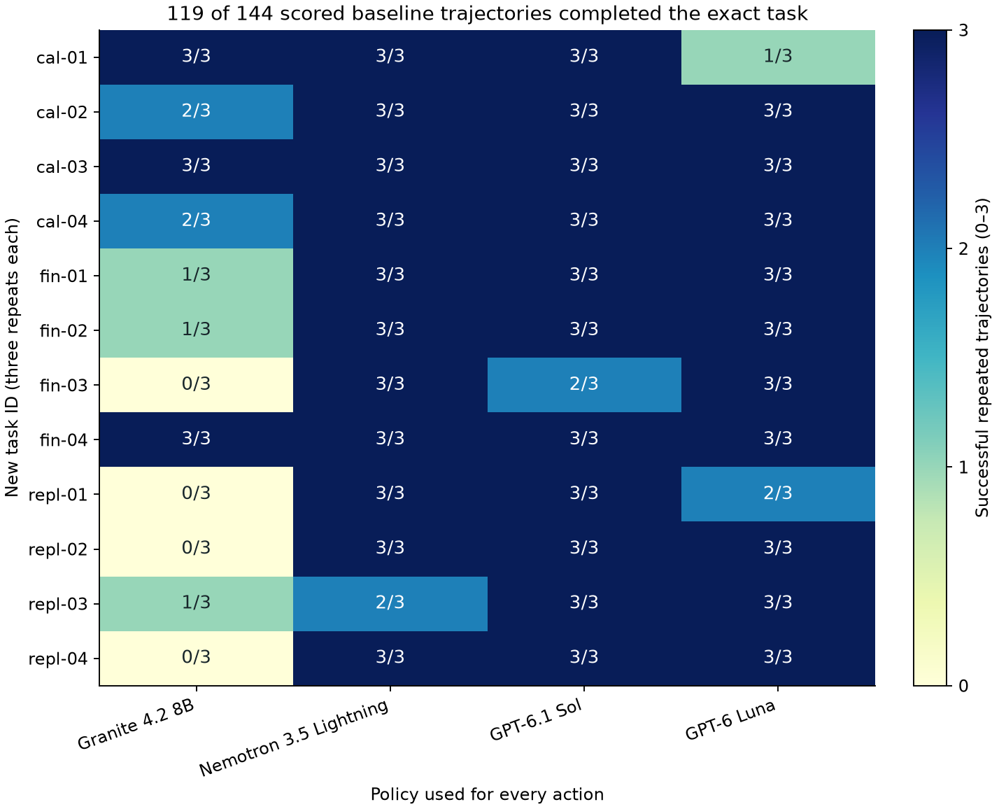
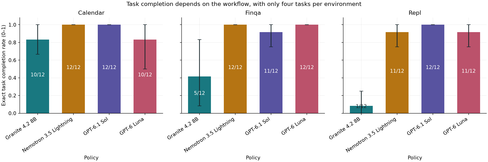
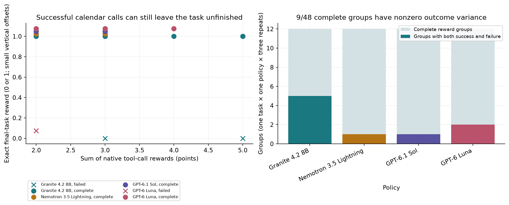
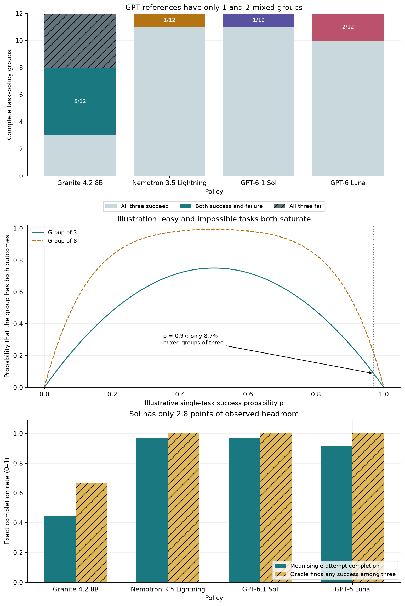
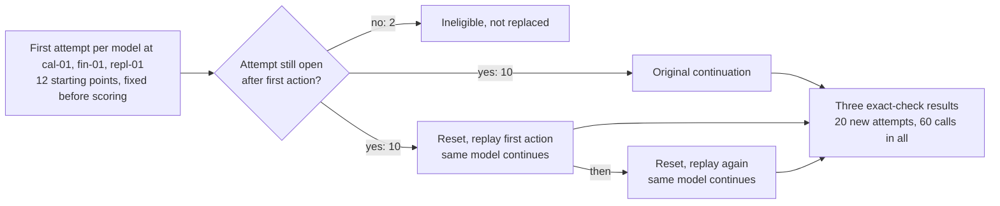
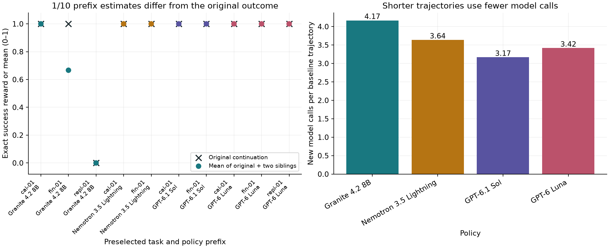
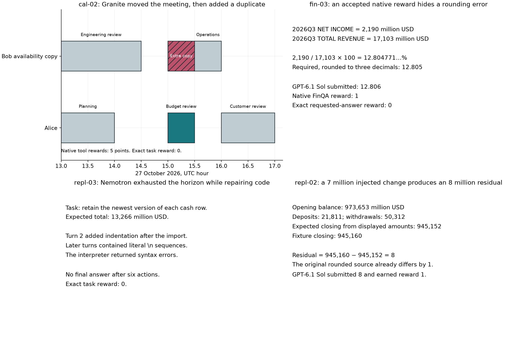
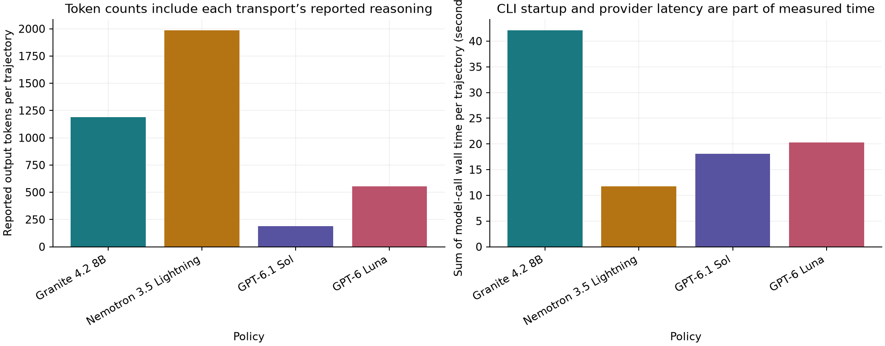

# Collecting scored attempts at office tasks for training

## Teaching a model from its own attempts

A language model connected to tools can do small pieces of office work. Give it a way to read and change a calendar and it can book a meeting. Give it a company's financial tables and it can answer a question about them. It works one step at a time: it chooses an action, sees what the tool returns, and chooses the next action until it decides the job is done.

One way to make such a model better at this work is to let it practise. The model attempts a task, a program checks whether the task was finished, and the attempt is saved with its score. A training method then adjusts the model so that it becomes more likely to act as it did in the attempts that succeeded, and less likely to act as it did in the attempts that failed. The score is called a reward, and training of this kind is called reinforcement learning. In this study the reward is 1 when the job was finished and 0 when it was not. A saved attempt holds the request, every action, every tool reply and the final result. The field calls it a rollout or a trajectory, and the data files call it an episode; this page calls it an attempt.

Collecting attempts costs model calls, and the training that uses them costs much more. So before training, it is worth checking that the collected attempts can teach anything. Two things have to hold. The reward has to say whether the job was really done, because a model trained on a wrong reward learns to earn the reward rather than to do the job. And attempts at the same task have to differ, because the training methods discussed here learn from the difference between attempts. This study collects and scores attempts and measures both conditions. It does not train a model.

### An illustrative example

This example is a simplified version of the first calendar task in the study. Alice and Bob need a 45-minute meeting on 27 October between 14:00 and 17:00. Alice is busy until 14:30, and Bob is busy from 15:30. The only slot that suits both is 14:30 to 15:15. A person arranging it would read both calendars, create the event on Alice's calendar and invite Bob.

The first complication is the score. The calendar software used here gives a point for every action that succeeds: reading a calendar earns a point, and so does creating an event. An assistant that reads both calendars and books the meeting correctly earns 3 points. One that books the meeting and then adds a stray copy to Bob's calendar earns 4, although the calendar is now wrong. Points for successful actions measure activity, not finished work. The check that decides the reward has to look at the calendar afterwards: exactly one new event, at 14:30, with Bob invited, and nothing else changed.

The second complication is the comparison. Suppose the assistant tries the same meeting three times. If two attempts book it correctly and one forgets Bob, the three rewards are 1, 1 and 0, and their average is 2/3. A training method that compares each attempt with that average sees the two successes 1/3 above it and the failure 2/3 below it, so it pushes the model towards inviting Bob. If all three attempts succeed, every reward equals the average and the comparison has nothing to push. The same is true when all three fail. Only a group that holds both a success and a failure, called a **mixed group** on this page, gives this kind of training something to learn from.

This is why a model that already finishes almost everything is an expensive source of training data. As an illustration, suppose each attempt at a task succeeds independently with the same probability. At 50%, a group of three attempts is mixed 75% of the time. At 97%, it is mixed 8.7% of the time, and it takes about 34 attempts on average to collect one mixed group. Researchers are looking for ways around this. [Save Your Saturated Data](https://arxiv.org/abs/2609.33126) (Yang et al., 27 September 2026) starts from the same observation, that groups in which every attempt earns the same reward give these methods nothing to learn, and tests ways to recover a signal from them.

### What this experiment does

Four models attempt the same 12 tasks, three times each. Two are small open-weight models, whose trained files are published so that anyone could train them further: Granite 4.2 8B from IBM and Nemotron 3.5 Lightning from NVIDIA. Two are OpenAI models, GPT-6.1 Sol and GPT-6 Luna, called through OpenAI's command-line tool. They show what the collected data looks like when a model already finishes nearly every task.

The tasks cover three kinds of office work: four changes to a made-up office calendar, four questions about IBM's quarterly results published on 21 October 2026, and four reconciliations of US Treasury daily cash records from 19 to 22 October 2026. Each kind of work runs in an environment, a program that offers the model a fixed set of tools, carries out its actions and reports back. The environments come from OpenEnv, an open-source collection of such environments, and each has its own built-in score. Every attempt is also scored by an exact check written for this study, which inspects the final calendar or compares the submitted number with the correctly rounded answer.

## The question

When four models each make three attempts at 12 new office tasks, how often is the work actually finished, judged by the final calendar or the exact number? How often does each environment's built-in score disagree with that check? And how many of the 48 groups of three attempts are mixed, holding the success-and-failure contrast that comparison-based training needs?

Someone planning to train a model on its own attempts needs these answers to choose which score to use as the reward, and to decide whether paying for more repeats of tasks like these would produce anything to learn from.

## Study summary

Granite 4.2 8B and Nemotron 3.5 Lightning (open-weight, through OpenRouter) and GPT-6.1 Sol and GPT-6 Luna (through `codex exec`) each made three attempts at 12 tasks written for the study on 24 October 2026: 144 attempts and 518 model calls, with at most six actions per attempt.

- 119 of 144 attempts finished the task: Granite 16 of 36, Nemotron 35, Sol 35 and Luna 33. Of the 25 failures, 24 were read and scored wrong. One was a reply the harness could not use: Luna's command-line tool called a tool it had not been offered, so its action, the correct booking, was withheld. On usable attempts Luna finished 33 of 35 and the order does not change. Nemotron, Sol and Luna failed 1 to 3 of 36 attempts each: they are at the ceiling of this test, which cannot rank them.
- The built-in scores accepted unfinished work in two of the three environments. On the calendar, a point per successful action does not separate success from failure: Granite's attempt that moved a meeting and then created a duplicate earned 5 points, as many as its best successes. The financial-table environment accepts answers within about 1% and passed 6 answers that the exact check rejected: five of Granite's slightly wrong divisions and Sol's 12.806 for 12.805. The reconciliation environment's built-in score agreed with the exact check on all 48 attempts.
- Only 9 of the 48 groups were mixed: Granite 5 of 12, Luna 2, Nemotron 1 and Sol 1. Counting every model call, that is 30 calls per mixed group for Granite, against 114 for Sol and 131 for Nemotron. Granite's other groups did not help either: 4 of its 12 failed all three times.

In the original situation: to score a booking, read the calendar afterwards instead of counting successful actions. Repeating these tasks with a model that already finishes them mostly confirmed the success. For Sol and for Nemotron, 11 of 12 groups held no contrast, so more attempts from such models are worth collecting only on harder tasks.

The main caveat is size. The 12 tasks come from one made-up calendar, one IBM release and one Treasury extract, and the four models ran with different access paths and settings. The results show how the scores and the contrast behave on these tasks. They are not a ranking of the models, and since no model was trained, nothing here measures a training gain.

## Contents

1. [The tasks and their correct answers](#1-the-tasks-and-their-correct-answers)
2. [How an attempt runs and how it is scored](#2-how-an-attempt-runs-and-how-it-is-scored)
3. [The models](#3-the-models)
4. [Results: how often the work was finished](#4-results-how-often-the-work-was-finished)
5. [Results: where the built-in score and the exact check disagree](#5-results-where-the-built-in-score-and-the-exact-check-disagree)
6. [Results: how many groups hold a contrast](#6-results-how-many-groups-hold-a-contrast)
7. [Error analysis](#7-error-analysis)
8. [What the evidence supports](#8-what-the-evidence-supports)
9. [Limitations](#9-limitations)
10. [Cost, data and how to run](#10-cost-data-and-how-to-run)
11. [Future work and further reading](#11-future-work-and-further-reading)

## 1. The tasks and their correct answers

Each task is one request with one correct result, fixed before any model ran. The identifiers (`cal-01` and so on) are used in every table, figure and data file.

| ID | What the model is asked to do | Correct result |
|---|---|---|
| cal-01 | Book a 45-minute "Vendor handoff" with Bob at the earliest time both are free on 27 October, 14:00 to 17:00 UTC | One new event, 14:30 to 15:15 UTC, Bob invited |
| cal-02 | Move the existing Budget review to the earliest free 30-minute slot from 15:00 UTC, keeping the same event | Same event, now 15:00 to 15:30 UTC |
| cal-03 | Cancel the Recruiter call on 2 November at 16:00 UTC; another call with the same title on a different day must stay | Event `recruit-02` cancelled |
| cal-04 | Book a 30-minute "London overlap" with Bob at 09:30 New York time on 2 November, which is also 14:30 in London | One new event, 14:30 to 15:00 UTC |
| fin-01 | IBM Software revenue growth, third quarter 2026 against third quarter 2025, in percent to three decimals | 8.254 |
| fin-02 | IBM current ratio (current assets divided by current liabilities) at 30 September 2026, to three decimals | 0.855 |
| fin-03 | IBM net income as a percentage of revenue for the third quarter of 2026, to three decimals | 12.805 |
| fin-04 | Change from 2025 to 2026 year-to-date in a defined "cash after investment" measure, in USD millions | 2563 |
| repl-01 | Total daily deposits minus total daily withdrawals over the four days | 13266 |
| repl-02 | On 21 October, closing balance minus (opening + deposits − withdrawals), with a labelled 7 million error added to the closing balance | 8 |
| repl-03 | The repl-01 total after dropping a labelled, older duplicate of one deposit row | 13266 |
| repl-04 | Sum of withdrawals on the days when deposits were smaller than withdrawals | 50312 |

The calendar holds seven made-up events for two made-up people. Alice owns an availability copy of Bob's calendar, so the model can read both without relying on sharing permissions. The tasks cover create, move, cancel, and create after converting local times.

The financial tables hold 104 numbers extracted from [IBM's third-quarter release of 21 October 2026](https://newsroom.ibm.com/2026-10-21-IBM-RELEASES-THIRD-QUARTER-RESULTS). Quarterly and year-to-date amounts are separate rows, so a model that reads the wrong period gets a different number. Only the numbers and short labels are redistributed, and the environment's own older benchmark is not used.

The reconciliation tasks use 16 records from the [US Treasury's daily cash statement](https://api.fiscaldata.treasury.gov/services/api/fiscal_service/v1/accounting/dts/operating_cash_balance?filter=record_date:gte:2026-10-19,record_date:lte:2026-10-23&page%5Bsize%5D=100) for 19 to 22 October 2026, four rows per day: opening balance, deposits, withdrawals and closing balance. Two tasks add a labelled error to a copy of the records, the way a faulty export might: a closing balance raised by 7 million, and an old duplicate of one deposit row. The saved source file is unchanged.

These tasks are newer than the models. GPT-6.1 Sol's documented training cutoff is 30 April 2026 and GPT-6 Luna's is 18 May 2026. Nemotron 3.5 Lightning's post-training data runs to May 2026. Granite 4.2 8B publishes no cutoff, so its release on 25 August 2026 stands in for one. Every target fact is dated after 31 August 2026: IBM's release on 21 October, the Treasury records from 19 to 22 October, and the questions and made-up calendar, written on 24 October 2026. `data/data_provenance.json` records that no language model wrote the tasks, and `data/model_provenance.json` records the cutoffs and their sources.

The models never see the correct results. The notebook re-derives all 12 independently (a minute-by-minute search for the earliest free slot, a time-zone conversion for cal-04, the arithmetic over the saved rows), and all 12 match.

## 2. How an attempt runs and how it is scored

### One attempt, step by step

Each model call receives the same fixed instruction, the task, the tool list and everything so far in the attempt. The instruction asks for one JSON object per turn naming one tool and its arguments, and ends: "A successful tool call does not by itself mean that the task is complete." The harness runs each action and sends the result back for the next call. An attempt ends when the model says it is done or after six actions.

| Environment (code name) | Tools offered | How the model finishes |
|---|---|---|
| Calendar (`calendar`) | `list_events`, `get_event`, `create_event`, `patch_event`, `delete_event`, plus a `finish` action added by the notebook | Calls `finish` |
| Financial tables (`finqa`) | `get_descriptions`, `get_table_info`, `sql_query`, `submit_answer` | Submits a number |
| Cash reconciliation (`repl`) | `execute` (Python in a restricted interpreter with no file or network access), `submit_answer` | Prints `FINAL(...)` or submits a number |

A reply that is not one JSON object with a tool and its arguments gets a short format message and uses up one of the six actions; this happened to 4 of the 518 replies. A reply from the OpenAI command-line tool that used a tool it was not offered is withheld, not run, and the attempt is scored 0; this happened once. A provider outage would have been recorded as an unknown result rather than a failure; none occurred.

### The two scores

Every attempt gets two scores, and the study compares them.

The **built-in score** is the one each environment ships with (stored as `native_reward` in `data/`). The calendar gives 1 point for every successful call, reads included. The financial-table environment gives 1 when the submitted number is within about 1% (relative) or 0.01 (absolute) of its answer. The reconciliation environment uses a rubric that ranged from −0.30 to 1.00 in this study, positive when the final answer matched.

The **exact check** is written for this study (stored as `verified_reward`). It gives 1 when the requested result holds and 0 otherwise. For a calendar task, the final calendar must hold exactly the requested change: the right event, times, calendar and attendee, both calendars read over the relevant window before any write, and no other event or attendee changed. The check compares times as stored in the calendar database, so a write that says `"timeZone": "UTC"` without the `Z` the task asked for is stored the same way and passes. For a financial or reconciliation task, the submitted number must equal the correctly rounded answer.

From the exact check come the three measures used on this page:

- The **completion rate** is finished attempts divided by attempts. Luna finished 1 of 3 attempts at cal-01 (33%) and 33 of 36 overall (91.7%). Higher is better.
- A **group** is one model's three attempts at one task: 12 per model, 48 in all. It is mixed when it holds at least one success and one failure.
- The number of **calls per mixed group** is a model's total model calls divided by its mixed groups. Sol made 114 calls and had 1 mixed group: 114 calls per mixed group. Lower is cheaper.

### How the experiment runs

One attempt travels through it like this: Nemotron's first attempt at cal-01 starts from the seven saved events, makes four model calls, and is saved with its actions, tool results, both scores and the final calendar.



The calls inside one attempt are chained: each call waits for the result of the previous action. The four models run in separate workers at the same time, each with its own calendar server, and never exchange messages.

```mermaid
flowchart TD
    start["Reset environment<br/>same saved starting state"] --> call["Model call<br/>Granite or Nemotron: OpenRouter, one JSON action<br/>Sol or Luna: codex exec, one JSON action"]
    call --> parse{"Reply usable?"}
    parse -->|"one JSON action"| run["Run the action in the environment<br/>tool result and built-in score"]
    parse -->|"not valid JSON or cut off"| fmt["Format message<br/>uses one of six actions"]
    parse -->|"CLI used an unoffered tool"| stop["Action withheld<br/>attempt scored 0"]
    run -->|"not finished, fewer than 6 actions"| call
    fmt --> call
    run -->|"finish, submit or 6 actions"| check["Exact check<br/>final calendar or exact number"]
    check --> save["Save attempt<br/>messages, actions, results, both scores"]
    stop --> save
```

### Worked example: one attempt from request to scores

Nemotron's first attempt at cal-01 (attempt `0c03290c65fb77851ad3b99b`) receives this task text:

> You act as Alice (alice@example.test). Calendar IDs are cal-alice and cal-bob. cal-bob is Alice's managed availability copy for Bob. Submit event writes in UTC with a Z suffix and timeZone UTC; convert named local times before writing. Do not change unrelated events. Create exactly one 45-minute event titled Vendor handoff on cal-alice, with bob@example.test as an attendee. Choose the earliest slot when both calendars are free on 27 October 2026 between 14:00 and 17:00 UTC. Check availability before writing. Stop when done.

| Turn | Action | What came back | Built-in points |
|---|---|---|---|
| 1 | `list_events` on Alice's calendar, 14:00 to 17:00 | Planning until 14:00, Budget review 14:00 to 14:30, Customer review from 16:00 | 1 |
| 2 | `list_events` on Bob's copy, 14:00 to 17:00 | Engineering review until 14:30, Operations from 15:30 | 1 |
| 3 | `create_event` | Event created | 1 |
| 4 | `finish` | Attempt ends | 0 |

The model's reply at turn 3, as saved:

```json
{"tool":"create_event","arguments":{"calendarId":"cal-alice","start":{"dateTime":"2026-10-27T14:30:00","timeZone":"UTC"},"end":{"dateTime":"2026-10-27T15:15:00","timeZone":"UTC"},"summary":"Vendor handoff","attendees":[{"email":"bob@example.test"}]}}
```

The exact check then reads the calendar database: one new Vendor handoff event on Alice's calendar from 14:30 to 15:15, Bob attached, both calendars read over the window before the write, and the seven original events unchanged. The exact check gives 1; the built-in score is 3. Nemotron's other two attempts at cal-01 also finished, so this group is not mixed: it confirms what the model already does and gives no contrast to learn from.

## 3. The models

| Model | Pinned version | Provider, how called | Size, precision | Settings | Why included |
|---|---|---|---|---|---|
| Granite 4.2 8B | `ibm-granite/granite-4.2-8b-20260831` | DeepInfra through OpenRouter, fallbacks off | 8.79B parameters, dense; BF16 | Temperature 0.7, top-p 0.95, low reasoning effort, 4,096-token output cap | Small dense open-weight model released by IBM on 25 August 2026; the kind of model someone could train on its own attempts |
| Nemotron 3.5 Lightning | `nvidia/nemotron-3.5-lightning-20260807` | DeepInfra through OpenRouter, fallbacks off | 30B in total, 3B active per token (repository name `30B-A3B`); BF16 | Same as Granite | Small open-weight model that NVIDIA released on 11 August 2026 for agent work; a second small model of a different design |
| GPT-6.1 Sol | `gpt-6.1-sol`; dated version not recorded | `codex exec` (codex-cli 0.160.1) | Not published | Medium reasoning effort; no sampling or output-token controls; 180 s per call | Strong closed model; shows what collected data looks like when nearly every attempt succeeds |
| GPT-6 Luna | `gpt-6-luna`; dated version not recorded | `codex exec` (codex-cli 0.160.1) | Not published | Same as Sol | A second OpenAI model, so the pattern is not read from one closed model |

Nemotron is a mixture-of-experts model: it holds about 30 billion parameters but uses about 3 billion of them for each token it writes. At collection OpenRouter charged $0.06 per million input tokens for both open-weight models and $0.25 (Granite) or $0.16 (Nemotron) per million output tokens; their licences are Apache 2.0 and OpenMDW 1.1. Every OpenRouter reply came from DeepInfra, as requested, but OpenRouter does not attest which weight files were served, so the Hugging Face revisions in `data/sources/` describe the model cards that were read.

The command-line tool accepts no sampling settings or output cap and adds its own instructions to every call, which is why Sol and Luna report far more input tokens. Every model sees the same task text, tools and six-action limit, so the study compares four deployed configurations, not models at equal settings. No model judges any attempt: both scores are computed by code.

## 4. Results: how often the work was finished

| Model | Calendar | Financial tables | Reconciliation | All tasks | Read and scored wrong | Unusable reply | Finished, usable attempts only |
|---|---|---|---|---|---|---|---|
| Granite 4.2 8B | 10/12 | 5/12 | 1/12 | 16/36 (44.4%) | 20 | 0 | 16/36 |
| Nemotron 3.5 Lightning | 12/12 | 12/12 | 11/12 | 35/36 (97.2%) | 1 | 0 | 35/36 |
| GPT-6.1 Sol | 12/12 | 11/12 | 12/12 | 35/36 (97.2%) | 1 | 0 | 35/36 |
| GPT-6 Luna | 10/12 | 12/12 | 11/12 | 33/36 (91.7%) | 2 | 1 | 33/35 |

The counts come from `data/episodes.csv` (`verified_reward`, `status`); the unusable reply is Luna's withheld action (`status` = `policy_tool_violation`). Three of the 24 wrong attempts ended with no answer after six actions (Granite twice on fin-02, Nemotron once on repl-03); the rest ended with a wrong calendar or number. Separately, 4 replies inside attempts were unreadable and got a format message; 3 of those 4 attempts still finished.



Each row is a task and each column a model (the axis label "Policy" means the model); a cell shows how many of the three attempts passed the exact check, from pale (0) to dark blue (3). The title pools all four models. Read down a column for one model's failures and across a row for a task's difficulty.

No task was hard for everyone. Every failure by Nemotron, Sol and Luna is isolated: Nemotron missed one attempt at repl-03, Sol one at fin-03, and Luna two at cal-01 and one at repl-01. Granite's failures are concentrated by kind of work: it finished 0 of 3 attempts at fin-03, repl-01, repl-02 and repl-04, and 1 of 3 at fin-01, fin-02 and repl-03, but 10 of 12 calendar attempts. Every model started from identical inputs, but 12 tasks are too few to say which feature of a task causes these differences.



The panels are the three kinds of work ("Finqa" is financial tables, "Repl" cash reconciliation). Each bar is the share of a model's 12 attempts that passed the exact check. The black lines are 95% intervals: the panel's four tasks were resampled 10,000 times, keeping each task's three attempts together, and the line spans the middle 95% of resampled rates. A line that collapses to a point means all four tasks gave the same result, not that the rate on new tasks is certain.

Granite's completion falls from 10 of 12 on the calendar to 5 of 12 on financial tables and 1 of 12 on reconciliation. The other three models stay at 10 of 12 or above in every panel. Taking each task's completion rate and subtracting Sol's on the same task, Granite averages 52.8 points lower (95% interval from resampling the 12 tasks: 30.6 to 72.2 points lower), losing on 9 tasks and tying on 3. Nemotron and Sol differ by 0 points (interval −8.3 to 8.3), with one task each way and 10 ties. These paired differences are in `data/paired_comparisons.csv`.

Nemotron, Sol and Luna sit at the ceiling of this test, separated by 1 to 3 failed attempts on different tasks; one more attempt could change their order. The test shows that Granite finishes these tasks much less often and cannot rank the other three.

## 5. Results: where the built-in score and the exact check disagree

The three environments disagree with the exact check in different ways, so they are taken one at a time.

### Calendar: points count actions, not results



In the left panel each point is one calendar attempt: built-in points across, exact check (0 or 1, slightly offset per model) up. Circles finished and crosses did not; two Luna crosses at 2 points overlap. The right panel counts mixed groups, covered in section 6.

The 44 finished calendar attempts earned between 2 and 5 points, and the 4 unfinished ones earned 2, 2, 3 and 5 (counted from `data/episodes.csv`). No threshold on the points separates them. Granite's attempt that created a duplicate meeting earned 5 points, the same as two of its finished attempts. Luna's attempt that read both calendars and stopped without booking earned 2, the same as the 12 finished cancellations (cal-03), which need one read and one delete. Points grow with the number of successful calls, so a model trained on them would be rewarded for calling more tools, including the extra write that broke cal-02.

### Financial tables: a 1% tolerance passes wrong arithmetic

| Model | Finance attempts | Built-in score accepts | Exact check accepts | Built-in accepts, exact rejects | Mixed groups, built-in score | Mixed groups, exact check |
|---|---|---|---|---|---|---|
| Granite 4.2 8B | 12 | 10 | 5 | 5 | 1 | 2 |
| Nemotron 3.5 Lightning | 12 | 12 | 12 | 0 | 0 | 0 |
| GPT-6.1 Sol | 12 | 12 | 11 | 1 | 0 | 1 |
| GPT-6 Luna | 12 | 12 | 12 | 0 | 0 | 0 |

The built-in score accepted 6 of the 48 finance answers that the exact check rejected, and never rejected an answer the exact check accepted. All six read the correct source rows and then divided wrongly (from the `sql_query` results saved in `data/episodes/`). Granite submitted 8.266 and 8.264 for 8.254, and 12.835, 12.833 and 12.830 for 12.805; Sol submitted 12.806 for 12.805. Each is within 1% of the answer, so the built-in score gives 1. Each misses the three decimals the question asked for, so the exact check gives 0.

The disagreement changes what a training run would see. Under the built-in score, Sol's three attempts at fin-03 all score 1, so its only mixed finance group disappears, and Granite's two mixed finance groups become one. Whether 12.806 counts as finished depends on the use: close enough for a rough comparison, wrong for a figure in a report. The study uses the precision the question states; the saved answers can be re-scored under any tolerance without new calls.

### Cash reconciliation: the built-in score agreed

The reconciliation rubric gave 0.90 to 1.00 to all 35 finished attempts and −0.30 to 0 to all 13 unfinished ones (from `data/episodes.csv`), so its sign matched the exact check every time.

The kind of error matters. [Checking the Checkers](https://arxiv.org/abs/2610.17824) (Gupta and Joshi, 13 October 2026) reviews 58 studies and finds that random checker errors mostly slow learning, while false passes a model can learn to trigger can stall or derail it; [An Imperfect Verifier is Good Enough](https://arxiv.org/abs/2604.07666v2) (Plesner et al., revised 27 September 2026) finds that one code-generation setup tolerated up to 20% noise. The calendar and finance disagreements here are false passes that always favour the same outputs: more calls, and answers that are nearly right.

## 6. Results: how many groups hold a contrast

| Model | All three succeed | Mixed | All three fail | Model calls | Calls per mixed group | Any of three succeeds |
|---|---|---|---|---|---|---|
| Granite 4.2 8B | 3 | 5 | 4 | 150 | 30 | 8/12 tasks |
| Nemotron 3.5 Lightning | 11 | 1 | 0 | 131 | 131 | 12/12 |
| GPT-6.1 Sol | 11 | 1 | 0 | 114 | 114 | 12/12 |
| GPT-6 Luna | 10 | 2 | 0 | 123 | 61.5 | 12/12 |



The top panel is measured: each bar is one model's 12 groups, split into all three succeed (light grey), mixed (coloured, with the count) and all three fail (dark, hatched). The middle panel is an illustration, not a measurement: the chance that a group of 3 (solid) or 8 (dashed) attempts is mixed if every attempt succeeds independently with probability p, which for three attempts is 1 − p³ − (1 − p)³. At the marked p = 0.97 it is 8.7%. Real tasks differ in difficulty, so no model's data is fitted to the curve. The bottom panel compares each model's completion rate (solid) with the share of its tasks on which at least one of three attempts succeeded (hatched, labelled "Oracle"). Picking that attempt needs the exact check, so the hatched bar is an upper bound, not something a deployed system could do alone.

Only 9 of 48 groups are mixed. They are Granite's cal-02, cal-04, fin-01, fin-02 and repl-03; Luna's cal-01 and repl-01; Nemotron's repl-03; and Sol's fin-03 (from `data/groups.csv`). Sol and Nemotron finished 35 of 36 attempts and had 1 mixed group in 12, in line with the illustration's 8.7% at a 97% success rate, though 12 groups cannot test it.

The cost follows: 114 model calls per mixed group for Sol and 131 for Nemotron, against 30 for Granite, which fails often enough for its attempts to differ. Granite also shows the other end of the curve. Its 4 all-failure groups (fin-03, repl-01, repl-02 and repl-04) give no contrast either: a task the model always fails teaches as little, by comparison, as one it always passes.

The bottom panel shows how little room the reliable models leave: picking the best of three would lift Sol from 97.2% to 100% at three times the attempts, and Granite from 44.4% to 66.7%. What Sol and Nemotron lack is not a correct answer somewhere in the group, but tasks they sometimes fail.

### Restarting from the first action

A single attempt is one sample of what a model might do from a given point. [Double-rollout reinforcement learning](https://arxiv.org/abs/2610.16593) (Qian et al., 12 October 2026) cuts an attempt short and replaces its reward with the average over several continuations from that point. This study adapts the idea to tool use without testing the paper's training claims: keep an attempt's first action, restore the environment to the state just after it, and let the same model continue twice more, giving three outcomes from one starting point.

The starting points were fixed before scoring: the first attempt by each model at the first task of each kind (cal-01, fin-01 and repl-01), 12 in all. Two were ineligible because their first action already ended the attempt (Nemotron's and Sol's repl-01), and they were not replaced. The remaining 10 each received two continuations: 20 extra attempts and 60 model calls. Before each continuation the environment was reset and the first action replayed, and its result had to match the original apart from the read time and version tags the calendar stamps on every reply.





In the left panel each column is one starting point. The cross is the original attempt's exact-check result and the dot the average of all three outcomes; a dot away from its cross means the continuations disagreed. The right panel is unrelated: average model calls per main attempt (Granite 4.17, Nemotron 3.64, Sol 3.17, Luna 3.42).

Nine of the 10 starting points gave the same result three times: eight finished every time and Granite's repl-01 failed every time. One changed. Granite's original fin-01 attempt (`02eaa745c8cb2871e52ffcee`) submitted 8.254 and finished. Its two continuations submitted 8.254 (`371bc4b46294503013fa45f7`, finished) and 8.249 (`c85b6a4d170687d83ad66749`, not finished), so the estimate from that point is 2 of 3. The extra 60 calls found one new disagreement, and it came from the model that already disagreed with itself most often.

## 7. Error analysis

The examples below cover every kind of failure among the 25, plus typical successes. Each is identified by its attempt ID in `data/episodes/`.

### An extra write after a correct move

Granite's first attempt at cal-02 (`f9abd9044a9957305a6dea44`) read both calendars and moved the Budget review to 15:00 to 15:30, which is correct. It then searched Bob's calendar for a Budget review, found none, and created one there. The task asked for the existing event to be moved and nothing else changed, so the exact check gives 0. Each of its five calls succeeded, so the built-in score is 5.



The top-left panel draws this attempt's final calendar: grey bars are existing events, the teal bar the moved Budget review and the hatched red bar the duplicate on Bob's copy. The other three panels are text versions of the fin-03, repl-03 and repl-02 cases described below.

### A booking of the wrong length

Granite's second attempt at cal-04 (`4365d97a76c7408a2322adae`) converted the times correctly and booked "London overlap" at 14:30 UTC with Bob, but from 14:30 to 15:30 instead of the requested 30 minutes. The exact check gives 0 and the built-in score 3, the same as a correct booking.

### Correct rows, wrong division

Granite's first attempt at fin-03 (`92c2277c8bbed7c0421b6f76`) queried net income and revenue for the third quarter of 2026 and received 2,190 and 17,103 (USD millions). The answer is 2,190 / 17,103 × 100 = 12.8048, or 12.805; Granite submitted 12.835, and its other two attempts, given the same numbers, 12.833 and 12.830. The environment offers no calculator, so the model divides in its own text, and Granite was off in the second decimal every time. The built-in score accepted all three.

Sol's first attempt at the same task (`c8b260790389d84a0cdf0b50`) received the same numbers and submitted 12.806: one unit off in the third decimal, accepted by the built-in score, and Sol's only failure in 36 attempts. This is the case where the built-in score misleads most.

### A typical success with the source rows visible

Nemotron's first attempt at fin-01 (`245d69ebfb2b5026b0b182b5`) listed the tables, read the income table's description, and queried Software revenue for both third quarters in one query: 7,804 for 2026 and 7,209 for 2025. (7,804 / 7,209 − 1) × 100 = 8.2536, which rounds to 8.254, and it submitted 8.254. Choosing the quarterly rows mattered: the table also holds year-to-date rows for the same metric, which answer a different question. Four actions; both scores 1.

### Out of actions while looking for a period label

Granite's first and third attempts at fin-02 (`b3d27f1c5e90476fa000d521`, `6ea28639b30161612fc1fc8f`) filtered the balance sheet on period `'Q3'`. Its periods are dates (`2026-09-30` and `2025-12-31`), so the queries returned nothing, an unfiltered query was refused, and the six actions ran out without an answer. The study made this case harder than it needed to be: the table description written for it says "Q3 and YTD are distinct periods", which fits the income table but not the balance sheet, and the schema tool lists the balance sheet's metrics but not its periods. Every other attempt at fin-02 found the right rows.

### Code the interpreter would not run

Nemotron's first attempt at repl-03 (`0e0e3e041be96c953b56337a`) wrote correct logic for the task (keep the highest version of each row, then total deposits minus withdrawals), but the interpreter rejected it. The second action had an indented line straight after `import json`, the next two sent literal `\n` characters in place of line breaks, and the fifth used a method the restricted interpreter does not allow. The sixth reached the limit with no answer. Its other two attempts finished, which makes this Nemotron's one mixed group, and its contrast is about writing code that runs, not about understanding the task.

### Replacing the input with a made-up copy

Granite's first attempt at repl-01 (`93606e8f18efef2504e8bbce`) started with the full records loaded in the variable `context` and a 400-character preview in view. Its first action overwrote `context` with a short, partly invented string commented "placeholder", and it later submitted 32776, the first deposit in the preview, instead of 13,266. This was a habit. Granite's code assigned a typed-in string to `context` in 7 of its 12 reconciliation attempts, and 6 of those 7 failed; in the one that finished, that first piece of code had a syntax error and never ran (counted from the `execute` actions in `data/episodes/`). Its 11 reconciliation failures submitted 0 four times, 32,776 twice, −32,776 once, 1,270,600 twice and 284,812 twice. The last is the withdrawals for 22 October, a day on which deposits were larger.

### Luna's three failures

Luna failed three attempts, each for a different reason:

- `5628254f8ea3a305782fabba` (cal-01) read both calendars over the right window and then called `finish` without booking anything. Exact check 0, built-in score 2.
- `5a5e23dbfcf39b266e3b2738` (cal-01) read both calendars; at its third turn the command-line tool logged a call to an internal `wait` tool the study had not offered, so the harness withheld the reply and scored the attempt 0. The withheld action was `create_event` on Alice's calendar from 14:30 to 15:15 UTC with Bob invited, exactly the requested booking. This is the study's one unusable reply.
- `a77cd196f340783e6fff82eb` (repl-01) wrote a short program that added the deposit and withdrawal rows together instead of subtracting, and submitted 1,342,734 instead of 13,266.

Two of the three are on cal-01, which gives Luna's mixed cal-01 group. One of its two failures there is a fault of the interface rather than of the booking, so the contrast in that group would teach the wrong lesson about calendars.

### A success that depends on the source's rounding

Sol's first attempt at repl-02 (`2017a9f5242efa8f256a35ad`) printed the four rows for 21 October and computed the residual in its second action. Opening 973,653 plus deposits 21,811 minus withdrawals 50,312 (USD millions) gives 945,152. The published closing balance was 945,153, already 1 higher because each figure is rounded, and the labelled error adds 7, giving 945,160. The residual is therefore 8, not the 7 that was injected, and Sol submitted 8. The answer key is computed from the figures as they appear, not from the size of the injected error.

### What these examples cannot show

The examples show what each model wrote and what the tools returned. They do not show why a model made a choice. Granite's duplicate meeting earned it more points, but nothing in the attempt suggests it was seeking points; the record shows only that the built-in score would have rewarded it.

## 8. What the evidence supports

- Use a check of the final result as the reward, not the environment's activity points. On the calendar, points could not tell a finished booking from a broken one, and a model trained on them would be paid for extra calls.
- Set the numeric tolerance from the question. The financial-table environment's 1% tolerance passed six wrong divisions in 48 answers and erased Sol's only mixed finance group. If a task asks for three decimals, check three decimals.
- Do not spend more on repeats of tasks a model already finishes. For Sol and Nemotron, 11 of 12 groups held no contrast and each mixed group cost over 100 calls. Tasks near the edge of what the model can do should give more contrast per call; Granite's 4 all-failure groups show that tasks can also be too hard.
- Read the unusable replies before training on them. Luna's withheld booking would have entered a training set as a failed booking, teaching the wrong lesson about calendars.

The uncertainty that most needs another experiment is whether tasks chosen to sit near each model's failure point would give the reliable models enough mixed groups at a reasonable cost, and whether training on them improves the model on new tasks.

## 9. Limitations

- Twelve tasks. Four tasks per kind of work cannot estimate a model's completion rate on office work in general, and the intervals above describe these tasks only. The finance questions share one IBM release and the reconciliation questions one Treasury extract.
- Small, made-up calendar. The calendar is a copy of a calendar service running on a local database, with seven events, a reduced tool set and no real permissions, recurring meetings or other users.
- Different access paths. The open-weight models and the OpenAI models ran with different settings and instructions (section 3). The calendar's own availability query returned errors in this local build, so availability was read through event lists.
- Strict precision is a choice. The exact check rejects answers one unit off in the third decimal because the questions ask for three decimals. A looser tolerance would raise Granite's and Sol's finance counts without new model calls.
- Restarts are a small sample. Ten starting points with three outcomes each show how the method works and what it costs. They cannot show whether such estimates are accurate or useful in training.
- No training and no saved analysis plan. No model was trained, so nothing here measures a training gain. The tasks, answer keys and restart points were fixed before scoring, but the analysis of reliable models in section 6 was added after the completion results were seen. Run history, settings and corrections are in [data/PROTOCOL.md](data/PROTOCOL.md).

## 10. Cost, data and how to run

The collection made 584 model calls on 24 October 2026: 518 for the 144 main attempts, 60 for the 20 restarted attempts and 6 connection checks. The 316 OpenRouter calls reported $0.0581 in total; the 268 Sol and Luna calls ran on a subscription that reports no dollar cost.

| Model | Model calls | Input tokens reported | Output tokens reported | Model-call seconds per attempt | Reported cost |
|---|---|---|---|---|---|
| Granite 4.2 8B | 150 | 380,190 | 42,839 | 42.1 | $0.0218 |
| Nemotron 3.5 Lightning | 131 | 293,902 | 71,536 | 11.7 | $0.0291 |
| GPT-6.1 Sol | 114 | 1,561,893 | 6,820 | 18.1 | not reported |
| GPT-6 Luna | 123 | 2,755,809 | 19,943 | 20.3 | not reported |



The left panel shows reported output tokens per attempt (Granite 1,190, Nemotron 1,987, Sol 189, Luna 554) and the right panel model-call seconds per attempt; its axis label is cut off. Providers count tokens differently, and the times include queueing and the command-line tool's start-up, so neither panel ranks efficiency fairly. Nemotron wrote the most tokens and took the least time.

| File in `data/` | What it holds |
|---|---|
| `tasks.json`, `calendar_seed.sql`, `finqa/`, `sources/` | The 12 tasks and answer keys, the made-up calendar, the IBM tables, the Treasury snapshot and provenance |
| `cache/`, `episodes/` | Every model request and raw reply (584 files); every attempt with its actions, tool results, both scores and final state (164 files) |
| `episodes.csv`, `steps.csv`, `groups.csv`, `verifier_agreement.csv`, `frontier_diagnostics.csv`, `prefix_comparison.csv` | The tables behind sections 4 to 6 |
| `openweight_rewarded_trajectories.jsonl` | Granite's and Nemotron's 72 main attempts in a training-style export |
| `PROTOCOL.md` | Run history, settings and corrections |

The export is not a ready training batch: training also needs the exact weights, tokenizer and token-level probabilities behind each reply, which a hosted service does not provide, so those fields are empty and each record says `exact_on_policy_ready: false`.

Running the notebook replays everything from these files with no model calls or public network requests:

```bash
python -m pip install -r requirements-replay.txt
jupyter nbconvert --to notebook --execute --inplace 25_knowledge_work_rollouts.ipynb
```

A new collection needs `NB25_LIVE=1`, the pinned OpenEnv source, an `OPENROUTER_API_KEY` and a signed-in `codex` tool, in a new folder; [data/PROTOCOL.md](data/PROTOCOL.md) lists the steps. The full analysis is in [25_knowledge_work_rollouts.ipynb](25_knowledge_work_rollouts.ipynb).

## 11. Future work and further reading

### Future work

- Write 50 or more tasks per kind of work from several companies and weeks of records, and measure completion and mixed groups per model. The present results rest on 12 tasks and two public sources.
- Add tasks near each model's failure point, such as longer reconciliations or calendars with more conflicts, and measure mixed groups per call for Sol and Nemotron, which had 1 mixed group in 12 at over 100 calls each.
- Repeat the finance tasks with a calculator tool and measure how many failures disappear. All six score disagreements here were wrong divisions of correct numbers.
- Compare fixed collection with a method that decides where to spend more attempts, at the same call budget, and count mixed groups. Only 9 of 48 fixed groups were mixed.
- Collect from self-hosted, pinned weights that record token-level probabilities, train briefly on the mixed groups and measure completion on new tasks. The hosted export cannot support training.

### Further reading

Links in this section and in the text above were opened on 24 October 2026 and again on 28 October 2026.

- [Back to Basics: Revisiting REINFORCE Style Optimization for Learning from Human Feedback in LLMs](https://arxiv.org/abs/2402.14740) (Ahmadian et al., 2024). Revisits simple REINFORCE-style training for language models, including the leave-one-out comparison of each attempt with its siblings that the notebook also computes.
- [ToolSandbox: A Stateful, Conversational, Interactive Evaluation Benchmark for LLM Tool Use Capabilities](https://arxiv.org/abs/2408.04682) (Lu et al., 2024; revised 2025). Scores tool-using models against milestones in the state of their tools, as the exact check here reads the final calendar.
- [Learning as Reasoning Unfolds: Progressive Rollout Allocation for Efficient Reinforcement Learning](https://arxiv.org/abs/2607.22002) (Jiang et al., 2026). Proposes VIGOR, which shifts attempts towards tasks still producing mixed results.
- [Early Verdicts, Better Budgets: Sequential Adaptive Rollout Allocation for Compute-Efficient RLVR](https://arxiv.org/abs/2607.26253) (Nomand et al., 2026). Proposes SARA, which stops collecting on tasks whose outcome is already clear; a candidate for the fixed-budget comparison above.
- [Where Groups Split: A Probe Prior for Nonzero Within-Group Variance in RL Post-Training](https://arxiv.org/abs/2610.25325) (Ellison et al., 2026). Estimates which tasks will give mixed groups and weights collection towards them.
- [Checking the Checkers: A Synthesis of Verifier Noise and Robustness in RLVR](https://arxiv.org/abs/2610.17824) (Gupta and Joshi, 2026). Reviews why false passes a model can learn to trigger, like the calendar points and the finance tolerance here, do more harm than random checker errors.
